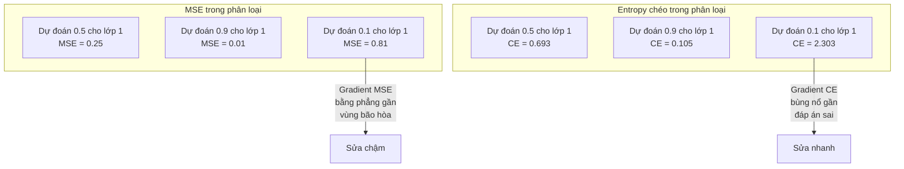
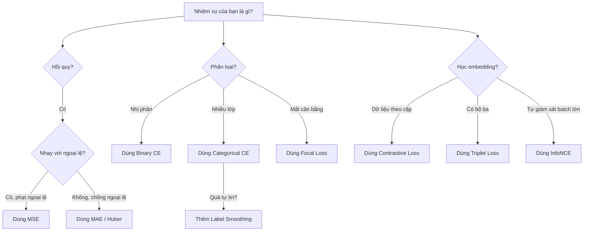
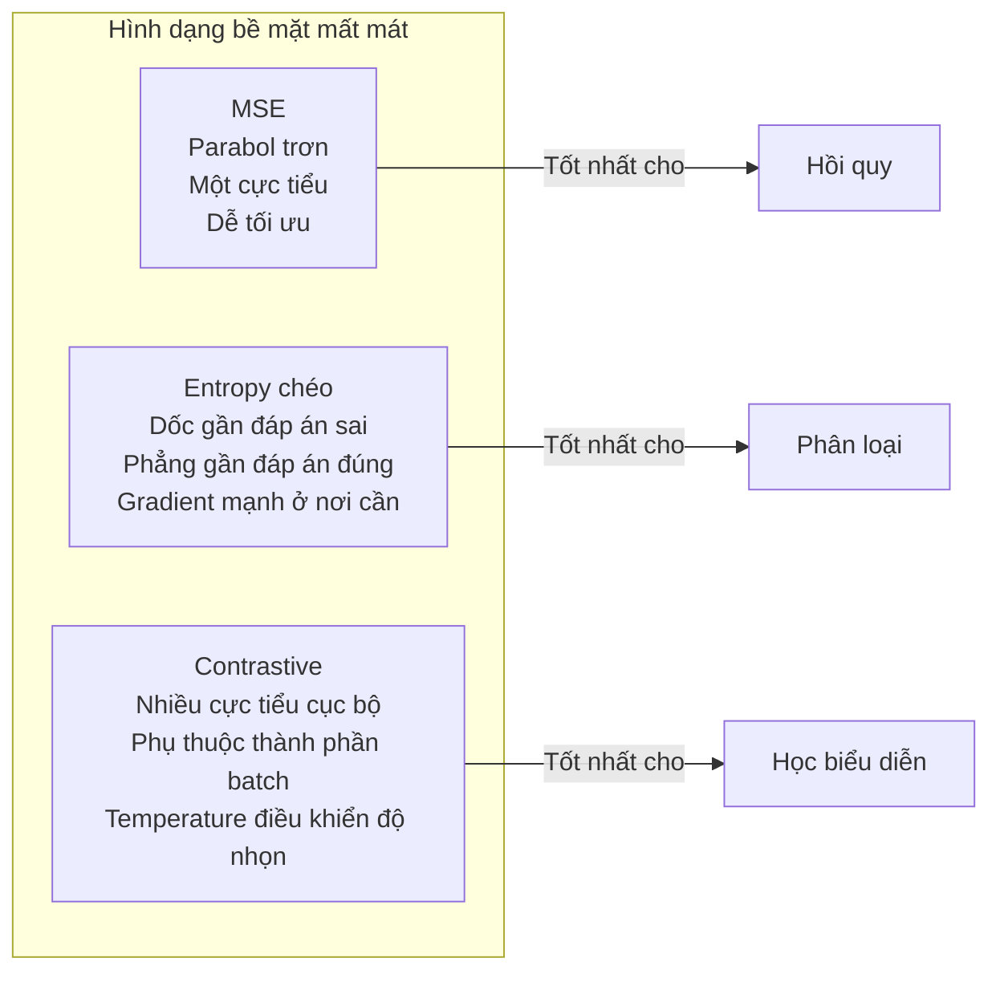

# Hàm mất mát (Loss Functions)

> Mạng của bạn đưa ra một dự đoán. Nhãn thực tế nói khác. Nó sai bao nhiêu? Con số đó chính là hàm mất mát (loss function). Chọn sai hàm mất mát và mô hình của bạn sẽ tối ưu cho một thứ hoàn toàn khác.

**Type:** Build
**Languages:** Python
**Prerequisites:** Bài 03.04 (Hàm kích hoạt)
**Time:** ~75 phút

## Mục tiêu học tập

- Tự cài đặt MSE (sai số bình phương trung bình), binary cross-entropy, categorical cross-entropy và contrastive loss (InfoNCE) cùng gradient của chúng
- Giải thích tại sao MSE thất bại với phân loại bằng cách chỉ ra chế độ hỏng "dự đoán 0.5 cho mọi thứ"
- Áp dụng làm trơn nhãn (label smoothing) cho entropy chéo và mô tả cách nó ngăn những dự đoán quá tự tin
- Chọn đúng hàm mất mát cho hồi quy, phân loại nhị phân, phân loại nhiều lớp và học embedding

## Vấn đề

Một mô hình tối thiểu hóa MSE trên bài toán phân loại sẽ tự tin dự đoán 0.5 cho mọi thứ. Nó đang tối thiểu hóa mất mát. Và nó cũng vô dụng.

Hàm mất mát là thứ duy nhất mà mô hình của bạn thật sự tối ưu. Không phải độ chính xác. Không phải F1 score. Không phải bất kỳ chỉ số nào bạn báo cáo cho sếp. Optimizer lấy gradient của hàm mất mát rồi chỉnh trọng số để con số đó nhỏ hơn. Nếu hàm mất mát không nắm được điều bạn quan tâm, mô hình sẽ tìm ra cách rẻ nhất về mặt toán học để thỏa mãn nó, và cách đó gần như không bao giờ là điều bạn muốn.

Đây là một ví dụ cụ thể. Bạn có bài toán phân loại nhị phân. Hai lớp, tỉ lệ 50/50. Bạn dùng MSE làm mất mát. Mô hình dự đoán 0.5 cho mọi đầu vào. MSE trung bình là 0.25, đúng bằng mức tối thiểu có thể đạt mà không thực sự học được gì. Mô hình không có khả năng phân biệt nào nhưng về mặt kỹ thuật là đã tối thiểu hóa hàm mất mát của bạn. Chuyển sang entropy chéo và chính mô hình đó buộc phải đẩy dự đoán về phía 0 hoặc 1, vì -log(0.5) = 0.693 là một mất mát rất tệ, trong khi -log(0.99) = 0.01 thưởng cho những dự đoán đúng và tự tin. Việc chọn hàm mất mát chính là khác biệt giữa một mô hình học được và một mô hình lách chỉ số.

Tệ hơn nữa. Trong học tự giám sát, bạn thậm chí không có nhãn. Contrastive loss định nghĩa toàn bộ tín hiệu học: cái gì tính là giống nhau, cái gì tính là khác nhau, và mô hình nên đẩy chúng ra xa đến mức nào. Chọn sai contrastive loss và embedding của bạn sụp về một điểm -- mọi đầu vào ánh xạ tới cùng một vector. Về mặt kỹ thuật là mất mát bằng không. Hoàn toàn vô giá trị.

## Khái niệm

### Sai số bình phương trung bình (MSE)

Mặc định cho hồi quy. Tính bình phương hiệu giữa dự đoán và nhãn, rồi lấy trung bình trên toàn bộ mẫu.

```
MSE = (1/n) * sum((y_pred - y_true)^2)
```

Vì sao bình phương lại quan trọng: nó phạt sai số lớn theo bậc hai. Một sai số 2 tốn gấp 4 lần sai số 1. Sai số 10 tốn gấp 100 lần. Điều này làm MSE nhạy với ngoại lệ -- chỉ một dự đoán sai lệch thảm hại đã áp đảo toàn bộ mất mát.

Số liệu thực: nếu mô hình của bạn dự đoán giá nhà và lệch $10,000 ở phần lớn ngôi nhà nhưng lệch $200,000 ở một căn biệt thự, MSE sẽ cố sửa căn biệt thự đó một cách quyết liệt, có thể làm giảm hiệu năng trên 99 ngôi nhà còn lại.

Gradient của MSE theo một dự đoán là:

```
dMSE/dy_pred = (2/n) * (y_pred - y_true)
```

Tuyến tính theo sai số. Sai số lớn hơn nhận gradient lớn hơn. Đây là điểm tốt cho hồi quy (sai lớn cần chỉnh lớn) và là lỗi cho phân loại (bạn muốn phạt những câu trả lời sai mà tự tin theo cấp số nhân, không phải tuyến tính).

### Mất mát entropy chéo (Cross-Entropy Loss)

Hàm mất mát cho phân loại. Bắt nguồn từ lý thuyết thông tin -- nó đo độ lệch giữa phân phối xác suất dự đoán và phân phối thật.

**Entropy chéo nhị phân (Binary Cross-Entropy, BCE):**

```
BCE = -(y * log(p) + (1 - y) * log(1 - p))
```

Trong đó y là nhãn thật (0 hoặc 1) và p là xác suất dự đoán.

Vì sao -log(p) hiệu quả: khi nhãn thật là 1 và bạn dự đoán p = 0.99, mất mát là -log(0.99) = 0.01. Khi bạn dự đoán p = 0.01, mất mát là -log(0.01) = 4.6. Chênh lệch 460 lần đó là lý do entropy chéo hiệu quả. Nó trừng phạt tàn nhẫn những dự đoán tự tin nhưng sai, trong khi gần như không phạt những dự đoán tự tin và đúng.

Gradient kể cùng một câu chuyện:

```
dBCE/dp = -(y/p) + (1-y)/(1-p)
```

Khi y = 1 và p gần 0, gradient là -1/p, tiến tới âm vô cực. Mô hình nhận được tín hiệu cực lớn để sửa sai. Khi p gần 1, gradient rất nhỏ. Đã đúng rồi, không có gì phải sửa.

**Entropy chéo phân loại (Categorical Cross-Entropy):**

Dùng cho phân loại nhiều lớp với nhãn one-hot.

```
CCE = -sum(y_i * log(p_i))
```

Chỉ lớp đúng đóng góp vào mất mát (vì mọi y_i khác đều bằng 0). Nếu có 10 lớp và lớp đúng được xác suất 0.1 (đoán ngẫu nhiên), mất mát là -log(0.1) = 2.3. Nếu lớp đúng được xác suất 0.9, mất mát là -log(0.9) = 0.105. Mô hình học cách dồn khối lượng xác suất vào đáp án đúng.

### Tại sao MSE thất bại với phân loại



Gradient của MSE trở nên bằng phẳng khi dự đoán gần 0 hoặc 1 (do sigmoid bão hòa). Gradient của entropy chéo bù lại điều này -- hàm -log triệt tiêu những vùng phẳng của sigmoid, tạo gradient mạnh đúng ở nơi cần nhất.

### Làm trơn nhãn (Label Smoothing)

Nhãn one-hot chuẩn nói rằng "đây là 100% lớp 3 và 0% mọi thứ khác." Đó là một khẳng định mạnh. Làm trơn nhãn giảm nhẹ nó:

```
smooth_label = (1 - alpha) * one_hot + alpha / num_classes
```

Với alpha = 0.1 và 10 lớp: thay vì [0, 0, 1, 0, ...], nhãn trở thành [0.01, 0.01, 0.91, 0.01, ...]. Mô hình nhắm tới 0.91 thay vì 1.0.

Vì sao cách này hiệu quả: một mô hình muốn xuất ra đúng 1.0 qua softmax phải đẩy logits tới vô cực. Điều đó gây quá tự tin, hại khả năng tổng quát hóa, và làm mô hình dễ vỡ khi phân phối dữ liệu thay đổi. Làm trơn nhãn chặn nhãn ở 0.9 (với alpha=0.1), giữ logits trong vùng hợp lý. GPT và hầu hết mô hình hiện đại dùng làm trơn nhãn hoặc tương đương.

### Mất mát contrastive (Contrastive Loss)

Không nhãn. Không lớp. Chỉ những cặp đầu vào và câu hỏi: hai cái này giống hay khác nhau?

**Contrastive loss kiểu SimCLR (NT-Xent / InfoNCE):**

Lấy một ảnh. Tạo hai phiên bản tăng cường của nó (cắt, xoay, đổi màu). Đây là "cặp dương" -- chúng nên có embedding giống nhau. Mọi ảnh khác trong batch tạo thành "cặp âm" -- chúng nên có embedding khác nhau.

```
L = -log(exp(sim(z_i, z_j) / tau) / sum(exp(sim(z_i, z_k) / tau)))
```

Trong đó sim() là độ tương đồng cosine, z_i và z_j là cặp dương, tổng lấy trên mọi cặp âm, và tau (temperature) điều khiển độ nhọn của phân phối. Temperature thấp hơn = cặp âm khó hơn = tách biệt mạnh hơn.

Số liệu thực: batch size 256 nghĩa là 255 cặp âm cho mỗi cặp dương. Temperature tau = 0.07 (mặc định của SimCLR). Mất mát trông như một softmax trên các độ tương đồng -- nó muốn độ tương đồng của cặp dương cao nhất trong cả 256 lựa chọn.

**Triplet Loss:**

Nhận ba đầu vào: anchor (mốc), positive (cùng lớp), negative (khác lớp).

```
L = max(0, d(anchor, positive) - d(anchor, negative) + margin)
```

Margin (thường 0.2-1.0) buộc một khoảng cách tối thiểu giữa khoảng cách tới mẫu dương và mẫu âm. Nếu mẫu âm đã đủ xa, mất mát bằng 0 -- không gradient, không cập nhật. Điều này giúp huấn luyện hiệu quả nhưng đòi hỏi chọn bộ ba cẩn thận (chọn những mẫu âm khó, gần mốc).

### Focal Loss

Dùng cho bộ dữ liệu mất cân bằng lớp (class imbalance). Entropy chéo chuẩn đối xử như nhau với mọi ví dụ đã được phân loại đúng. Focal loss giảm trọng số các ví dụ dễ:

```
FL = -alpha * (1 - p_t)^gamma * log(p_t)
```

Trong đó p_t là xác suất dự đoán của lớp đúng và gamma điều khiển mức tập trung. Với gamma = 0, đây là entropy chéo chuẩn. Với gamma = 2 (mặc định):

- Ví dụ dễ (p_t = 0.9): trọng số = (0.1)^2 = 0.01. Gần như bị bỏ qua.
- Ví dụ khó (p_t = 0.1): trọng số = (0.9)^2 = 0.81. Nhận toàn bộ tín hiệu gradient.

Focal loss được Lin et al. giới thiệu cho phát hiện đối tượng, nơi 99% vùng ứng viên là nền (cặp âm dễ). Không có focal loss, mô hình chìm trong các ví dụ nền dễ và không bao giờ học được cách phát hiện đối tượng. Có nó, mô hình tập trung năng lực vào những ca khó, mơ hồ nhưng quan trọng.

### Cây quyết định chọn hàm mất mát



### Bề mặt mất mát



```figure
cross-entropy-loss
```

## Tự tay làm

### Bước 1: MSE và gradient của nó

```python
def mse(predictions, targets):
    n = len(predictions)
    total = 0.0
    for p, t in zip(predictions, targets):
        total += (p - t) ** 2
    return total / n

def mse_gradient(predictions, targets):
    n = len(predictions)
    grads = []
    for p, t in zip(predictions, targets):
        grads.append(2.0 * (p - t) / n)
    return grads
```

### Bước 2: Entropy chéo nhị phân

Vấn đề log(0) là có thật. Nếu mô hình dự đoán đúng 0 cho một ví dụ dương, log(0) = âm vô cực. Cắt biên (clipping) ngăn điều này.

```python
import math

def binary_cross_entropy(predictions, targets, eps=1e-15):
    n = len(predictions)
    total = 0.0
    for p, t in zip(predictions, targets):
        p_clipped = max(eps, min(1 - eps, p))
        total += -(t * math.log(p_clipped) + (1 - t) * math.log(1 - p_clipped))
    return total / n

def bce_gradient(predictions, targets, eps=1e-15):
    grads = []
    for p, t in zip(predictions, targets):
        p_clipped = max(eps, min(1 - eps, p))
        grads.append(-(t / p_clipped) + (1 - t) / (1 - p_clipped))
    return grads
```

### Bước 3: Entropy chéo phân loại với softmax

Softmax chuyển logits thô thành xác suất. Sau đó ta tính entropy chéo so với nhãn one-hot.

```python
def softmax(logits):
    max_val = max(logits)
    exps = [math.exp(x - max_val) for x in logits]
    total = sum(exps)
    return [e / total for e in exps]

def categorical_cross_entropy(logits, target_index, eps=1e-15):
    probs = softmax(logits)
    p = max(eps, probs[target_index])
    return -math.log(p)

def cce_gradient(logits, target_index):
    probs = softmax(logits)
    grads = list(probs)
    grads[target_index] -= 1.0
    return grads
```

Gradient của softmax + entropy chéo rút gọn rất đẹp: chỉ là (xác suất dự đoán - 1) cho lớp đúng, và (xác suất dự đoán) cho mọi lớp khác. Sự rút gọn thanh nhã này không phải ngẫu nhiên -- đó là lý do softmax và entropy chéo luôn đi theo cặp.

### Bước 4: Làm trơn nhãn

```python
def label_smoothed_cce(logits, target_index, num_classes, alpha=0.1, eps=1e-15):
    probs = softmax(logits)
    loss = 0.0
    for i in range(num_classes):
        if i == target_index:
            smooth_target = 1.0 - alpha + alpha / num_classes
        else:
            smooth_target = alpha / num_classes
        p = max(eps, probs[i])
        loss += -smooth_target * math.log(p)
    return loss
```

### Bước 5: Mất mát contrastive (InfoNCE rút gọn)

```python
def cosine_similarity(a, b):
    dot = sum(x * y for x, y in zip(a, b))
    norm_a = math.sqrt(sum(x * x for x in a))
    norm_b = math.sqrt(sum(x * x for x in b))
    if norm_a < 1e-10 or norm_b < 1e-10:
        return 0.0
    return dot / (norm_a * norm_b)

def contrastive_loss(anchor, positive, negatives, temperature=0.07):
    sim_pos = cosine_similarity(anchor, positive) / temperature
    sim_negs = [cosine_similarity(anchor, neg) / temperature for neg in negatives]

    max_sim = max(sim_pos, max(sim_negs)) if sim_negs else sim_pos
    exp_pos = math.exp(sim_pos - max_sim)
    exp_negs = [math.exp(s - max_sim) for s in sim_negs]
    total_exp = exp_pos + sum(exp_negs)

    return -math.log(max(1e-15, exp_pos / total_exp))
```

### Bước 6: MSE so với entropy chéo trên phân loại

Huấn luyện cùng một mạng từ bài 04 (bộ dữ liệu hình tròn) với cả hai hàm mất mát. Xem entropy chéo hội tụ nhanh hơn.

```python
import random

def sigmoid(x):
    x = max(-500, min(500, x))
    return 1.0 / (1.0 + math.exp(-x))

def make_circle_data(n=200, seed=42):
    random.seed(seed)
    data = []
    for _ in range(n):
        x = random.uniform(-2, 2)
        y = random.uniform(-2, 2)
        label = 1.0 if x * x + y * y < 1.5 else 0.0
        data.append(([x, y], label))
    return data


class LossComparisonNetwork:
    def __init__(self, loss_type="bce", hidden_size=8, lr=0.1):
        random.seed(0)
        self.loss_type = loss_type
        self.lr = lr
        self.hidden_size = hidden_size

        self.w1 = [[random.gauss(0, 0.5) for _ in range(2)] for _ in range(hidden_size)]
        self.b1 = [0.0] * hidden_size
        self.w2 = [random.gauss(0, 0.5) for _ in range(hidden_size)]
        self.b2 = 0.0

    def forward(self, x):
        self.x = x
        self.z1 = []
        self.h = []
        for i in range(self.hidden_size):
            z = self.w1[i][0] * x[0] + self.w1[i][1] * x[1] + self.b1[i]
            self.z1.append(z)
            self.h.append(max(0.0, z))

        self.z2 = sum(self.w2[i] * self.h[i] for i in range(self.hidden_size)) + self.b2
        self.out = sigmoid(self.z2)
        return self.out

    def backward(self, target):
        if self.loss_type == "mse":
            d_loss = 2.0 * (self.out - target)
        else:
            eps = 1e-15
            p = max(eps, min(1 - eps, self.out))
            d_loss = -(target / p) + (1 - target) / (1 - p)

        d_sigmoid = self.out * (1 - self.out)
        d_out = d_loss * d_sigmoid

        for i in range(self.hidden_size):
            d_relu = 1.0 if self.z1[i] > 0 else 0.0
            d_h = d_out * self.w2[i] * d_relu
            self.w2[i] -= self.lr * d_out * self.h[i]
            for j in range(2):
                self.w1[i][j] -= self.lr * d_h * self.x[j]
            self.b1[i] -= self.lr * d_h
        self.b2 -= self.lr * d_out

    def compute_loss(self, pred, target):
        if self.loss_type == "mse":
            return (pred - target) ** 2
        else:
            eps = 1e-15
            p = max(eps, min(1 - eps, pred))
            return -(target * math.log(p) + (1 - target) * math.log(1 - p))

    def train(self, data, epochs=200):
        losses = []
        for epoch in range(epochs):
            total_loss = 0.0
            correct = 0
            for x, y in data:
                pred = self.forward(x)
                self.backward(y)
                total_loss += self.compute_loss(pred, y)
                if (pred >= 0.5) == (y >= 0.5):
                    correct += 1
            avg_loss = total_loss / len(data)
            accuracy = correct / len(data) * 100
            losses.append((avg_loss, accuracy))
            if epoch % 50 == 0 or epoch == epochs - 1:
                print(f"    Epoch {epoch:3d}: loss={avg_loss:.4f}, accuracy={accuracy:.1f}%")
        return losses
```

## Áp dụng

PyTorch cung cấp đầy đủ các hàm mất mát chuẩn, kèm sẵn ổn định số học (numerical stability):

```python
import torch
import torch.nn as nn
import torch.nn.functional as F

predictions = torch.tensor([0.9, 0.1, 0.7], requires_grad=True)
targets = torch.tensor([1.0, 0.0, 1.0])

mse_loss = F.mse_loss(predictions, targets)
bce_loss = F.binary_cross_entropy(predictions, targets)

logits = torch.randn(4, 10)
labels = torch.tensor([3, 7, 1, 9])
ce_loss = F.cross_entropy(logits, labels)
ce_smooth = F.cross_entropy(logits, labels, label_smoothing=0.1)
```

Hãy dùng `F.cross_entropy` (không phải `F.nll_loss` cộng softmax thủ công). Nó gộp log-softmax và negative log-likelihood vào một phép tính ổn định số học. Áp softmax riêng rồi lấy log sẽ kém ổn định hơn -- bạn mất độ chính xác khi trừ các số mũ lớn.

Với học contrastive, hầu hết nhóm dùng cài đặt riêng hoặc thư viện như `lightly` hay `pytorch-metric-learning`. Vòng lặp cốt lõi luôn giống nhau: tính độ tương đồng theo cặp, tạo softmax trên cặp dương và cặp âm, lan truyền ngược.

## Đóng gói

Bài học này tạo ra:
- `outputs/prompt-loss-function-selector.md` -- một prompt dùng lại để chọn đúng hàm mất mát
- `outputs/prompt-loss-debugger.md` -- một prompt chẩn đoán cho khi đường cong mất mát của bạn trông sai

## Bài tập

1. Cài đặt Huber loss (smooth L1 loss), tức là MSE với sai số nhỏ và MAE với sai số lớn. Huấn luyện một mạng hồi quy dự đoán y = sin(x) với MSE và với Huber khi 5% nhãn huấn luyện bị thêm nhiễu ngẫu nhiên (ngoại lệ). So sánh sai số kiểm tra cuối cùng.

2. Thêm focal loss vào vòng lặp huấn luyện phân loại nhị phân. Tạo bộ dữ liệu mất cân bằng (90% lớp 0, 10% lớp 1). So sánh BCE chuẩn với focal loss (gamma=2) trên recall của lớp thiểu số sau 200 epoch.

3. Cài đặt triplet loss với chọn mẫu âm semi-hard. Sinh dữ liệu embedding 2D cho 5 lớp. Với mỗi mốc, tìm mẫu âm khó nhất mà vẫn xa hơn mẫu dương (semi-hard). So sánh hội tụ với việc chọn bộ ba ngẫu nhiên.

4. Chạy so sánh MSE với entropy chéo nhưng theo dõi độ lớn gradient ở từng lớp trong quá trình huấn luyện. Vẽ norm gradient trung bình theo epoch. Kiểm chứng rằng entropy chéo tạo gradient lớn hơn ở những epoch đầu, khi mô hình còn bất định nhất.

5. Cài đặt mất mát phân kỳ KL và kiểm chứng rằng tối thiểu hóa KL(true || predicted) cho gradient giống entropy chéo khi phân phối thật là one-hot. Sau đó thử nhãn mềm (như knowledge distillation) trong đó phân phối "thật" đến từ đầu ra softmax của một mô hình teacher.

## Thuật ngữ chính

| Thuật ngữ | Người ta thường nói | Ý nghĩa thực sự |
|------|----------------|----------------------|
| Loss function | "Mô hình sai bao nhiêu" | Một hàm khả vi ánh xạ dự đoán và nhãn thành một số vô hướng mà optimizer tối thiểu hóa |
| MSE | "Sai số bình phương trung bình" | Trung bình bình phương hiệu giữa dự đoán và nhãn; phạt sai số lớn theo bậc hai |
| Cross-entropy | "Hàm mất mát của phân loại" | Đo độ lệch giữa phân phối xác suất dự đoán và phân phối thật bằng -log(p) |
| Binary cross-entropy | "BCE" | Entropy chéo cho hai lớp: -(y*log(p) + (1-y)*log(1-p)) |
| Label smoothing | "Làm mềm nhãn" | Thay nhãn cứng 0/1 bằng giá trị mềm (ví dụ 0.1/0.9) để ngăn quá tự tin và cải thiện tổng quát hóa |
| Contrastive loss | "Kéo gần nhau, đẩy xa nhau" | Hàm mất mát học biểu diễn bằng cách làm các cặp giống nhau gần nhau và cặp khác nhau xa nhau trong không gian embedding |
| InfoNCE | "Hàm mất mát của CLIP/SimCLR" | Entropy chéo chuẩn hóa theo temperature trên điểm tương đồng; coi học contrastive như bài toán phân loại |
| Focal loss | "Cách sửa cho dữ liệu mất cân bằng" | Entropy chéo nhân trọng số (1-p_t)^gamma để giảm trọng số ví dụ dễ và tập trung vào ví dụ khó |
| Triplet loss | "Mốc-dương-âm" | Đẩy mốc lại gần mẫu dương hơn mẫu âm ít nhất một margin trong không gian embedding |
| Temperature | "Núm chỉnh độ nhọn" | Một ước số vô hướng trên logits/độ tương đồng, điều khiển độ nhọn của phân phối kết quả; nhỏ hơn = nhọn hơn |

## Đọc thêm

- Lin et al., "Focal Loss for Dense Object Detection" (2017) -- giới thiệu focal loss để xử lý mất cân bằng lớp cực đoan trong phát hiện đối tượng (RetinaNet)
- Chen et al., "A Simple Framework for Contrastive Learning of Visual Representations" (SimCLR, 2020) -- định nghĩa pipeline học contrastive hiện đại với mất mát NT-Xent
- Szegedy et al., "Rethinking the Inception Architecture" (2016) -- giới thiệu làm trơn nhãn như một kỹ thuật điều chuẩn (regularization), nay đã chuẩn trong hầu hết mô hình lớn
- Hinton et al., "Distilling the Knowledge in a Neural Network" (2015) -- knowledge distillation dùng nhãn mềm và phân kỳ KL, nền tảng cho nén mô hình
