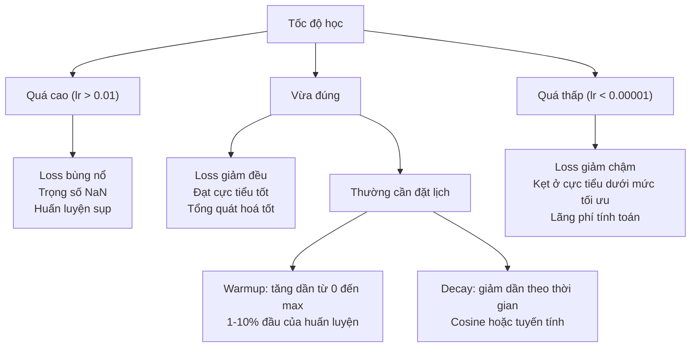
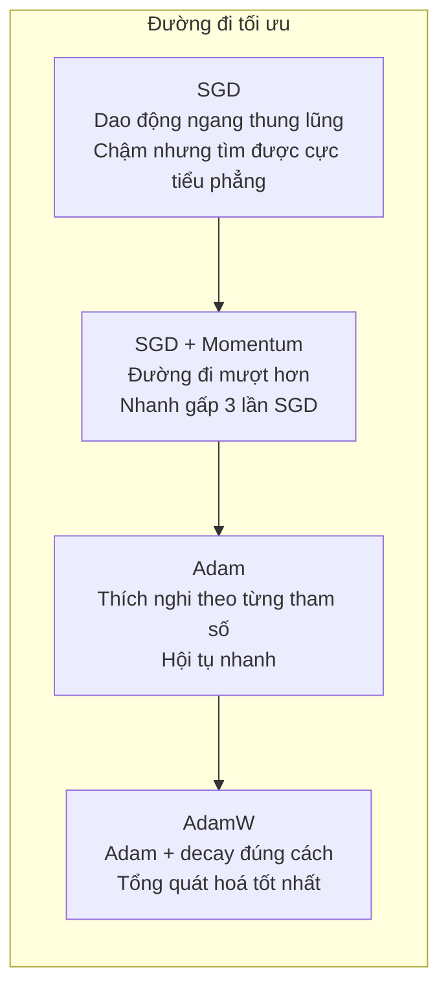
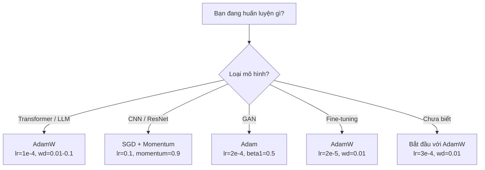

# Optimizer (bộ tối ưu)

> Gradient descent cho bạn biết nên đi theo hướng nào. Nó không nói gì về việc đi bao xa hay nhanh đến đâu. SGD là một chiếc la bàn. Adam là GPS có kèm dữ liệu giao thông.

**Type:** Build
**Languages:** Python
**Prerequisites:** Bài 03.05 (Hàm mất mát)
**Time:** ~75 phút

## Mục tiêu học tập

- Tự tay triển khai các optimizer SGD, SGD với momentum (đà), Adam và AdamW bằng Python
- Giải thích cách bias correction (hiệu chỉnh độ lệch) của Adam bù cho các ước lượng moment khởi tạo bằng 0 trong những bước huấn luyện đầu
- Chứng minh vì sao AdamW tổng quát hoá tốt hơn Adam dùng điều chuẩn L2 trên cùng một bài toán
- Chọn optimizer và siêu tham số mặc định phù hợp cho transformer, CNN, GAN và fine-tuning

## Vấn đề

Bạn đã tính xong gradient. Bạn biết trọng số #4,721 nên giảm 0.003 để loss nhỏ lại. Nhưng 0.003 theo đơn vị nào? Lấy thang theo cái gì? Và bước 1 có nên dịch đúng bằng lượng đó như ở bước 1,000 không?

Gradient descent thuần áp cùng một learning rate (tốc độ học) cho mọi tham số ở mọi bước: w = w - lr * gradient. Điều này sinh ra ba vấn đề khiến việc huấn luyện mạng neural trở nên khổ sở trong thực tế.

Thứ nhất, dao động. Bề mặt loss hiếm khi có dạng một cái bát trơn nhẵn. Nó giống một thung lũng dài và hẹp hơn. Gradient trỏ ngang qua thung lũng (hướng dốc), chứ không men theo nó (hướng thoải). Gradient descent nảy qua nảy lại theo chiều hẹp trong khi chỉ tiến được một chút theo chiều có ích. Bạn đã thấy điều này: loss giảm nhanh rồi đi ngang, không phải vì mô hình đã hội tụ mà vì nó đang dao động.

Thứ hai, một tốc độ học cho mọi tham số là sai. Có trọng số cần cập nhật lớn (chúng đang ở giai đoạn đầu, còn underfitting). Số khác chỉ cần cập nhật rất nhỏ (chúng đã gần giá trị tối ưu). Một tốc độ học vừa cho nhóm đầu sẽ phá nhóm sau, và ngược lại.

Thứ ba, saddle point (điểm yên ngựa). Ở không gian nhiều chiều, bề mặt loss có những vùng phẳng rộng lớn nơi gradient gần bằng 0. SGD thuần bò qua đó với tốc độ của gradient, tức là gần như bằng 0. Mô hình trông như bị kẹt. Nó không kẹt -- nó đang ở một vùng phẳng mà phía bên kia có hướng đi xuống hữu ích. Nhưng SGD không có cơ chế nào để đẩy qua.

Adam giải quyết cả ba. Nó duy trì hai trung bình chạy cho mỗi tham số -- trung bình gradient (momentum, xử lý dao động) và trung bình bình phương gradient (tốc độ adaptive (thích nghi), xử lý các thang khác nhau). Kết hợp với bias correction cho vài bước đầu, nó cho bạn một optimizer duy nhất chạy được trên 80% bài toán với siêu tham số mặc định. Bài này tự tay dựng nó để bạn hiểu chính xác khi nào và vì sao nó thất bại trên 20% còn lại.

## Khái niệm

### Stochastic Gradient Descent — hạ gradient ngẫu nhiên (SGD)

Optimizer đơn giản nhất. Tính gradient trên một mini-batch rồi bước ngược hướng.

```
w = w - lr * gradient
```

Chữ "stochastic" nghĩa là bạn dùng một tập con ngẫu nhiên (mini-batch) của dữ liệu để ước lượng gradient, thay vì toàn bộ dataset. Độ nhiễu này thực ra có ích -- nó giúp thoát khỏi các cực tiểu nhọn. Nhưng nhiễu cũng gây ra dao động.

Tốc độ học là núm vặn duy nhất. Quá cao: loss phân kỳ. Quá thấp: huấn luyện mất cả đời. Giá trị tối ưu phụ thuộc vào kiến trúc, dữ liệu, batch size và giai đoạn huấn luyện hiện tại. Với SGD thuần trên các mạng hiện đại, giá trị điển hình nằm trong khoảng 0.01 đến 0.1. Nhưng ngay trong một lần huấn luyện, tốc độ học lý tưởng vẫn thay đổi.

### Momentum

Phép so sánh quả bóng lăn xuống dốc bị dùng quá nhiều nhưng vẫn đúng. Thay vì bước chỉ theo gradient, bạn duy trì một vận tốc tích luỹ các gradient trước đó.

```
m_t = beta * m_{t-1} + gradient
w = w - lr * m_t
```

Beta (thường là 0.9) quyết định giữ lại bao nhiêu lịch sử. Với beta = 0.9, momentum xấp xỉ trung bình của 10 gradient gần nhất (1 / (1 - 0.9) = 10).

Vì sao điều này chữa được dao động: các gradient cùng hướng thì cộng dồn. Các gradient đổi hướng thì triệt tiêu. Trong thung lũng hẹp đó, thành phần "ngang" đổi dấu mỗi bước và bị làm tắt dần. Thành phần "dọc" giữ nguyên hướng và được khuếch đại. Kết quả là gia tốc mượt theo hướng có ích.

Con số thật: SGD một mình trên một bề mặt loss có điều kiện xấu có thể mất 10,000 bước. SGD với momentum (beta=0.9) thường mất 3,000-5,000 bước cho cùng bài toán. Mức tăng tốc không hề nhỏ.

### RMSProp

Phương pháp tốc độ học thích nghi theo từng tham số đầu tiên thật sự hiệu quả. Do Hinton đề xuất trong một bài giảng Coursera (chưa từng công bố chính thức).

```
s_t = beta * s_{t-1} + (1 - beta) * gradient^2
w = w - lr * gradient / (sqrt(s_t) + epsilon)
```

s_t theo dõi trung bình chạy của bình phương gradient. Tham số có gradient lớn đều đặn bị chia cho một số lớn (tốc độ học hiệu dụng nhỏ hơn). Tham số có gradient nhỏ bị chia cho một số nhỏ (tốc độ học hiệu dụng lớn hơn).

Điều này giải bài toán "một tốc độ học cho mọi tham số". Một trọng số đã nhận cập nhật lớn thì có lẽ đang gần đích -- hãy làm chậm nó. Một trọng số chỉ nhận cập nhật tí xíu có thể còn thiếu huấn luyện -- hãy tăng tốc nó.

Epsilon (thường là 1e-8) tránh chia cho 0 khi một tham số chưa được cập nhật.

### Adam: Momentum + RMSProp

Adam kết hợp cả hai ý tưởng. Nó duy trì hai trung bình động luỹ thừa (exponential moving average) cho mỗi tham số:

```
m_t = beta1 * m_{t-1} + (1 - beta1) * gradient        (first moment: mean)
v_t = beta2 * v_{t-1} + (1 - beta2) * gradient^2       (second moment: variance)
```

**Bias correction** là chi tiết then chốt mà hầu hết lời giải thích bỏ qua. Ở bước 1, m_1 = (1 - beta1) * gradient. Với beta1 = 0.9, đó là 0.1 * gradient -- nhỏ hơn mười lần. Trung bình động chưa kịp khởi động. Bias correction bù lại:

```
m_hat = m_t / (1 - beta1^t)
v_hat = v_t / (1 - beta2^t)
```

Ở bước 1 với beta1 = 0.9: m_hat = m_1 / (1 - 0.9) = m_1 / 0.1 = đúng gradient thật. Ở bước 100: (1 - 0.9^100) xấp xỉ 1.0, nên phần hiệu chỉnh biến mất. Bias correction quan trọng trong ~10 bước đầu và không còn ảnh hưởng sau ~50 bước.

Bước cập nhật:

```
w = w - lr * m_hat / (sqrt(v_hat) + epsilon)
```

Mặc định của Adam: lr = 0.001, beta1 = 0.9, beta2 = 0.999, epsilon = 1e-8. Bộ mặc định này chạy được cho 80% bài toán. Khi không được, đổi lr trước. Rồi đến beta2. Gần như đừng bao giờ đổi beta1 hay epsilon.

### AdamW: làm weight decay cho đúng

Điều chuẩn L2 cộng lambda * w^2 vào loss. Với SGD thuần, điều này tương đương weight decay (giảm trọng số), tức là trừ lambda * w khỏi trọng số ở mỗi bước. Với Adam, sự tương đương này đổ vỡ.

Phát hiện của Loshchilov & Hutter: khi bạn cộng L2 vào loss rồi Adam xử lý gradient, tốc độ học thích nghi cũng co giãn luôn số hạng điều chuẩn. Tham số có phương sai gradient lớn nhận ít điều chuẩn hơn. Tham số có phương sai nhỏ nhận nhiều hơn. Đó không phải điều bạn muốn -- bạn muốn điều chuẩn đồng đều bất kể thống kê gradient.

AdamW sửa điều này bằng cách áp weight decay trực tiếp lên trọng số, sau bước cập nhật của Adam:

```
w = w - lr * m_hat / (sqrt(v_hat) + epsilon) - lr * lambda * w
```

Số hạng weight decay (lr * lambda * w) không bị co giãn bởi hệ số thích nghi của Adam. Mọi tham số đều bị thu nhỏ theo cùng một tỉ lệ.

Nghe như một chi tiết nhỏ. Không phải đâu. AdamW hội tụ về nghiệm tốt hơn Adam + điều chuẩn L2 trên gần như mọi bài toán. Nó là optimizer mặc định trong PyTorch để huấn luyện transformer, mô hình diffusion và hầu hết kiến trúc hiện đại. BERT, GPT, LLaMA, Stable Diffusion -- tất cả đều huấn luyện bằng AdamW.

### Tốc độ học: siêu tham số quan trọng nhất



Nếu chỉ tinh chỉnh một siêu tham số, hãy chọn tốc độ học. Thay đổi tốc độ học 10 lần quan trọng hơn mọi quyết định kiến trúc bạn sẽ đưa ra. Các mặc định phổ biến:

- SGD: lr = 0.01 đến 0.1
- Adam/AdamW: lr = 1e-4 đến 3e-4
- Fine-tuning mô hình đã huấn luyện sẵn: lr = 1e-5 đến 5e-5
- Warmup tốc độ học: tăng tuyến tính trong 1-10% số bước đầu

### So sánh các optimizer



### Khi nào optimizer nào thắng



```figure
optimizer-trajectory
```

## Tự tay làm

### Bước 1: SGD thuần

```python
class SGD:
    def __init__(self, lr=0.01):
        self.lr = lr

    def step(self, params, grads):
        for i in range(len(params)):
            params[i] -= self.lr * grads[i]
```

### Bước 2: SGD với Momentum

```python
class SGDMomentum:
    def __init__(self, lr=0.01, beta=0.9):
        self.lr = lr
        self.beta = beta
        self.velocities = None

    def step(self, params, grads):
        if self.velocities is None:
            self.velocities = [0.0] * len(params)
        for i in range(len(params)):
            self.velocities[i] = self.beta * self.velocities[i] + grads[i]
            params[i] -= self.lr * self.velocities[i]
```

### Bước 3: Adam

```python
import math

class Adam:
    def __init__(self, lr=0.001, beta1=0.9, beta2=0.999, epsilon=1e-8):
        self.lr = lr
        self.beta1 = beta1
        self.beta2 = beta2
        self.epsilon = epsilon
        self.m = None
        self.v = None
        self.t = 0

    def step(self, params, grads):
        if self.m is None:
            self.m = [0.0] * len(params)
            self.v = [0.0] * len(params)

        self.t += 1

        for i in range(len(params)):
            self.m[i] = self.beta1 * self.m[i] + (1 - self.beta1) * grads[i]
            self.v[i] = self.beta2 * self.v[i] + (1 - self.beta2) * grads[i] ** 2

            m_hat = self.m[i] / (1 - self.beta1 ** self.t)
            v_hat = self.v[i] / (1 - self.beta2 ** self.t)

            params[i] -= self.lr * m_hat / (math.sqrt(v_hat) + self.epsilon)
```

### Bước 4: AdamW

```python
class AdamW:
    def __init__(self, lr=0.001, beta1=0.9, beta2=0.999, epsilon=1e-8, weight_decay=0.01):
        self.lr = lr
        self.beta1 = beta1
        self.beta2 = beta2
        self.epsilon = epsilon
        self.weight_decay = weight_decay
        self.m = None
        self.v = None
        self.t = 0

    def step(self, params, grads):
        if self.m is None:
            self.m = [0.0] * len(params)
            self.v = [0.0] * len(params)

        self.t += 1

        for i in range(len(params)):
            self.m[i] = self.beta1 * self.m[i] + (1 - self.beta1) * grads[i]
            self.v[i] = self.beta2 * self.v[i] + (1 - self.beta2) * grads[i] ** 2

            m_hat = self.m[i] / (1 - self.beta1 ** self.t)
            v_hat = self.v[i] / (1 - self.beta2 ** self.t)

            params[i] -= self.lr * m_hat / (math.sqrt(v_hat) + self.epsilon)
            params[i] -= self.lr * self.weight_decay * params[i]
```

### Bước 5: So sánh quá trình huấn luyện

Huấn luyện cùng một mạng hai lớp trên tập dữ liệu vòng tròn từ bài 05 với cả bốn optimizer. So sánh sự hội tụ.

```python
import random

def sigmoid(x):
    x = max(-500, min(500, x))
    return 1.0 / (1.0 + math.exp(-x))

def make_circle_data(n=200, seed=42):
    random.seed(seed)
    data = []
    for _ in range(n):
        x = random.uniform(-2, 2)
        y = random.uniform(-2, 2)
        label = 1.0 if x * x + y * y < 1.5 else 0.0
        data.append(([x, y], label))
    return data


class OptimizerTestNetwork:
    def __init__(self, optimizer, hidden_size=8):
        random.seed(0)
        self.hidden_size = hidden_size
        self.optimizer = optimizer

        self.w1 = [[random.gauss(0, 0.5) for _ in range(2)] for _ in range(hidden_size)]
        self.b1 = [0.0] * hidden_size
        self.w2 = [random.gauss(0, 0.5) for _ in range(hidden_size)]
        self.b2 = 0.0

    def get_params(self):
        params = []
        for row in self.w1:
            params.extend(row)
        params.extend(self.b1)
        params.extend(self.w2)
        params.append(self.b2)
        return params

    def set_params(self, params):
        idx = 0
        for i in range(self.hidden_size):
            for j in range(2):
                self.w1[i][j] = params[idx]
                idx += 1
        for i in range(self.hidden_size):
            self.b1[i] = params[idx]
            idx += 1
        for i in range(self.hidden_size):
            self.w2[i] = params[idx]
            idx += 1
        self.b2 = params[idx]

    def forward(self, x):
        self.x = x
        self.z1 = []
        self.h = []
        for i in range(self.hidden_size):
            z = self.w1[i][0] * x[0] + self.w1[i][1] * x[1] + self.b1[i]
            self.z1.append(z)
            self.h.append(max(0.0, z))

        self.z2 = sum(self.w2[i] * self.h[i] for i in range(self.hidden_size)) + self.b2
        self.out = sigmoid(self.z2)
        return self.out

    def compute_grads(self, target):
        eps = 1e-15
        p = max(eps, min(1 - eps, self.out))
        d_loss = -(target / p) + (1 - target) / (1 - p)
        d_sigmoid = self.out * (1 - self.out)
        d_out = d_loss * d_sigmoid

        grads = [0.0] * (self.hidden_size * 2 + self.hidden_size + self.hidden_size + 1)
        idx = 0
        for i in range(self.hidden_size):
            d_relu = 1.0 if self.z1[i] > 0 else 0.0
            d_h = d_out * self.w2[i] * d_relu
            grads[idx] = d_h * self.x[0]
            grads[idx + 1] = d_h * self.x[1]
            idx += 2

        for i in range(self.hidden_size):
            d_relu = 1.0 if self.z1[i] > 0 else 0.0
            grads[idx] = d_out * self.w2[i] * d_relu
            idx += 1

        for i in range(self.hidden_size):
            grads[idx] = d_out * self.h[i]
            idx += 1

        grads[idx] = d_out
        return grads

    def train(self, data, epochs=300):
        losses = []
        for epoch in range(epochs):
            total_loss = 0.0
            correct = 0
            for x, y in data:
                pred = self.forward(x)
                grads = self.compute_grads(y)
                params = self.get_params()
                self.optimizer.step(params, grads)
                self.set_params(params)

                eps = 1e-15
                p = max(eps, min(1 - eps, pred))
                total_loss += -(y * math.log(p) + (1 - y) * math.log(1 - p))
                if (pred >= 0.5) == (y >= 0.5):
                    correct += 1
            avg_loss = total_loss / len(data)
            accuracy = correct / len(data) * 100
            losses.append((avg_loss, accuracy))
            if epoch % 75 == 0 or epoch == epochs - 1:
                print(f"    Epoch {epoch:3d}: loss={avg_loss:.4f}, accuracy={accuracy:.1f}%")
        return losses
```

## Áp dụng

Optimizer của PyTorch xử lý nhóm tham số, gradient clipping và đặt lịch tốc độ học:

```python
import torch
import torch.optim as optim

model = torch.nn.Sequential(
    torch.nn.Linear(784, 256),
    torch.nn.ReLU(),
    torch.nn.Linear(256, 10),
)

optimizer = optim.AdamW(model.parameters(), lr=3e-4, weight_decay=0.01)

scheduler = optim.lr_scheduler.CosineAnnealingLR(optimizer, T_max=100)

for epoch in range(100):
    optimizer.zero_grad()
    output = model(torch.randn(32, 784))
    loss = torch.nn.functional.cross_entropy(output, torch.randint(0, 10, (32,)))
    loss.backward()
    torch.nn.utils.clip_grad_norm_(model.parameters(), max_norm=1.0)
    optimizer.step()
    scheduler.step()
```

Trình tự luôn là: zero_grad, forward, loss, backward, (clip), step, (schedule). Hãy nhớ đúng thứ tự này. Làm sai (ví dụ gọi scheduler.step() trước optimizer.step()) là nguồn gốc rất phổ biến của những lỗi tinh vi.

Với CNN, nhiều người thực hành vẫn thích SGD + momentum (lr=0.1, momentum=0.9, weight_decay=1e-4) kèm lịch step hoặc cosine. SGD tìm được cực tiểu phẳng hơn, thường tổng quát hoá tốt hơn. Với transformer và LLM, AdamW kèm warmup + cosine decay là mặc định phổ quát. Đừng chống lại số đông khi chưa có lý do đo được.

## Đóng gói

Bài này tạo ra:
- `outputs/prompt-optimizer-selector.md` -- một prompt quyết định để chọn optimizer và tốc độ học phù hợp cho bất kỳ kiến trúc nào

## Bài tập

1. Triển khai Nesterov momentum, trong đó bạn tính gradient tại vị trí "nhìn trước" (w - lr * beta * v) thay vì vị trí hiện tại. So sánh sự hội tụ với momentum chuẩn trên tập dữ liệu vòng tròn.

2. Triển khai lịch warmup tốc độ học: tăng tuyến tính từ 0 đến max_lr trong 10% số bước huấn luyện đầu, rồi cosine decay về 0. Huấn luyện với Adam + warmup so với Adam không warmup. Đo xem mất bao nhiêu epoch để đạt 90% độ chính xác trên tập dữ liệu vòng tròn.

3. Theo dõi tốc độ học hiệu dụng của từng tham số trong quá trình huấn luyện bằng Adam. Tốc độ hiệu dụng là lr * m_hat / (sqrt(v_hat) + eps). Vẽ phân phối tốc độ hiệu dụng sau 10, 50 và 200 bước. Có phải mọi tham số đều được cập nhật với cùng một tốc độ?

4. Triển khai gradient clipping (cắt theo chuẩn toàn cục). Đặt chuẩn gradient tối đa là 1.0. Huấn luyện có và không có clipping với tốc độ học cao (lr=0.01 cho Adam). Đếm xem bao nhiêu lần chạy phân kỳ (loss thành NaN) khi có và không có clipping trên 10 seed ngẫu nhiên.

5. So sánh Adam với AdamW trên một mạng có trọng số lớn. Khởi tạo mọi trọng số bằng giá trị ngẫu nhiên trong [-5, 5] (lớn hơn bình thường nhiều). Huấn luyện 200 epoch với weight_decay=0.1. Vẽ chuẩn L2 của trọng số theo thời gian huấn luyện cho cả hai optimizer. AdamW phải cho thấy trọng số co lại nhanh hơn.

## Thuật ngữ chính

| Thuật ngữ | Người ta thường nói | Ý nghĩa thực sự |
|------|----------------|----------------------|
| Learning rate | "Kích thước bước" | Hệ số nhân vô hướng cho cập nhật gradient; siêu tham số có ảnh hưởng lớn nhất trong huấn luyện |
| SGD | "Gradient descent cơ bản" | Stochastic gradient descent: cập nhật trọng số bằng cách trừ lr * gradient, tính trên một mini-batch |
| Momentum | "Ẩn dụ quả bóng lăn" | Trung bình động luỹ thừa của các gradient trước; làm tắt dao động và tăng tốc các hướng nhất quán |
| RMSProp | "Tốc độ học thích nghi" | Chia gradient của từng tham số cho RMS chạy của các gradient gần đây; cân bằng tốc độ học giữa các tham số |
| Adam | "Optimizer mặc định" | Kết hợp momentum (moment bậc một) và RMSProp (moment bậc hai) với bias correction cho các bước đầu |
| AdamW | "Adam làm đúng cách" | Adam với decoupled weight decay (giảm trọng số tách rời); áp điều chuẩn trực tiếp lên trọng số thay vì qua gradient |
| Bias correction | "Warmup cho trung bình chạy" | Chia cho (1 - beta^t) để bù việc khởi tạo bằng 0 các ước lượng moment của Adam |
| Weight decay | "Thu nhỏ trọng số" | Trừ đi một phần giá trị trọng số ở mỗi bước; một bộ điều chuẩn phạt các trọng số lớn |
| Learning rate schedule | "Đổi lr theo thời gian" | Hàm điều chỉnh tốc độ học trong quá trình huấn luyện; warmup + cosine decay là mặc định hiện đại |
| Gradient clipping | "Chặn chuẩn gradient" | Thu nhỏ vector gradient khi chuẩn của nó vượt ngưỡng; ngăn các cập nhật gradient bùng nổ |

## Đọc thêm

- Kingma & Ba, "Adam: A Method for Stochastic Optimization" (2014) -- bài báo Adam gốc với phân tích hội tụ và cách suy ra bias correction
- Loshchilov & Hutter, "Decoupled Weight Decay Regularization" (2017) -- chứng minh điều chuẩn L2 và weight decay không tương đương trong Adam, và đề xuất AdamW
- Smith, "Cyclical Learning Rates for Training Neural Networks" (2017) -- giới thiệu bài kiểm tra dải LR và các lịch chu kỳ giúp bỏ nhu cầu tinh chỉnh một tốc độ học cố định
- Ruder, "An Overview of Gradient Descent Optimization Algorithms" (2016) -- bài khảo sát đầy đủ nhất về mọi biến thể optimizer, với so sánh và trực giác rõ ràng
