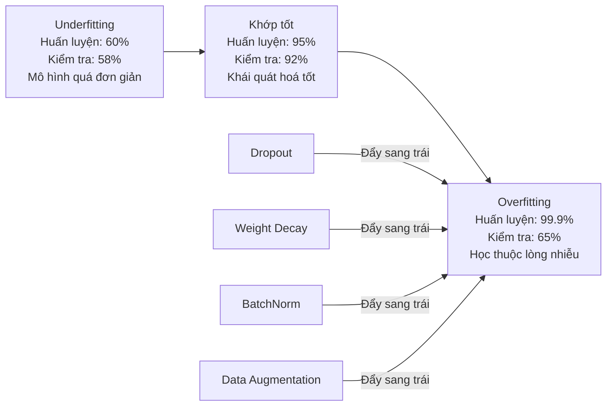
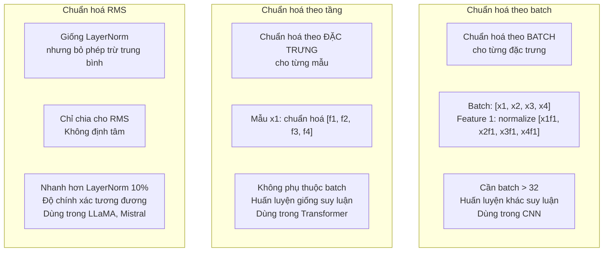
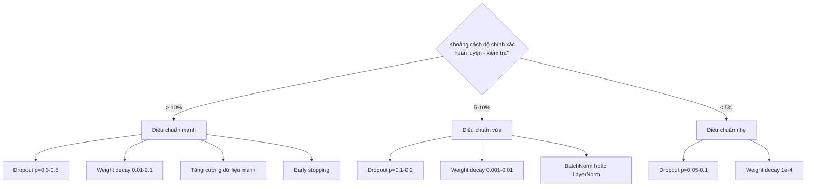

# Điều chuẩn (Regularization)

> Mô hình của bạn đạt 99% trên dữ liệu huấn luyện và 60% trên dữ liệu kiểm tra. Nó học thuộc lòng thay vì học. Regularization (điều chuẩn) là mức thuế bạn đánh lên độ phức tạp để buộc mô hình khái quát hoá.

**Type:** Build
**Languages:** Python
**Prerequisites:** Bài 03.06 (Bộ tối ưu)
**Time:** ~75 phút

## Mục tiêu học tập

- Tự tay cài đặt dropout (keep) với cơ chế nhân bù khi huấn luyện, weight decay (giảm trọng số) L2, batch normalization (chuẩn hoá theo batch), layer normalization, và RMSNorm từ đầu
- Đo khoảng cách độ chính xác giữa huấn luyện và kiểm tra và chẩn đoán overfitting (quá khớp) bằng các thí nghiệm điều chuẩn
- Giải thích vì sao transformer dùng LayerNorm thay vì BatchNorm và vì sao các LLM hiện đại thích RMSNorm hơn
- Áp dụng đúng tổ hợp kỹ thuật điều chuẩn dựa trên mức độ nghiêm trọng của overfitting

## Vấn đề

Một mạng nơ-ron với đủ tham số có thể học thuộc lòng bất kỳ bộ dữ liệu nào. Đây không phải là giả thuyết suông -- Zhang et al. (2017) đã chứng minh điều đó bằng cách huấn luyện các mạng tiêu chuẩn trên ImageNet với nhãn ngẫu nhiên. Các mạng này đạt mất mát huấn luyện gần bằng 0 trên những nhãn được gán hoàn toàn ngẫu nhiên. Chúng học thuộc lòng một triệu cặp đầu vào - đầu ra ngẫu nhiên mà không có quy luật nào để học. Mất mát huấn luyện hoàn hảo. Độ chính xác kiểm tra bằng 0.

Đây là vấn đề overfitting, và nó càng tệ khi mô hình càng lớn. GPT-3 có 175 tỷ tham số. Tập huấn luyện có khoảng 500 tỷ token. Với ngần ấy tham số, mô hình đủ dung lượng để học thuộc lòng nguyên văn những khối lớn của dữ liệu huấn luyện. Không có điều chuẩn, nó chỉ nhả lại các ví dụ huấn luyện thay vì học những quy luật khái quát hoá được.

Khoảng cách giữa hiệu năng huấn luyện và hiệu năng kiểm tra là khoảng cách quá khớp. Mọi kỹ thuật trong bài này tấn công khoảng cách đó từ một góc khác nhau. Dropout buộc mạng không được phụ thuộc vào bất kỳ nơ-ron đơn lẻ nào. Weight decay ngăn một trọng số đơn lẻ nào đó phình quá lớn. Batch normalization làm mượt bề mặt mất mát để bộ tối ưu tìm được những cực tiểu phẳng hơn, dễ khái quát hoá hơn. Layer normalization làm điều tương tự nhưng hoạt động ở nơi batch normalization thất bại (batch nhỏ, chuỗi có độ dài biến thiên). RMSNorm làm điều đó nhanh hơn 10% nhờ bỏ phép tính trung bình. Mỗi kỹ thuật đều đơn giản. Gộp lại, chúng là khác biệt giữa một mô hình học thuộc lòng và một mô hình khái quát hoá.

## Khái niệm

### Phổ overfitting

Mọi mô hình đều nằm đâu đó trên một phổ từ underfitting (quá đơn giản để bắt được quy luật) đến overfitting (quá phức tạp nên bắt luôn cả nhiễu). Điểm ngọt nằm ở giữa, và điều chuẩn đẩy mô hình về phía đó từ phía quá khớp.



### Dropout

Kỹ thuật điều chuẩn đơn giản nhất với cách diễn giải thanh thoát nhất. Trong lúc huấn luyện, đặt ngẫu nhiên đầu ra của mỗi nơ-ron về 0 với xác suất p.

```
output = activation(z) * mask    where mask[i] ~ Bernoulli(1 - p)
```

Với p = 0.5, một nửa số nơ-ron bị đặt về 0 ở mỗi lượt lan truyền xuôi. Mạng buộc phải học những biểu diễn dư thừa vì nó không thể đoán trước nơ-ron nào sẽ còn hoạt động. Điều này ngăn chặn hiện tượng đồng thích nghi -- các nơ-ron học cách dựa vào việc một số nơ-ron cụ thể khác có mặt.

Cách diễn giải theo ensemble: một mạng có N nơ-ron kèm dropout tạo ra 2^N mạng con khả dĩ (mọi tổ hợp nơ-ron bật hoặc tắt). Huấn luyện với dropout gần như huấn luyện đồng thời cả 2^N mạng con, mỗi mạng trên những mini-batch khác nhau. Lúc kiểm tra, bạn dùng toàn bộ nơ-ron (không dropout) và nhân đầu ra với (1 - p) để khớp với giá trị kỳ vọng khi huấn luyện. Điều này tương đương với việc lấy trung bình dự đoán của 2^N mạng con -- một ensemble khổng lồ từ một mô hình duy nhất.

Trong thực tế, hệ số nhân bù được áp dụng ngay khi huấn luyện thay vì khi kiểm tra, cách này gọi là inverted dropout (dropout nghịch đảo):

```
During training:  output = activation(z) * mask / (1 - p)
During testing:   output = activation(z)   (no change needed)
```

Cách này gọn hơn vì mã kiểm tra không cần biết gì về dropout.

Tỷ lệ mặc định: p = 0.1 cho transformer, p = 0.5 cho MLP, p = 0.2-0.3 cho CNN. Dropout cao hơn = điều chuẩn mạnh hơn = rủi ro underfitting cao hơn.

### Weight Decay (Điều chuẩn L2)

Cộng bình phương độ lớn của mọi trọng số vào hàm mất mát:

```
total_loss = task_loss + (lambda / 2) * sum(w_i^2)
```

Gradient của số hạng điều chuẩn là lambda * w. Nghĩa là ở mỗi bước, mỗi trọng số bị co dần về 0 một lượng tỷ lệ với độ lớn của nó. Trọng số lớn bị phạt nhiều hơn. Mô hình bị đẩy về phía những nghiệm mà không có trọng số nào chiếm ưu thế.

Vì sao điều này giúp khái quát hoá: các mô hình quá khớp thường có trọng số lớn, khuếch đại label noise (nhiễu nhãn) trong dữ liệu huấn luyện. Weight decay giữ trọng số nhỏ, qua đó giới hạn dung lượng hiệu dụng của mô hình và buộc nó dựa vào những đặc trưng vững chắc, khái quát hoá được thay vì những nếp học thuộc lòng.

Siêu tham số lambda điều khiển độ mạnh. Giá trị thường dùng:

- 0.01 cho AdamW trên transformer
- 1e-4 cho SGD trên CNN
- 0.1 cho những mô hình quá khớp nặng

Như đã bàn ở bài 06: weight decay và điều chuẩn L2 tương đương nhau trong SGD nhưng không tương đương trong Adam. Luôn dùng AdamW (weight decay tách rời) khi huấn luyện với Adam.

### Batch Normalization

Chuẩn hoá đầu ra của mỗi tầng theo mini-batch trước khi chuyển nó sang tầng kế tiếp.

Với một mini-batch các giá trị kích hoạt ở một tầng nào đó:

```
mu = (1/B) * sum(x_i)           (batch mean)
sigma^2 = (1/B) * sum((x_i - mu)^2)   (batch variance)
x_hat = (x_i - mu) / sqrt(sigma^2 + eps)   (normalize)
y = gamma * x_hat + beta        (scale and shift)
```

Gamma và beta là những tham số học được, cho phép mạng hoàn tác phép chuẩn hoá nếu điều đó là tối ưu. Không có chúng, bạn sẽ buộc đầu ra của mọi tầng phải có trung bình 0 và phương sai 1, mà có thể đó không phải là điều mạng muốn.

**Khác biệt giữa huấn luyện và suy luận:** Khi huấn luyện, mu và sigma lấy từ mini-batch hiện tại. Khi suy luận, bạn dùng trung bình tích luỹ trong quá trình huấn luyện (trung bình động luỹ thừa với momentum = 0.1, nghĩa là 90% cũ + 10% mới).

Vì sao BatchNorm hiệu quả vẫn còn đang tranh luận. Bài báo gốc cho rằng nó giảm "internal covariate shift" (phân phối đầu vào của các tầng thay đổi khi những tầng trước cập nhật). Santurkar et al. (2018) chỉ ra cách giải thích này sai. Lý do thật sự: BatchNorm làm bề mặt mất mát mượt hơn. Gradient có tính dự báo tốt hơn, các hằng số Lipschitz nhỏ hơn, và bộ tối ưu có thể bước lớn hơn một cách an toàn. Đó là lý do BatchNorm cho phép bạn dùng learning rate cao hơn và hội tụ nhanh hơn.

BatchNorm có một hạn chế cốt lõi: nó phụ thuộc vào thống kê của batch. Với batch size 1, trung bình và phương sai trở nên vô nghĩa. Với batch nhỏ (< 32), thống kê nhiễu và làm hại hiệu năng. Điều này quan trọng với những bài toán như phát hiện đối tượng (bộ nhớ giới hạn batch size) và mô hình hoá ngôn ngữ (độ dài chuỗi biến thiên).

### Layer Normalization

Chuẩn hoá theo các đặc trưng thay vì theo batch. Với một mẫu đơn lẻ:

```
mu = (1/D) * sum(x_j)           (feature mean)
sigma^2 = (1/D) * sum((x_j - mu)^2)   (feature variance)
x_hat = (x_j - mu) / sqrt(sigma^2 + eps)
y = gamma * x_hat + beta
```

D là số chiều đặc trưng. Mỗi mẫu được chuẩn hoá độc lập -- không phụ thuộc vào batch size. Đây là lý do transformer dùng LayerNorm thay vì BatchNorm. Chuỗi có độ dài biến thiên, batch size thường nhỏ (hoặc bằng 1 khi sinh), và phép tính giống hệt nhau giữa huấn luyện và suy luận.

Trong transformer, LayerNorm được áp dụng sau mỗi khối self-attention và mỗi khối feed-forward (Post-LN), hoặc trước chúng (Pre-LN, ổn định hơn khi huấn luyện).

### RMSNorm

LayerNorm nhưng bỏ phép trừ trung bình. Được đề xuất bởi Zhang & Sennrich (2019).

```
rms = sqrt((1/D) * sum(x_j^2))
y = gamma * x / rms
```

Chỉ vậy thôi. Không tính trung bình, không có tham số beta. Nhận xét: việc tái định tâm (trừ trung bình) trong LayerNorm đóng góp rất ít vào hiệu năng của mô hình nhưng lại tốn tính toán. Bỏ nó cho độ chính xác tương đương với chi phí ít hơn khoảng 10%.

LLaMA, LLaMA 2, LLaMA 3, Mistral và hầu hết các LLM hiện đại dùng RMSNorm thay vì LayerNorm. Ở quy mô hàng tỷ tham số và hàng nghìn tỷ token, khoản tiết kiệm 10% đó là đáng kể.

### So sánh các phép chuẩn hoá



### Data augmentation (tăng cường dữ liệu) như một dạng điều chuẩn

Không phải sửa mô hình mà là sửa dữ liệu. Biến đổi đầu vào huấn luyện trong khi giữ nguyên nhãn:

- Ảnh: cắt ngẫu nhiên, lật, xoay, đổi màu ngẫu nhiên, cutout
- Văn bản: thay thế từ đồng nghĩa, dịch vòng (back-translation), xoá ngẫu nhiên
- Âm thanh: kéo dài thời gian, đổi cao độ, thêm nhiễu

Hiệu ứng giống hệt điều chuẩn: nó làm tăng kích thước hiệu dụng của tập huấn luyện, khiến mô hình khó học thuộc lòng từng ví dụ cụ thể hơn. Một mô hình chỉ thấy mỗi ảnh một lần ở dạng gốc có thể học thuộc lòng nó. Một mô hình thấy 50 phiên bản tăng cường của mỗi ảnh buộc phải học cấu trúc bất biến.

### Early stopping (dừng sớm)

Bộ điều chuẩn đơn giản nhất: dừng huấn luyện khi mất mát trên tập kiểm định bắt đầu tăng. Lúc đó mô hình vẫn chưa quá khớp. Trong thực tế, bạn theo dõi mất mát kiểm định mỗi epoch, lưu mô hình tốt nhất, và tiếp tục huấn luyện thêm một khoảng "patience" (thường 5-20 epoch). Nếu mất mát kiểm định không cải thiện trong khoảng patience đó, bạn dừng lại và nạp mô hình tốt nhất đã lưu.

### Khi nào áp dụng cái gì



```figure
l2-regularization
```

## Tự tay làm

### Bước 1: Dropout (chế độ huấn luyện và đánh giá)

```python
import random
import math


class Dropout:
    def __init__(self, p=0.5):
        self.p = p
        self.training = True
        self.mask = None

    def forward(self, x):
        if not self.training:
            return list(x)
        self.mask = []
        output = []
        for val in x:
            if random.random() < self.p:
                self.mask.append(0)
                output.append(0.0)
            else:
                self.mask.append(1)
                output.append(val / (1 - self.p))
        return output

    def backward(self, grad_output):
        grads = []
        for g, m in zip(grad_output, self.mask):
            if m == 0:
                grads.append(0.0)
            else:
                grads.append(g / (1 - self.p))
        return grads
```

### Bước 2: Weight decay L2

```python
def l2_regularization(weights, lambda_reg):
    penalty = 0.0
    for w in weights:
        penalty += w * w
    return lambda_reg * 0.5 * penalty

def l2_gradient(weights, lambda_reg):
    return [lambda_reg * w for w in weights]
```

### Bước 3: Batch Normalization

```python
class BatchNorm:
    def __init__(self, num_features, momentum=0.1, eps=1e-5):
        self.gamma = [1.0] * num_features
        self.beta = [0.0] * num_features
        self.eps = eps
        self.momentum = momentum
        self.running_mean = [0.0] * num_features
        self.running_var = [1.0] * num_features
        self.training = True
        self.num_features = num_features

    def forward(self, batch):
        batch_size = len(batch)
        if self.training:
            mean = [0.0] * self.num_features
            for sample in batch:
                for j in range(self.num_features):
                    mean[j] += sample[j]
            mean = [m / batch_size for m in mean]

            var = [0.0] * self.num_features
            for sample in batch:
                for j in range(self.num_features):
                    var[j] += (sample[j] - mean[j]) ** 2
            var = [v / batch_size for v in var]

            for j in range(self.num_features):
                self.running_mean[j] = (1 - self.momentum) * self.running_mean[j] + self.momentum * mean[j]
                self.running_var[j] = (1 - self.momentum) * self.running_var[j] + self.momentum * var[j]
        else:
            mean = list(self.running_mean)
            var = list(self.running_var)

        self.x_hat = []
        output = []
        for sample in batch:
            normalized = []
            out_sample = []
            for j in range(self.num_features):
                x_h = (sample[j] - mean[j]) / math.sqrt(var[j] + self.eps)
                normalized.append(x_h)
                out_sample.append(self.gamma[j] * x_h + self.beta[j])
            self.x_hat.append(normalized)
            output.append(out_sample)
        return output
```

### Bước 4: Layer normalization

```python
class LayerNorm:
    def __init__(self, num_features, eps=1e-5):
        self.gamma = [1.0] * num_features
        self.beta = [0.0] * num_features
        self.eps = eps
        self.num_features = num_features

    def forward(self, x):
        mean = sum(x) / len(x)
        var = sum((xi - mean) ** 2 for xi in x) / len(x)

        self.x_hat = []
        output = []
        for j in range(self.num_features):
            x_h = (x[j] - mean) / math.sqrt(var + self.eps)
            self.x_hat.append(x_h)
            output.append(self.gamma[j] * x_h + self.beta[j])
        return output
```

### Bước 5: RMSNorm

```python
class RMSNorm:
    def __init__(self, num_features, eps=1e-6):
        self.gamma = [1.0] * num_features
        self.eps = eps
        self.num_features = num_features

    def forward(self, x):
        rms = math.sqrt(sum(xi * xi for xi in x) / len(x) + self.eps)
        output = []
        for j in range(self.num_features):
            output.append(self.gamma[j] * x[j] / rms)
        return output
```

### Bước 6: Huấn luyện có và không có điều chuẩn

```python
def sigmoid(x):
    x = max(-500, min(500, x))
    return 1.0 / (1.0 + math.exp(-x))


def make_circle_data(n=200, seed=42):
    random.seed(seed)
    data = []
    for _ in range(n):
        x = random.uniform(-2, 2)
        y = random.uniform(-2, 2)
        label = 1.0 if x * x + y * y < 1.5 else 0.0
        data.append(([x, y], label))
    return data


class RegularizedNetwork:
    def __init__(self, hidden_size=16, lr=0.05, dropout_p=0.0, weight_decay=0.0):
        random.seed(0)
        self.hidden_size = hidden_size
        self.lr = lr
        self.dropout_p = dropout_p
        self.weight_decay = weight_decay
        self.dropout = Dropout(p=dropout_p) if dropout_p > 0 else None

        self.w1 = [[random.gauss(0, 0.5) for _ in range(2)] for _ in range(hidden_size)]
        self.b1 = [0.0] * hidden_size
        self.w2 = [random.gauss(0, 0.5) for _ in range(hidden_size)]
        self.b2 = 0.0

    def forward(self, x, training=True):
        self.x = x
        self.z1 = []
        self.h = []
        for i in range(self.hidden_size):
            z = self.w1[i][0] * x[0] + self.w1[i][1] * x[1] + self.b1[i]
            self.z1.append(z)
            self.h.append(max(0.0, z))

        if self.dropout and training:
            self.dropout.training = True
            self.h = self.dropout.forward(self.h)
        elif self.dropout:
            self.dropout.training = False
            self.h = self.dropout.forward(self.h)

        self.z2 = sum(self.w2[i] * self.h[i] for i in range(self.hidden_size)) + self.b2
        self.out = sigmoid(self.z2)
        return self.out

    def backward(self, target):
        eps = 1e-15
        p = max(eps, min(1 - eps, self.out))
        d_loss = -(target / p) + (1 - target) / (1 - p)
        d_sigmoid = self.out * (1 - self.out)
        d_out = d_loss * d_sigmoid

        for i in range(self.hidden_size):
            d_relu = 1.0 if self.z1[i] > 0 else 0.0
            d_h = d_out * self.w2[i] * d_relu
            self.w2[i] -= self.lr * (d_out * self.h[i] + self.weight_decay * self.w2[i])
            for j in range(2):
                self.w1[i][j] -= self.lr * (d_h * self.x[j] + self.weight_decay * self.w1[i][j])
            self.b1[i] -= self.lr * d_h
        self.b2 -= self.lr * d_out

    def evaluate(self, data):
        correct = 0
        total_loss = 0.0
        for x, y in data:
            pred = self.forward(x, training=False)
            eps = 1e-15
            p = max(eps, min(1 - eps, pred))
            total_loss += -(y * math.log(p) + (1 - y) * math.log(1 - p))
            if (pred >= 0.5) == (y >= 0.5):
                correct += 1
        return total_loss / len(data), correct / len(data) * 100

    def train_model(self, train_data, test_data, epochs=300):
        history = []
        for epoch in range(epochs):
            total_loss = 0.0
            correct = 0
            for x, y in train_data:
                pred = self.forward(x, training=True)
                self.backward(y)
                eps = 1e-15
                p = max(eps, min(1 - eps, pred))
                total_loss += -(y * math.log(p) + (1 - y) * math.log(1 - p))
                if (pred >= 0.5) == (y >= 0.5):
                    correct += 1
            train_loss = total_loss / len(train_data)
            train_acc = correct / len(train_data) * 100
            test_loss, test_acc = self.evaluate(test_data)
            history.append((train_loss, train_acc, test_loss, test_acc))
            if epoch % 75 == 0 or epoch == epochs - 1:
                gap = train_acc - test_acc
                print(f"    Epoch {epoch:3d}: train_acc={train_acc:.1f}%, test_acc={test_acc:.1f}%, gap={gap:.1f}%")
        return history
```

## Áp dụng

PyTorch cung cấp mọi phép chuẩn hoá và điều chuẩn dưới dạng module:

```python
import torch
import torch.nn as nn

model = nn.Sequential(
    nn.Linear(784, 256),
    nn.BatchNorm1d(256),
    nn.ReLU(),
    nn.Dropout(0.3),
    nn.Linear(256, 128),
    nn.BatchNorm1d(128),
    nn.ReLU(),
    nn.Dropout(0.3),
    nn.Linear(128, 10),
)

model.train()
out_train = model(torch.randn(32, 784))

model.eval()
out_test = model(torch.randn(1, 784))
```

Việc bật/tắt bằng `model.train()` / `model.eval()` là cực kỳ quan trọng. Nó bật/tắt dropout và cho BatchNorm biết nên dùng thống kê của batch hay thống kê tích luỹ. Quên `model.eval()` trước khi suy luận là một trong những lỗi phổ biến nhất trong học sâu. Độ chính xác kiểm tra của bạn sẽ dao động ngẫu nhiên vì dropout vẫn đang bật và BatchNorm vẫn dùng thống kê mini-batch.

Với transformer, cách làm khác đi:

```python
class TransformerBlock(nn.Module):
    def __init__(self, d_model=512, nhead=8, dropout=0.1):
        super().__init__()
        self.attention = nn.MultiheadAttention(d_model, nhead, dropout=dropout)
        self.norm1 = nn.LayerNorm(d_model)
        self.ff = nn.Sequential(
            nn.Linear(d_model, d_model * 4),
            nn.GELU(),
            nn.Linear(d_model * 4, d_model),
            nn.Dropout(dropout),
        )
        self.norm2 = nn.LayerNorm(d_model)
        self.dropout = nn.Dropout(dropout)

    def forward(self, x):
        attended, _ = self.attention(x, x, x)
        x = self.norm1(x + self.dropout(attended))
        x = self.norm2(x + self.ff(x))
        return x
```

LayerNorm, không phải BatchNorm. Dropout p=0.1, không phải p=0.5. Đó là những giá trị mặc định cho transformer.

## Đóng gói

Bài học này tạo ra:
- `outputs/prompt-regularization-advisor.md` -- một prompt chẩn đoán overfitting và đề xuất chiến lược điều chuẩn phù hợp

## Bài tập

1. Cài đặt spatial dropout cho dữ liệu 2D: thay vì bỏ từng nơ-ron riêng lẻ, hãy bỏ cả kênh đặc trưng. Mô phỏng điều này bằng cách coi các nhóm đặc trưng liên tiếp là kênh và bỏ cả nhóm. So sánh khoảng cách huấn luyện - kiểm tra với dropout tiêu chuẩn trên bộ dữ liệu hình tròn với hidden_size=32.

2. Cài đặt label smoothing từ bài 05 kết hợp với dropout của bài này. Huấn luyện với bốn cấu hình: không dùng gì, chỉ dropout, chỉ label smoothing, cả hai. Đo khoảng cách độ chính xác huấn luyện - kiểm tra cuối cùng của mỗi cấu hình. Tổ hợp nào cho khoảng cách nhỏ nhất?

3. Thêm một tầng BatchNorm giữa tầng ẩn và hàm kích hoạt trong mạng dữ liệu hình tròn của bạn. Huấn luyện có và không có BatchNorm ở các learning rate 0.01, 0.05 và 0.1. BatchNorm sẽ cho phép huấn luyện ổn định ở những learning rate cao hơn, nơi mạng nguyên bản phân kỳ.

4. Cài đặt early stopping: theo dõi mất mát kiểm tra mỗi epoch, lưu trọng số tốt nhất, và dừng nếu mất mát kiểm tra không cải thiện trong 20 epoch. Chạy mạng đã điều chuẩn trong 1000 epoch. Cho biết epoch nào có độ chính xác kiểm tra tốt nhất và bạn đã tiết kiệm được bao nhiêu epoch tính toán.

5. So sánh LayerNorm với RMSNorm trên một mạng 4 tầng (không chỉ 2 tầng). Khởi tạo cả hai với cùng trọng số. Huấn luyện 200 epoch rồi so sánh độ chính xác cuối cùng, tốc độ huấn luyện (thời gian mỗi epoch), và độ lớn gradient ở tầng đầu. Xác minh rằng RMSNorm nhanh hơn với cùng độ chính xác.

## Thuật ngữ chính

| Thuật ngữ | Người ta thường nói | Ý nghĩa thực sự |
|------|----------------|----------------------|
| Overfitting | "Mô hình học thuộc lòng dữ liệu" | Khi hiệu năng huấn luyện của mô hình vượt trội rõ rệt so với hiệu năng kiểm tra, cho thấy nó học nhiễu thay vì tín hiệu |
| Regularization | "Chống quá khớp" | Mọi kỹ thuật hạn chế độ phức tạp của mô hình để cải thiện khả năng khái quát hoá: dropout, weight decay, chuẩn hoá, tăng cường dữ liệu |
| Dropout | "Xoá nơ-ron ngẫu nhiên" | Đặt ngẫu nhiên các nơ-ron về 0 trong lúc huấn luyện với xác suất p, buộc mạng phải có biểu diễn dư thừa; tương đương với huấn luyện một ensemble |
| Weight decay | "Phạt L2" | Co mọi trọng số về 0 bằng cách trừ lambda * w ở mỗi bước; phạt độ phức tạp thông qua độ lớn của trọng số |
| Batch normalization | "Chuẩn hoá theo batch" | Chuẩn hoá đầu ra của tầng theo chiều batch, dùng thống kê của batch khi huấn luyện và trung bình tích luỹ khi suy luận |
| Layer normalization | "Chuẩn hoá theo mẫu" | Chuẩn hoá theo các đặc trưng trong từng mẫu; không phụ thuộc batch, được dùng trong transformer nơi batch size biến thiên |
| RMSNorm | "LayerNorm không có trung bình" | Chuẩn hoá theo căn trung bình bình phương; bỏ phép trừ trung bình của LayerNorm để nhanh hơn 10% với độ chính xác tương đương |
| Early stopping | "Dừng trước khi quá khớp" | Dừng huấn luyện khi mất mát kiểm định không còn cải thiện; bộ điều chuẩn đơn giản nhất, thường được dùng kèm những cái khác |
| Data augmentation | "Thêm dữ liệu từ ít dữ liệu" | Biến đổi đầu vào huấn luyện (lật, cắt, thêm nhiễu) để tăng kích thước hiệu dụng của tập dữ liệu và buộc mô hình học tính bất biến |
| Generalization gap | "Chênh lệch train-test" | Khác biệt giữa hiệu năng huấn luyện và hiệu năng kiểm tra; điều chuẩn nhằm thu nhỏ khoảng cách này |

## Đọc thêm

- Srivastava et al., "Dropout: A Simple Way to Prevent Neural Networks from Overfitting" (2014) -- bài báo gốc về dropout với cách diễn giải theo ensemble và nhiều thực nghiệm mở rộng
- Ioffe & Szegedy, "Batch Normalization: Accelerating Deep Network Training by Reducing Internal Covariate Shift" (2015) -- giới thiệu BatchNorm và quy trình huấn luyện của nó, một trong những bài báo học sâu được trích dẫn nhiều nhất
- Zhang & Sennrich, "Root Mean Square Layer Normalization" (2019) -- cho thấy RMSNorm đạt độ chính xác ngang LayerNorm với ít tính toán hơn; được LLaMA và Mistral áp dụng
- Zhang et al., "Understanding Deep Learning Requires Rethinking Generalization" (2017) -- bài báo mang tính bước ngoặt cho thấy mạng nơ-ron có thể học thuộc lòng nhãn ngẫu nhiên, thách thức quan điểm truyền thống về khái quát hoá

---

[← Bài trước: Optimizer (bộ tối ưu)](../../06-optimizers/docs/vi.md) · [Bài sau: Khởi tạo trọng số và tính ổn định khi huấn luyện →](../../08-weight-initialization/docs/vi.md)
