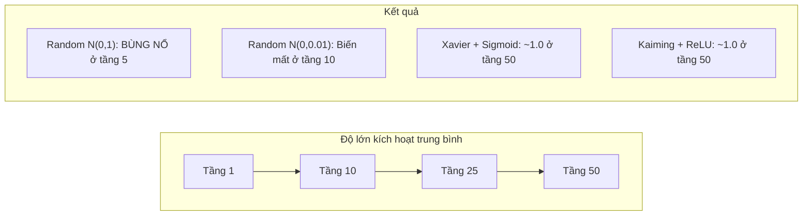
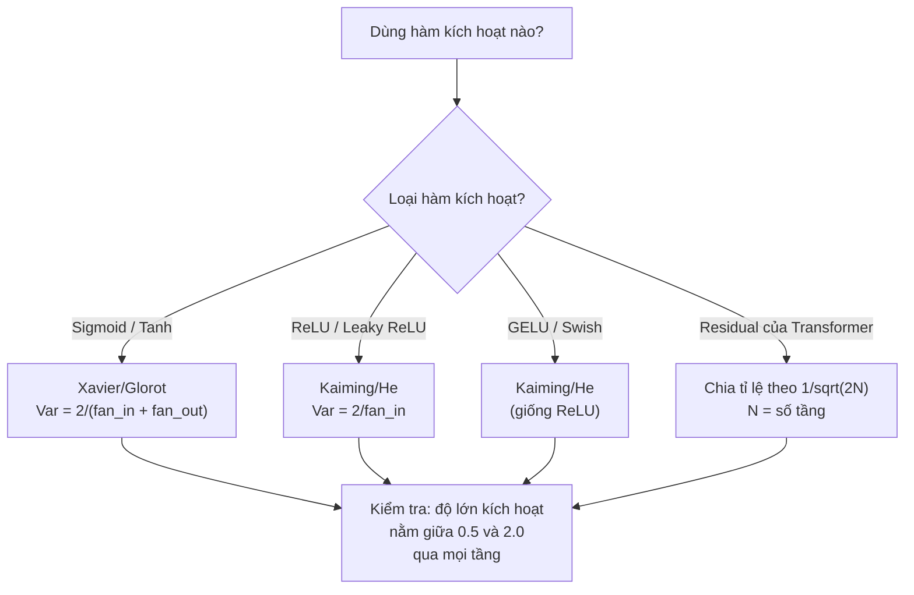

# Khởi tạo trọng số và tính ổn định khi huấn luyện

> Khởi tạo sai thì huấn luyện không bao giờ bắt đầu. Khởi tạo đúng thì 50 tầng huấn luyện mượt như 3 tầng.

**Type:** Build
**Languages:** Python
**Prerequisites:** Bài 03.04 (Hàm kích hoạt), Bài 03.07 (Điều chuẩn)
**Time:** ~90 phút

## Mục tiêu học tập

- Cài đặt các chiến lược khởi tạo zero, random, Xavier/Glorot và Kaiming/He rồi đo ảnh hưởng của chúng lên độ lớn kích hoạt qua 50 tầng
- Suy ra vì sao khởi tạo Xavier dùng Var(w) = 2/(fan_in + fan_out) và Kaiming dùng Var(w) = 2/fan_in
- Chứng minh vấn đề đối xứng của khởi tạo zero và giải thích vì sao chỉ chỉnh thang đo ngẫu nhiên là chưa đủ
- Ghép đúng chiến lược khởi tạo với hàm kích hoạt: Xavier cho sigmoid/tanh, Kaiming cho ReLU/GELU

## Vấn đề

Khởi tạo toàn bộ trọng số bằng zero. Không có gì học được. Mọi neuron tính cùng một hàm, nhận cùng một gradient và cập nhật y hệt nhau. Sau 10.000 epoch, tầng ẩn 512 neuron của bạn vẫn chỉ là 512 bản sao của cùng một neuron. Bạn trả tiền cho 512 tham số và chỉ nhận được 1.

Khởi tạo chúng quá lớn. Kích hoạt bùng nổ xuyên qua mạng. Đến tầng 10, giá trị chạm 1e15. Đến tầng 20, chúng tràn sang vô cực. Gradient đi theo đúng quỹ đạo đó nhưng ngược chiều.

Khởi tạo chúng ngẫu nhiên theo phân phối chuẩn tắc. Hiệu quả với 3 tầng. Ở 50 tầng, tín hiệu sụp về zero hoặc nổ tung tới vô cực, tuỳ vào việc thang đo ngẫu nhiên hơi nhỏ hay hơi lớn. Ranh giới giữa "chạy được" và "hỏng" mỏng như sợi tóc.

Weight initialization (khởi tạo trọng số) là quyết định bị đánh giá thấp nhất trong deep learning. Kiến trúc thì có paper. Optimizer thì có bài blog. Khởi tạo thì chỉ được một dòng chú thích cuối trang. Nhưng làm sai bước này thì mọi thứ khác vô nghĩa -- mạng của bạn đã chết trước khi huấn luyện bắt đầu.

## Khái niệm

### Vấn đề đối xứng

Mọi neuron trong một tầng có cùng cấu trúc: nhân đầu vào với trọng số, cộng bias, áp dụng hàm kích hoạt. Nếu mọi trọng số khởi đầu cùng một giá trị (zero là trường hợp cực đoan), mọi neuron tính ra cùng một đầu ra. Trong lan truyền ngược, mọi neuron nhận cùng một gradient. Trong bước cập nhật, mọi neuron thay đổi cùng một lượng.

Bạn bị kẹt. Mạng có hàng trăm tham số nhưng tất cả cùng nhúc nhích như một. Hiện tượng này gọi là đối xứng, và khởi tạo ngẫu nhiên là cách thô bạo để phá vỡ đối xứng (symmetry breaking). Mỗi neuron xuất phát từ một điểm khác nhau trong không gian trọng số, nên mỗi neuron học một đặc trưng khác nhau.

Nhưng "ngẫu nhiên" là chưa đủ. *Thang đo* của tính ngẫu nhiên quyết định mạng có huấn luyện được hay không.

### Lan truyền phương sai qua các tầng

Xét một tầng với fan_in (số đầu vào):

```
z = w1*x1 + w2*x2 + ... + w_n*x_n
```

Nếu mỗi trọng số wi được lấy từ một phân phối có phương sai (variance) Var(w) và mỗi đầu vào xi có phương sai Var(x), thì phương sai đầu ra là:

```
Var(z) = fan_in * Var(w) * Var(x)
```

Nếu Var(w) = 1 và fan_in = 512, phương sai đầu ra gấp 512 lần phương sai đầu vào. Sau 10 tầng: 512^10 = 1.2e27. Tín hiệu của bạn đã bùng nổ.

Nếu Var(w) = 0.001, phương sai đầu ra co lại 0.001 * 512 = 0.512 mỗi tầng. Sau 10 tầng: 0.512^10 = 0.00013. Tín hiệu của bạn đã biến mất.

Mục tiêu: chọn Var(w) sao cho Var(z) = Var(x). Nhờ đó lan truyền tín hiệu (signal propagation) giữ độ lớn không đổi qua các tầng.

### Khởi tạo Xavier/Glorot

Glorot và Bengio (2010) đã suy ra nghiệm cho các hàm kích hoạt sigmoid và tanh. Để giữ phương sai không đổi ở cả lượt xuôi và lượt ngược:

```
Var(w) = 2 / (fan_in + fan_out)
```

Trong thực tế, trọng số được lấy từ:

```
w ~ Uniform(-limit, limit)  where limit = sqrt(6 / (fan_in + fan_out))
```

hoặc:

```
w ~ Normal(0, sqrt(2 / (fan_in + fan_out)))
```

Cách này hiệu quả vì sigmoid và tanh gần như tuyến tính quanh zero, mà kích hoạt được khởi tạo đúng thì nằm quanh vùng đó. Phương sai giữ ổn định qua hàng chục tầng.

### Khởi tạo Kaiming/He

ReLU triệt tiêu một nửa đầu ra (mọi giá trị âm đều thành zero). fan_in hiệu dụng bị giảm một nửa vì trung bình một nửa số đầu vào bị zero hoá. Khởi tạo Xavier không tính đến điều này -- nó đánh giá thấp phương sai cần thiết.

He và cộng sự (2015) đã điều chỉnh công thức:

```
Var(w) = 2 / fan_in
```

Trọng số được lấy từ:

```
w ~ Normal(0, sqrt(2 / fan_in))
```

Hệ số 2 bù cho việc ReLU zero hoá một nửa số kích hoạt. Không có nó, tín hiệu co lại khoảng 0.5 lần mỗi tầng. Với 50 tầng: 0.5^50 = 8.8e-16. Khởi tạo Kaiming ngăn được điều đó.

### Khởi tạo cho Transformer

GPT-2 đưa ra một kiểu khác. Các kết nối residual cộng đầu ra của mỗi khối con vào đầu vào của chính nó:

```
x = x + sublayer(x)
```

Mỗi phép cộng làm tăng phương sai. Với N tầng residual, phương sai lớn lên tỉ lệ với N. GPT-2 chia tỉ lệ trọng số của các tầng residual theo 1/sqrt(2N), trong đó N là số tầng. Nhờ vậy độ lớn tín hiệu tích luỹ vẫn ổn định.

Llama 3 (405B tham số, 126 tầng) dùng cách tương tự. Không có phép chia tỉ lệ này, dòng residual sẽ phình vô hạn qua 126 tầng attention và khối feedforward.

```mermaid
flowchart TD
    subgraph "Khởi tạo zero"
        Z1["Tầng 1<br/>Mọi trọng số = 0"] --> Z2["Tầng 2<br/>Mọi neuron giống hệt nhau"]
        Z2 --> Z3["Tầng 3<br/>Vẫn giống hệt"]
        Z3 --> ZR["Kết quả: chỉ 1 neuron hiệu dụng<br/>bất kể độ rộng"]
    end

    subgraph "Khởi tạo Xavier"
        X1["Tầng 1<br/>Var = 2/(fan_in+fan_out)"] --> X2["Tầng 2<br/>Tín hiệu ổn định"]
        X2 --> X3["Tầng 50<br/>Tín hiệu ổn định"]
        X3 --> XR["Kết quả: huấn luyện được với<br/>sigmoid/tanh"]
    end

    subgraph "Khởi tạo Kaiming"
        K1["Tầng 1<br/>Var = 2/fan_in"] --> K2["Tầng 2<br/>Tín hiệu ổn định"]
        K2 --> K3["Tầng 50<br/>Tín hiệu ổn định"]
        K3 --> KR["Kết quả: huấn luyện được với<br/>ReLU/GELU"]
    end
```



### Độ lớn kích hoạt qua 50 tầng



### Chọn khởi tạo phù hợp



```figure
weight-init-variance
```

## Tự tay làm

### Bước 1: Các chiến lược khởi tạo

Bốn cách khởi tạo một ma trận trọng số. Mỗi cách trả về danh sách của các danh sách (ma trận 2 chiều) với fan_in cột và fan_out (số đầu ra) hàng.

```python
import math
import random


def zero_init(fan_in, fan_out):
    return [[0.0 for _ in range(fan_in)] for _ in range(fan_out)]


def random_init(fan_in, fan_out, scale=1.0):
    return [[random.gauss(0, scale) for _ in range(fan_in)] for _ in range(fan_out)]


def xavier_init(fan_in, fan_out):
    std = math.sqrt(2.0 / (fan_in + fan_out))
    return [[random.gauss(0, std) for _ in range(fan_in)] for _ in range(fan_out)]


def kaiming_init(fan_in, fan_out):
    std = math.sqrt(2.0 / fan_in)
    return [[random.gauss(0, std) for _ in range(fan_in)] for _ in range(fan_out)]
```

### Bước 2: Các hàm kích hoạt

Chúng ta cần sigmoid, tanh và ReLU để kiểm tra từng chiến lược khởi tạo với hàm kích hoạt mà nó nhắm tới.

```python
def sigmoid(x):
    x = max(-500, min(500, x))
    return 1.0 / (1.0 + math.exp(-x))


def tanh_act(x):
    return math.tanh(x)


def relu(x):
    return max(0.0, x)
```

### Bước 3: Lượt xuôi qua 50 tầng

Đưa dữ liệu ngẫu nhiên qua một mạng sâu và đo độ lớn kích hoạt trung bình ở mỗi tầng.

```python
def forward_deep(init_fn, activation_fn, n_layers=50, width=64, n_samples=100):
    random.seed(42)
    layer_magnitudes = []

    inputs = [[random.gauss(0, 1) for _ in range(width)] for _ in range(n_samples)]

    for layer_idx in range(n_layers):
        weights = init_fn(width, width)
        biases = [0.0] * width

        new_inputs = []
        for sample in inputs:
            output = []
            for neuron_idx in range(width):
                z = sum(weights[neuron_idx][j] * sample[j] for j in range(width)) + biases[neuron_idx]
                output.append(activation_fn(z))
            new_inputs.append(output)
        inputs = new_inputs

        magnitudes = []
        for sample in inputs:
            magnitudes.append(sum(abs(v) for v in sample) / width)
        mean_mag = sum(magnitudes) / len(magnitudes)
        layer_magnitudes.append(mean_mag)

    return layer_magnitudes
```

### Bước 4: Thí nghiệm

Chạy mọi tổ hợp: khởi tạo zero, random N(0,1), random N(0,0.01), Xavier với sigmoid, Xavier với tanh, Kaiming với ReLU. In độ lớn ở các tầng then chốt.

```python
def run_experiment():
    configs = [
        ("Zero init + Sigmoid", lambda fi, fo: zero_init(fi, fo), sigmoid),
        ("Random N(0,1) + ReLU", lambda fi, fo: random_init(fi, fo, 1.0), relu),
        ("Random N(0,0.01) + ReLU", lambda fi, fo: random_init(fi, fo, 0.01), relu),
        ("Xavier + Sigmoid", xavier_init, sigmoid),
        ("Xavier + Tanh", xavier_init, tanh_act),
        ("Kaiming + ReLU", kaiming_init, relu),
    ]

    print(f"{'Strategy':<30} {'L1':>10} {'L5':>10} {'L10':>10} {'L25':>10} {'L50':>10}")
    print("-" * 80)

    for name, init_fn, act_fn in configs:
        mags = forward_deep(init_fn, act_fn)
        row = f"{name:<30}"
        for idx in [0, 4, 9, 24, 49]:
            val = mags[idx]
            if val > 1e6:
                row += f" {'EXPLODED':>10}"
            elif val < 1e-6:
                row += f" {'VANISHED':>10}"
            else:
                row += f" {val:>10.4f}"
        print(row)
```

### Bước 5: Minh hoạ đối xứng

Cho thấy khởi tạo zero tạo ra các neuron giống hệt nhau.

```python
def symmetry_demo():
    random.seed(42)
    weights = zero_init(2, 4)
    biases = [0.0] * 4

    inputs = [0.5, -0.3]
    outputs = []
    for neuron_idx in range(4):
        z = sum(weights[neuron_idx][j] * inputs[j] for j in range(2)) + biases[neuron_idx]
        outputs.append(sigmoid(z))

    print("\nSymmetry Demo (4 neurons, zero init):")
    for i, out in enumerate(outputs):
        print(f"  Neuron {i}: output = {out:.6f}")
    all_same = all(abs(outputs[i] - outputs[0]) < 1e-10 for i in range(len(outputs)))
    print(f"  All identical: {all_same}")
    print(f"  Effective parameters: 1 (not {len(weights) * len(weights[0])})")
```

### Bước 6: Báo cáo độ lớn từng tầng

In biểu đồ cột trực quan về độ lớn kích hoạt qua 50 tầng.

```python
def magnitude_report(name, magnitudes):
    print(f"\n{name}:")
    for i, mag in enumerate(magnitudes):
        if i % 5 == 0 or i == len(magnitudes) - 1:
            if mag > 1e6:
                bar = "X" * 50 + " EXPLODED"
            elif mag < 1e-6:
                bar = "." + " VANISHED"
            else:
                bar_len = min(50, max(1, int(mag * 10)))
                bar = "#" * bar_len
            print(f"  Layer {i+1:3d}: {bar} ({mag:.6f})")
```

## Áp dụng

PyTorch cung cấp sẵn những hàm này:

```python
import torch
import torch.nn as nn

layer = nn.Linear(512, 256)

nn.init.xavier_uniform_(layer.weight)
nn.init.xavier_normal_(layer.weight)

nn.init.kaiming_uniform_(layer.weight, nonlinearity='relu')
nn.init.kaiming_normal_(layer.weight, nonlinearity='relu')

nn.init.zeros_(layer.bias)
```

Khi bạn gọi `nn.Linear(512, 256)`, PyTorch mặc định dùng khởi tạo Kaiming uniform. Đó là lý do hầu hết mạng đơn giản "chạy được ngay" -- PyTorch đã chọn đúng sẵn. Nhưng khi bạn tự dựng kiến trúc riêng hoặc đi sâu hơn 20 tầng, bạn cần hiểu chuyện gì đang xảy ra và có thể phải ghi đè mặc định.

Với transformer, các model HuggingFace thường xử lý khởi tạo trong phương thức `_init_weights`. Cách cài đặt của GPT-2 chia tỉ lệ các phép chiếu residual theo 1/sqrt(N). Nếu bạn tự dựng transformer từ đầu, bạn phải tự thêm phần này.

## Đóng gói

Bài học này tạo ra:
- `outputs/prompt-init-strategy.md` -- một prompt chẩn đoán vấn đề khởi tạo trọng số và đề xuất chiến lược phù hợp

## Bài tập

1. Thêm khởi tạo LeCun (Var = 1/fan_in, thiết kế cho hàm kích hoạt SELU). Chạy thí nghiệm 50 tầng với LeCun + tanh và so sánh với Xavier + tanh.

2. Cài đặt phép chia tỉ lệ residual của GPT-2: nhân đầu ra của mỗi tầng với 1/sqrt(2*N) trước khi cộng vào dòng residual. Chạy 50 tầng có và không có chia tỉ lệ, đo xem độ lớn residual lớn lên nhanh đến mức nào.

3. Viết hàm "kiểm tra sức khoẻ khởi tạo" nhận kích thước các tầng và loại hàm kích hoạt của một mạng, rồi đề xuất cách khởi tạo đúng và cảnh báo nếu cách khởi tạo hiện tại sẽ gây vấn đề.

4. Chạy thí nghiệm với fan_in = 16 so với fan_in = 1024. Xavier và Kaiming thích ứng với fan_in, còn random thì không. Chứng minh khoảng cách giữa "chạy được" và "hỏng" rộng ra thế nào khi tầng lớn hơn.

5. Cài đặt khởi tạo trực giao (sinh ma trận ngẫu nhiên, tính SVD, dùng ma trận trực giao U). So sánh với Kaiming cho mạng ReLU ở 50 tầng.

## Thuật ngữ chính

| Thuật ngữ | Người ta thường nói | Ý nghĩa thực sự |
|------|----------------|----------------------|
| Weight initialization | "Đặt trọng số khởi đầu ngẫu nhiên" | Chiến lược chọn giá trị trọng số ban đầu, quyết định mạng có huấn luyện được hay không |
| Symmetry breaking | "Làm cho các neuron khác nhau" | Dùng khởi tạo ngẫu nhiên để mỗi neuron học đặc trưng riêng thay vì tính cùng một hàm |
| Fan-in | "Số đầu vào của một neuron" | Số kết nối đi vào, quyết định cách phương sai đầu vào tích luỹ trong phép nhân tổng |
| Fan-out | "Số đầu ra của một neuron" | Số kết nối đi ra, quan trọng để giữ phương sai gradient trong lan truyền ngược |
| Xavier/Glorot init | "Cách khởi tạo cho sigmoid" | Var(w) = 2/(fan_in + fan_out), giữ phương sai ổn định qua hàm kích hoạt sigmoid và tanh |
| Kaiming/He init | "Cách khởi tạo cho ReLU" | Var(w) = 2/fan_in, tính đến việc ReLU zero hoá một nửa số kích hoạt |
| Variance propagation | "Cách tín hiệu lớn lên hay co lại qua các tầng" | Phân tích toán học về việc phương sai kích hoạt thay đổi từng tầng thế nào theo thang đo trọng số |
| Residual scaling | "Mẹo khởi tạo của GPT-2" | Chia tỉ lệ trọng số kết nối residual theo 1/sqrt(2N) để tránh phương sai lớn lên qua N tầng transformer |
| Dead network | "Không có gì học được" | Mạng mà khởi tạo kém khiến mọi gradient bằng zero hoặc mọi kích hoạt bão hoà, biến mọi neuron thành unit chết (dead unit) |
| Exploding activations | "Giá trị chạy tới vô cực" | Khi phương sai trọng số quá lớn, làm độ lớn kích hoạt tăng theo hàm mũ qua các tầng |

## Đọc thêm

- Glorot & Bengio, "Understanding the difficulty of training deep feedforward neural networks" (2010) -- bài báo gốc về khởi tạo Xavier với phân tích phương sai
- He et al., "Delving Deep into Rectifiers" (2015) -- giới thiệu khởi tạo Kaiming cho mạng ReLU
- Radford et al., "Language Models are Unsupervised Multitask Learners" (2019) -- bài báo GPT-2 với khởi tạo chia tỉ lệ residual
- Mishkin & Matas, "All You Need is a Good Init" (2016) -- khởi tạo unit-variance tuần tự theo tầng, một phương án thực nghiệm thay cho các công thức giải tích
