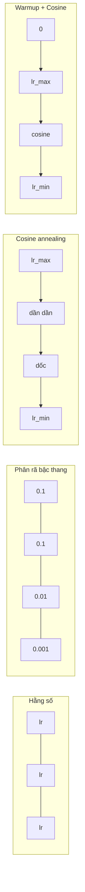
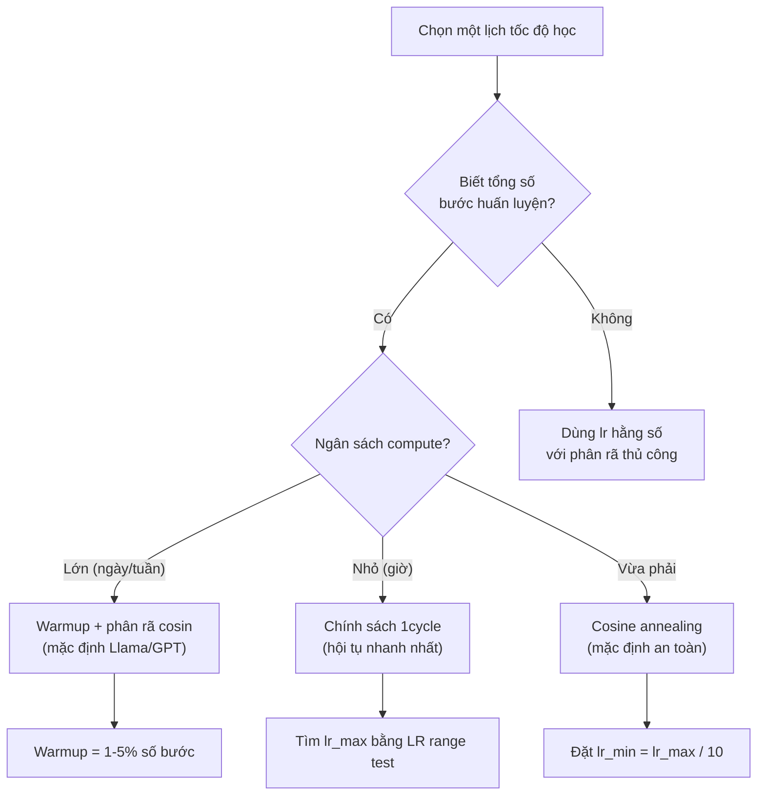
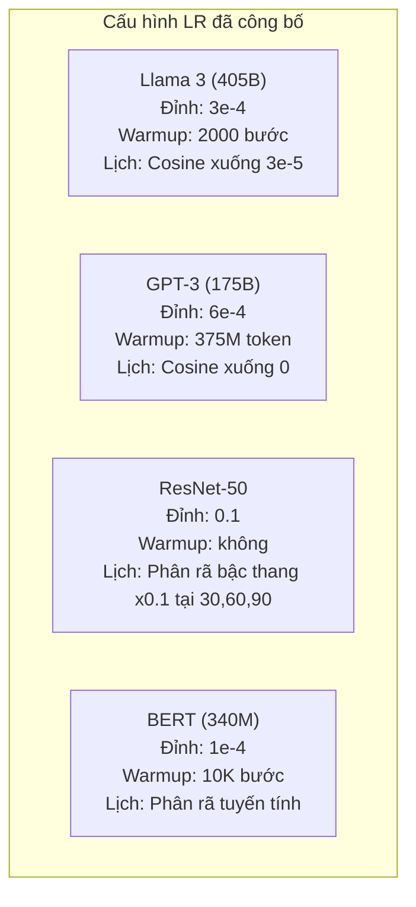

# Lịch tốc độ học và khởi động tăng dần

> Tốc độ học (learning rate) là siêu tham số quan trọng nhất. Không phải kiến trúc. Không phải kích thước tập dữ liệu. Không phải hàm kích hoạt. Mà là tốc độ học. Nếu bạn không tinh chỉnh gì khác, hãy tinh chỉnh đúng cái này.

**Type:** Build
**Languages:** Python
**Prerequisites:** Bài 03.06 (Bộ tối ưu), Bài 03.08 (Khởi tạo trọng số)
**Time:** ~90 phút

## Mục tiêu học tập

- Tự tay viết các lịch tốc độ học (learning rate schedule) hằng số, phân rã bậc thang (step decay), cosine annealing, khởi động tăng dần (warmup) + cosine, và one-cycle (một chu kỳ)
- Trình bày ba kiểu hỏng khi chọn tốc độ học: phân kỳ (quá cao), chững lại (quá thấp), và dao động do không có phân rã (decay)
- Giải thích vì sao warmup là bắt buộc với các bộ tối ưu dựa trên Adam và cách nó ổn định giai đoạn đầu huấn luyện
- So sánh tốc độ hội tụ của cả năm lịch trên cùng một bài toán và chọn lịch phù hợp với ngân sách huấn luyện của bạn

## Vấn đề

Đặt tốc độ học bằng 0.1. Huấn luyện phân kỳ -- loss nhảy lên vô cực sau 3 bước. Đặt bằng 0.0001. Huấn luyện bò như sên -- sau 100 epoch, mô hình gần như chẳng nhích khỏi trạng thái ngẫu nhiên. Đặt bằng 0.01. Huấn luyện chạy tốt trong 50 epoch, rồi loss dao động quanh một cực tiểu mà nó không bao giờ chạm tới vì các bước quá lớn.

Tốc độ học tối ưu không phải là một hằng số. Nó thay đổi trong suốt quá trình huấn luyện. Giai đoạn đầu, bạn muốn bước lớn để đi nhanh. Cuối quá trình, bạn muốn bước thật nhỏ để lắng vào một cực tiểu sắc. Khác biệt giữa mô hình đạt 90% độ chính xác và mô hình đạt 95% thường chỉ nằm ở lịch.

Mọi mô hình lớn công bố trong ba năm qua đều dùng lịch tốc độ học. Llama 3 dùng lr đỉnh = 3e-4 với 2000 bước warmup và phân rã cosin (cosine decay) xuống 3e-5. GPT-3 dùng lr = 6e-4 với warmup trên 375 triệu token. Đây không phải những lựa chọn tùy tiện. Chúng là kết quả của những đợt quét siêu tham số rộng khắp, tốn hàng triệu đô.

Bạn cần hiểu các lịch vì mặc định sẽ không hợp với bài toán của bạn. Khi fine-tune một mô hình đã huấn luyện sẵn, lịch đúng khác với huấn luyện từ đầu. Khi tăng kích thước batch, độ dài warmup cần thay đổi. Khi huấn luyện vỡ ở bước 10.000, bạn cần biết đó là lỗi do lịch hay do thứ khác.

## Khái niệm

### Tốc độ học hằng số

Cách đơn giản nhất. Chọn một con số, dùng nó cho mọi bước.

```
lr(t) = lr_0
```

Hiếm khi tối ưu. Nó hoặc quá cao cho cuối quá trình huấn luyện (dao động quanh cực tiểu), hoặc quá thấp cho giai đoạn đầu (đốt compute vô ích vào những bước tí xíu). Dùng được cho mô hình nhỏ và để debug. Lựa chọn tồi với bất cứ thứ gì huấn luyện quá một giờ.

### Phân rã bậc thang

Cách tiếp cận cổ điển từ thời ResNet. Cắt tốc độ học theo một hệ số (thường là 10x) tại các epoch cố định.

```
lr(t) = lr_0 * gamma^(floor(epoch / step_size))
```

Với gamma = 0.1 và step_size = 30 nghĩa là: lr giảm 10x sau mỗi 30 epoch. ResNet-50 dùng cách này -- lr=0.1, giảm 10x tại epoch 30, 60, và 90.

Vấn đề: các điểm phân rã tối ưu phụ thuộc vào tập dữ liệu và kiến trúc. Chuyển sang bài toán khác là bạn phải tinh chỉnh lại thời điểm giảm. Các chuyển tiếp rất đột ngột -- loss có thể vọt lên khi tốc độ học đổi đột ngột.

### Cosine annealing

Phân rã mượt từ tốc độ học lớn nhất xuống mức nhỏ nhất, theo đường cong cosin:

```
lr(t) = lr_min + 0.5 * (lr_max - lr_min) * (1 + cos(pi * t / T))
```

Trong đó t là bước hiện tại và T là tổng số bước.

Tại t=0, số hạng cosin bằng 1, nên lr = lr_max. Tại t=T, số hạng cosin bằng -1, nên lr = lr_min. Phân rã nhẹ lúc đầu, tăng tốc ở giữa, rồi lại nhẹ dần về cuối.

Đây là mặc định cho hầu hết các lượt huấn luyện hiện đại. Không có siêu tham số nào phải tinh chỉnh ngoài lr_max và lr_min. Hình dạng cosin khớp với quan sát thực nghiệm rằng phần lớn việc học diễn ra ở giữa quá trình huấn luyện -- bạn muốn các bước hợp lý trong giai đoạn then chốt đó.

### Warmup: vì sao bạn bắt đầu nhỏ

Adam và các bộ tối ưu thích nghi khác duy trì ước lượng chạy của trung bình và phương sai gradient. Tại bước 0, các ước lượng này được khởi tạo bằng 0. Vài cập nhật gradient đầu tiên dựa trên thống kê rác. Nếu tốc độ học lớn trong giai đoạn này, mô hình sẽ bước những bước khổng lồ và sai hướng.

Warmup khắc phục điều đó. Bắt đầu với tốc độ học thật nhỏ (thường là lr_max / warmup_steps, thậm chí bằng 0) rồi tăng tuyến tính lên lr_max trong N bước đầu. Khi chạm tốc độ học đầy đủ thì thống kê của Adam đã ổn định.

```
lr(t) = lr_max * (t / warmup_steps)     for t < warmup_steps
```

Warmup điển hình: 1-5% tổng số bước huấn luyện. Llama 3 huấn luyện trên ~1,8 nghìn tỷ token và warmup 2000 bước. GPT-3 warmup trên 375 triệu token.

### Linear warmup + phân rã cosin

Mặc định thời hiện đại. Tăng tuyến tính, rồi phân rã theo cosin:

```
if t < warmup_steps:
    lr(t) = lr_max * (t / warmup_steps)
else:
    progress = (t - warmup_steps) / (total_steps - warmup_steps)
    lr(t) = lr_min + 0.5 * (lr_max - lr_min) * (1 + cos(pi * progress))
```

Đây là thứ Llama, GPT, PaLM và hầu hết transformer hiện đại dùng. Warmup ngăn bất ổn định sớm. Phân rã cosin đưa mô hình lắng vào một cực tiểu tốt.

### Chính sách 1cycle

Phát hiện của Leslie Smith (2018): tăng tốc độ học từ một giá trị thấp lên giá trị cao trong nửa đầu huấn luyện, rồi giảm dần trong nửa sau. Nghe ngược đời -- tại sao lại *tăng* tốc độ học ở giữa chừng?

Lý thuyết: tốc độ học cao đóng vai trò điều chuẩn bằng cách thêm nhiễu vào quỹ đạo tối ưu hóa. Mô hình khám phá nhiều hơn cảnh quan loss trong pha tăng, tìm được những lòng chảo tốt hơn. Pha giảm sau đó tinh chỉnh bên trong lòng chảo tốt nhất đã tìm được.

```
Phase 1 (0 to T/2):    lr ramps from lr_max/25 to lr_max
Phase 2 (T/2 to T):    lr ramps from lr_max to lr_max/10000
```

1cycle thường huấn luyện nhanh hơn cosine annealing với cùng ngân sách compute. Đánh đổi: bạn phải biết trước tổng số bước.

### Hình dạng các lịch



### Sơ đồ quyết định



### Con số thật từ các mô hình đã công bố



```figure
lr-schedule
```

## Tự tay làm

### Bước 1: Các hàm lịch

Mỗi hàm nhận bước hiện tại và trả về tốc độ học tại bước đó.

```python
import math


def constant_schedule(step, lr=0.01, **kwargs):
    return lr


def step_decay_schedule(step, lr=0.1, step_size=100, gamma=0.1, **kwargs):
    return lr * (gamma ** (step // step_size))


def cosine_schedule(step, lr=0.01, total_steps=1000, lr_min=1e-5, **kwargs):
    if step >= total_steps:
        return lr_min
    return lr_min + 0.5 * (lr - lr_min) * (1 + math.cos(math.pi * step / total_steps))


def warmup_cosine_schedule(step, lr=0.01, total_steps=1000, warmup_steps=100, lr_min=1e-5, **kwargs):
    if total_steps <= warmup_steps:
        return lr * (step / max(warmup_steps, 1))
    if step < warmup_steps:
        return lr * step / warmup_steps
    progress = (step - warmup_steps) / (total_steps - warmup_steps)
    return lr_min + 0.5 * (lr - lr_min) * (1 + math.cos(math.pi * progress))


def one_cycle_schedule(step, lr=0.01, total_steps=1000, **kwargs):
    mid = max(total_steps // 2, 1)
    if step < mid:
        return (lr / 25) + (lr - lr / 25) * step / mid
    else:
        progress = (step - mid) / max(total_steps - mid, 1)
        return lr * (1 - progress) + (lr / 10000) * progress
```

### Bước 2: Trực quan hóa mọi lịch

In một biểu đồ dạng văn bản cho thấy mỗi lịch tiến triển thế nào qua quá trình huấn luyện.

```python
def visualize_schedule(name, schedule_fn, total_steps=500, **kwargs):
    steps = list(range(0, total_steps, total_steps // 20))
    if total_steps - 1 not in steps:
        steps.append(total_steps - 1)

    lrs = [schedule_fn(s, total_steps=total_steps, **kwargs) for s in steps]
    max_lr = max(lrs) if max(lrs) > 0 else 1.0

    print(f"\n{name}:")
    for s, lr_val in zip(steps, lrs):
        bar_len = int(lr_val / max_lr * 40)
        bar = "#" * bar_len
        print(f"  Step {s:4d}: lr={lr_val:.6f} {bar}")
```

### Bước 3: Mạng huấn luyện

Một mạng hai lớp đơn giản trên tập dữ liệu hình tròn, giống các bài trước, nhưng lần này ta thay đổi lịch.

```python
import random


def sigmoid(x):
    x = max(-500, min(500, x))
    return 1.0 / (1.0 + math.exp(-x))


def relu(x):
    return max(0.0, x)


def relu_deriv(x):
    return 1.0 if x > 0 else 0.0


def make_circle_data(n=200, seed=42):
    random.seed(seed)
    data = []
    for _ in range(n):
        x = random.uniform(-2, 2)
        y = random.uniform(-2, 2)
        label = 1.0 if x * x + y * y < 1.5 else 0.0
        data.append(([x, y], label))
    return data


def train_with_schedule(schedule_fn, schedule_name, data, epochs=300, base_lr=0.05, **kwargs):
    random.seed(0)
    hidden_size = 8
    total_steps = epochs * len(data)

    std = math.sqrt(2.0 / 2)
    w1 = [[random.gauss(0, std) for _ in range(2)] for _ in range(hidden_size)]
    b1 = [0.0] * hidden_size
    w2 = [random.gauss(0, std) for _ in range(hidden_size)]
    b2 = 0.0

    step = 0
    epoch_losses = []

    for epoch in range(epochs):
        total_loss = 0
        correct = 0

        for x, target in data:
            lr = schedule_fn(step, lr=base_lr, total_steps=total_steps, **kwargs)

            z1 = []
            h = []
            for i in range(hidden_size):
                z = w1[i][0] * x[0] + w1[i][1] * x[1] + b1[i]
                z1.append(z)
                h.append(relu(z))

            z2 = sum(w2[i] * h[i] for i in range(hidden_size)) + b2
            out = sigmoid(z2)

            error = out - target
            d_out = error * out * (1 - out)

            for i in range(hidden_size):
                d_h = d_out * w2[i] * relu_deriv(z1[i])
                w2[i] -= lr * d_out * h[i]
                for j in range(2):
                    w1[i][j] -= lr * d_h * x[j]
                b1[i] -= lr * d_h
            b2 -= lr * d_out

            total_loss += (out - target) ** 2
            if (out >= 0.5) == (target >= 0.5):
                correct += 1
            step += 1

        avg_loss = total_loss / len(data)
        accuracy = correct / len(data) * 100
        epoch_losses.append(avg_loss)

    return epoch_losses
```

### Bước 4: So sánh mọi lịch

Huấn luyện cùng một mạng với từng lịch rồi so sánh loss cuối và hành vi hội tụ.

```python
def compare_schedules(data):
    configs = [
        ("Constant", constant_schedule, {}),
        ("Step Decay", step_decay_schedule, {"step_size": 15000, "gamma": 0.1}),
        ("Cosine", cosine_schedule, {"lr_min": 1e-5}),
        ("Warmup+Cosine", warmup_cosine_schedule, {"warmup_steps": 3000, "lr_min": 1e-5}),
        ("1cycle", one_cycle_schedule, {}),
    ]

    print(f"\n{'Schedule':<20} {'Start Loss':>12} {'Mid Loss':>12} {'End Loss':>12} {'Best Loss':>12}")
    print("-" * 70)

    for name, schedule_fn, extra_kwargs in configs:
        losses = train_with_schedule(schedule_fn, name, data, epochs=300, base_lr=0.05, **extra_kwargs)
        mid_idx = len(losses) // 2
        best = min(losses)
        print(f"{name:<20} {losses[0]:>12.6f} {losses[mid_idx]:>12.6f} {losses[-1]:>12.6f} {best:>12.6f}")
```

### Bước 5: LR quá cao so với quá thấp

Trình bày ba kiểu hỏng: quá cao (phân kỳ), quá thấp (bò chậm), và vừa đúng.

```python
def lr_sensitivity(data):
    learning_rates = [1.0, 0.1, 0.01, 0.001, 0.0001]

    print("\nLR Sensitivity (constant schedule, 100 epochs):")
    print(f"  {'LR':>10} {'Start Loss':>12} {'End Loss':>12} {'Status':>15}")
    print("  " + "-" * 52)

    for lr in learning_rates:
        losses = train_with_schedule(constant_schedule, f"lr={lr}", data, epochs=100, base_lr=lr)
        start = losses[0]
        end = losses[-1]

        if end > start or math.isnan(end) or end > 1.0:
            status = "DIVERGED"
        elif end > start * 0.9:
            status = "BARELY MOVED"
        elif end < 0.15:
            status = "CONVERGED"
        else:
            status = "LEARNING"

        end_str = f"{end:.6f}" if not math.isnan(end) else "NaN"
        print(f"  {lr:>10.4f} {start:>12.6f} {end_str:>12} {status:>15}")
```

## Áp dụng

PyTorch cung cấp các bộ điều lịch (scheduler) trong `torch.optim.lr_scheduler`:

```python
import torch
import torch.optim as optim
from torch.optim.lr_scheduler import CosineAnnealingLR, OneCycleLR, StepLR

model = nn.Sequential(nn.Linear(10, 64), nn.ReLU(), nn.Linear(64, 1))
optimizer = optim.Adam(model.parameters(), lr=3e-4)

scheduler = CosineAnnealingLR(optimizer, T_max=1000, eta_min=1e-5)

for step in range(1000):
    loss = train_step(model, optimizer)
    scheduler.step()
```

Với warmup + cosine, dùng scheduler kiểu lambda hoặc `get_cosine_schedule_with_warmup` của HuggingFace:

```python
from transformers import get_cosine_schedule_with_warmup

scheduler = get_cosine_schedule_with_warmup(
    optimizer,
    num_warmup_steps=2000,
    num_training_steps=100000,
)
```

Hàm của HuggingFace là thứ hầu hết script fine-tune Llama và GPT đang dùng. Khi còn phân vân, hãy dùng warmup + cosine với warmup = 3-5% tổng số bước. Nó hiệu quả với gần như mọi thứ.

## Đóng gói

Bài học này tạo ra:
- `outputs/prompt-lr-schedule-advisor.md` -- một prompt đề xuất lịch tốc độ học và siêu tham số phù hợp với thiết lập huấn luyện của bạn

## Bài tập

1. Cài đặt phân rã hàm mũ: lr(t) = lr_0 * gamma^t với gamma = 0.999. So sánh với cosine annealing trên tập dữ liệu hình tròn.

2. Cài đặt learning rate range test (Leslie Smith): huấn luyện vài trăm bước trong khi tăng tốc độ học theo hàm mũ từ 1e-7 lên 1. Vẽ loss theo LR. LR lớn nhất tối ưu nằm ngay trước điểm loss bắt đầu tăng.

3. Huấn luyện với warmup + cosine nhưng thay đổi độ dài warmup: 0%, 1%, 5%, 10%, 20% tổng số bước. Tìm điểm ngọt nơi huấn luyện ổn định nhất.

4. Cài đặt cosine annealing với warm restarts (SGDR): đặt lại tốc độ học về lr_max sau mỗi T bước rồi phân rã tiếp. So sánh với cosine chuẩn trên một lượt huấn luyện dài hơn.

5. Xây một "bác sĩ phẫu thuật lịch" theo dõi loss huấn luyện, tự chuyển từ warmup sang cosine khi loss ổn định, và giảm lr nếu loss nằm ở vùng phẳng (plateau) quá lâu.

## Thuật ngữ chính

| Thuật ngữ | Người ta thường nói | Ý nghĩa thực sự |
|------|----------------|----------------------|
| Learning rate | "Mô hình học nhanh cỡ nào" | Đại lượng vô hướng nhân với gradient để xác định độ lớn cập nhật tham số |
| Schedule | "Đổi LR theo thời gian" | Một hàm ánh xạ bước huấn luyện sang tốc độ học, được thiết kế để tối ưu hội tụ |
| Warmup | "Bắt đầu với LR nhỏ" | Tăng tuyến tính LR từ gần 0 lên giá trị đích trong N bước đầu để ổn định thống kê của bộ tối ưu |
| Cosine annealing | "Phân rã LR mượt" | Giảm LR theo đường cong cosin từ lr_max xuống lr_min trong suốt quá trình huấn luyện |
| Step decay | "Hạ LR tại các mốc" | Nhân LR với một hệ số (thường 0.1) tại các khoảng epoch cố định |
| 1cycle policy | "Tăng rồi giảm" | Phương pháp của Leslie Smith: tăng LR rồi giảm trong một chu kỳ duy nhất để hội tụ nhanh hơn |
| LR range test | "Tìm tốc độ học tốt nhất" | Huấn luyện ngắn trong khi tăng LR để tìm giá trị mà loss bắt đầu phân kỳ |
| Cosine with warm restarts | "Đặt lại rồi lặp" | Định kỳ đặt LR về lr_max rồi phân rã lại (SGDR) |
| Eta min | "Sàn của LR" | Tốc độ học nhỏ nhất mà lịch phân rã xuống tới |
| Peak learning rate | "LR lớn nhất" | LR cao nhất đạt được trong huấn luyện, thường là sau warmup |

## Đọc thêm

- Loshchilov & Hutter, "SGDR: Stochastic Gradient Descent with Warm Restarts" (2017) -- giới thiệu cosine annealing và warm restarts
- Smith, "Super-Convergence: Very Fast Training of Neural Networks Using Large Learning Rates" (2018) -- bài báo về chính sách 1cycle
- Touvron et al., "Llama 2: Open Foundation and Fine-Tuned Chat Models" (2023) -- ghi lại lịch warmup + cosine dùng ở quy mô lớn
- Goyal et al., "Accurate, Large Minibatch SGD: Training ImageNet in 1 Hour" (2017) -- quy tắc scaling tuyến tính và warmup cho huấn luyện batch lớn

---

[← Bài trước: Khởi tạo trọng số và tính ổn định khi huấn luyện](../../08-weight-initialization/docs/vi.md) · [Bài sau: Tự xây dựng mini framework của bạn →](../../10-mini-framework/docs/vi.md)
