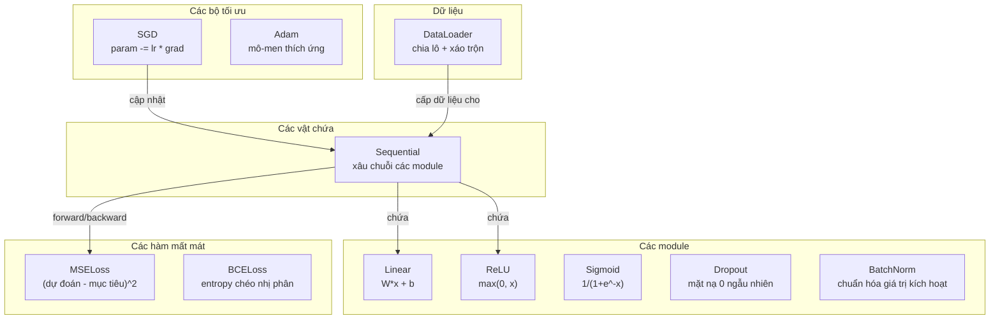
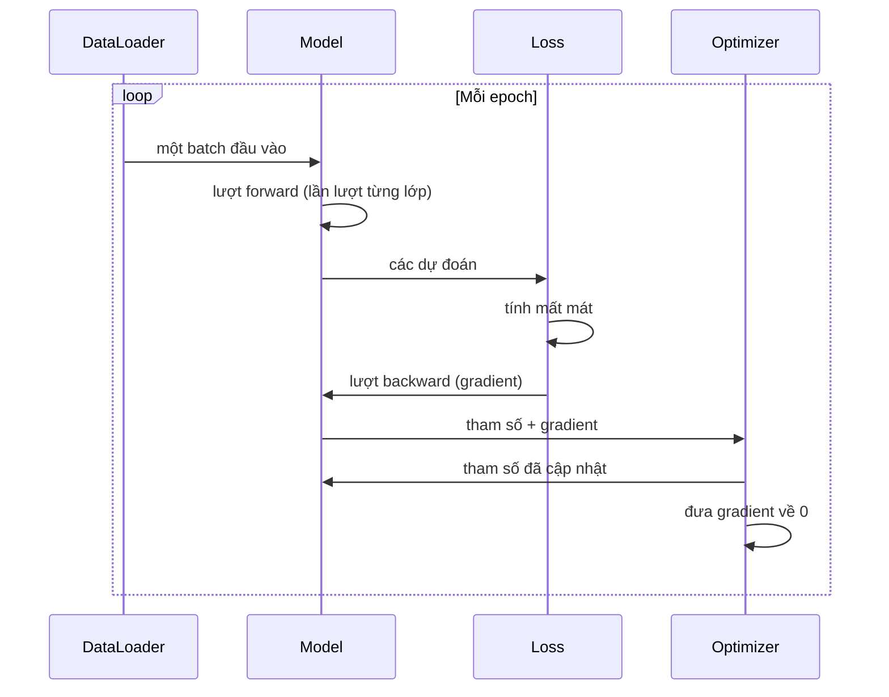
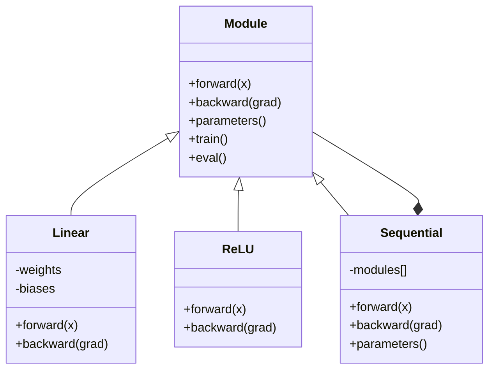

# Tự xây dựng mini framework của bạn

> Bạn đã xây neuron, layer, mạng, lan truyền ngược, hàm kích hoạt, hàm mất mát, bộ tối ưu, regularization, khởi tạo và lịch learning rate. Tất cả đều là những mảnh rời rạc. Giờ hãy nối chúng lại thành một mini framework (khung làm việc mini). Không phải PyTorch. Không phải TensorFlow. Mà là của chính bạn.

**Type:** Build
**Languages:** Python
**Prerequisites:** Toàn bộ Giai đoạn 03 (Bài 01-09)
**Time:** ~120 phút

## Mục tiêu học tập

- Xây dựng một framework học sâu hoàn chỉnh (~500 dòng) gồm Module, Linear, ReLU, Sigmoid, Dropout, BatchNorm, Sequential, các hàm mất mát, bộ tối ưu và DataLoader
- Giải thích lớp trừu tượng Module (forward, backward, parameters) và vì sao cần bật/tắt chế độ train/eval
- Nối mọi thành phần thành một vòng huấn luyện (training loop) chạy được, huấn luyện mạng 4 lớp trên bài toán phân loại hình tròn
- Đối chiếu từng thành phần trong framework của bạn với thành phần tương đương trong PyTorch (nn.Module, nn.Sequential, optim.Adam, DataLoader)

## Vấn đề

Bạn có cả mười bài học với các khối xây dựng nằm rải rác trong nhiều file riêng biệt. Một lớp `Value` ở đây, một vòng huấn luyện ở kia, khởi tạo trọng số trong một file khác, lịch learning rate lại ở một file khác nữa. Để huấn luyện một mạng, bạn copy-paste từ năm bài học khác nhau rồi tự tay nối chúng lại.

Đó chính là vấn đề mà framework giải quyết. PyTorch cho bạn `nn.Module`, `nn.Sequential`, `optim.Adam`, `DataLoader`, và một mẫu vòng huấn luyện gắn chúng lại với nhau. TensorFlow cho bạn `keras.Layer`, `keras.Sequential`, `keras.optimizers.Adam`. Những thứ này không phải phép thuật. Chúng là các mẫu tổ chức code giúp bạn định nghĩa, huấn luyện và đánh giá mạng mà không phải làm lại phần dây nối mỗi lần.

Bạn sẽ xây dựng đúng thứ tương tự trong ~500 dòng Python. Không numpy. Không phụ thuộc bên ngoài. Một framework có thể định nghĩa bất kỳ mạng feedforward nào, huấn luyện nó bằng SGD hoặc Adam, chia dữ liệu thành lô, áp dụng dropout và batch normalization, dùng bất kỳ hàm kích hoạt nào, và lên lịch learning rate.

Khi hoàn thành, bạn sẽ hiểu chính xác điều gì xảy ra khi bạn viết `model = nn.Sequential(...)` trong PyTorch. Bạn sẽ hiểu vì sao `model.train()` và `model.eval()` tồn tại. Bạn sẽ hiểu vì sao `optimizer.zero_grad()` là một lệnh gọi riêng. Bạn sẽ hiểu tất cả, vì bạn đã tự xây tất cả.

## Khái niệm

### Lớp trừu tượng Module

Mọi layer trong PyTorch đều kế thừa từ `nn.Module`. Một module (mô-đun) có ba trách nhiệm:

1. **forward()** -- tính đầu ra từ đầu vào
2. **parameters()** -- trả về toàn bộ trọng số có thể huấn luyện
3. **backward()** -- tính gradient (PyTorch để autograd lo, còn framework của chúng ta làm tường minh)

Layer Linear là một module. Hàm kích hoạt ReLU là một module. Layer dropout là một module. Layer batch normalization là một module. Tất cả đều có chung một giao diện.

### Vật chứa Sequential

`nn.Sequential` xâu chuỗi các module. Lượt forward: đưa dữ liệu qua module 1, rồi module 2, rồi module 3. Lượt backward: chạy ngược chuỗi. Bản thân container (vật chứa) cũng là một module -- nó có forward(), parameters() và backward(). Đây là mẫu composite: một dãy module cũng chính là một module.

### Chế độ huấn luyện và chế độ đánh giá

Dropout đặt ngẫu nhiên một số neuron về 0 khi huấn luyện nhưng cho tất cả đi qua khi đánh giá. Batch normalization dùng thống kê của batch khi huấn luyện nhưng dùng trung bình tích lũy khi đánh giá. Hai phương thức `train()` và `eval()` bật/tắt hành vi này. Mọi module đều có cờ `training`.

### Bộ tối ưu

Bộ tối ưu (optimizer) cập nhật tham số (parameter) dựa trên gradient của chúng. SGD: `param -= lr * grad`. Adam: duy trì ước lượng momentum và phương sai, rồi cập nhật. Bộ tối ưu không biết gì về kiến trúc mạng -- nó chỉ thấy một danh sách phẳng các tham số và gradient tương ứng.

### DataLoader

Chia lô quan trọng vì hai lý do. Thứ nhất, với bài toán lớn bạn không thể nhét toàn bộ dataset vào bộ nhớ. Thứ hai, hạ gradient theo mini-batch tạo ra nhiễu giúp thoát khỏi cực tiểu địa phương. DataLoader chia dữ liệu thành các batch và tùy chọn xáo trộn giữa các epoch.

### Kiến trúc framework



### Vòng huấn luyện



### Phân cấp module



```figure
gradient-clipping
```

## Tự tay làm

### Bước 1: Lớp cơ sở Module

Giao diện trừu tượng mà mọi layer phải cài đặt.

```python
class Module:
    def __init__(self):
        self.training = True

    def forward(self, x):
        raise NotImplementedError

    def backward(self, grad):
        raise NotImplementedError

    def parameters(self):
        return []

    def train(self):
        self.training = True

    def eval(self):
        self.training = False
```

### Bước 2: Layer Linear

Khối xây dựng nền tảng. Lưu trọng số và bias, tính Wx + b ở lượt forward, và tính gradient của trọng số/đầu vào ở lượt backward.

```python
import math
import random


class Linear(Module):
    def __init__(self, fan_in, fan_out):
        super().__init__()
        std = math.sqrt(2.0 / fan_in)
        self.weights = [[random.gauss(0, std) for _ in range(fan_in)] for _ in range(fan_out)]
        self.biases = [0.0] * fan_out
        self.weight_grads = [[0.0] * fan_in for _ in range(fan_out)]
        self.bias_grads = [0.0] * fan_out
        self.fan_in = fan_in
        self.fan_out = fan_out
        self.input = None

    def forward(self, x):
        self.input = x
        output = []
        for i in range(self.fan_out):
            val = self.biases[i]
            for j in range(self.fan_in):
                val += self.weights[i][j] * x[j]
            output.append(val)
        return output

    def backward(self, grad):
        input_grad = [0.0] * self.fan_in
        for i in range(self.fan_out):
            self.bias_grads[i] += grad[i]
            for j in range(self.fan_in):
                self.weight_grads[i][j] += grad[i] * self.input[j]
                input_grad[j] += grad[i] * self.weights[i][j]
        return input_grad

    def parameters(self):
        params = []
        for i in range(self.fan_out):
            for j in range(self.fan_in):
                params.append((self.weights, i, j, self.weight_grads))
            params.append((self.biases, i, None, self.bias_grads))
        return params
```

### Bước 3: Các module kích hoạt

ReLU, Sigmoid và Tanh dưới dạng module. Mỗi module lưu lại những gì nó cần cho lượt backward.

```python
class ReLU(Module):
    def __init__(self):
        super().__init__()
        self.mask = None

    def forward(self, x):
        self.mask = [1.0 if v > 0 else 0.0 for v in x]
        return [max(0.0, v) for v in x]

    def backward(self, grad):
        return [g * m for g, m in zip(grad, self.mask)]


class Sigmoid(Module):
    def __init__(self):
        super().__init__()
        self.output = None

    def forward(self, x):
        self.output = []
        for v in x:
            v = max(-500, min(500, v))
            self.output.append(1.0 / (1.0 + math.exp(-v)))
        return self.output

    def backward(self, grad):
        return [g * o * (1 - o) for g, o in zip(grad, self.output)]


class Tanh(Module):
    def __init__(self):
        super().__init__()
        self.output = None

    def forward(self, x):
        self.output = [math.tanh(v) for v in x]
        return self.output

    def backward(self, grad):
        return [g * (1 - o * o) for g, o in zip(grad, self.output)]
```

### Bước 4: Module Dropout

Đặt ngẫu nhiên các phần tử về 0 khi huấn luyện. Nhân các phần tử còn lại với 1/(1-p) để giá trị kỳ vọng giữ nguyên. Không làm gì khi đánh giá.

```python
class Dropout(Module):
    def __init__(self, p=0.5):
        super().__init__()
        self.p = p
        self.mask = None

    def forward(self, x):
        if not self.training:
            return x
        self.mask = [0.0 if random.random() < self.p else 1.0 / (1 - self.p) for _ in x]
        return [v * m for v, m in zip(x, self.mask)]

    def backward(self, grad):
        if self.mask is None:
            return grad
        return [g * m for g, m in zip(grad, self.mask)]
```

### Bước 5: Module BatchNorm

Chuẩn hóa giá trị kích hoạt về trung bình 0 và phương sai 1 cho từng đặc trưng trên toàn batch. Duy trì thống kê tích lũy cho chế độ đánh giá.

```python
class BatchNorm(Module):
    def __init__(self, size, momentum=0.1, eps=1e-5):
        super().__init__()
        self.size = size
        self.gamma = [1.0] * size
        self.beta = [0.0] * size
        self.gamma_grads = [0.0] * size
        self.beta_grads = [0.0] * size
        self.running_mean = [0.0] * size
        self.running_var = [1.0] * size
        self.momentum = momentum
        self.eps = eps
        self.x_norm = None
        self.std_inv = None
        self.batch_input = None

    def forward_batch(self, batch):
        batch_size = len(batch)
        output_batch = []

        if self.training:
            mean = [0.0] * self.size
            for sample in batch:
                for j in range(self.size):
                    mean[j] += sample[j]
            mean = [m / batch_size for m in mean]

            var = [0.0] * self.size
            for sample in batch:
                for j in range(self.size):
                    var[j] += (sample[j] - mean[j]) ** 2
            var = [v / batch_size for v in var]

            self.std_inv = [1.0 / math.sqrt(v + self.eps) for v in var]

            self.x_norm = []
            self.batch_input = batch
            for sample in batch:
                normed = [(sample[j] - mean[j]) * self.std_inv[j] for j in range(self.size)]
                self.x_norm.append(normed)
                output = [self.gamma[j] * normed[j] + self.beta[j] for j in range(self.size)]
                output_batch.append(output)

            for j in range(self.size):
                self.running_mean[j] = (1 - self.momentum) * self.running_mean[j] + self.momentum * mean[j]
                self.running_var[j] = (1 - self.momentum) * self.running_var[j] + self.momentum * var[j]
        else:
            std_inv = [1.0 / math.sqrt(v + self.eps) for v in self.running_var]
            for sample in batch:
                normed = [(sample[j] - self.running_mean[j]) * std_inv[j] for j in range(self.size)]
                output = [self.gamma[j] * normed[j] + self.beta[j] for j in range(self.size)]
                output_batch.append(output)

        return output_batch

    def forward(self, x):
        result = self.forward_batch([x])
        return result[0]

    def backward(self, grad):
        if self.x_norm is None:
            return grad
        for j in range(self.size):
            self.gamma_grads[j] += self.x_norm[0][j] * grad[j]
            self.beta_grads[j] += grad[j]
        return [grad[j] * self.gamma[j] * self.std_inv[j] for j in range(self.size)]

    def parameters(self):
        params = []
        for j in range(self.size):
            params.append((self.gamma, j, None, self.gamma_grads))
            params.append((self.beta, j, None, self.beta_grads))
        return params
```

### Bước 6: Sequential Container (vật chứa tuần tự)

Nối các module thành chuỗi. Lan truyền xuôi đi từ trái sang phải, lan truyền ngược đi từ phải sang trái.

```python
class Sequential(Module):
    def __init__(self, *modules):
        super().__init__()
        self.modules = list(modules)

    def forward(self, x):
        for module in self.modules:
            x = module.forward(x)
        return x

    def backward(self, grad):
        for module in reversed(self.modules):
            grad = module.backward(grad)
        return grad

    def parameters(self):
        params = []
        for module in self.modules:
            params.extend(module.parameters())
        return params

    def train(self):
        self.training = True
        for module in self.modules:
            module.train()

    def eval(self):
        self.training = False
        for module in self.modules:
            module.eval()
```

### Bước 7: Hàm mất mát

MSE và Binary Cross-Entropy, tức loss function (hàm mất mát). Mỗi hàm trả về giá trị mất mát và cung cấp backward() trả về gradient.

```python
class MSELoss:
    def __call__(self, predicted, target):
        self.predicted = predicted
        self.target = target
        n = len(predicted)
        self.loss = sum((p - t) ** 2 for p, t in zip(predicted, target)) / n
        return self.loss

    def backward(self):
        n = len(self.predicted)
        return [2 * (p - t) / n for p, t in zip(self.predicted, self.target)]


class BCELoss:
    def __call__(self, predicted, target):
        self.predicted = predicted
        self.target = target
        eps = 1e-7
        n = len(predicted)
        self.loss = 0
        for p, t in zip(predicted, target):
            p = max(eps, min(1 - eps, p))
            self.loss += -(t * math.log(p) + (1 - t) * math.log(1 - p))
        self.loss /= n
        return self.loss

    def backward(self):
        eps = 1e-7
        n = len(self.predicted)
        grads = []
        for p, t in zip(self.predicted, self.target):
            p = max(eps, min(1 - eps, p))
            grads.append((-t / p + (1 - t) / (1 - p)) / n)
        return grads
```

### Bước 8: Bộ tối ưu SGD và Adam

Cả hai đều nhận một danh sách tham số và cập nhật trọng số bằng gradient.

```python
class SGD:
    def __init__(self, parameters, lr=0.01):
        self.params = parameters
        self.lr = lr

    def step(self):
        for container, i, j, grad_container in self.params:
            if j is not None:
                container[i][j] -= self.lr * grad_container[i][j]
            else:
                container[i] -= self.lr * grad_container[i]

    def zero_grad(self):
        for container, i, j, grad_container in self.params:
            if j is not None:
                grad_container[i][j] = 0.0
            else:
                grad_container[i] = 0.0


class Adam:
    def __init__(self, parameters, lr=0.001, beta1=0.9, beta2=0.999, eps=1e-8):
        self.params = parameters
        self.lr = lr
        self.beta1 = beta1
        self.beta2 = beta2
        self.eps = eps
        self.t = 0
        self.m = [0.0] * len(parameters)
        self.v = [0.0] * len(parameters)

    def step(self):
        self.t += 1
        for idx, (container, i, j, grad_container) in enumerate(self.params):
            if j is not None:
                g = grad_container[i][j]
            else:
                g = grad_container[i]

            self.m[idx] = self.beta1 * self.m[idx] + (1 - self.beta1) * g
            self.v[idx] = self.beta2 * self.v[idx] + (1 - self.beta2) * g * g

            m_hat = self.m[idx] / (1 - self.beta1 ** self.t)
            v_hat = self.v[idx] / (1 - self.beta2 ** self.t)

            update = self.lr * m_hat / (math.sqrt(v_hat) + self.eps)

            if j is not None:
                container[i][j] -= update
            else:
                container[i] -= update

    def zero_grad(self):
        for container, i, j, grad_container in self.params:
            if j is not None:
                grad_container[i][j] = 0.0
            else:
                grad_container[i] = 0.0
```

### Bước 9: DataLoader

Chia dữ liệu thành các batch, tuỳ chọn xáo trộn sau mỗi epoch.

```python
class DataLoader:
    def __init__(self, data, batch_size=32, shuffle=True):
        self.data = data
        self.batch_size = batch_size
        self.shuffle = shuffle

    def __iter__(self):
        indices = list(range(len(self.data)))
        if self.shuffle:
            random.shuffle(indices)
        for start in range(0, len(indices), self.batch_size):
            batch_indices = indices[start:start + self.batch_size]
            batch = [self.data[i] for i in batch_indices]
            inputs = [item[0] for item in batch]
            targets = [item[1] for item in batch]
            yield inputs, targets

    def __len__(self):
        return (len(self.data) + self.batch_size - 1) // self.batch_size
```

### Bước 10: Huấn luyện mạng 4 lớp trên bài toán phân loại hình tròn

Ghép mọi thứ lại với nhau. Định nghĩa model, chọn hàm mất mát, chọn bộ tối ưu, rồi chạy vòng lặp huấn luyện.

```python
def make_circle_data(n=500, seed=42):
    random.seed(seed)
    data = []
    for _ in range(n):
        x = random.uniform(-2, 2)
        y = random.uniform(-2, 2)
        label = 1.0 if x * x + y * y < 1.5 else 0.0
        data.append(([x, y], [label]))
    return data


def train():
    random.seed(42)

    model = Sequential(
        Linear(2, 16),
        ReLU(),
        Linear(16, 16),
        ReLU(),
        Linear(16, 8),
        ReLU(),
        Linear(8, 1),
        Sigmoid(),
    )

    criterion = BCELoss()
    optimizer = Adam(model.parameters(), lr=0.01)

    data = make_circle_data(500)
    split = int(len(data) * 0.8)
    train_data = data[:split]
    test_data = data[split:]

    loader = DataLoader(train_data, batch_size=16, shuffle=True)

    model.train()

    for epoch in range(100):
        total_loss = 0
        total_correct = 0
        total_samples = 0

        for batch_inputs, batch_targets in loader:
            batch_loss = 0
            for x, t in zip(batch_inputs, batch_targets):
                pred = model.forward(x)
                loss = criterion(pred, t)
                batch_loss += loss

                optimizer.zero_grad()
                grad = criterion.backward()
                model.backward(grad)
                optimizer.step()

                predicted_class = 1.0 if pred[0] >= 0.5 else 0.0
                if predicted_class == t[0]:
                    total_correct += 1
                total_samples += 1

            total_loss += batch_loss

        avg_loss = total_loss / total_samples
        accuracy = total_correct / total_samples * 100

        if epoch % 10 == 0 or epoch == 99:
            print(f"Epoch {epoch:3d} | Loss: {avg_loss:.6f} | Train Accuracy: {accuracy:.1f}%")

    model.eval()
    correct = 0
    for x, t in test_data:
        pred = model.forward(x)
        predicted_class = 1.0 if pred[0] >= 0.5 else 0.0
        if predicted_class == t[0]:
            correct += 1
    test_accuracy = correct / len(test_data) * 100
    print(f"\nTest Accuracy: {test_accuracy:.1f}% ({correct}/{len(test_data)})")

    return model, test_accuracy
```

## Áp dụng

Đây là bản tương đương bằng PyTorch của những gì bạn vừa tự tay làm:

```python
import torch
import torch.nn as nn
from torch.utils.data import DataLoader, TensorDataset

model = nn.Sequential(
    nn.Linear(2, 16),
    nn.ReLU(),
    nn.Linear(16, 16),
    nn.ReLU(),
    nn.Linear(16, 8),
    nn.ReLU(),
    nn.Linear(8, 1),
    nn.Sigmoid(),
)

criterion = nn.BCELoss()
optimizer = torch.optim.Adam(model.parameters(), lr=0.01)

for epoch in range(100):
    model.train()
    for inputs, targets in dataloader:
        optimizer.zero_grad()
        predictions = model(inputs)
        loss = criterion(predictions, targets)
        loss.backward()
        optimizer.step()

    model.eval()
    with torch.no_grad():
        test_predictions = model(test_inputs)
```

Cấu trúc giống hệt nhau. `Sequential`, `Linear`, `ReLU`, `Sigmoid`, `BCELoss`, `Adam`, `zero_grad`, `backward`, `step`, `train`, `eval`. Mọi khái niệm ánh xạ một-một. Khác biệt là PyTorch xử lý autograd tự động (không cần tự viết backward() trong từng module), chạy trên GPU, và đã được tối ưu qua nhiều năm. Nhưng bộ khung xương thì vẫn vậy.

Giờ khi nhìn vào code PyTorch, bạn biết chính xác từng dòng đang làm gì. Sự hiểu đó chính là toàn bộ mục đích.

## Đóng gói

Bài học này tạo ra:
- `outputs/prompt-framework-architect.md` -- một prompt để thiết kế kiến trúc mạng nơ-ron bằng các trừu tượng của framework

## Bài tập

1. Thêm một lớp `SoftmaxCrossEntropyLoss` cho phân loại nhiều lớp. Lấy softmax các dự đoán, tính loss cross-entropy, và tự cài đặt phần backward gộp chung. Kiểm thử trên bộ dữ liệu xoắn ốc 3 lớp.

2. Cài đặt lịch learning rate trong bộ tối ưu: thêm phương thức `set_lr()` và gắn lịch cosine từ Bài 09. Huấn luyện bộ phân loại hình tròn với warmup + cosine rồi so sánh với LR hằng số.

3. Thêm phương thức `save()` và `load()` cho Sequential để tuần tự hoá toàn bộ trọng số ra file JSON và nạp lại. Kiểm chứng rằng model sau khi nạp cho ra dự đoán giống hệt bản gốc.

4. Cài đặt weight decay (chuẩn hoá L2) trong bộ tối ưu Adam. Thêm tham số `weight_decay` làm trọng số co dần về 0 sau mỗi bước. So sánh huấn luyện với decay=0 và decay=0.01.

5. Thay vòng lặp huấn luyện từng mẫu bằng cách cộng dồn gradient theo mini-batch đúng chuẩn: cộng dồn gradient qua tất cả mẫu trong một batch, rồi chia cho batch size và thực hiện một bước tối ưu. Đo xem điều này có làm thay đổi tốc độ hội tụ không.

## Thuật ngữ chính

| Thuật ngữ | Người ta thường nói | Ý nghĩa thực sự |
|------|----------------|----------------------|
| Module | "Một lớp" | Trừu tượng gốc trong một framework -- bất cứ thứ gì có forward(), backward(), và parameters() |
| Sequential | "Xếp các lớp theo thứ tự" | Một vật chứa nối các module thành chuỗi, áp dụng chúng theo thứ tự khi forward và theo chiều ngược lại khi backward |
| Forward pass | "Chạy mạng" | Tính đầu ra bằng cách đưa input đi qua từng module theo thứ tự |
| Backward pass | "Tính gradient" | Lan truyền gradient của loss ngược qua từng module để tính gradient của tham số |
| Parameters | "Các trọng số huấn luyện được" | Mọi giá trị trong mạng mà bộ tối ưu có thể cập nhật -- trọng số và bias |
| Optimizer | "Thứ cập nhật trọng số" | Một thuật toán dùng gradient để cập nhật tham số, cài đặt SGD, Adam, hoặc quy tắc khác |
| DataLoader | "Thứ nạp dữ liệu" | Một iterator chia tập dữ liệu thành các batch, tuỳ chọn xáo trộn giữa các epoch |
| Training mode | "model.train()" | Một cờ bật các hành vi ngẫu nhiên như dropout và batch normalization dùng thống kê theo batch |
| Evaluation mode | "model.eval()" | Một cờ tắt dropout và dùng thống kê tích luỹ cho batch normalization |
| Zero grad | "Xoá gradient" | Đặt lại toàn bộ gradient của tham số về 0 trước khi tính gradient cho batch tiếp theo |

## Đọc thêm

- Paszke et al., "PyTorch: An Imperative Style, High-Performance Deep Learning Library" (2019) -- bài báo mô tả các quyết định thiết kế của PyTorch
- Chollet, "Deep Learning with Python, Second Edition" (2021) -- Chương 3 bàn về nội bộ Keras với cùng trừu tượng module/layer
- Johnson, "Tiny-DNN" (https://github.com/tiny-dnn/tiny-dnn) -- một framework deep learning C++ chỉ gồm header, dùng để hiểu nội bộ của framework

---

[← Bài trước: Lịch tốc độ học và khởi động tăng dần](../../09-learning-rate-schedules/docs/vi.md) · [Bài sau: Giới thiệu về PyTorch →](../../11-intro-to-pytorch/docs/vi.md)
