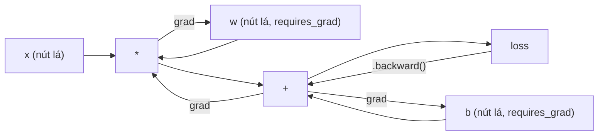
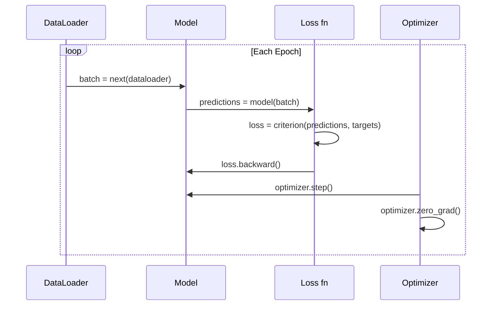

# Giới thiệu về PyTorch

> Bạn đã tự lắp động cơ từ piston và trục khuỷu. Giờ hãy học chiếc xe mà ai cũng thật sự lái.

**Type:** Build
**Languages:** Python
**Prerequisites:** Bài 03.10 (Tự xây dựng mini framework)
**Time:** ~75 phút

## Mục tiêu học tập

- Xây dựng và huấn luyện mạng nơ-ron bằng nn.Module, nn.Sequential và autograd của PyTorch
- Dùng tensor của PyTorch, tăng tốc GPU và vòng huấn luyện chuẩn (zero_grad, forward, loss, backward, step)
- Chuyển các thành phần trong mini framework tự viết của bạn sang phiên bản tương đương trong PyTorch
- Đo và so sánh tốc độ huấn luyện giữa framework Python thuần của bạn và PyTorch trên cùng một tác vụ

## Vấn đề

Bạn đã có một mini framework chạy được. Các lớp tuyến tính, ReLU, dropout, batch norm, Adam, một dataset loader (bộ nạp dữ liệu), một vòng huấn luyện. Nó huấn luyện một mạng 4 lớp cho bài toán phân loại hình tròn bằng Python thuần.

Nó cũng chậm hơn PyTorch 500 lần trên cùng bài toán đó.

Mini framework của bạn xử lý từng mẫu một bằng các vòng lặp Python lồng nhau. PyTorch đẩy cùng những phép toán đó vào các kernel C++/CUDA đã tối ưu, chạy trên GPU. Trên một NVIDIA A100, PyTorch huấn luyện ResNet-50 (25,6M tham số) trên ImageNet (1,28M ảnh) trong khoảng 6 giờ. Framework của bạn sẽ mất khoảng 3.000 giờ cho cùng tác vụ đó -- nếu nó không hết bộ nhớ trước.

Tốc độ không phải là khoảng cách duy nhất. Framework của bạn không hỗ trợ GPU. Không có vi phân tự động -- bạn phải tự viết backward() cho từng module. Không có lưu trữ (serialization). Không huấn luyện phân tán. Không mixed precision. Không có cách nào gỡ lỗi luồng gradient ngoài các câu lệnh print.

PyTorch lấp đầy từng khoảng trống đó. Và nó làm vậy trong khi vẫn giữ nguyên mô hình tư duy bạn đã xây: Module, forward(), parameters(), backward(), optimizer.step(). Các khái niệm chuyển đổi 1-1. Cú pháp gần như giống hệt. Khác biệt là PyTorch gói cả một thập kỷ kỹ thuật hệ thống phía sau đúng cái giao diện bạn đã tự thiết kế.

## Khái niệm

### Vì sao PyTorch thắng

Năm 2015, TensorFlow buộc bạn phải định nghĩa một đồ thị tính toán tĩnh trước khi chạy bất cứ thứ gì. Bạn dựng đồ thị, biên dịch nó, rồi đưa dữ liệu qua. Gỡ lỗi nghĩa là ngồi nhìn các hình trực quan hóa đồ thị. Đổi kiến trúc nghĩa là dựng lại đồ thị từ đầu.

PyTorch ra mắt năm 2017 với triết lý khác: eager execution (thực thi tức thời). Bạn viết Python. Nó chạy ngay. `y = model(x)` thật sự tính ra y ngay lúc đó, chứ không phải "thêm một node vào đồ thị sẽ tính y sau này". Nghĩa là các công cụ gỡ lỗi Python thông thường vẫn dùng được. print() chạy được. pdb chạy được. if/else trong forward pass chạy được.

Đến 2020, thị trường đã trả lời. Thị phần của PyTorch trong các bài báo nghiên cứu ML tăng từ 7% (2017) lên hơn 75% (2022). Meta, Google DeepMind, OpenAI, Anthropic và Hugging Face đều dùng PyTorch làm framework chính. TensorFlow 2.x phải chuyển sang eager execution để đáp lại -- một sự thừa nhận ngầm rằng thiết kế của PyTorch đúng.

Bài học: trải nghiệm của lập trình viên có hiệu ứng tích lũy. Một framework chậm hơn 10% nhưng gỡ lỗi nhanh hơn 50% luôn thắng.

### Tensor

Tensor (mảng nhiều chiều) là một cấu trúc dữ liệu nhiều chiều với ba thuộc tính quan trọng: shape, dtype và device (thiết bị).

```python
import torch

x = torch.zeros(3, 4)           # shape: (3, 4), dtype: float32, device: cpu
x = torch.randn(2, 3, 224, 224) # batch of 2 RGB images, 224x224
x = torch.tensor([1, 2, 3])     # from a Python list
```

**Shape** là số chiều. Một scalar có shape (), một vector có (n,), một ma trận có (m, n), một batch ảnh có (batch, channels, height, width).

**Dtype** quyết định độ chính xác và bộ nhớ.

| dtype | Bit | Phạm vi | Trường hợp dùng |
|-------|------|-------|----------|
| float32 | 32 | ~7 chữ số thập phân | Huấn luyện mặc định |
| float16 | 16 | ~3,3 chữ số thập phân | Độ chính xác hỗn hợp |
| bfloat16 | 16 | Cùng phạm vi với float32, độ chính xác thấp hơn | Huấn luyện LLM |
| int8 | 8 | -128 đến 127 | Suy luận lượng tử hóa |

**Device** quyết định nơi tính toán diễn ra.

```python
device = torch.device("cuda" if torch.cuda.is_available() else "cpu")
x = torch.randn(3, 4, device=device)
x = x.to("cuda")
x = x.cpu()
```

Mọi phép toán đều yêu cầu tất cả tensor nằm trên cùng một thiết bị. Đây là lỗi số 1 mà người mới dùng PyTorch gặp phải: `RuntimeError: Expected all tensors to be on the same device`. Sửa bằng cách chuyển mọi thứ về cùng thiết bị trước khi tính toán.

**Reshape** là phép có thời gian không đổi -- nó đổi metadata, không đổi dữ liệu.

```python
x = torch.randn(2, 3, 4)
x.view(2, 12)      # reshape to (2, 12) -- must be contiguous
x.reshape(6, 4)    # reshape to (6, 4) -- works always
x.permute(2, 0, 1) # reorder dimensions
x.unsqueeze(0)     # add dimension: (1, 2, 3, 4)
x.squeeze()        # remove size-1 dimensions
```

### Autograd

Mini framework của bạn buộc phải tự cài backward() cho từng module. PyTorch thì không. Nó ghi lại mọi phép toán trên tensor vào một đồ thị có hướng không chu trình (computational graph -- đồ thị tính toán), rồi duyệt ngược đồ thị đó để tự động tính gradient.



Khác biệt then chốt so với framework của bạn: PyTorch dùng autograd dựa trên băng ghi (tape-based). Mỗi phép toán được nối thêm vào một "băng" trong forward pass. Gọi `.backward()` sẽ phát lại băng đó theo chiều ngược.

```python
x = torch.randn(3, requires_grad=True)
y = x ** 2 + 3 * x
z = y.sum()
z.backward()
print(x.grad)  # dz/dx = 2x + 3
```

Ba quy tắc của autograd:

1. Chỉ các tensor lá có `requires_grad=True` mới tích lũy gradient
2. Gradient mặc định được tích lũy -- hãy gọi `optimizer.zero_grad()` trước mỗi lượt backward
3. `torch.no_grad()` tắt việc theo dõi gradient (dùng khi đánh giá)

### nn.Module

`nn.Module` là lớp cơ sở cho mọi thành phần mạng nơ-ron trong PyTorch. Bạn đã tự xây lớp trừu tượng này ở Bài 10. Phiên bản của PyTorch thêm đăng ký tham số tự động, tìm module đệ quy, quản lý thiết bị và lưu trữ state dict.

```python
import torch.nn as nn

class MLP(nn.Module):
    def __init__(self, input_dim, hidden_dim, output_dim):
        super().__init__()
        self.layer1 = nn.Linear(input_dim, hidden_dim)
        self.relu = nn.ReLU()
        self.layer2 = nn.Linear(hidden_dim, output_dim)

    def forward(self, x):
        x = self.layer1(x)
        x = self.relu(x)
        x = self.layer2(x)
        return x
```

Khi bạn gán một `nn.Module` hoặc `nn.Parameter` làm thuộc tính trong `__init__`, PyTorch tự động đăng ký nó. `model.parameters()` thu thập đệ quy mọi tham số đã đăng ký. Đó là lý do bạn không bao giờ phải tự gom trọng số như trong mini framework.

Các khối xây dựng chính:

| Module | Chức năng | Tham số |
|--------|-------------|------------|
| nn.Linear(in, out) | Wx + b | in*out + out |
| nn.Conv2d(in_ch, out_ch, k) | Tích chập 2D | in_ch*out_ch*k*k + out_ch |
| nn.BatchNorm1d(features) | Chuẩn hóa activation | 2 * features |
| nn.Dropout(p) | Đặt ngẫu nhiên về 0 | 0 |
| nn.ReLU() | max(0, x) | 0 |
| nn.GELU() | Lỗi Gaussian tuyến tính | 0 |
| nn.Embedding(vocab, dim) | Bảng tra cứu | vocab * dim |
| nn.LayerNorm(dim) | Chuẩn hóa theo từng mẫu | 2 * dim |

### Hàm mất mát và optimizer

PyTorch có sẵn phiên bản production cho mọi thứ bạn đã tự xây.

**Hàm mất mát** (từ `torch.nn`):

| Hàm mất mát | Tác vụ | Đầu vào |
|------|------|-------|
| nn.MSELoss() | Hồi quy | Mọi shape |
| nn.CrossEntropyLoss() | Phân loại nhiều lớp | Logits (không phải softmax) |
| nn.BCEWithLogitsLoss() | Phân loại nhị phân | Logits (không phải sigmoid) |
| nn.L1Loss() | Hồi quy (bền vững) | Mọi shape |
| nn.CTCLoss() | Căn chỉnh chuỗi | Xác suất log |

Lưu ý: `CrossEntropyLoss` kết hợp `LogSoftmax` + `NLLLoss` bên trong. Hãy truyền logits thô, không truyền đầu ra softmax. Đây là lỗi phổ biến tạo ra gradient sai một cách âm thầm.

**Optimizer** (từ `torch.optim`):

| Optimizer | Khi nào dùng | LR điển hình |
|-----------|-------------|-----------|
| SGD(params, lr, momentum) | CNN, pipeline đã tinh chỉnh kỹ | 0.01--0.1 |
| Adam(params, lr) | Điểm khởi đầu mặc định | 1e-3 |
| AdamW(params, lr, weight_decay) | Transformer, fine-tuning | 1e-4--1e-3 |
| LBFGS(params) | Quy mô nhỏ, bậc hai | 1.0 |

### Vòng huấn luyện

Mọi vòng huấn luyện PyTorch đều theo cùng một mẫu 5 bước. Bạn đã biết điều này từ Bài 10.



Mẫu chuẩn:

```python
for epoch in range(num_epochs):
    model.train()
    for inputs, targets in train_loader:
        inputs, targets = inputs.to(device), targets.to(device)
        optimizer.zero_grad()
        outputs = model(inputs)
        loss = criterion(outputs, targets)
        loss.backward()
        optimizer.step()
```

Năm dòng trong vòng lặp batch. Năm dòng đã huấn luyện GPT-4, Stable Diffusion và LLaMA. Kiến trúc thay đổi. Dữ liệu thay đổi. Năm dòng này thì không.

### Dataset và DataLoader

`Dataset` của PyTorch là một lớp trừu tượng với hai phương thức: `__len__` và `__getitem__`. `DataLoader` bọc nó, thêm chia batch, xáo trộn và nạp dữ liệu đa tiến trình.

```python
from torch.utils.data import Dataset, DataLoader

class MNISTDataset(Dataset):
    def __init__(self, images, labels):
        self.images = images
        self.labels = labels

    def __len__(self):
        return len(self.labels)

    def __getitem__(self, idx):
        return self.images[idx], self.labels[idx]

loader = DataLoader(dataset, batch_size=64, shuffle=True, num_workers=4)
```

`num_workers=4` sinh ra 4 tiến trình nạp dữ liệu song song trong khi GPU huấn luyện trên batch hiện tại. Với các tác vụ phụ thuộc ổ đĩa (ảnh lớn, âm thanh), chỉ riêng điều này có thể nhân đôi tốc độ huấn luyện.

### Huấn luyện trên GPU

Chuyển model lên GPU:

```python
device = torch.device("cuda" if torch.cuda.is_available() else "cpu")
model = model.to(device)
```

Lệnh này chuyển đệ quy mọi tham số và buffer lên GPU. Sau đó chuyển từng batch trong lúc huấn luyện:

```python
inputs, targets = inputs.to(device), targets.to(device)
```

**Mixed precision** giảm một nửa bộ nhớ và nhân đôi thông lượng trên các GPU hiện đại (A100, H100, RTX 4090) bằng cách chạy forward/backward ở float16 trong khi vẫn giữ trọng số master ở float32:

```python
from torch.amp import autocast, GradScaler

scaler = GradScaler()
for inputs, targets in loader:
    with autocast(device_type="cuda"):
        outputs = model(inputs)
        loss = criterion(outputs, targets)
    scaler.scale(loss).backward()
    scaler.step(optimizer)
    scaler.update()
    optimizer.zero_grad()
```

### So sánh: Mini framework vs PyTorch vs JAX

| Tiêu chí | Mini framework (L10) | PyTorch | JAX |
|---------|---------------------|---------|-----|
| Autodiff | backward() thủ công | Autograd dựa trên băng ghi | Biến đổi hàm |
| Thực thi | Eager (vòng lặp Python) | Eager (kernel C++) | Truy vết + biên dịch JIT |
| Hỗ trợ GPU | Không | Có (CUDA, ROCm, MPS) | Có (CUDA, TPU) |
| Tốc độ (MLP trên MNIST) | ~300s/epoch | ~0.5s/epoch | ~0.3s/epoch |
| Hệ thống module | Lớp Module tự viết | nn.Module | Hàm không trạng thái (Flax/Equinox) |
| Gỡ lỗi | print() | print(), pdb, breakpoint() | Khó hơn (truy vết JIT phá vỡ print) |
| Hệ sinh thái | Không có | Hugging Face, Lightning, timm | Flax, Optax, Orbax |
| Đường cong học | Bạn tự xây | Trung bình | Dốc (mô hình lập trình hàm) |
| Dùng trong production | Bài toán đồ chơi | Meta, OpenAI, Anthropic, HF | Google DeepMind, Midjourney |

```figure
dropout-mask
```

## Tự tay làm

Một MLP 3 lớp huấn luyện trên MNIST chỉ dùng các primitive của PyTorch. Không wrapper bậc cao. Không `torchvision.datasets`. Chúng ta tự tải và phân tích dữ liệu thô.

### Bước 1: Nạp MNIST từ các file thô

MNIST gồm 4 file nén gzip: ảnh huấn luyện (60.000 x 28 x 28), nhãn huấn luyện, ảnh test (10.000 x 28 x 28), nhãn test. Chúng ta tải chúng về và phân tích định dạng nhị phân.

```python
import torch
import torch.nn as nn
import struct
import gzip
import urllib.request
import os

def download_mnist(path="./mnist_data"):
    base_url = "https://storage.googleapis.com/cvdf-datasets/mnist/"
    files = [
        "train-images-idx3-ubyte.gz",
        "train-labels-idx1-ubyte.gz",
        "t10k-images-idx3-ubyte.gz",
        "t10k-labels-idx1-ubyte.gz",
    ]
    os.makedirs(path, exist_ok=True)
    for f in files:
        filepath = os.path.join(path, f)
        if not os.path.exists(filepath):
            urllib.request.urlretrieve(base_url + f, filepath)

def load_images(filepath):
    with gzip.open(filepath, "rb") as f:
        magic, num, rows, cols = struct.unpack(">IIII", f.read(16))
        data = f.read()
        images = torch.frombuffer(bytearray(data), dtype=torch.uint8)
        images = images.reshape(num, rows * cols).float() / 255.0
    return images

def load_labels(filepath):
    with gzip.open(filepath, "rb") as f:
        magic, num = struct.unpack(">II", f.read(8))
        data = f.read()
        labels = torch.frombuffer(bytearray(data), dtype=torch.uint8).long()
    return labels
```

### Bước 2: Định nghĩa model

Một MLP 3 lớp: 784 -> 256 -> 128 -> 10. Activation ReLU. Dropout để regularization. Không dùng batch norm cho đơn giản.

```python
class MNISTModel(nn.Module):
    def __init__(self):
        super().__init__()
        self.net = nn.Sequential(
            nn.Linear(784, 256),
            nn.ReLU(),
            nn.Dropout(0.2),
            nn.Linear(256, 128),
            nn.ReLU(),
            nn.Dropout(0.2),
            nn.Linear(128, 10),
        )

    def forward(self, x):
        return self.net(x)
```

Lớp đầu ra tạo 10 logits thô (mỗi chữ số một logit). Không softmax -- `CrossEntropyLoss` xử lý việc đó bên trong.

Số tham số: 784*256 + 256 + 256*128 + 128 + 128*10 + 10 = 235.146. Nhỏ theo tiêu chuẩn hiện đại. GPT-2 small có 124M. Model này huấn luyện trong vài giây.

### Bước 3: Vòng huấn luyện

Mẫu chuẩn forward-loss-backward-step.

```python
def train_one_epoch(model, loader, criterion, optimizer, device):
    model.train()
    total_loss = 0
    correct = 0
    total = 0
    for images, labels in loader:
        images, labels = images.to(device), labels.to(device)
        optimizer.zero_grad()
        outputs = model(images)
        loss = criterion(outputs, labels)
        loss.backward()
        optimizer.step()
        total_loss += loss.item() * images.size(0)
        _, predicted = outputs.max(1)
        correct += predicted.eq(labels).sum().item()
        total += labels.size(0)
    return total_loss / total, correct / total


def evaluate(model, loader, criterion, device):
    model.eval()
    total_loss = 0
    correct = 0
    total = 0
    with torch.no_grad():
        for images, labels in loader:
            images, labels = images.to(device), labels.to(device)
            outputs = model(images)
            loss = criterion(outputs, labels)
            total_loss += loss.item() * images.size(0)
            _, predicted = outputs.max(1)
            correct += predicted.eq(labels).sum().item()
            total += labels.size(0)
    return total_loss / total, correct / total
```

Lưu ý `torch.no_grad()` khi đánh giá. Nó tắt autograd, giảm bộ nhớ và tăng tốc suy luận. Không có nó, PyTorch sẽ dựng một đồ thị tính toán mà bạn không bao giờ dùng.

### Bước 4: Ghép mọi thứ lại

```python
def main():
    device = torch.device("cuda" if torch.cuda.is_available() else "cpu")

    download_mnist()
    train_images = load_images("./mnist_data/train-images-idx3-ubyte.gz")
    train_labels = load_labels("./mnist_data/train-labels-idx1-ubyte.gz")
    test_images = load_images("./mnist_data/t10k-images-idx3-ubyte.gz")
    test_labels = load_labels("./mnist_data/t10k-labels-idx1-ubyte.gz")

    train_dataset = torch.utils.data.TensorDataset(train_images, train_labels)
    test_dataset = torch.utils.data.TensorDataset(test_images, test_labels)
    train_loader = torch.utils.data.DataLoader(
        train_dataset, batch_size=64, shuffle=True
    )
    test_loader = torch.utils.data.DataLoader(
        test_dataset, batch_size=256, shuffle=False
    )

    model = MNISTModel().to(device)
    criterion = nn.CrossEntropyLoss()
    optimizer = torch.optim.Adam(model.parameters(), lr=1e-3)

    num_params = sum(p.numel() for p in model.parameters())
    print(f"Device: {device}")
    print(f"Parameters: {num_params:,}")
    print(f"Train samples: {len(train_dataset):,}")
    print(f"Test samples: {len(test_dataset):,}")
    print()

    for epoch in range(10):
        train_loss, train_acc = train_one_epoch(
            model, train_loader, criterion, optimizer, device
        )
        test_loss, test_acc = evaluate(
            model, test_loader, criterion, device
        )
        print(
            f"Epoch {epoch+1:2d} | "
            f"Train Loss: {train_loss:.4f} | Train Acc: {train_acc:.4f} | "
            f"Test Loss: {test_loss:.4f} | Test Acc: {test_acc:.4f}"
        )

    torch.save(model.state_dict(), "mnist_mlp.pt")
    print(f"\nModel saved to mnist_mlp.pt")
    print(f"Final test accuracy: {test_acc:.4f}")
```

Kết quả mong đợi sau 10 epoch: ~97,8% độ chính xác test. Thời gian huấn luyện trên CPU: ~30 giây. Trên GPU: ~5 giây. Trên mini framework của bạn với cùng kiến trúc: ~45 phút.

## Áp dụng

### So sánh nhanh: Mini framework vs PyTorch

| Mini framework (Bài 10) | PyTorch |
|---------------------------|---------|
| `model = Sequential(Linear(784, 256), ReLU(), ...)` | `model = nn.Sequential(nn.Linear(784, 256), nn.ReLU(), ...)` |
| `pred = model.forward(x)` | `pred = model(x)` |
| `optimizer.zero_grad()` | `optimizer.zero_grad()` |
| `grad = criterion.backward()` rồi `model.backward(grad)` | `loss.backward()` |
| `optimizer.step()` | `optimizer.step()` |
| Không GPU | `model.to("cuda")` |
| Tự viết backward cho từng module | Autograd lo tất cả |

Giao diện gần như giống hệt. Khác biệt nằm ở toàn bộ phần bên dưới.

### Lưu và nạp model

```python
torch.save(model.state_dict(), "model.pt")

model = MNISTModel()
model.load_state_dict(torch.load("model.pt", weights_only=True))
model.eval()
```

Luôn lưu `state_dict()` (từ điển tham số), không lưu đối tượng model. Lưu đối tượng model dùng pickle, sẽ hỏng khi bạn refactor code. State dict thì di động được.

### Lập lịch learning rate

```python
scheduler = torch.optim.lr_scheduler.CosineAnnealingLR(
    optimizer, T_max=10
)
for epoch in range(10):
    train_one_epoch(model, train_loader, criterion, optimizer, device)
    scheduler.step()
```

PyTorch có hơn 15 scheduler: StepLR, ExponentialLR, CosineAnnealingLR, OneCycleLR, ReduceLROnPlateau. Tất cả đều cắm vào cùng một giao diện optimizer.

## Đóng gói

Bài học này tạo ra hai artifact:

- `outputs/prompt-pytorch-debugger.md` -- một prompt để chẩn đoán các lỗi huấn luyện PyTorch phổ biến
- `outputs/skill-pytorch-patterns.md` -- tài liệu tham chiếu skill về các mẫu huấn luyện PyTorch

## Bài tập

1. **Thêm batch normalization.** Chèn `nn.BatchNorm1d` sau mỗi lớp tuyến tính (trước activation). So sánh độ chính xác test và tốc độ huấn luyện với phiên bản chỉ có dropout. Batch norm sẽ đạt 98%+ trong ít epoch hơn.

2. **Cài đặt learning rate finder.** Huấn luyện một epoch với learning rate tăng theo hàm mũ (từ 1e-7 đến 1.0). Vẽ loss theo LR. LR tối ưu nằm ngay trước điểm loss bắt đầu tăng. Dùng nó để chọn LR tốt hơn cho model MNIST.

3. **Chuyển sang GPU với mixed precision.** Thêm `torch.amp.autocast` và `GradScaler` vào vòng huấn luyện. Đo thông lượng (mẫu/giây) khi có và không có mixed precision trên GPU. Trên A100, kỳ vọng nhanh hơn ~2 lần.

4. **Tự xây một Dataset tùy chỉnh.** Tải Fashion-MNIST (cùng định dạng với MNIST nhưng là các món quần áo). Cài lớp `FashionMNISTDataset(Dataset)` với `__getitem__` và `__len__`. Huấn luyện cùng MLP và so sánh độ chính xác. Fashion-MNIST khó hơn -- kỳ vọng ~88% so với ~98%.

5. **Thay Adam bằng SGD + momentum.** Huấn luyện với `SGD(params, lr=0.01, momentum=0.9)`. So sánh các đường cong hội tụ. Sau đó thêm scheduler `CosineAnnealingLR` và xem SGD có bắt kịp Adam ở epoch 10 không.

## Thuật ngữ chính

| Thuật ngữ | Người ta thường nói | Ý nghĩa thực sự |
|------|----------------|----------------------|
| Tensor | "Một mảng đa chiều" | Một mảng có kiểu dữ liệu, biết thiết bị và có hỗ trợ vi phân tự động nằm sẵn trong mọi phép toán |
| Autograd | "Lan truyền ngược tự động" | Một hệ thống dựa trên băng ghi, ghi lại các phép toán trong forward pass rồi phát lại theo chiều ngược để tính gradient chính xác |
| nn.Module | "Một lớp" | Lớp cơ sở cho mọi khối tính toán khả vi -- đăng ký tham số, hỗ trợ lồng nhau, xử lý chế độ train/eval |
| state_dict | "Trọng số của model" | Một OrderedDict ánh xạ tên tham số sang tensor -- biểu diễn di động, có thể lưu trữ của một model đã huấn luyện |
| .backward() | "Tính gradient" | Duyệt ngược đồ thị tính toán, tính và tích lũy gradient cho mọi tensor lá có requires_grad=True |
| .to(device) | "Chuyển lên GPU" | Chuyển đệ quy toàn bộ tham số và buffer sang thiết bị được chỉ định (CPU, CUDA, MPS) |
| DataLoader | "Pipeline dữ liệu" | Một iterator chia batch, xáo trộn và tùy chọn song song hóa việc nạp dữ liệu từ một Dataset |
| Mixed precision | "Dùng float16" | Huấn luyện với forward/backward ở float16 để nhanh hơn trong khi vẫn giữ trọng số master float32 cho ổn định số học |
| Eager execution | "Chạy ngay đi" | Các phép toán thực thi ngay khi được gọi, không hoãn sang bước biên dịch sau -- lựa chọn thiết kế cốt lõi phân biệt PyTorch với TF 1.x |
| zero_grad | "Đặt lại gradient" | Đặt toàn bộ gradient của tham số về 0 trước lượt backward tiếp theo, vì PyTorch mặc định tích lũy gradient |

## Đọc thêm

- Paszke et al., "PyTorch: An Imperative Style, High-Performance Deep Learning Library" (2019) -- bài báo gốc giải thích các đánh đổi trong thiết kế của PyTorch
- PyTorch Tutorials: "Learning PyTorch with Examples" (https://pytorch.org/tutorials/beginner/pytorch_with_examples.html) -- con đường chính thức từ tensor đến nn.Module
- PyTorch Performance Tuning Guide (https://pytorch.org/tutorials/recipes/recipes/tuning_guide.html) -- mixed precision, DataLoader workers, pinned memory và các tối ưu production khác
- Horace He, "Making Deep Learning Go Brrrr" (https://horace.io/brrr_intro.html) -- vì sao huấn luyện trên GPU lại nhanh, kèm các chiến lược tối ưu dành riêng cho PyTorch

---

[← Bài trước: Tự xây dựng mini framework của bạn](../../10-mini-framework/docs/vi.md) · [Bài sau: Giới thiệu về JAX →](../../12-intro-to-jax/docs/vi.md)
