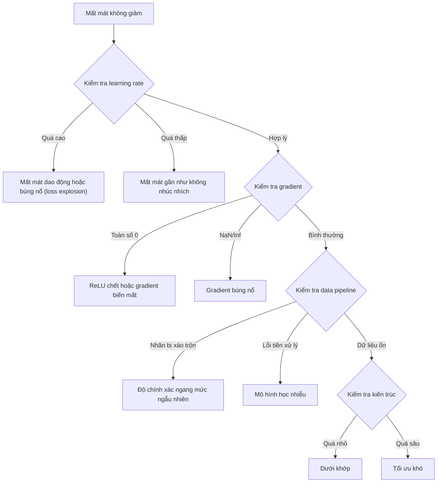
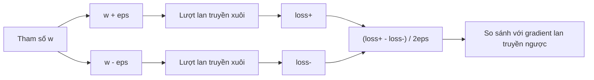
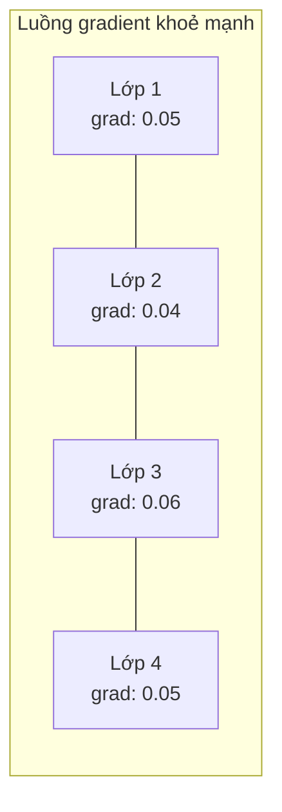
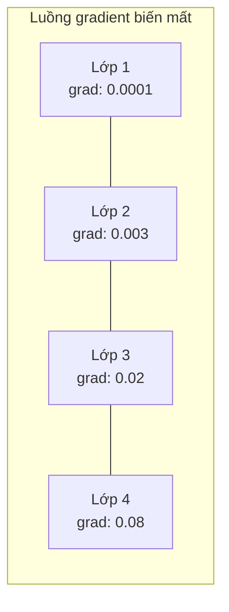
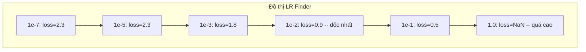

# Gỡ lỗi mạng nơ-ron

> Mạng của bạn đã biên dịch. Nó đã chạy. Nó đã in ra một con số. Con số đó sai và không có gì bị crash. Chào mừng đến với kiểu gỡ lỗi (debugging) khó nhất -- kiểu mà không có bất kỳ thông báo lỗi nào.

**Type:** Build
**Languages:** Python, PyTorch
**Prerequisites:** Giai đoạn 03, Bài 01-10 (đặc biệt là lan truyền ngược, hàm mất mát, bộ tối ưu)
**Time:** ~90 phút

## Mục tiêu học tập

- Chẩn đoán các lỗi thường gặp của mạng nơ-ron (mất mát NaN, đường cong mất mát phẳng, quá khớp, dao động) bằng những chiến lược gỡ lỗi có hệ thống
- Áp dụng kỹ thuật "quá khớp một batch" (overfit-one-batch test) để kiểm chứng kiến trúc mô hình và vòng lặp huấn luyện của bạn là đúng
- Kiểm tra độ lớn gradient, phân bố giá trị kích hoạt và chuẩn trọng số để phát hiện vấn đề gradient biến mất/bùng nổ
- Xây dựng một checklist gỡ lỗi bao quát data pipeline, kiến trúc mô hình, hàm mất mát, bộ tối ưu và các vấn đề learning rate

## Vấn đề

Phần mềm truyền thống crash khi nó hỏng. Một con trỏ null ném ra ngoại lệ. Một lệch kiểu dữ liệu thất bại ngay lúc biên dịch. Một lỗi lệch một đơn vị tạo ra kết quả sai rõ ràng.

Mạng nơ-ron không cho bạn sự xa xỉ đó.

Một mạng nơ-ron hỏng vẫn chạy đến hết, in ra một giá trị mất mát và đưa ra dự đoán. Mất mát có thể vẫn giảm. Các dự đoán có thể trông hợp lý. Nhưng mô hình sai một cách âm thầm -- nó học các lối tắt, ghi nhớ nhiễu, hoặc hội tụ về một cực tiểu cục bộ vô dụng. Các nhà nghiên cứu Google ước tính 60-70% thời gian gỡ lỗi ML là dành cho những bug "âm thầm" không sinh ra lỗi nhưng làm giảm chất lượng mô hình.

Khác biệt giữa một mô hình chạy được và một mô hình hỏng thường chỉ là một dòng đặt sai chỗ: thiếu `zero_grad()`, một chiều bị chuyển vị, một learning rate lệch 10 lần. Bài "Recipe for Training Neural Networks" (2019) kinh điển mở đầu bằng đúng câu này: "The most common neural net mistakes are bugs that don't crash."

Bài học này dạy bạn tìm ra những bug đó.

## Khái niệm

### Tư duy gỡ lỗi

Quên đi kiểu gỡ lỗi in-rồi-cầu-nguyện. Gỡ lỗi mạng nơ-ron đòi hỏi một cách tiếp cận có hệ thống, vì vòng phản hồi chậm (vài phút đến vài giờ cho mỗi lần huấn luyện) và các triệu chứng thì mơ hồ (mất mát tệ có thể do 20 nguyên nhân khác nhau).

Nguyên tắc vàng: **hãy bắt đầu đơn giản, thêm phức tạp từng phần một, và kiểm chứng từng phần độc lập.**



### Triệu chứng 1: Mất mát không giảm

Đây là lời phàn nàn phổ biến nhất. Vòng lặp huấn luyện chạy, các epoch trôi qua, mà mất mát vẫn đứng yên hoặc dao động dữ dội.

**Learning rate sai.** Quá cao: mất mát dao động hoặc nhảy lên NaN. Quá thấp: mất mát giảm chậm đến mức trông như phẳng. Với Adam, bắt đầu ở 1e-3. Với SGD, bắt đầu ở 1e-1 hoặc 1e-2. Luôn thử 3 learning rate cách nhau 10 lần (ví dụ 1e-2, 1e-3, 1e-4) trước khi kết luận là do nguyên nhân khác.

**ReLU chết (dead ReLU).** Nếu một nơ-ron ReLU nhận đầu vào âm lớn, nó xuất ra 0 và gradient của nó bằng 0. Nó không bao giờ kích hoạt lại nữa. Nếu chết đủ nhiều nơ-ron, mạng không thể học. Cách kiểm tra: in ra tỉ lệ giá trị kích hoạt đúng bằng 0 sau mỗi lớp ReLU. Nếu >50% đã chết, chuyển sang LeakyReLU hoặc giảm learning rate.

**Gradient biến mất.** Trong các mạng sâu dùng kích hoạt sigmoid hoặc tanh, gradient nhỏ đi theo cấp số nhân khi lan truyền ngược. Khi tới lớp đầu tiên thì chúng đã ~0. Các lớp đầu ngừng học. Cách khắc phục: dùng ReLU/GELU, thêm kết nối residual, hoặc dùng batch normalization.

**Gradient bùng nổ.** Vấn đề ngược lại -- gradient lớn lên theo cấp số nhân. Thường gặp trong RNN và các mạng rất sâu. Mất mát nhảy lên NaN. Cách khắc phục: cắt gradient (`torch.nn.utils.clip_grad_norm_`), giảm learning rate, hoặc thêm chuẩn hoá.

### Triệu chứng 2: Mất mát giảm nhưng mô hình vẫn tệ

Mất mát đi xuống. Độ chính xác huấn luyện chạm 99%. Nhưng độ chính xác kiểm tra chỉ 55%. Hoặc mô hình cho ra kết quả vô nghĩa trên dữ liệu thật.

**Quá khớp.** Mô hình ghi nhớ dữ liệu huấn luyện thay vì học các quy luật. Khoảng cách giữa mất mát huấn luyện và mất mát kiểm định lớn dần theo thời gian. Cách khắc phục: thêm dữ liệu, dropout, weight decay, dừng sớm, tăng cường dữ liệu.

**Rò rỉ dữ liệu.** Dữ liệu kiểm tra lọt vào tập huấn luyện. Độ chính xác cao một cách đáng ngờ. Nguyên nhân thường gặp: xáo trộn trước khi chia tập, tiền xử lý bằng thống kê tính trên toàn bộ dataset, mẫu trùng lặp giữa các tập. Cách khắc phục: chia tập trước, tiền xử lý sau, kiểm tra mẫu trùng.

**Nhãn sai.** 5-10% nhãn trong hầu hết dataset thật là sai (Northcutt et al., 2021 -- "Pervasive Label Errors in Test Sets"). Mô hình học luôn phần nhiễu đó. Cách khắc phục: dùng confident learning để tìm và sửa các mẫu bị gán nhãn sai, hoặc dùng loss truncation để bỏ qua những mẫu có mất mát cao.

### Triệu chứng 3: NaN hoặc Inf trong mất mát

Giá trị mất mát trở thành `nan` hoặc `inf`. Huấn luyện coi như đã chết.

**Learning rate quá cao.** Bước cập nhật gradient vượt quá xa đến mức trọng số bùng nổ. Cách khắc phục: giảm 10 lần.

**log(0) hoặc log(số âm).** Hàm mất mát cross-entropy tính `log(p)`. Nếu mô hình của bạn xuất ra đúng bằng 0 hoặc một xác suất âm, log sẽ bùng nổ. Cách khắc phục: kẹp dự đoán vào `[eps, 1-eps]` với `eps=1e-7`.

**Chia cho 0.** Batch normalization chia cho độ lệch chuẩn. Một batch có giá trị hằng số thì std=0. Cách khắc phục: thêm epsilon vào mẫu số (PyTorch làm việc này mặc định, nhưng các cài đặt tự viết có thể không).

**Tràn số.** Những giá trị kích hoạt lớn đưa vào `exp()` sẽ sinh ra Inf. Softmax đặc biệt dễ bị. Cách khắc phục: trừ đi giá trị lớn nhất trước khi lấy exp (thủ thuật log-sum-exp).

### Kỹ thuật 1: Kiểm tra gradient

So sánh gradient giải tích của bạn (từ lan truyền ngược) với gradient số (từ sai phân hữu hạn). Nếu chúng không khớp, lượt lan truyền ngược của bạn có bug.

Gradient số cho tham số `w`:

```
grad_numerical = (loss(w + eps) - loss(w - eps)) / (2 * eps)
```

Thước đo mức khớp (khác biệt tương đối):

```
rel_diff = |grad_analytical - grad_numerical| / max(|grad_analytical|, |grad_numerical|, 1e-8)
```

Nếu `rel_diff < 1e-5`: đúng. Nếu `rel_diff > 1e-3`: gần như chắc chắn là bug.



### Kỹ thuật 2: Thống kê giá trị kích hoạt

Theo dõi trung bình và độ lệch chuẩn của giá trị kích hoạt sau mỗi lớp trong quá trình huấn luyện. Mạng khoẻ mạnh giữ giá trị kích hoạt có trung bình gần 0 và độ lệch chuẩn gần 1 (sau chuẩn hoá), hoặc ít nhất là có chặn trên chặn dưới.

| Chỉ số sức khoẻ | Trung bình | Độ lệch chuẩn | Chẩn đoán |
|-----------------|------|-----|-----------|
| Khoẻ | ~0 | ~1 | Mạng đang học bình thường |
| Bão hoà | >>0 hoặc <<0 | ~0 | Giá trị kích hoạt kẹt ở biên |
| Chết | 0 | 0 | Nơ-ron đã chết (toàn số 0) |
| Bùng nổ | >>10 | >>10 | Giá trị kích hoạt tăng không có giới hạn |

### Kỹ thuật 3: Trực quan hoá luồng gradient (gradient flow)

Vẽ biểu đồ độ lớn gradient trung bình của từng lớp. Trong một mạng khoẻ mạnh, độ lớn gradient giữa các lớp nên xấp xỉ nhau. Nếu các lớp đầu có gradient nhỏ hơn lớp sau 1000 lần, bạn đang có vấn đề gradient biến mất.





### Kỹ thuật 4: Kiểm thử quá khớp một batch

Kỹ thuật gỡ lỗi quan trọng nhất trong học sâu.

Lấy một batch nhỏ (8-32 mẫu). Huấn luyện trên đó 100+ vòng lặp. Mất mát phải về gần 0 và độ chính xác huấn luyện phải đạt 100%. Nếu không được, mô hình hoặc vòng lặp huấn luyện của bạn có bug cơ bản -- đừng chuyển sang huấn luyện đầy đủ.

Kiểm thử này bắt được:
- Hàm mất mát bị hỏng
- Lượt lan truyền ngược bị hỏng
- Kiến trúc quá nhỏ để biểu diễn dữ liệu
- Bộ tối ưu không được nối với tham số của mô hình
- Dữ liệu và nhãn không khớp nhau

Việc này tốn 30 giây để chạy và tiết kiệm hàng giờ gỡ lỗi những lần huấn luyện đầy đủ.

### Kỹ thuật 5: Dò learning rate

Leslie Smith (2017) đề xuất quét learning rate từ rất nhỏ (1e-7) đến rất lớn (10) trong một epoch, đồng thời ghi lại mất mát. Vẽ mất mát theo learning rate. Learning rate tối ưu xấp xỉ nhỏ hơn 10 lần so với mức mà tại đó mất mát bắt đầu giảm nhanh nhất.



LR tốt nhất trong ví dụ này: ~1e-3 (nhỏ hơn một bậc độ lớn so với điểm dốc nhất).

### Những bug PyTorch thường gặp

Đây là những bug ngốn nhiều giờ nhất của cả cộng đồng PyTorch:

| Bug | Triệu chứng | Cách khắc phục |
|-----|---------|-----|
| Quên `optimizer.zero_grad()` | Gradient tích luỹ qua các batch, mất mát dao động | Thêm `optimizer.zero_grad()` trước `loss.backward()` |
| Quên `model.eval()` khi kiểm tra | Dropout và batch norm hoạt động khác đi, độ chính xác kiểm tra thay đổi giữa các lần chạy | Thêm `model.eval()` và `torch.no_grad()` |
| Sai kích thước tensor (shape mismatch) | Broadcasting âm thầm tạo kết quả sai, không báo lỗi | In kích thước sau mỗi phép toán khi gỡ lỗi |
| Lệch CPU/GPU | `RuntimeError: expected CUDA tensor` | Dùng `.to(device)` cho cả mô hình VÀ dữ liệu |
| Không detach tensor | Đồ thị tính toán lớn mãi không thôi, hết bộ nhớ (OOM) | Dùng `.detach()` hoặc `with torch.no_grad()` |
| Phép toán in-place phá autograd | `RuntimeError: modified by in-place operation` | Thay `x += 1` bằng `x = x + 1` |
| Dữ liệu không được chuẩn hoá | Mất mát kẹt ở mức ngẫu nhiên | Chuẩn hoá đầu vào về mean=0, std=1 |
| Nhãn sai kiểu dữ liệu | Cross-entropy cần `Long`, lại nhận `Float` | Ép kiểu nhãn: `labels.long()` |

### Bảng gỡ lỗi tổng hợp

| Triệu chứng | Nguyên nhân khả dĩ | Việc đầu tiên nên thử |
|---------|-------------|-------------------|
| Mất mát kẹt ở -log(1/num_classes) | Mô hình dự đoán phân bố đều | Kiểm tra data pipeline, xác minh nhãn khớp với đầu vào |
| Mất mát NaN sau vài bước | Learning rate quá cao | Giảm LR 10 lần |
| Mất mát NaN ngay lập tức | log(0) hoặc chia cho 0 | Thêm epsilon vào các phép log/chia |
| Mất mát dao động dữ dội | LR quá cao hoặc batch size quá nhỏ | Giảm LR, tăng batch size |
| Mất mát giảm rồi đi ngang | LR quá cao cho giai đoạn tinh chỉnh | Thêm lịch trình LR (cosine hoặc step decay) |
| Acc huấn luyện cao, acc kiểm tra thấp | Quá khớp | Thêm dropout, weight decay, thêm dữ liệu |
| Acc huấn luyện = acc kiểm tra = mức ngẫu nhiên | Mô hình không học được gì | Chạy kiểm thử quá khớp một batch |
| Acc huấn luyện = acc kiểm tra nhưng đều thấp | Dưới khớp | Mô hình lớn hơn, nhiều lớp hơn, nhiều đặc trưng hơn |
| Gradient toàn số 0 | ReLU chết hoặc đồ thị tính toán bị detach | Chuyển sang LeakyReLU, kiểm tra `.requires_grad` |
| Hết bộ nhớ khi huấn luyện | Batch quá lớn hoặc đồ thị không được giải phóng | Giảm batch size, dùng `torch.no_grad()` khi đánh giá |

```figure
learning-curves
```

## Tự tay làm

Một bộ công cụ chẩn đoán theo dõi giá trị kích hoạt, gradient và đường cong mất mát. Bạn sẽ cố tình phá hỏng một mạng rồi dùng bộ công cụ để chẩn đoán từng vấn đề.

### Bước 1: Lớp NetworkDebugger

Móc (hook) vào một mô hình PyTorch để ghi lại thống kê kích hoạt và gradient theo từng lớp.

```python
import torch
import torch.nn as nn
import math


class NetworkDebugger:
    def __init__(self, model):
        self.model = model
        self.activation_stats = {}
        self.gradient_stats = {}
        self.loss_history = []
        self.lr_losses = []
        self.hooks = []
        self._register_hooks()

    def _register_hooks(self):
        for name, module in self.model.named_modules():
            if isinstance(module, (nn.Linear, nn.Conv2d, nn.ReLU, nn.LeakyReLU)):
                hook = module.register_forward_hook(self._make_activation_hook(name))
                self.hooks.append(hook)
                hook = module.register_full_backward_hook(self._make_gradient_hook(name))
                self.hooks.append(hook)

    def _make_activation_hook(self, name):
        def hook(module, input, output):
            with torch.no_grad():
                out = output.detach().float()
                self.activation_stats[name] = {
                    "mean": out.mean().item(),
                    "std": out.std().item(),
                    "fraction_zero": (out == 0).float().mean().item(),
                    "min": out.min().item(),
                    "max": out.max().item(),
                }
        return hook

    def _make_gradient_hook(self, name):
        def hook(module, grad_input, grad_output):
            if grad_output[0] is not None:
                with torch.no_grad():
                    grad = grad_output[0].detach().float()
                    self.gradient_stats[name] = {
                        "mean": grad.mean().item(),
                        "std": grad.std().item(),
                        "abs_mean": grad.abs().mean().item(),
                        "max": grad.abs().max().item(),
                    }
        return hook

    def record_loss(self, loss_value):
        self.loss_history.append(loss_value)

    def check_loss_health(self):
        if len(self.loss_history) < 2:
            return "NOT_ENOUGH_DATA"
        recent = self.loss_history[-10:]
        if any(math.isnan(v) or math.isinf(v) for v in recent):
            return "NAN_OR_INF"
        if len(self.loss_history) >= 20:
            first_half = sum(self.loss_history[:10]) / 10
            second_half = sum(self.loss_history[-10:]) / 10
            if second_half >= first_half * 0.99:
                return "NOT_DECREASING"
        if len(recent) >= 5:
            diffs = [recent[i+1] - recent[i] for i in range(len(recent)-1)]
            if max(diffs) - min(diffs) > 2 * abs(sum(diffs) / len(diffs)):
                return "OSCILLATING"
        return "HEALTHY"

    def check_activations(self):
        issues = []
        for name, stats in self.activation_stats.items():
            if stats["fraction_zero"] > 0.5:
                issues.append(f"DEAD_NEURONS: {name} has {stats['fraction_zero']:.0%} zero activations")
            if abs(stats["mean"]) > 10:
                issues.append(f"EXPLODING_ACTIVATIONS: {name} mean={stats['mean']:.2f}")
            if stats["std"] < 1e-6:
                issues.append(f"COLLAPSED_ACTIVATIONS: {name} std={stats['std']:.2e}")
        return issues if issues else ["HEALTHY"]

    def check_gradients(self):
        issues = []
        grad_magnitudes = []
        for name, stats in self.gradient_stats.items():
            grad_magnitudes.append((name, stats["abs_mean"]))
            if stats["abs_mean"] < 1e-7:
                issues.append(f"VANISHING_GRADIENT: {name} abs_mean={stats['abs_mean']:.2e}")
            if stats["abs_mean"] > 100:
                issues.append(f"EXPLODING_GRADIENT: {name} abs_mean={stats['abs_mean']:.2e}")
        if len(grad_magnitudes) >= 2:
            first_mag = grad_magnitudes[0][1]
            last_mag = grad_magnitudes[-1][1]
            if last_mag > 0 and first_mag / last_mag > 100:
                issues.append(f"GRADIENT_RATIO: first/last = {first_mag/last_mag:.0f}x (vanishing)")
        return issues if issues else ["HEALTHY"]

    def print_report(self):
        print("\n=== NETWORK DEBUGGER REPORT ===")
        print(f"\nLoss health: {self.check_loss_health()}")
        if self.loss_history:
            print(f"  Last 5 losses: {[f'{v:.4f}' for v in self.loss_history[-5:]]}")
        print("\nActivation diagnostics:")
        for item in self.check_activations():
            print(f"  {item}")
        print("\nGradient diagnostics:")
        for item in self.check_gradients():
            print(f"  {item}")
        print("\nPer-layer activation stats:")
        for name, stats in self.activation_stats.items():
            print(f"  {name}: mean={stats['mean']:.4f} std={stats['std']:.4f} zero={stats['fraction_zero']:.1%}")
        print("\nPer-layer gradient stats:")
        for name, stats in self.gradient_stats.items():
            print(f"  {name}: abs_mean={stats['abs_mean']:.2e} max={stats['max']:.2e}")

    def remove_hooks(self):
        for hook in self.hooks:
            hook.remove()
        self.hooks.clear()
```

### Bước 2: Bài kiểm tra overfit một batch

```python
def overfit_one_batch(model, x_batch, y_batch, criterion, lr=0.01, steps=200):
    optimizer = torch.optim.Adam(model.parameters(), lr=lr)
    model.train()
    print("\n=== OVERFIT ONE BATCH TEST ===")
    print(f"Batch size: {x_batch.shape[0]}, Steps: {steps}")

    for step in range(steps):
        optimizer.zero_grad()
        output = model(x_batch)
        loss = criterion(output, y_batch)
        loss.backward()
        optimizer.step()

        if step % 50 == 0 or step == steps - 1:
            with torch.no_grad():
                preds = (output > 0).float() if output.shape[-1] == 1 else output.argmax(dim=1)
                targets = y_batch if y_batch.dim() == 1 else y_batch.squeeze()
                acc = (preds.squeeze() == targets).float().mean().item()
            print(f"  Step {step:3d} | Loss: {loss.item():.6f} | Accuracy: {acc:.1%}")

    final_loss = loss.item()
    if final_loss > 0.1:
        print(f"\n  FAIL: Loss did not converge ({final_loss:.4f}). Model or training loop is broken.")
        return False
    print(f"\n  PASS: Loss converged to {final_loss:.6f}")
    return True
```

### Bước 3: Bộ tìm learning rate

```python
def find_learning_rate(model, x_data, y_data, criterion, start_lr=1e-7, end_lr=10, steps=100):
    import copy
    original_state = copy.deepcopy(model.state_dict())
    optimizer = torch.optim.SGD(model.parameters(), lr=start_lr)
    lr_mult = (end_lr / start_lr) ** (1 / steps)

    model.train()
    results = []
    best_loss = float("inf")
    current_lr = start_lr

    print("\n=== LEARNING RATE FINDER ===")

    for step in range(steps):
        optimizer.zero_grad()
        output = model(x_data)
        loss = criterion(output, y_data)

        if math.isnan(loss.item()) or loss.item() > best_loss * 10:
            break

        best_loss = min(best_loss, loss.item())
        results.append((current_lr, loss.item()))

        loss.backward()
        optimizer.step()

        current_lr *= lr_mult
        for param_group in optimizer.param_groups:
            param_group["lr"] = current_lr

    model.load_state_dict(original_state)

    if len(results) < 10:
        print("  Could not complete LR sweep -- loss diverged too quickly")
        return results

    min_loss_idx = min(range(len(results)), key=lambda i: results[i][1])
    suggested_lr = results[max(0, min_loss_idx - 10)][0]

    print(f"  Swept {len(results)} steps from {start_lr:.0e} to {results[-1][0]:.0e}")
    print(f"  Minimum loss {results[min_loss_idx][1]:.4f} at lr={results[min_loss_idx][0]:.2e}")
    print(f"  Suggested learning rate: {suggested_lr:.2e}")

    return results
```

### Bước 4: Bộ kiểm tra gradient

```python
def _flat_to_multi_index(flat_idx, shape):
    multi_idx = []
    remaining = flat_idx
    for dim in reversed(shape):
        multi_idx.insert(0, remaining % dim)
        remaining //= dim
    return tuple(multi_idx)


def gradient_check(model, x, y, criterion, eps=1e-4):
    model.train()
    x_double = x.double()
    y_double = y.double()
    model_double = model.double()

    print("\n=== GRADIENT CHECK ===")
    overall_max_diff = 0
    checked = 0

    for name, param in model_double.named_parameters():
        if not param.requires_grad:
            continue

        layer_max_diff = 0

        model_double.zero_grad()
        output = model_double(x_double)
        loss = criterion(output, y_double)
        loss.backward()
        analytical_grad = param.grad.clone()

        num_checks = min(5, param.numel())
        for i in range(num_checks):
            idx = _flat_to_multi_index(i, param.shape)
            original = param.data[idx].item()

            param.data[idx] = original + eps
            with torch.no_grad():
                loss_plus = criterion(model_double(x_double), y_double).item()

            param.data[idx] = original - eps
            with torch.no_grad():
                loss_minus = criterion(model_double(x_double), y_double).item()

            param.data[idx] = original

            numerical = (loss_plus - loss_minus) / (2 * eps)
            analytical = analytical_grad[idx].item()

            denom = max(abs(numerical), abs(analytical), 1e-8)
            rel_diff = abs(numerical - analytical) / denom

            layer_max_diff = max(layer_max_diff, rel_diff)
            checked += 1

        overall_max_diff = max(overall_max_diff, layer_max_diff)
        status = "OK" if layer_max_diff < 1e-5 else "MISMATCH"
        print(f"  {name}: max_rel_diff={layer_max_diff:.2e} [{status}]")

    model.float()

    print(f"\n  Checked {checked} parameters")
    if overall_max_diff < 1e-5:
        print("  PASS: Gradients match (rel_diff < 1e-5)")
    elif overall_max_diff < 1e-3:
        print("  WARN: Small differences (1e-5 < rel_diff < 1e-3)")
    else:
        print("  FAIL: Gradient mismatch detected (rel_diff > 1e-3)")
    return overall_max_diff
```

### Bước 5: Mạng bị hỏng có chủ ý

Giờ hãy áp dụng bộ công cụ này vào các mạng bị hỏng và chẩn đoán từng cái một.

```python
def demo_broken_networks():
    torch.manual_seed(42)
    x = torch.randn(64, 10)
    y = (x[:, 0] > 0).long()

    print("\n" + "=" * 60)
    print("BUG 1: Learning rate too high (lr=10)")
    print("=" * 60)
    model1 = nn.Sequential(nn.Linear(10, 32), nn.ReLU(), nn.Linear(32, 2))
    debugger1 = NetworkDebugger(model1)
    optimizer1 = torch.optim.SGD(model1.parameters(), lr=10.0)
    criterion = nn.CrossEntropyLoss()
    for step in range(20):
        optimizer1.zero_grad()
        out = model1(x)
        loss = criterion(out, y)
        debugger1.record_loss(loss.item())
        loss.backward()
        optimizer1.step()
    debugger1.print_report()
    debugger1.remove_hooks()

    print("\n" + "=" * 60)
    print("BUG 2: Dead ReLUs from bad initialization")
    print("=" * 60)
    model2 = nn.Sequential(nn.Linear(10, 32), nn.ReLU(), nn.Linear(32, 32), nn.ReLU(), nn.Linear(32, 2))
    with torch.no_grad():
        for m in model2.modules():
            if isinstance(m, nn.Linear):
                m.weight.fill_(-1.0)
                m.bias.fill_(-5.0)
    debugger2 = NetworkDebugger(model2)
    optimizer2 = torch.optim.Adam(model2.parameters(), lr=1e-3)
    for step in range(50):
        optimizer2.zero_grad()
        out = model2(x)
        loss = criterion(out, y)
        debugger2.record_loss(loss.item())
        loss.backward()
        optimizer2.step()
    debugger2.print_report()
    debugger2.remove_hooks()

    print("\n" + "=" * 60)
    print("BUG 3: Missing zero_grad (gradients accumulate)")
    print("=" * 60)
    model3 = nn.Sequential(nn.Linear(10, 32), nn.ReLU(), nn.Linear(32, 2))
    debugger3 = NetworkDebugger(model3)
    optimizer3 = torch.optim.SGD(model3.parameters(), lr=0.01)
    for step in range(50):
        out = model3(x)
        loss = criterion(out, y)
        debugger3.record_loss(loss.item())
        loss.backward()
        optimizer3.step()
    debugger3.print_report()
    debugger3.remove_hooks()

    print("\n" + "=" * 60)
    print("HEALTHY NETWORK: Correct setup for comparison")
    print("=" * 60)
    model_good = nn.Sequential(nn.Linear(10, 32), nn.ReLU(), nn.Linear(32, 2))
    debugger_good = NetworkDebugger(model_good)
    optimizer_good = torch.optim.Adam(model_good.parameters(), lr=1e-3)
    for step in range(50):
        optimizer_good.zero_grad()
        out = model_good(x)
        loss = criterion(out, y)
        debugger_good.record_loss(loss.item())
        loss.backward()
        optimizer_good.step()
    debugger_good.print_report()
    debugger_good.remove_hooks()

    print("\n" + "=" * 60)
    print("OVERFIT-ONE-BATCH TEST (healthy model)")
    print("=" * 60)
    model_test = nn.Sequential(nn.Linear(10, 32), nn.ReLU(), nn.Linear(32, 2))
    overfit_one_batch(model_test, x[:8], y[:8], criterion)

    print("\n" + "=" * 60)
    print("LEARNING RATE FINDER")
    print("=" * 60)
    model_lr = nn.Sequential(nn.Linear(10, 32), nn.ReLU(), nn.Linear(32, 2))
    find_learning_rate(model_lr, x, y, criterion)

    print("\n" + "=" * 60)
    print("GRADIENT CHECK")
    print("=" * 60)
    model_grad = nn.Sequential(nn.Linear(10, 8), nn.ReLU(), nn.Linear(8, 2))
    gradient_check(model_grad, x[:4], y[:4], criterion)
```

## Áp dụng

### Công cụ có sẵn của PyTorch

```python
import torch
import torch.nn as nn

model = nn.Sequential(
    nn.Linear(768, 256),
    nn.ReLU(),
    nn.Linear(256, 10),
)

with torch.autograd.detect_anomaly():
    output = model(input_tensor)
    loss = criterion(output, target)
    loss.backward()

for name, param in model.named_parameters():
    if param.grad is not None:
        print(f"{name}: grad_mean={param.grad.abs().mean():.2e}")
```

### Tích hợp Weights & Biases

```python
import wandb

wandb.init(project="debug-training")

for epoch in range(100):
    loss = train_one_epoch()
    wandb.log({
        "loss": loss,
        "lr": optimizer.param_groups[0]["lr"],
        "grad_norm": torch.nn.utils.clip_grad_norm_(model.parameters(), float("inf")),
    })

    for name, param in model.named_parameters():
        if param.grad is not None:
            wandb.log({f"grad/{name}": wandb.Histogram(param.grad.cpu().numpy())})
```

### TensorBoard

```python
from torch.utils.tensorboard import SummaryWriter

writer = SummaryWriter("runs/debug_experiment")

for epoch in range(100):
    loss = train_one_epoch()
    writer.add_scalar("Loss/train", loss, epoch)

    for name, param in model.named_parameters():
        writer.add_histogram(f"weights/{name}", param, epoch)
        if param.grad is not None:
            writer.add_histogram(f"gradients/{name}", param.grad, epoch)
```

### Danh sách kiểm tra gỡ lỗi (trước khi train đầy đủ)

1. Chạy bài kiểm tra overfit một batch. Nếu nó thất bại, dừng lại.
2. In tóm tắt mô hình -- kiểm tra số lượng tham số có hợp lý không.
3. Chạy một lượt lan truyền xuôi với dữ liệu ngẫu nhiên -- kiểm tra shape đầu ra.
4. Train 5 epoch -- kiểm tra loss có giảm không.
5. Kiểm tra thống kê activation -- không có layer chết, không có bùng nổ.
6. Kiểm tra dòng chảy gradient -- không biến mất, không bùng nổ.
7. Kiểm tra data pipeline -- in 5 mẫu ngẫu nhiên kèm nhãn.

## Đóng gói

Bài học này tạo ra:
- `outputs/prompt-nn-debugger.md` -- một prompt để chẩn đoán các ca thất bại khi train mạng nơ-ron
- `outputs/skill-debug-checklist.md` -- một danh sách kiểm tra dạng cây quyết định để gỡ lỗi các vấn đề khi train

Các mẫu triển khai chính cho việc gỡ lỗi:
- Gắn hook giám sát vào các script train chạy production
- Ghi log thống kê activation và gradient vào W&B hoặc TensorBoard mỗi N bước
- Cài cảnh báo tự động cho loss NaN, neuron chết (>80% bằng 0), hoặc gradient bùng nổ
- Luôn chạy bài kiểm tra overfit một batch khi thay đổi kiến trúc hoặc data pipeline

## Bài tập

1. **Thêm bộ phát hiện gradient bùng nổ.** Sửa `NetworkDebugger` để phát hiện khi gradient vượt một ngưỡng và tự động gợi ý giá trị cắt gradient. Thử nghiệm nó trên một mạng 20 layer không có chuẩn hoá.

2. **Xây dựng bộ hồi sinh neuron chết.** Viết một hàm xác định các neuron ReLU chết (luôn xuất ra 0) rồi khởi tạo lại trọng số đầu vào của chúng bằng khởi tạo Kaiming. Chứng minh rằng cách này cứu được một mạng mà >70% neuron đã chết.

3. **Cài đặt bộ tìm learning rate kèm vẽ đồ thị.** Mở rộng `find_learning_rate` để lưu kết quả ra CSV và viết một script riêng đọc CSV rồi hiển thị đường cong LR so với loss bằng matplotlib. Xác định LR tối ưu cho ResNet-18 trên CIFAR-10.

4. **Tạo bộ kiểm tra data pipeline.** Viết một hàm kiểm tra: mẫu trùng lặp giữa tập train và test, phân bố nhãn mất cân bằng (tỷ lệ >10:1), chuẩn hoá đầu vào (mean gần 0, std gần 1), và giá trị NaN/Inf trong dữ liệu. Chạy nó trên một dataset bị làm hỏng có chủ ý.

5. **Gỡ lỗi một ca thất bại thật.** Lấy mini-framework từ Bài 10, cài vào một bug tinh vi (ví dụ: chuyển vị ma trận trọng số trong lượt lan truyền ngược), rồi dùng kiểm tra gradient để chỉ ra chính xác tham số nào có gradient sai. Ghi lại toàn bộ quá trình gỡ lỗi.

## Thuật ngữ chính

| Thuật ngữ | Người ta thường nói | Ý nghĩa thực sự |
|------|----------------|----------------------|
| Silent bug | "Nó chạy nhưng cho kết quả tệ" | Một bug không sinh ra lỗi nào nhưng làm giảm chất lượng mô hình -- chế độ thất bại chiếm ưu thế trong ML |
| Dead ReLU | "Các neuron chết rồi" | Một neuron ReLU có đầu vào luôn âm, nên nó xuất ra 0 và nhận gradient 0 vĩnh viễn |
| Vanishing gradients | "Các layer đầu ngừng học" | Gradient co lại theo cấp số nhân khi đi qua các layer, khiến trọng số ở các layer đầu gần như bị đóng băng |
| Exploding gradients | "Loss nhảy thành NaN" | Gradient tăng theo cấp số nhân khi đi qua các layer, khiến cập nhật trọng số lớn đến mức tràn số |
| Gradient checking | "Kiểm tra xem lan truyền ngược có đúng không" | So sánh gradient giải tích từ lan truyền ngược với gradient số từ sai phân hữu hạn |
| Overfit-one-batch | "Bài test gỡ lỗi quan trọng nhất" | Train trên một batch nhỏ duy nhất để xác nhận mô hình CÓ THỂ học -- nếu không học được thì có gì đó hỏng về căn bản |
| LR finder | "Quét để tìm learning rate phù hợp" | Tăng learning rate theo cấp số nhân trong một epoch và chọn mức ngay trước điểm loss phân kỳ |
| Data leakage | "Dữ liệu test lọt vào train" | Khi thông tin từ tập test làm nhiễm bẩn quá trình train, tạo ra độ chính xác cao giả tạo |
| Activation statistics | "Theo dõi sức khoẻ các layer" | Theo dõi mean, std và tỷ lệ giá trị 0 trong đầu ra mỗi layer để phát hiện neuron chết, bão hoà hoặc bùng nổ |
| Gradient clipping | "Chặn biên độ gradient" | Thu nhỏ gradient khi norm của nó vượt ngưỡng, ngăn các cập nhật gradient bùng nổ |

## Đọc thêm

- Smith, "Cyclical Learning Rates for Training Neural Networks" (2017) -- bài báo giới thiệu kiểm tra dải learning rate (LR finder)
- Northcutt et al., "Pervasive Label Errors in Test Sets Destabilize Machine Learning Benchmarks" (2021) -- chứng minh rằng 3-6% nhãn trong ImageNet, CIFAR-10 và nhiều benchmark lớn khác là sai
- Zhang et al., "Understanding Deep Learning Requires Rethinking Generalization" (2017) -- bài báo cho thấy mạng nơ-ron có thể ghi nhớ nhãn ngẫu nhiên, và đó là lý do bài kiểm tra overfit một batch hoạt động
- Tài liệu PyTorch về `torch.autograd.detect_anomaly` và `torch.autograd.set_detect_anomaly` cho việc phát hiện NaN/Inf có sẵn
