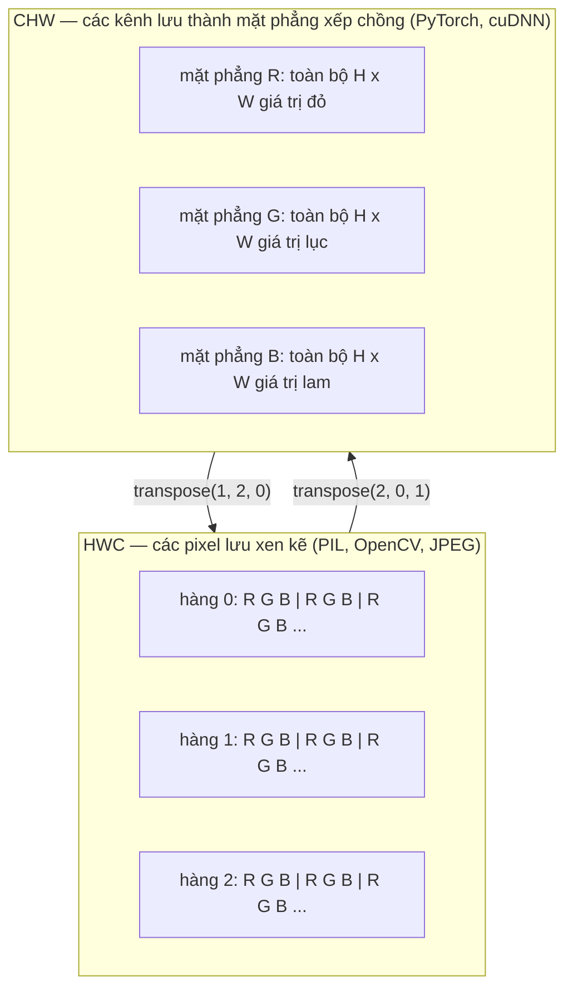

# Nền tảng hình ảnh — pixel (điểm ảnh), channel (kênh), color space (không gian màu)

> Hình ảnh là một tensor các mẫu ánh sáng. Mọi mô hình thị giác bạn từng dùng đều bắt đầu từ đúng một sự thật này.

**Type:** Build
**Languages:** Python
**Prerequisites:** Giai đoạn 1, Bài 12 (Phép toán tensor), Giai đoạn 3, Bài 11 (Giới thiệu PyTorch)
**Time:** ~45 phút

## Mục tiêu học tập

- Giải thích cách một cảnh liên tục bị rời rạc hoá thành các pixel và vì sao quyết định lấy mẫu/lượng tử hoá lại đặt trần cho mọi mô hình phía sau
- Đọc, cắt lát và kiểm tra ảnh dưới dạng mảng NumPy, chuyển đổi thành thạo giữa hai cách sắp xếp HWC và CHW
- Chuyển đổi giữa RGB, grayscale, HSV và YCbCr, giải thích vì sao mỗi không gian màu tồn tại
- Áp dụng tiền xử lý ở mức pixel (normalization (chuẩn hoá), chuẩn hoá theo thống kê, thay đổi kích thước, kênh đặt trước) đúng như các mô hình thị giác PyTorch huấn luyện sẵn mong đợi

## Vấn đề

Mọi bài báo bạn sẽ đọc, mọi trọng số huấn luyện sẵn bạn sẽ tải về, mọi API thị giác bạn sẽ gọi đều giả định một cách mã hoá cụ thể cho đầu vào. Đưa một ảnh `uint8` vào chỗ mô hình cần `float32` thì nó vẫn chạy — và âm thầm cho ra rác. Đưa BGR vào một mạng huấn luyện trên RGB thì độ chính xác tụt mười điểm. Đưa đầu vào channels-last khi mô hình cần channels-first thì lớp conv đầu tiên coi chiều cao là một kênh đặc trưng. Không có lỗi nào được ném ra. Nó chỉ phá hỏng các chỉ số của bạn và bạn mất cả tuần đi săn một bug nằm đúng ở chỗ bạn nạp tệp.

Phép tích chập không phức tạp một khi bạn biết nó đang trượt qua cái gì. Phần khó là "một hình ảnh" mang nghĩa khác nhau với camera, bộ giải mã JPEG, PIL, OpenCV, torchvision và một kernel CUDA. Mỗi stack có thứ tự trục, miền byte và quy ước kênh riêng. Một kỹ sư thị giác không nắm rõ những thứ này sẽ đưa vào vận hành những pipeline hỏng.

Bài học này đặt lại phần nền móng để phần còn lại của giai đoạn có thể xây tiếp. Đến cuối bài, bạn sẽ biết pixel là gì, vì sao mỗi pixel có ba con số thay vì một, "chuẩn hoá bằng thống kê ImageNet" thực sự làm gì, và cách chuyển giữa hai hoặc ba cách sắp xếp mà mọi bài khác trong giai đoạn này sẽ giả định.

## Khái niệm

### Toàn cảnh đường ống tiền xử lý

Mọi hệ thống thị giác chạy thật đều là cùng một chuỗi phép biến đổi có thể đảo ngược. Sai một bước là mô hình nhìn thấy đầu vào khác với lúc huấn luyện.

```mermaid
flowchart LR
    A["Tệp ảnh<br/>(JPEG/PNG)"] --> B["Giải mã<br/>uint8 HWC"]
    B --> C["Chuyển<br/>không gian màu<br/>(RGB/BGR/YCbCr)"]
    C --> D["Thay đổi kích thước<br/>cạnh ngắn"]
    D --> E["Cắt giữa<br/>kích thước mô hình"]
    E --> F["Chia cho 255<br/>float32 [0,1]"]
    F --> G["Trừ mean<br/>Chia cho std"]
    G --> H["Chuyển trục<br/>HWC → CHW"]
    H --> I["Gom batch<br/>CHW → NCHW"]
    I --> J["Mô hình"]

    style A fill:#fef3c7,stroke:#d97706
    style J fill:#ddd6fe,stroke:#7c3aed
    style G fill:#fecaca,stroke:#dc2626
    style H fill:#bfdbfe,stroke:#2563eb
```



Hai ô đỏ và xanh là nơi 80% lỗi âm thầm trú ngụ: thiếu chuẩn hoá theo thống kê và sai cách sắp xếp.

### Pixel là một mẫu, không phải một ô vuông

Cảm biến camera đếm các photon rơi trên một lưới các đầu dò nhỏ. Mỗi đầu dò tích ánh sáng trong một phần giây rồi phát ra điện áp tỉ lệ với số photon đập vào nó. Sau đó cảm biến rời rạc hoá điện áp đó thành một số nguyên. Một đầu dò trở thành một pixel.

```
Continuous scene                 Sensor grid                     Digital image
(infinite detail)                (H x W detectors)               (H x W integers)

    ~~~~~                        +--+--+--+--+--+                 210 198 180 155 120
   ~   ~   ~                     |  |  |  |  |  |                 205 195 178 152 118
  ~ light ~      ---->           +--+--+--+--+--+     ---->       200 190 175 150 115
   ~~~~~                         |  |  |  |  |  |                 195 185 170 148 112
                                 +--+--+--+--+--+                 188 180 165 145 108
```

Hai lựa chọn xảy ra ở bước này và chúng đặt trần cho mọi thứ phía sau:

- **Lấy mẫu không gian** quyết định bao nhiêu đầu dò trên mỗi độ của cảnh. Quá ít thì cạnh bị răng cưa (aliasing). Quá nhiều thì lưu trữ và tính toán bùng nổ.
- **Lượng tử hoá cường độ** quyết định điện áp được chia ngăn mịn đến đâu. 8 bit cho 256 mức và là chuẩn cho hiển thị. 10, 12, 16 bit cho chuyển sắc mượt hơn và quan trọng với chẩn đoán hình ảnh, HDR và các pipeline cảm biến thô.

Pixel không phải một ô vuông có màu và có diện tích. Nó là một phép đo duy nhất. Khi bạn thay đổi kích thước hay xoay ảnh, bạn đang lấy mẫu lại chính lưới phép đo đó.

### Vì sao có ba kênh

Một đầu dò đếm photon trên toàn bộ quang phổ nhìn thấy — đó là grayscale. Để có màu, cảm biến phủ lên lưới một mảng mosaic các bộ lọc đỏ, lục và lam. Sau bước demosaic, mỗi vị trí không gian có ba số nguyên: phản hồi của đầu dò lọc đỏ, lọc lục và lọc lam gần đó. Ba số nguyên ấy là bộ ba RGB của một pixel.

```
One pixel in memory:

    (R, G, B) = (210, 140, 30)   <- reddish-orange

An H x W RGB image:

    shape (H, W, 3)     stored as   H rows of W pixels of 3 values
                                    each in [0, 255] for uint8
```

Ba không phải con số thần kỳ. Camera chiều sâu thêm một kênh Z. Vệ tinh thêm các dải hồng ngoại và tử ngoại. Ảnh y tế thường có một kênh (X-quang, CT) hoặc rất nhiều kênh (hyperspectral). Số kênh là trục cuối; các lớp conv học cách trộn qua trục đó.

### Hai quy ước sắp xếp: HWC và CHW

Cùng một tensor, hai thứ tự. Mỗi thư viện chọn một.

```
HWC (height, width, channels)           CHW (channels, height, width)

   W ->                                    H ->
  +-----+-----+-----+                     +-----+-----+
H |R G B|R G B|R G B|                   C |R R R R R R|
| +-----+-----+-----+                   | +-----+-----+
v |R G B|R G B|R G B|                   v |G G G G G G|
  +-----+-----+-----+                     +-----+-----+
                                          |B B B B B B|
                                          +-----+-----+

   PIL, OpenCV, matplotlib,              PyTorch, most deep learning
   almost every image file on disk       frameworks, cuDNN kernels
```

CHW tồn tại vì kernel tích chập trượt qua H và W. Đặt trục kênh lên đầu nghĩa là mỗi kernel thấy một mặt phẳng 2D liền mạch cho từng kênh, nhờ đó vector hoá gọn gàng. Các định dạng trên đĩa giữ HWC vì nó khớp với cách các dòng quét đi ra từ cảm biến.

Phép chuyển một dòng mà bạn sẽ gõ cả nghìn lần:

```
img_chw = img_hwc.transpose(2, 0, 1)      # NumPy
img_chw = img_hwc.permute(2, 0, 1)        # PyTorch tensor
```

Cách sắp xếp bộ nhớ, trực quan hoá:



### Miền byte và dtype

Ba quy ước chiếm ưu thế:

| Quy ước | dtype | Miền giá trị | Nơi bạn gặp |
|------------|-------|-------|------------------|
| Raw | `uint8` | [0, 255] | Tệp trên đĩa, đầu ra của PIL, OpenCV |
| Normalized | `float32` | [0.0, 1.0] | Sau `img.astype('float32') / 255` |
| Standardized | `float32` | khoảng [-2, +2] | Sau khi trừ mean và chia cho std |

Các mạng tích chập được huấn luyện trên đầu vào đã chuẩn hoá theo thống kê. Thống kê ImageNet `mean=[0.485, 0.456, 0.406]`, `std=[0.229, 0.224, 0.225]` là trung bình cộng và độ lệch chuẩn của ba kênh trên toàn bộ tập huấn luyện ImageNet, tính trên các pixel đã chuẩn hoá về [0, 1]. Đưa `uint8` thô vào một mô hình cần float đã chuẩn hoá theo thống kê là lỗi âm thầm phổ biến nhất trong thị giác ứng dụng.

### Không gian màu và vì sao chúng tồn tại

RGB là định dạng thu nhận nhưng không phải lúc nào cũng là biểu diễn hữu ích nhất cho mô hình.

```
 RGB               HSV                       YCbCr / YUV

 R red             H hue (angle 0-360)       Y luminance (brightness)
 G green           S saturation (0-1)        Cb chroma blue-yellow
 B blue            V value/brightness (0-1)  Cr chroma red-green

 Linear to         Separates color from      Separates brightness from
 sensor output     brightness. Useful for    color. JPEG and most video
                   color thresholding, UI    codecs compress the chroma
                   sliders, simple filters   channels harder because the
                                             human eye is less sensitive
                                             to chroma detail than to Y.
```

Với hầu hết CNN hiện đại, bạn đưa vào RGB. Bạn gặp các không gian khác khi:

- **HSV** — mã CV cổ điển, phân đoạn dựa trên màu, cân bằng trắng.
- **YCbCr** — đọc cấu trúc bên trong JPEG, pipeline video, các mô hình siêu phân giải chỉ làm việc trên Y.
- **Grayscale** — OCR, mô hình tài liệu, mọi trường hợp mà màu là biến gây nhiễu chứ không phải tín hiệu.

Chuyển grayscale từ RGB là một tổng có trọng số, không phải trung bình, vì mắt người nhạy với lục hơn đỏ và lam:

```
Y = 0.299 R + 0.587 G + 0.114 B       (ITU-R BT.601, the classic weights)
```

### Tỉ lệ khung hình, thay đổi kích thước và interpolation (nội suy)

Mọi mô hình có kích thước đầu vào cố định (224x224 với hầu hết bộ phân loại ImageNet, 384x384 hoặc 512x512 với các bộ phát hiện hiện đại). Ảnh của bạn hiếm khi khớp. Ba lựa chọn thay đổi kích thước quan trọng:

- **Thay đổi cạnh ngắn, rồi cắt giữa** — công thức ImageNet chuẩn. Giữ tỉ lệ khung hình, bỏ đi một dải pixel ở rìa.
- **Thay đổi kích thước rồi đệm** — giữ tỉ lệ khung hình và mọi pixel, thêm các thanh đen. Chuẩn cho phát hiện và OCR.
- **Thay đổi trực tiếp về kích thước đích** — kéo giãn ảnh. Rẻ, làm méo hình học, vẫn ổn với nhiều bài phân loại.

Phương pháp nội suy quyết định các pixel trung gian được tính thế nào khi lưới mới không khớp với lưới cũ:

```
Nearest neighbour     fastest, blocky, only choice for masks/labels
Bilinear              fast, smooth, default for most image resizing
Bicubic               slower, sharper on upscaling
Lanczos               slowest, best quality, used for final display
```

Quy tắc ngón tay cái: bilinear cho huấn luyện, bicubic hoặc lanczos cho tài nguyên bạn sẽ nhìn, nearest cho bất kỳ thứ gì chứa ID lớp dạng số nguyên.

```figure
conv-output-size
```

## Tự tay làm

### Bước 1: Dựng một tensor ảnh và kiểm tra hình dạng của nó

Bắt đầu với một ảnh tổng hợp tất định để bài thực hành đầu chạy offline chỉ với NumPy. Giải mã tệp là một ranh giới riêng: một khi bộ giải mã JPEG hay PNG trả về byte RGB, mọi phép toán tensor bên dưới đều như nhau.

```python
import numpy as np

def synthetic_rgb(h=128, w=192, seed=0):
    rng = np.random.default_rng(seed)
    yy, xx = np.meshgrid(np.linspace(0, 1, h), np.linspace(0, 1, w), indexing="ij")
    r = (np.sin(xx * 6) * 0.5 + 0.5) * 255
    g = yy * 255
    b = (1 - yy) * xx * 255
    rgb = np.stack([r, g, b], axis=-1) + rng.normal(0, 6, (h, w, 3))
    return np.clip(rgb, 0, 255).astype(np.uint8)

arr = synthetic_rgb()

print(f"type:   {type(arr).__name__}")
print(f"dtype:  {arr.dtype}")
print(f"shape:  {arr.shape}     # (H, W, C)")
print(f"min:    {arr.min()}")
print(f"max:    {arr.max()}")
print(f"pixel at (0, 0): {arr[0, 0]}")
```

Kết quả mong đợi: `shape: (H, W, 3)`, `dtype: uint8`, miền `[0, 255]`. Đó là biểu diễn giải mã chuẩn tắc, dù byte đến từ camera, từ bộ giải mã ảnh hay từ bộ sinh tổng hợp này.

### Bước 2: Tách kênh và sắp xếp lại bố cục

Tách riêng R, G, B rồi chuyển từ HWC sang CHW cho PyTorch.

```python
R = arr[:, :, 0]
G = arr[:, :, 1]
B = arr[:, :, 2]
print(f"R shape: {R.shape}, mean: {R.mean():.1f}")
print(f"G shape: {G.shape}, mean: {G.mean():.1f}")
print(f"B shape: {B.shape}, mean: {B.mean():.1f}")

arr_chw = arr.transpose(2, 0, 1)
print(f"\nHWC shape: {arr.shape}")
print(f"CHW shape: {arr_chw.shape}")
```

Ba mặt phẳng grayscale, mỗi kênh một mặt phẳng. CHW chỉ sắp xếp lại các trục; không nhất thiết phải copy dữ liệu khi cách bố trí bộ nhớ cho phép.

### Bước 3: Chuyển đổi grayscale và HSV

Grayscale bằng tổng có trọng số, rồi tự tay làm phép RGB sang HSV.

```python
def rgb_to_grayscale(rgb):
    weights = np.array([0.299, 0.587, 0.114], dtype=np.float32)
    return (rgb.astype(np.float32) @ weights).astype(np.uint8)

def rgb_to_hsv(rgb):
    rgb_f = rgb.astype(np.float32) / 255.0
    r, g, b = rgb_f[..., 0], rgb_f[..., 1], rgb_f[..., 2]
    cmax = np.max(rgb_f, axis=-1)
    cmin = np.min(rgb_f, axis=-1)
    delta = cmax - cmin

    h = np.zeros_like(cmax)
    mask = delta > 0
    argmax = np.argmax(rgb_f, axis=-1)
    rmax = mask & (argmax == 0)
    gmax = mask & (argmax == 1)
    bmax = mask & (argmax == 2)
    h[rmax] = ((g[rmax] - b[rmax]) / delta[rmax]) % 6
    h[gmax] = ((b[gmax] - r[gmax]) / delta[gmax]) + 2
    h[bmax] = ((r[bmax] - g[bmax]) / delta[bmax]) + 4
    h = h * 60.0

    s = np.divide(delta, cmax, out=np.zeros_like(delta), where=cmax > 0)
    v = cmax
    return np.stack([h, s, v], axis=-1)

gray = rgb_to_grayscale(arr)
hsv = rgb_to_hsv(arr)
print(f"gray shape: {gray.shape}, range: [{gray.min()}, {gray.max()}]")
print(f"hsv   shape: {hsv.shape}")
print(f"hue range: [{hsv[..., 0].min():.1f}, {hsv[..., 0].max():.1f}] degrees")
print(f"sat range: [{hsv[..., 1].min():.2f}, {hsv[..., 1].max():.2f}]")
print(f"val range: [{hsv[..., 2].min():.2f}, {hsv[..., 2].max():.2f}]")
```

Hue ra theo độ, saturation và value trong [0, 1]. Điều đó khớp với quy ước `hsv_full` của OpenCV.

### Bước 4: Chuẩn hoá, chuẩn hoá theo thống kê và đảo ngược

Đi từ byte thô đến đúng tensor mà một mô hình ImageNet huấn luyện sẵn mong đợi, rồi quay lại.

```python
mean = np.array([0.485, 0.456, 0.406], dtype=np.float32)
std = np.array([0.229, 0.224, 0.225], dtype=np.float32)

def preprocess_imagenet(rgb_uint8):
    x = rgb_uint8.astype(np.float32) / 255.0
    x = (x - mean) / std
    x = x.transpose(2, 0, 1)
    return x

def deprocess_imagenet(chw_float32):
    x = chw_float32.transpose(1, 2, 0)
    x = x * std + mean
    x = np.clip(x * 255.0, 0, 255).astype(np.uint8)
    return x

x = preprocess_imagenet(arr)
print(f"preprocessed shape: {x.shape}     # (C, H, W)")
print(f"preprocessed dtype: {x.dtype}")
print(f"preprocessed mean per channel:  {x.mean(axis=(1, 2)).round(3)}")
print(f"preprocessed std  per channel:  {x.std(axis=(1, 2)).round(3)}")

roundtrip = deprocess_imagenet(x)
max_diff = np.abs(roundtrip.astype(int) - arr.astype(int)).max()
print(f"roundtrip max pixel diff: {max_diff}    # should be 0 or 1")
```

Mean theo từng kênh phải gần bằng không, std gần bằng một. Cặp preprocess/deprocess chính là thứ mọi lệnh `transforms.Normalize` của torchvision làm bên dưới.

### Bước 5: Tự viết phần thay đổi kích thước

Nearest neighbor làm tròn mỗi toạ độ đầu ra về một pixel nguồn. Nội suy bilinear tìm bốn pixel xung quanh rồi trộn chúng theo khoảng cách. Cả hai cách cài đặt bên dưới dùng toạ độ căn theo hai đầu mút để pixel nguồn đầu và cuối giữ nguyên.

```python
def resize_coordinates(source_length, target_length):
    if target_length == 1:
        return np.zeros(1, dtype=np.float32)
    return np.linspace(0, source_length - 1, target_length, dtype=np.float32)

def nearest_resize(image, target_height, target_width):
    y = np.rint(resize_coordinates(image.shape[0], target_height)).astype(int)
    x = np.rint(resize_coordinates(image.shape[1], target_width)).astype(int)
    return image[y[:, None], x[None, :]]

def bilinear_resize(image, target_height, target_width):
    y = resize_coordinates(image.shape[0], target_height)
    x = resize_coordinates(image.shape[1], target_width)
    y0 = np.floor(y).astype(int)
    x0 = np.floor(x).astype(int)
    y1 = np.minimum(y0 + 1, image.shape[0] - 1)
    x1 = np.minimum(x0 + 1, image.shape[1] - 1)
    wy = (y - y0)[:, None, None]
    wx = (x - x0)[None, :, None]

    source = image.astype(np.float32)
    top = source[y0[:, None], x0[None, :]] * (1 - wx)
    top += source[y0[:, None], x1[None, :]] * wx
    bottom = source[y1[:, None], x0[None, :]] * (1 - wx)
    bottom += source[y1[:, None], x1[None, :]] * wx
    result = top * (1 - wy) + bottom * wy
    return np.clip(np.rint(result), 0, 255).astype(image.dtype)

target_height = arr.shape[0] * 3
target_width = arr.shape[1] * 3
nearest = nearest_resize(arr, target_height, target_width)
bilinear = bilinear_resize(arr, target_height, target_width)

def local_roughness(x):
    gy = np.diff(x.astype(float), axis=0)
    gx = np.diff(x.astype(float), axis=1)
    return float(np.abs(gy).mean() + np.abs(gx).mean())

for name, out in [("nearest", nearest), ("bilinear", bilinear)]:
    print(f"{name:>8}  shape={out.shape}  roughness={local_roughness(out):6.2f}")
```

Nearest có độ gồ ghề cao nhất vì nó giữ cạnh sắc. Bilinear mượt hơn vì mỗi pixel mới trộn hai vị trí trên mỗi trục. Phần mã chạy kèm mở rộng cùng ý tưởng tách được đó sang bốn láng giềng mỗi trục với kernel bậc ba Catmull-Rom, rồi in cả ba kết quả mà không cần thư viện ảnh.

## Áp dụng

PyTorch thực hiện đúng các phép đó trên tensor có batch và nhận biết thiết bị. Đoạn mã bên dưới thay đổi cạnh ngắn, cắt giữa, chuẩn hoá theo thống kê từng kênh và tạo ra tensor NCHW mà mô hình huấn luyện sẵn mong đợi.

```python
import torch
import torch.nn.functional as F

image_hwc = torch.from_numpy(synthetic_rgb(256, 320))
batch = image_hwc.permute(2, 0, 1).unsqueeze(0).float() / 255.0

height, width = batch.shape[-2:]
scale = 256 / min(height, width)
resized_height = round(height * scale)
resized_width = round(width * scale)
batch = F.interpolate(
    batch,
    size=(resized_height, resized_width),
    mode="bilinear",
    align_corners=False,
    antialias=True,
)

top = (resized_height - 224) // 2
left = (resized_width - 224) // 2
batch = batch[:, :, top:top + 224, left:left + 224]

mean = torch.tensor([0.485, 0.456, 0.406]).view(1, 3, 1, 1)
std = torch.tensor([0.229, 0.224, 0.225]).view(1, 3, 1, 1)
batch = (batch - mean) / std

print(f"tensor dtype: {batch.dtype}")
print(f"batched shape: {tuple(batch.shape)}")
print(f"per-channel mean: {batch.mean(dim=(0, 2, 3)).tolist()}")
print(f"per-channel std:  {batch.std(dim=(0, 2, 3)).tolist()}")
```

Bốn bước, đúng thứ tự này: đổi byte sang float và chuyển HWC thành NCHW, thay đổi cạnh ngắn về 256, cắt giữa 224x224, rồi trừ mean ImageNet và chia cho độ lệch chuẩn của nó. Đảo thứ tự đó sẽ âm thầm thay đổi thứ đến được mô hình.

## Đóng gói

Bài học này tạo ra:

- `outputs/prompt-vision-preprocessing-audit.md` — một prompt biến bất kỳ model card hay dataset card thành danh sách kiểm tra các bất biến tiền xử lý mà đội phải tuân thủ.
- `outputs/skill-image-tensor-inspector.md` — một skill nhận bất kỳ tensor hay mảng có dạng ảnh, báo cáo dtype, cách sắp xếp, miền giá trị, và liệu nó trông như raw, normalized hay standardized.

## Bài tập

1. **(Dễ)** Tạo một mảng RGB `uint8` 2x2 với bốn màu khác nhau. Chuyển HWC sang CHW rồi ngược lại, in cả hai hình dạng, và chứng minh vòng khứ hồi giữ nguyên mọi giá trị.
2. **(Trung bình)** Viết `standardize(img, mean, std)` và hàm nghịch đảo của nó, sao cho cặp này vượt qua kiểm tra `roundtrip_max_diff <= 1` trên mọi ảnh uint8. Hai hàm phải chạy được với một ảnh đơn ở HWC và với một batch ở NCHW bằng cùng một lời gọi.
3. **(Khó)** Lấy một tensor 3 kênh đã chuẩn hoá theo thống kê ImageNet và cho qua một conv 1x1 học cách trộn có trọng số từ RGB thành một kênh grayscale duy nhất. Khởi tạo trọng số là `[0.299, 0.587, 0.114]`, đóng băng chúng, rồi kiểm chứng đầu ra khớp với `rgb_to_grayscale` viết tay của bạn trong sai số dấu phẩy động. Còn những phép biến đổi không gian màu cổ điển nào khác có thể viết dưới dạng tích chập 1x1?

## Thuật ngữ chính

| Thuật ngữ | Người ta thường nói | Ý nghĩa thực sự |
|------|----------------|----------------------|
| Pixel | "Một ô vuông có màu" | Một mẫu cường độ ánh sáng tại một vị trí trên lưới — ba số cho màu, một số cho grayscale |
| Channel | "Màu" | Một trong các lưới không gian song song xếp vào tensor ảnh; trục cuối ở HWC, trục đầu ở CHW |
| HWC / CHW | "Hình dạng" | Các thứ tự trục cho tensor ảnh; đĩa và PIL dùng HWC, PyTorch và cuDNN dùng CHW |
| Normalize | "Co giãn ảnh" | Chia cho 255 để pixel nằm trong [0, 1] — cần nhưng chưa đủ |
| Standardize | "Đưa về quanh không" | Trừ mean và chia cho std theo từng kênh để phân phối đầu vào khớp với lúc huấn luyện |
| Grayscale conversion | "Lấy trung bình các kênh" | Một tổng có trọng số 0.299/0.587/0.114 khớp với cảm nhận độ chói của mắt người |
| Interpolation | "Cách thay đổi kích thước chọn pixel" | Quy tắc quyết định giá trị đầu ra khi lưới mới không khớp lưới cũ — nearest cho nhãn, bilinear cho huấn luyện, bicubic cho hiển thị |
| Aspect ratio | "Rộng chia cao" | Tỉ lệ phân biệt "thay đổi kích thước rồi đệm" với "thay đổi kích thước rồi kéo giãn" |

## Đọc thêm

- [Charles Poynton — A Guided Tour of Color Space](https://web.archive.org/web/20251220000525/https://poynton.ca/PDFs/Guided_tour.pdf) — cách trình bày kỹ thuật rõ ràng nhất về lý do có quá nhiều không gian màu và khi nào mỗi loại quan trọng
- [PyTorch Vision Transforms Docs](https://pytorch.org/vision/stable/transforms.html) — toàn bộ pipeline biến đổi mà bạn sẽ thực sự ghép lại khi chạy thật
- [How JPEG Works (Colt McAnlis)](https://www.youtube.com/watch?v=F1kYBnY6mwg) — một chuyến tham quan trực quan sắc gọn qua lấy mẫu con chroma, DCT, và vì sao JPEG mã hoá YCbCr thay vì RGB
- [ImageNet Preprocessing Conventions (torchvision models)](https://pytorch.org/vision/stable/models.html) — nguồn chuẩn cho `mean=[0.485, 0.456, 0.406]` và vì sao mọi mô hình trong bộ sưu tập đều mong đợi nó

---

[Bài sau: Tích chập từ đầu →](../../02-convolutions-from-scratch/docs/vi.md)
