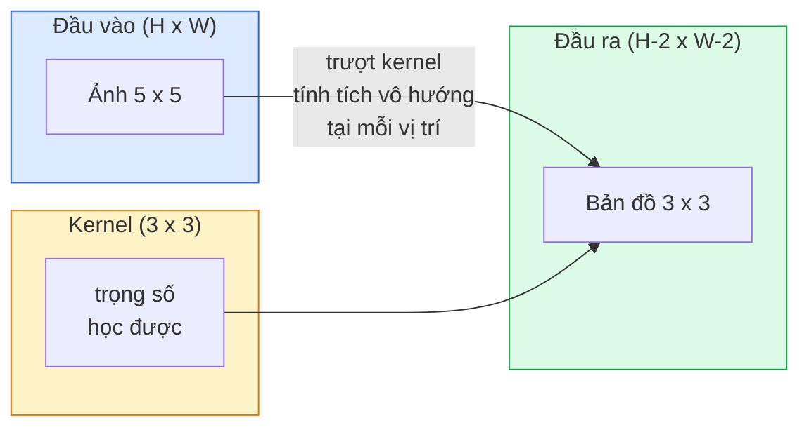
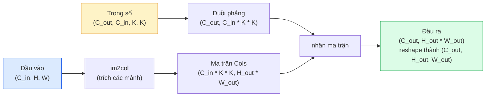

# Tích chập từ đầu

> Convolution (tích chập) là một tầng dày đặc tí hon mà bạn trượt khắp ảnh, dùng chung cùng một bộ trọng số ở mọi vị trí.

**Type:** Build
**Languages:** Python
**Prerequisites:** Giai đoạn 3 (Lõi Học sâu), Giai đoạn 4, Bài 01 (Nền tảng hình ảnh)
**Time:** ~75 phút

## Mục tiêu học tập

- Tự cài đặt tích chập 2D chỉ bằng NumPy, gồm bản vòng lặp lồng nhau và bản vector hoá `im2col`
- Tính kích thước không gian đầu ra cho mọi tổ hợp kích thước đầu vào, kích thước kernel, padding (đệm) và stride (bước nhảy), rồi giải thích công thức `(H - K + 2P) / S + 1`
- Tự thiết kế kernel (biên, làm mờ, làm sắc, Sobel) và giải thích vì sao mỗi kernel tạo ra đúng kiểu kích hoạt đó
- Xếp chồng các tích chập thành một bộ trích xuất đặc trưng và nối độ sâu của chồng đó với kích thước trường tiếp nhận (receptive field)

## Vấn đề

Một tầng fully connected trên ảnh RGB 224x224 sẽ cần 224 * 224 * 3 = 150,528 trọng số đầu vào cho mỗi nơ-ron. Chỉ một tầng ẩn 1,000 đơn vị đã là 150 triệu tham số — trước khi bạn học được bất cứ điều gì hữu ích. Tệ hơn, tầng đó không hề biết rằng một con chó ở góc trên bên trái và một con chó ở góc dưới bên phải là cùng một mẫu hình. Nó coi mọi vị trí điểm ảnh là độc lập, đúng là sai với ảnh: dịch một con mèo đi ba điểm ảnh không nên buộc mạng phải học lại khái niệm đó.

Hai tính chất một mô hình ảnh cần là **translation equivariance** (đẳng biến tịnh tiến — đầu ra dịch theo khi đầu vào dịch) và **parameter sharing** (chia sẻ tham số — cùng một bộ phát hiện đặc trưng chạy ở mọi nơi). Tầng dày đặc không cho bạn cái nào. Tích chập cho bạn cả hai miễn phí.

Tích chập không được phát minh cho học sâu. Đó là cùng một phép toán chạy nén JPEG, làm mờ Gauss trong Photoshop, phát hiện biên trong thị giác công nghiệp, và mọi bộ lọc âm thanh từng được phát hành. Lý do CNN thống trị ImageNet từ 2012 đến 2020 là vì tích chập là prior đúng cho dữ liệu mà các giá trị gần nhau có liên hệ với nhau và cùng một mẫu hình có thể xuất hiện ở bất kỳ đâu.

## Khái niệm

### Một kernel, trượt đi

Một tích chập 2D nhận một ma trận trọng số nhỏ gọi là kernel (hay filter), trượt nó khắp đầu vào, và tại mỗi vị trí tính tổng các tích từng phần tử. Tổng đó thành một điểm ảnh đầu ra.



Một ví dụ 3x3 cụ thể trên đầu vào 5x5 (không đệm, bước nhảy 1):

```
Input X (5 x 5):                Kernel W (3 x 3):

  1  2  0  1  2                   1  0 -1
  0  1  3  1  0                   2  0 -2
  2  1  0  2  1                   1  0 -1
  1  0  2  1  3
  2  1  1  0  1

The kernel slides across every valid 3 x 3 window. Output Y is 3 x 3:

 Y[0,0] = sum( W * X[0:3, 0:3] )
 Y[0,1] = sum( W * X[0:3, 1:4] )
 Y[0,2] = sum( W * X[0:3, 2:5] )
 Y[1,0] = sum( W * X[1:4, 0:3] )
 ... and so on
```

Công thức duy nhất đó — **trọng số chia sẻ, tính cục bộ, cửa sổ trượt** — là toàn bộ ý tưởng. Phần còn lại chỉ là thủ tục ghi chép.

### Công thức kích thước đầu ra

Cho kích thước không gian đầu vào `H`, kích thước kernel `K`, đệm `P`, bước nhảy `S`:

```
H_out = floor( (H - K + 2P) / S ) + 1
```

Hãy nhớ công thức này. Bạn sẽ tính nó hàng chục lần cho mỗi kiến trúc.

| Tình huống | H | K | P | S | H_out |
|----------|---|---|---|---|-------|
| Conv hợp lệ, không đệm | 32 | 3 | 0 | 1 | 30 |
| Conv same (giữ nguyên kích thước) | 32 | 3 | 1 | 1 | 32 |
| Giảm mẫu 2 lần | 32 | 3 | 1 | 2 | 16 |
| Pool 2x2 | 32 | 2 | 0 | 2 | 16 |
| Trường tiếp nhận lớn | 32 | 7 | 3 | 2 | 16 |

"Đệm same" nghĩa là chọn P sao cho H_out == H khi S == 1. Với K lẻ, đó là P = (K - 1) / 2. Đó là lý do kernel 3x3 chiếm ưu thế — chúng là kernel lẻ nhỏ nhất mà vẫn có tâm.

### Đệm (padding)

Không có đệm, mỗi tích chập làm nhỏ bản đồ đặc trưng (feature map). Xếp 20 lớp như vậy và ảnh 224x224 của bạn thành 184x184, vừa lãng phí tính toán ở viền vừa làm phức tạp các kết nối residual cần kích thước khớp nhau.

```
Zero padding (P = 1) on a 5 x 5 input:

  0  0  0  0  0  0  0
  0  1  2  0  1  2  0
  0  0  1  3  1  0  0
  0  2  1  0  2  1  0       Now the kernel can centre on pixel
  0  1  0  2  1  3  0       (0, 0) and still have three rows and
  0  2  1  1  0  1  0       three columns of values to multiply.
  0  0  0  0  0  0  0
```

Các chế độ bạn gặp trong thực tế: `zero` (phổ biến nhất), `reflect` (phản chiếu mép, tránh viền cứng trong mô hình sinh), `replicate` (sao chép mép), `circular` (bọc vòng, dùng trong bài toán toroidal).

### Bước nhảy (stride)

Bước nhảy là kích thước bước di chuyển của cú trượt. `stride=1` là mặc định. `stride=2` giảm một nửa các chiều không gian và là cách kinh điển để giảm mẫu bên trong CNN mà không cần tầng pooling riêng — mọi kiến trúc hiện đại (ResNet, ConvNeXt, MobileNet) đều dùng conv có bước nhảy thay cho max-pool ở đâu đó.

```
Stride 1 on a 5 x 5 input, 3 x 3 kernel:

  starts: (0,0) (0,1) (0,2)        -> output row 0
          (1,0) (1,1) (1,2)        -> output row 1
          (2,0) (2,1) (2,2)        -> output row 2

  Output: 3 x 3

Stride 2 on the same input:

  starts: (0,0) (0,2)              -> output row 0
          (2,0) (2,2)              -> output row 1

  Output: 2 x 2
```

### Nhiều kênh đầu vào

Ảnh thật có ba kênh. Một tích chập 3x3 trên đầu vào RGB thực ra là một khối 3x3x3: mỗi kênh đầu vào một lát 3x3. Tại mỗi vị trí không gian, bạn nhân và cộng dồn trên cả ba lát rồi thêm bias.

```
Input:   (C_in,  H,  W)        3 x 5 x 5
Kernel:  (C_in,  K,  K)        3 x 3 x 3 (one kernel)
Output:  (1,     H', W')       2D map

For a layer that produces C_out output channels, you stack C_out kernels:

Weight:  (C_out, C_in, K, K)   e.g. 64 x 3 x 3 x 3
Output:  (C_out, H', W')       64 x 3 x 3

Parameter count: C_out * C_in * K * K + C_out   (the + C_out is biases)
```

Dòng cuối là thứ bạn sẽ tính khi lập kế hoạch mô hình. Một conv 3x3 64 kênh trên đầu vào 3 kênh có `64 * 3 * 3 * 3 + 64 = 1,792` tham số. Rẻ.

### Mẹo im2col

Vòng lặp lồng nhau dễ đọc nhưng chậm. GPU muốn những phép nhân ma trận lớn. Mẹo: duỗi mọi cửa sổ trường tiếp nhận của đầu vào thành một cột của ma trận lớn, duỗi kernel thành một hàng, và toàn bộ tích chập thành một phép matmul duy nhất.



Mọi cài đặt conv trong production đều là một biến thể của cách này cộng thêm các mẹo tiling bộ nhớ đệm (conv trực tiếp, Winograd, conv FFT cho kernel lớn). Hiểu im2col là hiểu phần lõi.

### Trường tiếp nhận

Một conv 3x3 nhìn 9 điểm ảnh đầu vào. Xếp hai conv 3x3 và một nơ-ron ở tầng thứ hai nhìn 5x5 điểm ảnh đầu vào. Ba conv 3x3 cho 7x7. Tổng quát:

```
RF after L stacked K x K convs (stride 1) = 1 + L * (K - 1)

With strides:   RF grows multiplicatively with stride along each layer.
```

Toàn bộ lý do "3x3 suốt dọc mạng" hiệu quả (VGG, ResNet, ConvNeXt) là hai conv 3x3 nhìn cùng vùng đầu vào như một conv 5x5 nhưng ít tham số hơn và có thêm một phi tuyến ở giữa.

```figure
convolution-kernel
```

## Tự tay làm

### Bước 1: Đệm một mảng

Bắt đầu với nguyên hàm nhỏ nhất: một hàm đệm bằng số 0 quanh mảng H x W.

```python
import numpy as np

def pad2d(x, p):
    if p == 0:
        return x
    h, w = x.shape[-2:]
    out = np.zeros(x.shape[:-2] + (h + 2 * p, w + 2 * p), dtype=x.dtype)
    out[..., p:p + h, p:p + w] = x
    return out

x = np.arange(9).reshape(3, 3)
print(x)
print()
print(pad2d(x, 1))
```

Mẹo trục cuối `x.shape[:-2]` nghĩa là cùng một hàm chạy được trên `(H, W)`, `(C, H, W)`, hay `(N, C, H, W)` mà không cần sửa gì.

### Bước 2: Tích chập 2D bằng vòng lặp lồng nhau

Bản cài đặt tham chiếu — chậm, nhưng không mơ hồ. Đây là điều `torch.nn.functional.conv2d` làm về nguyên lý.

```python
def conv2d_naive(x, w, b=None, stride=1, padding=0):
    c_in, h, w_in = x.shape
    c_out, c_in_w, kh, kw = w.shape
    assert c_in == c_in_w

    x_pad = pad2d(x, padding)
    h_out = (h + 2 * padding - kh) // stride + 1
    w_out = (w_in + 2 * padding - kw) // stride + 1

    out = np.zeros((c_out, h_out, w_out), dtype=np.float32)
    for oc in range(c_out):
        for i in range(h_out):
            for j in range(w_out):
                hs = i * stride
                ws = j * stride
                patch = x_pad[:, hs:hs + kh, ws:ws + kw]
                out[oc, i, j] = np.sum(patch * w[oc])
        if b is not None:
            out[oc] += b[oc]
    return out
```

Bốn vòng lặp lồng nhau (kênh đầu ra, hàng, cột, cộng với phép cộng dồn ngầm trên C_in, kh, kw). Đây là chân lý nền để bạn đối chiếu mọi cài đặt nhanh hơn.

### Bước 3: Kiểm chứng bằng một kernel tự thiết kế

Tạo một kernel Sobel dọc, áp nó lên một ảnh bậc thang tổng hợp, và xem biên dọc sáng lên.

```python
def synthetic_step_image():
    img = np.zeros((1, 16, 16), dtype=np.float32)
    img[:, :, 8:] = 1.0
    return img

sobel_x = np.array([
    [[-1, 0, 1],
     [-2, 0, 2],
     [-1, 0, 1]]
], dtype=np.float32)[None]

x = synthetic_step_image()
y = conv2d_naive(x, sobel_x, padding=1)
print(y[0].round(1))
```

Kỳ vọng giá trị dương lớn ở cột 7 (độ sáng tăng từ trái sang phải) và số 0 ở mọi nơi khác. Lần `print` đó chính là kiểm tra nhanh xem phép toán có đúng không.

### Bước 4: im2col

Chuyển mọi cửa sổ kích thước kernel trong đầu vào thành một cột của ma trận. Với `C_in=3, K=3`, mỗi cột là 27 số.

```python
def im2col(x, kh, kw, stride=1, padding=0):
    c_in, h, w = x.shape
    x_pad = pad2d(x, padding)
    h_out = (h + 2 * padding - kh) // stride + 1
    w_out = (w + 2 * padding - kw) // stride + 1

    cols = np.zeros((c_in * kh * kw, h_out * w_out), dtype=x.dtype)
    col = 0
    for i in range(h_out):
        for j in range(w_out):
            hs = i * stride
            ws = j * stride
            patch = x_pad[:, hs:hs + kh, ws:ws + kw]
            cols[:, col] = patch.reshape(-1)
            col += 1
    return cols, h_out, w_out
```

Nó vẫn là vòng lặp Python, nhưng giờ phần nặng sẽ là một phép matmul vector hoá duy nhất.

### Bước 5: Tích chập nhanh bằng im2col + matmul

Thay vòng lặp bốn lớp bằng một phép nhân ma trận.

```python
def conv2d_im2col(x, w, b=None, stride=1, padding=0):
    c_out, c_in, kh, kw = w.shape
    cols, h_out, w_out = im2col(x, kh, kw, stride, padding)
    w_flat = w.reshape(c_out, -1)
    out = w_flat @ cols
    if b is not None:
        out += b[:, None]
    return out.reshape(c_out, h_out, w_out)
```

Kiểm tra tính đúng: chạy cả hai cài đặt và so sánh.

```python
rng = np.random.default_rng(0)
x = rng.normal(0, 1, (3, 16, 16)).astype(np.float32)
w = rng.normal(0, 1, (8, 3, 3, 3)).astype(np.float32)
b = rng.normal(0, 1, (8,)).astype(np.float32)

y_naive = conv2d_naive(x, w, b, padding=1)
y_im2col = conv2d_im2col(x, w, b, padding=1)

print(f"max abs diff: {np.max(np.abs(y_naive - y_im2col)):.2e}")
```

`max abs diff` nên vào khoảng `1e-5` — khác biệt là thứ tự cộng dồn số thực dấu phẩy động, không phải lỗi.

### Bước 6: Một bộ kernel tự thiết kế

Năm bộ lọc cho thấy một tầng conv duy nhất có thể biểu đạt gì trước khi huấn luyện.

```python
KERNELS = {
    "identity": np.array([[0, 0, 0], [0, 1, 0], [0, 0, 0]], dtype=np.float32),
    "blur_3x3": np.ones((3, 3), dtype=np.float32) / 9.0,
    "sharpen": np.array([[0, -1, 0], [-1, 5, -1], [0, -1, 0]], dtype=np.float32),
    "sobel_x": np.array([[-1, 0, 1], [-2, 0, 2], [-1, 0, 1]], dtype=np.float32),
    "sobel_y": np.array([[-1, -2, -1], [0, 0, 0], [1, 2, 1]], dtype=np.float32),
}

def apply_kernel(img2d, kernel):
    x = img2d[None].astype(np.float32)
    w = kernel[None, None]
    return conv2d_im2col(x, w, padding=1)[0]
```

Áp lên bất kỳ ảnh xám nào, làm mờ làm mềm, làm sắc làm nét biên, Sobel-x làm sáng biên dọc, Sobel-y làm sáng biên ngang. Đây đúng là những mẫu hình mà tầng conv *đầu tiên* được huấn luyện trong AlexNet và VGG cuối cùng đã học — vì một mô hình ảnh tốt cần bộ phát hiện biên và đốm bất kể nhiệm vụ phía sau là gì.

## Áp dụng

`nn.Conv2d` của PyTorch bọc cùng phép toán đó với autograd, kernel CUDA và tối ưu cuDNN. Ngữ nghĩa hình dạng giống hệt.

```python
import torch
import torch.nn as nn

conv = nn.Conv2d(in_channels=3, out_channels=64, kernel_size=3, stride=1, padding=1)
print(conv)
print(f"weight shape: {tuple(conv.weight.shape)}   # (C_out, C_in, K, K)")
print(f"bias shape:   {tuple(conv.bias.shape)}")
print(f"param count:  {sum(p.numel() for p in conv.parameters())}")

x = torch.randn(8, 3, 224, 224)
y = conv(x)
print(f"\ninput  shape: {tuple(x.shape)}")
print(f"output shape: {tuple(y.shape)}")
```

Đổi `padding=1` thành `padding=0` thì đầu ra tụt xuống 222x222. Đổi `stride=1` thành `stride=2` thì tụt xuống 112x112. Vẫn đúng công thức bạn đã nhớ ở trên.

## Đóng gói

Bài học này tạo ra:

- `outputs/prompt-cnn-architect.md` — một prompt mà, khi cho kích thước đầu vào, ngân sách tham số và trường tiếp nhận mục tiêu, sẽ thiết kế một chồng lớp `Conv2d` với K/S/P đúng ở mỗi bước.
- `outputs/skill-conv-shape-calculator.md` — một skill đi qua một spec mạng theo từng tầng và trả về kích thước đầu ra, trường tiếp nhận và số tham số cho mỗi khối.

## Bài tập

1. **(Dễ)** Cho đầu vào ảnh xám 128x128 và một chồng `[Conv3x3(s=1,p=1), Conv3x3(s=2,p=1), Conv3x3(s=1,p=1), Conv3x3(s=2,p=1)]`, tính bằng tay kích thước không gian đầu ra và trường tiếp nhận ở mỗi tầng. Kiểm chứng bằng một `nn.Sequential` các conv giả trong PyTorch.
2. **(Vừa)** Mở rộng `conv2d_naive` và `conv2d_im2col` để nhận đối số `groups`. Chứng minh rằng `groups=C_in=C_out` tái tạo một depthwise convolution và số tham số của nó là `C * K * K` thay vì `C * C * K * K`.
3. **(Khó)** Tự cài đặt lan truyền ngược của `conv2d_im2col`: cho gradient của đầu ra, tính gradient của `x` và `w`. Kiểm chứng với `torch.autograd.grad` trên cùng đầu vào và trọng số. Mẹo: gradient của im2col là `col2im`, và nó phải cộng dồn các cửa sổ chồng lấn.

## Thuật ngữ chính

| Thuật ngữ | Người ta thường nói | Ý nghĩa thực sự |
|------|----------------|----------------------|
| Convolution | "Trượt một bộ lọc" | Một tích vô hướng học được áp tại mọi vị trí không gian với trọng số chia sẻ; về mặt toán học là tương quan chéo (cross-correlation), nhưng ai cũng gọi là tích chập |
| Kernel / filter | "Bộ phát hiện đặc trưng" | Một tensor trọng số nhỏ có dạng (C_in, K, K) mà tích vô hướng với một cửa sổ đầu vào tạo ra một điểm ảnh đầu ra |
| Stride | "Bạn nhảy xa bao nhiêu" | Khoảng bước giữa các lần đặt kernel liên tiếp; stride 2 giảm một nửa mỗi chiều không gian |
| Padding | "Số 0 ở viền" | Giá trị thêm vào quanh đầu vào để kernel có thể đặt tâm lên điểm ảnh viền; đệm `same` giữ kích thước đầu ra bằng kích thước đầu vào |
| Receptive field | "Nơ-ron nhìn được bao nhiêu" | Vùng đầu vào gốc mà một kích hoạt đầu ra phụ thuộc vào, lớn dần theo độ sâu và bước nhảy |
| im2col | "Mẹo GEMM" | Sắp xếp mọi cửa sổ tiếp nhận thành các cột để tích chập thành một phép nhân ma trận lớn — lõi của mọi kernel conv nhanh |
| Depthwise conv | "Mỗi kênh một kernel" | Conv với `groups == C_in`, mỗi kênh đầu ra chỉ tính từ kênh đầu vào khớp với nó; là xương sống của MobileNet và ConvNeXt |
| Translation equivariance | "Dịch vào, dịch ra" | Tính chất: dịch đầu vào k điểm ảnh thì đầu ra cũng dịch k điểm ảnh; có sẵn miễn phí nhờ trọng số chia sẻ |

## Đọc thêm

- [A guide to convolution arithmetic for deep learning (Dumoulin & Visin, 2016)](https://arxiv.org/abs/1603.07285) — bộ sơ đồ chuẩn mực về đệm/bước nhảy/giãn (dilation) mà mọi khoá học đều lặng lẽ sao chép
- [CS231n: Convolutional Neural Networks for Visual Recognition](https://cs231n.github.io/convolutional-networks/) — ghi chép bài giảng kinh điển, gồm cả giải thích im2col nguyên bản
- [The Annotated ConvNet (fast.ai)](https://nbviewer.org/github/fastai/fastbook/blob/master/13_convolutions.ipynb) — một notebook đi từ tích chập thủ công đến bộ phân loại chữ số đã huấn luyện
- [Receptive Field Arithmetic for CNNs (Dang Ha The Hien)](https://distill.pub/2019/computing-receptive-fields/) — bài giải thích tương tác chất lượng bài báo về tính toán trường tiếp nhận

---

[← Bài trước: Nền tảng hình ảnh](../../01-image-fundamentals/docs/vi.md) · [Bài sau: CNN →](../../03-cnns-lenet-to-resnet/docs/vi.md)
