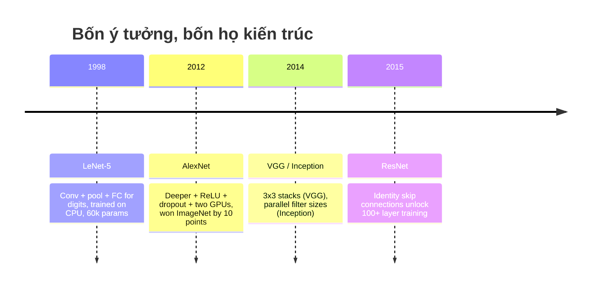
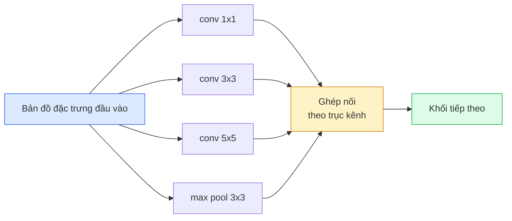
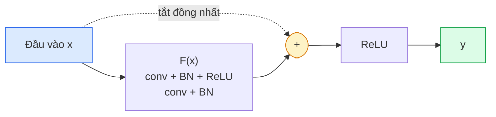

# CNN — từ LeNet đến ResNet

> Mỗi CNN lớn trong ba mươi năm qua đều là cùng một công thức conv–phi tuyến–downsampling (giảm mẫu) với đúng một ý tưởng mới gắn thêm. Hãy học các ý tưởng đó theo đúng thứ tự.

**Type:** Learn + Build
**Languages:** Python
**Prerequisites:** Giai đoạn 3, Bài 11 (PyTorch), Giai đoạn 4, Bài 01 (Nền tảng hình ảnh), Bài 02 (Tích chập tự viết)
**Time:** ~75 phút

## Mục tiêu học tập

- Lần theo dòng dõi kiến trúc LeNet-5 -> AlexNet -> VGG -> Inception -> ResNet và nêu ý tưởng mới duy nhất mà mỗi họ đã đóng góp
- Cài đặt LeNet-5, một khối kiểu VGG, và một BasicBlock của ResNet trong PyTorch, mỗi cái dưới 40 dòng
- Giải thích vì sao residual connection (kết nối tàn dư) biến một mạng 1.000 lớp từ không huấn luyện được thành state-of-the-art
- Đọc một backbone hiện đại (ResNet-18, ResNet-50) và dự đoán shape đầu ra, receptive field, và số tham số trước khi nhìn vào mã nguồn

## Vấn đề

Năm 2011, bộ phân loại ImageNet tốt nhất đạt khoảng 74% độ chính xác top-5. Năm 2012 AlexNet đạt 85%. Năm 2015 ResNet đạt 96%. Không có dữ liệu mới. Không có thế hệ GPU mới. Lợi ích đến từ các ý tưởng kiến trúc. Một kỹ sư thị giác máy tính đang làm việc phải biết ý tưởng nào đến từ bài báo nào, vì mọi backbone bạn triển khai trong năm 2026 đều là sự tái tổ hợp của chính những mảnh đó — và vì các ý tưởng cứ tiếp tục lan truyền: grouped conv đi từ CNN sang transformer, residual connection đi từ ResNet sang mọi LLM đang tồn tại, batch normalisation (chuẩn hoá theo batch) sống trong các mô hình diffusion.

Học các mạng này theo đúng thứ tự cũng giúp bạn miễn nhiễm với một sai lầm phổ biến: vớ lấy mô hình lớn nhất có sẵn khi một mạng cỡ LeNet là đủ giải quyết bài toán. MNIST không cần ResNet. Biết đường cong mở rộng của từng họ giúp bạn biết nên đứng ở đâu trên đường cong đó.

## Khái niệm

### Bốn ý tưởng đã thay đổi thị giác máy tính



Không gì khác trong thị giác máy tính cổ điển lại quan trọng bằng bốn bước nhảy này.

### LeNet-5 (1998)

Bộ nhận dạng chữ số của Yann LeCun. 60.000 tham số. Hai khối conv-pool, hai lớp fully connected, kích hoạt tanh. Nó định nghĩa khuôn mẫu mà mọi CNN thừa kế:

```
input (1, 32, 32)
  conv 5x5 -> (6, 28, 28)
  avg pool 2x2 -> (6, 14, 14)
  conv 5x5 -> (16, 10, 10)
  avg pool 2x2 -> (16, 5, 5)
  flatten -> 400
  dense -> 120
  dense -> 84
  dense -> 10
```

Mọi thứ thế giới hiện đại gọi là CNN — xen kẽ tích chập và downsampling nuôi một head phân loại nhỏ — chính là LeNet với nhiều lớp hơn, nhiều kênh hơn, và kích hoạt tốt hơn.

### AlexNet (2012)

Ba thay đổi cùng nhau phá vỡ ImageNet:

1. **ReLU** thay cho tanh. Gradient không còn triệt tiêu. Huấn luyện nhanh lên gấp sáu lần.
2. **Dropout** trong head fully connected. Regularisation trở thành một lớp, không phải một mẹo.
3. **Độ sâu và độ rộng**. Năm lớp conv, ba lớp dense, 60M tham số, huấn luyện trên hai GPU với mô hình chia đôi qua hai card.

Hình 2 của bài báo vẫn vẽ việc chia GPU thành hai luồng song song. Sự song song đó là một cách lách phần cứng, không phải một kiến giải về kiến trúc — nhưng ba ý tưởng trên vẫn còn trong mọi mô hình bạn dùng.

### VGG (2014)

VGG hỏi: điều gì xảy ra nếu bạn chỉ dùng tích chập 3x3 và đi thật sâu?

```
stack:   conv 3x3 -> conv 3x3 -> pool 2x2
repeat:  16 or 19 conv layers
```

Hai conv 3x3 nhìn cùng một vùng đầu vào 5x5 như một conv 5x5 nhưng với ít tham số hơn (2*9*C^2 = 18C^2 so với 25*C^2) và thêm một ReLU ở giữa. VGG biến quan sát này thành cả một kiến trúc. Sự đơn giản — một loại khối, lặp lại — khiến nó thành điểm quy chiếu cho mọi thứ đến sau.

Giá phải trả: 138M tham số, huấn luyện chậm, suy luận đắt.

### Inception (2014, cùng năm)

Câu trả lời của Google cho "nên dùng kích thước kernel nào?" là: tất cả, chạy song song.



Mỗi nhánh chuyên môn hoá — 1x1 để trộn kênh, 3x3 cho kết cấu cục bộ, 5x5 cho các mẫu lớn hơn, pooling (gộp) cho đặc trưng bất biến với phép dịch — và phép concat cho lớp tiếp theo chọn nhánh nào có ích. Inception v1 dùng conv 1x1 bên trong mỗi nhánh như một bottleneck để giữ số tham số ở mức hợp lý.

### Vấn đề suy giảm (degradation problem)

Đến 2015, VGG-19 chạy được còn VGG-32 thì không. Độ sâu lẽ ra phải giúp, nhưng quá ~20 lớp thì cả loss huấn luyện lẫn loss kiểm tra đều tệ đi. Đó không phải overfitting. Đó là việc bộ tối ưu không tìm được trọng số hữu ích vì gradient co lại theo phép nhân qua từng lớp.

```
Plain deep network:
  y = f_L( f_{L-1}( ... f_1(x) ... ) )

Gradient wrt early layer:
  dL/dW_1 = dL/dy * df_L/df_{L-1} * ... * df_2/df_1 * df_1/dW_1

Each multiplicative term has magnitude roughly (weight magnitude) * (activation gain).
Stack 100 of them with gains < 1 and the gradient is effectively zero.
```

VGG chạy được ở 19 lớp vì batch norm (công bố cùng thời) giữ kích hoạt được co giãn tốt. Nhưng ngay cả batch norm cũng không cứu được độ sâu quá khoảng 30 lớp.

### ResNet (2015)

He, Zhang, Ren, Sun đề xuất một thay đổi sửa được mọi thứ:

```
standard block:   y = F(x)
residual block:   y = F(x) + x
```

`+ x` nghĩa là lớp luôn có thể chọn không làm gì bằng cách đẩy `F(x)` về 0. Một ResNet 1.000 lớp giờ tệ nhất cũng chỉ bằng một mạng 1 lớp, vì mỗi khối thêm vào đều có lối thoát tầm thường. Với bảo đảm đó, bộ tối ưu sẵn lòng làm cho mỗi khối *hơi* hữu ích — và hơi hữu ích, chồng 100 lần, là state-of-the-art.



Có hai biến thể của khối xuất hiện khắp nơi:

- **BasicBlock** (ResNet-18, ResNet-34): hai conv 3x3, kết nối tắt (skip connection) vòng qua cả hai.
- **Bottleneck** (ResNet-50, -101, -152): 1x1 giảm, 3x3 ở giữa, 1x1 tăng, kết nối tắt vòng qua cả bộ ba. Rẻ hơn khi số kênh lớn.

Khi kết nối tắt phải đi qua một phép downsampling (stride=2), nhánh đồng nhất được thay bằng một conv 1x1 stride=2 để khớp shape.

### Vì sao residual còn quan trọng ngoài thị giác máy tính

Ý tưởng này thực ra không chỉ về phân loại ảnh. Nó là về việc biến mạng sâu từ "cầu nguyện và hy vọng gradient sống sót" thành một công cụ kỹ thuật đáng tin, mở rộng được. Mọi transformer bạn đọc ở giai đoạn sau đều có đúng kết nối tắt đó trong mỗi khối. Không có ResNet, thì không có GPT.

```figure
pooling
```

## Tự tay làm

### Bước 1: LeNet-5

Một LeNet tối giản mà trung thành. Kích hoạt tanh, average pooling. Nhượng bộ duy nhất cho hiện đại là ta dùng `nn.CrossEntropyLoss` ở phía sau thay cho các kết nối Gaussian nguyên bản.

```python
import torch
import torch.nn as nn
import torch.nn.functional as F

class LeNet5(nn.Module):
    def __init__(self, num_classes=10):
        super().__init__()
        self.conv1 = nn.Conv2d(1, 6, kernel_size=5)
        self.conv2 = nn.Conv2d(6, 16, kernel_size=5)
        self.pool = nn.AvgPool2d(2)
        self.fc1 = nn.Linear(16 * 5 * 5, 120)
        self.fc2 = nn.Linear(120, 84)
        self.fc3 = nn.Linear(84, num_classes)

    def forward(self, x):
        x = self.pool(torch.tanh(self.conv1(x)))
        x = self.pool(torch.tanh(self.conv2(x)))
        x = torch.flatten(x, 1)
        x = torch.tanh(self.fc1(x))
        x = torch.tanh(self.fc2(x))
        return self.fc3(x)

net = LeNet5()
x = torch.randn(1, 1, 32, 32)
print(f"output: {net(x).shape}")
print(f"params: {sum(p.numel() for p in net.parameters()):,}")
```

Kết quả mong đợi: `output: torch.Size([1, 10])`, `params: 61,706`. Đó chính là toàn bộ bộ phân loại chữ số đã khởi đầu thị giác máy tính hiện đại.

### Bước 2: Một khối VGG

Một khối tái sử dụng được: hai conv 3x3, ReLU, batch norm, max pool.

```python
class VGGBlock(nn.Module):
    def __init__(self, in_c, out_c):
        super().__init__()
        self.conv1 = nn.Conv2d(in_c, out_c, kernel_size=3, padding=1)
        self.bn1 = nn.BatchNorm2d(out_c)
        self.conv2 = nn.Conv2d(out_c, out_c, kernel_size=3, padding=1)
        self.bn2 = nn.BatchNorm2d(out_c)
        self.pool = nn.MaxPool2d(2)

    def forward(self, x):
        x = F.relu(self.bn1(self.conv1(x)))
        x = F.relu(self.bn2(self.conv2(x)))
        return self.pool(x)

class MiniVGG(nn.Module):
    def __init__(self, num_classes=10):
        super().__init__()
        self.stack = nn.Sequential(
            VGGBlock(3, 32),
            VGGBlock(32, 64),
            VGGBlock(64, 128),
        )
        self.head = nn.Sequential(
            nn.AdaptiveAvgPool2d(1),
            nn.Flatten(),
            nn.Linear(128, num_classes),
        )

    def forward(self, x):
        return self.head(self.stack(x))

net = MiniVGG()
x = torch.randn(1, 3, 32, 32)
print(f"output: {net(x).shape}")
print(f"params: {sum(p.numel() for p in net.parameters()):,}")
```

Ba khối VGG trên đầu vào cỡ CIFAR, một adaptive pool, một lớp linear. ~290k tham số. Thừa đủ cho CIFAR-10.

### Bước 3: Một BasicBlock của ResNet

Khối xây dựng cốt lõi của ResNet-18 và ResNet-34.

```python
class BasicBlock(nn.Module):
    def __init__(self, in_c, out_c, stride=1):
        super().__init__()
        self.conv1 = nn.Conv2d(in_c, out_c, kernel_size=3, stride=stride, padding=1, bias=False)
        self.bn1 = nn.BatchNorm2d(out_c)
        self.conv2 = nn.Conv2d(out_c, out_c, kernel_size=3, stride=1, padding=1, bias=False)
        self.bn2 = nn.BatchNorm2d(out_c)
        if stride != 1 or in_c != out_c:
            self.shortcut = nn.Sequential(
                nn.Conv2d(in_c, out_c, kernel_size=1, stride=stride, bias=False),
                nn.BatchNorm2d(out_c),
            )
        else:
            self.shortcut = nn.Identity()

    def forward(self, x):
        out = F.relu(self.bn1(self.conv1(x)))
        out = self.bn2(self.conv2(out))
        out = out + self.shortcut(x)
        return F.relu(out)
```

`bias=False` trên các lớp conv là quy ước của batch norm — tham số beta của BN đã xử lý bias, nên mang thêm bias của conv là lãng phí. `shortcut` chỉ cần một conv thật khi stride hoặc số kênh thay đổi; còn lại nó là một identity không làm gì.

### Bước 4: Một ResNet tí hon

Chồng bốn nhóm BasicBlock để có một ResNet chạy được cho đầu vào cỡ CIFAR.

```python
class TinyResNet(nn.Module):
    def __init__(self, num_classes=10):
        super().__init__()
        self.stem = nn.Sequential(
            nn.Conv2d(3, 32, kernel_size=3, stride=1, padding=1, bias=False),
            nn.BatchNorm2d(32),
            nn.ReLU(inplace=True),
        )
        self.layer1 = self._make_group(32, 32, num_blocks=2, stride=1)
        self.layer2 = self._make_group(32, 64, num_blocks=2, stride=2)
        self.layer3 = self._make_group(64, 128, num_blocks=2, stride=2)
        self.layer4 = self._make_group(128, 256, num_blocks=2, stride=2)
        self.head = nn.Sequential(
            nn.AdaptiveAvgPool2d(1),
            nn.Flatten(),
            nn.Linear(256, num_classes),
        )

    def _make_group(self, in_c, out_c, num_blocks, stride):
        blocks = [BasicBlock(in_c, out_c, stride=stride)]
        for _ in range(num_blocks - 1):
            blocks.append(BasicBlock(out_c, out_c, stride=1))
        return nn.Sequential(*blocks)

    def forward(self, x):
        x = self.stem(x)
        x = self.layer1(x)
        x = self.layer2(x)
        x = self.layer3(x)
        x = self.layer4(x)
        return self.head(x)

net = TinyResNet()
x = torch.randn(1, 3, 32, 32)
print(f"output: {net(x).shape}")
print(f"params: {sum(p.numel() for p in net.parameters()):,}")
```

Bốn nhóm, mỗi nhóm hai khối. Stride 2 ở đầu các nhóm 2, 3, 4. Số kênh gấp đôi ở mỗi lần downsampling. Khoảng 2.8M tham số. Đó là công thức chuẩn, mở rộng gọn gàng lên tới ResNet-152.

### Bước 5: So sánh hiệu quả tham số trên đặc trưng

Chạy cùng một đầu vào qua cả ba mạng và so sánh số tham số.

```python
def summary(name, net, x):
    y = net(x)
    params = sum(p.numel() for p in net.parameters())
    print(f"{name:12s}  input {tuple(x.shape)} -> output {tuple(y.shape)}  params {params:>10,}")

x = torch.randn(1, 3, 32, 32)
summary("LeNet5",     LeNet5(),       torch.randn(1, 1, 32, 32))
summary("MiniVGG",    MiniVGG(),      x)
summary("TinyResNet", TinyResNet(),   x)
```

Ba mô hình, ba thời đại, ba bậc độ lớn về số tham số. Về độ chính xác CIFAR-10, bạn cần khoảng: LeNet 60%, MiniVGG 89%, TinyResNet 93% sau vài epoch huấn luyện.

## Áp dụng

`torchvision.models` cho bạn các phiên bản pretrained của tất cả những thứ trên. Chữ ký gọi giống hệt nhau giữa các họ, và đó chính xác là điểm của abstraction backbone.

```python
from torchvision.models import resnet18, ResNet18_Weights, vgg16, VGG16_Weights

r18 = resnet18(weights=ResNet18_Weights.IMAGENET1K_V1)
r18.eval()

print(f"ResNet-18 params: {sum(p.numel() for p in r18.parameters()):,}")
print(r18.layer1[0])
print()

v16 = vgg16(weights=VGG16_Weights.IMAGENET1K_V1)
v16.eval()
print(f"VGG-16   params: {sum(p.numel() for p in v16.parameters()):,}")
```

ResNet-18 có 11.7M tham số. VGG-16 có 138M. Độ chính xác top-1 ImageNet tương đương (69.8% so với 71.6%). Residual connection mang lại cho bạn lợi thế hiệu quả tham số gấp 12 lần. Đó là lý do các biến thể ResNet thống trị từ 2016 cho đến khi ViT xuất hiện năm 2021 — và vẫn thống trị các triển khai thực tế nơi compute là ràng buộc.

Với transfer learning, công thức luôn như nhau: nạp bản pretrained, đóng băng backbone, thay head phân loại.

```python
for p in r18.parameters():
    p.requires_grad = False
r18.fc = nn.Linear(r18.fc.in_features, 10)
```

Ba dòng. Bạn giờ có một bộ phân loại CIFAR 10 lớp thừa hưởng các biểu diễn mà ImageNet đã trả giá để có.

## Đóng gói

Bài học này tạo ra:

- `outputs/prompt-backbone-selector.md` — một prompt chọn đúng họ CNN (LeNet/VGG/ResNet/MobileNet/ConvNeXt) dựa trên tác vụ, kích thước dataset, và ngân sách compute.
- `outputs/skill-residual-block-reviewer.md` — một skill đọc một module PyTorch và gắn cờ các lỗi kết nối tắt (thiếu shortcut khi stride đổi, thứ tự kích hoạt của shortcut, vị trí BN so với phép cộng).

## Bài tập

1. **(Dễ)** Đếm tham số bằng tay cho `TinyResNet` từng lớp một. So với `sum(p.numel() for p in net.parameters())`. Phần lớn ngân sách tham số đi đâu — conv, BN, hay head phân loại?
2. **(Trung bình)** Cài đặt khối Bottleneck (1x1 -> 3x3 -> 1x1 với skip) và dùng nó để dựng một mạng kiểu ResNet-50 cho CIFAR. So sánh tham số với `TinyResNet`.
3. **(Khó)** Bỏ kết nối tắt khỏi `BasicBlock`, huấn luyện một mạng "plain" 34 khối và một ResNet 34 khối trên CIFAR-10, mỗi cái 10 epoch. Vẽ loss huấn luyện theo epoch cho cả hai. Tái tạo kết quả Hình 1 của He et al. nơi mạng sâu plain hội tụ tới loss cao hơn mạng nông sinh đôi của nó.

## Thuật ngữ chính

| Thuật ngữ | Người ta thường nói | Ý nghĩa thực sự |
|------|----------------|----------------------|
| Backbone | "Mô hình" | Chồng các khối tích chập tạo ra bản đồ đặc trưng đưa vào head tác vụ |
| Residual connection | "Skip connection" | `y = F(x) + x`; cho phép bộ tối ưu học identity bằng cách đặt F về 0, điều khiến độ sâu tuỳ ý huấn luyện được |
| BasicBlock | "Hai conv 3x3 với một skip" | Khối xây dựng của ResNet-18/34: conv-BN-ReLU-conv-BN-add-ReLU |
| Bottleneck | "1x1 giảm, 3x3, 1x1 tăng" | Khối của ResNet-50/101/152; rẻ khi số kênh lớn vì 3x3 chạy trên độ rộng đã giảm |
| Degradation problem | "Sâu hơn là tệ hơn" | Quá ~20 lớp conv plain, cả lỗi huấn luyện và lỗi kiểm tra đều tăng; được giải quyết bằng residual connection, không phải bằng thêm dữ liệu |
| Stem | "Lớp đầu tiên" | Conv khởi đầu chuyển đầu vào 3 kênh thành độ rộng đặc trưng cơ sở; thường là 7x7 stride 2 cho ImageNet, 3x3 stride 1 cho CIFAR |
| Head | "Bộ phân loại" | Các lớp sau khối backbone cuối: adaptive pool, flatten, linear |
| Transfer learning | "Trọng số pretrained" | Nạp một backbone đã huấn luyện trên ImageNet và chỉ fine-tune head trên tác vụ của bạn |

## Đọc thêm

- [Deep Residual Learning for Image Recognition (He et al., 2015)](https://arxiv.org/abs/1512.03385) — bài báo ResNet; từng hình đều đáng nghiên cứu
- [Very Deep Convolutional Networks (Simonyan & Zisserman, 2014)](https://arxiv.org/abs/1409.1556) — bài báo VGG; vẫn là tài liệu tham chiếu tốt nhất cho câu hỏi "vì sao 3x3"
- [ImageNet Classification with Deep CNNs (Krizhevsky et al., 2012)](https://papers.nips.cc/paper_files/paper/2012/hash/c399862d3b9d6b76c8436e924a68c45b-Abstract.html) — AlexNet; bài báo đã kết thúc kỷ nguyên đặc trưng thủ công
- [Going Deeper with Convolutions (Szegedy et al., 2014)](https://arxiv.org/abs/1409.4842) — Inception v1; ý tưởng filter song song vẫn xuất hiện trong vision transformer

---

[← Bài trước: Tích chập từ đầu](../../02-convolutions-from-scratch/docs/vi.md) · [Bài sau: Phân loại ảnh →](../../04-image-classification/docs/vi.md)
