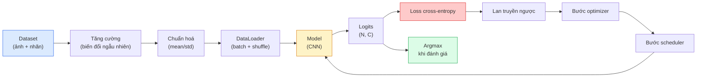

# Phân loại ảnh

> Một bộ phân loại là một hàm ánh xạ từ pixel sang phân phối xác suất trên các lớp. Mọi thứ còn lại chỉ là hệ thống ống dẫn.

**Type:** Build
**Languages:** Python
**Prerequisites:** Giai đoạn 2, Bài 09 (Đánh giá mô hình), Giai đoạn 3, Bài 10 (Mini framework), Giai đoạn 4, Bài 03 (CNN)
**Time:** ~75 phút

## Mục tiêu học tập

- Xây dựng một pipeline image classification (phân loại ảnh) đầu-cuối trên CIFAR-10: dataset, tăng cường dữ liệu (data augmentation), model, vòng lặp huấn luyện, đánh giá
- Giải thích vai trò của từng thành phần (dataloader, loss, optimizer, scheduler, augmentation) và dự đoán việc làm hỏng bất kỳ thành phần nào sẽ biểu hiện thế nào trên đường cong loss
- Tự tay cài đặt mixup, cutout và label smoothing (làm trơn nhãn) và lý giải khi nào từng kỹ thuật đáng để thêm vào
- Đọc confusion matrix (ma trận nhầm lẫn) và bảng precision/recall theo từng lớp để chẩn đoán lỗi của dataset và model vượt ra ngoài độ chính xác tổng hợp

## Vấn đề

Mọi tác vụ thị giác máy tính khi đưa vào sản phẩm, ở một mức nào đó, đều quy về phân loại ảnh. Detection phân loại các vùng. Segmentation phân loại từng pixel. Retrieval xếp hạng theo độ tương đồng với tâm của lớp. Làm đúng phần phân loại — vòng lặp dataset, chính sách tăng cường dữ liệu, hàm loss, phần đánh giá — là kỹ năng chuyển được sang mọi tác vụ khác trong giai đoạn này.

Phần lớn lỗi trong phân loại không nằm ở model. Chúng sống trong pipeline: chuẩn hoá bị hỏng, tập huấn luyện không được xáo trộn, tăng cường dữ liệu làm sai nhãn, tập validation bị nhiễm dữ liệu huấn luyện, learning rate âm thầm phân kỳ sau epoch 30. Một CNN đạt 93% trên CIFAR-10 với cấu hình đúng thường chỉ được 70-75% với cấu hình hỏng, mà đường cong loss trông vẫn hợp lý suốt thời gian đó.

Bài này tự tay nối toàn bộ pipeline để mọi phần đều kiểm tra được. Bạn sẽ không dùng bất cứ thứ gì từ `torchvision.datasets` có thể che giấu lỗi.

## Khái niệm

### Pipeline phân loại



Mỗi dòng trong vòng lặp này đều là nơi lỗi có thể sống. Cross-entropy nhận logits thô, không phải đầu ra softmax, nên bất kỳ `model(x).softmax()` nào đặt trước hàm loss đều âm thầm tính gradient sai. Tăng cường dữ liệu chỉ áp lên đầu vào, không áp lên nhãn — trừ mixup, vốn trộn cả hai. `optimizer.zero_grad()` phải chạy đúng một lần mỗi bước; bỏ qua nó sẽ tích luỹ gradient và trông như learning rate cực kỳ bất ổn. Mỗi lỗi đó đều làm phẳng đường cong học mà không hề ném ra lỗi.

### Cross-entropy, logits và softmax

Một bộ phân loại tạo ra `C` con số cho mỗi ảnh, gọi là logits. Áp softmax biến chúng thành một phân phối xác suất:

```
softmax(z)_i = exp(z_i) / sum_j exp(z_j)
```

Cross-entropy đo log âm của xác suất lớp đúng:

```
CE(z, y) = -log( softmax(z)_y )
        = -z_y + log( sum_j exp(z_j) )
```

Dạng bên phải là dạng ổn định về số học (log-sum-exp). `nn.CrossEntropyLoss` của PyTorch gộp softmax + NLL trong một phép toán và nhận trực tiếp logits thô. Tự áp softmax trước gần như luôn là lỗi — bạn đang tính log(softmax(softmax(z))), một đại lượng vô nghĩa.

### Vì sao tăng cường dữ liệu hiệu quả

CNN có inductive bias (thiên kiến quy nạp) về tịnh tiến (nhờ chia sẻ trọng số) nhưng không có sẵn bất biến với cắt xén, lật, nhiễu màu hay che khuất. Cách duy nhất để dạy nó những bất biến đó là cho nó thấy những pixel thể hiện chúng. Mỗi phép biến đổi ngẫu nhiên khi huấn luyện là một cách nói rằng: "hai ảnh này có cùng nhãn; hãy học các đặc trưng bỏ qua khác biệt đó."

```
Original crop:  "dog facing left"
Flip:           "dog facing right"       <- same label, different pixels
Rotate(+15):    "dog, slight tilt"
Colour jitter:  "dog in warmer light"
RandomErasing:  "dog with patch missing"
```

Quy tắc: tăng cường dữ liệu phải giữ nguyên nhãn. Cutout và xoay trên ảnh chữ số có thể biến "6" thành "9"; với dataset đó bạn dùng biên độ xoay nhỏ hơn và chọn những phép tăng cường tôn trọng bất biến riêng của chữ số.

### Mixup và cutmix

Tăng cường dữ liệu thông thường biến đổi pixel nhưng giữ nhãn one-hot. **Mixup** và **cutmix** phá vỡ điều đó bằng cách nội suy cả hai.

```
Mixup:
  lambda ~ Beta(a, a)
  x = lambda * x_i + (1 - lambda) * x_j
  y = lambda * y_i + (1 - lambda) * y_j

Cutmix:
  paste a random rectangle of x_j into x_i
  y = area-weighted mix of y_i and y_j
```

Vì sao nó giúp ích: model thôi ghi nhớ những target one-hot nhọn hoắt và học cách nội suy giữa các lớp. Loss huấn luyện tăng, độ chính xác test tăng. Đây là bản nâng cấp độ bền vững rẻ nhất cho bất kỳ bộ phân loại nào.

### Label smoothing

Một họ hàng của mixup. Thay vì huấn luyện theo `[0, 0, 1, 0, 0]`, bạn huấn luyện theo `[eps/C, eps/C, 1-eps, eps/C, eps/C]` với `eps` nhỏ như 0.1. Nó ngăn model tạo ra logits nhọn tuỳ ý và cải thiện calibration gần như không mất gì. Có sẵn trong `nn.CrossEntropyLoss(label_smoothing=0.1)` từ PyTorch 1.10.

### Đánh giá vượt ra ngoài độ chính xác

Độ chính xác tổng hợp che khuất mất cân bằng lớp (class imbalance). Một bộ phân loại nhị phân 90-10 luôn dự đoán lớp đa số sẽ đạt 90%. Những công cụ thực sự cho bạn biết chuyện gì đang diễn ra:

- **Độ chính xác theo từng lớp** — một con số cho mỗi lớp; lập tức lộ ra những hạng mục hoạt động kém.
- **Confusion matrix** — lưới C x C với hàng i cột j = số mẫu thuộc lớp thật i bị dự đoán là lớp j; đường chéo là đúng, các ô ngoài đường chéo là nơi model của bạn sống.
- **Top-1 / Top-5** — liệu lớp đúng có nằm trong 1 hay 5 dự đoán hàng đầu; độ chính xác top-1/top-5 (top-1/top-5 accuracy) quan trọng với ImageNet vì những lớp như "Norwich terrier" và "Norfolk terrier" thực sự mơ hồ.
- **Calibration (ECE)** — một dự đoán có độ tin cậy 0.8 có đúng 80% số lần không? Các mạng hiện đại thường quá tự tin một cách hệ thống; sửa bằng temperature scaling hoặc làm trơn nhãn.

```figure
receptive-field
```

## Tự tay làm

### Bước 1: Dataset tổng hợp tất định

CIFAR-10 nằm trên ổ đĩa. Để bài học tái lập được và nhanh, ta xây một dataset tổng hợp trông giống CIFAR — ảnh RGB 32x32 với cấu trúc riêng theo lớp mà model phải học. Đúng pipeline này chạy nguyên vẹn trên CIFAR-10 thật.

```python
import numpy as np
import torch
from torch.utils.data import Dataset


def synthetic_cifar(num_per_class=1000, num_classes=10, seed=0):
    rng = np.random.default_rng(seed)
    X = []
    Y = []
    for c in range(num_classes):
        centre = rng.uniform(0, 1, (3,))
        freq = 2 + c
        for _ in range(num_per_class):
            yy, xx = np.meshgrid(np.linspace(0, 1, 32), np.linspace(0, 1, 32), indexing="ij")
            r = np.sin(xx * freq) * 0.5 + centre[0]
            g = np.cos(yy * freq) * 0.5 + centre[1]
            b = (xx + yy) * 0.5 * centre[2]
            img = np.stack([r, g, b], axis=-1)
            img += rng.normal(0, 0.08, img.shape)
            img = np.clip(img, 0, 1)
            X.append(img.astype(np.float32))
            Y.append(c)
    X = np.stack(X)
    Y = np.array(Y)
    idx = rng.permutation(len(X))
    return X[idx], Y[idx]


class ArrayDataset(Dataset):
    def __init__(self, X, Y, transform=None):
        self.X = X
        self.Y = Y
        self.transform = transform

    def __len__(self):
        return len(self.X)

    def __getitem__(self, i):
        img = self.X[i]
        if self.transform is not None:
            img = self.transform(img)
        img = torch.from_numpy(img).permute(2, 0, 1)
        return img, int(self.Y[i])
```

Mỗi lớp có bảng màu và mẫu tần số riêng, cộng thêm nhiễu Gauss để buộc model học tín hiệu thay vì ghi nhớ pixel. Mười lớp, mỗi lớp một nghìn ảnh, đã xáo trộn.

### Bước 2: Chuẩn hoá và tăng cường dữ liệu

Hai phép biến đổi mà mọi pipeline thị giác máy tính đều có.

```python
def standardize(mean, std):
    mean = np.array(mean, dtype=np.float32)
    std = np.array(std, dtype=np.float32)
    def _fn(img):
        return (img - mean) / std
    return _fn


def random_hflip(p=0.5):
    def _fn(img):
        if np.random.random() < p:
            return img[:, ::-1, :].copy()
        return img
    return _fn


def random_crop(pad=4):
    def _fn(img):
        h, w = img.shape[:2]
        padded = np.pad(img, ((pad, pad), (pad, pad), (0, 0)), mode="reflect")
        y = np.random.randint(0, 2 * pad)
        x = np.random.randint(0, 2 * pad)
        return padded[y:y + h, x:x + w, :]
    return _fn


def compose(*fns):
    def _fn(img):
        for fn in fns:
            img = fn(img)
        return img
    return _fn
```

Đệm reflect trước khi crop, không dùng đệm 0, vì viền đen là một tín hiệu mà model sẽ học cách bỏ qua theo hướng không có ích.

### Bước 3: Mixup

Trộn hai ảnh và hai nhãn ngay trong bước huấn luyện. Được cài như một phép biến đổi ở mức batch nên nó nằm cạnh lượt lan truyền xuôi thay vì nằm trong dataset.

```python
def mixup_batch(x, y, num_classes, alpha=0.2):
    if alpha <= 0:
        return x, torch.nn.functional.one_hot(y, num_classes).float()
    lam = float(np.random.beta(alpha, alpha))
    idx = torch.randperm(x.size(0), device=x.device)
    x_mixed = lam * x + (1 - lam) * x[idx]
    y_onehot = torch.nn.functional.one_hot(y, num_classes).float()
    y_mixed = lam * y_onehot + (1 - lam) * y_onehot[idx]
    return x_mixed, y_mixed


def soft_cross_entropy(logits, soft_targets):
    log_probs = torch.log_softmax(logits, dim=-1)
    return -(soft_targets * log_probs).sum(dim=-1).mean()
```

`soft_cross_entropy` là cross-entropy so với một phân phối nhãn mềm. Nó quy về trường hợp one-hot thông thường khi target đúng là one-hot.

### Bước 4: Vòng lặp huấn luyện

Công thức đầy đủ: một lượt qua dữ liệu, gradient một lần mỗi batch, scheduler nhích một lần mỗi epoch.

```python
import torch
import torch.nn as nn
from torch.utils.data import DataLoader
from torch.optim import SGD
from torch.optim.lr_scheduler import CosineAnnealingLR

def train_one_epoch(model, loader, optimizer, device, num_classes, use_mixup=True):
    model.train()
    total, correct, loss_sum = 0, 0, 0.0
    for x, y in loader:
        x, y = x.to(device), y.to(device)
        if use_mixup:
            x_m, y_soft = mixup_batch(x, y, num_classes)
            logits = model(x_m)
            loss = soft_cross_entropy(logits, y_soft)
        else:
            logits = model(x)
            loss = nn.functional.cross_entropy(logits, y, label_smoothing=0.1)
        optimizer.zero_grad()
        loss.backward()
        optimizer.step()
        loss_sum += loss.item() * x.size(0)
        total += x.size(0)
        # Training accuracy vs the un-mixed labels `y` is only an approximation
        # when mixup is on (the model saw soft targets, not y). Treat it as a
        # rough progress signal; rely on val accuracy for real performance.
        with torch.no_grad():
            pred = logits.argmax(dim=-1)
            correct += (pred == y).sum().item()
    return loss_sum / total, correct / total


@torch.no_grad()
def evaluate(model, loader, device, num_classes):
    model.eval()
    total, correct = 0, 0
    loss_sum = 0.0
    cm = torch.zeros(num_classes, num_classes, dtype=torch.long)
    for x, y in loader:
        x, y = x.to(device), y.to(device)
        logits = model(x)
        loss = nn.functional.cross_entropy(logits, y)
        pred = logits.argmax(dim=-1)
        for t, p in zip(y.cpu(), pred.cpu()):
            cm[t, p] += 1
        loss_sum += loss.item() * x.size(0)
        total += x.size(0)
        correct += (pred == y).sum().item()
    return loss_sum / total, correct / total, cm
```

Năm bất biến bạn kiểm tra mỗi lần viết vòng lặp huấn luyện:

1. `model.train()` trước khi huấn luyện, `model.eval()` trước khi đánh giá — việc này đổi hành vi dropout và batchnorm.
2. `.zero_grad()` trước `.backward()`.
3. `.item()` khi tích luỹ các metric để không có gì giữ đồ thị tính toán sống.
4. `@torch.no_grad()` khi đánh giá — tiết kiệm bộ nhớ và thời gian, tránh những tai nạn tinh vi.
5. Argmax trên logits thô, không phải softmax — cùng kết quả, ít hơn một phép toán.

### Bước 5: Ghép lại

Dùng `TinyResNet` từ bài trước, huấn luyện vài epoch, rồi đánh giá.

```python
from main import synthetic_cifar, ArrayDataset
from main import standardize, random_hflip, random_crop, compose
from main import mixup_batch, soft_cross_entropy
from main import train_one_epoch, evaluate
# TinyResNet comes from the previous lesson (03-cnns-lenet-to-resnet).
# Adjust the import path to wherever you stored the previous lesson's code.
from cnns_lenet_to_resnet import TinyResNet  # example placeholder

X, Y = synthetic_cifar(num_per_class=500)
split = int(0.9 * len(X))
X_train, Y_train = X[:split], Y[:split]
X_val, Y_val = X[split:], Y[split:]

mean = [0.5, 0.5, 0.5]
std = [0.25, 0.25, 0.25]
train_tf = compose(random_hflip(), random_crop(pad=4), standardize(mean, std))
eval_tf = standardize(mean, std)

train_ds = ArrayDataset(X_train, Y_train, transform=train_tf)
val_ds = ArrayDataset(X_val, Y_val, transform=eval_tf)

train_loader = DataLoader(train_ds, batch_size=128, shuffle=True, num_workers=0)
val_loader = DataLoader(val_ds, batch_size=256, shuffle=False, num_workers=0)

device = "cuda" if torch.cuda.is_available() else "cpu"
model = TinyResNet(num_classes=10).to(device)
optimizer = SGD(model.parameters(), lr=0.1, momentum=0.9, weight_decay=5e-4, nesterov=True)
scheduler = CosineAnnealingLR(optimizer, T_max=10)

for epoch in range(10):
    tr_loss, tr_acc = train_one_epoch(model, train_loader, optimizer, device, 10, use_mixup=True)
    va_loss, va_acc, _ = evaluate(model, val_loader, device, 10)
    scheduler.step()
    print(f"epoch {epoch:2d}  lr {scheduler.get_last_lr()[0]:.4f}  "
          f"train {tr_loss:.3f}/{tr_acc:.3f}  val {va_loss:.3f}/{va_acc:.3f}")
```

Trên dataset tổng hợp, cách này đạt độ chính xác validation gần như hoàn hảo trong vòng năm epoch, và đó chính là điểm mấu chốt: pipeline đúng thì model học được những gì có thể học. Đổi dataset sang CIFAR-10 thật và vẫn vòng lặp đó huấn luyện tới ~90% mà không cần sửa gì.

### Bước 6: Đọc ma trận nhầm lẫn

Chỉ riêng độ chính xác không bao giờ cho bạn biết model đang thất bại ở đâu. Confusion matrix thì có.

```python
def print_confusion(cm, labels=None):
    c = cm.shape[0]
    labels = labels or [str(i) for i in range(c)]
    print(f"{'':>6}" + "".join(f"{l:>5}" for l in labels))
    for i in range(c):
        row = cm[i].tolist()
        print(f"{labels[i]:>6}" + "".join(f"{v:>5}" for v in row))
    print()
    tp = cm.diag().float()
    fp = cm.sum(dim=0).float() - tp
    fn = cm.sum(dim=1).float() - tp
    prec = tp / (tp + fp).clamp_min(1)
    rec = tp / (tp + fn).clamp_min(1)
    f1 = 2 * prec * rec / (prec + rec).clamp_min(1e-9)
    for i in range(c):
        print(f"{labels[i]:>6}  prec {prec[i]:.3f}  rec {rec[i]:.3f}  f1 {f1[i]:.3f}")

_, _, cm = evaluate(model, val_loader, device, 10)
print_confusion(cm)
```

Hàng là lớp thật, cột là dự đoán. Một cụm số ngoài đường chéo giữa lớp 3 và lớp 5 nghĩa là model nhầm lẫn hai lớp đó, và cho bạn điểm khởi đầu để thu thập dữ liệu có mục tiêu hoặc một phép tăng cường dữ liệu riêng cho lớp đó.

## Áp dụng

`torchvision` gói toàn bộ những gì ở trên thành các thành phần chuẩn mực. Với CIFAR-10 thật, cả pipeline là bốn dòng cộng một vòng lặp huấn luyện.

```python
from torchvision.datasets import CIFAR10
from torchvision.transforms import Compose, RandomCrop, RandomHorizontalFlip, ToTensor, Normalize

mean = (0.4914, 0.4822, 0.4465)
std = (0.2470, 0.2435, 0.2616)
train_tf = Compose([
    RandomCrop(32, padding=4, padding_mode="reflect"),
    RandomHorizontalFlip(),
    ToTensor(),
    Normalize(mean, std),
])
eval_tf = Compose([ToTensor(), Normalize(mean, std)])

train_ds = CIFAR10(root="./data", train=True,  download=True, transform=train_tf)
val_ds   = CIFAR10(root="./data", train=False, download=True, transform=eval_tf)
```

Hai điều cần chú ý: mean/std là **riêng cho dataset** — tính trên tập huấn luyện CIFAR-10, không phải ImageNet — và đệm reflect là chính sách crop mặc định của cộng đồng. Sao chép số liệu thống kê của ImageNet vào đây là một chỗ rò rỉ ~1% độ chính xác mà không ai phát hiện cho tới khi có người profile model.

## Đóng gói

Bài học này tạo ra:

- `outputs/prompt-classifier-pipeline-auditor.md` — một prompt kiểm tra script huấn luyện theo năm bất biến ở trên và chỉ ra vi phạm đầu tiên.
- `outputs/skill-classification-diagnostics.md` — một skill mà, khi nhận confusion matrix và danh sách tên lớp, sẽ tóm tắt lỗi theo từng lớp và đề xuất bản sửa có tác động lớn nhất.

## Bài tập

1. **(Dễ)** Huấn luyện cùng model có và không có mixup trong năm epoch trên dataset tổng hợp. Vẽ loss huấn luyện và loss validation cho cả hai. Giải thích vì sao loss huấn luyện khi có mixup cao hơn nhưng độ chính xác validation lại tương đương hoặc tốt hơn.
2. **(Trung bình)** Cài đặt Cutout — đặt về 0 một hình vuông 8x8 ngẫu nhiên trong mỗi ảnh huấn luyện — và chạy ablation so với không tăng cường, hflip+crop, hflip+crop+cutout, hflip+crop+mixup. Báo cáo độ chính xác validation cho từng cấu hình.
3. **(Khó)** Xây một pipeline CIFAR-100 (100 lớp, cùng kích thước đầu vào) và tái lập một lần huấn luyện ResNet-34 trong sai số 1% so với độ chính xác đã công bố. Thêm: quét ba learning rate và hai weight decay, ghi log ra một CSV cục bộ, tạo bảng những nhầm lẫn hàng đầu cuối cùng từ confusion matrix.

## Thuật ngữ chính

| Thuật ngữ | Người ta thường nói | Ý nghĩa thực sự |
|------|----------------|----------------------|
| Logits | "Đầu ra thô" | Vector trước softmax gồm C con số cho mỗi ảnh; cross-entropy cần đúng những giá trị này, không phải giá trị đã qua softmax |
| Cross-entropy | "Hàm loss" | Log âm xác suất của lớp đúng; gộp log-softmax và NLL vào một phép toán ổn định |
| DataLoader | "Cái chia batch" | Bọc một dataset với xáo trộn, chia batch và (tuỳ chọn) nạp đa worker; bị đổ lỗi cho một nửa các lỗi huấn luyện |
| Augmentation | "Biến đổi ngẫu nhiên" | Mọi phép biến đổi ở mức pixel lúc huấn luyện mà giữ nguyên nhãn; dạy cho CNN những bất biến mà nó không có sẵn |
| Mixup / Cutmix | "Trộn hai ảnh" | Trộn cả đầu vào lẫn nhãn để bộ phân loại học nội suy mượt thay vì ranh giới cứng |
| Label smoothing | "Target mềm hơn" | Thay one-hot bằng (1-eps, eps/(C-1), ...); cải thiện calibration và tăng nhẹ độ chính xác |
| Top-k accuracy | "Top-5" | Lớp đúng nằm trong k dự đoán có xác suất cao nhất; dùng trên dataset có những lớp thực sự mơ hồ |
| Confusion matrix | "Nơi lỗi sống" | Bảng C x C mà ô (i, j) đếm số ảnh thuộc lớp thật i bị dự đoán là j; đường chéo là đúng, ngoài đường chéo cho biết cần sửa gì |

## Đọc thêm

- [CS231n: Training Neural Networks](https://cs231n.github.io/neural-networks-3/) — vẫn là bài dạo quanh pipeline huấn luyện rõ ràng nhất gói trong một trang
- [Bag of Tricks for Image Classification (He et al., 2019)](https://arxiv.org/abs/1812.01187) — từng mẹo nhỏ mà cộng lại thêm 3-4% độ chính xác ResNet trên ImageNet
- [mixup: Beyond Empirical Risk Minimization (Zhang et al., 2017)](https://arxiv.org/abs/1710.09412) — bài báo mixup gốc; ba trang lý thuyết cùng những thí nghiệm thuyết phục
- [Why temperature scaling matters (Guo et al., 2017)](https://arxiv.org/abs/1706.04599) — bài báo chứng minh các mạng hiện đại bị lệch calibration và sửa nó bằng một tham số vô hướng

---

[← Bài trước: CNN](../../03-cnns-lenet-to-resnet/docs/vi.md) · [Bài sau: Học chuyển giao (transfer learning) & tinh chỉnh (fine-tuning) →](../../05-transfer-learning/docs/vi.md)
