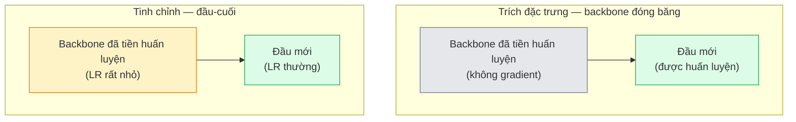

# Học chuyển giao (transfer learning) & tinh chỉnh (fine-tuning)

> Ai đó đã đốt hàng triệu giờ GPU để dạy một mạng nơ-ron biết cạnh, vân và các bộ phận vật thể trông ra sao. Bạn nên mượn những đặc trưng đó trước khi tự huấn luyện mô hình của mình.

**Type:** Build
**Languages:** Python
**Prerequisites:** Giai đoạn 4, Bài 03 (CNN), Bài 04 (Phân loại ảnh)
**Time:** ~75 phút

## Mục tiêu học tập

- Phân biệt trích đặc trưng (feature extraction) với tinh chỉnh (fine-tuning) và chọn đúng cách dựa trên kích thước tập dữ liệu, khoảng cách miền (domain shift) và ngân sách tính toán
- Nạp một backbone đã tiền huấn luyện, thay đầu phân loại của nó, và chỉ huấn luyện phần đầu để có baseline chạy được trong dưới 20 dòng
- Mở băng dần từng lớp với tốc độ học phân biệt (discriminative learning rate) để các đặc trưng tổng quát ở đầu nhận cập nhật nhỏ hơn các đặc trưng đặc thù tác vụ ở cuối
- Chẩn đoán ba lỗi thường gặp: trôi đặc trưng do LR quá cao trên các khối đã mở băng, thống kê BN sụp đổ trên tập dữ liệu tí hon, và quên thảm khốc (catastrophic forgetting)

## Vấn đề

Huấn luyện một ResNet-50 trên ImageNet tốn khoảng 2.000 giờ GPU. Rất ít đội có ngân sách đó cho mọi tác vụ họ triển khai. Thứ gần như mọi đội thực sự triển khai là một backbone đã tiền huấn luyện với một đầu mới được huấn luyện trên vài trăm hoặc vài nghìn ảnh đặc thù tác vụ.

Đây không phải là đường tắt. Khối conv đầu tiên của bất kỳ CNN nào huấn luyện trên ImageNet đều học cạnh và các bộ lọc kiểu Gabor. Vài khối tiếp theo học vân và mô-típ đơn giản. Các khối ở giữa học các bộ phận vật thể. Các khối cuối học những tổ hợp bắt đầu trông giống 1.000 lớp của ImageNet. 90% đầu của hệ thứ bậc đó chuyển gần như nguyên vẹn sang ảnh y tế, kiểm tra công nghiệp, dữ liệu vệ tinh và mọi tác vụ thị giác khác — vì tự nhiên chỉ có vốn từ hạn chế về cạnh và vân. 10% cuối mới là phần bạn thực sự huấn luyện.

Làm đúng chuyện chuyển giao có ba lỗi đang chờ bạn: phá hỏng đặc trưng đã tiền huấn luyện bằng tốc độ học quá cao, bỏ đói mô hình thông tin vì đóng băng quá nhiều, và để thống kê running của BatchNorm trôi về một tập dữ liệu tí hon mà phần còn lại của mạng chưa từng học. Bài này đi qua từng lỗi một cách có chủ đích.

## Khái niệm

### Trích đặc trưng so với tinh chỉnh

Hai chế độ, chọn theo mức bạn tin vào đặc trưng đã tiền huấn luyện và lượng dữ liệu bạn đang có.



Các quy tắc kinh nghiệm:

| Kích thước tập dữ liệu | Khoảng cách miền | Công thức |
|--------------|-----------------|--------|
| < 1k ảnh | gần ImageNet | Đóng băng backbone, chỉ huấn luyện phần đầu |
| 1k-10k | gần | Đóng băng 2-3 stage đầu, tinh chỉnh phần còn lại |
| 10k-100k | bất kỳ | Tinh chỉnh đầu-cuối với LR phân biệt |
| 100k+ | xa | Tinh chỉnh mọi thứ; cân nhắc huấn luyện từ đầu nếu miền đủ xa |

"Gần ImageNet" đại khái nghĩa là ảnh RGB tự nhiên có nội dung giống vật thể. Ảnh CT y tế, ảnh vệ tinh chụp từ trên cao và ảnh kính hiển vi là những miền xa — đặc trưng vẫn hữu ích, nhưng bạn sẽ cần để nhiều lớp thích nghi hơn.

### Vì sao đóng băng lại hiệu quả

Đặc trưng mà một CNN học trên ImageNet không chuyên biệt cho 1.000 lớp đó. Chúng chuyên biệt cho thống kê của ảnh tự nhiên: cạnh ở những hướng cụ thể, vân, mẫu tương phản, các hình dạng nguyên thuỷ. Những thống kê đó ổn định trên gần như mọi miền thị giác mà con người có thể kể tên. Đó là lý do một mô hình huấn luyện trên ImageNet và được đánh giá zero-shot trên CIFAR-10 chỉ với một đầu tuyến tính mới (không tinh chỉnh backbone) đạt độ chính xác trên 80%. Phần đầu đang học xem nên đánh trọng số cho những đặc trưng nào trong số các đặc trưng đã học cho tác vụ này.

### Tốc độ học phân biệt

Khi bạn thực sự mở băng, các lớp đầu nên huấn luyện chậm hơn các lớp cuối. Lớp đầu mã hoá đặc trưng tổng quát mà bạn muốn giữ lại; lớp cuối mã hoá cấu trúc đặc thù tác vụ mà bạn cần dịch chuyển nhiều.

```
Typical recipe:

  stage 0 (stem + first group): lr = base_lr / 100    (mostly fixed)
  stage 1:                       lr = base_lr / 10
  stage 2:                       lr = base_lr / 3
  stage 3 (last backbone group): lr = base_lr
  head:                          lr = base_lr  (or slightly higher)
```

Trong PyTorch, đây chỉ là một danh sách param group truyền cho optimizer. Một mô hình, năm tốc độ học, không thêm dòng code nào.

### Vấn đề BatchNorm

Các lớp BN giữ những buffer `running_mean` và `running_var` được tính trên ImageNet. Nếu tác vụ của bạn có phân phối điểm ảnh khác — ánh sáng khác, cảm biến khác, không gian màu khác — thì các buffer đó sai. Ba lựa chọn theo thứ tự ưu tiên:

1. **Tinh chỉnh với BN ở train mode.** Để BN cập nhật thống kê running cùng mọi thứ khác. Lựa chọn mặc định khi tập dữ liệu tác vụ ở mức trung bình (>= 5k mẫu).
2. **Đóng băng BN ở eval mode.** Giữ thống kê ImageNet và chỉ huấn luyện trọng số. Đúng khi tập dữ liệu của bạn đủ nhỏ để trung bình trượt của BN sẽ bị nhiễu.
3. **Thay BN bằng GroupNorm.** Loại bỏ hoàn toàn vấn đề trung bình trượt. Được dùng trong các backbone phát hiện và phân đoạn, nơi batch size mỗi GPU rất nhỏ.

Làm sai điều này sẽ âm thầm làm rơi độ chính xác 5-15%.

### Thiết kế phần đầu

Đầu phân loại là 1-3 lớp tuyến tính cộng một dropout tuỳ chọn. Mọi backbone của torchvision đều có sẵn một đầu mặc định để bạn thay:

```
backbone.fc = nn.Linear(backbone.fc.in_features, num_classes)          # ResNet
backbone.classifier[1] = nn.Linear(..., num_classes)                    # EfficientNet, MobileNet
backbone.heads.head = nn.Linear(..., num_classes)                       # torchvision ViT
```

Với tập dữ liệu nhỏ, một lớp tuyến tính duy nhất thường là đủ. Thêm một lớp ẩn (Linear -> ReLU -> Dropout -> Linear) giúp ích khi phân phối tác vụ xa phân phối huấn luyện của backbone hơn.

### Giảm LR theo từng lớp

Một phiên bản mượt hơn của LR phân biệt, dùng trong tinh chỉnh hiện đại (BEiT, DINOv2, các bản ViT-B fine-tune). Thay vì nhóm lớp theo stage, cho mỗi lớp một LR nhỏ hơn một chút so với lớp ngay trên nó:

```
lr_layer_k = base_lr * decay^(L - k)
```

Với decay = 0.75 và L = 12 khối transformer, khối đầu huấn luyện ở `0.75^11 ≈ 0.04x` LR của phần đầu. Điều này quan trọng hơn với tinh chỉnh transformer so với CNN, nơi LR nhóm theo stage thường là đủ.

### Cần đánh giá những gì

Các lần chạy học chuyển giao cần hai con số mà bạn sẽ không theo dõi khi huấn luyện từ đầu:

- **Độ chính xác chỉ với tiền huấn luyện** — độ chính xác của phần đầu khi backbone bị đóng băng. Đây là mức sàn của bạn.
- **Độ chính xác sau tinh chỉnh** — cùng mô hình đó sau khi huấn luyện đầu-cuối. Đây là mức trần của bạn.

Nếu sau tinh chỉnh mà thấp hơn chỉ-tiền-huấn-luyện, bạn có lỗi về tốc độ học hoặc BN. Luôn in cả hai.

```figure
transfer-learning
```

## Tự tay làm

### Bước 1: Nạp một backbone đã tiền huấn luyện và xem cấu trúc

```python
import torch
import torch.nn as nn
from torchvision.models import resnet18, ResNet18_Weights

backbone = resnet18(weights=ResNet18_Weights.IMAGENET1K_V1)
print(backbone)
print()
print("classifier head:", backbone.fc)
print("feature dim:", backbone.fc.in_features)
```

`ResNet18` có bốn stage (`layer1..layer4`) cộng một stem và một đầu `fc`. Mọi backbone phân loại của torchvision đều có cấu trúc tương tự.

### Bước 2: Trích đặc trưng — đóng băng mọi thứ, thay phần đầu

```python
def make_feature_extractor(num_classes=10):
    model = resnet18(weights=ResNet18_Weights.IMAGENET1K_V1)
    for p in model.parameters():
        p.requires_grad = False
    model.fc = nn.Linear(model.fc.in_features, num_classes)
    return model

model = make_feature_extractor(num_classes=10)
trainable = sum(p.numel() for p in model.parameters() if p.requires_grad)
frozen = sum(p.numel() for p in model.parameters() if not p.requires_grad)
print(f"trainable: {trainable:>10,}")
print(f"frozen:    {frozen:>10,}")
```

Chỉ `model.fc` là huấn luyện được. Backbone là một bộ trích đặc trưng đã đóng băng thành một lớp đóng băng (frozen layer) không nhận gradient.

### Bước 3: Tinh chỉnh phân biệt

Một hàm tiện ích dựng các param group với tốc độ học riêng cho từng stage.

```python
def discriminative_param_groups(model, base_lr=1e-3, decay=0.3):
    stages = [
        ["conv1", "bn1"],
        ["layer1"],
        ["layer2"],
        ["layer3"],
        ["layer4"],
        ["fc"],
    ]
    groups = []
    for i, names in enumerate(stages):
        lr = base_lr * (decay ** (len(stages) - 1 - i))
        params = [p for n, p in model.named_parameters()
                  if any(n.startswith(k) for k in names)]
        if params:
            groups.append({"params": params, "lr": lr, "name": "_".join(names)})
    return groups

model = resnet18(weights=ResNet18_Weights.IMAGENET1K_V1)
model.fc = nn.Linear(model.fc.in_features, 10)
for p in model.parameters():
    p.requires_grad = True

groups = discriminative_param_groups(model)
for g in groups:
    print(f"{g['name']:>10s}  lr={g['lr']:.2e}  params={sum(p.numel() for p in g['params']):>8,}")
```

`decay=0.3` nghĩa là mỗi stage huấn luyện ở 30% tốc độ của stage kế tiếp. `fc` nhận `base_lr`, `layer4` nhận `0.3 * base_lr`, `conv1` nhận `0.3^5 * base_lr ≈ 0.00243 * base_lr`. Nghe có vẻ cực đoan; thực nghiệm cho thấy nó hiệu quả.

### Bước 4: Xử lý BatchNorm

Hàm phụ trợ để đóng băng thống kê running của BN mà không đóng băng trọng số của nó.

```python
def freeze_bn_stats(model):
    for m in model.modules():
        if isinstance(m, (nn.BatchNorm1d, nn.BatchNorm2d, nn.BatchNorm3d)):
            m.eval()
            for p in m.parameters():
                p.requires_grad = False
    return model
```

Gọi nó sau khi bạn đặt `model.train()` ở đầu mỗi epoch. `model.train()` chuyển mọi thứ sang train mode; hàm này chỉ đảo ngược điều đó cho các lớp BN.

### Bước 5: Một vòng lặp tinh chỉnh đầu-cuối tối giản

```python
from torch.optim import SGD
from torch.utils.data import DataLoader
from torch.optim.lr_scheduler import CosineAnnealingLR
import torch.nn.functional as F

def fine_tune(model, train_loader, val_loader, device, epochs=5, base_lr=1e-3, freeze_bn=False):
    model = model.to(device)
    groups = discriminative_param_groups(model, base_lr=base_lr)
    optimizer = SGD(groups, momentum=0.9, weight_decay=1e-4, nesterov=True)
    scheduler = CosineAnnealingLR(optimizer, T_max=epochs)

    for epoch in range(epochs):
        model.train()
        if freeze_bn:
            freeze_bn_stats(model)
        tr_loss, tr_correct, tr_total = 0.0, 0, 0
        for x, y in train_loader:
            x, y = x.to(device), y.to(device)
            logits = model(x)
            loss = F.cross_entropy(logits, y, label_smoothing=0.1)
            optimizer.zero_grad()
            loss.backward()
            optimizer.step()
            tr_loss += loss.item() * x.size(0)
            tr_total += x.size(0)
            tr_correct += (logits.argmax(-1) == y).sum().item()
        scheduler.step()

        model.eval()
        va_total, va_correct = 0, 0
        with torch.no_grad():
            for x, y in val_loader:
                x, y = x.to(device), y.to(device)
                pred = model(x).argmax(-1)
                va_total += x.size(0)
                va_correct += (pred == y).sum().item()
        print(f"epoch {epoch}  train {tr_loss/tr_total:.3f}/{tr_correct/tr_total:.3f}  "
              f"val {va_correct/va_total:.3f}")
    return model
```

Năm epoch với công thức ở trên trên CIFAR-10 đưa `ResNet18-IMAGENET1K_V1` từ ~70% độ chính xác linear-probe zero-shot lên ~93% sau tinh chỉnh. Chỉ riêng phần đầu sẽ bão hoà quanh 86% mà không bao giờ chạm vào backbone.

### Bước 6: Mở băng dần

Một lịch mở băng từng stage mỗi epoch, đi từ cuối về đầu. Nó giảm thiểu trôi đặc trưng với cái giá là thêm vài epoch.

```python
def progressive_unfreeze_schedule(model):
    stages = ["layer4", "layer3", "layer2", "layer1"]
    yielded = set()

    def start():
        for p in model.parameters():
            p.requires_grad = False
        for p in model.fc.parameters():
            p.requires_grad = True

    def unfreeze(epoch):
        if epoch < len(stages):
            name = stages[epoch]
            yielded.add(name)
            for n, p in model.named_parameters():
                if n.startswith(name):
                    p.requires_grad = True
            return name
        return None

    return start, unfreeze
```

Gọi `start()` một lần trước epoch đầu tiên. Gọi `unfreeze(epoch)` ở đầu mỗi epoch. Dựng lại optimizer mỗi khi tập tham số huấn luyện được thay đổi, nếu không các param bị đóng băng vẫn giữ moment đã cache và làm optimizer rối.

## Áp dụng

Với hầu hết tác vụ thực tế, `torchvision.models` + ba dòng là đủ. Cỗ máy nặng hơn ở trên chỉ quan trọng khi bạn gặp những vấn đề mà mặc định của thư viện không sửa được.

```python
from torchvision.models import resnet50, ResNet50_Weights

model = resnet50(weights=ResNet50_Weights.IMAGENET1K_V2)
model.fc = nn.Linear(model.fc.in_features, num_classes)
optimizer = torch.optim.AdamW(model.parameters(), lr=1e-4, weight_decay=1e-4)
```

Hai mặc định cấp production khác:

- `timm` cung cấp ~800 backbone thị giác đã tiền huấn luyện với API nhất quán (`timm.create_model("resnet50", pretrained=True, num_classes=10)`). Với bất kỳ lần tinh chỉnh nào ngoài vườn thú torchvision, nó là chuẩn.
- Với transformer, `transformers.AutoModelForImageClassification.from_pretrained(name, num_labels=N)` cho bạn ViT / BEiT / DeiT với cùng ngữ nghĩa nạp như mô hình văn bản.

## Đóng gói

Bài này tạo ra:

- `outputs/prompt-fine-tune-planner.md` — một prompt chọn giữa trích đặc trưng, mở băng dần và tinh chỉnh đầu-cuối dựa trên kích thước tập dữ liệu, khoảng cách miền và ngân sách tính toán.
- `outputs/skill-freeze-inspector.md` — một skill mà, khi đưa vào một mô hình PyTorch, báo cáo tham số nào huấn luyện được, lớp BatchNorm nào đang ở eval mode, và liệu optimizer có thực sự được nạp các tham số huấn luyện được hay không.

## Bài tập

1. **(Dễ)** Huấn luyện một `ResNet18` như một linear probe (backbone đóng băng) và như một lần tinh chỉnh toàn phần trên cùng tập dữ liệu CIFAR tổng hợp. Báo cáo cả hai độ chính xác cạnh nhau. Giải thích khoảng cách nào cho bạn biết đặc trưng chuyển tốt và khoảng cách nào cho bạn biết chúng không chuyển được.
2. **(Trung bình)** Cố tình tạo một lỗi: đặt `base_lr = 1e-1` cho stage backbone thay vì cho phần đầu. Cho thấy loss huấn luyện nổ tung, rồi phục hồi bằng cách áp dụng hàm phụ trợ `discriminative_param_groups`. Ghi lại LR mà từ đó mỗi stage bắt đầu phân kỳ.
3. **(Khó)** Lấy một tập dữ liệu ảnh y tế (ví dụ CheXpert-small, PatchCamelyon, hoặc HAM10000) và so sánh ba chế độ: (a) backbone đóng băng tiền huấn luyện trên ImageNet + đầu tuyến tính; (b) tinh chỉnh đầu-cuối từ tiền huấn luyện ImageNet; (c) huấn luyện từ đầu. Báo cáo độ chính xác và chi phí tính toán cho từng chế độ. Ở kích thước tập dữ liệu nào thì huấn luyện từ đầu bắt đầu cạnh tranh được?

## Thuật ngữ chính

| Thuật ngữ | Người ta thường nói | Ý nghĩa thực sự |
|------|----------------|----------------------|
| Feature extraction | "Đóng băng và huấn luyện phần đầu" | Tham số backbone bị đóng băng, chỉ đầu phân loại mới nhận gradient |
| Fine-tuning | "Huấn luyện lại đầu-cuối" | Mọi tham số đều huấn luyện được, thường với LR nhỏ hơn nhiều so với huấn luyện từ đầu |
| Discriminative LR | "LR nhỏ hơn cho các lớp đầu" | Các param group của optimizer trong đó LR của stage đầu chỉ bằng một phần LR của stage cuối |
| Layer-wise LR decay | "Gradient LR mượt" | LR từng lớp nhân với decay^(L - k); phổ biến trong tinh chỉnh transformer |
| Catastrophic forgetting | "Mô hình làm mất ImageNet" | LR quá cao ghi đè đặc trưng đã tiền huấn luyện trước khi tín hiệu tác vụ mới được học |
| BN statistics drift | "Running mean bị sai" | running_mean/var của BatchNorm được tính trên phân phối khác với tác vụ hiện tại, âm thầm làm giảm độ chính xác |
| Linear probe | "Backbone đóng băng + đầu tuyến tính" | Cách đánh giá đặc trưng đã tiền huấn luyện — độ chính xác của bộ phân loại tuyến tính tốt nhất đặt trên biểu diễn đã đóng băng |
| Catastrophic collapse | "Mọi thứ đều dự đoán một lớp" | Xảy ra khi tinh chỉnh với LR đủ cao để phá huỷ đặc trưng trước khi gradient từ phần đầu kịp ổn định |

## Đọc thêm

- [How transferable are features in deep neural networks? (Yosinski et al., 2014)](https://arxiv.org/abs/1411.1792) — bài báo định lượng mức chuyển giao được của đặc trưng giữa các lớp
- [Universal Language Model Fine-tuning (ULMFiT, Howard & Ruder, 2018)](https://arxiv.org/abs/1801.06146) — công thức gốc của LR phân biệt / mở băng dần; các ý tưởng này chuyển trực tiếp sang thị giác
- [timm documentation](https://huggingface.co/docs/timm) — tài liệu tham chiếu cho các backbone thị giác hiện đại và đúng những mặc định tinh chỉnh mà chúng được huấn luyện cùng
- [A Simple Framework for Linear-Probe Evaluation (Kornblith et al., 2019)](https://arxiv.org/abs/1805.08974) — vì sao độ chính xác linear-probe quan trọng và cách báo cáo nó cho đúng

---

[← Bài trước: Phân loại ảnh](../../04-image-classification/docs/vi.md) · [Bài sau: Object Detection →](../../06-object-detection-yolo/docs/vi.md)
