# Object Detection — YOLO từ đầu

> Object detection (phát hiện đối tượng) là phân loại cộng hồi quy, chạy ở mọi vị trí trên feature map, rồi được dọn sạch bằng non-max suppression (khử phi cực đại).

**Type:** Build
**Languages:** Python
**Prerequisites:** Giai đoạn 4, Bài 03 (CNN), Bài 04 (Phân loại ảnh), Bài 05 (Học chuyển giao)
**Time:** ~75 phút

## Mục tiêu học tập

- Giải thích thiết kế lưới và anchor biến phát hiện thành bài toán dự đoán dày đặc, và nêu ý nghĩa từng con số trong tensor đầu ra
- Tính Intersection-over-Union giữa các hộp và tự tay viết non-max suppression
- Xây một head kiểu YOLO tối giản trên backbone đã huấn luyện trước, gồm các loss phân loại, objectness và hồi quy hộp
- Đọc một dòng chỉ số phát hiện (precision@0.5, recall, mAP@0.5, mAP@0.5:0.95) và chọn nút vặn tiếp theo

## Vấn đề

Phân loại nói "ảnh này là một con chó." Phát hiện nói "có một con chó ở pixel (112, 40, 280, 210), có một con mèo ở (400, 180, 560, 310), và không còn gì khác trong khung hình." Đúng một thay đổi cấu trúc đó — dự đoán số lượng hộp có nhãn thay đổi được thay vì một nhãn cho mỗi ảnh — là thứ mà mọi hệ tự hành, mọi sản phẩm giám sát, mọi bộ phân tích bố cục tài liệu và mọi dây chuyền thị giác nhà máy đều phụ thuộc vào.

Phát hiện cũng là nơi mọi đánh đổi kỹ thuật trong thị giác máy tính xuất hiện cùng lúc. Bạn muốn hộp bao (bounding box) chính xác (head hồi quy), bạn muốn đúng lớp cho mỗi hộp (head phân loại), bạn muốn mô hình biết khi nào không có gì để phát hiện (điểm objectness), và bạn muốn đúng một dự đoán cho mỗi vật thể thật (non-max suppression). Sai bất kỳ điều nào thì pipeline sẽ bỏ sót vật thể, báo ra những hộp ảo giác, hoặc dự đoán cùng một vật thể mười lăm lần ở các vị trí hơi khác nhau.

YOLO (You Only Look Once, Redmon và cộng sự 2016) là thiết kế khiến tất cả những thứ này chạy được trong thời gian thực nhờ chỉ một lượt lan truyền xuôi của mạng conv, và chính những quyết định cấu trúc đó vẫn là xương sống của các detector hiện đại (YOLOv8, YOLOv9, YOLO-NAS, RT-DETR). Nắm được phần lõi thì mọi biến thể chỉ là sự sắp xếp lại của cùng những bộ phận.

## Khái niệm

### Phát hiện như dự đoán dày đặc

Bộ phân loại xuất C con số cho mỗi ảnh. Detector kiểu YOLO xuất `(S x S x (5 + C))` con số cho mỗi ảnh, với S là kích thước lưới không gian.

```mermaid
flowchart LR
    IMG["Đầu vào 416x416 RGB"] --> BB["Backbone<br/>(ResNet, DarkNet, ...)"]
    BB --> FM["Feature map<br/>(C_feat, 13, 13)"]
    FM --> HEAD["Head phát hiện<br/>(conv 1x1)"]
    HEAD --> OUT["Tensor đầu ra<br/>(13, 13, B * (5 + C))"]
    OUT --> DEC["Giải mã<br/>(lưới + sigmoid + exp)"]
    DEC --> NMS["Non-max suppression"]
    NMS --> RESULT["Hộp cuối cùng"]

    style IMG fill:#dbeafe,stroke:#2563eb
    style HEAD fill:#fef3c7,stroke:#d97706
    style NMS fill:#fecaca,stroke:#dc2626
    style RESULT fill:#dcfce7,stroke:#16a34a
```



Mỗi ô lưới (grid cell) trong `S * S` ô dự đoán `B` hộp. Với mỗi hộp:

- 4 con số mô tả hình học: `tx, ty, tw, th`.
- 1 con số là điểm objectness: "có vật thể nào nằm giữa ô này không?"
- C con số là xác suất lớp.

Tổng mỗi ô: `B * (5 + C)`. Với VOC có `S=13, B=2, C=20`, tức 50 con số mỗi ô.

### Vì sao cần lưới và anchor

Hồi quy thuần sẽ dự đoán `(x, y, w, h)` cho từng vật thể như một toạ độ tuyệt đối. Điều đó khó với mạng conv, vì dịch ảnh không nên dịch mọi dự đoán đi cùng một lượng — mỗi vật thể được neo theo không gian. Lưới giải quyết bằng cách gán mỗi hộp ground-truth cho ô lưới chứa tâm của nó; chỉ ô đó chịu trách nhiệm cho vật thể đó.

Anchor giải quyết vấn đề thứ hai. Một conv 3x3 không dễ hồi quy ra hộp rộng 500 pixel từ một ô đặc trưng có trường tiếp nhận 16 pixel. Thay vào đó, ta định nghĩa trước `B` hình dạng hộp prior (anchor) cho mỗi ô và dự đoán delta nhỏ so với từng anchor. Mô hình học cách chọn đúng anchor và đẩy nhẹ nó thay vì hồi quy từ con số không.

```
Anchor box priors (example for 416x416 input):

  small:   (30,  60)
  medium:  (75,  170)
  large:   (200, 380)

At each grid cell, every anchor emits (tx, ty, tw, th, obj, c_1, ..., c_C).
```

Các detector hiện đại thường dùng FPN với bộ anchor khác nhau cho từng độ phân giải — anchor nhỏ trên map nông độ phân giải cao, anchor lớn trên map sâu độ phân giải thấp. Cùng ý tưởng, nhiều tỉ lệ hơn.

### Giải mã dự đoán

`tx, ty, tw, th` thô không phải toạ độ hộp; chúng là mục tiêu hồi quy cần được biến đổi trước khi vẽ:

```
centre x  = (sigmoid(tx) + cell_x) * stride
centre y  = (sigmoid(ty) + cell_y) * stride
width     = anchor_w * exp(tw)
height    = anchor_h * exp(th)
```

`sigmoid` giữ độ lệch tâm nằm trong ô. `exp` cho phép chiều rộng co giãn tự do từ anchor mà không bị đổi dấu. `stride` đưa toạ độ lưới trở lại pixel. Bước giải mã này giống nhau ở mọi phiên bản YOLO từ v2.

### IoU

Độ đo tương đồng phổ quát giữa hai hộp trong phát hiện:

```
IoU(A, B) = area(A intersect B) / area(A union B)
```

IoU = 1 nghĩa là trùng khít; IoU = 0 nghĩa là không chồng lấn. IoU giữa dự đoán và hộp ground-truth quyết định một dự đoán có được tính là true positive hay không (thường là IoU >= 0.5). IoU giữa hai dự đoán là thứ NMS dùng để khử trùng lặp.

### Khử phi cực đại

Mạng conv huấn luyện trên các anchor kề nhau thường dự đoán những hộp chồng lấn cho cùng một vật thể. NMS giữ dự đoán có điểm tin cậy (confidence score) cao nhất và xoá mọi dự đoán khác có IoU vượt ngưỡng.

```
NMS(boxes, scores, iou_threshold):
    sort boxes by score descending
    keep = []
    while boxes not empty:
        pick the top-scoring box, add to keep
        remove every box with IoU > iou_threshold to the picked box
    return keep
```

Ngưỡng điển hình: 0.45 cho phát hiện đối tượng. Các detector gần đây thay NMS chuẩn bằng `soft-NMS`, `DIoU-NMS`, hoặc học trực tiếp việc khử (RT-DETR) nhưng mục đích cấu trúc vẫn như cũ.

### Hàm loss

Loss YOLO là ba loss cộng lại có trọng số:

```
L = lambda_coord * L_box(pred, target, where obj=1)
  + lambda_obj   * L_obj(pred, 1,     where obj=1)
  + lambda_noobj * L_obj(pred, 0,     where obj=0)
  + lambda_cls   * L_cls(pred, target, where obj=1)
```

Chỉ những ô chứa vật thể mới đóng góp vào loss hồi quy hộp và loss phân loại. Các ô không có vật thể chỉ đóng góp vào loss objectness (dạy mô hình biết im lặng). `lambda_noobj` thường nhỏ (~0.5) vì đại đa số ô là rỗng, nếu không chúng sẽ chi phối tổng loss.

Các biến thể hiện đại thay loss hộp MSE bằng CIoU / DIoU (tối ưu trực tiếp IoU), dùng focal loss cho mất cân bằng lớp, và cân bằng objectness bằng quality focal loss. Cấu trúc ba thành phần vẫn không đổi.

### Chỉ số phát hiện

Accuracy không chuyển sang được cho phát hiện. Bốn con số thì có:

- **Precision@IoU=0.5** — trong số dự đoán được tính là positive, bao nhiêu cái thực sự đúng.
- **Recall@IoU=0.5** — trong số vật thể thật, ta tìm được bao nhiêu.
- **AP@0.5** — diện tích dưới đường cong precision-recall ở ngưỡng IoU 0.5; một con số cho mỗi lớp.
- **mAP@0.5:0.95** (mean average precision, độ chính xác trung bình) — trung bình AP qua các ngưỡng IoU 0.5, 0.55, ..., 0.95. Chỉ số COCO; khắt khe nhất và nhiều thông tin nhất.

Hãy báo cáo cả bốn. Detector mạnh ở mAP@0.5 nhưng yếu ở mAP@0.5:0.95 nghĩa là định vị (localization) thô mà không sát; sửa bằng loss hồi quy hộp tốt hơn. Detector có precision cao và recall thấp thì quá thận trọng; hạ ngưỡng tin cậy hoặc tăng trọng số objectness.

```figure
object-detection-nms
```

## Tự tay làm

### Bước 1: IoU

Cỗ máy cày của cả bài học. Chạy trên hai mảng hộp ở định dạng `(x1, y1, x2, y2)`.

```python
import numpy as np

def box_iou(boxes_a, boxes_b):
    ax1, ay1, ax2, ay2 = boxes_a[:, 0], boxes_a[:, 1], boxes_a[:, 2], boxes_a[:, 3]
    bx1, by1, bx2, by2 = boxes_b[:, 0], boxes_b[:, 1], boxes_b[:, 2], boxes_b[:, 3]

    inter_x1 = np.maximum(ax1[:, None], bx1[None, :])
    inter_y1 = np.maximum(ay1[:, None], by1[None, :])
    inter_x2 = np.minimum(ax2[:, None], bx2[None, :])
    inter_y2 = np.minimum(ay2[:, None], by2[None, :])

    inter_w = np.clip(inter_x2 - inter_x1, 0, None)
    inter_h = np.clip(inter_y2 - inter_y1, 0, None)
    inter = inter_w * inter_h

    area_a = (ax2 - ax1) * (ay2 - ay1)
    area_b = (bx2 - bx1) * (by2 - by1)
    union = area_a[:, None] + area_b[None, :] - inter
    return inter / np.clip(union, 1e-8, None)
```

Trả về ma trận `(N_a, N_b)` các IoU theo cặp. Dùng với một hộp ground-truth bằng cách để một trong hai mảng có shape `(1, 4)`.

### Bước 2: Non-max suppression

```python
def nms(boxes, scores, iou_threshold=0.45):
    order = np.argsort(-scores)
    keep = []
    while len(order) > 0:
        i = order[0]
        keep.append(i)
        if len(order) == 1:
            break
        rest = order[1:]
        ious = box_iou(boxes[[i]], boxes[rest])[0]
        order = rest[ious <= iou_threshold]
    return np.array(keep, dtype=np.int64)
```

Tất định, `O(N log N)` nhờ phép sắp xếp, và khớp hành vi của `torchvision.ops.nms` trên cùng đầu vào.

### Bước 3: Mã hoá và giải mã hộp

Chuyển đổi qua lại giữa toạ độ pixel và các mục tiêu `(tx, ty, tw, th)` mà mạng thực sự hồi quy.

```python
def encode(box_xyxy, cell_x, cell_y, stride, anchor_wh):
    x1, y1, x2, y2 = box_xyxy
    cx = 0.5 * (x1 + x2)
    cy = 0.5 * (y1 + y2)
    w = x2 - x1
    h = y2 - y1
    tx = cx / stride - cell_x
    ty = cy / stride - cell_y
    tw = np.log(w / anchor_wh[0] + 1e-8)
    th = np.log(h / anchor_wh[1] + 1e-8)
    return np.array([tx, ty, tw, th])


def decode(tx_ty_tw_th, cell_x, cell_y, stride, anchor_wh):
    tx, ty, tw, th = tx_ty_tw_th
    cx = (sigmoid(tx) + cell_x) * stride
    cy = (sigmoid(ty) + cell_y) * stride
    w = anchor_wh[0] * np.exp(tw)
    h = anchor_wh[1] * np.exp(th)
    return np.array([cx - w / 2, cy - h / 2, cx + w / 2, cy + h / 2])


def sigmoid(x):
    return 1.0 / (1.0 + np.exp(-x))
```

Thử: encode một hộp rồi decode — bạn sẽ nhận lại thứ rất gần bản gốc (trừ việc nghịch đảo sigmoid không hoàn hảo khi `tx` nằm ngoài miền sau sigmoid).

### Bước 4: Một head YOLO tối giản

Một conv 1x1 trên feature map, rồi reshape về `(B, S, S, num_anchors, 5 + C)`.

```python
import torch
import torch.nn as nn

class YOLOHead(nn.Module):
    def __init__(self, in_c, num_anchors, num_classes):
        super().__init__()
        self.num_anchors = num_anchors
        self.num_classes = num_classes
        self.conv = nn.Conv2d(in_c, num_anchors * (5 + num_classes), kernel_size=1)

    def forward(self, x):
        n, _, h, w = x.shape
        y = self.conv(x)
        y = y.view(n, self.num_anchors, 5 + self.num_classes, h, w)
        y = y.permute(0, 3, 4, 1, 2).contiguous()
        return y
```

Shape đầu ra: `(N, H, W, num_anchors, 5 + C)`. Chiều cuối chứa `[tx, ty, tw, th, obj, cls_0, ..., cls_{C-1}]`.

### Bước 5: Gán ground-truth

Với mỗi hộp ground-truth, quyết định `(cell, anchor)` nào chịu trách nhiệm.

```python
def assign_targets(boxes_xyxy, classes, anchors, stride, grid_size, num_classes):
    num_anchors = len(anchors)
    target = np.zeros((grid_size, grid_size, num_anchors, 5 + num_classes), dtype=np.float32)
    has_obj = np.zeros((grid_size, grid_size, num_anchors), dtype=bool)

    for box, cls in zip(boxes_xyxy, classes):
        x1, y1, x2, y2 = box
        cx, cy = 0.5 * (x1 + x2), 0.5 * (y1 + y2)
        gx, gy = int(cx / stride), int(cy / stride)
        bw, bh = x2 - x1, y2 - y1

        ious = np.array([
            (min(bw, aw) * min(bh, ah)) / (bw * bh + aw * ah - min(bw, aw) * min(bh, ah))
            for aw, ah in anchors
        ])
        best = int(np.argmax(ious))
        aw, ah = anchors[best]

        target[gy, gx, best, 0] = cx / stride - gx
        target[gy, gx, best, 1] = cy / stride - gy
        target[gy, gx, best, 2] = np.log(bw / aw + 1e-8)
        target[gy, gx, best, 3] = np.log(bh / ah + 1e-8)
        target[gy, gx, best, 4] = 1.0
        target[gy, gx, best, 5 + cls] = 1.0
        has_obj[gy, gx, best] = True
    return target, has_obj
```

Chọn anchor là "IoU hình dạng tốt nhất với ground truth" — một proxy rẻ tiền khớp cách gán của YOLOv2/v3. v5 trở đi dùng chiến lược tinh vi hơn (task-aligned matching, dynamic k) để tinh chỉnh cùng ý tưởng đó.

### Bước 6: Ba hàm loss

```python
def yolo_loss(pred, target, has_obj, lambda_coord=5.0, lambda_obj=1.0, lambda_noobj=0.5, lambda_cls=1.0):
    has_obj_t = torch.from_numpy(has_obj).bool()
    target_t = torch.from_numpy(target).float()

    # box-regression loss: only on cells with objects
    box_pred = pred[..., :4][has_obj_t]
    box_true = target_t[..., :4][has_obj_t]
    loss_box = torch.nn.functional.mse_loss(box_pred, box_true, reduction="sum")

    # objectness loss
    obj_pred = pred[..., 4]
    obj_true = target_t[..., 4]
    loss_obj_pos = torch.nn.functional.binary_cross_entropy_with_logits(
        obj_pred[has_obj_t], obj_true[has_obj_t], reduction="sum")
    loss_obj_neg = torch.nn.functional.binary_cross_entropy_with_logits(
        obj_pred[~has_obj_t], obj_true[~has_obj_t], reduction="sum")

    # classification loss on cells with objects
    cls_pred = pred[..., 5:][has_obj_t]
    cls_true = target_t[..., 5:][has_obj_t]
    loss_cls = torch.nn.functional.binary_cross_entropy_with_logits(
        cls_pred, cls_true, reduction="sum")

    total = (lambda_coord * loss_box
             + lambda_obj * loss_obj_pos
             + lambda_noobj * loss_obj_neg
             + lambda_cls * loss_cls)
    return total, {"box": loss_box.item(), "obj_pos": loss_obj_pos.item(),
                   "obj_neg": loss_obj_neg.item(), "cls": loss_cls.item()}
```

Năm siêu tham số mà mọi tutorial YOLO hoặc hard-code hoặc sweep. Tỉ lệ rất quan trọng: `lambda_coord=5, lambda_noobj=0.5` phản chiếu paper YOLOv1 gốc và vẫn là một mặc định hợp lý.

### Bước 7: Pipeline suy luận

Giải mã đầu ra thô của head, áp sigmoid/exp, đặt ngưỡng theo objectness, rồi NMS.

```python
def postprocess(pred_tensor, anchors, stride, img_size, conf_threshold=0.25, iou_threshold=0.45):
    pred = pred_tensor.detach().cpu().numpy()
    grid_h, grid_w = pred.shape[1], pred.shape[2]
    num_anchors = len(anchors)

    boxes, scores, classes = [], [], []
    for gy in range(grid_h):
        for gx in range(grid_w):
            for a in range(num_anchors):
                tx, ty, tw, th, obj, *cls = pred[0, gy, gx, a]
                score = sigmoid(obj) * sigmoid(np.array(cls)).max()
                if score < conf_threshold:
                    continue
                cls_idx = int(np.argmax(cls))
                cx = (sigmoid(tx) + gx) * stride
                cy = (sigmoid(ty) + gy) * stride
                w = anchors[a][0] * np.exp(tw)
                h = anchors[a][1] * np.exp(th)
                boxes.append([cx - w / 2, cy - h / 2, cx + w / 2, cy + h / 2])
                scores.append(float(score))
                classes.append(cls_idx)

    if not boxes:
        return np.zeros((0, 4)), np.zeros((0,)), np.zeros((0,), dtype=int)
    boxes = np.array(boxes)
    scores = np.array(scores)
    classes = np.array(classes)
    keep = nms(boxes, scores, iou_threshold)
    return boxes[keep], scores[keep], classes[keep]
```

Đó là toàn bộ đường eval: head -> decode -> threshold -> NMS.

## Áp dụng

`torchvision.models.detection` cung cấp các detector production với cùng cấu trúc khái niệm. Nạp một mô hình đã huấn luyện trước chỉ mất ba dòng.

```python
import torch
from torchvision.models.detection import fasterrcnn_resnet50_fpn_v2

model = fasterrcnn_resnet50_fpn_v2(weights="DEFAULT")
model.eval()
with torch.no_grad():
    predictions = model([torch.randn(3, 400, 600)])
print(predictions[0].keys())
print(f"boxes:  {predictions[0]['boxes'].shape}")
print(f"scores: {predictions[0]['scores'].shape}")
print(f"labels: {predictions[0]['labels'].shape}")
```

Với pipeline suy luận thời gian thực, `ultralytics` (YOLOv8/v9) là chuẩn: `from ultralytics import YOLO; model = YOLO('yolov8n.pt'); model(img)`. Mô hình tự xử lý decode và NMS bên trong và trả về đúng bộ ba `boxes / scores / labels` mà bạn vừa tự xây ở trên.

## Đóng gói

Bài học này tạo ra:

- `outputs/prompt-detection-metric-reader.md` — một prompt biến dòng `precision, recall, AP, mAP@0.5:0.95` thành chẩn đoán một dòng và thí nghiệm tiếp theo hữu ích nhất.
- `outputs/skill-anchor-designer.md` — một skill mà, khi cho một dataset các hộp ground-truth, chạy k-means trên `(w, h)` và trả về bộ anchor cho từng mức FPN kèm thống kê độ phủ bạn cần để chọn đúng số anchor.

## Bài tập

1. **(Dễ)** Cài đặt `box_iou` và chạy so với `torchvision.ops.box_iou` trên 1.000 cặp hộp ngẫu nhiên. Kiểm tra chênh lệch tuyệt đối lớn nhất nhỏ hơn `1e-6`.
2. **(Trung bình)** Chuyển `yolo_loss` sang phiên bản dùng loss hộp `CIoU` thay cho MSE. Chứng minh trên dataset tổng hợp 100 ảnh rằng CIoU hội tụ tới mAP@0.5:0.95 cuối tốt hơn MSE trong cùng số epoch.
3. **(Khó)** Cài đặt suy luận đa tỉ lệ: đưa cùng một ảnh ở ba độ phân giải qua mô hình, hợp các dự đoán hộp, và chạy một lần NMS ở cuối. Đo mức tăng mAP so với suy luận đơn tỉ lệ trên một tập held-out.

## Thuật ngữ chính

| Thuật ngữ | Người ta thường nói | Ý nghĩa thực sự |
|------|----------------|----------------------|
| Anchor | "Hộp prior" | Hình dạng hộp định nghĩa trước ở mỗi ô lưới, từ đó mạng dự đoán delta thay vì toạ độ tuyệt đối |
| IoU | "Chồng lấn" | Giao trên hợp của hai hộp; độ đo tương đồng phổ quát trong phát hiện |
| NMS | "Khử trùng lặp" | Thuật toán tham lam giữ các dự đoán điểm cao nhất và loại các dự đoán chồng lấn vượt ngưỡng |
| Objectness | "Có gì đó ở đây không" | Số vô hướng theo từng anchor, từng ô, dự đoán liệu có vật thể nằm giữa ô đó |
| Grid stride | "Hệ số giảm mẫu" | Số pixel mỗi ô lưới; đầu vào 416 px với head lưới 13 có stride 32 |
| mAP | "Mean average precision" | Trung bình diện tích dưới đường cong precision-recall, lấy trung bình qua các lớp và (với COCO) qua các ngưỡng IoU |
| AP@0.5 | "PASCAL VOC AP" | Average precision với ngưỡng IoU 0.5; phiên bản dễ dãi của chỉ số |
| mAP@0.5:0.95 | "COCO AP" | Trung bình qua các ngưỡng IoU 0.5..0.95 bước 0.05; phiên bản khắt khe và là chuẩn hiện hành của cộng đồng |

## Đọc thêm

- [YOLOv1: You Only Look Once (Redmon et al., 2016)](https://arxiv.org/abs/1506.02640) — bài báo khai sinh; mọi YOLO sau đó chỉ là tinh chỉnh cấu trúc này
- [YOLOv3 (Redmon & Farhadi, 2018)](https://arxiv.org/abs/1804.02767) — bài báo giới thiệu head kiểu FPN đa tỉ lệ; vẫn là sơ đồ rõ ràng nhất
- [Ultralytics YOLOv8 docs](https://docs.ultralytics.com) — tài liệu tham chiếu production hiện tại; bao gồm định dạng dataset, augmentation, công thức huấn luyện
- [The Illustrated Guide to Object Detection (Jonathan Hui)](https://jonathan-hui.medium.com/object-detection-series-24d03a12f904) — chuyến tham quan dễ hiểu nhất về cả vườn detector; vô giá để hiểu DETR, RetinaNet, FCOS và YOLO liên quan với nhau thế nào

---

[← Bài trước: Học chuyển giao (transfer learning) & tinh chỉnh (fine-tuning)](../../05-transfer-learning/docs/vi.md) · [Bài sau: Phân đoạn ngữ nghĩa →](../../07-semantic-segmentation-unet/docs/vi.md)
