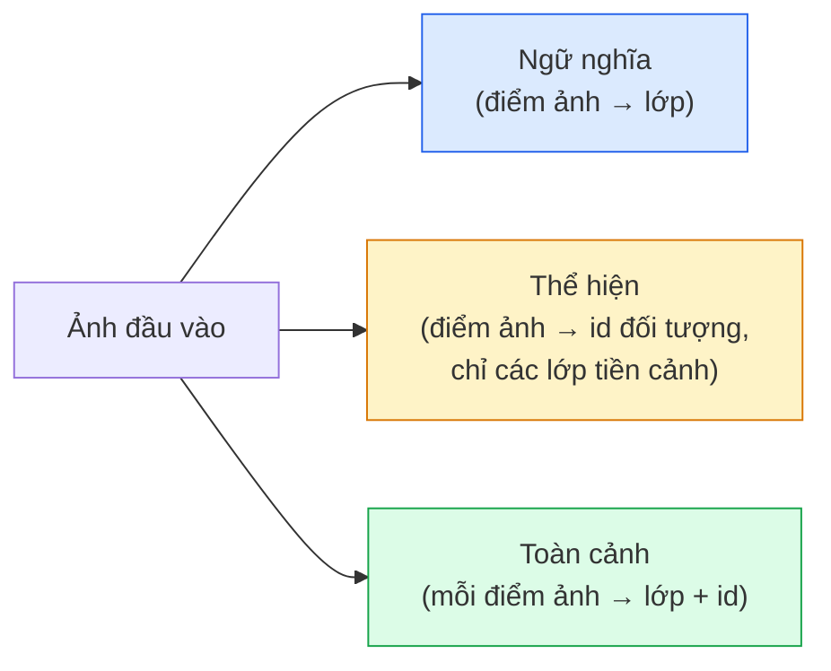
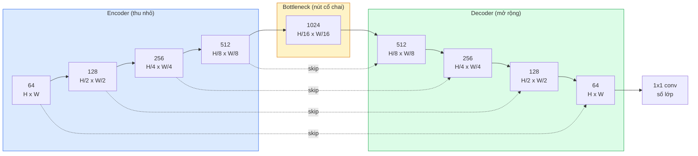

# Phân đoạn ngữ nghĩa — U-Net

> Phân đoạn là phân loại ở mức từng điểm ảnh. U-Net làm được điều đó bằng cách ghép một encoder giảm mẫu với một decoder thực hiện upsampling (tăng mẫu) thành cặp encoder-decoder (bộ mã hoá - giải mã), rồi nối các skip connection (kết nối tắt) giữa hai bên.

**Type:** Build
**Languages:** Python
**Prerequisites:** Giai đoạn 4, Bài 03 (CNN), Bài 04 (Phân loại ảnh)
**Time:** ~75 phút

## Mục tiêu học tập

- Phân biệt semantic segmentation (phân đoạn ngữ nghĩa), instance segmentation và panoptic segmentation rồi chọn đúng bài toán cho một vấn đề cụ thể
- Tự dựng U-Net trong PyTorch với các khối encoder, một bottleneck, một decoder dùng transposed convolution (tích chập chuyển vị) và skip connection
- Cài đặt cross-entropy theo từng điểm ảnh, Dice loss và loss kết hợp — lựa chọn mặc định hiện nay cho phân đoạn y tế và công nghiệp
- Đọc chỉ số IoU và Dice theo từng lớp và chẩn đoán xem điểm kém đến từ recall của vật thể nhỏ, độ chính xác biên, hay class imbalance (mất cân bằng lớp)

## Vấn đề

Phân loại cho ra một nhãn mỗi ảnh. Phát hiện cho ra vài khung hộp mỗi ảnh. Phân đoạn cho ra một nhãn cho mỗi điểm ảnh. Với đầu vào kích thước `H x W`, đầu ra là tensor có shape `H x W` (semantic) hoặc `H x W x N_instances` (instance). Đó là hàng triệu dự đoán mỗi ảnh, không phải một.

Cấu trúc của phân đoạn là lý do nó có mặt trong gần như mọi sản phẩm thị giác máy tính dự đoán dày: ảnh y tế (mặt nạ khối u), lái tự động (đường, làn, vật cản), vệ tinh (dấu chân công trình, ranh giới mùa vụ), bóc tách tài liệu (vùng bố cục), robot (vùng có thể gắp). Không nhiệm vụ nào trong số đó giải được bằng cách vẽ một khung hộp quanh vật thể; chúng cần đúng đường bao.

Vấn đề kiến trúc thì dễ phát biểu mà không dễ giải: bạn cần mạng vừa nhìn được bối cảnh toàn cục của ảnh (đây là loại cảnh gì) vừa giữ được chi tiết điểm ảnh cục bộ (chính xác điểm ảnh nào là đường, điểm ảnh nào là vỉa hè) cùng lúc. Một CNN thông thường nén không gian để lấy bối cảnh, và nén luôn chi tiết. U-Net là thiết kế lấy được cả hai.

## Khái niệm

### Semantic, instance và panoptic



- **Semantic** nói "điểm ảnh này là đường, điểm ảnh kia là ô tô." Hai ô tô cạnh nhau gộp thành một khối duy nhất.
- **Instance** nói "điểm ảnh này là ô tô #3, điểm ảnh kia là ô tô #5." Bỏ qua các vùng nền ("stuff" = trời, đường, cỏ).
- **Panoptic** hợp nhất cả hai: mỗi điểm ảnh có một nhãn lớp, mỗi instance có một id riêng, cả vùng stuff và things đều được phân đoạn.

Bài này bàn về semantic. Bài sau (Mask R-CNN) bàn về instance.

### Hình dạng của U-Net



Encoder chia đôi độ phân giải không gian bốn lần và nhân đôi số kênh. Decoder làm ngược lại: nhân đôi độ phân giải không gian bốn lần và chia đôi số kênh. Các skip connection nối (concat) đặc trưng encoder khớp với đặc trưng decoder ở từng mức phân giải. Lớp conv 1x1 cuối ánh xạ `64 -> num_classes` ở độ phân giải đầy đủ.

Vì sao cần skip connection: khi bắt đầu xuất dự đoán mức điểm ảnh, decoder mới chỉ thấy các feature map nhỏ. Không có skip, nó không định vị chính xác được biên vì thông tin đó đã bị nén mất trong encoder. Skip connection đưa cho decoder những feature map độ phân giải cao mà encoder đã tính trên đường đi xuống.

### Transposed conv và bilinear upsample

Decoder phải mở rộng kích thước không gian. Có hai lựa chọn:

- **Tích chập chuyển vị** (`nn.ConvTranspose2d`) — upsampling học được. Mặc định lịch sử của U-Net. Có thể sinh artifact bàn cờ nếu stride và kernel size không chia hết cho nhau.
- **Bilinear upsample + conv 3x3** — upsampling mượt rồi tới một lớp conv. Ít artifact hơn, ít tham số hơn, và hiện là mặc định thời nay.

Cả hai đều gặp ngoài thực tế. Với U-Net đầu tiên, bilinear an toàn hơn.

### Cross-entropy trên lưới điểm ảnh

Với phân đoạn ngữ nghĩa có C lớp, đầu ra của mô hình là `(N, C, H, W)`. Target là `(N, H, W)` chứa id lớp dạng số nguyên. Cross-entropy giống hệt trường hợp phân loại, chỉ là áp dụng ở mọi vị trí không gian:

```
Loss = mean over (n, h, w) of -log( softmax(logits[n, :, h, w])[target[n, h, w]] )
```

Hàm `F.cross_entropy` trong PyTorch xử lý sẵn shape này. Không cần reshape.

### Dice loss và vì sao bạn cần nó

Cross-entropy đối xử với mọi điểm ảnh như nhau. Điều đó sai khi một lớp chiếm gần hết khung hình (ảnh y tế: 99% nền, 1% khối u). Mạng có thể đạt độ chính xác 99% bằng cách dự đoán nền ở mọi nơi mà vẫn vô dụng.

Dice loss, dựng trên Dice coefficient (hệ số Dice), giải quyết việc này bằng cách tối ưu trực tiếp phần chồng lấp giữa mask dự đoán và mask đúng:

```
Dice(p, y) = 2 * sum(p * y) / (sum(p) + sum(y) + epsilon)
Dice_loss = 1 - Dice
```

trong đó `p` là bản đồ xác suất sigmoid/softmax của một lớp và `y` là mask nhị phân ground-truth. Loss chỉ bằng 0 khi phần chồng lấp hoàn hảo. Vì dựa trên tỉ lệ, class imbalance không còn ảnh hưởng.

Trên thực tế, hãy dùng **loss kết hợp**:

```
L = L_cross_entropy + lambda * L_dice       (lambda ~ 1)
```

Cross-entropy cho gradient ổn định ở giai đoạn đầu huấn luyện; Dice dồn phần cuối quá trình vào việc khớp đúng hình dạng mask. Cách kết hợp này là mặc định của ngành ảnh y tế và rất khó bị vượt trên bất kỳ bộ dữ liệu mất cân bằng lớp nào.

### Chỉ số đánh giá

- **Độ chính xác điểm ảnh** — phần trăm điểm ảnh dự đoán đúng. Rẻ. Hỏng trên dữ liệu mất cân bằng vì đúng lý do như độ chính xác trong phân loại.
- **IoU theo từng lớp** — intersection over union cho mask của mỗi lớp; trung bình trên các lớp = mIoU.
- **Dice (F1 trên điểm ảnh)** — gần giống IoU; `Dice = 2 * IoU / (1 + IoU)`. Ảnh y tế chuộng Dice, cộng đồng lái tự động chuộng IoU; hai chỉ số đơn điệu với nhau.
- **Boundary F1** — đo mức gần nhau giữa biên dự đoán và biên đúng, phạt cả những lệch nhỏ. Quan trọng với các bài cần độ chính xác cao như kiểm tra chất bán dẫn.

Hãy báo cáo IoU theo từng lớp, đừng chỉ mIoU. IoU trung bình che mất một lớp ở 15% khi chín lớp khác ở 85%.

### Đánh đổi độ phân giải đầu vào

Encoder của U-Net chia đôi độ phân giải bốn lần, nên đầu vào phải chia hết cho 16. Ảnh y tế thường là 512x512 hoặc 1024x1024. Ảnh cắt cho lái tự động là 2048x1024. Chi phí bộ nhớ của U-Net tỉ lệ với `H * W * C_max`, và ở 1024x1024 với 1024 kênh bottleneck, riêng lượt forward đã tốn hàng gigabyte VRAM.

Hai cách xử lý tiêu chuẩn:
1. Chia đầu vào thành tile — xử lý các tile 256x256 có chồng lấp rồi ghép lại.
2. Thay bottleneck bằng tích chập giãn (dilated convolution) để giữ độ phân giải cao hơn mà vẫn mở rộng trường tiếp nhận (họ DeepLab).

Với mô hình đầu tiên, U-Net đầu vào 256x256 với base 64 kênh huấn luyện thoải mái trên 8 GB VRAM.

```figure
segmentation-flood
```

## Tự tay làm

### Bước 1: Khối encoder

Hai lớp conv 3x3 với batch norm và ReLU. Lớp conv đầu đổi số kênh; lớp sau giữ nguyên.

```python
import torch
import torch.nn as nn
import torch.nn.functional as F

class DoubleConv(nn.Module):
    def __init__(self, in_c, out_c):
        super().__init__()
        self.net = nn.Sequential(
            nn.Conv2d(in_c, out_c, kernel_size=3, padding=1, bias=False),
            nn.BatchNorm2d(out_c),
            nn.ReLU(inplace=True),
            nn.Conv2d(out_c, out_c, kernel_size=3, padding=1, bias=False),
            nn.BatchNorm2d(out_c),
            nn.ReLU(inplace=True),
        )

    def forward(self, x):
        return self.net(x)
```

Khối này được dùng lại khắp nơi. `bias=False` vì beta của BN đã xử lý phần bias.

### Bước 2: Khối xuống và khối lên

```python
class Down(nn.Module):
    def __init__(self, in_c, out_c):
        super().__init__()
        self.net = nn.Sequential(
            nn.MaxPool2d(2),
            DoubleConv(in_c, out_c),
        )

    def forward(self, x):
        return self.net(x)


class Up(nn.Module):
    def __init__(self, in_c, out_c):
        super().__init__()
        self.up = nn.Upsample(scale_factor=2, mode="bilinear", align_corners=False)
        self.conv = DoubleConv(in_c, out_c)

    def forward(self, x, skip):
        x = self.up(x)
        if x.shape[-2:] != skip.shape[-2:]:
            x = F.interpolate(x, size=skip.shape[-2:], mode="bilinear", align_corners=False)
        x = torch.cat([skip, x], dim=1)
        return self.conv(x)
```

Việc chỉ so shape không gian (`shape[-2:]`) xử lý những đầu vào có kích thước không chia hết cho 16; một lệnh `F.interpolate` an toàn căn tensor trước khi concat. So sánh toàn bộ shape sẽ kích hoạt cả khi số kênh khác nhau — đó nên là một lỗi ồn ào, không phải một lần interpolate im lặng.

### Bước 3: U-Net

```python
class UNet(nn.Module):
    def __init__(self, in_channels=3, num_classes=2, base=64):
        super().__init__()
        self.inc = DoubleConv(in_channels, base)
        self.d1 = Down(base, base * 2)
        self.d2 = Down(base * 2, base * 4)
        self.d3 = Down(base * 4, base * 8)
        self.d4 = Down(base * 8, base * 16)
        self.u1 = Up(base * 16 + base * 8, base * 8)
        self.u2 = Up(base * 8 + base * 4, base * 4)
        self.u3 = Up(base * 4 + base * 2, base * 2)
        self.u4 = Up(base * 2 + base, base)
        self.outc = nn.Conv2d(base, num_classes, kernel_size=1)

    def forward(self, x):
        x1 = self.inc(x)
        x2 = self.d1(x1)
        x3 = self.d2(x2)
        x4 = self.d3(x3)
        x5 = self.d4(x4)
        x = self.u1(x5, x4)
        x = self.u2(x, x3)
        x = self.u3(x, x2)
        x = self.u4(x, x1)
        return self.outc(x)

net = UNet(in_channels=3, num_classes=2, base=32)
x = torch.randn(1, 3, 256, 256)
print(f"output: {net(x).shape}")
print(f"params: {sum(p.numel() for p in net.parameters()):,}")
```

Shape đầu ra `(1, 2, 256, 256)` — cùng kích thước không gian với đầu vào, `num_classes` kênh. Khoảng 7.7M tham số với `base=32`.

### Bước 4: Các hàm loss

```python
def dice_loss(logits, targets, num_classes, eps=1e-6):
    probs = F.softmax(logits, dim=1)
    targets_one_hot = F.one_hot(targets, num_classes).permute(0, 3, 1, 2).float()
    dims = (0, 2, 3)
    intersection = (probs * targets_one_hot).sum(dim=dims)
    denom = probs.sum(dim=dims) + targets_one_hot.sum(dim=dims)
    dice = (2 * intersection + eps) / (denom + eps)
    return 1 - dice.mean()


def combined_loss(logits, targets, num_classes, lam=1.0):
    ce = F.cross_entropy(logits, targets)
    dc = dice_loss(logits, targets, num_classes)
    return ce + lam * dc, {"ce": ce.item(), "dice": dc.item()}
```

Dice được tính theo từng lớp rồi lấy trung bình (macro Dice). `eps` tránh chia cho 0 ở những lớp không có trong batch.

### Bước 5: Chỉ số IoU

```python
@torch.no_grad()
def iou_per_class(logits, targets, num_classes):
    preds = logits.argmax(dim=1)
    ious = torch.zeros(num_classes)
    for c in range(num_classes):
        pred_c = (preds == c)
        true_c = (targets == c)
        inter = (pred_c & true_c).sum().float()
        union = (pred_c | true_c).sum().float()
        ious[c] = (inter / union) if union > 0 else torch.tensor(float("nan"))
    return ious
```

Trả về một vector độ dài C. `nan` đánh dấu những lớp không có trong batch — đừng lấy trung bình qua chúng khi tính mIoU.

### Bước 6: Bộ dữ liệu tổng hợp để kiểm chứng đầu-cuối

Sinh các hình trên nền màu để mạng phải học hình dạng, không phải màu điểm ảnh.

```python
import numpy as np
from torch.utils.data import Dataset, DataLoader

def synthetic_segmentation(num_samples=200, size=64, seed=0):
    rng = np.random.default_rng(seed)
    images = np.zeros((num_samples, size, size, 3), dtype=np.float32)
    masks = np.zeros((num_samples, size, size), dtype=np.int64)
    for i in range(num_samples):
        bg = rng.uniform(0, 1, (3,))
        images[i] = bg
        masks[i] = 0
        num_shapes = rng.integers(1, 4)
        for _ in range(num_shapes):
            cls = int(rng.integers(1, 3))
            color = rng.uniform(0, 1, (3,))
            cx, cy = rng.integers(10, size - 10, size=2)
            r = int(rng.integers(4, 12))
            yy, xx = np.meshgrid(np.arange(size), np.arange(size), indexing="ij")
            if cls == 1:
                mask = (xx - cx) ** 2 + (yy - cy) ** 2 < r ** 2
            else:
                mask = (np.abs(xx - cx) < r) & (np.abs(yy - cy) < r)
            images[i][mask] = color
            masks[i][mask] = cls
        images[i] += rng.normal(0, 0.02, images[i].shape)
        images[i] = np.clip(images[i], 0, 1)
    return images, masks


class SegDataset(Dataset):
    def __init__(self, images, masks):
        self.images = images
        self.masks = masks

    def __len__(self):
        return len(self.images)

    def __getitem__(self, i):
        img = torch.from_numpy(self.images[i]).permute(2, 0, 1).float()
        mask = torch.from_numpy(self.masks[i]).long()
        return img, mask
```

Ba lớp: nền (0), hình tròn (1), hình vuông (2). Mạng phải học cách phân biệt hình dạng.

### Bước 7: Vòng huấn luyện

```python
def train_one_epoch(model, loader, optimizer, device, num_classes):
    model.train()
    loss_sum, total = 0.0, 0
    iou_sum = torch.zeros(num_classes)
    for x, y in loader:
        x, y = x.to(device), y.to(device)
        logits = model(x)
        loss, _ = combined_loss(logits, y, num_classes)
        optimizer.zero_grad()
        loss.backward()
        optimizer.step()
        loss_sum += loss.item() * x.size(0)
        total += x.size(0)
        iou_sum += iou_per_class(logits, y, num_classes).nan_to_num(0)
    return loss_sum / total, iou_sum / len(loader)
```

Chạy 10-30 epoch trên bộ dữ liệu tổng hợp và xem mIoU vượt 0.9 cho các lớp hình dạng. Lưu ý `nan_to_num(0)` coi lớp không có trong batch là 0; muốn IoU từng lớp chính xác, hãy mask theo sự có mặt rồi dùng `torch.nanmean` trên các batch ở lúc đánh giá, thay vì lấy trung bình ở đây.

## Áp dụng

Trong môi trường sản xuất, `segmentation_models_pytorch` ("smp") bọc mọi kiến trúc phân đoạn chuẩn với bất kỳ backbone torchvision hoặc timm nào. Ba dòng:

```python
import segmentation_models_pytorch as smp

model = smp.Unet(
    encoder_name="resnet34",
    encoder_weights="imagenet",
    in_channels=3,
    classes=3,
)
```

Cũng nên biết khi làm thật:
- **DeepLabV3+** thay downsampling bằng max-pool bằng tích chập giãn để bottleneck giữ được độ phân giải; biên nhanh hơn trên dữ liệu vệ tinh và lái xe.
- **SegFormer** đổi encoder conv sang transformer phân cấp; hiện là SOTA trên nhiều benchmark.
- **Mask2Former** / **OneFormer** hợp nhất semantic, instance và panoptic segmentation trong một kiến trúc duy nhất.

Cả ba đều thay thế trực tiếp trong `smp` hoặc `transformers` với cùng data loader.

## Đóng gói

Bài này tạo ra:

- `outputs/prompt-segmentation-task-picker.md` — một prompt chọn giữa semantic, instance và panoptic segmentation và chỉ ra kiến trúc cho một bài toán cho trước.
- `outputs/skill-segmentation-mask-inspector.md` — một skill báo cáo phân bố lớp, thống kê mask dự đoán, và những lớp bị dự đoán thiếu hoặc bị nhoè biên.

## Bài tập

1. **(Dễ)** Cài `bce_dice_loss` cho bài phân đoạn nhị phân (tiền cảnh so với nền). Kiểm chứng trên bộ dữ liệu tổng hợp hai lớp rằng loss kết hợp hội tụ nhanh hơn BCE đơn thuần khi tiền cảnh chỉ chiếm 5% số điểm ảnh.
2. **(Trung bình)** Thay khối lên `nn.Upsample + conv` bằng khối lên dùng `nn.ConvTranspose2d`. Huấn luyện cả hai trên bộ dữ liệu tổng hợp và so mIoU. Quan sát nơi artifact bàn cờ xuất hiện ở bản dùng tích chập chuyển vị.
3. **(Khó)** Lấy một bộ dữ liệu phân đoạn thật (Oxford-IIIT Pets, tập mini Cityscapes, hoặc một tập con ảnh y tế) và huấn luyện U-Net tới trong vòng 2 điểm IoU so với mốc `smp.Unet`. Báo cáo IoU từng lớp và xác định lớp nào hưởng lợi nhiều nhất khi thêm Dice vào loss.

## Thuật ngữ chính

| Thuật ngữ | Người ta thường nói | Ý nghĩa thực sự |
|------|----------------|----------------------|
| Semantic segmentation | "Gán nhãn mọi điểm ảnh" | Phân loại từng điểm ảnh vào C lớp; các instance cùng lớp gộp làm một |
| Instance segmentation | "Gán nhãn mọi đối tượng" | Tách các instance khác nhau của cùng một lớp; chỉ tiền cảnh |
| Panoptic segmentation | "Semantic + instance" | Mỗi điểm ảnh có một lớp; mỗi instance thing còn có id riêng |
| Skip connection | "Cầu nối của U-Net" | Nối đặc trưng encoder vào đặc trưng decoder cùng mức phân giải; giữ chi tiết tần số cao |
| Transposed conv | "Deconvolution" | Upsampling học được; có thể sinh artifact bàn cờ |
| Dice loss | "Loss chồng lấp" | 1 - 2|A ∩ B| / (|A| + |B|); tối ưu trực tiếp phần chồng lấp mask và bền với class imbalance |
| mIoU | "Mean intersection over union" | IoU trung bình trên các lớp; chỉ số chuẩn của cộng đồng cho phân đoạn |
| Boundary F1 | "Độ chính xác biên" | Điểm F1 chỉ tính trên các điểm ảnh biên; quan trọng với bài cần độ chính xác cao |

## Đọc thêm

- [U-Net: Convolutional Networks for Biomedical Image Segmentation (Ronneberger et al., 2015)](https://arxiv.org/abs/1505.04597) — bài báo gốc; hình mà ai cũng chép nằm ở trang 2
- [Fully Convolutional Networks (Long et al., 2015)](https://arxiv.org/abs/1411.4038) — bài báo đầu tiên biến phân đoạn thành bài toán conv đầu-cuối
- [segmentation_models_pytorch](https://github.com/qubvel/segmentation_models.pytorch) — tài liệu tham chiếu cho phân đoạn trong sản xuất; mọi kiến trúc chuẩn cộng mọi loss chuẩn
- [iafoss, Unet34 submission with TTA (Kaggle notebook)](https://www.kaggle.com/code/iafoss/unet34-submission-tta-0-699-new-public-lb) — test-time augmentation cho U-Net trong một cuộc thi phân đoạn thật

---

[← Bài trước: Object Detection](../../06-object-detection-yolo/docs/vi.md) · [Bài sau: Phân đoạn thể hiện →](../../08-instance-segmentation-mask-rcnn/docs/vi.md)
