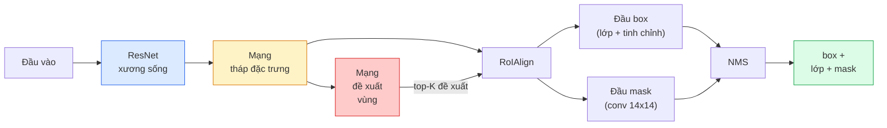

# Phân đoạn thể hiện — Mask R-CNN

> Thêm một nhánh mask bé xíu vào bộ phát hiện Faster R-CNN là bạn có phân đoạn thể hiện. Phần khó là RoIAlign, và nó khó hơn vẻ ngoài.

**Type:** Build + Learn
**Languages:** Python
**Prerequisites:** Giai đoạn 4, Bài 06 (YOLO), Bài 07 (U-Net)
**Time:** ~75 phút

## Mục tiêu học tập

- Lần theo kiến trúc Mask R-CNN từ đầu đến cuối: backbone, FPN, RPN, RoIAlign, box head, mask head (đầu dự đoán mask)
- Tự viết RoIAlign từ đầu và giải thích vì sao RoIPool không còn được dùng
- Dùng mô hình pretrained `maskrcnn_resnet50_fpn_v2` của torchvision để có mask thể hiện chất lượng production và đọc đúng định dạng đầu ra của nó
- Fine-tune Mask R-CNN trên một dataset nhỏ tự chuẩn bị bằng cách thay box head và mask head, giữ backbone đóng băng

## Vấn đề

Phân đoạn ngữ nghĩa (semantic segmentation) cho bạn một mask cho mỗi lớp. Instance segmentation (phân đoạn thể hiện) cho bạn một mask cho mỗi đối tượng, kể cả khi hai đối tượng cùng một lớp. Đếm từng cá thể, theo dõi qua các frame, và đo đạc mọi thứ (bounding box của từng viên gạch trên bức tường, từng tế bào trong ảnh kính hiển vi) đều cần phân đoạn thể hiện.

Mask R-CNN (He et al., 2017) giải quyết việc này bằng cách định nghĩa lại phân đoạn thể hiện thành phát hiện cộng thêm mask. Thiết kế sạch đến mức suốt năm năm sau, gần như mọi bài báo về phân đoạn thể hiện đều là một biến thể của Mask R-CNN, và bản cài đặt trong torchvision vẫn là mặc định production cho dataset nhỏ và vừa.

Vấn đề kỹ thuật khó là lấy mẫu: làm sao cắt một vùng đặc trưng kích thước cố định ra khỏi một box đề xuất mà các góc của nó không trùng biên pixel? Làm sai chỗ này mất vài phần mười điểm mAP ở mọi nơi. RoIAlign là câu trả lời.

## Khái niệm

### Kiến trúc



Năm mảnh cần hiểu:

1. **Backbone (xương sống)** — ResNet-50 hoặc ResNet-101 huấn luyện trên ImageNet. Tạo ra một hệ thống feature map ở stride 4, 8, 16, 32.
2. **FPN (Feature Pyramid Network, tháp đặc trưng)** — kết nối top-down cộng ngang giúp mọi mức có C kênh đặc trưng giàu ngữ nghĩa. Phát hiện truy vấn mức FPN khớp với kích thước đối tượng.
3. **RPN (Region Proposal Network, đề xuất vùng)** — một đầu conv nhỏ mà tại mỗi vị trí anchor dự đoán "ở đây có đối tượng không?" và "tinh chỉnh box thế nào?". Sinh ra khoảng 1000 đề xuất mỗi ảnh.
4. **RoIAlign** — lấy mẫu một mảng đặc trưng kích thước cố định (ví dụ 7x7) từ bất kỳ box nào trên bất kỳ mức FPN nào, tức vùng quan tâm (region of interest). Lấy mẫu song tuyến (bilinear sampling), không lượng tử hoá.
5. **Các đầu ra (heads)** — box head hai lớp tinh chỉnh box và chọn lớp, cộng một đầu conv nhỏ xuất mask nhị phân `28x28` cho mỗi đề xuất.

### Vì sao dùng RoIAlign mà không phải RoIPool

Fast R-CNN ban đầu dùng RoIPool: chia box đề xuất thành lưới, lấy đặc trưng lớn nhất trong mỗi ô, và làm tròn mọi toạ độ về số nguyên. Việc làm tròn đó làm lệch feature map so với toạ độ pixel đầu vào tới một pixel feature-map — nhỏ trên ảnh 224x224, nhưng thảm hoạ khi feature map ở stride 32.

```
RoIPool:
  box (34.7, 51.3, 98.2, 142.9)
  round -> (34, 51, 98, 142)
  split grid -> round each cell boundary
  misalignment accumulates at every step

RoIAlign:
  box (34.7, 51.3, 98.2, 142.9)
  sample at exact float coordinates using bilinear interpolation
  no rounding anywhere
```

RoIAlign nâng mask AP thêm 3-4 điểm trên COCO mà gần như miễn phí. Mọi bộ phát hiện quan tâm đến định vị giờ đều dùng nó — YOLOv7 seg, RT-DETR, Mask2Former như nhau.

### RPN trong một đoạn văn

Tại mọi vị trí của feature map, đặt K anchor box với kích thước và hình dạng khác nhau. Dự đoán một điểm objectness cho mỗi anchor và một offset hồi quy để biến anchor thành box khớp hơn. Giữ khoảng 1.000 box điểm cao nhất, áp NMS ở IoU 0.7, rồi đưa những box còn lại cho các head. RPN được huấn luyện bằng mini-loss riêng — cùng cấu trúc với loss YOLO ở Bài 6, chỉ khác hai lớp (có đối tượng / không có đối tượng).

### Đầu dự đoán mask

Với mỗi đề xuất (sau RoIAlign), mask head là một FCN tí hon: bốn conv 3x3, một deconv 2x, một conv 1x1 cuối cùng xuất `num_classes` kênh đầu ra ở độ phân giải `28x28`. Chỉ kênh ứng với lớp dự đoán được giữ lại; các kênh khác bị bỏ. Điều này tách dự đoán mask khỏi phân loại.

Nội suy mask 28x28 lên kích thước pixel gốc của đề xuất để có mask nhị phân cuối cùng.

### Các loss

Mask R-CNN có bốn loss cộng lại:

```
L = L_rpn_cls + L_rpn_box + L_box_cls + L_box_reg + L_mask
```

- `L_rpn_cls`, `L_rpn_box` — objectness + hồi quy box cho các đề xuất của RPN.
- `L_box_cls` — cross-entropy trên (C+1) lớp (gồm cả nền) ở bộ phân loại của head.
- `L_box_reg` — smooth L1 trên phần tinh chỉnh box của head.
- `L_mask` — binary cross-entropy theo từng pixel trên đầu ra mask 28x28.

Mỗi loss có trọng số mặc định riêng; bản cài đặt trong torchvision để lộ chúng qua tham số khởi tạo.

### Định dạng đầu ra

`torchvision.models.detection.maskrcnn_resnet50_fpn_v2` trả về một list các dict, mỗi ảnh một dict:

```
{
    "boxes":  (N, 4) in (x1, y1, x2, y2) pixel coordinates,
    "labels": (N,) class IDs, 0 = background so indices are 1-based,
    "scores": (N,) confidence scores,
    "masks":  (N, 1, H, W) float masks in [0, 1] — threshold at 0.5 for binary,
}
```

Mask đã ở độ phân giải ảnh đầy đủ. Đầu ra 28x28 của head đã được nội suy lên bên trong.

```figure
cv3-roialign-sampling
```

## Tự tay làm

### Bước 1: Tự viết RoIAlign

Đây là thành phần duy nhất của Mask R-CNN dễ hiểu hơn khi đọc code so với đọc văn xuôi.

```python
import torch
import torch.nn.functional as F

def roi_align_single(feature, box, output_size=7, spatial_scale=1 / 16.0):
    """
    feature: (C, H, W) single-image feature map
    box: (x1, y1, x2, y2) in original image pixel coordinates
    output_size: side of the output grid (7 for box head, 14 for mask head)
    spatial_scale: reciprocal of the feature map stride
    """
    C, H, W = feature.shape
    x1, y1, x2, y2 = [c * spatial_scale - 0.5 for c in box]
    bin_w = (x2 - x1) / output_size
    bin_h = (y2 - y1) / output_size

    grid_y = torch.linspace(y1 + bin_h / 2, y2 - bin_h / 2, output_size)
    grid_x = torch.linspace(x1 + bin_w / 2, x2 - bin_w / 2, output_size)
    yy, xx = torch.meshgrid(grid_y, grid_x, indexing="ij")

    gx = 2 * (xx + 0.5) / W - 1
    gy = 2 * (yy + 0.5) / H - 1
    grid = torch.stack([gx, gy], dim=-1).unsqueeze(0)
    sampled = F.grid_sample(feature.unsqueeze(0), grid, mode="bilinear",
                            align_corners=False)
    return sampled.squeeze(0)
```

Mọi con số đều ở vị trí được lấy mẫu song tuyến. Không làm tròn, không lượng tử hoá, không mất gradient.

### Bước 2: So sánh với RoIAlign của torchvision

```python
from torchvision.ops import roi_align

feature = torch.randn(1, 16, 50, 50)
boxes = torch.tensor([[0, 10, 20, 100, 90]], dtype=torch.float32)  # (batch_idx, x1, y1, x2, y2)

ours = roi_align_single(feature[0], boxes[0, 1:].tolist(), output_size=7, spatial_scale=1/4)
theirs = roi_align(feature, boxes, output_size=(7, 7), spatial_scale=1/4, sampling_ratio=1, aligned=True)[0]

print(f"shape ours:   {tuple(ours.shape)}")
print(f"shape theirs: {tuple(theirs.shape)}")
print(f"max|diff|:    {(ours - theirs).abs().max().item():.3e}")
```

Với `sampling_ratio=1` và `aligned=True`, hai kết quả khớp nhau trong sai số `1e-5`.

### Bước 3: Nạp một Mask R-CNN pretrained

```python
import torch
from torchvision.models.detection import maskrcnn_resnet50_fpn_v2, MaskRCNN_ResNet50_FPN_V2_Weights

model = maskrcnn_resnet50_fpn_v2(weights=MaskRCNN_ResNet50_FPN_V2_Weights.DEFAULT)
model.eval()
print(f"params: {sum(p.numel() for p in model.parameters()):,}")
print(f"classes (including background): {len(model.roi_heads.box_predictor.cls_score.out_features * [0])}")
```

46M tham số, 91 lớp (COCO). Lớp đầu tiên (id 0) là nền; mọi thứ mô hình thực sự phát hiện bắt đầu từ id 1.

### Bước 4: Chạy suy luận

```python
with torch.no_grad():
    x = torch.randn(3, 400, 600)
    predictions = model([x])
p = predictions[0]
print(f"boxes:  {tuple(p['boxes'].shape)}")
print(f"labels: {tuple(p['labels'].shape)}")
print(f"scores: {tuple(p['scores'].shape)}")
print(f"masks:  {tuple(p['masks'].shape)}")
```

Tensor mask có shape `(N, 1, H, W)`. Đặt ngưỡng 0.5 để có mask nhị phân cho mỗi đối tượng:

```python
binary_masks = (p['masks'] > 0.5).squeeze(1)  # (N, H, W) boolean
```

### Bước 5: Thay các head cho số lớp tuỳ chỉnh

Công thức fine-tune quen thuộc: tái dùng backbone, FPN và RPN; thay hai đầu phân loại.

```python
from torchvision.models.detection.faster_rcnn import FastRCNNPredictor
from torchvision.models.detection.mask_rcnn import MaskRCNNPredictor

def build_custom_maskrcnn(num_classes):
    model = maskrcnn_resnet50_fpn_v2(weights=MaskRCNN_ResNet50_FPN_V2_Weights.DEFAULT)
    in_features = model.roi_heads.box_predictor.cls_score.in_features
    model.roi_heads.box_predictor = FastRCNNPredictor(in_features, num_classes)
    in_features_mask = model.roi_heads.mask_predictor.conv5_mask.in_channels
    hidden_layer = 256
    model.roi_heads.mask_predictor = MaskRCNNPredictor(in_features_mask, hidden_layer, num_classes)
    return model

custom = build_custom_maskrcnn(num_classes=5)
print(f"custom cls_score.out_features: {custom.roi_heads.box_predictor.cls_score.out_features}")
```

`num_classes` phải bao gồm lớp nền, nên dataset có 4 lớp đối tượng dùng `num_classes=5`.

### Bước 6: Đóng băng những gì không cần huấn luyện

Trên dataset nhỏ, đóng băng backbone và FPN. Chỉ objectness + hồi quy của RPN và hai head được học.

```python
def freeze_backbone_and_fpn(model):
    # torchvision Mask R-CNN packs the FPN inside `model.backbone` (as
    # `model.backbone.fpn`), so iterating `model.backbone.parameters()` covers
    # both the ResNet feature layers and the FPN lateral/output convs.
    for p in model.backbone.parameters():
        p.requires_grad = False
    return model

custom = freeze_backbone_and_fpn(custom)
trainable = sum(p.numel() for p in custom.parameters() if p.requires_grad)
print(f"trainable after freeze: {trainable:,}")
```

Trên dataset 500 ảnh, đây là khác biệt giữa hội tụ và overfitting.

## Áp dụng

Vòng huấn luyện đầy đủ cho Mask R-CNN trong torchvision dài 40 dòng và không thay đổi đáng kể giữa các bài toán — đổi dataset là chạy.

```python
def train_step(model, images, targets, optimizer):
    model.train()
    loss_dict = model(images, targets)
    losses = sum(loss for loss in loss_dict.values())
    optimizer.zero_grad()
    losses.backward()
    optimizer.step()
    return {k: v.item() for k, v in loss_dict.items()}
```

List `targets` phải có dict cho từng ảnh với `boxes`, `labels`, và `masks` (dạng tensor nhị phân `(num_instances, H, W)`). Mô hình trả về dict bốn loss khi huấn luyện và list dự đoán khi eval, phụ thuộc `model.training`.

Bộ đánh giá `pycocotools` cho ra mAP@IoU=0.5:0.95 cho cả box và mask; bạn cần cả hai con số để biết box head hay mask head là nút thắt.

## Đóng gói

Bài này tạo ra:

- `outputs/prompt-instance-vs-semantic-router.md` — một prompt đặt ba câu hỏi rồi chọn instance vs semantic vs panoptic segmentation (phân đoạn toàn cảnh) cùng mô hình chính xác để bắt đầu.
- `outputs/skill-mask-rcnn-head-swapper.md` — một skill sinh 10 dòng code để thay head trên bất kỳ mô hình phát hiện nào của torchvision, với `num_classes` mới.

## Bài tập

1. **(Dễ)** Kiểm chứng RoIAlign của bạn với `torchvision.ops.roi_align` trên 100 box ngẫu nhiên. Báo cáo sai khác tuyệt đối lớn nhất. Cũng chạy RoIPool (hành vi trước 2017) và chỉ ra nó lệch khoảng 1-2 pixel feature-map trên các box gần biên.
2. **(Trung bình)** Fine-tune `maskrcnn_resnet50_fpn_v2` trên dataset tự chuẩn bị 50 ảnh (hai lớp bất kỳ: bóng bay, cá, ổ gà, logo). Đóng băng backbone, huấn luyện 20 epoch, báo cáo mask AP@0.5.
3. **(Khó)** Thay mask head của Mask R-CNN bằng một head dự đoán ở 56x56 thay vì 28x28. Đo mAP@IoU=0.75 trước và sau. Giải thích vì sao mức tăng (hoặc không tăng) khớp với đánh đổi độ chính xác biên / bộ nhớ như dự kiến.

## Thuật ngữ chính

| Thuật ngữ | Người ta thường nói | Ý nghĩa thực sự |
|------|----------------|----------------------|
| Mask R-CNN | "Phát hiện cộng mask" | Faster R-CNN + một đầu FCN nhỏ dự đoán mask 28x28 cho mỗi đề xuất mỗi lớp |
| FPN | "Tháp đặc trưng" | Kết nối top-down cộng ngang giúp mọi mức stride có C kênh đặc trưng giàu ngữ nghĩa |
| RPN | "Bộ đề xuất vùng" | Một đầu conv nhỏ sinh khoảng 1000 đề xuất có/không đối tượng mỗi ảnh |
| RoIAlign | "Cắt không làm tròn" | Lấy mẫu song tuyến một lưới đặc trưng kích thước cố định từ box có toạ độ thực |
| RoIPool | "Cắt thời trước 2017" | Cùng mục đích với RoIAlign nhưng làm tròn toạ độ box; đã lỗi thời |
| Mask AP | "mAP thể hiện" | Average precision tính bằng mask IoU thay vì box IoU; thước đo phân đoạn thể hiện của COCO |
| Binary mask head | "Mask theo lớp" | Dự đoán một mask nhị phân cho mỗi lớp với mỗi đề xuất; chỉ giữ kênh của lớp dự đoán |
| Background class | "Lớp 0" | Lớp gom chung "không có đối tượng"; chỉ số của lớp thật bắt đầu từ 1 |

## Đọc thêm

- [Mask R-CNN (He et al., 2017)](https://arxiv.org/abs/1703.06870) — bài báo; mục 3 về RoIAlign là phần cần đọc kỹ
- [FPN: Feature Pyramid Networks (Lin et al., 2017)](https://arxiv.org/abs/1612.03144) — bài báo FPN; mọi bộ phát hiện hiện đại đều dùng nó
- [torchvision Mask R-CNN tutorial](https://pytorch.org/tutorials/intermediate/torchvision_tutorial.html) — tài liệu tham khảo cho vòng fine-tune
- [Detectron2 model zoo](https://github.com/facebookresearch/detectron2/blob/main/MODEL_ZOO.md) — các cài đặt production kèm trọng số đã huấn luyện cho gần như mọi biến thể phát hiện và phân đoạn

---

[← Bài trước: Phân đoạn ngữ nghĩa](../../07-semantic-segmentation-unet/docs/vi.md) · [Bài sau: Sinh ảnh →](../../09-image-generation-gans/docs/vi.md)
