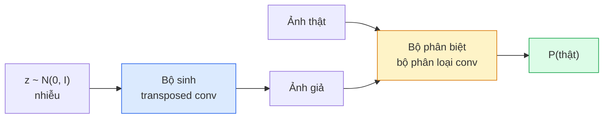
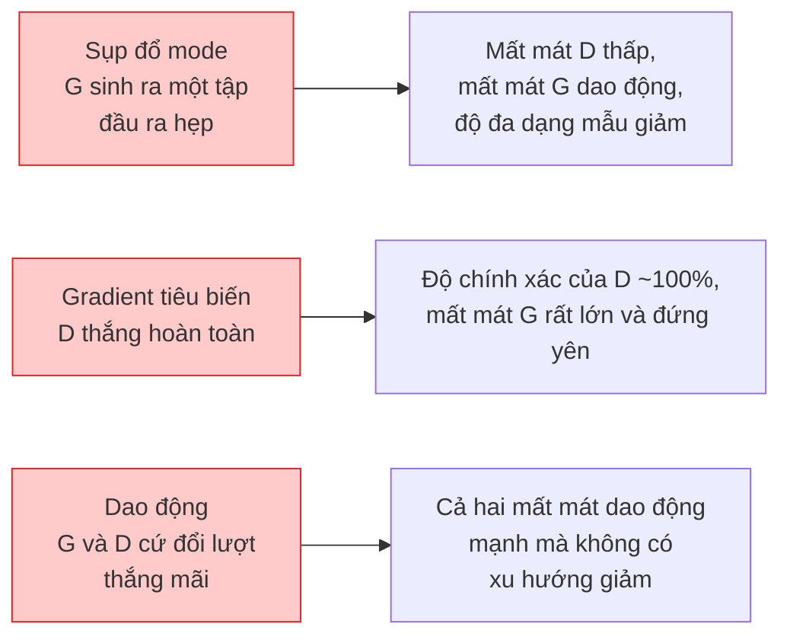

# Sinh ảnh — GAN

> GAN là hai mạng nơ-ron trong một trò chơi cố định. Một mạng vẽ, một mạng phê bình. Cả hai cùng giỏi lên cho tới khi các bức vẽ lừa được bộ phê bình.

**Type:** Build
**Languages:** Python
**Prerequisites:** Giai đoạn 4, Bài 03 (CNN), Giai đoạn 3, Bài 06 (Bộ tối ưu), Bài 07 (Điều chuẩn)
**Time:** ~75 phút

## Mục tiêu học tập

- Giải thích trò chơi minimax giữa generator (bộ sinh) và discriminator (bộ phân biệt), và vì sao điểm cân bằng tương ứng với p_model = p_data
- Cài đặt một DCGAN trong PyTorch và khiến nó sinh ra ảnh tổng hợp 32x32 mạch lạc trong dưới 60 dòng
- Ổn định việc huấn luyện GAN bằng ba thủ thuật chuẩn: non-saturating loss, spectral norm, TTUR (two-timescale update rule)
- Đọc các đường cong huấn luyện để phân biệt hội tụ khoẻ mạnh với mode collapse (sụp đổ mode), dao động, và trường hợp discriminator thắng hoàn toàn

## Vấn đề

Phân loại dạy một mạng ánh xạ ảnh sang nhãn. Sinh ảnh đảo ngược bài toán: lấy mẫu những ảnh mới trông như thể chúng đến từ cùng một phân phối. Không có đầu ra "đúng" nào để bạn so sánh; chỉ có một phân phối bạn muốn bắt chước.

Các hàm mất mát chuẩn (MSE, cross-entropy) không thể đo được "mẫu này có đến từ phân phối thật hay không". Tối thiểu hoá sai số theo từng pixel tạo ra những ảnh trung bình mờ nhoè, chứ không phải mẫu chân thực. Bước đột phá là học chính hàm mất mát: huấn luyện một mạng thứ hai với nhiệm vụ phân biệt thật với giả, rồi dùng đánh giá của nó để thúc đẩy bộ sinh.

GAN (Goodfellow và cộng sự, 2014) đã định nghĩa khung đó. Tới 2018, StyleGAN đã tạo ra những khuôn mặt 1024x1024 không phân biệt được với ảnh chụp. Các mô hình diffusion từ đó đã chiếm ngôi về chất lượng và khả năng điều khiển, nhưng mọi thủ thuật giúp diffusion khả thi — lựa chọn chuẩn hoá, không gian ẩn (latent space), feature loss — đều được hiểu lần đầu trên GAN.

## Khái niệm

### Hai mạng



**Bộ sinh** G nhận một vector nhiễu `z` và xuất ra một ảnh. **Bộ phân biệt** D nhận một ảnh và xuất ra một số vô hướng: xác suất ảnh đó là thật.

### Trò chơi

G muốn D sai. D muốn mình đúng. Một cách hình thức:

```
min_G max_D  E_x[log D(x)] + E_z[log(1 - D(G(z)))]
```

Đọc từ phải sang trái: D đang cực đại hoá độ chính xác trên ảnh thật (`log D(real)`) và ảnh giả (`log (1 - D(fake))`). G đang cực tiểu hoá độ chính xác của D trên ảnh giả — nó muốn `D(G(z))` cao.

Goodfellow đã chứng minh minimax này có một Nash equilibrium (cân bằng Nash) toàn cục tại đó `p_G = p_data`, D xuất ra 0.5 ở mọi nơi, và phân kỳ Jensen-Shannon giữa phân phối sinh và phân phối thật bằng không. Phần khó là đi tới được đó.

### Non-saturating loss

Dạng trên không ổn định về mặt số học. Đầu quá trình huấn luyện, `D(G(z))` gần bằng không với mọi ảnh giả, nên `log(1 - D(G(z)))` có gradient tiêu biến theo G. Cách sửa: lật hàm mất mát của G.

```
L_D = -E_x[log D(x)] - E_z[log(1 - D(G(z)))]
L_G = -E_z[log D(G(z))]                          # non-saturating
```

Giờ khi `D(G(z))` gần bằng không, mất mát của G lớn và gradient của nó mang thông tin. Mọi GAN hiện đại đều huấn luyện với biến thể này.

### Quy tắc kiến trúc DCGAN

Radford, Metz, Chintala (2015) đã chưng cất nhiều năm thí nghiệm thất bại thành năm quy tắc giúp huấn luyện GAN ổn định:

1. Thay pooling bằng conv có stride (cả hai mạng).
2. Dùng batch norm trong cả bộ sinh và bộ phân biệt, trừ đầu ra của G và đầu vào của D.
3. Bỏ các lớp fully connected trên kiến trúc sâu hơn.
4. G dùng ReLU trên mọi lớp trừ lớp đầu ra (tanh cho đầu ra trong [-1, 1]).
5. D dùng LeakyReLU (negative_slope=0.2) trên mọi lớp.

Mọi GAN dựa trên conv hiện đại (StyleGAN, BigGAN, GigaGAN) vẫn bắt đầu từ những quy tắc này rồi thay từng mảnh một.

### Các kiểu thất bại và dấu hiệu của chúng



- **Sụp đổ mode**: G tìm ra một ảnh lừa được D và chỉ sinh ra ảnh đó. Cách sửa: thêm minibatch discrimination, spectral norm, hoặc label-conditioning.
- **Bộ phân biệt thắng**: D trở nên quá mạnh quá nhanh, gradient của G tiêu biến. Cách sửa: D nhỏ hơn, hạ learning rate của D, hoặc áp dụng label smoothing trên nhãn thật.
- **Dao động**: hai mạng đổi lượt thắng mà không bao giờ tiến gần điểm cân bằng. Cách sửa: TTUR (D học nhanh hơn G khoảng 2-4 lần), hoặc chuyển sang Wasserstein loss.

### Đánh giá

GAN không có ground truth, vậy làm sao biết chúng đang hoạt động?

- **Xem mẫu** — cứ nhìn 64 mẫu vào cuối mỗi epoch. Không thể bỏ qua.
- **FID (Fréchet Inception Distance)** — khoảng cách giữa phân phối đặc trưng Inception-v3 của tập thật và tập sinh. Càng thấp càng tốt. Chuẩn của cộng đồng.
- **Inception Score** — cũ hơn, dễ vỡ hơn; hãy ưu tiên FID.
- **Precision/Recall cho generative model (mô hình sinh)** — đo chất lượng (precision) và độ phủ (recall) riêng rẽ. Nhiều thông tin hơn chỉ dùng FID.

Với một lần chạy nhỏ trên dữ liệu tổng hợp, xem mẫu là đủ.

```figure
cv-gan-image
```

## Tự tay làm

### Bước 1: Bộ sinh

Một bộ sinh DCGAN nhỏ nhận nhiễu 64 chiều và tạo ra ảnh 32x32.

```python
import torch
import torch.nn as nn

class Generator(nn.Module):
    def __init__(self, z_dim=64, img_channels=3, feat=64):
        super().__init__()
        self.net = nn.Sequential(
            nn.ConvTranspose2d(z_dim, feat * 4, kernel_size=4, stride=1, padding=0, bias=False),
            nn.BatchNorm2d(feat * 4),
            nn.ReLU(inplace=True),
            nn.ConvTranspose2d(feat * 4, feat * 2, kernel_size=4, stride=2, padding=1, bias=False),
            nn.BatchNorm2d(feat * 2),
            nn.ReLU(inplace=True),
            nn.ConvTranspose2d(feat * 2, feat, kernel_size=4, stride=2, padding=1, bias=False),
            nn.BatchNorm2d(feat),
            nn.ReLU(inplace=True),
            nn.ConvTranspose2d(feat, img_channels, kernel_size=4, stride=2, padding=1, bias=False),
            nn.Tanh(),
        )

    def forward(self, z):
        return self.net(z.view(z.size(0), -1, 1, 1))
```

Bốn lớp transposed conv, mỗi lớp có `kernel_size=4, stride=2, padding=1` nên chúng nhân đôi kích thước không gian một cách gọn gàng. Đầu ra kích hoạt trong [-1, 1] nhờ tanh.

### Bước 2: Bộ phân biệt

Bản đối xứng của bộ sinh. LeakyReLU, conv có stride, kết thúc bằng một logit vô hướng.

```python
class Discriminator(nn.Module):
    def __init__(self, img_channels=3, feat=64):
        super().__init__()
        self.net = nn.Sequential(
            nn.Conv2d(img_channels, feat, kernel_size=4, stride=2, padding=1),
            nn.LeakyReLU(0.2, inplace=True),
            nn.Conv2d(feat, feat * 2, kernel_size=4, stride=2, padding=1, bias=False),
            nn.BatchNorm2d(feat * 2),
            nn.LeakyReLU(0.2, inplace=True),
            nn.Conv2d(feat * 2, feat * 4, kernel_size=4, stride=2, padding=1, bias=False),
            nn.BatchNorm2d(feat * 4),
            nn.LeakyReLU(0.2, inplace=True),
            nn.Conv2d(feat * 4, 1, kernel_size=4, stride=1, padding=0),
        )

    def forward(self, x):
        return self.net(x).view(-1)
```

Lớp conv cuối thu một feature map `4x4` về `1x1`. Đầu ra là một số vô hướng cho mỗi ảnh; chỉ áp sigmoid khi tính mất mát.

### Bước 3: Bước huấn luyện

Luân phiên: cập nhật D một lần, rồi G một lần, ở mỗi batch.

```python
import torch.nn.functional as F

def train_step(G, D, real, z, opt_g, opt_d, device):
    real = real.to(device)
    bs = real.size(0)

    # D step
    opt_d.zero_grad()
    d_real = D(real)
    d_fake = D(G(z).detach())
    loss_d = (F.binary_cross_entropy_with_logits(d_real, torch.ones_like(d_real))
              + F.binary_cross_entropy_with_logits(d_fake, torch.zeros_like(d_fake)))
    loss_d.backward()
    opt_d.step()

    # G step
    opt_g.zero_grad()
    d_fake = D(G(z))
    loss_g = F.binary_cross_entropy_with_logits(d_fake, torch.ones_like(d_fake))
    loss_g.backward()
    opt_g.step()

    return loss_d.item(), loss_g.item()
```

`G(z).detach()` trong bước D là then chốt: ta không muốn gradient chảy vào G trong lúc cập nhật nó. Quên điều đó là lỗi kinh điển của người mới.

### Bước 4: Vòng huấn luyện đầy đủ trên hình tổng hợp

```python
from torch.utils.data import DataLoader, TensorDataset
import numpy as np

def synthetic_images(num=2000, size=32, seed=0):
    rng = np.random.default_rng(seed)
    imgs = np.zeros((num, 3, size, size), dtype=np.float32) - 1.0
    for i in range(num):
        r = rng.uniform(6, 12)
        cx, cy = rng.uniform(r, size - r, size=2)
        yy, xx = np.meshgrid(np.arange(size), np.arange(size), indexing="ij")
        mask = (xx - cx) ** 2 + (yy - cy) ** 2 < r ** 2
        color = rng.uniform(-0.5, 1.0, size=3)
        for c in range(3):
            imgs[i, c][mask] = color[c]
    return torch.from_numpy(imgs)

device = "cuda" if torch.cuda.is_available() else "cpu"
data = synthetic_images()
loader = DataLoader(TensorDataset(data), batch_size=64, shuffle=True)

G = Generator(z_dim=64, img_channels=3, feat=32).to(device)
D = Discriminator(img_channels=3, feat=32).to(device)
opt_g = torch.optim.Adam(G.parameters(), lr=2e-4, betas=(0.5, 0.999))
opt_d = torch.optim.Adam(D.parameters(), lr=2e-4, betas=(0.5, 0.999))

for epoch in range(10):
    for (batch,) in loader:
        z = torch.randn(batch.size(0), 64, device=device)
        ld, lg = train_step(G, D, batch, z, opt_g, opt_d, device)
    print(f"epoch {epoch}  D {ld:.3f}  G {lg:.3f}")
```

`Adam(lr=2e-4, betas=(0.5, 0.999))` là mặc định của DCGAN — beta1 thấp giữ cho số hạng momentum không ổn định hoá trò chơi đối kháng quá mức.

### Bước 5: Lấy mẫu

```python
@torch.no_grad()
def sample(G, n=16, z_dim=64, device="cpu"):
    G.eval()
    z = torch.randn(n, z_dim, device=device)
    imgs = G(z)
    imgs = (imgs + 1) / 2
    return imgs.clamp(0, 1)
```

Luôn chuyển sang chế độ eval trước khi lấy mẫu. Với DCGAN điều này quan trọng vì batch norm dùng thống kê running thay vì thống kê của batch.

### Bước 6: Chuẩn hoá phổ

Một thứ thay thế trực tiếp cho BN trong bộ phân biệt, đảm bảo mạng là 1-Lipschitz. Sửa được hầu hết các hỏng hóc kiểu "D thắng quá mạnh".

```python
from torch.nn.utils import spectral_norm

def build_sn_discriminator(img_channels=3, feat=64):
    return nn.Sequential(
        spectral_norm(nn.Conv2d(img_channels, feat, 4, 2, 1)),
        nn.LeakyReLU(0.2, inplace=True),
        spectral_norm(nn.Conv2d(feat, feat * 2, 4, 2, 1)),
        nn.LeakyReLU(0.2, inplace=True),
        spectral_norm(nn.Conv2d(feat * 2, feat * 4, 4, 2, 1)),
        nn.LeakyReLU(0.2, inplace=True),
        spectral_norm(nn.Conv2d(feat * 4, 1, 4, 1, 0)),
    )
```

Đổi `Discriminator` sang `build_sn_discriminator()` và bạn thường không cần thủ thuật TTUR nữa. Chuẩn hoá phổ là nâng cấp độ bền đơn lẻ dễ nhất mà bạn có thể áp dụng.

## Áp dụng

Với sinh ảnh nghiêm túc, hãy dùng trọng số đã huấn luyện sẵn hoặc chuyển sang diffusion. Hai thư viện chuẩn:

- `torch_fidelity` tính FID / IS trên bộ sinh của bạn mà không phải viết code đánh giá tuỳ chỉnh.
- `pytorch-gan-zoo` (legacy) và `StudioGAN` cung cấp các cài đặt đã được kiểm thử của DCGAN, WGAN-GP, SN-GAN, StyleGAN, và BigGAN.

Năm 2026, GAN vẫn là lựa chọn tốt nhất cho: sinh ảnh thời gian thực (độ trễ <10 ms), chuyển đổi phong cách, dịch ảnh sang ảnh với điều khiển chính xác (Pix2Pix, CycleGAN). Diffusion thắng về độ chân thực ảnh chụp và điều kiện hoá bằng văn bản.

## Đóng gói

Bài học này tạo ra:

- `outputs/prompt-gan-training-triage.md` — một prompt đọc mô tả đường cong huấn luyện và chọn ra kiểu thất bại (sụp đổ mode, D thắng, dao động) kèm cách sửa duy nhất được khuyến nghị.
- `outputs/skill-dcgan-scaffold.md` — một skill viết bộ khung DCGAN từ `z_dim`, `image_size` mục tiêu, và `num_channels`, gồm cả vòng huấn luyện và bộ lưu mẫu.

## Bài tập

1. **(Dễ)** Huấn luyện DCGAN ở trên trên tập dữ liệu hình tròn tổng hợp và lưu một lưới 16 mẫu vào cuối mỗi epoch. Đến epoch nào thì các hình tròn sinh ra trở nên rõ ràng là hình tròn?
2. **(Trung bình)** Thay batch norm của bộ phân biệt bằng chuẩn hoá phổ. Huấn luyện cả hai phiên bản song song. Cái nào hội tụ nhanh hơn? Cái nào có phương sai thấp hơn qua ba seed?
3. **(Khó)** Cài đặt một DCGAN có điều kiện: đưa nhãn lớp vào cả G và D (nối one-hot vào nhiễu ở G, nối một kênh embedding lớp ở D). Huấn luyện trên tập "hình tròn vs hình vuông" tổng hợp từ bài 7 và chứng minh điều kiện hoá lớp hoạt động bằng cách lấy mẫu với những nhãn cụ thể.

## Thuật ngữ chính

| Thuật ngữ | Người ta thường nói | Ý nghĩa thực sự |
|------|----------------|----------------------|
| Generator (G) | "Mạng vẽ đồ" | Ánh xạ nhiễu thành ảnh; được huấn luyện để lừa bộ phân biệt |
| Discriminator (D) | "Bộ phê bình" | Bộ phân loại nhị phân; được huấn luyện để phân biệt ảnh thật với ảnh sinh |
| Minimax | "Trò chơi" | Cực tiểu theo G, cực đại theo D của mất mát đối kháng (adversarial loss); cân bằng là p_G = p_data |
| Non-saturating loss | "Phiên bản số học tỉnh táo" | Mất mát của G là -log(D(G(z))) thay vì log(1 - D(G(z))) để tránh gradient tiêu biến đầu quá trình huấn luyện |
| Mode collapse | "Bộ sinh chỉ tạo một thứ" | G chỉ sinh ra một tập con nhỏ của phân phối dữ liệu; sửa bằng SN, minibatch discrimination, hoặc batch lớn hơn |
| TTUR | "Hai learning rate" | D học nhanh hơn G, thường khoảng 2-4 lần; giúp huấn luyện ổn định |
| Spectral norm | "Lớp 1-Lipschitz" | Một phép chuẩn hoá trọng số chặn hằng số Lipschitz của mỗi lớp; ngăn D trở nên dốc tuỳ tiện |
| FID | "Fréchet Inception Distance" | Khoảng cách giữa phân phối đặc trưng Inception-v3 của tập thật và tập sinh; thước đo đánh giá chuẩn |

## Đọc thêm

- [Generative Adversarial Networks (Goodfellow et al., 2014)](https://arxiv.org/abs/1406.2661) — bài báo khởi đầu tất cả
- [DCGAN (Radford, Metz, Chintala, 2015)](https://arxiv.org/abs/1511.06434) — các quy tắc kiến trúc giúp GAN huấn luyện được
- [Spectral Normalization for GANs (Miyato et al., 2018)](https://arxiv.org/abs/1802.05957) — thủ thuật ổn định hữu ích nhất
- [StyleGAN3 (Karras et al., 2021)](https://arxiv.org/abs/2106.12423) — GAN SOTA; đọc như một tuyển tập hit lớn nhất của mọi thủ thuật trong thập kỷ qua

---

[← Bài trước: Phân đoạn thể hiện](../../08-instance-segmentation-mask-rcnn/docs/vi.md) · [Bài sau: Sinh ảnh →](../../10-image-generation-diffusion/docs/vi.md)
