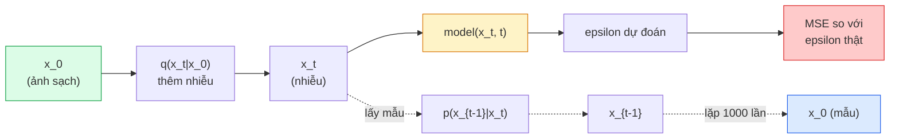

# Sinh ảnh — Mô hình diffusion (khuếch tán)

> Một mô hình diffusion học cách khử nhiễu. Huấn luyện nó loại bỏ một chút xíu nhiễu khỏi ảnh nhiễu, lặp lại quá trình đó theo chiều ngược một nghìn lần, và bạn có một cỗ máy sinh ảnh.

**Type:** Build
**Languages:** Python
**Prerequisites:** Giai đoạn 4, Bài 07 (U-Net), Giai đoạn 1, Bài 06 (Xác suất), Giai đoạn 3, Bài 06 (Bộ tối ưu)
**Time:** ~75 phút

## Mục tiêu học tập

- Suy ra quá trình thuận thêm nhiễu (forward process) `x_0 -> x_1 -> ... -> x_T` và giải thích vì sao dạng đóng `q(x_t | x_0)` đúng với mọi t
- Cài đặt mục tiêu huấn luyện kiểu DDPM hồi quy lượng nhiễu được thêm ở mỗi bước, cùng một bộ lấy mẫu (sampling) đi ngược từ nhiễu thuần về ảnh
- Xây một U-Net có điều kiện thời gian (đủ nhỏ để huấn luyện trên CPU) dự đoán nhiễu cho bất kỳ bước thời gian nào
- Giải thích khác biệt giữa lấy mẫu DDPM và DDIM, và khi nào dùng cái nào (Bài 23 đi sâu vào flow matching và rectified flow)

## Vấn đề

GAN sinh một phát: nhiễu vào, ảnh ra, một lượt lan truyền xuôi. Chúng nhanh và khó huấn luyện. Mô hình diffusion sinh lặp đi lặp lại: bắt đầu từ nhiễu thuần, khử nhiễu từng bước nhỏ, ảnh hiện ra. Chúng chậm và dễ huấn luyện. Năm năm qua, đặc tính thứ hai đã chiếm ưu thế: bất kỳ nhóm nhỏ nào cũng huấn luyện được một mô hình diffusion và có mẫu tạm ổn; còn huấn luyện GAN là một nghề bạn phải học qua nhiều năm chạy thất bại.

Ngoài độ ổn định khi huấn luyện, chính cấu trúc lặp của diffusion mở ra mọi thứ mà sinh ảnh hiện đại làm được: điều kiện văn bản, inpainting, chỉnh sửa ảnh, siêu phân giải, phong cách điều khiển được. Mỗi bước của vòng lặp lấy mẫu là một chỗ để cấy thêm ràng buộc mới. Chính cái móc đó khiến Stable Diffusion, Imagen, DALL-E 3, Midjourney và mọi mô hình ảnh điều khiển được mà bạn sẽ dùng đều dựa trên diffusion.

Bài này xây DDPM tối giản: thêm nhiễu thuận, khử nhiễu ngược, vòng lặp huấn luyện. Bài tiếp theo (Stable Diffusion) nối nó vào một hệ thống production với VAE, bộ mã hoá văn bản và classifier-free guidance.

## Khái niệm

### Quá trình thuận

Lấy một ảnh `x_0`. Thêm một chút nhiễu Gaussian để được `x_1`. Thêm một chút nữa để được `x_2`. Cứ thế T bước cho tới khi `x_T` gần như không phân biệt được với nhiễu Gaussian thuần.

```
q(x_t | x_{t-1}) = N(x_t; sqrt(1 - beta_t) * x_{t-1},  beta_t * I)
```

`beta_t` là một lịch phương sai nhỏ, thường tuyến tính từ 0.0001 đến 0.02 qua T=1000 bước. Mỗi bước thu nhỏ tín hiệu một chút và bơm vào nhiễu mới.

### Bước nhảy dạng đóng

Thêm nhiễu từng bước một là một chuỗi Markov, nhưng toán học gấp lại được: bạn có thể lấy mẫu `x_t` trực tiếp từ `x_0` trong một bước.

```
Define alpha_t = 1 - beta_t
Define alpha_bar_t = prod_{s=1..t} alpha_s

Then:
  q(x_t | x_0) = N(x_t; sqrt(alpha_bar_t) * x_0,  (1 - alpha_bar_t) * I)

Equivalently:
  x_t = sqrt(alpha_bar_t) * x_0 + sqrt(1 - alpha_bar_t) * epsilon
  where epsilon ~ N(0, I)
```

Chỉ một phương trình này là toàn bộ lý do diffusion trở nên thực dụng. Khi huấn luyện, bạn chọn ngẫu nhiên một `t`, lấy mẫu `x_t` trực tiếp từ `x_0`, và huấn luyện trong một bước — không cần mô phỏng toàn bộ chuỗi Markov.

### Quá trình ngược (reverse process)

Quá trình thuận là cố định. Quá trình ngược `p(x_{t-1} | x_t)` là thứ mạng nơ-ron học. Mô hình diffusion không dự đoán trực tiếp `x_{t-1}`; chúng dự đoán nhiễu `epsilon` được thêm ở bước t, rồi toán học suy ra `x_{t-1}` từ đó.



### Hàm mất mát huấn luyện

Mỗi bước huấn luyện:

1. Lấy mẫu một ảnh thật `x_0`.
2. Lấy mẫu đều một bước thời gian `t` trong [1, T].
3. Lấy mẫu nhiễu `epsilon ~ N(0, I)`.
4. Tính `x_t = sqrt(alpha_bar_t) * x_0 + sqrt(1 - alpha_bar_t) * epsilon`.
5. Dự đoán `epsilon_theta(x_t, t)` bằng mạng.
6. Tối thiểu hoá `|| epsilon - epsilon_theta(x_t, t) ||^2`.

Chỉ có thế. Mạng nơ-ron học cách dự đoán nhiễu ở bất kỳ bước thời gian nào. Mất mát là MSE. Không có trò chơi đối kháng, không sụp đổ, không dao động.

### Bộ lấy mẫu (DDPM)

Để sinh ảnh: bắt đầu từ `x_T ~ N(0, I)` và đi ngược từng bước một.

```
for t = T, T-1, ..., 1:
    eps = model(x_t, t)
    x_{t-1} = (1 / sqrt(alpha_t)) * (x_t - (beta_t / sqrt(1 - alpha_bar_t)) * eps) + sqrt(beta_t) * z
    where z ~ N(0, I) if t > 1, else 0
return x_0
```

Điều mấu chốt là dù phân phối điều kiện ngược nói chung không có dạng đóng, với đúng quá trình thuận Gaussian này thì nó có. Mấy hệ số trông xấu xí kia chính là thứ định lý Bayes cho bạn.

### Vì sao là 1000 bước

Lịch nhiễu (noise schedule) của quá trình thuận được chọn sao cho mỗi bước chỉ thêm vừa đủ nhiễu để bước ngược gần với Gaussian. Quá ít bước thì bước ngược cách xa Gaussian và mạng không mô hình hoá tốt được. Quá nhiều bước thì lấy mẫu đắt đỏ mà lợi ích giảm dần. T=1000 với lịch tuyến tính là mặc định của DDPM.

### DDIM: lấy mẫu nhanh gấp 20 lần

Huấn luyện giữ nguyên. Phần lấy mẫu thay đổi. DDIM (Song et al., 2020) định nghĩa một quá trình ngược tất định, bỏ qua các bước thời gian mà không cần huấn luyện lại. Lấy mẫu 50 bước với DDIM cho chất lượng gần bằng DDPM 1000 bước. Mọi hệ thống production đều dùng DDIM hoặc một biến thể còn nhanh hơn (DPM-Solver, Euler ancestral).

### Điều kiện thời gian

Mạng `epsilon_theta(x_t, t)` cần biết nó đang khử nhiễu ở bước thời gian nào. Mô hình diffusion hiện đại cấy `t` qua embedding thời gian dạng sin (cùng ý tưởng với positional encoding trong transformer), rồi cộng vào các feature map ở mọi tầng của U-Net.

```
t_embedding = sinusoidal(t)
feature_map += MLP(t_embedding)
```

Không có điều kiện thời gian, mạng phải đoán mức nhiễu từ chính ảnh, cách đó vẫn chạy nhưng kém hiệu quả mẫu hơn nhiều.

```figure
cv-diffusion-image
```

## Tự tay làm

### Bước 1: Lịch nhiễu

```python
import torch

def linear_beta_schedule(T=1000, beta_start=1e-4, beta_end=2e-2):
    return torch.linspace(beta_start, beta_end, T)


def precompute_schedule(betas):
    alphas = 1.0 - betas
    alphas_cumprod = torch.cumprod(alphas, dim=0)
    return {
        "betas": betas,
        "alphas": alphas,
        "alphas_cumprod": alphas_cumprod,
        "sqrt_alphas_cumprod": torch.sqrt(alphas_cumprod),
        "sqrt_one_minus_alphas_cumprod": torch.sqrt(1.0 - alphas_cumprod),
        "sqrt_recip_alphas": torch.sqrt(1.0 / alphas),
    }

schedule = precompute_schedule(linear_beta_schedule(T=1000))
```

Tính trước một lần, rồi tra theo chỉ số khi huấn luyện và lấy mẫu.

### Bước 2: Khuếch tán thuận (q_sample)

```python
def q_sample(x0, t, noise, schedule):
    sqrt_a = schedule["sqrt_alphas_cumprod"][t].view(-1, 1, 1, 1)
    sqrt_one_minus_a = schedule["sqrt_one_minus_alphas_cumprod"][t].view(-1, 1, 1, 1)
    return sqrt_a * x0 + sqrt_one_minus_a * noise
```

Công thức dạng đóng một dòng. `t` là một batch các bước thời gian, mỗi ảnh trong batch một giá trị.

### Bước 3: Một U-Net nhỏ có điều kiện thời gian

```python
import torch.nn as nn
import torch.nn.functional as F
import math

def timestep_embedding(t, dim=64):
    half = dim // 2
    freqs = torch.exp(-math.log(10000) * torch.arange(half, device=t.device) / half)
    args = t[:, None].float() * freqs[None]
    emb = torch.cat([args.sin(), args.cos()], dim=-1)
    return emb


class TinyUNet(nn.Module):
    def __init__(self, img_channels=3, base=32, t_dim=64):
        super().__init__()
        self.t_mlp = nn.Sequential(
            nn.Linear(t_dim, base * 4),
            nn.SiLU(),
            nn.Linear(base * 4, base * 4),
        )
        self.t_dim = t_dim
        self.enc1 = nn.Conv2d(img_channels, base, 3, padding=1)
        self.enc2 = nn.Conv2d(base, base * 2, 4, stride=2, padding=1)
        self.mid = nn.Conv2d(base * 2, base * 2, 3, padding=1)
        self.dec1 = nn.ConvTranspose2d(base * 2, base, 4, stride=2, padding=1)
        self.dec2 = nn.Conv2d(base * 2, img_channels, 3, padding=1)
        self.time_proj = nn.Linear(base * 4, base * 2)

    def forward(self, x, t):
        t_emb = timestep_embedding(t, self.t_dim)
        t_emb = self.t_mlp(t_emb)
        t_proj = self.time_proj(t_emb)[:, :, None, None]

        h1 = F.silu(self.enc1(x))
        h2 = F.silu(self.enc2(h1)) + t_proj
        h3 = F.silu(self.mid(h2))
        d1 = F.silu(self.dec1(h3))
        d2 = torch.cat([d1, h1], dim=1)
        return self.dec2(d2)
```

U-Net hai tầng với điều kiện thời gian được cấy ở chỗ thắt nút. Tăng độ sâu và độ rộng khi làm việc với ảnh thật.

### Bước 4: Vòng lặp huấn luyện

```python
def train_step(model, x0, schedule, optimizer, device, T=1000):
    model.train()
    x0 = x0.to(device)
    bs = x0.size(0)
    t = torch.randint(0, T, (bs,), device=device)
    noise = torch.randn_like(x0)
    x_t = q_sample(x0, t, noise, schedule)
    pred = model(x_t, t)
    loss = F.mse_loss(pred, noise)
    optimizer.zero_grad()
    loss.backward()
    optimizer.step()
    return loss.item()
```

Đó là toàn bộ vòng lặp huấn luyện. Không có trò chơi GAN, không mất mát chuyên dụng, chỉ một lời gọi MSE.

### Bước 5: Bộ lấy mẫu (DDPM)

```python
@torch.no_grad()
def sample(model, schedule, shape, T=1000, device="cpu"):
    model.eval()
    x = torch.randn(shape, device=device)
    betas = schedule["betas"].to(device)
    sqrt_one_minus_a = schedule["sqrt_one_minus_alphas_cumprod"].to(device)
    sqrt_recip_alphas = schedule["sqrt_recip_alphas"].to(device)

    for t in reversed(range(T)):
        t_batch = torch.full((shape[0],), t, dtype=torch.long, device=device)
        eps = model(x, t_batch)
        coef = betas[t] / sqrt_one_minus_a[t]
        mean = sqrt_recip_alphas[t] * (x - coef * eps)
        if t > 0:
            x = mean + torch.sqrt(betas[t]) * torch.randn_like(x)
        else:
            x = mean
    return x
```

1000 lượt lan truyền xuôi để tạo một batch mẫu. Trong code thật, bạn sẽ đổi chỗ này bằng bộ lấy mẫu DDIM 50 bước.

### Bước 6: Bộ lấy mẫu DDIM (tất định, nhanh ~20 lần)

```python
@torch.no_grad()
def sample_ddim(model, schedule, shape, steps=50, T=1000, device="cpu", eta=0.0):
    model.eval()
    x = torch.randn(shape, device=device)
    alphas_cumprod = schedule["alphas_cumprod"].to(device)

    ts = torch.linspace(T - 1, 0, steps + 1).long()
    for i in range(steps):
        t = ts[i]
        t_prev = ts[i + 1]
        t_batch = torch.full((shape[0],), t, dtype=torch.long, device=device)
        eps = model(x, t_batch)
        a_t = alphas_cumprod[t]
        a_prev = alphas_cumprod[t_prev] if t_prev >= 0 else torch.tensor(1.0, device=device)
        x0_pred = (x - torch.sqrt(1 - a_t) * eps) / torch.sqrt(a_t)
        sigma = eta * torch.sqrt((1 - a_prev) / (1 - a_t) * (1 - a_t / a_prev))
        dir_xt = torch.sqrt(1 - a_prev - sigma ** 2) * eps
        noise = sigma * torch.randn_like(x) if eta > 0 else 0
        x = torch.sqrt(a_prev) * x0_pred + dir_xt + noise
    return x
```

`eta=0` là hoàn toàn tất định (cùng đầu vào nhiễu luôn cho cùng đầu ra). `eta=1` lấy lại DDPM.

## Áp dụng

Với công việc production, hãy dùng `diffusers`:

```python
from diffusers import DDPMScheduler, UNet2DModel

unet = UNet2DModel(sample_size=32, in_channels=3, out_channels=3, layers_per_block=2)
scheduler = DDPMScheduler(num_train_timesteps=1000)
```

Thư viện có sẵn các scheduler (DDPM, DDIM, DPM-Solver, Euler, Heun), U-Net cấu hình được, pipeline cho text-to-image và image-to-image, cùng các helper fine-tune LoRA.

Với nghiên cứu, `k-diffusion` (Katherine Crowson) có những cài đặt tham chiếu sát nhất và những biến thể lấy mẫu tốt nhất.

## Đóng gói

Bài này tạo ra:

- `outputs/prompt-diffusion-sampler-picker.md` — một prompt chọn DDPM / DDIM / DPM-Solver / Euler dựa trên mục tiêu chất lượng, ngân sách độ trễ và kiểu điều kiện.
- `outputs/skill-noise-schedule-designer.md` — một skill tạo lịch beta tuyến tính, cosine hoặc sigmoid khi cho T và mức nhiễu hoá mục tiêu, kèm biểu đồ chẩn đoán tỉ lệ tín hiệu trên nhiễu theo thời gian.

## Bài tập

1. **(Dễ)** Trực quan hoá quá trình thuận: lấy một ảnh và vẽ `x_t` tại `t in [0, 100, 250, 500, 750, 1000]`. Kiểm tra rằng `x_1000` trông như nhiễu Gaussian thuần.
2. **(Trung bình)** Huấn luyện TinyUNet trên bộ dữ liệu vòng tròn tổng hợp trong 20 epoch và lấy mẫu 16 vòng tròn. So sánh lấy mẫu DDPM (1000 bước) và DDIM (50 bước) — chúng có tạo ra ảnh giống nhau từ cùng một seed nhiễu không?
3. **(Khó)** Cài đặt một lịch nhiễu cosine (Nichol & Dhariwal, 2021): `alpha_bar_t = cos^2((t/T + s) / (1 + s) * pi / 2)`. Huấn luyện cùng mô hình với lịch tuyến tính và lịch cosine rồi chứng minh cosine cho mẫu tốt hơn ở số bước thấp.

## Thuật ngữ chính

| Thuật ngữ | Người ta thường nói | Ý nghĩa thực sự |
|------|----------------|----------------------|
| Forward process | "Thêm nhiễu theo thời gian" | Chuỗi Markov cố định, biến một ảnh thành nhiễu Gaussian qua T bước |
| Reverse process | "Khử nhiễu từng bước" | Phân phối được học, đi ngược từ nhiễu về ảnh |
| Epsilon prediction | "Dự đoán nhiễu" | Mục tiêu huấn luyện: `epsilon_theta(x_t, t)` dự đoán nhiễu được thêm ở bước t |
| Beta schedule | "Lượng nhiễu" | Dãy T phương sai nhỏ, quy định mỗi bước nhận vào bao nhiêu nhiễu |
| alpha_bar_t | "Hệ số giữ lại tích luỹ" | Tích của (1 - beta_s) tới thời điểm t; t càng lớn thì tín hiệu còn lại càng ít |
| DDPM sampler | "Ancestral, ngẫu nhiên" | Lấy mẫu từng x_{t-1} từ Gaussian điều kiện của nó; 1000 bước |
| DDIM sampler | "Tất định, nhanh" | Viết lại việc lấy mẫu thành một ODE tất định; 20-100 bước với chất lượng tương đương |
| Time conditioning | "Nói cho mô hình biết t" | Embedding dạng sin của t được cấy vào U-Net để nó biết mức nhiễu |

## Đọc thêm

- [Denoising Diffusion Probabilistic Models (Ho et al., 2020)](https://arxiv.org/abs/2006.11239) — bài báo đưa diffusion vào thực tế và đánh bại GAN về FID
- [Improved DDPM (Nichol & Dhariwal, 2021)](https://arxiv.org/abs/2102.09672) — lịch cosine và cách tham số hoá v
- [DDIM (Song, Meng, Ermon, 2020)](https://arxiv.org/abs/2010.02502) — bộ lấy mẫu tất định giúp suy luận thời gian thực trở nên khả thi
- [Elucidating the Design Space of Diffusion (Karras et al., 2022)](https://arxiv.org/abs/2206.00364) — góc nhìn thống nhất về mọi lựa chọn thiết kế diffusion; tài liệu tham chiếu tốt nhất hiện nay

---

[← Bài trước: Sinh ảnh](../../09-image-generation-gans/docs/vi.md) · [Bài sau: Stable Diffusion →](../../11-stable-diffusion/docs/vi.md)
