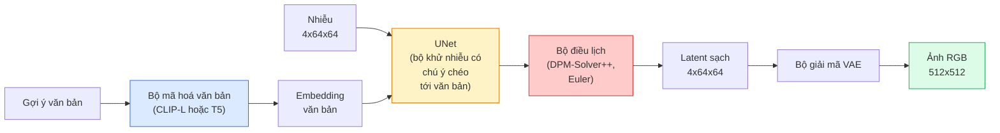

# Stable Diffusion — Kiến trúc & Tinh chỉnh

> Stable Diffusion là một DDPM chạy trong không gian ẩn của một VAE đã huấn luyện trước, được điều kiện hoá bằng văn bản qua cross-attention (chú ý chéo), lấy mẫu bằng một bộ giải ODE tất định nhanh, và được dẫn dắt bởi classifier-free guidance (guidance không cần bộ phân loại).

**Type:** Learn + Use
**Languages:** Python
**Prerequisites:** Giai đoạn 4, Bài 10 (Diffusion), Giai đoạn 7, Bài 02 (Self-attention)
**Time:** ~75 phút

## Mục tiêu học tập

- Lần theo năm thành phần của một pipeline Stable Diffusion: VAE, text encoder (bộ mã hoá văn bản), U-Net, scheduler (bộ điều lịch), safety checker — và mỗi thành phần thực sự làm gì
- Giải thích latent diffusion (khuếch tán trong không gian ẩn) và vì sao huấn luyện trong không gian ẩn 4x64x64 (thay vì ảnh 3x512x512) giảm 48 lần chi phí tính toán mà không mất chất lượng
- Dùng `diffusers` để sinh ảnh, chạy image-to-image, inpainting, và sinh ảnh có ControlNet dẫn dắt
- Tinh chỉnh Stable Diffusion bằng LoRA trên một tập dữ liệu nhỏ tuỳ biến và nạp adapter LoRA lúc suy luận

## Vấn đề

Huấn luyện một DDPM trực tiếp trên ảnh RGB 512x512 rất tốn kém. Mỗi bước huấn luyện lan truyền ngược qua một U-Net nhìn thấy 3x512x512 = 786.432 giá trị đầu vào, và lấy mẫu cần hơn 50 lượt chạy xuôi qua chính U-Net đó. Ở mức chất lượng của Stable Diffusion 1.5 (phát hành năm 2022), khuếch tán trong không gian điểm ảnh sẽ cần khoảng 256 GPU-tháng huấn luyện và 10-30 giây mỗi ảnh trên một GPU tiêu dùng.

Mẹo giúp text-to-image trọng số mở trở nên khả thi là **latent diffusion** (Rombach et al., CVPR 2022). Huấn luyện một VAE ánh xạ ảnh 3x512x512 thành tensor ẩn 4x64x64 rồi ngược lại, sau đó làm khuếch tán trong không gian ẩn đó. Chi phí tính toán giảm `(3*512*512)/(4*64*64) = 48x`. Thời gian lấy mẫu giảm từ hàng chục giây xuống dưới hai giây trên cùng một GPU.

Gần như mọi mô hình sinh ảnh hiện đại — SDXL, SD3, FLUX, HunyuanDiT, Wan-Video — đều là mô hình latent diffusion với các biến thể về autoencoder, denoiser (bộ khử nhiễu) (U-Net hoặc DiT), và điều kiện hoá văn bản. Học Stable Diffusion là bạn đã học được khuôn mẫu.

## Khái niệm

### Đường ống xử lý



- **VAE** — autoencoder đóng băng. Encoder biến ảnh thành latent (dùng cho img2img và huấn luyện). Decoder biến latent trở lại thành ảnh.
- **Text encoder** — bộ mã hoá văn bản CLIP (SD 1.x/2.x), CLIP-L + CLIP-G (SDXL), hoặc T5-XXL (SD3/FLUX). Tạo ra một chuỗi embedding token.
- **U-Net** — bộ khử nhiễu. Có các lớp cross-attention chú ý từ latent tới embedding văn bản ở mọi mức độ phân giải.
- **Scheduler** — thuật toán lấy mẫu (DDIM, Euler, DPM-Solver++). Chọn các sigma, trộn nhiễu dự đoán trở lại latent.
- **Safety checker** — bộ lọc NSFW / nội dung không hợp pháp tuỳ chọn trên ảnh đầu ra.

### Guidance không cần bộ phân loại (CFG)

Điều kiện hoá văn bản thuần tuý học `epsilon_theta(x_t, t, c)` cho mọi prompt `c`. CFG huấn luyện cùng mạng đó với `c` bị bỏ đi 10% số lần (thay bằng một embedding rỗng), cho ra một mô hình duy nhất dự đoán cả nhiễu có điều kiện lẫn nhiễu không điều kiện. Lúc suy luận:

```
eps = eps_uncond + w * (eps_cond - eps_uncond)
```

`w` là thang guidance. `w=0` là không điều kiện, `w=1` là có điều kiện thuần, `w>1` đẩy đầu ra về phía "được điều kiện theo prompt nhiều hơn" với cái giá là mất đa dạng. Mặc định của SD là `w=7.5`.

CFG là lý do text-to-image đạt được chất lượng sản xuất. Không có nó, prompt chỉ ảnh hưởng yếu tới đầu ra; có nó, prompt chi phối.

### Hình học của không gian ẩn

Latent 4 kênh của VAE không chỉ là một ảnh bị nén. Nó là một đa tạp nơi các phép tính số học gần như tương ứng với những chỉnh sửa ngữ nghĩa (prompt engineering và nội suy đều sống ở đây), và nơi U-Net khuếch tán đã được huấn luyện để dùng hết ngân sách mô hình hoá của nó. Giải mã một latent 4x64x64 ngẫu nhiên không cho ra một ảnh trông ngẫu nhiên — nó cho ra rác, vì chỉ một đa tạp con cụ thể của latent mới giải mã thành ảnh hợp lệ.

Hai hệ quả:

1. **Img2img** = mã hoá ảnh thành latent, thêm nhiễu một phần, chạy bộ khử nhiễu, giải mã. Cấu trúc ảnh sống sót vì việc mã hoá gần như khả nghịch; nội dung thay đổi theo prompt.
2. **Inpainting** = giống img2img nhưng bộ khử nhiễu chỉ cập nhật các vùng có mặt nạ; các vùng không có mặt nạ được giữ ở latent đã mã hoá.

### Kiến trúc U-Net

U-Net của SD là một phiên bản lớn của TinyUNet trong Bài 10 với ba bổ sung:

- **Khối Transformer** ở mọi độ phân giải không gian, chứa self-attention + cross-attention tới embedding văn bản.
- **Time embedding** (embedding bước thời gian) qua MLP trên mã hoá sin.
- **Kết nối tắt** giữa encoder và decoder ở các độ phân giải khớp nhau.

Tổng số tham số trong SD 1.5: ~860M. SDXL: ~2.6B. FLUX: ~12B. Mức tăng tham số chủ yếu nằm ở các lớp attention.

### Tinh chỉnh LoRA

Tinh chỉnh toàn bộ Stable Diffusion cần 20+ GB VRAM và cập nhật 860M tham số. LoRA (Low-Rank Adaptation) giữ mô hình gốc đóng băng và chèn các ma trận phân rã hạng nhỏ vào các lớp attention. Một adapter LoRA cho SD thường nặng 10-50 MB, huấn luyện trong 10-60 phút trên một GPU tiêu dùng, và nạp lúc suy luận như một sửa đổi cắm vào là chạy.

```
Original: W_q : (d_in, d_out)   frozen
LoRA:     W_q + alpha * (A @ B)   where A : (d_in, r), B : (r, d_out)

r is typically 4-32.
```

LoRA là cách gần như mọi bản tinh chỉnh của cộng đồng được phân phối. CivitAI và Hugging Face lưu trữ hàng triệu bản.

### Những bộ điều lịch bạn sẽ gặp

- **DDIM** — tất định, ~50 bước, đơn giản.
- **Euler ancestral** — ngẫu nhiên, 30-50 bước, mẫu sáng tạo hơn một chút.
- **DPM-Solver++ 2M Karras** — tất định, 20-30 bước, mặc định trong sản xuất.
- **LCM / TCD / Turbo** — mô hình nhất quán và các biến thể chưng cất; 1-4 bước với cái giá là mất một phần chất lượng.

Đổi bộ điều lịch là thay đổi một dòng trong `diffusers` và đôi khi sửa được vấn đề mẫu mà không cần huấn luyện lại.

```figure
cv3-latent-compression
```

## Tự tay làm

Bài này dùng `diffusers` từ đầu đến cuối thay vì dựng lại Stable Diffusion từ con số không. Những mảnh bạn sẽ cần dựng lại (VAE, text encoder, U-Net, scheduler) là chủ đề của các bài riêng; ở đây mục tiêu là sự thành thạo với API sản xuất.

### Bước 1: Text-to-image

```python
import torch
from diffusers import StableDiffusionPipeline

pipe = StableDiffusionPipeline.from_pretrained(
    "runwayml/stable-diffusion-v1-5",
    torch_dtype=torch.float16,
).to("cuda")

image = pipe(
    prompt="a dog riding a skateboard in tokyo, studio ghibli style",
    guidance_scale=7.5,
    num_inference_steps=25,
    generator=torch.Generator("cuda").manual_seed(42),
).images[0]
image.save("dog.png")
```

`float16` giảm một nửa VRAM mà không mất chất lượng nhìn thấy được. `num_inference_steps=25` với DPM-Solver++ mặc định tương đương `num_inference_steps=50` với DDIM.

### Bước 2: Đổi scheduler

```python
from diffusers import DPMSolverMultistepScheduler, EulerAncestralDiscreteScheduler

pipe.scheduler = DPMSolverMultistepScheduler.from_config(pipe.scheduler.config)
pipe.scheduler = EulerAncestralDiscreteScheduler.from_config(pipe.scheduler.config)
```

Trạng thái của scheduler tách rời khỏi trọng số U-Net. Bạn có thể huấn luyện với DDPM và lấy mẫu bằng bất kỳ bộ điều lịch nào.

### Bước 3: Image-to-image

```python
from diffusers import StableDiffusionImg2ImgPipeline
from PIL import Image

img2img = StableDiffusionImg2ImgPipeline.from_pretrained(
    "runwayml/stable-diffusion-v1-5",
    torch_dtype=torch.float16,
).to("cuda")

init_image = Image.open("dog.png").convert("RGB").resize((512, 512))
out = img2img(
    prompt="a dog riding a skateboard, oil painting",
    image=init_image,
    strength=0.6,
    guidance_scale=7.5,
).images[0]
```

`strength` là lượng nhiễu thêm vào trước khi khử nhiễu (0.0 = không đổi, 1.0 = tái tạo hoàn toàn). 0.5-0.7 là khoảng chuẩn cho chuyển đổi phong cách.

### Bước 4: Inpainting

```python
from diffusers import StableDiffusionInpaintPipeline

inpaint = StableDiffusionInpaintPipeline.from_pretrained(
    "runwayml/stable-diffusion-inpainting",
    torch_dtype=torch.float16,
).to("cuda")

image = Image.open("dog.png").convert("RGB").resize((512, 512))
mask = Image.open("dog_mask.png").convert("L").resize((512, 512))

out = inpaint(
    prompt="a cat",
    image=image,
    mask_image=mask,
    guidance_scale=7.5,
).images[0]
```

Điểm ảnh trắng trong mặt nạ là vùng cần tái tạo. Điểm ảnh đen được giữ nguyên.

### Bước 5: Nạp LoRA

```python
pipe.load_lora_weights(
    "artificialguybr/studioghibli-redmond-1-5v-studio-ghibli-lora-for-liberteredmond-sd-1-5",
    weight_name="StudioGhibliRedmond-15V-LiberteRedmond-StdGBRedmAF-StudioGhibli.safetensors",
)
pipe.fuse_lora(lora_scale=0.8)

image = pipe(prompt="a village square, StdGBRedmAF, Studio Ghibli").images[0]
```

Cụm từ kích hoạt từ model card (`StdGBRedmAF, Studio Ghibli`) bật phong cách lên. `lora_scale` điều khiển độ mạnh; 0.0 = không tác dụng, 1.0 = tác dụng đầy đủ. `fuse_lora` nướng adapter vào trọng số tại chỗ để tăng tốc, nhưng ngăn việc đổi adapter. Gọi `pipe.unfuse_lora()` trước khi nạp adapter khác.

### Bước 6: Huấn luyện LoRA (phác thảo)

Huấn luyện LoRA thực tế nằm trong `peft` hoặc `diffusers.training`. Dàn ý:

```python
# Pseudocode
for step, batch in enumerate(dataloader):
    images, prompts = batch
    latents = vae.encode(images).latent_dist.sample() * 0.18215

    t = torch.randint(0, num_train_timesteps, (batch_size,))
    noise = torch.randn_like(latents)
    noisy_latents = scheduler.add_noise(latents, noise, t)

    text_emb = text_encoder(tokenizer(prompts))

    pred_noise = unet(noisy_latents, t, text_emb)  # LoRA weights injected here

    loss = F.mse_loss(pred_noise, noise)
    loss.backward()
    optimizer.step()
```

Chỉ các ma trận LoRA nhận gradient; U-Net gốc, VAE, và text encoder đều bị đóng băng. Với batch size 1 và gradient checkpointing, việc này vừa trong 8 GB VRAM.

## Áp dụng

Trong sản xuất, những quyết định bạn thực sự đưa ra:

- **Họ mô hình**: SD 1.5 cho các bản tinh chỉnh cộng đồng mã nguồn mở, SDXL cho độ trung thực cao hơn, SD3 / FLUX cho hiện đại nhất và các yêu cầu giấy phép chặt chẽ.
- **Scheduler**: DPM-Solver++ 2M Karras cho 20-30 bước, LCM-LoRA khi độ trễ dưới 1s.
- **Độ chính xác**: `float16` trên 4080/4090, `bfloat16` trên A100 và mới hơn, `int8` (qua `bitsandbytes` hoặc `compel`) khi VRAM eo hẹp.
- **Điều kiện hoá**: văn bản thuần là đủ; để điều khiển mạnh hơn, thêm ControlNet (canny, depth, pose) lên trên pipeline gốc.

Với sinh ảnh hàng loạt, `AUTO1111` / `ComfyUI` là các công cụ cộng đồng; với API sản xuất, `diffusers` + `accelerate` hoặc `optimum-nvidia` với biên dịch TensorRT.

## Đóng gói

Bài này tạo ra:

- `outputs/prompt-sd-pipeline-planner.md` — một prompt chọn SD 1.5 / SDXL / SD3 / FLUX cùng scheduler và độ chính xác, dựa trên ngân sách độ trễ, mục tiêu trung thực, và ràng buộc giấy phép.
- `outputs/skill-lora-training-setup.md` — một skill viết toàn bộ cấu hình huấn luyện LoRA cho một tập dữ liệu tuỳ biến, gồm caption, rank, batch size, và learning rate.

## Bài tập

1. **(Dễ)** Sinh cùng một prompt với `guidance_scale` trong `[1, 3, 5, 7.5, 10, 15]`. Mô tả ảnh thay đổi thế nào. Ở giá trị guidance nào thì bắt đầu xuất hiện artefact?
2. **(Trung bình)** Lấy một bức ảnh chụp thật bất kỳ, chạy qua `StableDiffusionImg2ImgPipeline` với `strength` trong `[0.2, 0.4, 0.6, 0.8, 1.0]`. Strength nào giữ được bố cục trong khi vẫn đổi phong cách? Vì sao 1.0 bỏ qua hoàn toàn ảnh đầu vào?
3. **(Khó)** Huấn luyện một LoRA trên 10-20 ảnh của một chủ thể duy nhất (một con thú cưng, một logo, một nhân vật) và sinh ra những cảnh mới có chủ thể đó. Báo cáo rank và số bước huấn luyện của LoRA cho kết quả giữ nhận dạng tốt nhất mà không bị overfitting với ảnh đầu vào.

## Thuật ngữ chính

| Thuật ngữ | Người ta thường nói | Ý nghĩa thực sự |
|------|----------------|----------------------|
| Latent diffusion | "Khuếch tán trong latent" | Chạy toàn bộ DDPM trong không gian ẩn của VAE (4x64x64) thay vì không gian điểm ảnh (3x512x512); tiết kiệm 48 lần tính toán |
| VAE scale factor | "0.18215" | Hằng số đưa latent thô của VAE về khoảng phương sai đơn vị; được hard-code trong mọi pipeline SD |
| Classifier-free guidance | "CFG" | Trộn dự đoán nhiễu có điều kiện và không điều kiện; núm vặn suy luận ảnh hưởng mạnh nhất |
| Scheduler | "Sampler" | Thuật toán biến nhiễu + dự đoán của mô hình thành một quỹ đạo latent đã khử nhiễu |
| LoRA | "Adapter hạng thấp" | Các ma trận phân rã hạng nhỏ tinh chỉnh lớp attention mà không đụng tới trọng số gốc |
| Cross-attention | "Chú ý văn bản-ảnh" | Chú ý từ token latent tới token văn bản; bơm thông tin prompt vào mọi mức của U-Net |
| ControlNet | "Điều kiện hoá cấu trúc" | Một adapter được huấn luyện riêng để dẫn dắt SD bằng đầu vào phụ (canny, depth, pose, segmentation) |
| DPM-Solver++ | "Bộ điều lịch mặc định" | Bộ giải ODE tất định bậc hai; chất lượng tốt nhất ở số bước thấp (20-30) tính đến 2026 |

## Đọc thêm

- [High-Resolution Image Synthesis with Latent Diffusion (Rombach et al., 2022)](https://arxiv.org/abs/2112.10752) — bài báo Stable Diffusion; gồm mọi thí nghiệm ablation biện minh cho thiết kế
- [Classifier-Free Diffusion Guidance (Ho & Salimans, 2022)](https://arxiv.org/abs/2207.12598) — bài báo CFG
- [LoRA: Low-Rank Adaptation of Large Language Models (Hu et al., 2021)](https://arxiv.org/abs/2106.09685) — LoRA ra đời từ NLP trước; nó chuyển sang SD gần như không cần sửa gì
- [diffusers documentation](https://huggingface.co/docs/diffusers) — tài liệu tham chiếu cho mọi pipeline SD / SDXL / SD3 / FLUX

---

[← Bài trước: Sinh ảnh](../../10-image-generation-diffusion/docs/vi.md) · [Bài sau: Video understanding (hiểu video) →](../../12-video-understanding/docs/vi.md)
