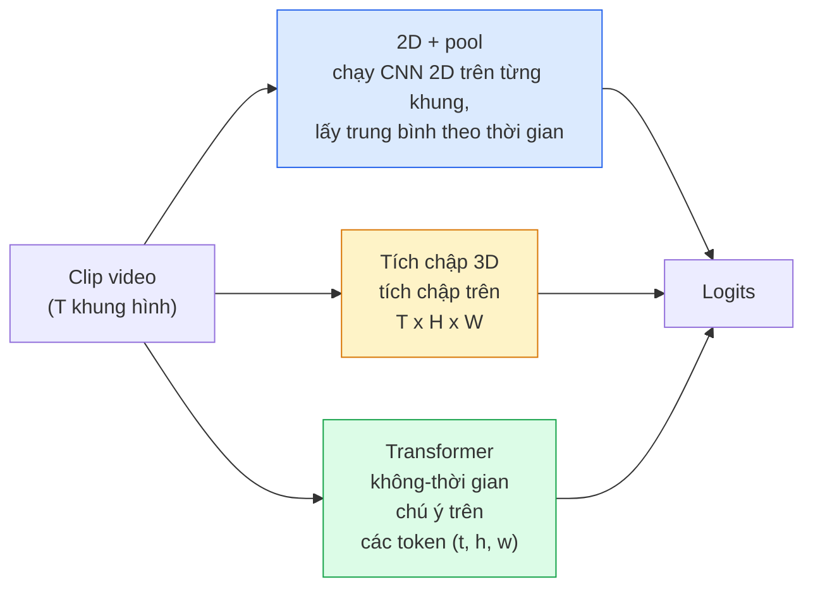

# Video understanding (hiểu video) — Temporal modeling (mô hình hóa theo thời gian)

> Một video là một chuỗi ảnh cộng với phần vật lý kết nối chúng. Mọi mô hình video đều xử lý thời gian theo một trong ba hướng: coi thời gian là một trục phụ (tích chập 3D), coi đó là một chuỗi để chú ý lên (transformer), hoặc trích xuất đặc trưng một lần rồi gộp (2D+pool).

**Type:** Learn + Build
**Languages:** Python
**Prerequisites:** Giai đoạn 4, Bài 03 (CNN), Bài 04 (Phân loại ảnh)
**Time:** ~45 phút

## Mục tiêu học tập

- Phân biệt ba họ mô hình video chính (2D+pool, tích chập 3D, transformer không-thời gian) và dự đoán đánh đổi giữa chi phí và độ chính xác của chúng
- Triển khai frame sampling (lấy mẫu khung), temporal pooling (gộp theo thời gian) và một bộ phân loại baseline 2D+pool trong PyTorch
- Giải thích vì sao các kernel 3D "inflated" của I3D chuyển giao tốt từ trọng số ImageNet và tích chập factorised (2+1)D làm khác điều gì
- Đọc hiểu các bộ dữ liệu và độ đo action recognition (nhận dạng hành động) tiêu chuẩn: Kinetics-400/600, UCF101, Something-Something V2; độ chính xác top-1 ở cấp clip (đoạn video) và cấp video

## Vấn đề

Một video 30 giây ở 30 fps là 900 ảnh. Nói một cách ngây thơ, phân loại video chính là phân loại ảnh chạy 900 lần rồi gộp kết quả theo một cách nào đó. Cách này hiệu quả khi hành động hiện rõ ở gần như mọi khung hình (thể thao, nấu ăn, video tập thể dục) và thất bại thảm hại khi hành động được định nghĩa bởi chính chuyển động: "đẩy một vật từ trái sang phải" trông như hai vật đứng yên trong từng khung hình đơn lẻ.

Câu hỏi cốt lõi của mọi kiến trúc video là: cấu trúc thời gian được mô hình hóa khi nào, và bằng cách nào? Câu trả lời chi phối mọi thứ còn lại — chi phí tính toán, chiến lược pretraining, liệu bạn có tái dùng được trọng số ImageNet hay không, và mô hình được huấn luyện trên những bộ dữ liệu nào.

Bài này cố tình ngắn hơn các bài về ảnh tĩnh. Phần máy móc cốt lõi cho ảnh đã có sẵn, và video understanding chủ yếu là câu chuyện về thời gian: lấy mẫu, mô hình hóa và gộp.

## Khái niệm

### Ba họ kiến trúc



### 2D + pool

Lấy một CNN 2D (ResNet, EfficientNet, ViT). Chạy nó độc lập trên từng khung đã lấy mẫu. Lấy trung bình (hoặc max-pool, hoặc attention-pool) các embedding theo từng khung. Đưa vector đã gộp vào bộ phân loại.

Ưu điểm:
- Pretraining trên ImageNet chuyển giao trực tiếp.
- Dễ triển khai nhất.
- Rẻ: T khung * chi phí suy luận một ảnh.

Nhược điểm:
- Không mô hình hóa được chuyển động. Hành động = tổng hợp của các lần xuất hiện.
- Temporal pooling bất biến với thứ tự; "mở cửa" và "đóng cửa" trông giống nhau.

Khi nào dùng: các bài toán nặng về diện mạo, transfer learning trên bộ dữ liệu video nhỏ, các baseline ban đầu.

### Tích chập 3D

Thay kernel 2D (H, W) bằng kernel 3D (T, H, W). Mạng tích chập trên cả không gian lẫn thời gian. Các họ đời đầu: C3D, I3D, SlowFast.

Mẹo của I3D: lấy một mô hình 2D pretrained trên ImageNet, "inflate" mỗi kernel 2D bằng cách sao chép nó dọc theo một trục thời gian mới. Một conv 2D 3x3 trở thành conv 3D 3x3x3. Nhờ vậy mô hình 3D có trọng số pretrained mạnh thay vì huấn luyện từ đầu.

Ưu điểm:
- Mô hình hóa trực tiếp chuyển động.
- Inflation của I3D cho transfer learning miễn phí.

Nhược điểm:
- Tốn thêm T/8 FLOPs so với bản 2D tương ứng (với kernel thời gian 3 chồng 3 lần).
- Kernel thời gian nhỏ; chuyển động tầm xa cần cách tiếp cận pyramid hoặc hai luồng.

Khi nào dùng: action recognition khi chuyển động chính là tín hiệu (Something-Something V2, Kinetics với các lớp nặng chuyển động).

### Transformer không-thời gian

Token hóa video thành một lưới các patch không-thời gian rồi chú ý trên toàn bộ chúng. TimeSformer, ViViT, Video Swin, VideoMAE.

Các kiểu chú ý quan trọng:
- **Joint** — một phép chú ý lớn trên (t, h, w). Bậc hai theo `T*H*W`; đắt.
- **Divided** — hai phép chú ý mỗi block: một trên thời gian, một trên không gian. Mức tăng gần tuyến tính.
- **Factorised** — chú ý thời gian xen kẽ với chú ý không gian giữa các block.

Ưu điểm:
- Độ chính xác SOTA trên mọi benchmark lớn.
- Chuyển giao từ transformer ảnh (ViT) nhờ patch inflation.
- Hỗ trợ video ngữ cảnh dài nhờ sparse attention.

Nhược điểm:
- Ngốn tính toán.
- Cần chọn kiểu chú ý cẩn thận, nếu không thời gian chạy sẽ phình to.

Khi nào dùng: bộ dữ liệu lớn, hiểu video độ trung thực cao, bài toán đa phương thức video+văn bản.

### Lấy mẫu khung

Một clip 10 giây ở 30 fps là 300 khung; đưa cả 300 khung vào bất kỳ mô hình nào cũng là lãng phí. Các chiến lược tiêu chuẩn:

- **Uniform sampling** — chọn T khung rải đều trên clip. Mặc định cho 2D+pool.
- **Dense sampling** — cửa sổ T khung liên tiếp ngẫu nhiên. Phổ biến với tích chập 3D vì chuyển động cần các khung lân cận.
- **Multi-clip** — lấy nhiều cửa sổ T khung từ cùng một video, phân loại từng cửa sổ, lấy trung bình dự đoán khi test.

T thường là 8, 16, 32 hoặc 64. T cao hơn = nhiều tín hiệu thời gian hơn với chi phí tính toán cao hơn.

### Đánh giá

Hai cấp độ:
- **Độ chính xác cấp clip** — mô hình thấy một clip T khung, báo cáo top-k.
- **Độ chính xác cấp video** — lấy trung bình dự đoán cấp clip trên nhiều clip mỗi video; cao hơn và ổn định hơn.

Luôn báo cáo cả hai. Một mô hình đạt 78% clip / 82% video là đang dựa nhiều vào việc lấy trung bình lúc test; một mô hình đạt 80% / 81% thì bền vững hơn trên từng clip.

### Những bộ dữ liệu bạn sẽ gặp

- **Kinetics-400 / 600 / 700** — bộ dữ liệu hành động đa dụng. 400k clip; URL YouTube (nhiều link nay đã chết).
- **Something-Something V2** — hành động được định nghĩa bằng chuyển động ("di chuyển X từ trái sang phải"). Không thể giải bằng 2D+pool.
- **UCF-101**, **HMDB-51** — cũ hơn, nhỏ hơn, vẫn được báo cáo.
- **AVA** — *định vị* hành động trong không gian và thời gian; khó hơn phân loại.

```figure
v4-video-temporal
```

## Tự tay làm

### Bước 1: Bộ lấy mẫu khung

Bộ lấy mẫu uniform và dense làm việc trên một danh sách khung (hoặc một tensor video).

```python
import numpy as np

def sample_uniform(num_frames_total, T):
    if num_frames_total <= T:
        return list(range(num_frames_total)) + [num_frames_total - 1] * (T - num_frames_total)
    step = num_frames_total / T
    return [int(i * step) for i in range(T)]


def sample_dense(num_frames_total, T, rng=None):
    rng = rng or np.random.default_rng()
    if num_frames_total <= T:
        return list(range(num_frames_total)) + [num_frames_total - 1] * (T - num_frames_total)
    start = int(rng.integers(0, num_frames_total - T + 1))
    return list(range(start, start + T))
```

Cả hai trả về T chỉ số để bạn dùng cắt tensor video.

### Bước 2: Một baseline 2D+pool

Chạy một ResNet-18 2D trên mọi khung, average-pool đặc trưng, rồi phân loại.

```python
import torch
import torch.nn as nn
from torchvision.models import resnet18, ResNet18_Weights

class FramePool(nn.Module):
    def __init__(self, num_classes=400, pretrained=True):
        super().__init__()
        weights = ResNet18_Weights.IMAGENET1K_V1 if pretrained else None
        backbone = resnet18(weights=weights)
        self.features = nn.Sequential(*(list(backbone.children())[:-1]))  # global avg pool kept
        self.head = nn.Linear(512, num_classes)

    def forward(self, x):
        # x: (N, T, 3, H, W)
        N, T = x.shape[:2]
        x = x.view(N * T, *x.shape[2:])
        feats = self.features(x).view(N, T, -1)
        pooled = feats.mean(dim=1)
        return self.head(pooled)

model = FramePool(num_classes=10)
x = torch.randn(2, 8, 3, 224, 224)
print(f"output: {model(x).shape}")
print(f"params: {sum(p.numel() for p in model.parameters()):,}")
```

Mười một triệu tham số, pretrained trên ImageNet, chạy theo từng khung, lấy trung bình, phân loại. Baseline này thường chỉ kém các mô hình 3D đúng nghĩa 5-10 điểm trên những bài toán nặng về diện mạo — đôi khi còn tốt hơn, vì nó tái dùng một backbone ImageNet mạnh hơn.

### Bước 3: Một tích chập 3D kiểu inflated của I3D

Biến một conv 2D đơn lẻ thành conv 3D bằng cách lặp trọng số dọc theo một trục thời gian mới.

```python
def inflate_2d_to_3d(conv2d, time_kernel=3):
    out_c, in_c, kh, kw = conv2d.weight.shape
    weight_3d = conv2d.weight.data.unsqueeze(2)  # (out, in, 1, kh, kw)
    weight_3d = weight_3d.repeat(1, 1, time_kernel, 1, 1) / time_kernel
    conv3d = nn.Conv3d(in_c, out_c, kernel_size=(time_kernel, kh, kw),
                        padding=(time_kernel // 2, conv2d.padding[0], conv2d.padding[1]),
                        stride=(1, conv2d.stride[0], conv2d.stride[1]),
                        bias=False)
    conv3d.weight.data = weight_3d
    return conv3d

conv2d = nn.Conv2d(3, 64, kernel_size=3, padding=1, bias=False)
conv3d = inflate_2d_to_3d(conv2d, time_kernel=3)
print(f"2D weight shape:  {tuple(conv2d.weight.shape)}")
print(f"3D weight shape:  {tuple(conv3d.weight.shape)}")
x = torch.randn(1, 3, 8, 56, 56)
print(f"3D output shape:  {tuple(conv3d(x).shape)}")
```

Phép chia cho `time_kernel` giữ độ lớn activation gần như không đổi — quan trọng để không làm hỏng thống kê batch-norm ngay lượt chạy đầu.

### Bước 4: Tích chập factorised (2+1)D

Tách một conv 3D thành một conv 2D (không gian) và một conv 1D (thời gian). Cùng trường tiếp nhận, ít tham số hơn, độ chính xác tốt hơn trên một số benchmark.

```python
class Conv2Plus1D(nn.Module):
    def __init__(self, in_c, out_c, kernel_size=3):
        super().__init__()
        mid_c = (in_c * out_c * kernel_size * kernel_size * kernel_size) \
                // (in_c * kernel_size * kernel_size + out_c * kernel_size)
        self.spatial = nn.Conv3d(in_c, mid_c, kernel_size=(1, kernel_size, kernel_size),
                                 padding=(0, kernel_size // 2, kernel_size // 2), bias=False)
        self.bn = nn.BatchNorm3d(mid_c)
        self.act = nn.ReLU(inplace=True)
        self.temporal = nn.Conv3d(mid_c, out_c, kernel_size=(kernel_size, 1, 1),
                                  padding=(kernel_size // 2, 0, 0), bias=False)

    def forward(self, x):
        return self.temporal(self.act(self.bn(self.spatial(x))))

c = Conv2Plus1D(3, 64)
x = torch.randn(1, 3, 8, 56, 56)
print(f"(2+1)D output: {tuple(c(x).shape)}")
```

Một mạng R(2+1)D đầy đủ giống hệt ResNet-18 với mọi conv 3x3 được thay bằng `Conv2Plus1D`.

## Áp dụng

Hai thư viện bao phủ công việc video trong thực tế:

- `torchvision.models.video` — R(2+1)D, MViT, Swin3D với trọng số Kinetics pretrained. Cùng API như các mô hình ảnh.
- `pytorchvideo` (Meta) — model zoo, data loader cho Kinetics / SSv2 / AVA, các transform tiêu chuẩn.

Với các mô hình video Vision-Language (video captioning, video QA), dùng `transformers` (`VideoMAE`, `VideoLLaMA`, `InternVideo`).

## Đóng gói

Bài này tạo ra:

- `outputs/prompt-video-architecture-picker.md` — một prompt chọn 2D+pool / I3D / (2+1)D / transformer dựa trên diện mạo-so-với-chuyển động, kích thước bộ dữ liệu và ngân sách tính toán.
- `outputs/skill-frame-sampler-auditor.md` — một skill kiểm tra bộ lấy mẫu của pipeline video và gắn cờ các lỗi thường gặp: lệch chỉ số một đơn vị, lấy mẫu không đều khi `num_frames < T`, thiếu crop giữ tỉ lệ khung hình, v.v.

## Bài tập

1. **(Dễ)** Tính (xấp xỉ) FLOPs cho FramePool với T=8 so với một ResNet 3D kiểu I3D với T=8. Giải thích vì sao 2D+pool rẻ hơn 3-5 lần.
2. **(Trung bình)** Sinh một bộ dữ liệu video tổng hợp: các quả bóng ngẫu nhiên di chuyển theo hướng ngẫu nhiên, gán nhãn theo hướng chuyển động ("trái-sang-phải", "phải-sang-trái", "chéo-lên"). Huấn luyện FramePool trên đó. Chứng minh nó chỉ đạt độ chính xác gần mức đoán ngẫu nhiên, cho thấy chỉ riêng diện mạo là không đủ cho các bài toán chuyển động.
3. **(Khó)** Xây R(2+1)D-18 bằng cách thay mọi Conv2d trong ResNet-18 bằng `Conv2Plus1D`. Inflate trọng số của conv đầu tiên từ một ResNet-18 pretrained trên ImageNet. Huấn luyện trên bộ dữ liệu chuyển động ở bài tập 2 và vượt qua FramePool.

## Thuật ngữ chính

| Thuật ngữ | Người ta thường nói | Ý nghĩa thực sự |
|------|----------------|----------------------|
| 2D + pool | "Bộ phân loại theo từng khung" | Chạy CNN 2D trên mọi khung đã lấy mẫu, average-pool đặc trưng theo thời gian, rồi phân loại |
| 3D convolution | "Kernel không-thời gian" | Kernel tích chập trên (T, H, W); có thể mô hình hóa chuyển động một cách tự nhiên |
| Inflation | "Nâng trọng số 2D lên 3D" | Khởi tạo trọng số conv 3D bằng cách lặp trọng số của conv 2D dọc theo trục thời gian mới, rồi chia cho kernel_T để giữ nguyên độ lớn activation |
| (2+1)D | "Conv factorised" | Tách 3D thành 2D không gian + 1D thời gian; ít tham số hơn, thêm một phép phi tuyến ở giữa |
| Divided attention | "Thời gian rồi không gian" | Block transformer với hai phép chú ý mỗi lớp: một trên các token ở cùng khung, một trên các token ở cùng vị trí |
| Clip | "Cửa sổ T khung" | Một dãy con T khung đã lấy mẫu; đơn vị mà mô hình video tiêu thụ |
| Clip vs video accuracy | "Hai thiết lập đánh giá" | Clip = một mẫu mỗi video, video = trung bình trên nhiều clip đã lấy mẫu |
| Kinetics | "ImageNet của video" | 400-700 lớp hành động, hơn 300k clip YouTube, kho dữ liệu pretraining video tiêu chuẩn |

## Đọc thêm

- [I3D: Quo Vadis, Action Recognition (Carreira & Zisserman, 2017)](https://arxiv.org/abs/1705.07750) — giới thiệu inflation và bộ dữ liệu Kinetics
- [R(2+1)D: A Closer Look at Spatiotemporal Convolutions (Tran et al., 2018)](https://arxiv.org/abs/1711.11248) — conv factorised, vẫn là một baseline mạnh
- [TimeSformer: Is Space-Time Attention All You Need? (Bertasius et al., 2021)](https://arxiv.org/abs/2102.05095) — transformer video mạnh đầu tiên
- [VideoMAE (Tong et al., 2022)](https://arxiv.org/abs/2203.12602) — pretraining masked autoencoder cho video; công thức pretraining thống trị hiện nay

---

[← Bài trước: Stable Diffusion](../../11-stable-diffusion/docs/vi.md) · [Bài sau: Thị giác 3D →](../../13-3d-vision-nerf/docs/vi.md)
