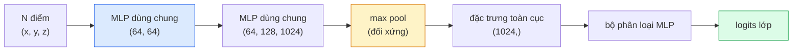

# Thị giác 3D — Point Cloud & NeRF

> Thị giác 3D có hai hướng. Point cloud là đầu ra thô của cảm biến. NeRF là trường thể tích học được. Cả hai đều trả lời câu hỏi "cái gì ở đâu trong không gian".

**Type:** Learn + Build
**Languages:** Python
**Prerequisites:** Giai đoạn 4, Bài 03 (CNN), Giai đoạn 1, Bài 12 (Phép toán tensor)
**Time:** ~45 phút

## Mục tiêu học tập

- Phân biệt biểu diễn 3D tường minh (point cloud, mesh, voxel) và ẩn (signed distance field, NeRF) cùng lúc nào dùng cái nào
- Hiểu mẹo hàm đối xứng của PointNet khiến mạng nơ-ron bất biến với hoán vị trên một tập điểm không thứ tự
- Lần theo một lượt lan truyền xuôi của NeRF: bắn tia, kết xuất thể tích, mã hoá vị trí, đầu ra mật độ + màu của MLP
- Dùng `nerfstudio` hoặc `instant-ngp` để tái dựng 3D với mô hình đã huấn luyện sẵn từ một tập nhỏ ảnh đã có tư thế camera (camera pose)

## Vấn đề

Một camera tạo ra ảnh 2D. Một LIDAR tạo ra tập điểm 3D không có thứ tự. Một pipeline structure-from-motion tạo ra đám điểm thưa các keypoint 3D. Một NeRF tái dựng cả một cảnh 3D từ vài ảnh đã biết tư thế. Tất cả đều là "thị giác" nhưng không cái nào trông giống tensor đặc mà CNN muốn.

Thị giác 3D quan trọng vì gần như mọi tác vụ robot giá trị cao đều chạy trong 3D: gắp vật, tránh vật cản, điều hướng, che khuất trong AR, thu nạp nội dung 3D. Một kỹ sư thị giác chỉ hiểu ảnh 2D sẽ bị khoá ngoài phần đang lớn nhanh nhất của lĩnh vực (nội dung AR/VR, robot, stack xe tự lái, tái dựng 3D bằng NeRF cho bất động sản hoặc xây dựng).

Hai biểu diễn chiếm ưu thế vì những lý do khác nhau. Point cloud là thứ cảm biến cho bạn miễn phí. NeRF và các hậu duệ (3D Gaussian splatting, neural SDF) là thứ bạn có khi bảo một mạng nơ-ron học một cảnh.

## Khái niệm

### Point cloud

Point cloud là một tập không thứ tự gồm N điểm trong R^3, tuỳ chọn mỗi điểm kèm đặc trưng (màu, cường độ, pháp tuyến).

```
cloud = [
  (x1, y1, z1, r1, g1, b1),
  (x2, y2, z2, r2, g2, b2),
  ...
  (xN, yN, zN, rN, gN, bN),
]
```

Không lưới, không liên kết. Hai tính chất khiến việc này khó với mạng nơ-ron:

- **Bất biến hoán vị** — đầu ra không được phụ thuộc thứ tự điểm.
- **N biến đổi** — một mô hình phải xử lý được các đám điểm kích thước khác nhau.

PointNet (Qi et al., 2017) giải quyết cả hai bằng một ý tưởng: áp một MLP dùng chung lên từng điểm, rồi gộp bằng một hàm đối xứng (max pool). Kết quả là một vector kích thước cố định không phụ thuộc thứ tự.

```
f(P) = max_{p in P} MLP(p)
```

Đây chính là toàn bộ phần lõi của PointNet. Các biến thể sâu hơn (PointNet++, Point Transformer) thêm lấy mẫu phân cấp và gộp cục bộ nhưng mẹo hàm đối xứng vẫn không đổi.

### Kiến trúc PointNet



"MLP dùng chung" nghĩa là cùng một MLP chạy trên từng điểm một cách độc lập. Cài đặt dưới dạng conv 1x1 trên chiều điểm cho hiệu quả.

### Trường bức xạ nơ-ron (NeRF)

NeRF (Mildenhall et al., 2020) nhận câu hỏi "ta có thể tái dựng một cảnh 3D từ N bức ảnh không?" và trả lời bằng một mạng nơ-ron chính là cảnh đó. Mạng ánh xạ `(x, y, z, viewing_direction)` thành `(density, colour)`. Kết xuất một góc nhìn mới là một vòng lặp đi tia (ray marching) trên mạng này.

```
NeRF MLP:  (x, y, z, theta, phi) -> (sigma, r, g, b)

To render a pixel (u, v) of a new view:
  1. Cast a ray from the camera through pixel (u, v)
  2. Sample points along the ray at distances t_1, t_2, ..., t_N
  3. Query the MLP at each point
  4. Composite the colours weighted by (1 - exp(-sigma * dt))
  5. The sum is the rendered pixel colour
```

Một hàm mất mát so pixel đã kết xuất với pixel chuẩn trong ảnh huấn luyện. Lan truyền ngược qua bước kết xuất sẽ cập nhật MLP. Không có dữ liệu chuẩn 3D, không có hình học tường minh — cảnh được lưu trong trọng số MLP.

### Mã hoá vị trí (positional encoding) trong NeRF

Một MLP thuần trên `(x, y, z)` không thể biểu diễn chi tiết tần số cao vì MLP bị thiên lệch phổ về phía tần số thấp. NeRF sửa điều này bằng cách mã hoá từng toạ độ thành một vector đặc trưng Fourier trước khi đưa vào MLP:

```
gamma(p) = (sin(2^0 pi p), cos(2^0 pi p), sin(2^1 pi p), cos(2^1 pi p), ...)
```

Tối đa L=10 mức tần số. Đây đúng là mẹo mà transformer dùng cho vị trí, và nó xuất hiện lại trong điều kiện thời gian của diffusion (Bài 10). Không có nó, NeRF trông mờ nhoè.

### Kết xuất thể tích (volumetric rendering)

```
C(r) = sum_i T_i * (1 - exp(-sigma_i * delta_i)) * c_i

T_i  = exp(- sum_{j<i} sigma_j * delta_j)
delta_i = t_{i+1} - t_i
```

`T_i` là độ truyền qua — bao nhiêu ánh sáng còn sống tới điểm i. `(1 - exp(-sigma_i * delta_i))` là độ đục tại điểm i. `c_i` là màu. Pixel cuối cùng là tổng có trọng số dọc theo tia.

### Cái gì đã thay thế NeRF

NeRF thuần huấn luyện chậm (hàng giờ) và kết xuất chậm (vài giây mỗi ảnh). Dòng phát triển từ đó:

- **Instant-NGP** (2022) — mã hoá hash-grid thay cho đầu vào vị trí của MLP; huấn luyện trong vài giây.
- **Mip-NeRF 360** — xử lý cảnh không giới hạn và khử răng cưa.
- **3D Gaussian Splatting** (2023) — thay trường thể tích bằng hàng triệu Gaussian 3D; huấn luyện trong vài phút, kết xuất thời gian thực. Mặc định của sản xuất hiện nay.

Gần như mọi sản phẩm NeRF thật sự vào năm 2026 đều thực chất là 3D Gaussian splatting. Mô hình tư duy thì vẫn là NeRF.

### Bộ dữ liệu và benchmark

- **ShapeNet** — phân loại và phân đoạn mô hình CAD 3D dưới dạng point cloud.
- **ScanNet** — bản quét trong nhà thật để phân đoạn.
- **KITTI** — point cloud LIDAR ngoài trời cho xe tự lái.
- **NeRF Synthetic** / **Blended MVS** — bộ dữ liệu ảnh có tư thế cho tổng hợp góc nhìn (view synthesis).
- Bộ dữ liệu **Mip-NeRF 360** — cảnh thật không giới hạn.

```figure
nerf-rays
```

## Tự tay làm

### Bước 1: Bộ phân loại PointNet

```python
import torch
import torch.nn as nn

class PointNet(nn.Module):
    def __init__(self, num_classes=10):
        super().__init__()
        self.mlp1 = nn.Sequential(
            nn.Conv1d(3, 64, 1),    nn.BatchNorm1d(64),   nn.ReLU(inplace=True),
            nn.Conv1d(64, 64, 1),   nn.BatchNorm1d(64),   nn.ReLU(inplace=True),
        )
        self.mlp2 = nn.Sequential(
            nn.Conv1d(64, 128, 1),  nn.BatchNorm1d(128),  nn.ReLU(inplace=True),
            nn.Conv1d(128, 1024, 1), nn.BatchNorm1d(1024), nn.ReLU(inplace=True),
        )
        self.head = nn.Sequential(
            nn.Linear(1024, 512),   nn.BatchNorm1d(512),  nn.ReLU(inplace=True),
            nn.Dropout(0.3),
            nn.Linear(512, 256),    nn.BatchNorm1d(256),  nn.ReLU(inplace=True),
            nn.Dropout(0.3),
            nn.Linear(256, num_classes),
        )

    def forward(self, x):
        # x: (N, 3, num_points) — transposed for Conv1d
        x = self.mlp1(x)
        x = self.mlp2(x)
        x = torch.max(x, dim=-1)[0]       # (N, 1024)
        return self.head(x)

pts = torch.randn(4, 3, 1024)
net = PointNet(num_classes=10)
print(f"output: {net(pts).shape}")
print(f"params: {sum(p.numel() for p in net.parameters()):,}")
```

Khoảng 1.6M tham số. Chạy trên 1.024 điểm mỗi đám.

### Bước 2: Mã hoá vị trí

```python
def positional_encoding(x, L=10):
    """
    x: (..., D) -> (..., D * 2 * L)
    """
    freqs = 2.0 ** torch.arange(L, dtype=x.dtype, device=x.device)
    args = x.unsqueeze(-1) * freqs * 3.141592653589793
    sinc = torch.cat([args.sin(), args.cos()], dim=-1)
    return sinc.reshape(*x.shape[:-1], -1)

x = torch.randn(5, 3)
y = positional_encoding(x, L=10)
print(f"input:  {x.shape}")
print(f"encoded: {y.shape}     # (5, 60)")
```

Nhân với `2^l * pi` cho ra tần số cao dần.

### Bước 3: MLP NeRF tí hon

```python
class TinyNeRF(nn.Module):
    def __init__(self, L_pos=10, L_dir=4, hidden=128):
        super().__init__()
        self.L_pos = L_pos
        self.L_dir = L_dir
        pos_dim = 3 * 2 * L_pos
        dir_dim = 3 * 2 * L_dir
        self.trunk = nn.Sequential(
            nn.Linear(pos_dim, hidden), nn.ReLU(inplace=True),
            nn.Linear(hidden, hidden),  nn.ReLU(inplace=True),
            nn.Linear(hidden, hidden),  nn.ReLU(inplace=True),
            nn.Linear(hidden, hidden),  nn.ReLU(inplace=True),
        )
        self.sigma = nn.Linear(hidden, 1)
        self.color = nn.Sequential(
            nn.Linear(hidden + dir_dim, hidden // 2), nn.ReLU(inplace=True),
            nn.Linear(hidden // 2, 3), nn.Sigmoid(),
        )

    def forward(self, x, d):
        x_enc = positional_encoding(x, self.L_pos)
        d_enc = positional_encoding(d, self.L_dir)
        h = self.trunk(x_enc)
        sigma = torch.relu(self.sigma(h)).squeeze(-1)
        rgb = self.color(torch.cat([h, d_enc], dim=-1))
        return sigma, rgb

nerf = TinyNeRF()
x = torch.randn(128, 3)
d = torch.randn(128, 3)
s, c = nerf(x, d)
print(f"sigma: {s.shape}   rgb: {c.shape}")
```

Tí hon so với NeRF gốc (bản gốc có 2 nhánh MLP độ sâu 8, tức lấy mẫu thô đến mịn (coarse-to-fine)). Đủ để minh hoạ kiến trúc.

### Bước 4: Kết xuất thể tích dọc theo một tia

```python
def volumetric_render(sigma, rgb, t_vals):
    """
    sigma: (..., N_samples)
    rgb:   (..., N_samples, 3)
    t_vals: (N_samples,) distances along the ray
    """
    delta = torch.cat([t_vals[1:] - t_vals[:-1], torch.full_like(t_vals[:1], 1e10)])
    alpha = 1.0 - torch.exp(-sigma * delta)
    trans = torch.cumprod(torch.cat([torch.ones_like(alpha[..., :1]), 1.0 - alpha + 1e-10], dim=-1), dim=-1)[..., :-1]
    weights = alpha * trans
    rendered = (weights.unsqueeze(-1) * rgb).sum(dim=-2)
    depth = (weights * t_vals).sum(dim=-1)
    return rendered, depth, weights


N = 64
t_vals = torch.linspace(2.0, 6.0, N)
sigma = torch.rand(N) * 0.5
rgb = torch.rand(N, 3)
rendered, depth, weights = volumetric_render(sigma, rgb, t_vals)
print(f"rendered colour: {rendered.tolist()}")
print(f"depth:           {depth.item():.2f}")
```

Một tia, 64 mẫu, gộp thành một pixel RGB và một giá trị độ sâu.

## Áp dụng

Cho công việc thật:

- `nerfstudio` (Tancik et al.) — thư viện tham chiếu hiện nay cho NeRF / Instant-NGP / Gaussian Splatting. Dòng lệnh cộng thêm trình xem trên web.
- `pytorch3d` (Meta) — kết xuất khả vi, tiện ích point cloud, thao tác mesh.
- `open3d` — xử lý point cloud, đăng ký, trực quan hoá.

Khi triển khai, 3D Gaussian splatting phần lớn đã thay NeRF thuần vì kết xuất nhanh hơn 100 lần. Chất lượng tái dựng tương đương.

## Đóng gói

Bài học này tạo ra:

- `outputs/prompt-3d-task-router.md` — một prompt định tuyến tới biểu diễn 3D đúng (point cloud, mesh, voxel, NeRF, Gaussian splat) dựa trên tác vụ và dữ liệu đầu vào.
- `outputs/skill-point-cloud-loader.md` — một skill viết `Dataset` PyTorch cho các file .ply / .pcd / .xyz với chuẩn hoá, căn giữa và lấy mẫu điểm đúng cách.

## Bài tập

1. **(Dễ)** Chứng minh PointNet bất biến với hoán vị: cho cùng một đám điểm qua mạng hai lần, một lần với các điểm bị xáo trộn. Kiểm tra đầu ra giống hệt nhau, chỉ sai khác do nhiễu số thực.
2. **(Trung bình)** Cài đặt một hàm sinh tia tối thiểu, nhận thông số nội tại và tư thế camera, tạo ra gốc tia và hướng tia cho mọi pixel của ảnh H x W.
3. **(Khó)** Huấn luyện một TinyNeRF trên bộ dữ liệu tổng hợp gồm các góc nhìn đã kết xuất của một khối lập phương có màu (sinh bằng kết xuất khả vi hoặc một ray tracer đơn giản). Báo cáo mất mát kết xuất ở epoch 1, 10 và 100. Đến epoch nào thì mô hình cho ra các góc nhìn nhận ra được?

## Thuật ngữ chính

| Thuật ngữ | Người ta thường nói | Ý nghĩa thực sự |
|------|----------------|----------------------|
| Point cloud | "Điểm 3D từ LIDAR" | Tập không thứ tự các (x, y, z) + đặc trưng tuỳ chọn cho mỗi điểm |
| PointNet | "Mạng nơ-ron đầu tiên trên point cloud" | MLP dùng chung cho từng điểm + gộp đối xứng (max); bất biến hoán vị ngay từ thiết kế |
| NeRF | "MLP chính là cảnh" | Mạng ánh xạ (x, y, z, dir) thành (mật độ, màu); kết xuất bằng bắn tia |
| Positional encoding | "Đặc trưng Fourier" | Mã hoá từng toạ độ thành sin/cos ở nhiều tần số để vượt qua thiên lệch tần số thấp của MLP |
| Volumetric rendering | "Tích phân theo tia" | Gộp các mẫu dọc theo một tia thành một pixel dùng độ truyền qua và alpha |
| Instant-NGP | "NeRF hash-grid" | Thay MLP toạ độ của NeRF bằng lưới hash đa độ phân giải; nhanh hơn 100-1000x |
| 3D Gaussian splatting | "Hàng triệu Gaussian" | Cảnh = tập các Gaussian 3D; kết xuất thời gian thực, huấn luyện trong vài phút |
| SDF | "Trường khoảng cách có dấu" | Hàm trả về khoảng cách có dấu tới bề mặt gần nhất; một biểu diễn ẩn khác |

## Đọc thêm

- [PointNet (Qi et al., 2017)](https://arxiv.org/abs/1612.00593) — bộ phân loại bất biến hoán vị
- [NeRF (Mildenhall et al., 2020)](https://arxiv.org/abs/2003.08934) — bài báo biến tái dựng 3D từ ảnh thành bài toán mạng nơ-ron
- [Instant-NGP (Müller et al., 2022)](https://arxiv.org/abs/2201.05989) — lưới hash, tăng tốc 1000x
- [3D Gaussian Splatting (Kerbl et al., 2023)](https://arxiv.org/abs/2308.04079) — kiến trúc đã thay thế NeRF trong sản xuất

---

[← Bài trước: Video understanding (hiểu video)](../../12-video-understanding/docs/vi.md) · [Bài sau: Vision Transformer (ViT) →](../../14-vision-transformers/docs/vi.md)
