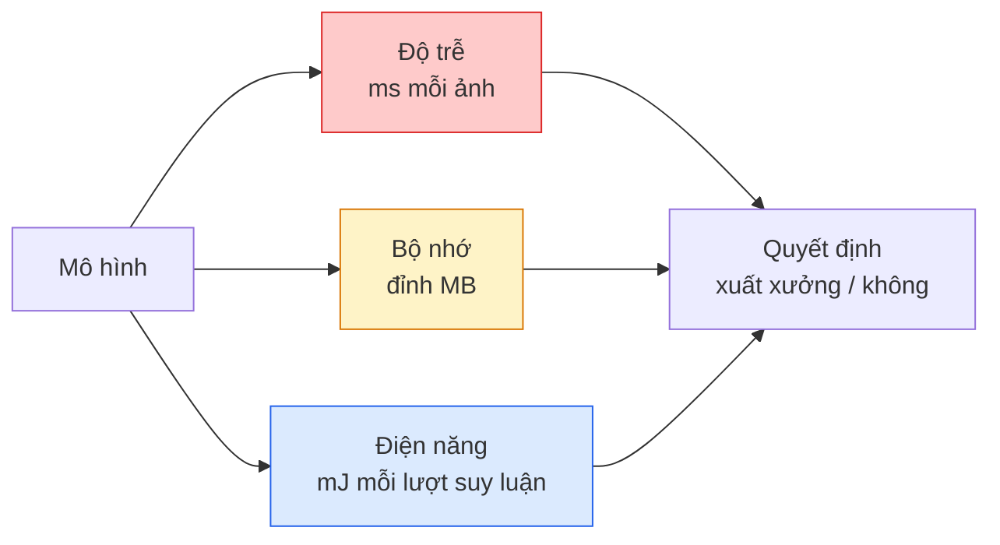

# Thị giác thời gian thực — Triển khai trên thiết bị biên

> Suy luận trên thiết bị biên (edge device) là kỷ luật đưa một mô hình đạt 90% độ chính xác chạy ở 30 fps trên một thiết bị chỉ có 2 GB RAM. Mỗi điểm phần trăm độ chính xác đều phải đánh đổi bằng mili giây độ trễ.

**Type:** Learn + Build
**Languages:** Python
**Prerequisites:** Giai đoạn 4, Bài 04 (Phân loại ảnh), Giai đoạn 10, Bài 11 (Lượng tử hoá)
**Time:** ~75 phút

## Mục tiêu học tập

- Đo độ trễ suy luận, bộ nhớ đỉnh và thông lượng cho bất kỳ mô hình PyTorch nào, rồi đọc được đánh đổi giữa FLOPs / tham số / độ trễ
- Lượng tử hoá (quantization) một mô hình thị giác xuống INT8 bằng cách lượng tử hoá sau huấn luyện của PyTorch và kiểm chứng mức mất độ chính xác < 1%
- Xuất sang ONNX và biên dịch bằng ONNX Runtime hoặc TensorRT; kể tên ba lỗi xuất mô hình phổ biến nhất và cách sửa
- Giải thích khi nào nên chọn MobileNetV3, EfficientNet-Lite, ConvNeXt-Tiny hay MobileViT cho một ràng buộc biên cụ thể

## Vấn đề

Một mô hình thị giác ở thời điểm huấn luyện là một con quái vật dấu phẩy động. 100M tham số, 10 GFLOPs mỗi lượt lan truyền xuôi, 2 GB VRAM. Không thứ nào trong đó vừa với một chiếc điện thoại, một bộ giải trí trên ô tô, một camera công nghiệp hay một drone. Đưa một hệ thống thị giác ra sản phẩm nghĩa là nhét cùng những dự đoán đó vào một ngân sách nhỏ hơn 100 lần.

Ba núm vặn làm phần lớn công việc: chọn mô hình (một kiến trúc nhỏ hơn với cùng công thức huấn luyện), lượng tử hoá (dùng INT8 thay vì FP32), và runtime suy luận (ONNX Runtime, TensorRT, Core ML, TFLite). Làm đúng ba điều này là khác biệt giữa một bản demo chạy trên máy trạm và một sản phẩm xuất xưởng trên một module camera giá 30 đô.

Bài học này dựng kỷ luật đo lường trước (bạn không thể tối ưu cái bạn không đo được), rồi đi qua ba núm vặn. Mục tiêu không phải học mọi runtime biên mà là biết những đòn bẩy nào tồn tại và cách kiểm chứng từng đòn bẩy có làm đúng như bạn tưởng hay không.

## Khái niệm

### Ba ngân sách



- **Độ trễ (latency)**: p50, p95, p99. Chỉ lấy trung bình ở p50 sẽ che mất hành vi đuôi — thứ quan trọng với hệ thống thời gian thực.
- **Bộ nhớ đỉnh**: mức lớn nhất thiết bị từng chạm tới, không phải mức trung bình ở trạng thái ổn định. Quan trọng vì lỗi OOM là chí mạng trên các nền tảng nhúng.
- **Điện năng / năng lượng**: mili jun mỗi lượt suy luận trên thiết bị chạy pin. Thường được xấp xỉ bằng mức sử dụng CPU/GPU nhân với thời gian.

Một bảng (mô hình, độ trễ, bộ nhớ, độ chính xác) là thứ mà một quyết định biên dựa vào. Mọi ô đều được đo trên thiết bị đích, không phải trên máy trạm.

### Kỷ luật đo lường

Ba quy tắc mà mọi phép đo biên nên tuân theo:

1. **Khởi động nóng** mô hình bằng 5-10 lượt lan truyền xuôi giả trước khi đo. Cache lạnh và biên dịch JIT tạo ra những con số đầu tiên không đại diện.
2. **Đồng bộ** khối lượng việc GPU bằng `torch.cuda.synchronize()` trước và sau đoạn được tính giờ. Không có bước này, bạn đang đo việc điều phối kernel chứ không phải việc thực thi kernel.
3. **Cố định kích thước đầu vào** theo độ phân giải khi chạy thật. Độ trễ ở 224x224 không phải độ trễ ở 512x512.

### FLOPs như một đại lượng thay thế

FLOPs (số phép tính dấu phẩy động mỗi lượt suy luận) là một đại lượng thay thế rẻ và không phụ thuộc thiết bị cho độ trễ. Hữu ích để so sánh kiến trúc, dễ gây nhầm khi dùng làm thời gian thực tế tuyệt đối. Một mô hình nhiều hơn 10% FLOPs có thể nhanh gấp 2 lần trên thực tế vì nó dùng các toán tử thân thiện với phần cứng (conv depthwise biên dịch tốt, conv 7x7 lớn thì không).

Quy tắc: dùng FLOPs để tìm kiếm kiến trúc, dùng độ trễ đo trên thiết bị để ra quyết định triển khai.

### Lượng tử hoá trong một đoạn văn

Thay trọng số và giá trị kích hoạt FP32 bằng INT8. Kích thước mô hình giảm 4 lần, băng thông bộ nhớ giảm 4 lần, khối lượng tính toán giảm 2-4 lần trên phần cứng có kernel INT8 (mọi SoC di động hiện đại, mọi GPU NVIDIA có Tensor Core). Mức mất độ chính xác trên bài toán thị giác thường là 0.1-1 điểm phần trăm với lượng tử hoá tĩnh sau huấn luyện.

Các kiểu:

- **Động** — lượng tử hoá trọng số xuống INT8, giá trị kích hoạt tính bằng FP. Dễ, tăng tốc ít.
- **Tĩnh (sau huấn luyện)** — lượng tử hoá trọng số và hiệu chỉnh dải giá trị kích hoạt trên một tập hiệu chỉnh nhỏ. Nhanh hơn động nhiều.
- **Huấn luyện nhận biết lượng tử hoá (QAT)** — mô phỏng lượng tử hoá trong lúc huấn luyện để mô hình học cách thích nghi. Độ chính xác tốt nhất, cần dữ liệu có nhãn.

Với thị giác, lượng tử hoá tĩnh sau huấn luyện cho 95% lợi ích với 5% công sức. Chỉ dùng QAT khi mức mất độ chính xác từ PTQ là không chấp nhận được.

### Tỉa và chưng cất tri thức

- **Tỉa (pruning)** — bỏ các trọng số không quan trọng (dựa trên độ lớn) hoặc các kênh (tỉa có cấu trúc). Hiệu quả trên các mô hình thừa tham số; ít hữu ích trên những kiến trúc vốn đã gọn.
- **Chưng cất tri thức (distillation)** — huấn luyện một học trò nhỏ bắt chước logits của một giáo viên lớn. Thường lấy lại được phần lớn độ chính xác đã mất khi thu nhỏ mô hình. Tiêu chuẩn cho các mô hình biên chạy thật.

### Các runtime suy luận

- **PyTorch eager** — chậm, không dùng để triển khai. Chỉ dùng khi phát triển.
- **TorchScript** — đã cũ. Bị `torch.compile` và xuất ONNX thay thế.
- **ONNX Runtime** — runtime trung lập. CPU, CUDA, CoreML, TensorRT, OpenVINO đều có provider ONNX. Bắt đầu từ đây.
- **TensorRT** — trình biên dịch của NVIDIA. Độ trễ tốt nhất trên GPU NVIDIA (máy trạm và Jetson). Tích hợp được với ONNX Runtime hoặc chạy độc lập.
- **Core ML** — runtime của Apple cho iOS/macOS. Cần `.mlmodel` hoặc `.mlpackage`.
- **TFLite** — runtime của Google cho Android/ARM. Cần `.tflite`.
- **OpenVINO** — runtime của Intel cho CPU/VPU. Cần `.xml` + `.bin`.

Trên thực tế: xuất PyTorch -> ONNX -> chọn runtime cho thiết bị đích. ONNX là ngôn ngữ chung.

### Bảng chọn kiến trúc biên

| Ngân sách | Mô hình | Vì sao |
|--------|-------|-----|
| < 3M tham số | MobileNetV3-Small | Biên dịch được ở mọi nơi, baseline tốt |
| 3-10M | EfficientNet-Lite-B0 | Độ chính xác trên mỗi tham số tốt nhất trên TFLite |
| 10-20M | ConvNeXt-Tiny | Độ chính xác trên mỗi tham số tốt nhất, thân thiện với CPU |
| 20-30M | MobileViT-S hoặc EfficientViT | Transformer với độ chính xác ImageNet |
| 30-80M | Swin-V2-Tiny | Nếu stack hỗ trợ window attention |

Lượng tử hoá tất cả những mô hình này xuống INT8 trừ khi bạn có lý do cụ thể để không làm vậy.

```figure
cnn-param-count
```

## Tự tay làm

### Bước 1: Đo độ trễ cho đúng

```python
import time
import torch

def measure_latency(model, input_shape, device="cpu", warmup=10, iters=50):
    model = model.to(device).eval()
    x = torch.randn(input_shape, device=device)
    with torch.no_grad():
        for _ in range(warmup):
            model(x)
        if device == "cuda":
            torch.cuda.synchronize()
        times = []
        for _ in range(iters):
            if device == "cuda":
                torch.cuda.synchronize()
            t0 = time.perf_counter()
            model(x)
            if device == "cuda":
                torch.cuda.synchronize()
            times.append((time.perf_counter() - t0) * 1000)
    times.sort()
    return {
        "p50_ms": times[len(times) // 2],
        "p95_ms": times[int(len(times) * 0.95)],
        "p99_ms": times[int(len(times) * 0.99)],
        "mean_ms": sum(times) / len(times),
    }
```

Khởi động nóng, đồng bộ, dùng `time.perf_counter()`. Báo cáo phân vị, không chỉ trung bình.

### Bước 2: Đếm tham số và FLOPs

```python
def parameter_count(model):
    return sum(p.numel() for p in model.parameters())

def flops_estimate(model, input_shape):
    """
    Rough FLOP count for a conv/linear-only model. For production use `fvcore` or `ptflops`.
    """
    total = 0
    def conv_hook(m, inp, out):
        nonlocal total
        c_out, c_in, kh, kw = m.weight.shape
        h, w = out.shape[-2:]
        total += 2 * c_in * c_out * kh * kw * h * w
    def linear_hook(m, inp, out):
        nonlocal total
        total += 2 * m.in_features * m.out_features
    hooks = []
    for m in model.modules():
        if isinstance(m, torch.nn.Conv2d):
            hooks.append(m.register_forward_hook(conv_hook))
        elif isinstance(m, torch.nn.Linear):
            hooks.append(m.register_forward_hook(linear_hook))
    model.eval()
    with torch.no_grad():
        model(torch.randn(input_shape))
    for h in hooks:
        h.remove()
    return total
```

Với dự án thật, dùng `fvcore.nn.FlopCountAnalysis` hoặc `ptflops`; chúng xử lý đúng mọi loại module.

### Bước 3: Lượng tử hoá tĩnh sau huấn luyện

```python
def quantise_ptq(model, calibration_loader, backend="x86"):
    import torch.ao.quantization as tq
    model = model.eval().cpu()
    model.qconfig = tq.get_default_qconfig(backend)
    tq.prepare(model, inplace=True)
    with torch.no_grad():
        for x, _ in calibration_loader:
            model(x)
    tq.convert(model, inplace=True)
    return model
```

Ba bước: cấu hình, chuẩn bị (chèn observer), hiệu chỉnh bằng dữ liệu thật, chuyển đổi (hợp nhất toán tử + lượng tử hoá). Yêu cầu mô hình đã được hợp nhất (`Conv -> BN -> ReLU` -> `ConvBnReLU`), việc này do `torch.ao.quantization.fuse_modules` đảm nhận.

### Bước 4: Xuất sang ONNX

```python
def export_onnx(model, sample_input, path="model.onnx"):
    model = model.eval()
    torch.onnx.export(
        model,
        sample_input,
        path,
        input_names=["input"],
        output_names=["output"],
        dynamic_axes={"input": {0: "batch"}, "output": {0: "batch"}},
        opset_version=17,
    )
    return path
```

`opset_version=17` là mặc định an toàn trong năm 2026. `dynamic_axes` cho phép bạn chạy mô hình ONNX với kích thước batch tuỳ ý.

### Bước 5: Đo chuẩn và so sánh các chế độ

```python
import torch.nn as nn
from torchvision.models import mobilenet_v3_small

def compare_regimes():
    model = mobilenet_v3_small(weights=None, num_classes=10)
    params = parameter_count(model)
    flops = flops_estimate(model, (1, 3, 224, 224))
    lat_fp32 = measure_latency(model, (1, 3, 224, 224), device="cpu")
    print(f"FP32 MobileNetV3-Small: {params:,} params  {flops/1e9:.2f} GFLOPs  "
          f"p50={lat_fp32['p50_ms']:.2f}ms  p95={lat_fp32['p95_ms']:.2f}ms")
```

Chạy cùng hàm đó cho `resnet50`, `efficientnet_v2_s` và `convnext_tiny` là bạn có bảng so sánh cần thiết cho một quyết định triển khai.

## Áp dụng

Các stack chạy thật hội tụ về một trong ba đường:

- **Web / serverless**: PyTorch -> ONNX -> ONNX Runtime (provider CPU hoặc CUDA). Dễ nhất, đủ tốt cho phần lớn trường hợp.
- **Biên NVIDIA (Jetson, máy chủ GPU)**: PyTorch -> ONNX -> TensorRT. Độ trễ tốt nhất, công sức kỹ thuật lớn nhất.
- **Di động**: PyTorch -> ONNX -> Core ML (iOS) hoặc TFLite (Android). Lượng tử hoá trước khi xuất.

Về đo lường, `torch-tb-profiler`, `nvprof` / `nsys`, và Instruments trên macOS cho bạn phân tích theo từng lớp. `benchmark_app` (OpenVINO) và `trtexec` (TensorRT) cho các con số CLI độc lập.

## Đóng gói

Bài học này tạo ra:

- `outputs/prompt-edge-deployment-planner.md` — một prompt chọn backbone, chiến lược lượng tử hoá và runtime khi biết thiết bị đích và SLA độ trễ.
- `outputs/skill-latency-profiler.md` — một skill viết ra script đo độ trễ hoàn chỉnh với khởi động nóng, đồng bộ, phân vị và theo dõi bộ nhớ.

## Bài tập

1. **(Dễ)** Đo độ trễ p50 cho `resnet18`, `mobilenet_v3_small`, `efficientnet_v2_s` và `convnext_tiny` ở 224x224 trên CPU. Báo cáo bảng và chỉ ra kiến trúc nào có độ chính xác trên mỗi ms tốt nhất.
2. **(Trung bình)** Áp dụng lượng tử hoá tĩnh sau huấn luyện cho `mobilenet_v3_small`. Báo cáo độ trễ FP32 so với INT8 và mức mất độ chính xác trên một tập con giữ lại của CIFAR-10 hoặc tương tự.
3. **(Khó)** Xuất `convnext_tiny` sang ONNX, chạy nó qua `onnxruntime` với `CPUExecutionProvider`, và so sánh độ trễ với baseline PyTorch eager. Xác định lớp đầu tiên mà ONNX Runtime nhanh hơn và giải thích vì sao.

## Thuật ngữ chính

| Thuật ngữ | Người ta thường nói | Ý nghĩa thực sự |
|------|----------------|----------------------|
| Latency | "Nhanh cỡ nào" | Thời gian từ đầu vào tới đầu ra; dùng phân vị p50/p95/p99, không dùng trung bình |
| FLOPs | "Kích thước mô hình" | Số phép tính dấu phẩy động mỗi lượt lan truyền xuôi; đại lượng thay thế thô cho chi phí tính toán |
| INT8 quantisation | "8-bit" | Thay trọng số/giá trị kích hoạt FP32 bằng số nguyên 8-bit; nhỏ hơn ~4 lần, nhanh hơn 2-4 lần |
| PTQ | "Lượng tử hoá sau huấn luyện" | Lượng tử hoá một mô hình đã huấn luyện mà không huấn luyện lại; dễ, thường là đủ |
| QAT | "Huấn luyện nhận biết lượng tử hoá" | Mô phỏng lượng tử hoá trong lúc huấn luyện; độ chính xác tốt nhất, cần dữ liệu có nhãn |
| ONNX | "Định dạng trung lập" | Định dạng trao đổi mô hình được mọi runtime suy luận phổ biến hỗ trợ |
| TensorRT | "Trình biên dịch của NVIDIA" | Biên dịch ONNX thành engine đã tối ưu cho GPU NVIDIA |
| Distillation | "Giáo viên -> học trò" | Huấn luyện một mô hình nhỏ bắt chước logits của mô hình lớn; lấy lại phần lớn độ chính xác đã mất |

## Đọc thêm

- [EfficientNet (Tan & Le, 2019)](https://arxiv.org/abs/1905.11946) — compound scaling cho các kiến trúc hiệu quả
- [MobileNetV3 (Howard et al., 2019)](https://arxiv.org/abs/1905.02244) — kiến trúc ưu tiên di động với h-swish và squeeze-excite
- [Accelerating Inference Up to 6x Faster in PyTorch with Torch-TensorRT (NVIDIA)](https://developer.nvidia.com/blog/accelerating-inference-up-to-6x-faster-in-pytorch-with-torch-tensorrt/) — cách thực sự đạt được những con số thông lượng trong bài báo
- [ONNX Runtime docs](https://onnxruntime.ai/docs/) — lượng tử hoá, tối ưu đồ thị, chọn provider

---

[← Bài trước: Vision Transformer (ViT)](../../14-vision-transformers/docs/vi.md) · [Bài sau: Xây dựng một pipeline (quy trình xử lý) thị giác hoàn chỉnh →](../../16-vision-pipeline-capstone/docs/vi.md)
