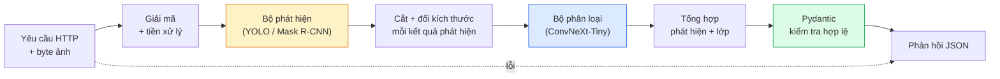

# Xây dựng một pipeline (quy trình xử lý) thị giác hoàn chỉnh — Đồ án tổng kết (capstone)

> Hệ thống thị giác chạy production là một chuỗi model và rule được khâu lại bằng data contract. Các mảnh ghép đã có sẵn trong giai đoạn này; phần đồ án tổng kết chỉ việc nối chúng lại từ đầu đến cuối.

**Type:** Build
**Languages:** Python
**Prerequisites:** Giai đoạn 4, Bài 01-15
**Time:** ~120 phút

## Mục tiêu học tập

- Thiết kế một pipeline thị giác chạy production có khả năng phát hiện vật thể, phân loại chúng và trả về JSON có cấu trúc — với mọi nhánh thất bại đều được xử lý
- Cắm vào một service duy nhất: bộ phát hiện (Mask R-CNN hoặc YOLO), bộ phân loại (ConvNeXt-Tiny) và data contract (Pydantic)
- Đo benchmark toàn pipeline từ đầu đến cuối và chỉ ra điểm nghẽn đầu tiên (thường là tiền xử lý, rồi mới đến bộ phát hiện)
- Đóng gói một service FastAPI tối giản nhận ảnh tải lên, chạy pipeline và trả về kết quả phát hiện kèm phân loại

## Vấn đề

Từng model thị giác riêng lẻ thì hữu ích; sản phẩm thị giác lại là chuỗi của chúng. Một bài kiểm kê kệ hàng bán lẻ là bộ phát hiện cộng bộ phân loại sản phẩm cộng một pipeline OCR giá. Xe tự lái là bộ phát hiện 2D cộng bộ phát hiện 3D cộng bộ phân vùng cộng bộ theo dõi cộng bộ lập kế hoạch. Sàng lọc y tế sơ bộ là bộ phân vùng cộng bộ phân loại vùng cộng giao diện cho bác sĩ.

Chính việc nối những chuỗi đó là phần phân biệt một bản thử nghiệm ML với một sản phẩm. Mỗi giao diện giữa các model là một chỗ mới cho bug. Mỗi phép biến đổi toạ độ, mỗi lần chuẩn hoá, mỗi lần đổi kích thước mask đều là ứng viên cho thất bại âm thầm. Một pipeline mạnh ngang với giao diện yếu nhất của nó.

Đồ án tổng kết này dựng lên pipeline khả dụng tối thiểu: phát hiện + phân loại + đầu ra có cấu trúc + một lớp phục vụ. Mọi thứ khác trong Giai đoạn 4 đều lắp vào bộ khung này: đổi Mask R-CNN sang YOLOv8, thêm một đầu OCR, thêm một nhánh phân vùng, thêm một bộ theo dõi. Kiến trúc ổn định; các mảnh ghép cắm ra cắm vào được.

## Khái niệm

### Pipeline



Bảy chặng. Hai chặng model thì đắt; năm chặng còn lại mới là nơi lũ bug trú ngụ.

### Data contract với Pydantic

Mỗi ranh giới model trở thành một đối tượng có kiểu. Nhờ đó thất bại âm thầm biến thành thất bại ồn ào.

```
Detection(
    box: tuple[float, float, float, float],   # (x1, y1, x2, y2), absolute pixels
    score: float,                              # [0, 1]
    class_id: int,                             # from detector's label map
    mask: Optional[list[list[int]]],           # RLE-encoded if present
)

PipelineResult(
    image_id: str,
    detections: list[Detection],
    classifications: list[Classification],
    inference_ms: float,
)
```

Khi bộ phát hiện trả box theo `(cx, cy, w, h)` thay vì `(x1, y1, x2, y2)`, bước kiểm tra hợp lệ của Pydantic sẽ hỏng ngay tại ranh giới và bạn biết ngay, thay vì phải gỡ lỗi một phép cắt ở hạ nguồn vốn âm thầm trả về vùng rỗng.

### Độ trễ đi đâu mất

Ba điều gần như luôn đúng trong mọi pipeline thị giác:

1. **Tiền xử lý thường là khối đơn lẻ lớn nhất.** Giải mã JPEG, đổi không gian màu, đổi kích thước — đều ngốn CPU và rất dễ bị bỏ qua.
2. **Bộ phát hiện chiếm phần lớn thời gian GPU.** 70-90% thời gian GPU nằm ở lượt lan truyền xuôi của phép phát hiện.
3. **Hậu xử lý (NMS, mã hoá/giải mã RLE) thì rẻ trên GPU, đắt trên CPU.** Luôn đo hiệu năng trên đúng mục tiêu thật.

Biết được phân bố này là thứ biến việc tối ưu thành một danh sách có thứ tự ưu tiên.

### Các kiểu thất bại

- **Không phát hiện được gì** — trả về danh sách rỗng, đừng để sập. Ghi log.
- **Box vượt biên** — kẹp về kích thước ảnh trước khi cắt.
- **Vùng cắt quá nhỏ** — bỏ qua phân loại với box nhỏ hơn đầu vào tối thiểu của bộ phân loại.
- **Ảnh tải lên hỏng** — trả 400 kèm mã lỗi cụ thể, không phải 500.
- **Nạp model thất bại** — hỏng ngay lúc khởi động service, không phải ở yêu cầu đầu tiên.

Một pipeline production xử lý từng trường hợp trên mà không cần viết `try/except` chung chung để che lỗi. Mỗi thất bại có một mã có tên và một phản hồi riêng.

### Gom lô

Một service production phục vụ nhiều client. Gom lô (batch inference, tức suy luận theo lô) cho phát hiện và phân loại xuyên nhiều yêu cầu sẽ nhân thông lượng (throughput) lên. Cái giá phải trả: thêm độ trễ vì phải chờ lô đầy. Cách dựng thường thấy: gom yêu cầu trong tối đa 20ms, gộp thành lô, xử lý, rồi chia phản hồi. `torchserve` và `triton` làm việc này sẵn; các service nhỏ với tải dễ đoán thì tự viết micro-batcher.

```figure
v4-vision-pipeline
```

## Tự tay làm

### Bước 1: Data contract

```python
from pydantic import BaseModel, Field
from typing import List, Optional, Tuple

class Detection(BaseModel):
    box: Tuple[float, float, float, float]
    score: float = Field(ge=0, le=1)
    class_id: int = Field(ge=0)
    mask_rle: Optional[str] = None


class Classification(BaseModel):
    detection_index: int
    class_id: int
    class_name: str
    score: float = Field(ge=0, le=1)


class PipelineResult(BaseModel):
    image_id: str
    detections: List[Detection]
    classifications: List[Classification]
    inference_ms: float
```

Năm giây viết code tiết kiệm một giờ gỡ lỗi trên bất kỳ pipeline nghiêm túc nào.

### Bước 2: Lớp Pipeline tối giản

```python
import time
import numpy as np
import torch
from PIL import Image

class VisionPipeline:
    def __init__(self, detector, classifier, class_names,
                 device="cpu", min_crop=32):
        self.detector = detector.to(device).eval()
        self.classifier = classifier.to(device).eval()
        self.class_names = class_names
        self.device = device
        self.min_crop = min_crop

    def preprocess(self, image):
        """
        image: PIL.Image or np.ndarray (H, W, 3) uint8
        returns: CHW float tensor on device
        """
        if isinstance(image, Image.Image):
            image = np.asarray(image.convert("RGB"))
        tensor = torch.from_numpy(image).permute(2, 0, 1).float() / 255.0
        return tensor.to(self.device)

    @torch.no_grad()
    def detect(self, image_tensor):
        return self.detector([image_tensor])[0]

    @torch.no_grad()
    def classify(self, crops):
        if len(crops) == 0:
            return []
        batch = torch.stack(crops).to(self.device)
        logits = self.classifier(batch)
        probs = logits.softmax(-1)
        scores, cls = probs.max(-1)
        return list(zip(cls.tolist(), scores.tolist()))

    def run(self, image, image_id="anonymous"):
        t0 = time.perf_counter()
        tensor = self.preprocess(image)
        det = self.detect(tensor)

        crops = []
        detections = []
        valid_indices = []
        for i, (box, score, cls) in enumerate(zip(det["boxes"], det["scores"], det["labels"])):
            x1, y1, x2, y2 = [max(0, int(b)) for b in box.tolist()]
            x2 = min(x2, tensor.shape[-1])
            y2 = min(y2, tensor.shape[-2])
            detections.append(Detection(
                box=(x1, y1, x2, y2),
                score=float(score),
                class_id=int(cls),
            ))
            if (x2 - x1) < self.min_crop or (y2 - y1) < self.min_crop:
                continue
            crop = tensor[:, y1:y2, x1:x2]
            crop = torch.nn.functional.interpolate(
                crop.unsqueeze(0),
                size=(224, 224),
                mode="bilinear",
                align_corners=False,
            )[0]
            crops.append(crop)
            valid_indices.append(i)

        class_preds = self.classify(crops)

        classifications = []
        for valid_idx, (cls_id, cls_score) in zip(valid_indices, class_preds):
            classifications.append(Classification(
                detection_index=valid_idx,
                class_id=int(cls_id),
                class_name=self.class_names[cls_id],
                score=float(cls_score),
            ))

        return PipelineResult(
            image_id=image_id,
            detections=detections,
            classifications=classifications,
            inference_ms=(time.perf_counter() - t0) * 1000,
        )
```

Mỗi giao diện đều có kiểu. Mỗi nhánh thất bại đều có một quyết định xử lý cụ thể.

### Bước 3: Nối bộ phát hiện với bộ phân loại

```python
from torchvision.models.detection import maskrcnn_resnet50_fpn_v2
from torchvision.models import convnext_tiny

# Use ImageNet-pretrained weights for a realistic pipeline without training
detector = maskrcnn_resnet50_fpn_v2(weights="DEFAULT")
classifier = convnext_tiny(weights="DEFAULT")
class_names = [f"imagenet_class_{i}" for i in range(1000)]

pipe = VisionPipeline(detector, classifier, class_names)

# Smoke test with a synthetic image
test_image = (np.random.rand(400, 600, 3) * 255).astype(np.uint8)
result = pipe.run(test_image, image_id="demo")
print(result.model_dump_json(indent=2)[:500])
```

### Bước 4: Service FastAPI

```python
from fastapi import FastAPI, UploadFile, HTTPException
from io import BytesIO

app = FastAPI()
pipe = None  # initialised on startup

@app.on_event("startup")
def load():
    global pipe
    detector = maskrcnn_resnet50_fpn_v2(weights="DEFAULT").eval()
    classifier = convnext_tiny(weights="DEFAULT").eval()
    pipe = VisionPipeline(detector, classifier, class_names=[f"c{i}" for i in range(1000)])

@app.post("/detect")
async def detect_endpoint(file: UploadFile):
    if file.content_type not in {"image/jpeg", "image/png", "image/webp"}:
        raise HTTPException(status_code=400, detail="unsupported image type")
    data = await file.read()
    try:
        img = Image.open(BytesIO(data)).convert("RGB")
    except Exception:
        raise HTTPException(status_code=400, detail="cannot decode image")
    result = pipe.run(img, image_id=file.filename or "upload")
    return result.model_dump()
```

Chạy bằng `uvicorn main:app --host 0.0.0.0 --port 8000`. Thử bằng `curl -F 'file=@dog.jpg' http://localhost:8000/detect`.

### Bước 5: Đo benchmark pipeline

```python
import time

def benchmark(pipe, num_runs=20, image_size=(400, 600)):
    img = (np.random.rand(*image_size, 3) * 255).astype(np.uint8)
    pipe.run(img)  # warm up

    stages = {"preprocess": [], "detect": [], "classify": [], "total": []}
    for _ in range(num_runs):
        t0 = time.perf_counter()
        tensor = pipe.preprocess(img)
        t1 = time.perf_counter()
        det = pipe.detect(tensor)
        t2 = time.perf_counter()
        crops = []
        for box in det["boxes"]:
            x1, y1, x2, y2 = [max(0, int(b)) for b in box.tolist()]
            x2 = min(x2, tensor.shape[-1])
            y2 = min(y2, tensor.shape[-2])
            if (x2 - x1) >= pipe.min_crop and (y2 - y1) >= pipe.min_crop:
                crop = tensor[:, y1:y2, x1:x2]
                crop = torch.nn.functional.interpolate(
                    crop.unsqueeze(0), size=(224, 224), mode="bilinear", align_corners=False
                )[0]
                crops.append(crop)
        pipe.classify(crops)
        t3 = time.perf_counter()
        stages["preprocess"].append((t1 - t0) * 1000)
        stages["detect"].append((t2 - t1) * 1000)
        stages["classify"].append((t3 - t2) * 1000)
        stages["total"].append((t3 - t0) * 1000)

    for stage, times in stages.items():
        times.sort()
        print(f"{stage:12s}  p50={times[len(times)//2]:7.1f} ms  p95={times[int(len(times)*0.95)]:7.1f} ms")
```

Kết quả điển hình trên CPU: tiền xử lý ~3 ms, phát hiện 300-500 ms, phân loại 20-40 ms, tổng 350-550 ms. Trên GPU, phát hiện còn 20-40 ms và tiền xử lý + phân loại bắt đầu chiếm tỉ trọng đáng kể hơn.

## Áp dụng

Các mẫu production đều hội tụ về cùng một cấu trúc, cộng thêm:

- **Đánh phiên bản model** — luôn ghi tên model và hash trọng số vào phản hồi.
- **Trace ID theo từng yêu cầu** — ghi thời gian từng chặng cho mọi yêu cầu để bạn đối chiếu được phản hồi chậm với đúng chặng.
- **Đường dự phòng** — nếu bộ phân loại quá thời gian, trả về phần phát hiện mà không kèm phân loại, thay vì làm hỏng cả yêu cầu.
- **Bộ lọc an toàn** — bộ lọc NSFW / PII chạy sau phân loại, trước khi phản hồi rời khỏi service.
- **Endpoint theo lô** — một `/detect_batch` nhận danh sách URL ảnh để xử lý hàng loạt.

Khi phục vụ production, `torchserve`, `Triton Inference Server` và `BentoML` lo sẵn việc gom lô, đánh phiên bản, số liệu đo và kiểm tra sức khoẻ. Chạy `FastAPI` trực tiếp thì ổn cho bản thử nghiệm và sản phẩm quy mô nhỏ.

## Đóng gói

Bài học này tạo ra:

- `outputs/prompt-vision-service-shape-reviewer.md` — một prompt rà soát code của service thị giác để tìm chỗ vi phạm hình dạng contract/phản hồi và chỉ ra bug gây vỡ đầu tiên.
- `outputs/skill-pipeline-budget-planner.md` — một skill nhận độ trễ và thông lượng mục tiêu, phân bổ ngân sách thời gian cho từng chặng của pipeline và đánh dấu chặng nào sẽ vượt ngân sách trước.

## Bài tập

1. **(Dễ)** Chạy pipeline trên 10 ảnh từ bất kỳ dataset mở nào. Báo cáo thời gian trung bình mỗi chặng và phân bố số kết quả phát hiện trên mỗi ảnh.
2. **(Trung bình)** Thêm một trường đầu ra mask vào `Detection` và mã hoá nó bằng RLE. Kiểm tra JSON vẫn dưới 1MB kể cả với ảnh có 10 vật thể.
3. **(Khó)** Thêm một micro-batcher trước bộ phân loại: gom các vùng cắt trong tối đa 10 ms, phân loại tất cả trong một lần gọi GPU, trả kết quả theo từng yêu cầu. Đo mức tăng thông lượng ở 5 yêu cầu đồng thời mỗi giây và độ trễ phát sinh.

## Thuật ngữ chính

| Thuật ngữ | Người ta thường nói | Ý nghĩa thực sự |
|------|----------------|----------------------|
| Pipeline | "Cả hệ thống" | Một chuỗi có thứ tự gồm các bước tiền xử lý, suy luận và hậu xử lý, với giao diện có kiểu giữa mỗi cặp bước |
| Data contract | "Cái schema" | Các định nghĩa Pydantic / dataclass mà mọi đầu vào và đầu ra của từng chặng phải tuân theo; bắt lỗi tích hợp ngay tại ranh giới |
| Preprocessing | "Trước model" | Giải mã, đổi màu, đổi kích thước, chuẩn hoá; thường là chỗ ngốn CPU nhiều nhất |
| Postprocessing | "Sau model" | NMS, đổi kích thước mask, đặt ngưỡng, mã hoá RLE; rẻ trên GPU, đắt trên CPU |
| Microbatcher | "Gom rồi đẩy" | Bộ gom chờ một cửa sổ thời gian cố định cho nhiều yêu cầu, rồi chạy một lượt lan truyền xuôi theo lô duy nhất |
| Trace ID | "Request id" | Mã định danh theo từng yêu cầu, được ghi log ở mọi chặng để có thể truy vết yêu cầu chậm từ đầu đến cuối |
| Failure code | "Lỗi có tên" | Mã lỗi riêng cho từng nhóm thất bại thay vì 500 chung chung; giúp client viết logic thử lại |
| Health check | "Readiness probe" | Endpoint rẻ tiền cho biết service có trả lời được không; loadbalancer dựa vào đó |

## Đọc thêm

- [Full Stack Deep Learning — Deploying Models](https://fullstackdeeplearning.com/course/2022/lecture-5-deployment/) — bài tổng quan chuẩn mực về triển khai ML vào production
- [BentoML docs](https://docs.bentoml.com) — framework phục vụ có gom lô, đánh phiên bản và số liệu đo
- [torchserve docs](https://pytorch.org/serve/) — thư viện phục vụ chính thức của PyTorch
- [NVIDIA Triton Inference Server](https://developer.nvidia.com/triton-inference-server) — phục vụ thông lượng cao với gom lô và hỗ trợ nhiều model

---

[← Bài trước: Thị giác thời gian thực](../../15-real-time-edge/docs/vi.md) · [Bài sau: Thị giác tự giám sát →](../../17-self-supervised-vision/docs/vi.md)
