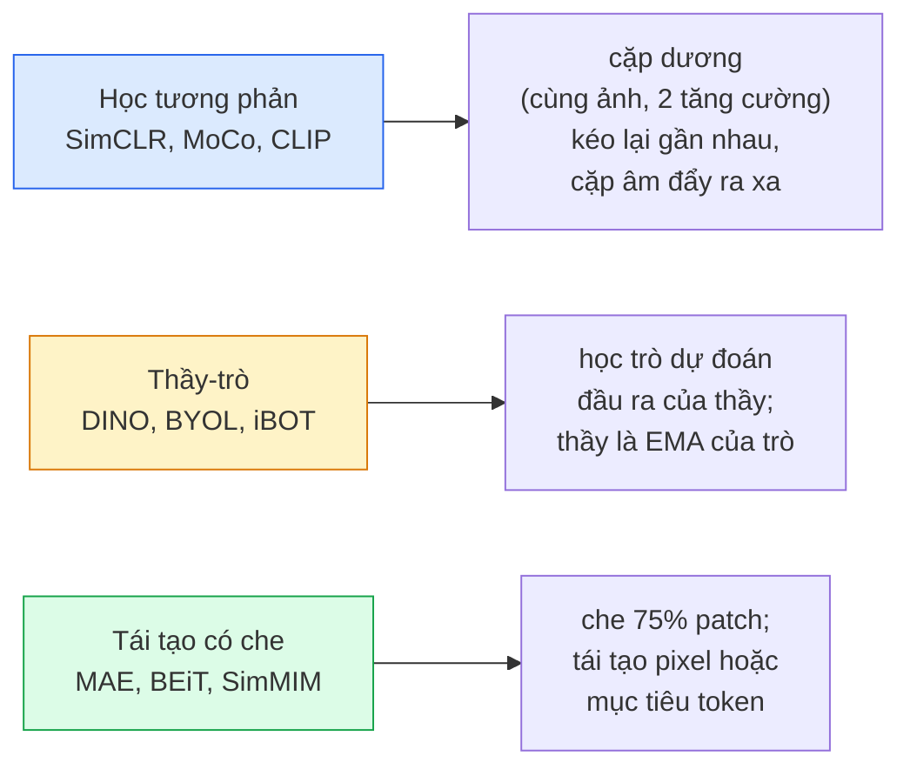

# Thị giác tự giám sát — SimCLR, DINO, MAE

> Nhãn là nút thắt của thị giác có giám sát. Tiền huấn luyện tự giám sát loại bỏ chúng: học đặc trưng thị giác từ 100M ảnh không nhãn, rồi fine-tune trên 10k ảnh có nhãn.

**Type:** Learn + Build
**Languages:** Python
**Prerequisites:** Giai đoạn 4, Bài 04 (Phân loại ảnh), Bài 14 (ViT)
**Time:** ~75 phút

## Mục tiêu học tập

- Lần theo ba họ tự giám sát lớn — tương phản (SimCLR), thầy-trò (DINO), tái tạo có che (MAE) — và nêu rõ mỗi họ tối ưu cái gì
- Tự viết InfoNCE loss từ đầu và giải thích vì sao batch 512 chạy được còn batch 32 thì hỏng
- Giải thích vì sao tỉ lệ che 75% của MAE không phải con số tuỳ tiện và nó khác BERT 15% cho văn bản thế nào
- Dùng checkpoint DINOv2 hoặc MAE ImageNet cho linear probe và truy hồi zero-shot

## Vấn đề

ImageNet có giám sát có 1.3M ảnh gán nhãn, ước tính tốn 10 triệu USD để gán. Dataset y tế và công nghiệp còn nhỏ hơn và còn đắt hơn để gán nhãn. Đội thị giác nào cũng hỏi: liệu có thể tiền huấn luyện trên dữ liệu không nhãn rẻ tiền — khung hình YouTube, dữ liệu crawl web, video webcam, ảnh vệ tinh — rồi fine-tune trên một tập nhãn nhỏ?

Self-supervised learning (học tự giám sát) là câu trả lời. Một ViT tự giám sát hiện đại huấn luyện trên LAION hoặc JFT đạt hoặc vượt độ chính xác ImageNet có giám sát khi fine-tune. Nó cũng chuyển giao tốt hơn sang tác vụ hạ nguồn (phát hiện, phân đoạn, độ sâu) so với tiền huấn luyện có giám sát. DINOv2 (Meta, 2023) và MAE (Meta, 2022) là mặc định sản xuất hiện nay cho đặc trưng thị giác chuyển giao được.

Bước chuyển về mặt khái niệm là: tác vụ giả (pretext task) — thứ mà mô hình được huấn luyện để làm — không nhất thiết phải là tác vụ hạ nguồn. Điều quan trọng là nó buộc mô hình học đặc trưng hữu ích. Dự đoán màu của ảnh xám, xoay ảnh rồi bảo mô hình phân loại góc xoay, che patch rồi tái tạo chúng — tất cả đều đã hiệu quả. Ba hướng mở rộng được là contrastive learning (học tương phản), chưng cất thầy-trò, và tái tạo có che.

## Khái niệm

### Ba họ



### Học tương phản (SimCLR)

Lấy một ảnh, áp hai phép view augmentation (tăng cường góc nhìn) ngẫu nhiên, được hai góc nhìn. Cho cả hai qua cùng một encoder cộng một projection head. Tối thiểu hoá một loss nói rằng "hai embedding này phải gần nhau" và "embedding này phải xa embedding của mọi ảnh khác trong batch".

```
Loss for positive pair (z_i, z_j) among 2N views per batch:

   L_ij = -log( exp(sim(z_i, z_j) / tau) / sum_k in batch \ {i} exp(sim(z_i, z_k) / tau) )

sim = cosine similarity
tau = temperature (0.1 standard)
```

Đây là InfoNCE loss. Nó cần nhiều cặp âm (negative pair) cho mỗi cặp dương (positive pair), nên batch size rất quan trọng — SimCLR cần 512-8192. MoCo giới thiệu một hàng đợi momentum gồm các batch trước để tách số lượng cặp âm khỏi batch size.

### Thầy-trò (DINO)

Hai mạng cùng kiến trúc: học trò và thầy. Thầy là momentum encoder (bộ mã hoá có đà) — trung bình trượt theo cấp số nhân (EMA) của trọng số học trò. Cả hai cùng xem các góc nhìn tăng cường của ảnh. Đầu ra của học trò được huấn luyện để khớp với đầu ra của thầy — không có cặp âm tường minh.

```
loss = CE( student_output(view_1),  teacher_output(view_2) )
     + CE( student_output(view_2),  teacher_output(view_1) )

teacher_weights = m * teacher_weights + (1 - m) * student_weights   (m ≈ 0.996)
```

Vì sao nó không sụp đổ (representation collapse) thành "dự đoán một hằng số": đầu ra của thầy được centering (trừ trung bình theo từng chiều) và sharpening (chia cho một nhiệt độ nhỏ). Centering ngăn một chiều nào đó lấn át; sharpening ngăn đầu ra sụp về phân phối đều.

DINO là thứ mà DINOv2 phóng to, trên 142M ảnh đã tuyển chọn. Đặc trưng thu được là SOTA hiện nay cho truy hồi thị giác zero-shot và dự đoán dày đặc.

### Tái tạo có che (MAE)

Che 75% patch của đầu vào ViT. Chỉ cho 25% nhìn thấy được đi qua encoder. Một decoder nhỏ nhận đầu ra của encoder cộng các mask token ở vị trí bị che, và được huấn luyện để tái tạo pixel của các patch bị che.

```
Encoder:  visible 25% of patches -> features
Decoder:  features + mask tokens at masked positions -> reconstructed pixels
Loss:     MSE between reconstructed and original pixels on masked patches only
```

Các lựa chọn thiết kế then chốt giúp MAE hiệu quả:

- **Tỉ lệ che 75%** — cao. Buộc encoder học đặc trưng ngữ nghĩa; tái tạo 25% thì gần như tầm thường (pixel lân cận tương quan mạnh đến mức một CNN có thể làm trúng ngay).
- **Encoder/decoder bất đối xứng** — encoder ViT lớn chỉ thấy các patch nhìn thấy được; một decoder nhỏ (8 lớp, 512 chiều) lo phần tái tạo. Tiền huấn luyện nhanh gấp 3 lần BEiT ngây thơ.
- **Mục tiêu tái tạo trong không gian pixel** — đơn giản hơn mục tiêu token hoá của BEiT và chạy tốt hơn trên ViT.

Sau tiền huấn luyện, bỏ decoder. Encoder chính là bộ trích xuất đặc trưng.

### Vì sao 75% mà không phải 15%

BERT che 15% token. MAE che 75%. Khác biệt nằm ở mật độ thông tin.

- Ngôn ngữ tự nhiên có entropy cao trên mỗi token. Dự đoán 15% token vẫn khó vì mỗi vị trí bị che có nhiều cách hoàn thành hợp lý.
- Patch ảnh có entropy thấp — một vùng lân cận không bị che thường quyết định gần như chính xác pixel của patch bị che. Muốn việc dự đoán đòi hỏi hiểu ngữ nghĩa, bạn phải che mạnh tay.

75% đủ cao để ngoại suy không gian đơn giản không thể giải được tác vụ; encoder buộc phải biểu diễn nội dung ảnh.

### Đánh giá bằng linear probe (đầu dò tuyến tính)

Sau tiền huấn luyện tự giám sát, cách đánh giá chuẩn là một **linear probe**: đóng băng encoder, huấn luyện một bộ phân loại tuyến tính duy nhất bên trên, trên nhãn ImageNet. Báo cáo độ chính xác top-1.

- SimCLR ResNet-50: ~71% (2020)
- DINO ViT-S/16: ~77% (2021)
- MAE ViT-L/16: ~76% (2022)
- DINOv2 ViT-g/14: ~86% (2023)

Linear probe là phép đo thuần chất lượng đặc trưng; fine-tuning thường cộng thêm 2-5 điểm nhưng cũng trộn lẫn hiệu ứng của việc huấn luyện lại head.

```figure
data-augmentation
```

## Tự tay làm

### Bước 1: Pipeline tăng cường hai góc nhìn

```python
import torch
import torchvision.transforms as T

two_view_train = lambda: T.Compose([
    T.RandomResizedCrop(96, scale=(0.2, 1.0)),
    T.RandomHorizontalFlip(),
    T.ColorJitter(0.4, 0.4, 0.4, 0.1),
    T.RandomGrayscale(p=0.2),
    T.ToTensor(),
])


class TwoViewDataset(torch.utils.data.Dataset):
    def __init__(self, base):
        self.base = base
        self.aug = two_view_train()

    def __len__(self):
        return len(self.base)

    def __getitem__(self, i):
        img, _ = self.base[i]
        v1 = self.aug(img)
        v2 = self.aug(img)
        return v1, v2
```

Mỗi __getitem__ trả về hai góc nhìn tăng cường của cùng một ảnh; nhãn không cần thiết.

### Bước 2: InfoNCE loss

```python
import torch.nn.functional as F

def info_nce(z1, z2, tau=0.1):
    """
    z1, z2: (N, D) L2-normalised embeddings of paired views
    """
    N, D = z1.shape
    z = torch.cat([z1, z2], dim=0)  # (2N, D)
    sim = z @ z.T / tau              # (2N, 2N)

    mask = torch.eye(2 * N, dtype=torch.bool, device=z.device)
    sim = sim.masked_fill(mask, float("-inf"))

    targets = torch.cat([torch.arange(N, 2 * N), torch.arange(0, N)]).to(z.device)
    return F.cross_entropy(sim, targets)
```

Chuẩn hoá L2 embedding trước khi gọi. `tau=0.1` là mặc định của SimCLR; nhỏ hơn làm loss sắc hơn và cần nhiều cặp âm hơn.

### Bước 3: Kiểm tra nhanh InfoNCE

```python
z1 = F.normalize(torch.randn(16, 32), dim=-1)
z2 = z1.clone()
loss_same = info_nce(z1, z2, tau=0.1).item()
z2_random = F.normalize(torch.randn(16, 32), dim=-1)
loss_random = info_nce(z1, z2_random, tau=0.1).item()
print(f"InfoNCE with identical pairs:  {loss_same:.3f}")
print(f"InfoNCE with random pairs:     {loss_random:.3f}")
```

Cặp giống hệt nhau phải cho loss thấp (gần 0 với batch lớn và nhiệt độ lạnh). Cặp ngẫu nhiên phải cho log(2N-1) = ~log(31) = ~3.4 với batch 16 cặp.

### Bước 4: Che theo kiểu MAE

```python
def random_mask_indices(num_patches, mask_ratio=0.75, seed=0):
    g = torch.Generator().manual_seed(seed)
    n_keep = int(num_patches * (1 - mask_ratio))
    perm = torch.randperm(num_patches, generator=g)
    visible = perm[:n_keep]
    masked = perm[n_keep:]
    return visible.sort().values, masked.sort().values


num_patches = 196
visible, masked = random_mask_indices(num_patches, mask_ratio=0.75)
print(f"visible: {len(visible)} / {num_patches}")
print(f"masked:  {len(masked)} / {num_patches}")
```

Đơn giản, nhanh, và tất định với một seed cho trước. Các bản MAE thật xử lý theo batch và giữ mask riêng cho từng mẫu.

## Áp dụng

DINOv2 là chuẩn sản xuất năm 2026:

```python
import torch
from transformers import AutoImageProcessor, AutoModel

processor = AutoImageProcessor.from_pretrained("facebook/dinov2-base")
model = AutoModel.from_pretrained("facebook/dinov2-base")
model.eval()

# Per-image embeddings for zero-shot retrieval
with torch.no_grad():
    inputs = processor(images=[pil_image], return_tensors="pt")
    outputs = model(**inputs)
    embedding = outputs.last_hidden_state[:, 0]  # CLS token
```

Embedding 768 chiều thu được là xương sống của các pipeline truy hồi ảnh, tương ứng dày đặc, và chuyển giao zero-shot hiện đại. Fine-tune cho một tác vụ hạ nguồn hiếm khi cần gì hơn một head tuyến tính.

Với embedding ảnh-văn bản, SigLIP hoặc OpenCLIP là tương đương; với fine-tune kiểu MAE, repo `timm` có sẵn mọi checkpoint MAE.

## Đóng gói

Bài học này tạo ra:

- `outputs/prompt-ssl-pretraining-picker.md` — một prompt chọn SimCLR / MAE / DINOv2 dựa trên kích thước dataset, compute, và tác vụ hạ nguồn.
- `outputs/skill-linear-probe-runner.md` — một skill viết phần đánh giá linear probe cho bất kỳ encoder đóng băng + dataset có nhãn nào.

## Bài tập

1. **(Dễ)** Kiểm chứng rằng InfoNCE loss giảm khi bạn hạ nhiệt độ với embedding đã căn chỉnh tốt và tăng khi bạn hạ nhiệt độ với embedding ngẫu nhiên. Vẽ đồ thị `tau in [0.05, 0.1, 0.2, 0.5]` vs loss.
2. **(Trung bình)** Cài đặt một centre buffer kiểu DINO. Chứng minh rằng không có centering, học trò sụp về một vector hằng trong vài epoch.
3. **(Khó)** Huấn luyện MAE trên CIFAR-100 dùng TinyUNet từ Bài 10 làm backbone. Báo cáo độ chính xác linear probe ở 10, 50, và 200 epoch. Chứng minh rằng một linear probe tiền huấn luyện bằng MAE thắng một linear probe có giám sát từ đầu trên cùng tập con 1.000 ảnh.

## Thuật ngữ chính

| Thuật ngữ | Người ta thường nói | Ý nghĩa thực sự |
|------|----------------|----------------------|
| Self-supervised | "Label-free" | Một tác vụ giả tạo ra biểu diễn hữu ích từ dữ liệu không nhãn |
| Pretext task | "Tác vụ giả" | Mục tiêu dùng trong SSL (tái tạo patch, khớp góc nhìn); bỏ đi sau tiền huấn luyện |
| Linear probe | "Encoder đóng băng + head tuyến tính" | Đánh giá SSL chuẩn: chỉ huấn luyện một bộ phân loại tuyến tính trên đặc trưng đóng băng |
| InfoNCE | "Contrastive loss" | softmax trên cosine similarity; cặp dương là lớp đích, mọi cặp còn lại là âm |
| EMA teacher | "Thầy trung bình trượt" | Thầy có trọng số là trung bình trượt cấp số nhân của học trò; dùng bởi BYOL, MoCo, DINO |
| Mask ratio | "% patch bị che" | Tỉ lệ patch bị che trong MAE; 75% cho thị giác, 15% cho văn bản |
| Representation collapse | "Đầu ra hằng số" | Lỗi SSL khi encoder xuất ra một vector hằng cho mọi đầu vào; ngăn bằng centering, sharpening, hoặc cặp âm |
| DINOv2 | "Backbone SSL sản xuất" | ViT tự giám sát của Meta năm 2023; đặc trưng ảnh đa dụng mạnh nhất năm 2026 |

## Đọc thêm

- [SimCLR (Chen et al., 2020)](https://arxiv.org/abs/2002.05709) — tài liệu tham chiếu cho học tương phản
- [DINO (Caron et al., 2021)](https://arxiv.org/abs/2104.14294) — thầy-trò với momentum, centering, sharpening
- [MAE (He et al., 2022)](https://arxiv.org/abs/2111.06377) — tiền huấn luyện masked autoencoder cho ViT
- [DINOv2 (Oquab et al., 2023)](https://arxiv.org/abs/2304.07193) — mở rộng ViT tự giám sát thành đặc trưng sản xuất

---

[← Bài trước: Xây dựng một pipeline (quy trình xử lý) thị giác hoàn chỉnh](../../16-vision-pipeline-capstone/docs/vi.md) · [Bài sau: Thị giác từ vựng mở (open-vocabulary) →](../../18-open-vocab-clip/docs/vi.md)
