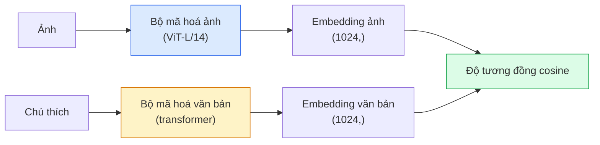

# Thị giác từ vựng mở (open-vocabulary) — CLIP

> Huấn luyện một bộ mã hoá ảnh và một bộ mã hoá văn bản cùng nhau sao cho các cặp (ảnh, chú thích) khớp nhau rơi vào cùng một điểm trong không gian chung. Đó là toàn bộ mẹo.

**Type:** Build + Use
**Languages:** Python
**Prerequisites:** Giai đoạn 4, Bài 14 (ViT), Bài 17 (Tự giám sát)
**Time:** ~45 phút

## Mục tiêu học tập

- Giải thích kiến trúc hai tháp của CLIP và mục tiêu huấn luyện tương phản
- Dùng CLIP (hoặc SigLIP) đã huấn luyện sẵn để phân loại không mẫu (zero-shot) mà không cần huấn luyện riêng cho tác vụ
- Tự tay cài đặt phân loại không mẫu: mã hoá câu lệnh lớp, tính độ tương đồng cosine, lấy argmax
- Phân biệt CLIP, SigLIP, OpenCLIP và LLaVA/LLaMA-vision — mỗi loại dùng để làm gì trong năm 2026

## Vấn đề

Các bộ phân loại truyền thống có từ vựng đóng: một mô hình ImageNet 1000 lớp chỉ dự đoán được 1000 nhãn. Mỗi lớp mới đòi hỏi dữ liệu có nhãn và một đầu phân loại được huấn luyện lại.

CLIP (Radford et al., OpenAI 2021) cho thấy huấn luyện trên 400M cặp (ảnh, chú thích) thu thập từ web tạo ra một mô hình có thể phân loại vào bất kỳ tập lớp nào lúc suy luận, chỉ mô tả bằng ngôn ngữ tự nhiên. Bạn thêm một lớp mới bằng cách viết một câu.

Năng lực đó — chuyển giao không mẫu — là lý do mọi hệ thị giác hiện đại bắt đầu bằng một checkpoint thuộc họ CLIP. Phát hiện (Grounding DINO, OWL-ViT), phân đoạn (CLIPSeg, SAM), truy hồi, kiểm duyệt nội dung, VLM và sinh ảnh từ văn bản đều dựa trên embedding kết hợp kiểu CLIP.

## Khái niệm

### Hai tháp



Cả hai bộ mã hoá kết thúc bằng một phép chiếu tuyến tính về cùng số chiều embedding (512 với CLIP-B/32, 1024 với CLIP-L/14). Chuẩn hoá L2 rồi tính độ tương đồng cosine.

### Mục tiêu

Cho một batch gồm N cặp (ảnh, chú thích), dựng ma trận tương đồng NxN. Huấn luyện cả hai bộ mã hoá sao cho đường chéo (các cặp khớp) có tương đồng cao và các ô ngoài đường chéo (không khớp) có tương đồng thấp.

```
sim_matrix = image_embeddings @ text_embeddings.T / tau

loss_i2t = cross_entropy(sim_matrix,       targets=arange(N))
loss_t2i = cross_entropy(sim_matrix.T,     targets=arange(N))
loss = (loss_i2t + loss_t2i) / 2
```

Đối xứng vì cả truy hồi ảnh sang văn bản lẫn văn bản sang ảnh đều phải hoạt động. `tau` (nhiệt độ) thường được học như một tham số vô hướng, khởi tạo bằng 0.07.

### SigLIP: một mất mát tốt hơn

SigLIP (Zhai et al., 2023) thay softmax bằng sigmoid theo từng cặp:

```
loss = mean over pairs of log(1 + exp(-y_ij * sim_ij))
y_ij = +1 if matching, -1 otherwise
```

Mất mát theo từng cặp loại bỏ chuẩn hoá cấp batch mà CLIP cần. SigLIP huấn luyện tốt hơn ở batch nhỏ và ngang hoặc vượt CLIP với cùng lượng dữ liệu.

### Phân loại không mẫu

Với một CLIP đã huấn luyện:

1. Với mỗi lớp, soạn một câu lệnh: "a photo of a {class}".
2. Mã hoá toàn bộ câu lệnh lớp bằng bộ mã hoá văn bản -> `T` kích thước (C, d).
3. Mã hoá ảnh kiểm tra -> `I` kích thước (1, d).
4. Tương đồng = `I @ T.T` kích thước (1, C).
5. Argmax -> lớp dự đoán.

Thiết kế câu lệnh quan trọng. OpenAI đã công bố 80 mẫu câu lệnh (prompt template) cho ImageNet ("a photo of a {}", "a blurry photo of a {}", "a sketch of a {}", ...). Lấy trung bình embedding của tất cả mẫu cho mỗi lớp để được thêm 1-3% độ chính xác top-1.

### Các mô hình kiểu CLIP được dùng ở đâu trong năm 2026

- **Phân loại không mẫu** — dùng trực tiếp.
- **Truy hồi ảnh** — mã hoá toàn bộ ảnh một lần, tạo embedding cho truy vấn lúc suy luận.
- **Phát hiện có điều kiện văn bản** — Grounding DINO, OWL-ViT bọc tháp văn bản CLIP quanh một bộ phát hiện.
- **Phân đoạn có điều kiện văn bản** — CLIPSeg; SAM dùng đầu vào câu lệnh văn bản qua CLIP.
- **VLMs** — LLaVA, Qwen-VL, InternVL nối một bộ mã hoá thị giác họ CLIP vào một LLM.
- **Sinh ảnh từ văn bản** — Stable Diffusion, DALL-E 3 điều kiện hoá trên embedding văn bản của CLIP.

Một khi đã có không gian embedding (embedding space) chung, mọi tác vụ thị giác + ngôn ngữ trở thành một phép tính khoảng cách.

```figure
clip-contrastive
```

## Tự tay làm

### Bước 1: Một mô hình hai tháp tí hon

CLIP thật là ViT + transformer. Trong bài này, hai tháp là các MLP nhỏ trên đặc trưng đã trích xuất sẵn để tín hiệu huấn luyện hiện rõ trên CPU.

```python
import torch
import torch.nn as nn
import torch.nn.functional as F


class TwoTower(nn.Module):
    def __init__(self, img_in=128, txt_in=64, emb=64):
        super().__init__()
        self.image_proj = nn.Sequential(nn.Linear(img_in, 128), nn.ReLU(), nn.Linear(128, emb))
        self.text_proj = nn.Sequential(nn.Linear(txt_in, 128), nn.ReLU(), nn.Linear(128, emb))
        self.logit_scale = nn.Parameter(torch.ones([]) * 2.6592)  # ln(1/0.07)

    def forward(self, img_feats, txt_feats):
        i = F.normalize(self.image_proj(img_feats), dim=-1)
        t = F.normalize(self.text_proj(txt_feats), dim=-1)
        return i, t, self.logit_scale.exp()
```

Hai phép chiếu, đầu ra cùng số chiều, nhiệt độ học được. Cùng hình dạng với API CLIP thật.

### Bước 2: Mất mát tương phản (contrastive loss)

```python
def clip_loss(image_emb, text_emb, logit_scale):
    N = image_emb.size(0)
    sim = logit_scale * image_emb @ text_emb.T
    targets = torch.arange(N, device=sim.device)
    l_i = F.cross_entropy(sim, targets)
    l_t = F.cross_entropy(sim.T, targets)
    return (l_i + l_t) / 2
```

Đối xứng. logit_scale càng lớn = softmax càng nhọn = càng tự tin nhưng có nguy cơ bất ổn định.

### Bước 3: Bộ phân loại không mẫu

```python
@torch.no_grad()
def zero_shot_classify(model, image_feats, class_text_feats, class_names):
    """
    image_feats:      (N, img_in)
    class_text_feats: (C, txt_in)   one averaged embedding per class
    """
    i = F.normalize(model.image_proj(image_feats), dim=-1)
    t = F.normalize(model.text_proj(class_text_feats), dim=-1)
    sim = i @ t.T
    pred = sim.argmax(dim=-1)
    return [class_names[p] for p in pred.tolist()]
```

Mỗi bước một dòng. Đây chính là quy trình không mẫu dùng với một checkpoint CLIP production.

### Bước 4: Kiểm tra nhanh

```python
torch.manual_seed(0)
model = TwoTower()

img = torch.randn(8, 128)
txt = torch.randn(8, 64)
i, t, scale = model(img, txt)
loss = clip_loss(i, t, scale)
print(f"batch size: {i.size(0)}   loss: {loss.item():.3f}")
```

Với một mô hình khởi tạo ngẫu nhiên, loss phải gần `log(N) = log(8) = 2.08` — mục tiêu cross-entropy đối xứng khi chưa học được cấu trúc nào.

## Áp dụng

OpenCLIP là lựa chọn mặc định của cộng đồng trong năm 2026:

```python
import open_clip
import torch
from PIL import Image

model, _, preprocess = open_clip.create_model_and_transforms("ViT-B-32", pretrained="laion2b_s34b_b79k")
tokenizer = open_clip.get_tokenizer("ViT-B-32")

image = preprocess(Image.open("dog.jpg")).unsqueeze(0)
text = tokenizer(["a photo of a dog", "a photo of a cat", "a photo of a car"])

with torch.no_grad():
    image_features = model.encode_image(image)
    text_features = model.encode_text(text)
    image_features = image_features / image_features.norm(dim=-1, keepdim=True)
    text_features = text_features / text_features.norm(dim=-1, keepdim=True)
    probs = (100.0 * image_features @ text_features.T).softmax(dim=-1)

print(probs)
```

SigLIP mới hơn, huấn luyện tốt hơn ở quy mô nhỏ, và được ưu tiên cho công việc mới: `google/siglip-base-patch16-224`. Hugging Face cung cấp cả hai.

## Đóng gói

Bài này tạo ra:

- `outputs/prompt-zero-shot-class-picker.md` — một prompt thiết kế mẫu lớp cho CLIP không mẫu khi cho danh sách lớp và một lĩnh vực.
- `outputs/skill-image-text-retriever.md` — một skill xây chỉ mục embedding ảnh với bất kỳ checkpoint CLIP nào, hỗ trợ truy vấn bằng văn bản và truy vấn bằng ảnh.

## Bài tập

1. **(Dễ)** Dùng OpenCLIP ViT-B/32 huấn luyện sẵn và phân loại không mẫu trên CIFAR-10 với bộ 80 mẫu câu lệnh. Báo cáo độ chính xác top-1; nó nên vào khoảng 85-90%.
2. **(Trung bình)** So sánh một mẫu duy nhất ("a photo of a {}") với embedding lấy trung bình 80 mẫu trên cùng tác vụ CIFAR-10. Định lượng khoảng cách và giải thích vì sao các mẫu giúp ích.
3. **(Khó)** Xây một chỉ mục truy hồi ảnh không mẫu: embed 1.000 ảnh bằng CLIP, dựng chỉ mục FAISS, truy vấn bằng một mô tả ngôn ngữ tự nhiên. Báo cáo recall@5 truy hồi cho 20 truy vấn giữ riêng mà bạn tự viết.

## Thuật ngữ chính

| Thuật ngữ | Người ta thường nói | Ý nghĩa thực sự |
|------|----------------|----------------------|
| Two-tower | "Bộ mã hoá kép" | Bộ mã hoá ảnh và văn bản riêng biệt, kết thúc bằng một đầu chiếu cùng số chiều |
| Zero-shot | "Không huấn luyện riêng cho tác vụ" | Phân loại vào các lớp chỉ được mô tả bằng văn bản lúc suy luận; không đụng tới nhãn |
| Temperature / logit_scale | "tau" | Đại lượng vô hướng học được, nhân vào ma trận tương đồng trước softmax |
| Prompt template | "A photo of a {}" | Khung ngôn ngữ tự nhiên bọc quanh tên lớp; lấy trung bình nhiều mẫu giúp tăng độ chính xác không mẫu |
| CLIP | "Mô hình ảnh + văn bản" | Mô hình OpenAI năm 2021; từ vựng của cả lĩnh vực trong năm 2026 |
| SigLIP | "CLIP dùng sigmoid" | Thay softmax bằng sigmoid theo từng cặp; huấn luyện tốt hơn ở batch nhỏ |
| OpenCLIP | "Bản tái lập mở" | Các biến thể CLIP do cộng đồng huấn luyện trên LAION; mặc định production cho pipeline mã nguồn mở |
| VLM | "Mô hình thị giác - ngôn ngữ" | Một bộ mã hoá họ CLIP cộng một LLM, huấn luyện để trả lời câu hỏi về ảnh |

## Đọc thêm

- [CLIP: Learning Transferable Visual Models from Natural Language Supervision (Radford et al., 2021)](https://arxiv.org/abs/2103.00020)
- [SigLIP: Sigmoid Loss for Language-Image Pre-Training (Zhai et al., 2023)](https://arxiv.org/abs/2303.15343)
- [OpenCLIP](https://github.com/mlfoundations/open_clip) — cơ sở mã của cộng đồng
- [Oquab et al. (2023). DINOv2: Learning Robust Visual Features without Supervision](https://arxiv.org/abs/2304.07193) — bài báo, kèm benchmark đặc trưng so với các mô hình kiểu CLIP và kiểu MAE

---

[← Bài trước: Thị giác tự giám sát](../../17-self-supervised-vision/docs/vi.md) · [Bài sau: OCR & document understanding (hiểu tài liệu) →](../../19-ocr-document-understanding/docs/vi.md)
