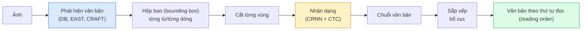

# OCR & document understanding (hiểu tài liệu)

> OCR là một pipeline ba tầng — text detection (phát hiện văn bản), nhận dạng ký tự, rồi sắp bố cục. Mọi hệ thống OCR hiện đại đều đổi thứ tự các tầng này hoặc gộp chúng lại.

**Type:** Learn + Use
**Languages:** Python
**Prerequisites:** Giai đoạn 4, Bài 06 (Phát hiện đối tượng), Giai đoạn 7, Bài 02 (Self-attention)
**Time:** ~45 phút

## Mục tiêu học tập

- Truy vết pipeline OCR cổ điển (phát hiện -> nhận dạng -> bố cục) và các lựa chọn end-to-end hiện đại (Donut, Qwen-VL-OCR)
- Cài đặt loss CTC (Connectionist Temporal Classification) để huấn luyện OCR chuỗi sang chuỗi
- Dùng PaddleOCR hoặc EasyOCR để phân tích tài liệu trong production mà không cần huấn luyện
- Phân biệt OCR, phân tích bố cục và hiểu tài liệu — chọn đúng công cụ cho từng bài toán

## Vấn đề

Ảnh chứa đầy chữ có ở khắp nơi: hoá đơn bán lẻ, hoá đơn, giấy tờ tuỳ thân, sách scan, biểu mẫu, bảng trắng, biển hiệu, ảnh chụp màn hình. Trích xuất dữ liệu có cấu trúc từ chúng — không chỉ từng ký tự, mà cả "đây là tổng tiền" — là một trong những bài toán thị giác ứng dụng có giá trị cao nhất.

Lĩnh vực này chia thành ba tầng kỹ năng:

1. **OCR đúng nghĩa**: biến pixel thành văn bản.
2. **Layout parsing (phân tích bố cục)**: nhóm đầu ra OCR thành các vùng (tiêu đề, thân, bảng, phần đầu trang).
3. **Hiểu tài liệu**: trích xuất các trường có cấu trúc ("invoice_total = $42.50") từ bố cục.

Mỗi tầng đều có cách tiếp cận cổ điển và hiện đại, và khoảng cách giữa "tôi muốn chữ từ một ảnh" với "tôi cần tổng tiền của hoá đơn này" lớn hơn phần lớn đội ngũ tưởng tượng.

## Khái niệm

### Pipeline cổ điển



- **Phát hiện văn bản (text detection)** tạo ra tứ giác cho từng dòng hoặc từng từ.
- **Nhận dạng** cắt mỗi vùng về chiều cao cố định, chạy CNN + BiLSTM + CTC để sinh chuỗi ký tự.
- **Bố cục** dựng lại thứ tự đọc (trên xuống dưới, trái sang phải với chữ Latin; khác với tiếng Ả Rập, tiếng Nhật).

### CTC trong một đoạn văn

Nhận dạng OCR tạo ra chuỗi có độ dài thay đổi từ một feature map có độ dài cố định. CTC (Graves et al., 2006) cho phép bạn huấn luyện việc này mà không cần căn chỉnh ở mức ký tự. Ở mỗi bước thời gian, mô hình xuất một phân phối trên (vocab + blank); loss CTC marginalise trên mọi cách căn chỉnh mà sau khi gộp các lần lặp và xoá blank sẽ rút gọn đúng thành văn bản đích.

```
raw output: "h h h _ _ e e l l _ l l o _ _"
after merge repeats and remove blanks: "hello"
```

CTC là lý do CRNN hiệu quả năm 2015 và vẫn là cách huấn luyện phần lớn mô hình OCR production năm 2026.

### Mô hình end-to-end hiện đại

- **Donut** (Kim et al., 2022) — encoder ViT + decoder văn bản; đọc ảnh và xuất JSON trực tiếp. Không có bộ phát hiện văn bản, không có module bố cục.
- **TrOCR** — ViT + decoder transformer cho OCR ở mức dòng.
- **Qwen-VL-OCR / InternVL** — mô hình thị giác-ngôn ngữ đầy đủ, fine-tune cho tác vụ OCR; độ chính xác tốt nhất năm 2026 trên tài liệu phức tạp.
- **PaddleOCR** — pipeline DB + CRNN cổ điển trong một gói production trưởng thành; vẫn là con ngựa thồ mã nguồn mở.

Mô hình end-to-end cần nhiều dữ liệu và tính toán hơn nhưng tránh được tích luỹ lỗi của pipeline nhiều tầng.

### Phân tích bố cục

Với tài liệu có cấu trúc, chạy một bộ phát hiện bố cục (LayoutLMv3, DocLayNet) để gán nhãn từng vùng: Title, Paragraph, Figure, Table, Footnote. Thứ tự đọc sau đó chỉ còn là "duyệt các vùng theo thứ tự bố cục rồi nối lại".

Với biểu mẫu, dùng mô hình **trích xuất khoá-giá trị (key-value extraction)** (Donut cho tài liệu nhiều hình ảnh, LayoutLMv3 cho bản scan thường). Chúng nhận ảnh + văn bản đã phát hiện + vị trí và dự đoán các cặp khoá-giá trị có cấu trúc.

### Chỉ số đánh giá

- **Character Error Rate (CER)** — khoảng cách Levenshtein / độ dài tham chiếu. Càng thấp càng tốt. Mục tiêu production: < 2% trên bản scan sạch.
- **Word Error Rate (WER)** — tương tự nhưng ở mức từ.
- **F1 trên trường có cấu trúc** — cho tác vụ khoá-giá trị; đo xem `{invoice_total: 42.50}` có xuất hiện đúng không.
- **Khoảng cách sửa trên JSON** — cho phân tích tài liệu end-to-end; bài báo Donut đưa ra khoảng cách sửa trên cây đã chuẩn hoá.

```figure
cv3-ctc-collapse
```

## Tự tay làm

### Bước 1: Loss CTC + bộ giải mã greedy

```python
import torch
import torch.nn as nn
import torch.nn.functional as F


def ctc_loss(log_probs, targets, input_lengths, target_lengths, blank=0):
    """
    log_probs:      (T, N, C) log-softmax over vocab including blank at index 0
    targets:        (N, S) int targets (no blanks)
    input_lengths:  (N,) per-sample time steps used
    target_lengths: (N,) per-sample target length
    """
    return F.ctc_loss(log_probs, targets, input_lengths, target_lengths,
                      blank=blank, reduction="mean", zero_infinity=True)


def greedy_ctc_decode(log_probs, blank=0):
    """
    log_probs: (T, N, C) log-softmax
    returns: list of index sequences (blanks removed, repeats merged)
    """
    preds = log_probs.argmax(dim=-1).transpose(0, 1).cpu().tolist()
    out = []
    for seq in preds:
        decoded = []
        prev = None
        for idx in seq:
            if idx != prev and idx != blank:
                decoded.append(idx)
            prev = idx
        out.append(decoded)
    return out
```

`F.ctc_loss` dùng implementation CuDNN hiệu quả khi có sẵn. Bộ giải mã greedy đơn giản hơn beam search và thường chỉ kém khoảng 1% CER.

### Bước 2: Bộ nhận dạng CRNN nhỏ

CNN + BiLSTM tối giản cho OCR theo dòng.

```python
class TinyCRNN(nn.Module):
    def __init__(self, vocab_size=40, hidden=128, feat=32):
        super().__init__()
        self.cnn = nn.Sequential(
            nn.Conv2d(1, feat, 3, 1, 1), nn.BatchNorm2d(feat), nn.ReLU(inplace=True),
            nn.MaxPool2d(2),
            nn.Conv2d(feat, feat * 2, 3, 1, 1), nn.BatchNorm2d(feat * 2), nn.ReLU(inplace=True),
            nn.MaxPool2d(2),
            nn.Conv2d(feat * 2, feat * 4, 3, 1, 1), nn.BatchNorm2d(feat * 4), nn.ReLU(inplace=True),
            nn.MaxPool2d((2, 1)),
            nn.Conv2d(feat * 4, feat * 4, 3, 1, 1), nn.BatchNorm2d(feat * 4), nn.ReLU(inplace=True),
            nn.MaxPool2d((2, 1)),
        )
        self.rnn = nn.LSTM(feat * 4, hidden, bidirectional=True, batch_first=True)
        self.head = nn.Linear(hidden * 2, vocab_size)

    def forward(self, x):
        # x: (N, 1, H, W)
        f = self.cnn(x)                # (N, C, H', W')
        f = f.mean(dim=2).transpose(1, 2)  # (N, W', C)
        h, _ = self.rnn(f)
        return F.log_softmax(self.head(h).transpose(0, 1), dim=-1)  # (W', N, vocab)
```

Đầu vào có chiều cao cố định (CNN max-pool chiều cao xuống 1). Chiều rộng là chiều thời gian cho CTC.

### Bước 3: OCR tổng hợp

Sinh chuỗi chữ số đen trên nền trắng để smoke test end-to-end.

```python
import numpy as np

def synthetic_line(text, height=32, char_width=16):
    W = char_width * len(text)
    img = np.ones((height, W), dtype=np.float32)
    for i, c in enumerate(text):
        x = i * char_width
        shade = 0.0 if c.isalnum() else 0.5
        img[6:height - 6, x + 2:x + char_width - 2] = shade
    return img


def build_batch(strings, vocab):
    H = 32
    W = 16 * max(len(s) for s in strings)
    imgs = np.ones((len(strings), 1, H, W), dtype=np.float32)
    target_lengths = []
    targets = []
    for i, s in enumerate(strings):
        imgs[i, 0, :, :16 * len(s)] = synthetic_line(s)
        ids = [vocab.index(c) for c in s]
        targets.extend(ids)
        target_lengths.append(len(ids))
    return torch.from_numpy(imgs), torch.tensor(targets), torch.tensor(target_lengths)


vocab = ["_"] + list("0123456789abcdefghijklmnopqrstuvwxyz")
imgs, targets, lengths = build_batch(["hello", "world"], vocab)
print(f"images: {imgs.shape}   targets: {targets.shape}   lengths: {lengths.tolist()}")
```

Một bộ dữ liệu OCR thật thêm font, nhiễu, xoay, mờ và màu. Pipeline ở trên vẫn giữ nguyên.

### Bước 4: Phác thảo huấn luyện

```python
model = TinyCRNN(vocab_size=len(vocab))
opt = torch.optim.Adam(model.parameters(), lr=1e-3)

for step in range(200):
    strings = ["abc" + str(step % 10)] * 4 + ["xyz" + str((step + 1) % 10)] * 4
    imgs, targets, target_lens = build_batch(strings, vocab)
    log_probs = model(imgs)  # (W', 8, vocab)
    input_lens = torch.full((8,), log_probs.size(0), dtype=torch.long)
    loss = ctc_loss(log_probs, targets, input_lens, target_lens, blank=0)
    opt.zero_grad(); loss.backward(); opt.step()
```

Trên dữ liệu tổng hợp tầm thường này, loss sẽ giảm từ ~3 xuống ~0.2 sau 200 bước.

## Áp dụng

Ba hướng production:

- **PaddleOCR** — trưởng thành, nhanh, đa ngôn ngữ. Dùng một dòng: `paddleocr.PaddleOCR(lang="en").ocr(image_path)`.
- **EasyOCR** — thuần Python, đa ngôn ngữ, backbone PyTorch.
- **Tesseract** — cổ điển; vẫn hữu ích với tài liệu scan cũ khi các mô hình gặp khó.

Để phân tích tài liệu end-to-end, dùng Donut hoặc một VLM:

```python
from transformers import DonutProcessor, VisionEncoderDecoderModel

processor = DonutProcessor.from_pretrained("naver-clova-ix/donut-base-finetuned-cord-v2")
model = VisionEncoderDecoderModel.from_pretrained("naver-clova-ix/donut-base-finetuned-cord-v2")
```

Với hoá đơn bán lẻ, hoá đơn, biểu mẫu có cấu trúc lặp lại, hãy fine-tune Donut. Với tài liệu tuỳ ý hoặc OCR kèm suy luận, một VLM như Qwen-VL-OCR là lựa chọn mặc định hiện nay.

## Đóng gói

Bài học này tạo ra:

- `outputs/prompt-ocr-stack-picker.md` — một prompt chọn Tesseract / PaddleOCR / Donut / VLM-OCR dựa trên loại tài liệu, ngôn ngữ và cấu trúc.
- `outputs/skill-ctc-decoder.md` — một skill viết bộ giải mã CTC greedy và beam search từ đầu, kèm chuẩn hoá độ dài.

## Bài tập

1. **(Dễ)** Huấn luyện TinyCRNN trên chuỗi số ngẫu nhiên 5 chữ số trong 500 bước. Báo cáo CER trên tập giữ lại.
2. **(Trung bình)** Thay giải mã greedy bằng beam search (beam_width=5). Báo cáo chênh lệch CER. Beam search thắng trên những đầu vào nào?
3. **(Khó)** Dùng PaddleOCR trên 20 hoá đơn, trích các dòng hàng, rồi tính F1 so với nhãn gán tay cho các cặp {item_name, price}.

## Thuật ngữ chính

| Thuật ngữ | Người ta thường nói | Ý nghĩa thực sự |
|------|----------------|----------------------|
| OCR | "Văn bản từ pixel" | Biến các vùng ảnh thành chuỗi ký tự |
| CTC | "Loss không cần căn chỉnh" | Loss huấn luyện mô hình chuỗi mà không cần nhãn từng bước thời gian; marginalise trên mọi cách căn chỉnh |
| CRNN | "Mô hình OCR cổ điển" | Bộ trích đặc trưng conv + BiLSTM + CTC; baseline 2015 vẫn còn dùng trong production |
| Donut | "OCR end-to-end" | Encoder ViT + decoder văn bản; xuất JSON trực tiếp từ ảnh |
| Layout parsing | "Tìm các vùng" | Phát hiện và gán nhãn các vùng Title/Table/Figure/Paragraph trong tài liệu |
| Reading order | "Chuỗi văn bản" | Sắp các vùng đã nhận dạng thành câu; dễ với chữ Latin, khó với bố cục hỗn hợp |
| CER / WER | "Tỷ lệ lỗi" | Khoảng cách Levenshtein / độ dài tham chiếu ở mức ký tự hoặc mức từ |
| VLM-OCR | "LLM biết đọc" | Mô hình thị giác-ngôn ngữ được huấn luyện hoặc prompt cho tác vụ OCR; SOTA hiện tại trên tài liệu phức tạp |

## Đọc thêm

- [CRNN (Shi et al., 2015)](https://arxiv.org/abs/1507.05717) — kiến trúc CNN+RNN+CTC gốc
- [CTC (Graves et al., 2006)](https://www.cs.toronto.edu/~graves/icml_2006.pdf) — bài báo CTC gốc; đặc kín các ý tưởng thuật toán
- [Donut (Kim et al., 2022)](https://arxiv.org/abs/2111.15664) — transformer hiểu tài liệu không cần OCR
- [PaddleOCR](https://github.com/PaddlePaddle/PaddleOCR) — stack OCR production mã nguồn mở

---

[← Bài trước: Thị giác từ vựng mở (open-vocabulary)](../../18-open-vocab-clip/docs/vi.md) · [Bài sau: Truy hồi ảnh & Học metric →](../../20-image-retrieval-metric/docs/vi.md)
