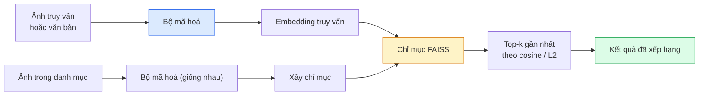

# Truy hồi ảnh & Học metric

> Hệ truy hồi ảnh (image retrieval) xếp hạng các ứng viên theo khoảng cách trong không gian embedding. Học metric (metric learning) là bộ môn định hình không gian đó để khoảng cách mang đúng ý nghĩa bạn muốn.

**Type:** Build
**Languages:** Python
**Prerequisites:** Giai đoạn 4, Bài 14 (ViT), Bài 18 (CLIP)
**Time:** ~45 phút

## Mục tiêu học tập

- Giải thích các mất mát học metric dựa trên triplet (mất mát bộ ba), contrastive và proxy, rồi chọn đúng loại cho một bộ dữ liệu cụ thể
- Cài đặt chuẩn hoá L2 và độ tương đồng cosine cho đúng, và rà soát khác biệt giữa truy hồi "cùng mặt hàng" và "cùng lớp"
- Xây một chỉ mục FAISS, truy vấn bằng văn bản và bằng ảnh, rồi báo cáo recall@K cho một tập truy vấn giữ lại riêng
- Dùng DINOv2, CLIP và SigLIP như các backbone embedding có sẵn, và biết khi nào từng cái thắng thế

## Vấn đề

Truy hồi có mặt khắp nơi trong thị giác máy tính sản xuất: phát hiện trùng lặp, tìm kiếm ảnh ngược, tìm kiếm bằng hình ("tìm sản phẩm tương tự"), nhận dạng lại khuôn mặt, re-ID người cho giám sát, khớp mức thực thể cho thương mại điện tử. Câu hỏi sản phẩm luôn như nhau: "với ảnh truy vấn này, hãy xếp hạng danh mục của tôi."

Hai quyết định thiết kế định hình toàn bộ hệ thống. Embedding — mô hình nào sinh ra các vector. Chỉ mục embedding (embedding index) — làm sao tìm láng giềng gần nhất ở quy mô lớn. Cả hai đều đã thành hàng phổ thông vào năm 2026 (DINOv2 cho embedding, FAISS cho chỉ mục), điều đó nâng cao chuẩn mực: phần khó là định nghĩa *thế nào là tương tự* cho ứng dụng của bạn, rồi định hình không gian embedding để các khoảng cách khớp với định nghĩa đó.

Việc định hình đó là học metric. Đó là một bộ môn nhỏ nhưng có đòn bẩy lớn.

## Khái niệm

### Truy hồi trong một cái nhìn



### Bốn họ mất mát

| Mất mát | Yêu cầu | Ưu điểm | Nhược điểm |
|------|----------|------|------|
| **Contrastive** | (anchor, positive) + negatives | Đơn giản, dùng được với bất kỳ nhãn cặp nào | Hội tụ chậm nếu không có nhiều mẫu âm |
| **Triplet** | (anchor, positive, negative) | Trực giác rõ; kiểm soát margin trực tiếp | Khai thác bộ ba khó thì tốn kém |
| **NT-Xent / InfoNCE** | Cặp + mẫu âm khai thác theo batch | Mở rộng được tới batch lớn | Cần batch lớn hoặc hàng đợi momentum |
| **Proxy-based (ProxyNCA)** | Chỉ cần nhãn lớp | Nhanh, ổn định, không cần khai thác | Có thể overfit vào proxy trên bộ dữ liệu nhỏ |

Với hầu hết trường hợp sản xuất, hãy bắt đầu với một backbone đã huấn luyện sẵn và chỉ thêm fine-tune học metric nếu embedding có sẵn kém hiệu quả trên tập kiểm tra của bạn.

### Mất mát bộ ba (triplet loss) một cách hình thức

```
L = max(0, ||f(a) - f(p)||^2 - ||f(a) - f(n)||^2 + margin)
```

Kéo anchor `a` lại gần positive `p`, đẩy nó ra xa negative `n`, với một margin (lề) bảo đảm có khoảng cách. Cấu trúc ba ảnh này tổng quát hoá cho bất kỳ thứ tự tương đồng nào.

Việc khai thác mẫu quan trọng: các bộ ba dễ (`n` đã xa `a`) đóng góp loss bằng 0; chỉ những bộ ba khó (hard negative) mới dạy được mạng. Khai thác semi-hard (`n` xa hơn `p` nhưng vẫn trong margin) là công thức FaceNet năm 2016 và vẫn đang thống trị.

### Độ tương đồng cosine so với L2

Hai metric, hai quy ước:

- **Cosine**: góc giữa các vector. Yêu cầu embedding được chuẩn hoá L2.
- **L2**: khoảng cách Euclid. Dùng được trên embedding thô hoặc đã chuẩn hoá, nhưng thường đi cặp với chuẩn hoá L2 + L2 bình phương.

Với hầu hết mạng hiện đại, hai cách là tương đương: `||a - b||^2 = 2 - 2 cos(a, b)` khi `||a|| = ||b|| = 1`. Hãy chọn quy ước khớp với cách embedding của bạn được huấn luyện; trộn lẫn chúng sẽ âm thầm đổi nghĩa của "gần nhất".

### Recall@K

Chỉ số truy hồi chuẩn, recall@K (độ phủ recall@k):

```
recall@K = fraction of queries where at least one correct match is in the top K results
```

Báo cáo recall@1, @5, @10 cạnh nhau. recall@10 trên 0.95 mà recall@1 dưới 0.5 nghĩa là không gian embedding có cấu trúc đúng nhưng thứ hạng còn nhiễu — hãy thử fine-tune lâu hơn hoặc thêm một bước xếp hạng lại.

Với phát hiện trùng lặp, precision@K quan trọng hơn vì mỗi dương tính giả là một lỗi người dùng nhìn thấy. Với tìm kiếm bằng hình, recall@K là tín hiệu sản phẩm.

### FAISS trong một đoạn

Facebook AI Similarity Search. Thư viện mặc định cho tìm kiếm láng giềng gần nhất. Ba lựa chọn chỉ mục:

- `IndexFlatIP` / `IndexFlatL2` — vét cạn, chính xác, không cần huấn luyện. Dùng tới ~1M vector.
- `IndexIVFFlat` — chia thành K ô, chỉ tìm trong vài ô gần nhất. Xấp xỉ, nhanh, cần dữ liệu huấn luyện.
- `IndexHNSW` — dựa trên đồ thị, nhanh nhất khi có nhiều truy vấn, chỉ mục có kích thước lớn.

Với 100k vector bạn có lẽ muốn `IndexFlatIP` trên độ tương đồng cosine. Với 10M bạn muốn `IndexIVFFlat`. Với 100M+ thì kết hợp lượng tử hoá tích (`IndexIVFPQ`).

### Truy hồi mức thực thể so với mức lớp

Hai bài toán rất khác nhau nhưng trùng tên:

- **Mức lớp** — "tìm mèo trong danh mục của tôi." Tương đồng có điều kiện theo lớp; embedding CLIP / DINOv2 có sẵn hoạt động tốt.
- **Mức thực thể** — "tìm *đúng sản phẩm này* trong danh mục của tôi." Cần phân biệt tinh mịn giữa các vật thể trông giống nhau cùng một lớp; embedding có sẵn kém hơn; fine-tune bằng học metric mới quan trọng.

Luôn hỏi bạn đang giải bài toán nào trước khi chọn mô hình.

```figure
metric-embedding
```

## Tự tay làm

### Bước 1: Mất mát bộ ba

```python
import torch
import torch.nn.functional as F

def triplet_loss(anchor, positive, negative, margin=0.2):
    d_ap = F.pairwise_distance(anchor, positive, p=2)
    d_an = F.pairwise_distance(anchor, negative, p=2)
    return F.relu(d_ap - d_an + margin).mean()
```

Một dòng. Dùng được trên embedding chuẩn hoá L2 hoặc thô.

### Bước 2: Khai thác semi-hard

Cho một batch embedding và nhãn, tìm mẫu âm semi-hard khó nhất cho mỗi anchor.

```python
def semi_hard_negatives(emb, labels, margin=0.2):
    dist = torch.cdist(emb, emb)
    same_class = labels[:, None] == labels[None, :]
    diff_class = ~same_class
    N = emb.size(0)

    positives = dist.clone()
    positives[~same_class] = float("-inf")
    positives.fill_diagonal_(float("-inf"))
    pos_idx = positives.argmax(dim=1)

    semi_hard = dist.clone()
    semi_hard[same_class] = float("inf")
    d_ap = dist[torch.arange(N), pos_idx].unsqueeze(1)
    semi_hard[dist <= d_ap] = float("inf")
    neg_idx = semi_hard.argmin(dim=1)

    fallback_mask = semi_hard[torch.arange(N), neg_idx] == float("inf")
    if fallback_mask.any():
        hardest = dist.clone()
        hardest[same_class] = float("inf")
        neg_idx = torch.where(fallback_mask, hardest.argmin(dim=1), neg_idx)
    return pos_idx, neg_idx
```

Mỗi anchor nhận mẫu dương khó nhất trong cùng lớp và một mẫu âm semi-hard xa hơn mẫu dương nhưng vẫn trong margin.

### Bước 3: Recall@K

```python
def recall_at_k(query_emb, gallery_emb, query_labels, gallery_labels, k=1):
    sim = query_emb @ gallery_emb.T
    _, top_k = sim.topk(k, dim=-1)
    matches = (gallery_labels[top_k] == query_labels[:, None]).any(dim=-1)
    return matches.float().mean().item()
```

Top-k theo tích vô hướng trên embedding chuẩn hoá L2 bằng top-k theo cosine. Báo cáo tỉ lệ trung bình các truy vấn có ít nhất một láng giềng đúng.

### Bước 4: Ghép lại

```python
import torch
import torch.nn as nn
from torch.optim import Adam

class Encoder(nn.Module):
    def __init__(self, in_dim=128, emb_dim=64):
        super().__init__()
        self.net = nn.Sequential(
            nn.Linear(in_dim, 128), nn.ReLU(),
            nn.Linear(128, emb_dim),
        )

    def forward(self, x):
        return F.normalize(self.net(x), dim=-1)

torch.manual_seed(0)
num_classes = 6
protos = F.normalize(torch.randn(num_classes, 128), dim=-1)

def sample_batch(bs=32):
    labels = torch.randint(0, num_classes, (bs,))
    x = protos[labels] + 0.15 * torch.randn(bs, 128)
    return x, labels

enc = Encoder()
opt = Adam(enc.parameters(), lr=3e-3)

for step in range(200):
    x, y = sample_batch(32)
    emb = enc(x)
    pos_idx, neg_idx = semi_hard_negatives(emb, y)
    loss = triplet_loss(emb, emb[pos_idx], emb[neg_idx])
    opt.zero_grad(); loss.backward(); opt.step()
```

Sau vài trăm bước, các cụm embedding tạo thành mỗi lớp một cụm.

## Áp dụng

Các stack sản xuất năm 2026:

- **DINOv2 + FAISS** — truy hồi thị giác đa dụng. Chạy được ngay không cần chỉnh.
- **CLIP + FAISS** — khi truy vấn là văn bản.
- **Fine-tuned DINOv2 + FAISS** — truy hồi mức thực thể, re-ID khuôn mặt, thời trang, thương mại điện tử.
- **Milvus / Weaviate / Qdrant** — lớp bọc vector DB được quản lý quanh FAISS hoặc HNSW.

Với truy hồi mức thực thể SOTA, công thức là: backbone DINOv2, thêm một embedding head, fine-tune bằng mất mát triplet hoặc InfoNCE trên các cặp gán nhãn mức thực thể, rồi đánh chỉ mục trong FAISS.

## Đóng gói

Bài học này tạo ra:

- `outputs/prompt-retrieval-loss-picker.md` — một prompt chọn triplet / InfoNCE / ProxyNCA cho một bài toán truy hồi cụ thể.
- `outputs/skill-recall-at-k-runner.md` — một skill viết harness đánh giá gọn gàng cho recall@K với các split train/val/gallery và data contract đúng chuẩn.

## Bài tập

1. **(Dễ)** Chạy ví dụ đồ chơi ở trên. Vẽ embedding bằng PCA trước và sau khi huấn luyện để thấy sáu cụm hình thành.
2. **(Trung bình)** Thêm cài đặt mất mát ProxyNCA: mỗi lớp một "proxy" được học, cross-entropy chuẩn trên độ tương đồng cosine. So sánh tốc độ hội tụ với mất mát triplet trên dữ liệu đồ chơi.
3. **(Khó)** Lấy 1.000 ảnh validation ImageNet, embedding bằng DINOv2 qua HuggingFace, xây một chỉ mục FAISS flat, và báo cáo recall@{1, 5, 10} khi truy vấn chính các ảnh đó (phải là 1.0) và khi truy vấn một split giữ lại riêng với nhãn ImageNet làm ground truth.

## Thuật ngữ chính

| Thuật ngữ | Người ta thường nói | Ý nghĩa thực sự |
|------|----------------|----------------------|
| Metric learning | "Định hình không gian" | Huấn luyện encoder sao cho khoảng cách trong không gian đầu ra phản ánh độ tương đồng mục tiêu |
| Triplet loss | "Kéo và đẩy" | L = max(0, d(a, p) - d(a, n) + margin); mất mát học metric kinh điển |
| Semi-hard mining | "Mẫu âm hữu ích" | Mẫu âm xa anchor hơn mẫu dương nhưng vẫn trong margin; theo thực nghiệm là loại chứa nhiều thông tin nhất |
| Proxy-based loss | "Nguyên mẫu lớp" | Mỗi lớp một proxy được học; cross-entropy trên độ tương đồng với proxy; không cần khai thác cặp |
| Recall@K | "Tỉ lệ trúng top-K" | Tỉ lệ truy vấn có ít nhất một kết quả đúng trong top K |
| Instance retrieval | "Tìm đúng thứ này" | Khớp tinh mịn; đặc trưng có sẵn thường kém hơn |
| FAISS | "Thư viện NN" | Thư viện láng giềng gần nhất của Facebook; hỗ trợ chỉ mục chính xác và xấp xỉ |
| HNSW | "Chỉ mục đồ thị" | Hierarchical navigable small world; NN xấp xỉ nhanh với chi phí bộ nhớ nhỏ |

## Đọc thêm

- [FaceNet: A Unified Embedding for Face Recognition (Schroff et al., 2015)](https://arxiv.org/abs/1503.03832) — bài báo mất mát triplet / khai thác semi-hard
- [In Defense of the Triplet Loss for Person Re-Identification (Hermans et al., 2017)](https://arxiv.org/abs/1703.07737) — hướng dẫn thực hành fine-tune triplet
- [FAISS documentation](https://github.com/facebookresearch/faiss/wiki) — mọi chỉ mục, mọi đánh đổi
- [SMoT: Metric Learning Taxonomy (Kim et al., 2021)](https://arxiv.org/abs/2010.06927) — khảo sát các mất mát hiện đại và mối liên hệ giữa chúng

---

[← Bài trước: OCR & document understanding (hiểu tài liệu)](../../19-ocr-document-understanding/docs/vi.md) · [Bài sau: Phát hiện keypoint & Ước lượng tư thế →](../../21-keypoint-pose/docs/vi.md)
