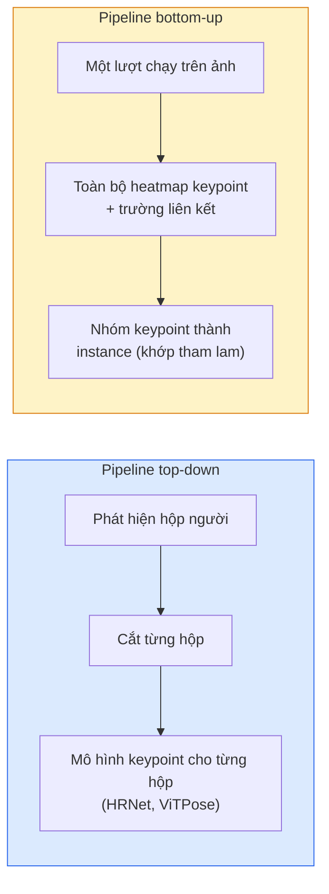

# Phát hiện keypoint & Ước lượng tư thế

> Một tư thế là một tập keypoint (điểm mốc) có thứ tự. Bộ phát hiện keypoint chính là bộ hồi quy heatmap (bản đồ nhiệt). Mọi thứ còn lại chỉ là chuyện ghi chép sổ sách.

**Type:** Build
**Languages:** Python
**Prerequisites:** Giai đoạn 4, Bài 06 (Phát hiện đối tượng), Bài 07 (U-Net)
**Time:** ~45 phút

## Mục tiêu học tập

- Phân biệt ước lượng tư thế top-down (từ trên xuống) và bottom-up (từ dưới lên), nêu rõ khi nào dùng cách nào
- Hồi quy heatmap cho K keypoint với mục tiêu Gaussian cho từng keypoint và trích xuất toạ độ keypoint khi suy luận
- Giải thích Part Affinity Field (PAF) — tức trường liên kết bộ phận — và cách pipeline bottom-up nhóm các keypoint thành từng instance
- Dùng MediaPipe Pose hoặc MMPose để ước lượng keypoint trong môi trường production và hiểu định dạng đầu ra của chúng

## Vấn đề

Các bài toán keypoint ẩn dưới nhiều cái tên: tư thế người (17 khớp cơ thể), landmark khuôn mặt (68 hoặc 478 điểm), bàn tay (21 điểm), tư thế động vật, tư thế vật thể cho robot, landmark giải phẫu y tế. Tất cả đều có chung một cấu trúc: phát hiện K điểm rời rạc trên một đối tượng và xuất ra toạ độ (x, y) của chúng.

Ước lượng tư thế (pose estimation) là nền tảng của motion capture, ứng dụng thể dục, phân tích thể thao, điều khiển bằng cử chỉ, hoạt hình, thử đồ AR và gắp vật bằng robot. Bài toán 2D đã chín muồi; tư thế 3D (ước lượng vị trí khớp trong toạ độ thế giới từ một camera duy nhất) chính là biên giới nghiên cứu hiện nay.

Câu hỏi kỹ thuật nằm ở độ lớn. Tư thế một người trong một ảnh là bài toán 20ms. Tư thế nhiều người trong đám đông ở 30 fps là bài toán khác, với kiến trúc khác.

## Khái niệm

### Top-down so với bottom-up



- **Top-down** — phát hiện người trước, rồi chạy mô hình keypoint riêng cho từng người trên mỗi ảnh cắt. Độ chính xác cao nhất; thời gian tăng tuyến tính theo số người.
- **Bottom-up** — một lượt forward dự đoán toàn bộ keypoint cộng thêm trường liên kết; sau đó nhóm chúng lại. Thời gian không đổi bất kể đám đông lớn cỡ nào.

Top-down (HRNet, ViTPose) dẫn đầu về độ chính xác; bottom-up (OpenPose, HigherHRNet) dẫn đầu về thông lượng cho cảnh đông người.

### Hồi quy heatmap

Thay vì hồi quy trực tiếp `(x, y)`, hãy dự đoán một heatmap `H x W` cho mỗi keypoint với một đám Gaussian đặt tại vị trí thật.

```
target[k, y, x] = exp(-((x - cx_k)^2 + (y - cy_k)^2) / (2 sigma^2))
```

Khi suy luận, argmax của mỗi heatmap chính là vị trí keypoint dự đoán.

Vì sao heatmap hiệu quả hơn hồi quy trực tiếp: cấu trúc không gian của mạng (feature map tích chập) khớp tự nhiên với đầu ra không gian. Mục tiêu Gaussian còn có tác dụng điều chuẩn — một sai số định vị nhỏ sinh ra loss nhỏ, chứ không phải bằng 0.

### Định vị dưới mức điểm ảnh

Argmax cho toạ độ nguyên. Để đạt độ chính xác dưới mức điểm ảnh, tinh chỉnh bằng cách khớp một parabol qua argmax và các điểm láng giềng, hoặc dùng hướng offset (độ lệch) quen thuộc `(dx, dy) = 0.25 * (heatmap[y, x+1] - heatmap[y, x-1], ...)`.

### Part Affinity Fields (PAFs)

Chiêu của OpenPose cho việc liên kết trong bottom-up. Với mỗi cặp keypoint có nối với nhau (ví dụ vai trái tới khuỷu trái), dự đoán một trường 2 kênh mã hoá vector đơn vị chỉ từ điểm này sang điểm kia. Để nối một vai với khuỷu của nó, tích phân PAF dọc theo đường nối các cặp ứng viên; cặp có tích phân lớn nhất sẽ được ghép.

```
For each connection (limb):
  PAF channels: 2 (unit vector x, y)
  Line integral: sum over sample points of (PAF . line_direction)
  Higher integral = stronger match
```

Tinh tế, và mở rộng được cho đám đông kích thước bất kỳ mà không cần cắt ảnh từng người.

### Keypoint COCO

Bộ dữ liệu tư thế cơ thể chuẩn: 17 keypoint mỗi người, với PCK (Percentage of Correct Keypoints) và OKS (Object Keypoint Similarity) làm độ đo. OKS là bản tương ứng của IoU cho keypoint, và chính là thứ mà COCO mAP@OKS báo cáo.

### 2D so với 3D

- **2D pose** — toạ độ ảnh; đã đạt chất lượng production (MediaPipe, HRNet, ViTPose).
- **3D pose** — toạ độ thế giới / camera; vẫn là hướng nghiên cứu sôi động. Các cách phổ biến:
  - Nâng dự đoán 2D lên 3D bằng một MLP nhỏ (VideoPose3D).
  - Hồi quy 3D trực tiếp từ ảnh (PyMAF, MHFormer).
  - Dùng nhiều góc nhìn (CMU Panoptic) để lấy ground truth.

```figure
cv3-pose-heatmap
```

## Tự tay làm

### Bước 1: Mục tiêu heatmap Gaussian

```python
import numpy as np
import torch

def gaussian_heatmap(size, cx, cy, sigma=2.0):
    yy, xx = np.meshgrid(np.arange(size), np.arange(size), indexing="ij")
    return np.exp(-((xx - cx) ** 2 + (yy - cy) ** 2) / (2 * sigma ** 2)).astype(np.float32)

hm = gaussian_heatmap(64, 32, 32, sigma=2.0)
print(f"peak: {hm.max():.3f} at ({hm.argmax() % 64}, {hm.argmax() // 64})")
```

Xếp các heatmap của từng keypoint chồng lên nhau theo trục kênh, bạn có tensor mục tiêu đầy đủ.

### Bước 2: Đầu keypoint tí hon

Một mô hình kiểu U-Net xuất ra K kênh heatmap.

```python
import torch.nn as nn
import torch.nn.functional as F

class TinyKeypointNet(nn.Module):
    def __init__(self, num_keypoints=4, base=16):
        super().__init__()
        self.down1 = nn.Sequential(nn.Conv2d(3, base, 3, 2, 1), nn.ReLU(inplace=True))
        self.down2 = nn.Sequential(nn.Conv2d(base, base * 2, 3, 2, 1), nn.ReLU(inplace=True))
        self.mid = nn.Sequential(nn.Conv2d(base * 2, base * 2, 3, 1, 1), nn.ReLU(inplace=True))
        self.up1 = nn.ConvTranspose2d(base * 2, base, 2, 2)
        self.up2 = nn.ConvTranspose2d(base, num_keypoints, 2, 2)

    def forward(self, x):
        h1 = self.down1(x)
        h2 = self.down2(h1)
        h3 = self.mid(h2)
        u1 = self.up1(h3)
        return self.up2(u1)
```

Đầu vào `(N, 3, H, W)`, đầu ra `(N, K, H, W)`. Loss là MSE theo từng điểm ảnh so với mục tiêu Gaussian.

### Bước 3: Suy luận — trích xuất toạ độ keypoint

```python
def heatmap_to_coords(heatmaps):
    """
    heatmaps: (N, K, H, W)
    returns:  (N, K, 2) float coordinates in image pixels
    """
    N, K, H, W = heatmaps.shape
    hm = heatmaps.reshape(N, K, -1)
    idx = hm.argmax(dim=-1)
    ys = (idx // W).float()
    xs = (idx % W).float()
    return torch.stack([xs, ys], dim=-1)

coords = heatmap_to_coords(torch.randn(2, 4, 32, 32))
print(f"coords: {coords.shape}")  # (2, 4, 2)
```

Một dòng khi suy luận. Để tinh chỉnh dưới mức điểm ảnh, nội suy quanh argmax.

### Bước 4: Bộ dữ liệu keypoint tổng hợp

Đơn giản: vẽ bốn điểm trên nền trắng rồi học cách dự đoán chúng.

```python
def make_synthetic_sample(size=64):
    img = np.ones((3, size, size), dtype=np.float32)
    rng = np.random.default_rng()
    kps = rng.integers(8, size - 8, size=(4, 2))
    for cx, cy in kps:
        img[:, cy - 2:cy + 2, cx - 2:cx + 2] = 0.0
    hms = np.stack([gaussian_heatmap(size, cx, cy) for cx, cy in kps])
    return img, hms, kps
```

Đủ dễ để một mô hình tí hon học trong một phút.

### Bước 5: Huấn luyện

```python
model = TinyKeypointNet(num_keypoints=4)
opt = torch.optim.Adam(model.parameters(), lr=3e-3)

for step in range(200):
    batch = [make_synthetic_sample() for _ in range(16)]
    imgs = torch.from_numpy(np.stack([b[0] for b in batch]))
    hms = torch.from_numpy(np.stack([b[1] for b in batch]))
    pred = model(imgs)
    # Upsample pred to full resolution
    pred = F.interpolate(pred, size=hms.shape[-2:], mode="bilinear", align_corners=False)
    loss = F.mse_loss(pred, hms)
    opt.zero_grad(); loss.backward(); opt.step()
```

## Áp dụng

- **MediaPipe Pose** — bộ ước lượng tư thế production của Google; có runtime WebGL + mobile với độ trễ dưới 10ms.
- **MMPose** (OpenMMLab) — codebase nghiên cứu toàn diện; đủ mọi kiến trúc SOTA kèm trọng số pretrained.
- **YOLOv8-pose** — tư thế nhiều người thời gian thực nhanh nhất với một lượt forward duy nhất.
- **transformers HumanDPT / PoseAnything** — các hướng tiếp cận thị giác-ngôn ngữ mới cho tư thế mở (đối tượng nào cũng được, tập keypoint nào cũng được).

## Đóng gói

Bài học này tạo ra:

- `outputs/prompt-pose-stack-picker.md` — một prompt chọn MediaPipe / YOLOv8-pose / HRNet / ViTPose dựa trên độ trễ, kích thước đám đông và nhu cầu 2D hay 3D.
- `outputs/skill-heatmap-to-coords.md` — một skill viết hàm chuyển heatmap sang toạ độ dưới mức điểm ảnh mà mọi mô hình tư thế production đều dùng.

## Bài tập

1. **(Dễ)** Huấn luyện mô hình keypoint tí hon trên bộ dữ liệu tổng hợp 4 điểm. Báo cáo sai số L2 trung bình giữa keypoint dự đoán và keypoint thật sau 200 bước.
2. **(Trung bình)** Thêm bước tinh chỉnh dưới mức điểm ảnh: từ vị trí argmax, khớp một parabol 1D theo trục x và y bằng các điểm ảnh láng giềng. Báo cáo mức tăng độ chính xác so với argmax nguyên.
3. **(Khó)** Xây bộ dữ liệu tổng hợp 2 người, mỗi ảnh chứa hai instance của mẫu 4 keypoint. Huấn luyện pipeline bottom-up với PAF để dự đoán keypoint nào thuộc instance nào, rồi đánh giá bằng OKS.

## Thuật ngữ chính

| Thuật ngữ | Người ta thường nói | Ý nghĩa thực sự |
|------|----------------|----------------------|
| Keypoint | "Một landmark" | Một điểm cụ thể có thứ tự trên một đối tượng (khớp, góc, đặc trưng) |
| Pose | "Skeleton (bộ xương)" | Một tập keypoint có thứ tự thuộc về một instance |
| Top-down | "Phát hiện rồi ước lượng" | Pipeline hai giai đoạn: bộ phát hiện người + mô hình keypoint theo từng ảnh cắt; độ chính xác cao nhất |
| Bottom-up | "Ước lượng trước, nhóm sau" | Dự đoán toàn bộ keypoint trong một lượt + nhóm lại; thời gian không đổi theo kích thước đám đông |
| Heatmap | "Mục tiêu Gaussian" | Tensor H x W cho mỗi keypoint với đỉnh tại vị trí thật; mục tiêu hồi quy được ưa dùng |
| PAF | "Part Affinity Field" | Trường vector đơn vị 2 kênh mã hoá hướng của chi; dùng để nhóm keypoint thành instance |
| OKS | "IoU cho keypoint" | Object Keypoint Similarity; độ đo COCO cho tư thế |
| HRNet | "High-Resolution Net" | Kiến trúc keypoint top-down thống trị; giữ đặc trưng độ phân giải cao xuyên suốt |

## Đọc thêm

- [OpenPose (Cao et al., 2017)](https://arxiv.org/abs/1812.08008) — bottom-up với PAF; vẫn là bài viết tốt nhất về hướng tiếp cận này
- [HRNet (Sun et al., 2019)](https://arxiv.org/abs/1902.09212) — kiến trúc tham chiếu cho top-down
- [ViTPose (Xu et al., 2022)](https://arxiv.org/abs/2204.12484) — ViT thuần làm backbone cho tư thế; hiện là SOTA trên nhiều benchmark
- [MediaPipe Pose](https://developers.google.com/mediapipe/solutions/vision/pose_landmarker) — tư thế thời gian thực cho production; stack triển khai nhanh nhất tính đến 2026

---

[← Bài trước: Truy hồi ảnh & Học metric](../../20-image-retrieval-metric/docs/vi.md) · [Bài sau: 3D Gaussian Splatting từ đầu →](../../22-3d-gaussian-splatting/docs/vi.md)
