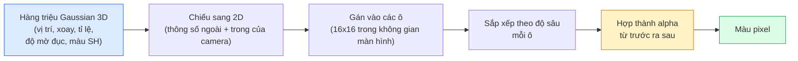

# 3D Gaussian Splatting từ đầu

> Một cảnh là đám mây hàng triệu Gaussian 3D. Mỗi cái có vị trí, hướng, tỉ lệ, độ mờ đục, và một màu phụ thuộc hướng nhìn. Kết xuất điểm ảnh (rasterization) chúng, lan truyền ngược qua bước kết xuất, xong.

**Type:** Build
**Languages:** Python
**Prerequisites:** Giai đoạn 4, Bài 13 (Thị giác 3D & NeRF), Giai đoạn 1, Bài 12 (Phép toán tensor), Giai đoạn 4, Bài 10 (Diffusion cơ bản, không bắt buộc)
**Time:** ~90 phút

## Mục tiêu học tập

- Giải thích vì sao 3D Gaussian Splatting thay NeRF thành lựa chọn mặc định trong sản xuất cho tái dựng 3D quang thực vào năm 2026
- Nêu sáu tham số trên mỗi Gaussian (vị trí, quaternion xoay, tỉ lệ, độ mờ đục, màu spherical harmonics (hàm điều hoà cầu), đặc trưng tuỳ chọn) và mỗi tham số đóng góp bao nhiêu số thực
- Tự viết một bộ kết xuất điểm ảnh splatting Gaussian 2D dùng alpha compositing (hợp thành alpha), rồi chỉ ra trường hợp 3D chiếu về đúng vòng lặp đó
- Dùng `nerfstudio`, `gsplat`, hoặc `SuperSplat` để tái dựng một cảnh từ 20-50 ảnh và xuất sang phần mở rộng glTF `KHR_gaussian_splatting` hoặc schema `UsdVolParticleField3DGaussianSplat` của OpenUSD 26.03

## Vấn đề

NeRF lưu một cảnh dưới dạng trọng số của một MLP. Mỗi pixel kết xuất là hàng trăm truy vấn MLP dọc theo một tia. Huấn luyện mất hàng giờ, kết xuất mất vài giây, và trọng số thì không sửa được — muốn dời một cái ghế trong cảnh, bạn phải huấn luyện lại.

3D Gaussian Splatting (Kerbl, Kopanas, Leimkühler, Drettakis, SIGGRAPH 2023) thay thế toàn bộ cách làm đó. Một cảnh là một tập hợp tường minh các Gaussian 3D. Kết xuất là kết xuất điểm ảnh trên GPU với hơn 100 fps. Huấn luyện mất vài phút. Chỉnh sửa thì trực tiếp: dịch một tập con Gaussian là bạn đã dời được cái ghế. Đến 2026, Khronos Group đã phê chuẩn một phần mở rộng glTF cho Gaussian splat, OpenUSD 26.03 phát hành schema Gaussian splat, Zillow và Apartments.com kết xuất bất động sản bằng chúng, và phần lớn bài báo nghiên cứu mới về tái dựng 3D đều là biến thể của ý tưởng 3DGS cốt lõi.

Mô hình tinh thần thì đơn giản, nhưng phần toán có đủ nhiều mảnh chuyển động khiến hầu hết bài giới thiệu bắt đầu từ bước kết xuất rồi bỏ qua các phép chiếu và spherical harmonics. Bài này dựng toàn bộ — bản 2D trước, rồi mở rộng sang 3D.

## Khái niệm

### Một Gaussian mang những gì

Một Gaussian 3D là một khối tham số trong không gian với các thuộc tính sau:

```
position         mu         (3,)    centre in world coordinates
rotation         q          (4,)    unit quaternion encoding orientation
scale            s          (3,)    log-scales per axis (exponentiated at render time)
opacity          alpha      (1,)    post-sigmoid opacity [0, 1]
SH coefficients  c_lm       (3 * (L+1)^2,)   view-dependent colour
```

Xoay + tỉ lệ tạo nên một ma trận hiệp phương sai (covariance matrix) 3x3: `Sigma = R S S^T R^T`. Đó là hình dạng của Gaussian trong 3D. Spherical harmonics cho phép màu thay đổi theo hướng nhìn — điểm sáng phản chiếu, ánh bóng mờ, quầng sáng phụ thuộc góc nhìn — mà không cần lưu texture cho từng góc nhìn. Với SH bậc 3, bạn có 16 hệ số mỗi kênh màu, tức 48 số thực cho mỗi Gaussian chỉ riêng phần màu.

Một cảnh thường có 1-5 triệu Gaussian. Mỗi cái lưu khoảng 60 số thực (3 + 4 + 3 + 1 + 48 + linh tinh). Đó là 240 MB cho một cảnh năm triệu Gaussian — nhỏ hơn nhiều so với đám điểm tương đương có texture theo từng điểm, và nhỏ hơn một bậc so với trọng số MLP của NeRF khi kết xuất lại ở độ phân giải cao.

### Kết xuất điểm ảnh, không phải ray marching



Năm bước, tất cả đều thân thiện với GPU. Không truy vấn MLP cho từng pixel. Một chiếc RTX 3080 Ti kết xuất 6 triệu splat ở 147 fps.

### Bước chiếu

Gaussian 3D tại vị trí thế giới `mu` với hiệp phương sai 3D `Sigma` chiếu thành Gaussian 2D tại vị trí màn hình `mu'` với hiệp phương sai 2D `Sigma'`:

```
mu' = project(mu)
Sigma' = J W Sigma W^T J^T          (2 x 2)

W = viewing transform (rotation + translation of camera)
J = Jacobian of the perspective projection at mu'
```

Dấu vết của Gaussian 2D là một hình ellipse với các trục là các vector riêng của `Sigma'`. Mỗi pixel nằm trong ellipse đó nhận đóng góp của Gaussian, có trọng số `exp(-0.5 * (p - mu')^T Sigma'^-1 (p - mu'))`.

### Quy tắc hợp thành alpha

Với một pixel, các Gaussian phủ lên nó được sắp xếp từ sau ra trước (hoặc tương đương là từ trước ra sau với công thức nghịch đảo). Màu được hợp thành bằng đúng phương trình mà mọi bộ kết xuất bán trong suốt đã dùng từ thập niên 1980:

```
C_pixel = sum_i alpha_i * T_i * c_i

T_i = prod_{j < i} (1 - alpha_j)       transmittance up to i
alpha_i = opacity_i * exp(-0.5 * d^T Sigma'^-1 d)   local contribution
c_i = eval_SH(SH_i, view_direction)    view-dependent colour
```

Đây **chính là phương trình của phép kết xuất thể tích trong NeRF**, chỉ khác là chạy trên một tập Gaussian thưa, tường minh, thay vì các mẫu dày đặc dọc theo một tia. Chính sự tương đồng đó giải thích vì sao chất lượng kết xuất khớp với NeRF — cả hai đều tích phân cùng một phương trình trường bức xạ.

### Vì sao việc này khả vi

Mọi bước — chiếu, gán ô, hợp thành alpha, tính SH — đều khả vi theo các tham số của Gaussian. Cho một ảnh tham chiếu, bạn tính mất mát trên pixel kết xuất, lan truyền ngược qua bộ kết xuất, cập nhật toàn bộ `(mu, q, s, alpha, c_lm)` bằng hạ gradient. Qua khoảng 30.000 vòng lặp, các Gaussian tìm ra vị trí, tỉ lệ và màu đúng của mình.

### Tăng mật độ và tỉa

Một tập Gaussian cố định không thể phủ một cảnh phức tạp. Huấn luyện gồm hai cơ chế thích ứng:

- **Nhân bản (clone)** một Gaussian ngay tại vị trí hiện tại khi độ lớn gradient của nó cao nhưng tỉ lệ nhỏ — chỗ này cần thêm chi tiết.
- **Tách (split)** một Gaussian tỉ lệ lớn thành hai cái nhỏ hơn khi gradient của nó cao — một Gaussian to quá mượt để khớp vùng đó.
- **Tỉa (prune)** các Gaussian có độ mờ đục tụt dưới ngưỡng — chúng không còn đóng góp gì.

Quá trình tăng mật độ (densification) chạy mỗi N vòng lặp. Một cảnh thường lớn dần từ khoảng 100k Gaussian ban đầu (khởi tạo từ điểm SfM) lên 1-5 triệu khi kết thúc huấn luyện.

### Spherical harmonics trong một đoạn

Màu phụ thuộc hướng nhìn là một hàm `c(direction)` trên mặt cầu đơn vị. Spherical harmonics là cơ sở Fourier của mặt cầu. Cắt ở bậc `L`, bạn được `(L+1)^2` hàm cơ sở mỗi kênh. Tính màu cho một góc nhìn mới là tích vô hướng giữa các hệ số SH đã học và cơ sở tính tại hướng nhìn đó. Bậc 0 = một hệ số = màu hằng. Bậc 3 = 16 hệ số = đủ để bắt shading Lambert, phản xạ gương, và phản chiếu nhẹ. Các bài báo SD Gaussian Splatting mặc định dùng bậc 3.

### Bộ công cụ sản xuất năm 2026

```
1. Capture         smartphone / DJI drone / handheld scanner
2. SfM / MVS       COLMAP or GLOMAP derives camera poses + sparse points
3. Train 3DGS      nerfstudio / gsplat / inria official / PostShot (~10-30 min on RTX 4090)
4. Edit            SuperSplat / SplatForge (clean floaters, segment)
5. Export          .ply -> glTF KHR_gaussian_splatting or .usd (OpenUSD 26.03)
6. View            Cesium / Unreal / Babylon.js / Three.js / Vision Pro
```

### Biến thể 4D và sinh tạo

- **4D Gaussian Splatting** — Gaussian là hàm của thời gian; dùng cho video thể tích (Superman 2026, "Helicopter" của A$AP Rocky).
- **Splat sinh tạo** — các mô hình văn bản sang splat (Marble của World Labs) tự tạo ra toàn bộ cảnh.
- **3D Gaussian Unscented Transform** — biến thể của NVIDIA NuRec cho mô phỏng lái xe tự hành.

```figure
cv3-gaussian-splat
```

## Tự tay làm

### Bước 1: Một Gaussian 2D

Ta dựng bộ kết xuất 2D trước. Trường hợp 3D quy về nó sau bước chiếu.

```python
import torch
import torch.nn as nn
import torch.nn.functional as F


def eval_2d_gaussian(means, covs, points):
    """
    means:  (G, 2)      centres
    covs:   (G, 2, 2)   covariance matrices
    points: (H, W, 2)   pixel coordinates
    returns: (G, H, W)  density at every pixel for every Gaussian
    """
    G = means.size(0)
    H, W, _ = points.shape
    flat = points.view(-1, 2)
    inv = torch.linalg.inv(covs)
    diff = flat[None, :, :] - means[:, None, :]
    d = torch.einsum("gpi,gij,gpj->gp", diff, inv, diff)
    density = torch.exp(-0.5 * d)
    return density.view(G, H, W)
```

`einsum` tính dạng toàn phương `diff^T Sigma^-1 diff` cho mọi cặp (Gaussian, pixel).

### Bước 2: Bộ kết xuất điểm ảnh 2D

Hợp thành alpha từ trước ra sau. Độ sâu trong 2D vô nghĩa, nên ta dùng một số vô hướng học được cho mỗi Gaussian để quyết định thứ tự.

```python
def rasterise_2d(means, covs, colours, opacities, depths, image_size):
    """
    means:     (G, 2)
    covs:      (G, 2, 2)
    colours:   (G, 3)
    opacities: (G,)     in [0, 1]
    depths:    (G,)     per-Gaussian scalar used for ordering
    image_size: (H, W)
    returns:   (H, W, 3) rendered image
    """
    H, W = image_size
    yy, xx = torch.meshgrid(
        torch.arange(H, dtype=torch.float32, device=means.device),
        torch.arange(W, dtype=torch.float32, device=means.device),
        indexing="ij",
    )
    points = torch.stack([xx, yy], dim=-1)

    densities = eval_2d_gaussian(means, covs, points)
    alphas = opacities[:, None, None] * densities
    alphas = alphas.clamp(0.0, 0.99)

    order = torch.argsort(depths)
    alphas = alphas[order]
    colours_sorted = colours[order]

    T = torch.ones(H, W, device=means.device)
    out = torch.zeros(H, W, 3, device=means.device)
    for i in range(means.size(0)):
        a = alphas[i]
        out += (T * a)[..., None] * colours_sorted[i][None, None, :]
        T = T * (1.0 - a)
    return out
```

Không nhanh — bản thật dùng kernel CUDA theo ô — nhưng đúng toán và khả vi hoàn toàn.

### Bước 3: Một cảnh splat 2D huấn luyện được

```python
class Splats2D(nn.Module):
    def __init__(self, num_splats=128, image_size=64, seed=0):
        super().__init__()
        g = torch.Generator().manual_seed(seed)
        H, W = image_size, image_size
        self.means = nn.Parameter(torch.rand(num_splats, 2, generator=g) * torch.tensor([W, H]))
        self.log_scale = nn.Parameter(torch.ones(num_splats, 2) * math.log(2.0))
        self.rot = nn.Parameter(torch.zeros(num_splats))  # single angle in 2D
        self.colour_logits = nn.Parameter(torch.randn(num_splats, 3, generator=g) * 0.5)
        self.opacity_logit = nn.Parameter(torch.zeros(num_splats))
        self.depth = nn.Parameter(torch.rand(num_splats, generator=g))

    def covs(self):
        s = torch.exp(self.log_scale)
        c, si = torch.cos(self.rot), torch.sin(self.rot)
        R = torch.stack([
            torch.stack([c, -si], dim=-1),
            torch.stack([si, c], dim=-1),
        ], dim=-2)
        S = torch.diag_embed(s ** 2)
        return R @ S @ R.transpose(-1, -2)

    def forward(self, image_size):
        covs = self.covs()
        colours = torch.sigmoid(self.colour_logits)
        opacities = torch.sigmoid(self.opacity_logit)
        return rasterise_2d(self.means, covs, colours, opacities, self.depth, image_size)
```

`log_scale`, `opacity_logit` và `colour_logits` đều là tham số không ràng buộc, được đưa qua đúng hàm kích hoạt lúc kết xuất. Đây là mẫu chuẩn cho mọi bản cài đặt 3DGS.

### Bước 4: Khớp Gaussian 2D vào một ảnh tham chiếu

```python
import math
import numpy as np

def make_target(size=64):
    yy, xx = np.meshgrid(np.arange(size), np.arange(size), indexing="ij")
    img = np.zeros((size, size, 3), dtype=np.float32)
    # Red circle
    mask = (xx - 20) ** 2 + (yy - 20) ** 2 < 10 ** 2
    img[mask] = [1.0, 0.2, 0.2]
    # Blue square
    mask = (np.abs(xx - 45) < 8) & (np.abs(yy - 40) < 8)
    img[mask] = [0.2, 0.3, 1.0]
    return torch.from_numpy(img)


target = make_target(64)
model = Splats2D(num_splats=64, image_size=64)
opt = torch.optim.Adam(model.parameters(), lr=0.05)

for step in range(200):
    pred = model((64, 64))
    loss = F.mse_loss(pred, target)
    opt.zero_grad(); loss.backward(); opt.step()
    if step % 40 == 0:
        print(f"step {step:3d}  mse {loss.item():.4f}")
```

Qua 200 bước, 64 Gaussian ổn định vào hai hình. Ý tưởng chỉ có thế — hạ gradient trên những hình học cơ sở tường minh.

### Bước 5: Từ 2D sang 3D

Phần mở rộng 3D giữ nguyên vòng lặp đó. Những gì thêm vào:

1. Xoay của mỗi Gaussian là một quaternion thay vì một góc đơn.
2. Hiệp phương sai là `R S S^T R^T` với `R` dựng từ quaternion và `S = diag(exp(log_scale))`.
3. Phép chiếu `(mu, Sigma) -> (mu', Sigma')` dùng thông số ngoài của camera và ma trận Jacobian của phép chiếu phối cảnh tại `mu`.
4. Màu trở thành khai triển spherical harmonics; tính nó tại hướng nhìn.
5. Sắp xếp theo độ sâu dùng z thật trong không gian camera thay vì một số vô hướng học được.

Mọi bản cài đặt sản xuất (`gsplat`, `inria/gaussian-splatting`, `nerfstudio`) làm đúng như vậy trên GPU với kernel CUDA theo ô.

### Bước 6: Tính spherical harmonics

Cơ sở SH đến bậc 3 có 16 số hạng mỗi kênh. Cách tính:

```python
def eval_sh_degree_3(sh_coeffs, dirs):
    """
    sh_coeffs: (..., 16, 3)   last dim is RGB channels
    dirs:      (..., 3)       unit vectors
    returns:   (..., 3)
    """
    C0 = 0.282094791773878
    C1 = 0.488602511902920
    C2 = [1.092548430592079, 1.092548430592079,
          0.315391565252520, 1.092548430592079,
          0.546274215296039]
    x, y, z = dirs[..., 0], dirs[..., 1], dirs[..., 2]
    x2, y2, z2 = x * x, y * y, z * z
    xy, yz, xz = x * y, y * z, x * z

    result = C0 * sh_coeffs[..., 0, :]
    result = result - C1 * y[..., None] * sh_coeffs[..., 1, :]
    result = result + C1 * z[..., None] * sh_coeffs[..., 2, :]
    result = result - C1 * x[..., None] * sh_coeffs[..., 3, :]

    result = result + C2[0] * xy[..., None] * sh_coeffs[..., 4, :]
    result = result + C2[1] * yz[..., None] * sh_coeffs[..., 5, :]
    result = result + C2[2] * (2.0 * z2 - x2 - y2)[..., None] * sh_coeffs[..., 6, :]
    result = result + C2[3] * xz[..., None] * sh_coeffs[..., 7, :]
    result = result + C2[4] * (x2 - y2)[..., None] * sh_coeffs[..., 8, :]

    # degree 3 terms omitted here for brevity; full 16-coefficient version in the code file
    return result
```

Các `sh_coeffs` học được lưu "màu theo mọi hướng" cho Gaussian đó. Lúc kết xuất, bạn tính chúng theo hướng nhìn hiện tại và nhận về một RGB 3 thành phần.

## Áp dụng

Với công việc 3DGS thật, hãy dùng `gsplat` (Meta) hoặc `nerfstudio`:

```bash
pip install nerfstudio gsplat
ns-download-data example
ns-train splatfacto --data path/to/data
```

`splatfacto` là trình huấn luyện 3DGS của nerfstudio. Một cảnh điển hình mất 10-30 phút trên RTX 4090.

Các lựa chọn xuất file đáng quan tâm năm 2026:

- `.ply` — đám mây Gaussian thô (dễ chuyển, file lớn nhất).
- `.splat` — định dạng lượng tử hoá của PlayCanvas / SuperSplat.
- glTF `KHR_gaussian_splatting` — chuẩn Khronos, chuyển được giữa các trình xem (RC tháng 2/2026).
- OpenUSD `UsdVolParticleField3DGaussianSplat` — gốc USD, cho pipeline NVIDIA Omniverse và Vision Pro.

Với cảnh 4D / động, `4DGS` và `Deformable-3DGS` mở rộng đúng bộ máy đó với trung bình và độ mờ đục biến thiên theo thời gian.

## Đóng gói

Bài này tạo ra:

- `outputs/prompt-3dgs-capture-planner.md` — một prompt lập kế hoạch buổi ghi hình (số ảnh, đường đi của camera, ánh sáng) cho một loại cảnh cho trước.
- `outputs/skill-3dgs-export-router.md` — một skill chọn đúng định dạng xuất (`.ply` / `.splat` / glTF / USD) dựa trên trình xem hay engine phía sau.

## Bài tập

1. **(Dễ)** Chạy trình huấn luyện splat 2D ở trên với một ảnh tổng hợp khác. Thay đổi `num_splats` trong `[16, 64, 256]` và vẽ MSE theo số bước cho từng giá trị. Xác định điểm lợi ích giảm dần.
2. **(Trung bình)** Mở rộng bộ kết xuất 2D để hỗ trợ màu RGB trên mỗi Gaussian phụ thuộc một "góc nhìn" vô hướng thông qua harmonic bậc 2. Huấn luyện trên một cặp ảnh tham chiếu và kiểm chứng mô hình tái dựng được cả hai.
3. **(Khó)** Clone `nerfstudio` và huấn luyện `splatfacto` trên một bộ 20 ảnh chụp bất kỳ cảnh bạn có (bàn học, chậu cây, khuôn mặt, căn phòng). Xuất sang glTF `KHR_gaussian_splatting` và mở trong một trình xem (Three.js `GaussianSplats3D`, SuperSplat, Babylon.js V9). Báo cáo thời gian huấn luyện, số Gaussian, và fps kết xuất.

## Thuật ngữ chính

| Thuật ngữ | Người ta thường nói | Ý nghĩa thực sự |
|------|----------------|----------------------|
| 3DGS | "Gaussian splat" | Biểu diễn cảnh tường minh bằng hàng triệu Gaussian 3D, mỗi cái có vị trí, xoay, tỉ lệ, độ mờ đục, màu SH |
| Covariance | "Hình dạng của Gaussian" | `Sigma = R S S^T R^T`; hướng và tỉ lệ dị bất đẳng hướng (anisotropic) của một Gaussian |
| Alpha compositing | "Pha trộn từ sau ra trước" | Cùng phương trình với phép kết xuất thể tích của NeRF, giờ chạy trên một tập thưa tường minh |
| Densification | "Nhân bản và tách" | Thêm Gaussian thích ứng ở nơi phép tái dựng còn khớp chưa đủ |
| Pruning | "Xoá cái mờ" | Loại bỏ các Gaussian đã sụp về độ mờ đục gần bằng không trong huấn luyện |
| Spherical harmonics | "Màu phụ thuộc góc nhìn" | Cơ sở Fourier trên mặt cầu; lưu màu như một hàm của hướng nhìn |
| Splatfacto | "3DGS của nerfstudio" | Cách dễ nhất để huấn luyện 3DGS vào năm 2026 |
| `KHR_gaussian_splatting` | "chuẩn glTF" | Phần mở rộng Khronos 2026 giúp 3DGS chuyển được giữa các trình xem và engine |

## Đọc thêm

- [3D Gaussian Splatting for Real-Time Radiance Field Rendering (Kerbl et al., SIGGRAPH 2023)](https://repo-sam.inria.fr/fungraph/3d-gaussian-splatting/) — bài báo gốc
- [gsplat (Meta/nerfstudio)](https://github.com/nerfstudio-project/gsplat) — bộ kết xuất CUDA chất lượng sản xuất
- [nerfstudio Splatfacto](https://docs.nerf.studio/nerfology/methods/splat.html) — công thức huấn luyện tham chiếu
- [Khronos KHR_gaussian_splatting extension](https://github.com/KhronosGroup/glTF/blob/main/extensions/2.0/Khronos/KHR_gaussian_splatting/README.md) — định dạng di động của năm 2026
- [OpenUSD 26.03 release notes](https://openusd.org/release/) — schema `UsdVolParticleField3DGaussianSplat`
- [THE FUTURE 3D State of Gaussian Splatting 2026](https://www.thefuture3d.com/blog-0/2026/4/4/state-of-gaussian-splatting-2026) — tổng quan ngành

---

[← Bài trước: Phát hiện keypoint & Ước lượng tư thế](../../21-keypoint-pose/docs/vi.md) · [Bài sau: Transformer khuếch tán (Diffusion Transformer) & Luồng hiệu chỉnh (Rectified Flow) →](../../23-diffusion-transformers-rectified-flow/docs/vi.md)
