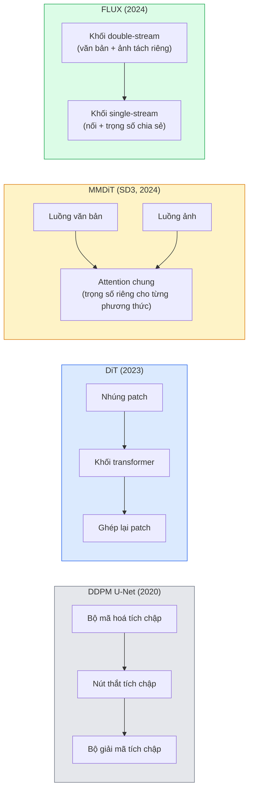

# Transformer khuếch tán (Diffusion Transformer) & Luồng hiệu chỉnh (Rectified Flow)

> U-Net không phải bí mật của khuếch tán. Thay nó bằng transformer, đổi lịch nhiễu sang một luồng đường thẳng, và bạn có ngay SD3, FLUX, cùng mọi mô hình text-to-image của năm 2026.

**Type:** Learn + Build
**Languages:** Python
**Prerequisites:** Giai đoạn 4, Bài 10 (Diffusion DDPM), Bài 14 (ViT), Giai đoạn 7, Bài 02 (Self-attention)
**Time:** ~75 phút

## Mục tiêu học tập

- Lần theo quá trình tiến hoá từ U-Net DDPM (Bài 10) tới transformer khuếch tán (DiT), MMDiT (SD3), và DiT single+double-stream (FLUX)
- Giải thích luồng hiệu chỉnh (rectified flow): vì sao quỹ đạo đường thẳng giữa nhiễu và dữ liệu cho phép mô hình lấy mẫu trong 20 bước thay vì 1000
- Cài đặt một khối DiT nhỏ và một vòng huấn luyện luồng hiệu chỉnh, cả hai dưới 100 dòng
- Phân biệt các biến thể mô hình (SD3, FLUX.1-dev, FLUX.1-schnell, Z-Image, Qwen-Image) theo kiến trúc, số tham số, và giấy phép

## Vấn đề

Bài 10 xây một DDPM với bộ khử nhiễu U-Net. Công thức đó thống trị giai đoạn 2020-2023: U-Net + lịch beta + loss dự đoán nhiễu. Nó sinh ra Stable Diffusion 1.5 và 2.1 cùng DALL-E 2.

Mọi mô hình text-to-image tiên tiến của năm 2026 đều đã vượt qua nó. Stable Diffusion 3, FLUX, SD4, Z-Image, Qwen-Image, Hunyuan-Image — không mô hình nào dùng U-Net. Chúng dùng transformer khuếch tán (DiT). SD3 và FLUX còn đổi lịch nhiễu DDPM sang luồng hiệu chỉnh, thứ làm thẳng đường đi từ nhiễu tới dữ liệu và cho phép suy luận 1-4 bước với các biến thể consistency hoặc distilled.

Sự chuyển dịch này quan trọng vì nó là lý do việc sinh ảnh bằng khuếch tán trở nên điều khiển được, bám prompt (SD3/SD4 đã giải bài toán render chữ), và nhanh ở mức production. Hiểu DiT + luồng hiệu chỉnh là hiểu cả chồng công nghệ sinh ảnh của năm 2026.

## Khái niệm

### Từ U-Net đến transformer



- **DiT** (Peebles & Xie, 2023) — thay U-Net bằng một transformer kiểu ViT trên các patch latent. Điều kiện hoá qua adaptive layer norm (AdaLN).
- **MMDiT** (SD3, Esser et al., 2024) — hai luồng với trọng số riêng cho token văn bản và token ảnh, dùng chung một attention chung.
- **FLUX** (Black Forest Labs, 2024) — N khối đầu là double-stream như SD3, các khối sau nối lại và chia sẻ trọng số (single-stream) để hiệu quả ở độ sâu lớn hơn.
- **Z-Image** (2025) — một DiT single-stream hiệu quả với 6B tham số, thách thức quan điểm "scale bằng mọi giá".

### Luồng hiệu chỉnh trong một đoạn văn

DDPM định nghĩa quá trình thuận là một SDE nhiễu, trong đó `x_t` ngày càng bị phá hỏng. Quá trình đảo học được là một SDE thứ hai, giải bằng 1000 bước nhỏ.

Luồng hiệu chỉnh định nghĩa một phép nội suy **đường thẳng** giữa dữ liệu sạch và nhiễu thuần:

```
x_t = (1 - t) * x_0 + t * epsilon,     t in [0, 1]
```

Huấn luyện một mạng dự đoán trường vận tốc (velocity field) `v_theta(x_t, t) = epsilon - x_0` — hướng thuận dọc đường thẳng từ dữ liệu sạch tới nhiễu (`dx_t/dt`). Khi lấy mẫu, bạn tích phân vận tốc này theo chiều ngược để đi từ nhiễu về phía dữ liệu. ODE thu được gần với đường thẳng hơn nhiều, nên cần ít bước lấy mẫu (sampling step) hơn hẳn.

SD3 gọi đây là **Khớp luồng hiệu chỉnh** (Rectified Flow Matching). FLUX, Z-Image, và hầu hết mô hình năm 2026 dùng cùng mục tiêu này. Suy luận điển hình: 20-30 bước Euler (tất định) so với 50+ bước DDIM trong chế độ DDPM cũ. Các biến thể distilled / turbo / schnell / LCM kéo xuống còn 1-4 bước.

### Điều kiện hoá AdaLN

DiT nhận điều kiện theo lớp và văn bản (class conditioning) qua **adaptive layer norm**: dự đoán `scale` và `shift` từ vector điều kiện rồi áp dụng chúng sau LayerNorm. Sạch hơn nhiều so với điều chế kiểu FiLM trong U-Net và là mặc định ở mọi DiT hiện đại.

```
cond -> MLP -> (scale, shift, gate)
norm(x) * (1 + scale) + shift, then residual add * gate
```

### Bộ mã hoá văn bản trong SD3 và FLUX

- **SD3** dùng ba bộ mã hoá văn bản: hai mô hình CLIP + T5-XXL. Các embedding được nối lại và đưa vào luồng ảnh như điều kiện văn bản.
- **FLUX** dùng một CLIP-L + T5-XXL.
- Các biến thể **Qwen-Image / Z-Image** dùng bộ mã hoá văn bản nội bộ riêng, căn chỉnh với LLM nền của chúng.

Bộ mã hoá văn bản là phần lớn lý do SD3/FLUX hiểu prompt tốt hơn SD1.5 nhiều đến vậy. Chỉ riêng T5-XXL đã 4.7B tham số.

### Classifier-free guidance vẫn giữ nguyên

Luồng hiệu chỉnh thay đổi bộ lấy mẫu, không thay đổi phần điều kiện hoá. Classifier-free guidance (bỏ văn bản với xác suất 10% khi huấn luyện, trộn dự đoán có điều kiện và không điều kiện khi suy luận) hoạt động y hệt với luồng hiệu chỉnh. Hầu hết mô hình năm 2026 dùng guidance scale 3.5-5 — thấp hơn 7.5 của SD1.5 vì mô hình luồng hiệu chỉnh bám prompt chặt hơn ngay từ mặc định.

### Consistency, Turbo, Schnell, LCM

Bốn cái tên cho cùng một ý tưởng: chưng cất một mô hình chậm nhiều bước thành một mô hình nhanh ít bước.

- **LCM (Latent Consistency Model)** — huấn luyện một student dự đoán `x_0` cuối cùng từ bất kỳ `x_t` trung gian nào trong một bước.
- **SDXL Turbo / FLUX schnell** — mô hình 1-4 bước huấn luyện bằng adversarial diffusion distillation.
- **SD Turbo** — Consistency Models kiểu OpenAI được chuyển sang latent diffusion.

Việc phục vụ production cho bất kỳ mô hình mới nào cũng phát hành cả một checkpoint "chất lượng đầy đủ" và một biến thể "turbo / schnell". Schnell ("nhanh" trong tiếng Đức, quy ước của Black Forest Labs) chạy trong 1-4 bước và phù hợp pipeline thời gian thực.

### Bối cảnh mô hình năm 2026

| Model | Size | Architecture | License |
|-------|------|--------------|---------|
| Stable Diffusion 3 Medium | 2B | MMDiT | SAI Community |
| Stable Diffusion 3.5 Large | 8B | MMDiT | SAI Community |
| FLUX.1-dev | 12B | Double + Single Stream DiT | non-commercial |
| FLUX.1-schnell | 12B | same, distilled | Apache 2.0 |
| FLUX.2 | — | iterated FLUX.1 | mixed |
| Z-Image | 6B | S3-DiT (Scalable Single-Stream) | permissive |
| Qwen-Image | ~20B | DiT + Qwen text tower | Apache 2.0 |
| Hunyuan-Image-3.0 | ~80B | DiT | research |
| SD4 Turbo | 3B | DiT + distillation | SAI Commercial |

FLUX.1-schnell là mặc định open-source của năm 2026. Z-Image dẫn đầu về hiệu quả. FLUX.2 và SD4 là đỉnh chất lượng hiện tại.

### Vì sao bước chuyển này quan trọng

DDPM + U-Net đã chạy được. DiT + luồng hiệu chỉnh chạy **tốt hơn, nhanh hơn, và scale sạch hơn**. Bước chuyển này song song với bước chuyển từ RNN sang transformer trong NLP: cả hai kiến trúc giải cùng một bài toán, nhưng transformer scale được và giờ thống trị. Mọi bài báo năm 2026 về sinh ảnh, video, hay 3D đều dùng bộ khử nhiễu hình DiT và thường dùng mục tiêu luồng hiệu chỉnh. U-Net DDPM giờ chủ yếu mang tính sư phạm (Bài 10).

```figure
cv3-rectified-flow
```

## Tự tay làm

### Bước 1: Một khối DiT với AdaLN

```python
import torch
import torch.nn as nn


class AdaLNZero(nn.Module):
    """
    Adaptive LayerNorm with a gate. Predicts (scale, shift, gate) from the conditioning.
    Init such that the whole block starts as identity ("zero init").
    """

    def __init__(self, dim, cond_dim):
        super().__init__()
        self.norm = nn.LayerNorm(dim, elementwise_affine=False)
        self.mlp = nn.Linear(cond_dim, dim * 3)
        nn.init.zeros_(self.mlp.weight)
        nn.init.zeros_(self.mlp.bias)

    def forward(self, x, cond):
        scale, shift, gate = self.mlp(cond).chunk(3, dim=-1)
        h = self.norm(x) * (1 + scale.unsqueeze(1)) + shift.unsqueeze(1)
        return h, gate.unsqueeze(1)


class DiTBlock(nn.Module):
    def __init__(self, dim=192, heads=3, mlp_ratio=4, cond_dim=192):
        super().__init__()
        self.adaln1 = AdaLNZero(dim, cond_dim)
        self.attn = nn.MultiheadAttention(dim, heads, batch_first=True)
        self.adaln2 = AdaLNZero(dim, cond_dim)
        self.mlp = nn.Sequential(
            nn.Linear(dim, dim * mlp_ratio),
            nn.GELU(),
            nn.Linear(dim * mlp_ratio, dim),
        )

    def forward(self, x, cond):
        h, gate1 = self.adaln1(x, cond)
        a, _ = self.attn(h, h, h, need_weights=False)
        x = x + gate1 * a
        h, gate2 = self.adaln2(x, cond)
        x = x + gate2 * self.mlp(h)
        return x
```

`AdaLNZero` khởi đầu như một ánh xạ đồng nhất vì trọng số MLP của nó được khởi tạo bằng 0. Huấn luyện đẩy khối ra khỏi trạng thái đồng nhất; điều này ổn định hoá mô hình khuếch tán transformer sâu một cách rõ rệt.

### Bước 2: Một DiT tí hon

```python
def timestep_embedding(t, dim):
    import math
    half = dim // 2
    freqs = torch.exp(-math.log(10000) * torch.arange(half, device=t.device) / half)
    args = t[:, None].float() * freqs[None]
    return torch.cat([args.sin(), args.cos()], dim=-1)


class TinyDiT(nn.Module):
    def __init__(self, image_size=16, patch_size=2, in_channels=3, dim=96, depth=4, heads=3):
        super().__init__()
        self.patch_size = patch_size
        self.num_patches = (image_size // patch_size) ** 2
        self.patch = nn.Conv2d(in_channels, dim, kernel_size=patch_size, stride=patch_size)
        self.pos = nn.Parameter(torch.zeros(1, self.num_patches, dim))
        self.time_mlp = nn.Sequential(
            nn.Linear(dim, dim * 2),
            nn.SiLU(),
            nn.Linear(dim * 2, dim),
        )
        self.blocks = nn.ModuleList([DiTBlock(dim, heads, cond_dim=dim) for _ in range(depth)])
        self.norm_out = nn.LayerNorm(dim, elementwise_affine=False)
        self.head = nn.Linear(dim, patch_size * patch_size * in_channels)

    def forward(self, x, t):
        n = x.size(0)
        x = self.patch(x)
        x = x.flatten(2).transpose(1, 2) + self.pos
        t_emb = self.time_mlp(timestep_embedding(t, self.pos.size(-1)))
        for blk in self.blocks:
            x = blk(x, t_emb)
        x = self.norm_out(x)
        x = self.head(x)
        return self._unpatchify(x, n)

    def _unpatchify(self, x, n):
        p = self.patch_size
        h = w = int(self.num_patches ** 0.5)
        x = x.view(n, h, w, p, p, -1).permute(0, 5, 1, 3, 2, 4).reshape(n, -1, h * p, w * p)
        return x
```

### Bước 3: Huấn luyện luồng hiệu chỉnh

```python
import torch.nn.functional as F

def rectified_flow_train_step(model, x0, optimizer, device):
    model.train()
    x0 = x0.to(device)
    n = x0.size(0)
    t = torch.rand(n, device=device)
    epsilon = torch.randn_like(x0)
    x_t = (1 - t[:, None, None, None]) * x0 + t[:, None, None, None] * epsilon

    target_velocity = epsilon - x0
    pred_velocity = model(x_t, t)

    loss = F.mse_loss(pred_velocity, target_velocity)
    optimizer.zero_grad()
    loss.backward()
    optimizer.step()
    return loss.item()
```

So với loss dự đoán nhiễu của DDPM (Bài 10): cùng cấu trúc, khác mục tiêu. Thay vì dự đoán nhiễu `epsilon`, ta dự đoán **vận tốc** `epsilon - x_0`, hướng từ dữ liệu tới nhiễu dọc theo phép nội suy đường thẳng.

### Bước 4: Bộ lấy mẫu Euler

Luồng hiệu chỉnh là một ODE. Phương pháp Euler là đơn giản nhất và, với một mô hình luồng hiệu chỉnh được huấn luyện tốt, gần chính xác như các bộ giải ODE (ODE solver) bậc cao ở 20+ bước.

```python
@torch.no_grad()
def rectified_flow_sample(model, shape, steps=20, device="cpu"):
    model.eval()
    x = torch.randn(shape, device=device)
    dt = 1.0 / steps
    t = torch.ones(shape[0], device=device)
    for _ in range(steps):
        v = model(x, t)
        x = x - dt * v
        t = t - dt
    return x
```

20 bước. Trên một mô hình đã huấn luyện, cách này cho mẫu tương đương DDPM 1000 bước.

### Bước 5: Kiểm tra khói đầu-cuối

```python
import numpy as np

def synthetic_blobs(num=200, size=16, seed=0):
    rng = np.random.default_rng(seed)
    out = np.zeros((num, 3, size, size), dtype=np.float32)
    yy, xx = np.meshgrid(np.arange(size), np.arange(size), indexing="ij")
    for i in range(num):
        cx, cy = rng.uniform(4, size - 4, size=2)
        r = rng.uniform(2, 4)
        mask = (xx - cx) ** 2 + (yy - cy) ** 2 < r ** 2
        colour = rng.uniform(-1, 1, size=3)
        for c in range(3):
            out[i, c][mask] = colour[c]
    return torch.from_numpy(out)
```

Huấn luyện một `TinyDiT` trên dữ liệu này bằng luồng hiệu chỉnh. Sau 500 bước, mẫu sinh ra sẽ trông như những đốm màu mờ.

## Áp dụng

Để sinh ảnh thật với FLUX / SD3 / Z-Image, `diffusers` phát hành tất cả chúng với một API thống nhất:

```python
from diffusers import FluxPipeline, StableDiffusion3Pipeline
import torch

pipe = FluxPipeline.from_pretrained(
    "black-forest-labs/FLUX.1-schnell",
    torch_dtype=torch.bfloat16,
).to("cuda")

out = pipe(
    prompt="a golden retriever surfing a tsunami, hyperrealistic, studio lighting",
    guidance_scale=0.0,           # schnell was trained without CFG
    num_inference_steps=4,
    max_sequence_length=256,
).images[0]
out.save("surf.png")
```

Ba dòng. `FLUX.1-schnell` trong bốn bước. Đổi model id sang `black-forest-labs/FLUX.1-dev` để có chất lượng cao hơn ở 20-30 bước với CFG.

Với SD3:

```python
pipe = StableDiffusion3Pipeline.from_pretrained(
    "stabilityai/stable-diffusion-3.5-large",
    torch_dtype=torch.bfloat16,
).to("cuda")
out = pipe(prompt, guidance_scale=3.5, num_inference_steps=28).images[0]
```

## Đóng gói

Bài này tạo ra:

- `outputs/prompt-dit-model-picker.md` — chọn giữa SD3, FLUX.1-dev, FLUX.1-schnell, Z-Image, SD4 Turbo dựa trên chất lượng, độ trễ, và ràng buộc giấy phép.
- `outputs/skill-rectified-flow-trainer.md` — viết một vòng huấn luyện đầy đủ cho luồng hiệu chỉnh với AdaLN DiT và lấy mẫu Euler.

## Bài tập

1. **(Dễ)** Huấn luyện TinyDiT ở trên trên tập dữ liệu đốm tổng hợp trong 500 bước. So sánh mẫu sinh ra với 10, 20, và 50 bước Euler.
2. **(Trung bình)** Thêm điều kiện văn bản bằng cách nối một embedding lớp đã học vào embedding thời gian (10 "lớp" đốm theo màu). Lấy mẫu với lớp 0, 5, và 9 rồi kiểm tra màu có khớp không.
3. **(Khó)** Tính khoảng cách Fréchet (đại diện cho FID) giữa mẫu sinh từ phiên bản luồng hiệu chỉnh và phiên bản DDPM của cùng mạng kích thước đó, huấn luyện trên cùng dữ liệu với cùng số bước. Báo cáo bên nào hội tụ nhanh hơn.

## Thuật ngữ chính

| Thuật ngữ | Người ta thường nói | Ý nghĩa thực sự |
|------|----------------|----------------------|
| DiT | "Transformer khuếch tán" | Transformer thay U-Net làm bộ khử nhiễu khuếch tán; hoạt động trên các latent đã được chia thành patch (patchify) |
| AdaLN | "Adaptive layer norm" | Điều kiện hoá theo timestep/văn bản qua scale, shift, gate đã học, áp dụng sau LayerNorm; chuẩn ở mọi DiT hiện đại |
| MMDiT | "DiT đa phương thức (SD3)" | Các luồng trọng số riêng cho token văn bản và token ảnh, dùng chung một self-attention chung |
| Single-stream / double-stream | "Chiêu của FLUX" | N khối đầu double-stream (trọng số riêng theo từng phương thức), các khối sau single-stream (nối + trọng số chia sẻ) để hiệu quả |
| Rectified flow | "Đường thẳng từ nhiễu tới dữ liệu" | Nội suy tuyến tính giữa dữ liệu và nhiễu; mạng dự đoán vận tốc; cần ít bước ODE hơn khi suy luận |
| Velocity target | "epsilon - x_0" | Mục tiêu hồi quy trong luồng hiệu chỉnh; hướng từ dữ liệu sạch tới nhiễu |
| CFG guidance | "classifier-free guidance" | Trộn dự đoán có điều kiện và không điều kiện; vẫn dùng trong mô hình luồng hiệu chỉnh |
| Schnell / turbo / LCM | "chưng cất 1-4 bước" | Biến thể ít bước được chưng cất từ mô hình chất lượng đầy đủ; chạy thời gian thực ở production |

## Đọc thêm

- [Scalable Diffusion Models with Transformers (Peebles & Xie, 2023)](https://arxiv.org/abs/2212.09748) — bài báo DiT
- [Scaling Rectified Flow Transformers (Esser et al., SD3 paper)](https://arxiv.org/abs/2403.03206) — MMDiT và luồng hiệu chỉnh ở quy mô lớn
- [FLUX.1 model card and technical report (Black Forest Labs)](https://huggingface.co/black-forest-labs/FLUX.1-dev) — chi tiết double + single-stream
- [Z-Image: Efficient Image Generation Foundation Model (2025)](https://arxiv.org/html/2511.22699v1) — DiT single-stream 6B
- [Elucidating the Design Space of Diffusion (Karras et al., 2022)](https://arxiv.org/abs/2206.00364) — tài liệu tham chiếu cho mọi đánh đổi thiết kế khuếch tán
- [Latent Consistency Models (Luo et al., 2023)](https://arxiv.org/abs/2310.04378) — cách LCM-LoRA cho bạn suy luận 4 bước

---

[← Bài trước: 3D Gaussian Splatting từ đầu](../../22-3d-gaussian-splatting/docs/vi.md) · [Bài sau: SAM 3 & Phân đoạn từ vựng mở →](../../24-sam3-open-vocab-segmentation/docs/vi.md)
