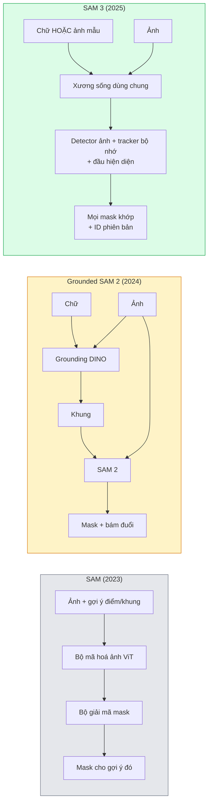

# SAM 3 & Phân đoạn từ vựng mở

> Đưa cho mô hình một gợi ý chữ và một ảnh, nhận về mask cho mọi vật thể khớp. SAM 3 đã biến việc đó thành một lượt forward duy nhất.

**Type:** Use + Build
**Languages:** Python
**Prerequisites:** Giai đoạn 4, Bài 07 (U-Net), Bài 08 (Mask R-CNN), Bài 18 (CLIP)
**Time:** ~60 phút

## Mục tiêu học tập

- Phân biệt SAM (chỉ gợi ý thị giác), Grounded SAM / SAM 2 (detector + SAM) và SAM 3 (gợi ý chữ gốc qua Promptable Concept Segmentation)
- Giải thích kiến trúc SAM 3: xương sống dùng chung + detector ảnh + tracker video dựa trên bộ nhớ + đầu hiện diện + thiết kế detector-tracker tách rời
- Dùng tích hợp SAM 3 trong `transformers` của Hugging Face cho phát hiện, phân đoạn và bám đuổi trong video (video tracking) theo gợi ý chữ
- Chọn giữa SAM 3, Grounded SAM 2, YOLO-World và SAM-MI dựa trên độ trễ, độ phức tạp của khái niệm và đích triển khai

## Vấn đề

SAM ra mắt năm 2023 chỉ là mô hình dùng gợi ý thị giác: bạn bấm một điểm hoặc vẽ một khung và nó trả về một mask. Với câu "cho tôi tất cả quả cam trong ảnh này", bạn cần một detector (Grounding DINO) để tạo khung, rồi SAM phân đoạn từng khung. Grounded SAM biến việc đó thành một pipeline, nhưng đó là chuỗi hai mô hình đóng băng với sai số tích luỹ không thể tránh.

SAM 3 (Meta, tháng 11/2025, ICLR 2026) đã gộp chuỗi đó lại. Nó nhận một cụm danh từ ngắn hoặc một ảnh mẫu làm gợi ý và trả về mọi mask khớp cùng ID phiên bản (instance) chỉ trong một lượt forward. Đó là **Promptable Concept Segmentation (PCS)** — phân đoạn theo gợi ý (promptable segmentation) ở mức khái niệm. Kết hợp với bản cập nhật Object Multiplex tháng 3/2026 (SAM 3.1), nó bám đuổi nhiều phiên bản của cùng một khái niệm trong video một cách hiệu quả.

Bài này nói về sự chuyển dịch cấu trúc mà điều đó đại diện. Phân đoạn 2D, phát hiện và nối chữ với ảnh đã hợp nhất vào một mô hình. Câu hỏi sản xuất không còn là "tôi nối pipeline nào" mà là "mô hình gợi ý nào xử lý trọn vẹn use case của tôi".

## Khái niệm

### Ba thế hệ



### Promptable Concept Segmentation

Một "concept prompt" (gợi ý khái niệm) là một cụm danh từ ngắn (`"yellow school bus"`, `"striped red umbrella"`, `"hand holding a mug"`) hoặc một ảnh mẫu. Mô hình trả về mask phân đoạn cho mọi phiên bản trong ảnh khớp với khái niệm, kèm một ID phiên bản duy nhất cho mỗi kết quả khớp.

Điều này khác SAM gợi ý thị giác cổ điển ở ba điểm:

1. Không cần gợi ý cho từng phiên bản — một gợi ý chữ trả về mọi kết quả khớp.
2. Open-vocabulary (từ vựng mở) — khái niệm có thể là bất kỳ thứ gì mô tả được bằng ngôn ngữ tự nhiên.
3. Trả về nhiều phiên bản cùng lúc thay vì một mask cho mỗi gợi ý.

### Các mảnh kiến trúc chính

- **Shared backbone (xương sống dùng chung)** — một ViT duy nhất xử lý ảnh. Cả đầu detector và tracker dựa trên bộ nhớ đều đọc từ đó.
- **Presence head (đầu hiện diện)** — dự đoán khái niệm có xuất hiện trong ảnh hay không. Tách "có ở đây không?" khỏi "nó ở đâu?". Giảm dương tính giả với khái niệm không có mặt.
- **Decoupled detector-tracker (detector-tracker tách rời)** — phát hiện ở mức ảnh và bám đuổi ở mức video có đầu riêng nên chúng không can thiệp vào nhau.
- **Memory bank (ngân hàng bộ nhớ)** — lưu đặc trưng từng phiên bản qua các khung hình để bám đuổi trong video (cùng cơ chế SAM 2 đã dùng).

### Huấn luyện ở quy mô lớn

SAM 3 được huấn luyện trên **4 triệu khái niệm duy nhất** do một data engine sinh ra, engine này lặp đi lặp lại việc gán nhãn và sửa bằng AI cùng người kiểm duyệt. Bộ **SA-CO benchmark** mới chứa 270K khái niệm duy nhất, lớn hơn 50 lần các benchmark trước. SAM 3 đạt 75-80% hiệu năng của con người trên SA-CO và gấp đôi các hệ thống hiện có trên PCS ảnh + video.

### SAM 3.1 Object Multiplex

Bản cập nhật tháng 3/2026: **Object Multiplex** giới thiệu cơ chế bộ nhớ chia sẻ để bám đuổi đồng thời nhiều phiên bản của cùng một khái niệm. Trước đây, bám đuổi N phiên bản nghĩa là N ngân hàng bộ nhớ riêng. Multiplex gộp thành một bộ nhớ chia sẻ với truy vấn theo từng phiên bản. Kết quả: bám đuổi nhiều vật thể nhanh hơn đáng kể mà không mất độ chính xác.

### Nơi Grounded SAM vẫn còn quan trọng trong 2026

- Khi bạn cần thay một detector từ vựng mở cụ thể (DINO-X, Florence-2).
- Khi giấy phép SAM 3 (gated trên HF) là rào cản.
- Khi bạn cần kiểm soát ngưỡng detector nhiều hơn những gì SAM 3 phơi ra.
- Khi làm nghiên cứu / ablation trên thành phần detector.

Pipeline mô-đun vẫn có chỗ đứng. Với phần lớn công việc sản xuất, SAM 3 là câu trả lời đơn giản hơn.

### YOLO-World so với SAM 3

- **YOLO-World** — chỉ detector từ vựng mở (không mask). Thời gian thực. Tốt nhất khi bạn cần khung ở fps cao.
- **SAM 3** — phân đoạn + bám đuổi đầy đủ. Chậm hơn nhưng đầu ra phong phú hơn.

Phân chia trong sản xuất: YOLO-World cho pipeline chỉ phát hiện nhanh (điều hướng robot, dashboard nhanh), SAM 3 cho mọi thứ cần mask hoặc bám đuổi.

### Hiệu quả của SAM-MI

SAM-MI (2025-2026) giải quyết nút thắt của bộ giải mã trong SAM. Các ý chính:

- **Sparse point prompting (gợi ý điểm thưa)** — dùng vài điểm chọn kỹ thay vì gợi ý dày; giảm 96% số lượt gọi decoder.
- **Shallow mask aggregation (gộp mask nông)** — gộp các dự đoán mask thô thành một mask sắc nét hơn.
- **Decoupled mask injection (tiêm mask tách rời)** — decoder nhận đặc trưng mask tính sẵn thay vì chạy lại.

Kết quả: nhanh hơn ~1.6× so với Grounded-SAM trên các benchmark từ vựng mở.

### Định dạng đầu ra của ba mô hình

Cả ba trả về cùng một cấu trúc tổng quát (khung + nhãn + điểm + mask + ID), rất tiện — pipeline phía sau của bạn không phải rẽ nhánh theo mô hình nào đã chạy.

```figure
cv3-open-vocab
```

## Tự tay làm

### Bước 1: Dựng gợi ý

Viết một helper biến câu của người dùng thành danh sách gợi ý khái niệm cho SAM 3. Đây là ranh giới nơi "người dùng đã gõ gì" gặp "mô hình tiêu thụ gì".

```python
def split_concepts(sentence):
    """
    Heuristic splitter for multi-concept prompts.
    Returns list of short noun phrases.
    """
    for sep in [",", ";", "and", "or", "&"]:
        if sep in sentence:
            parts = [p.strip() for p in sentence.replace("and ", ",").split(",")]
            return [p for p in parts if p]
    return [sentence.strip()]

print(split_concepts("cats, dogs and balloons"))
```

SAM 3 nhận một khái niệm mỗi lượt forward; với truy vấn nhiều khái niệm, hãy lặp hoặc batch chúng.

### Bước 2: Helper hậu xử lý

Biến đầu ra thô của SAM 3 thành danh sách phát hiện sạch, khớp hợp đồng pipeline của Giai đoạn 4, Bài 16.

```python
from dataclasses import dataclass
from typing import List

@dataclass
class ConceptDetection:
    concept: str
    instance_id: int
    box: tuple          # (x1, y1, x2, y2)
    score: float
    mask_rle: str       # run-length encoded


def rle_encode(binary_mask):
    flat = binary_mask.flatten().astype("uint8")
    runs = []
    prev, count = flat[0], 0
    for v in flat:
        if v == prev:
            count += 1
        else:
            runs.append((int(prev), count))
            prev, count = v, 1
    runs.append((int(prev), count))
    return ";".join(f"{v}x{c}" for v, c in runs)
```

RLE giữ payload phản hồi nhỏ gọn kể cả với nhiều mask độ phân giải cao. Cùng định dạng đó dùng được cho SAM 2, SAM 3 và Grounded SAM 2.

### Bước 3: Giao diện phân đoạn từ vựng mở thống nhất

Bọc bất kỳ backend nào bạn có (SAM 3, Grounded SAM 2, YOLO-World + SAM 2) sau một phương thức duy nhất. Code phía sau của bạn không đổi khi backend đổi.

```python
from abc import ABC, abstractmethod
import numpy as np

class OpenVocabSeg(ABC):
    @abstractmethod
    def detect(self, image: np.ndarray, concept: str) -> List[ConceptDetection]:
        ...


class StubOpenVocabSeg(OpenVocabSeg):
    """
    Deterministic stub used for pipeline testing when real models are not loaded.
    """
    def detect(self, image, concept):
        h, w = image.shape[:2]
        return [
            ConceptDetection(
                concept=concept,
                instance_id=0,
                box=(w * 0.2, h * 0.3, w * 0.5, h * 0.8),
                score=0.89,
                mask_rle="0x100;1x50;0x200",
            ),
            ConceptDetection(
                concept=concept,
                instance_id=1,
                box=(w * 0.55, h * 0.25, w * 0.85, h * 0.75),
                score=0.74,
                mask_rle="0x80;1x40;0x220",
            ),
        ]
```

Lớp con thật `SAM3OpenVocabSeg` sẽ bọc `transformers.Sam3Model` và `Sam3Processor`.

### Bước 4: Dùng SAM 3 trên Hugging Face (tham khảo)

Với mô hình thật, tích hợp `transformers` trông như sau:

```python
from transformers import Sam3Processor, Sam3Model
import torch

processor = Sam3Processor.from_pretrained("facebook/sam3")
model = Sam3Model.from_pretrained("facebook/sam3").eval()

inputs = processor(images=pil_image, return_tensors="pt")
inputs = processor.set_text_prompt(inputs, "yellow school bus")

with torch.no_grad():
    outputs = model(**inputs)

masks = processor.post_process_masks(
    outputs.masks, inputs.original_sizes, inputs.reshaped_input_sizes
)
boxes = outputs.boxes
scores = outputs.scores
```

Một gợi ý, mọi kết quả khớp trả về trong một lần gọi.

### Bước 5: Đo những gì Grounded SAM 2 từng cho không

Một benchmark trung thực: điều gì xảy ra khi bạn thay Grounded SAM 2 bằng SAM 3 trong một pipeline thật?

- Độ trễ: SAM 3 tiết kiệm một lượt forward (không cần detector riêng) nhưng bản thân mô hình nặng hơn; thường trung tính hoặc nhanh hơn chút.
- Độ chính xác: SAM 3 tốt hơn đáng kể với khái niệm hiếm hoặc ghép ("striped red umbrella"). Tương đương với khái niệm một từ phổ biến.
- Linh hoạt: Grounded SAM 2 cho bạn thay detector (DINO-X, Florence-2, Grounding DINO 1.5); SAM 3 là nguyên khối.

Kết luận: SAM 3 là mặc định cho phân đoạn từ vựng mở năm 2026. Grounded SAM 2 vẫn là câu trả lời đúng khi bạn cần linh hoạt detector hoặc điều khoản giấy phép khác.

## Áp dụng

Các mẫu triển khai trong sản xuất:

- **Gán nhãn thời gian thực** — SAM 3 + tính năng lấy nhãn làm gợi ý chữ của CVAT. Người gán nhãn chọn tên nhãn; SAM 3 gán nhãn trước cho mọi phiên bản khớp. Sau đó xem lại và sửa.
- **Phân tích video** — SAM 3.1 Object Multiplex cho bám đuổi nhiều vật thể; nạp khung hình vào tracker dựa trên bộ nhớ.
- **Robot** — SAM 3 cho thao tác từ vựng mở ("pick up the red cup"); chạy như một primitive lập kế hoạch.
- **Chẩn đoán hình ảnh** — SAM 3 fine-tune trên khái niệm y tế; cần gửi yêu cầu truy cập trên HF.

Ultralytics bọc SAM 3 trong gói Python của nó:

```python
from ultralytics import SAM

model = SAM("sam3.pt")
results = model(image_path, prompts="yellow school bus")
```

Cùng giao diện như YOLO và SAM 2.

## Đóng gói

Bài này tạo ra:

- `outputs/prompt-open-vocab-stack-picker.md` — một prompt chọn SAM 3 / Grounded SAM 2 / YOLO-World / SAM-MI dựa trên độ trễ, độ phức tạp khái niệm và giấy phép.
- `outputs/skill-concept-prompt-designer.md` — một skill biến lời người dùng thành gợi ý khái niệm SAM 3 đúng chuẩn (tách, phân định, dự phòng).

## Bài tập

1. **(Dễ)** Chạy SAM 3 trên 10 ảnh với những gợi ý khái niệm bạn tự chọn. So sánh với SAM 2 + Grounding DINO 1.5 trên cùng các ảnh đó. Báo cáo mô hình nào bỏ sót khái niệm nào.
2. **(Trung bình)** Xây UI "bấm để chọn / bấm để loại" trên SAM 3: một gợi ý chữ trả về các phiên bản ứng viên; người dùng bấm giữ những cái nào được tính là dương. Xuất tập khái niệm cuối cùng ra JSON.
3. **(Khó)** Fine-tune SAM 3 trên một tập khái niệm riêng (ví dụ 5 loại linh kiện điện tử) với 20 ảnh gán nhãn cho mỗi loại. So sánh với SAM 3 zero-shot (chuyển giao không mẫu) trên cùng tập test; đo mức cải thiện IoU của mask.

## Thuật ngữ chính

| Thuật ngữ | Người ta thường nói | Ý nghĩa thực sự |
|------|----------------|----------------------|
| Open-vocabulary segmentation | "Segment by text" | Tạo mask cho vật thể được mô tả bằng ngôn ngữ tự nhiên, không phải một tập nhãn cố định |
| PCS | "Promptable Concept Segmentation" | Tác vụ cốt lõi của SAM 3 — cho một cụm danh từ hoặc ảnh mẫu, phân đoạn mọi phiên bản khớp |
| Concept prompt | "The text input" | Cụm danh từ ngắn hoặc ảnh mẫu; không phải một câu đầy đủ |
| Presence head | "Is it here?" | Mô-đun của SAM 3 quyết định khái niệm có tồn tại trong ảnh hay không trước khi định vị |
| SA-CO | "SAM 3 benchmark" | Benchmark phân đoạn từ vựng mở với 270K khái niệm; lớn hơn 50 lần benchmark từ vựng mở trước |
| Object Multiplex | "SAM 3.1 update" | Bám đuổi nhiều vật thể dùng bộ nhớ chia sẻ; bám đuổi đồng thời nhiều phiên bản rất nhanh |
| Grounded SAM 2 | "Modular pipeline" | Chuỗi detector + SAM 2; vẫn đáng dùng khi việc thay detector là quan trọng |
| SAM-MI | "Efficient SAM variant" | Mask Injection cho tốc độ nhanh hơn 1.6x so với Grounded-SAM |

## Đọc thêm

- [SAM 3: Segment Anything with Concepts (arXiv 2511.16719)](https://arxiv.org/abs/2511.16719)
- [SAM 3.1 Object Multiplex (Meta AI, tháng 3/2026)](https://ai.meta.com/blog/segment-anything-model-3/)
- [Trang mô hình SAM 3 trên Hugging Face](https://huggingface.co/facebook/sam3)
- [Hướng dẫn Grounded SAM 2 (PyImageSearch)](https://pyimagesearch.com/2026/01/19/grounded-sam-2-from-open-set-detection-to-segmentation-and-tracking/)
- [Tài liệu SAM 3 của Ultralytics](https://docs.ultralytics.com/models/sam-3/)
- [SAM3-I: Instruction-aware SAM (arXiv 2512.04585)](https://arxiv.org/abs/2512.04585)

---

[← Bài trước: Transformer khuếch tán (Diffusion Transformer) & Luồng hiệu chỉnh (Rectified Flow)](../../23-diffusion-transformers-rectified-flow/docs/vi.md) · [Bài sau: Mô hình thị giác - ngôn ngữ →](../../25-vision-language-models/docs/vi.md)
