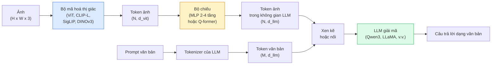

# Mô hình thị giác - ngôn ngữ — Mẫu ViT-MLP-LLM

> Một bộ mã hoá thị giác chuyển ảnh thành token. Một projector (bộ chiếu) MLP ánh xạ các token đó vào không gian embedding của LLM. Phần còn lại do mô hình ngôn ngữ làm. Mẫu đó — ViT-MLP-LLM — chính là mọi VLM đang chạy production năm 2026.

**Type:** Learn + Use
**Languages:** Python
**Prerequisites:** Giai đoạn 4, Bài 14 (ViT), Bài 18 (CLIP), Giai đoạn 7, Bài 02 (Self-attention)
**Time:** ~75 phút

## Mục tiêu học tập

- Nêu kiến trúc ViT-MLP-LLM và giải thích mỗi thành phần trong bộ ba đóng góp gì
- So sánh Qwen3-VL, InternVL3.5, LLaVA-Next và GLM-4.6V theo số tham số, độ dài ngữ cảnh và hiệu năng benchmark
- Giải thích DeepStack: vì sao đặc trưng ViT đa tầng siết chặt alignment (căn chỉnh) thị giác - ngôn ngữ tốt hơn một đặc trưng tầng cuối duy nhất
- Đo hallucination (ảo giác) của VLM trong production bằng Cross-Modal Error Rate (CMER) và hành động dựa trên tín hiệu đó

## Vấn đề

CLIP (Giai đoạn 4, Bài 18) cho bạn một không gian embedding chung cho ảnh và văn bản, đủ cho phân loại zero-shot và truy xuất. Nó không trả lời được "ảnh này có bao nhiêu chiếc xe đỏ?" vì CLIP không sinh văn bản — nó chỉ chấm điểm tương đồng.

Các VLM (vision-language model — mô hình thị giác - ngôn ngữ) — Qwen3-VL, InternVL3.5, LLaVA-Next, GLM-4.6V — gắn một bộ mã hoá ảnh thuộc họ CLIP vào một mô hình ngôn ngữ đầy đủ. Mô hình nhìn ảnh kèm câu hỏi và sinh ra câu trả lời. Năm 2026, các VLM mã nguồn mở sánh ngang hoặc vượt GPT-5 và Gemini-2.5-Pro trên các benchmark đa phương thức (MMMU, MMBench, DocVQA, ChartQA, MathVista, OSWorld).

Bộ ba thành phần (ViT, projector, LLM) là chuẩn. Khác biệt giữa các mô hình nằm ở việc chọn ViT nào, projector nào, LLM nào, dữ liệu huấn luyện và công thức căn chỉnh. Khi đã hiểu mẫu này, thay bất kỳ thành phần nào chỉ là việc cơ học.

## Khái niệm

### Kiến trúc ViT-MLP-LLM



1. **Bộ mã hoá thị giác** — một ViT đã pretrain (CLIP-L/14, SigLIP, DINOv3, hoặc một biến thể fine-tune). Sinh ra các patch token.
2. **Projector** — một module nhỏ (MLP 2-4 tầng, hoặc Q-former) ánh xạ token thị giác vào chiều embedding của LLM. Đây là nơi phần lớn việc fine-tune diễn ra.
3. **LLM** — một mô hình ngôn ngữ chỉ có decoder (Qwen3, Llama, Mistral, GLM, InternLM). Đọc token thị giác + văn bản theo trình tự, sinh văn bản.

Về nguyên tắc, cả ba thành phần đều huấn luyện được. Trong thực tế, bộ mã hoá thị giác và LLM gần như đóng băng trong khi projector được huấn luyện — tín hiệu vài tỷ tham số với chi phí rẻ.

### DeepStack

Projection cơ bản chỉ dùng tầng ViT cuối. DeepStack (Qwen3-VL) lấy mẫu đặc trưng từ nhiều độ sâu ViT rồi xếp chồng chúng. Tầng sâu mang ngữ nghĩa bậc cao; tầng nông mang thông tin không gian và kết cấu chi tiết. Đưa cả hai vào LLM sẽ lấp khoảng cách giữa "ảnh chứa gì" (ngữ nghĩa) và "chính xác ở đâu" (grounding — neo vào ảnh theo không gian).

### Ba giai đoạn huấn luyện

Các VLM hiện đại huấn luyện theo giai đoạn:

1. **Alignment** — đóng băng ViT và LLM. Chỉ huấn luyện projector trên các cặp ảnh - chú thích (image captioning — tạo chú thích ảnh). Dạy projector ánh xạ không gian thị giác sang không gian ngôn ngữ.
2. **Pre-training** — mở băng mọi thứ. Huấn luyện trên dữ liệu ảnh - văn bản xen kẽ quy mô lớn (500M+ cặp). Xây dựng kiến thức thị giác của mô hình.
3. **Instruction tuning** (tinh chỉnh theo chỉ dẫn) — fine-tune trên các bộ ba (ảnh, câu hỏi, câu trả lời) đã tuyển chọn. Dạy hành vi hội thoại và định dạng tác vụ, trong đó có VQA (visual question answering — hỏi đáp trên ảnh). Đây là bước biến một "LM biết về thị giác" thành trợ lý dùng được.

Hầu hết các lần fine-tune LoRA đều nhắm vào giai đoạn 3 với một tập dữ liệu gán nhãn nhỏ.

### So sánh các dòng mô hình (đầu 2026)

| Mô hình | Tham số | Bộ mã hoá thị giác | LLM | Ngữ cảnh | Điểm mạnh |
|-------|--------|----------------|-----|---------|-----------|
| Qwen3-VL-235B-A22B (MoE) | 235B (22B active) | custom ViT + DeepStack | Qwen3 | 256K | SOTA tổng quát, agent GUI |
| Qwen3-VL-30B-A3B (MoE) | 30B (3B active) | custom ViT + DeepStack | Qwen3 | 256K | Phương án MoE nhỏ hơn |
| Qwen3-VL-8B (dense) | 8B | custom ViT | Qwen3 | 128K | Mặc định dense cho production |
| InternVL3.5-38B | 38B | InternViT-6B | Qwen3 + GPT-OSS | 128K | Mạnh ở MMBench / MMVet |
| InternVL3.5-241B-A28B | 241B (28B active) | InternViT-6B | Qwen3 | 128K | Cạnh tranh với GPT-4o |
| LLaVA-Next 72B | 72B | SigLIP | Llama-3 | 32K | Mở, dễ fine-tune |
| GLM-4.6V | ~70B | custom | GLM | 64K | Mã nguồn mở, OCR mạnh |
| MiniCPM-V-2.6 | 8B | SigLIP | MiniCPM | 32K | Thân thiện với thiết bị biên |

### Các visual agent

Qwen3-VL-235B đạt hiệu năng toàn cầu cao nhất trên OSWorld — một benchmark cho **visual agent** vận hành GUI (máy tính để bàn, di động, web). Mô hình nhìn ảnh chụp màn hình, hiểu UI và phát ra hành động (nhấp, gõ, cuộn). Kết hợp với công cụ, nó khép kín vòng lặp cho các tác vụ máy tính để bàn thông dụng. Đây chính là thứ chạy bên dưới hầu hết các demo "AI PC" năm 2026.

### Năng lực agent + các biến thể RoPE

VLM cần biết **khi nào** một khung hình xuất hiện trong video. Qwen3-VL tiến hoá từ T-RoPE (temporal rotary position embeddings) sang **text-based time alignment** — các token văn bản mốc thời gian tường minh xen kẽ với khung hình video. Mô hình thấy "`<timestamp 00:32>` frame, prompt" và có thể suy luận về quan hệ thời gian.

### Vấn đề căn chỉnh

12% các cặp ảnh - văn bản trong một tập dữ liệu thu thập (crawl) chứa mô tả không hoàn toàn neo vào ảnh. Một VLM huấn luyện trên đó sẽ âm thầm học cách ảo giác — bịa ra vật thể, đọc sai con số, tạo ra quan hệ không có. Trong production đây là kiểu lỗi chiếm ưu thế.

Skywork.ai giới thiệu **Cross-Modal Error Rate (CMER)** để theo dõi điều này:

```
CMER = fraction of outputs where the text confidence is high but the image-text similarity (via a CLIP-family checker) is low
```

CMER cao nghĩa là mô hình đang tự tin nói những điều không neo vào ảnh. Theo dõi CMER và coi nó như một KPI production đã cắt tỷ lệ ảo giác khoảng 35% trong triển khai của họ. Mấu chốt không phải "sửa mô hình" mà là "đưa các output CMER cao sang người rà soát".

### Fine-tune với LoRA / QLoRA

Fine-tune toàn phần một VLM 70B là ngoài tầm với của hầu hết đội nhóm. LoRA (rank 16-64) trên các tầng attention + projector, hoặc QLoRA với trọng số gốc 4-bit, vừa một A100 / H100. Chi phí: 5,000-50,000 ví dụ, $100-$5,000 tiền compute, 2-10 giờ huấn luyện.

### Suy luận không gian vẫn còn yếu

VLM hiện tại đạt 50-60% trên các benchmark suy luận không gian (trên-dưới, trái-phải, đếm, khoảng cách). Nếu use case của bạn phụ thuộc vào "vật nào nằm trên vật nào", hãy kiểm chứng kỹ — hiệu năng VLM tổng quát thấp hơn con người. Các lựa chọn thay thế tốt hơn VLM cho tác vụ thuần không gian: một bộ ước lượng keypoint / pose chuyên dụng, một mô hình độ sâu, hoặc một mô hình phát hiện với hình học box được hậu xử lý.

```figure
v4-vlm-projector
```

## Tự tay làm

### Bước 1: Projector

Phần bạn sẽ huấn luyện thường xuyên nhất. MLP 2-4 tầng với GELU.

```python
import torch
import torch.nn as nn


class Projector(nn.Module):
    def __init__(self, vit_dim=768, llm_dim=4096, hidden=4096):
        super().__init__()
        self.net = nn.Sequential(
            nn.Linear(vit_dim, hidden),
            nn.GELU(),
            nn.Linear(hidden, llm_dim),
        )

    def forward(self, x):
        return self.net(x)
```

Đầu vào là một tensor token `(N_patches, d_vit)`. Đầu ra là `(N_patches, d_llm)`. LLM coi mỗi hàng đầu ra như một token bình thường.

### Bước 2: Lắp ViT-MLP-LLM end-to-end

Khung của lượt forward cho một VLM tối giản. Code thật dùng `transformers`; đây là bố cục khái niệm.

```python
class MinimalVLM(nn.Module):
    def __init__(self, vit, projector, llm, image_token_id):
        super().__init__()
        self.vit = vit
        self.projector = projector
        self.llm = llm
        self.image_token_id = image_token_id  # placeholder token in text prompt

    def forward(self, image, input_ids, attention_mask):
        # 1. vision features
        vision_tokens = self.vit(image)                     # (B, N_patches, d_vit)
        vision_embeds = self.projector(vision_tokens)       # (B, N_patches, d_llm)

        # 2. text embeddings
        text_embeds = self.llm.get_input_embeddings()(input_ids)  # (B, M, d_llm)

        # 3. replace image placeholder tokens with vision embeds
        merged = self._merge(text_embeds, vision_embeds, input_ids)

        # 4. run LLM
        return self.llm(inputs_embeds=merged, attention_mask=attention_mask)

    def _merge(self, text_embeds, vision_embeds, input_ids):
        out = text_embeds.clone()
        expected = vision_embeds.size(1)
        for b in range(input_ids.size(0)):
            positions = (input_ids[b] == self.image_token_id).nonzero(as_tuple=True)[0]
            if len(positions) != expected:
                raise ValueError(
                    f"batch item {b} has {len(positions)} image tokens but vision_embeds has {expected} patches."
                    " Every sample in the batch must be pre-padded to the same number of image placeholder tokens.")
            out[b, positions] = vision_embeds[b]
        return out
```

Token giữ chỗ `<image>` trong văn bản được thay bằng embedding ảnh thật — cùng mẫu mà LLaVA, Qwen-VL và InternVL dùng.

### Bước 3: Tính CMER

Một kiểm tra runtime nhẹ.

```python
import torch.nn.functional as F


def cross_modal_error_rate(image_emb, text_emb, text_confidence, sim_threshold=0.25, conf_threshold=0.8):
    """
    image_emb, text_emb: embeddings of image and generated text (normalised internally)
    text_confidence:     mean per-token probability in [0, 1]
    Returns:             fraction of high-confidence outputs with low image-text alignment
    """
    image_emb = F.normalize(image_emb, dim=-1)
    text_emb = F.normalize(text_emb, dim=-1)
    sim = (image_emb * text_emb).sum(dim=-1)        # cosine similarity
    high_conf_low_sim = (text_confidence > conf_threshold) & (sim < sim_threshold)
    return high_conf_low_sim.float().mean().item()
```

Coi CMER là một KPI production. Theo dõi nó theo từng endpoint, từng kiểu prompt, từng khách hàng. CMER tăng cho thấy mô hình bắt đầu ảo giác trên một phân phối đầu vào nào đó.

### Bước 4: Bộ phân loại VLM đồ chơi (chạy được)

Chứng minh projector huấn luyện được. "Đặc trưng ViT" giả được đưa vào; một token kiểu LLM tí hon dự đoán lớp.

```python
class ToyVLM(nn.Module):
    def __init__(self, vit_dim=32, llm_dim=64, num_classes=5):
        super().__init__()
        self.projector = Projector(vit_dim, llm_dim, hidden=64)
        self.head = nn.Linear(llm_dim, num_classes)

    def forward(self, vision_tokens):
        projected = self.projector(vision_tokens)
        pooled = projected.mean(dim=1)
        return self.head(pooled)
```

Có thể fit mô hình này trên các cặp (đặc trưng, lớp) tổng hợp trong dưới 200 bước — đủ để cho thấy mẫu projector hoạt động.

## Áp dụng

Ba cách các đội production dùng VLM năm 2026:

- **API có sẵn** — OpenAI Vision, Anthropic Claude Vision, Google Gemini Vision. Không cần hạ tầng, nhưng có rủi ro nhà cung cấp.
- **Tự host mã nguồn mở** — Qwen3-VL hoặc InternVL3.5 qua `transformers` và `vllm`. Kiểm soát hoàn toàn, công sức ban đầu cao hơn.
- **Fine-tune theo miền** — nạp Qwen2.5-VL-7B hoặc LLaVA-1.6-7B, LoRA trên 5k-50k ví dụ tùy chỉnh, phục vụ bằng `vllm` hoặc `TGI`.

```python
from transformers import AutoProcessor, AutoModelForVision2Seq
import torch
from PIL import Image

model_id = "Qwen/Qwen3-VL-8B-Instruct"
processor = AutoProcessor.from_pretrained(model_id)
model = AutoModelForVision2Seq.from_pretrained(model_id, torch_dtype=torch.bfloat16, device_map="auto")

messages = [{
    "role": "user",
    "content": [
        {"type": "image", "image": Image.open("plot.png")},
        {"type": "text", "text": "What does this chart show?"},
    ],
}]
inputs = processor.apply_chat_template(messages, add_generation_prompt=True, tokenize=True, return_dict=True, return_tensors="pt").to("cuda")
generated = model.generate(**inputs, max_new_tokens=256)
answer = processor.decode(generated[0][inputs["input_ids"].shape[1]:], skip_special_tokens=True)
```

`apply_chat_template` che giấu việc token hoá token giữ chỗ `<image>`; mô hình tự xử lý việc hợp nhất bên trong.

## Đóng gói

Bài học này tạo ra:

- `outputs/prompt-vlm-selector.md` — chọn Qwen3-VL / InternVL3.5 / LLaVA-Next / API dựa trên độ chính xác, độ trễ, độ dài ngữ cảnh và ngân sách.
- `outputs/skill-cmer-monitor.md` — phát ra code để gắn công cụ đo cross-modal error rate cho một endpoint VLM production, dashboard theo endpoint và ngưỡng cảnh báo.

## Bài tập

1. **(Dễ)** Chạy ba prompt ("cái này là gì?", "đếm các vật thể", "mô tả cảnh") qua một VLM mở bất kỳ trên năm ảnh. Chấm thủ công từng câu trả lời là đúng / đúng một phần / ảo giác. Tính tỷ lệ kiểu CMER cho lần chạy đầu.
2. **(Trung bình)** Fine-tune Qwen2.5-VL-3B hoặc LLaVA-1.6-7B bằng LoRA (rank 16) trên 500 ảnh của một miền mục tiêu kèm chú thích. So sánh độ chính xác kiểu MMBench giữa zero-shot và sau fine-tune.
3. **(Khó)** Thay bộ mã hoá ảnh của VLM bằng DINOv3 thay vì SigLIP/CLIP mặc định. Chỉ huấn luyện lại projector (LLM đóng băng + DINOv3 đóng băng). Đo xem các tác vụ dự đoán dày đặc (đếm, suy luận không gian) có cải thiện không.

## Thuật ngữ chính

| Thuật ngữ | Người ta thường nói | Ý nghĩa thực sự |
|------|----------------|----------------------|
| ViT-MLP-LLM | "Mẫu VLM" | Bộ mã hoá thị giác + projector + mô hình ngôn ngữ; mọi VLM năm 2026 |
| Projector | "Cây cầu" | MLP 2-4 tầng (hoặc Q-former) ánh xạ token thị giác vào không gian embedding của LLM |
| DeepStack | "Chiêu đặc trưng của Qwen3-VL" | Đặc trưng ViT đa tầng được xếp chồng thay vì chỉ dùng tầng cuối |
| Image token | "Token giữ chỗ <image>" | Token đặc biệt trong luồng văn bản, được thay bằng embedding thị giác đã chiếu |
| CMER | "KPI ảo giác" | Cross-Modal Error Rate; cao khi độ tin cậy của văn bản cao nhưng tương đồng ảnh - văn bản thấp |
| Visual agent | "VLM biết nhấp chuột" | VLM vận hành GUI (OSWorld, di động, web) bằng lời gọi công cụ |
| Q-former | "Cầu token số lượng cố định" | Projector kiểu BLIP-2 tạo ra số token truy vấn thị giác cố định |
| Alignment / pre-training / instruction tuning | "Ba giai đoạn" | Pipeline huấn luyện VLM chuẩn |

## Đọc thêm

- [Qwen3-VL Technical Report (arXiv 2511.21631)](https://arxiv.org/abs/2511.21631)
- [InternVL3.5 Advancing Open-Source Multimodal Models (arXiv 2508.18265)](https://arxiv.org/html/2508.18265v1)
- [LLaVA-Next series](https://llava-vl.github.io/blog/2024-05-10-llava-next-stronger-llms/)
- [BentoML: Best Open-Source VLMs 2026](https://www.bentoml.com/blog/multimodal-ai-a-guide-to-open-source-vision-language-models)
- [MMMU: Multi-discipline Multimodal Understanding benchmark](https://mmmu-benchmark.github.io/)
- [VLMs in manufacturing (Robotics Tomorrow, March 2026)](https://www.roboticstomorrow.com/story/2026/03/when-machines-learn-to-see-like-experts-the-rise-of-vision-language-models-in-manufacturing/26335/)

---

[← Bài trước: SAM 3 & Phân đoạn từ vựng mở](../../24-sam3-open-vocab-segmentation/docs/vi.md) · [Bài sau: Ước lượng độ sâu đơn ảnh (monocular depth) & hình học →](../../26-monocular-depth/docs/vi.md)
