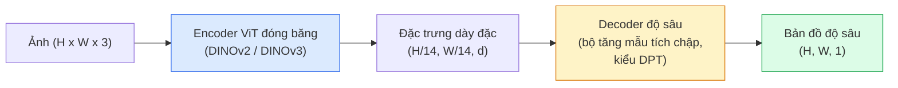

# Ước lượng độ sâu đơn ảnh (monocular depth) & hình học

> Bản đồ độ sâu là một ảnh một kênh, mỗi pixel là khoảng cách từ camera. Dự đoán nó chỉ từ một khung RGB từng là điều bất khả thi nếu không có stereo hay LiDAR. Đến 2026, một encoder ViT đóng băng cộng thêm một head nhẹ đạt sai số chỉ vài phần trăm so với ground truth.

**Type:** Build + Use
**Languages:** Python
**Prerequisites:** Giai đoạn 4, Bài 14 (ViT), Bài 17 (Thị giác tự giám sát), Bài 07 (U-Net)
**Time:** ~60 phút

## Mục tiêu học tập

- Phân biệt độ sâu tương đối (relative depth) và độ sâu theo mét (metric depth), rồi nói rõ mỗi mô hình production (MiDaS, Marigold, Depth Anything V3, ZoeDepth) giải quyết loại nào
- Dùng Depth Anything V3 (backbone DINOv2) để dự đoán độ sâu cho ảnh đơn tùy ý mà không cần hiệu chuẩn
- Giải thích vì sao độ sâu đơn ảnh lại hoạt động được chỉ từ một ảnh (manh mối phối cảnh, gradient vân, prior học được), và những gì nó không thể khôi phục: mơ hồ tỉ lệ (scale ambiguity) và hình học bị che khuất
- Nâng các phát hiện 2D lên điểm 3D bằng bản đồ độ sâu và thông số nội tại của camera lỗ kim

## Vấn đề

Độ sâu là trục còn thiếu trong thị giác máy tính 2D. Với RGB, bạn biết vật thể xuất hiện ở đâu trên mặt phẳng ảnh; bạn không biết chúng xa bao nhiêu. Cảm biến độ sâu (giàn stereo, LiDAR, time-of-flight) giải quyết trực tiếp nhưng đắt, dễ hỏng và giới hạn tầm.

Ước lượng độ sâu đơn ảnh — dự đoán độ sâu từ một khung RGB duy nhất — từng cho ra kết quả mờ và không đáng tin. Đến 2026, các encoder lớn đã pretrained đã thay đổi điều đó: Depth Anything V3 dùng backbone DINOv2 đóng băng và tạo ra bản đồ độ sâu tổng quát hóa được qua miền trong nhà, ngoài trời, y tế và vệ tinh. Marigold định nghĩa lại độ sâu như một bài toán diffusion có điều kiện. ZoeDepth hồi quy khoảng cách theo mét thật.

Độ sâu cũng là cầu nối giữa phát hiện 2D và hiểu biết 3D: nhân pixel của một box được phát hiện với độ sâu, bạn nâng vật thể 2D lên thành đám mây điểm 3D. Đó là lõi của mọi hệ thống che khuất AR, mọi pipeline tránh vật cản, và mọi robot "nhặt cái cốc".

## Khái niệm

### Độ sâu tương đối so với độ sâu theo mét

- **Độ sâu tương đối** — các giá trị `z` có thứ tự nhưng không có đơn vị thực tế. "Pixel A gần hơn pixel B, nhưng tỉ lệ khoảng cách không được neo vào mét."
- **Độ sâu theo mét** — khoảng cách tuyệt đối tính bằng mét từ camera. Đòi hỏi mô hình đã học được quan hệ thống kê giữa manh mối trong ảnh và khoảng cách thật.

MiDaS và Depth Anything V3 tạo ra độ sâu tương đối. Marigold tạo ra độ sâu tương đối. ZoeDepth, UniDepth và Metric3D tạo ra độ sâu theo mét. Mô hình theo mét nhạy với thông số nội tại camera; mô hình tương đối thì không.

### Mẫu encoder-decoder



Depth Anything V3 đóng băng encoder và chỉ huấn luyện decoder kiểu DPT. Encoder cung cấp đặc trưng phong phú; decoder nội suy chúng trở lại độ phân giải ảnh và hồi quy độ sâu.

### Vì sao một ảnh duy nhất vẫn cho ra độ sâu

Một ảnh 2D chứa nhiều manh mối đơn ảnh tương quan với độ sâu:

- **Phối cảnh** — các đường song song trong 3D hội tụ trong 2D.
- **Gradient vân** — bề mặt ở xa có vân nhỏ hơn và dày hơn.
- **Thứ tự che khuất** — vật gần che vật xa.
- **Hằng định kích thước** — vật đã biết (ô tô, người) cho tỉ lệ xấp xỉ.
- **Phối cảnh khí quyển** — vật ở xa trông mờ sương và xanh hơn trong cảnh ngoài trời.

Một ViT huấn luyện trên hàng tỉ ảnh sẽ nội hóa các manh mối này. Với đủ dữ liệu và một backbone mạnh, độ sâu đơn ảnh đạt độ chính xác hợp lý mà không cần giám sát 3D tường minh.

### Những gì độ sâu đơn ảnh không làm được

- **Tỉ lệ mét tuyệt đối** khi không có thông số nội tại hay một vật đã biết trong cảnh. Mạng có thể dự đoán "cái cốc xa gấp đôi cái thìa" mà không biết cốc cách 1 m hay 10 m.
- **Hình học bị che khuất** — mặt sau của ghế không nhìn thấy và không thể suy ra đáng tin.
- **Bề mặt phản xạ / hoàn toàn không có vân** — gương, kính, tường trơn. Mạng báo độ sâu nghe hợp lý nhưng sai.

### Depth Anything V3 năm 2026

- DINOv2 ViT-L/14 nguyên bản làm encoder (đóng băng).
- Decoder DPT.
- Huấn luyện trên các cặp ảnh đã biết pose từ nhiều nguồn khác nhau (không cần giám sát độ sâu tường minh ngoài tính nhất quán quang trắc).
- Dự đoán hình học nhất quán về không gian từ **số lượng đầu vào thị giác tùy ý, có hoặc không có pose camera đã biết**.
- SOTA trên độ sâu đơn ảnh, hình học đa góc nhìn, kết xuất thị giác, ước lượng pose camera.

Đây là mô hình thay thế trực tiếp để gọi khi bạn cần độ sâu vào năm 2026.

### Marigold — diffusion cho độ sâu

Marigold (Ke et al., CVPR 2024) định nghĩa lại ước lượng độ sâu như diffusion ảnh-sang-ảnh có điều kiện. Điều kiện: RGB. Mục tiêu: bản đồ độ sâu. Dùng U-Net của Stable Diffusion 2 đã pretrained làm backbone. Bản đồ độ sâu đầu ra sắc nét lạ thường ở biên vật thể. Đánh đổi: suy luận chậm hơn mô hình feed-forward (10-50 bước khử nhiễu).

### Thông số nội tại và camera lỗ kim

Để nâng một pixel `(u, v)` có độ sâu `d` lên điểm 3D `(X, Y, Z)` trong tọa độ camera:

```
fx, fy, cx, cy = camera intrinsics
X = (u - cx) * d / fx
Y = (v - cy) * d / fy
Z = d
```

Thông số nội tại đến từ metadata EXIF, một bảng hiệu chuẩn, hoặc một bộ ước lượng nội tại đơn ảnh (Perspective Fields, UniDepth). Không có nội tại, bạn vẫn có thể kết xuất đám mây điểm bằng cách giả định FOV 60-70° và principal point ở giữa ảnh — dùng được để hiển thị, không dùng được để đo.

### Đánh giá

Hai thước đo chuẩn:

- **AbsRel** (sai số tương đối tuyệt đối): `mean(|d_pred - d_gt| / d_gt)`. Thấp hơn là tốt hơn. 0.05-0.1 với mô hình production.
- **delta < 1.25** (độ chính xác ngưỡng): tỉ lệ pixel có `max(d_pred/d_gt, d_gt/d_pred) < 1.25`. Cao hơn là tốt hơn. 0.9+ với SOTA.

Với độ sâu tương đối (Depth Anything V3, MiDaS), đánh giá dùng phiên bản bất biến với co giãn và dịch chuyển của cả hai thước đo.

```figure
depth-sweep
```

## Tự tay làm

### Bước 1: Các thước đo độ sâu

```python
import torch

def abs_rel_error(pred, target, mask=None):
    if mask is not None:
        pred = pred[mask]
        target = target[mask]
    return (torch.abs(pred - target) / target.clamp(min=1e-6)).mean().item()


def delta_accuracy(pred, target, threshold=1.25, mask=None):
    if mask is not None:
        pred = pred[mask]
        target = target[mask]
    ratio = torch.maximum(pred / target.clamp(min=1e-6), target / pred.clamp(min=1e-6))
    return (ratio < threshold).float().mean().item()
```

Luôn mask các pixel độ sâu không hợp lệ (không, NaN, bão hòa) trước khi đánh giá.

### Bước 2: Căn chỉnh co giãn và dịch chuyển

Với mô hình độ sâu tương đối, căn chỉnh dự đoán với ground truth trước khi tính thước đo. Khớp bình phương tối thiểu của `a * pred + b = target`:

```python
def align_scale_shift(pred, target, mask=None):
    if mask is not None:
        p = pred[mask]
        t = target[mask]
    else:
        p = pred.flatten()
        t = target.flatten()
    A = torch.stack([p, torch.ones_like(p)], dim=1)
    coeffs, *_ = torch.linalg.lstsq(A, t.unsqueeze(-1))
    a, b = coeffs[:2, 0]
    return a * pred + b
```

Chạy `align_scale_shift` trước `abs_rel_error` khi đánh giá MiDaS / Depth Anything.

### Bước 3: Nâng độ sâu thành đám mây điểm

```python
import numpy as np

def depth_to_point_cloud(depth, intrinsics):
    H, W = depth.shape
    fx, fy, cx, cy = intrinsics
    v, u = np.meshgrid(np.arange(H), np.arange(W), indexing="ij")
    z = depth
    x = (u - cx) * z / fx
    y = (v - cy) * z / fy
    return np.stack([x, y, z], axis=-1)


depth = np.random.uniform(0.5, 4.0, (240, 320))
intr = (320.0, 320.0, 160.0, 120.0)
pc = depth_to_point_cloud(depth, intr)
print(f"point cloud shape: {pc.shape}  (H, W, 3)")
```

Một hàm, dùng cho mọi ứng dụng nâng lên 3D. Xuất đám mây điểm ra `.ply` và mở bằng MeshLab hoặc CloudCompare.

### Bước 4: Kiểm tra nhanh với cảnh độ sâu tổng hợp

```python
def synthetic_depth(size=96):
    yy, xx = np.meshgrid(np.arange(size), np.arange(size), indexing="ij")
    # Floor: linear gradient from near (top) to far (bottom)
    depth = 1.0 + (yy / size) * 4.0
    # Box in the middle: closer
    mask = (np.abs(xx - size / 2) < size / 6) & (np.abs(yy - size * 0.6) < size / 6)
    depth[mask] = 2.0
    return depth.astype(np.float32)


gt = torch.from_numpy(synthetic_depth(96))
pred = gt + 0.3 * torch.randn_like(gt)  # simulated prediction
aligned = align_scale_shift(pred, gt)
print(f"before align  absRel = {abs_rel_error(pred, gt):.3f}")
print(f"after align   absRel = {abs_rel_error(aligned, gt):.3f}")
```

### Bước 5: Dùng Depth Anything V2 (tham khảo)

```python
import numpy as np
from transformers import pipeline
from PIL import Image

pipe = pipeline(task="depth-estimation", model="depth-anything/Depth-Anything-V2-Large-hf")

image = Image.open("street.jpg").convert("RGB")
out = pipe(image)
depth_np = np.array(out["depth"])
```

Ba dòng. `out["depth"]` là ảnh xám PIL; chuyển sang numpy để tính toán. Depth Anything 3 (tháng 11 năm 2025) không nạp qua pipeline này. Nó có gói `depth_anything_3` riêng: `DepthAnything3.from_pretrained("depth-anything/DA3MONO-LARGE")` nạp mô hình đơn ảnh tương đối, và `model.inference(images).depth` trả về mảng độ sâu `[N, H, W]`.

## Áp dụng

- **Depth Anything V3** (Meta AI / ByteDance, 2024-2026) — lựa chọn mặc định cho độ sâu tương đối. Mô hình backbone ViT-large nhanh nhất trong production.
- **Marigold** (ETH, 2024) — chất lượng thị giác cao nhất, suy luận chậm.
- **UniDepth** (ETH, 2024) — độ sâu theo mét kèm ước lượng thông số nội tại camera.
- **ZoeDepth** (Intel, 2023) — độ sâu theo mét; cũ hơn nhưng vẫn đáng tin.
- **MiDaS v3.1** — kế thừa nhưng ổn định; baseline tốt để so sánh.

Mẫu tích hợp điển hình:

1. Khung RGB đến.
2. Mô hình độ sâu tạo bản đồ độ sâu.
3. Bộ phát hiện tạo ra các box.
4. Nâng centroid của box qua độ sâu lên 3D; hợp nhất với đám mây điểm nếu có.
5. Hạ nguồn: che khuất AR, lập đường đi, ước lượng kích thước vật, thay thế stereo.

Với nhu cầu thời gian thực, Depth Anything V2 Small (lượng tử hóa INT8) đạt ~30 fps trên GPU phổ thông ở 518x518.

## Đóng gói

Bài học này tạo ra:

- `outputs/prompt-depth-model-picker.md` — chọn giữa Depth Anything V3, Marigold, UniDepth, MiDaS dựa trên độ trễ, nhu cầu mét-so-với-tương-đối, và loại cảnh.
- `outputs/skill-depth-to-pointcloud.md` — một skill dựng đám mây điểm từ bản đồ độ sâu với xử lý nội tại đúng và xuất ra `.ply`.

## Bài tập

1. **(Dễ)** Chạy Depth Anything V2 trên 10 ảnh bất kỳ chụp bàn làm việc của bạn. Lưu độ sâu dạng PNG xám và xem lại. Xác định một vật có độ sâu dự đoán trông sai và giải thích vì sao các manh mối đơn ảnh thất bại.
2. **(Trung bình)** Với RGB + độ sâu từ Depth Anything V2, nâng lên đám mây điểm và kết xuất bằng `open3d`. So sánh hai cảnh (trong nhà / ngoài trời) và ghi chú cảnh nào trông đáng tin hơn.
3. **(Khó)** Lấy năm cặp ảnh chỉ khác nhau ở vị trí của một vật đã biết (ví dụ chai được dịch lại gần 30 cm). Dùng UniDepth dự đoán độ sâu theo mét trên cả hai. Báo cáo chênh lệch khoảng cách dự đoán so với 30 cm thực.

## Thuật ngữ chính

| Thuật ngữ | Người ta thường nói | Ý nghĩa thực sự |
|------|----------------|----------------------|
| Monocular depth | "Độ sâu ảnh đơn" | Ước lượng độ sâu từ một khung RGB, không có stereo hay LiDAR |
| Relative depth | "Độ sâu có thứ tự" | Giá trị z có thứ tự, không có đơn vị thực tế |
| Metric depth | "Khoảng cách tuyệt đối" | Độ sâu tính bằng mét; cần hiệu chuẩn hoặc mô hình huấn luyện với giám sát theo mét |
| AbsRel | "Sai số tương đối tuyệt đối" | Trung bình của |d_pred - d_gt| / d_gt; thước đo độ sâu chuẩn |
| Delta accuracy | "delta < 1.25" | Tỉ lệ pixel có dự đoán nằm trong 25% của ground truth |
| Pinhole camera | "fx, fy, cx, cy" | Mô hình camera dùng để nâng (u, v, d) lên (X, Y, Z) |
| DPT | "Dense Prediction Transformer" | Decoder dựa trên tích chập dùng trên các encoder ViT đóng băng cho độ sâu |
| DINOv2 backbone | "Lý do nó hoạt động" | Đặc trưng tự giám sát tổng quát hóa qua các miền mà không cần nhãn độ sâu |

## Đọc thêm

- [Trang paper Depth Anything V3](https://depth-anything.github.io/) — độ sâu đơn ảnh SOTA với encoder DINOv2
- [Marigold (Ke et al., CVPR 2024)](https://marigoldmonodepth.github.io/) — ước lượng độ sâu dựa trên diffusion
- [UniDepth (Piccinelli et al., 2024)](https://arxiv.org/abs/2403.18913) — độ sâu theo mét kèm nội tại
- [MiDaS v3.1 (Intel ISL)](https://github.com/isl-org/MiDaS) — baseline độ sâu tương đối kinh điển
- [Bài blog DINOv3 (Meta)](https://ai.meta.com/blog/dinov3-self-supervised-vision-model/) — họ encoder nâng độ chính xác độ sâu

---

[← Bài trước: Mô hình thị giác - ngôn ngữ](../../25-vision-language-models/docs/vi.md) · [Bài sau: Bám đuổi nhiều đối tượng & Bộ nhớ video →](../../27-multi-object-tracking/docs/vi.md)
