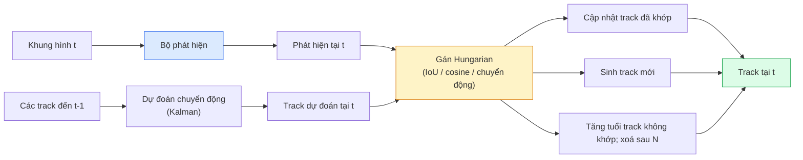

# Bám đuổi nhiều đối tượng & Bộ nhớ video

> Multi-object tracking (bám đuổi nhiều đối tượng) = phát hiện + kết hợp dữ liệu (data association). Phát hiện mọi khung hình. Khớp phát hiện của khung này với track của khung trước theo ID.

**Type:** Build
**Languages:** Python
**Prerequisites:** Giai đoạn 4, Bài 06 (Phát hiện YOLO), Bài 08 (Mask R-CNN), Bài 24 (SAM 3)
**Time:** ~60 phút

## Mục tiêu học tập

- Phân biệt tracking-by-detection với bám đuổi dựa trên truy vấn (query-based tracking) và gọi tên các họ thuật toán (SORT, DeepSORT, ByteTrack, BoT-SORT, bộ bám đuổi dùng bộ nhớ SAM 2, SAM 3.1 Object Multiplex)
- Tự tay cài IoU + phép gán bằng Hungarian algorithm (thuật toán Hungarian) để làm tracking-by-detection cổ điển
- Giải thích memory bank của SAM 2 và vì sao nó xử lý che khuất tốt hơn phép IoU matching (khớp theo IoU) trong bước kết hợp
- Đọc hiểu ba thước đo bám đuổi (MOTA, IDF1, HOTA) và chọn cái nào quan trọng cho một tình huống cụ thể

## Vấn đề

Một bộ phát hiện cho bạn biết các đối tượng đang ở đâu trong một khung hình. Một tracker cho bạn biết phát hiện nào ở khung `t` là cùng một đối tượng với phát hiện ở khung `t-1`. Không có nó, bạn không thể đếm đối tượng đi qua một đường, theo dõi một quả bóng xuyên qua che khuất, hay biết "xe #4 đã ở trong làn được 8 giây".

Bám đuổi là thiết yếu với mọi sản phẩm có video: phân tích thể thao, giám sát, xe tự lái, phân tích video y tế, theo dõi động vật hoang dã, đếm logo. Những khối cấu thành cốt lõi thì dùng chung: bộ phát hiện cho từng khung hình, mô hình chuyển động dựa trên Kalman filter (bộ lọc Kalman) hoặc thứ gì đó phong phú hơn, một bước kết hợp (Hungarian algorithm trên IoU / cosine / đặc trưng học được), và track lifecycle (vòng đời track: sinh, cập nhật, chết).

Năm 2026 mang đến hai mẫu hình mới: **bám đuổi dựa trên bộ nhớ của SAM 2** (bộ nhớ đặc trưng thay cho kết hợp bằng mô hình chuyển động) và **SAM 3.1 Object Multiplex** (bộ nhớ chia sẻ cho nhiều phiên bản của cùng một khái niệm). Bài này đi qua ngăn xếp cổ điển trước, rồi đến cách tiếp cận dựa trên bộ nhớ.

## Khái niệm

### Tracking-by-detection



Mọi tracker bạn gặp trong 2026 đều là một biến thể của vòng lặp này. Khác biệt nằm ở:

- **SORT** (2016): Kalman filter + Hungarian trên IoU. Đơn giản, nhanh, không có mô hình ngoại hình.
- **DeepSORT** (2017): SORT + đặc trưng ngoại hình dựa trên CNN cho mỗi track, tức appearance embedding (embedding ngoại hình) kiểu ReID. Xử lý việc cắt nhau tốt hơn.
- **ByteTrack** (2021): kết hợp các phát hiện độ tin cậy thấp như một giai đoạn thứ hai; không cần đặc trưng ngoại hình nhưng vẫn dẫn đầu trên MOT17.
- **BoT-SORT** (2022): ByteTrack + bù chuyển động camera + ReID.
- **StrongSORT / OC-SORT** — hậu duệ của ByteTrack với chuyển động và ngoại hình tốt hơn.

### Kalman filter trong một đoạn văn

Kalman filter duy trì trạng thái cho từng track `(x, y, w, h, dx, dy, dw, dh)` kèm một hiệp phương sai. Ở mỗi khung hình, **dự đoán** trạng thái bằng mô hình vận tốc không đổi, rồi **cập nhật** bằng phát hiện đã khớp. Bước cập nhật tin vào phát hiện hơn khi độ bất định của dự đoán cao. Cách này cho quỹ đạo mượt và khả năng nối tiếp một track xuyên qua che khuất ngắn (1-5 khung hình).

Mọi tracker cổ điển đều dùng Kalman filter ở bước dự đoán chuyển động.

### Thuật toán Hungarian

Cho một ma trận chi phí `M x N` (track x phát hiện), hãy tìm phép gán một-một sao cho tổng chi phí nhỏ nhất. Chi phí thường là `1 - IoU(track_bbox, detection_bbox)` hoặc âm của độ tương đồng cosine giữa các đặc trưng ngoại hình. Thời gian chạy là O((M+N)^3); với M, N tới ~1000 thì Python vẫn đủ nhanh qua `scipy.optimize.linear_sum_assignment`.

### Ý tưởng then chốt của ByteTrack

Các tracker tiêu chuẩn bỏ đi phát hiện có độ tin cậy thấp (< 0.5). ByteTrack giữ chúng lại làm **ứng viên giai đoạn hai**: sau khi khớp track với các phát hiện độ tin cậy cao, những track không khớp sẽ thử khớp với phát hiện độ tin cậy thấp bằng ngưỡng IoU nới lỏng hơn một chút. Cách này cứu được các che khuất ngắn và các ca identity switch (đổi danh tính) khi đám đông.

### Bám đuổi dựa trên bộ nhớ của SAM 2

SAM 2 xử lý video bằng cách giữ một **memory bank** các đặc trưng không gian - thời gian cho từng phiên bản đối tượng. Khi nhận một prompt (cú nhấp, hộp, văn bản) trên một khung hình, nó mã hoá phiên bản đó vào bộ nhớ. Ở các khung hình sau, bộ nhớ được cross-attend với đặc trưng của khung mới, và bộ giải mã tạo mặt nạ cho đúng phiên bản đó trong khung mới.

Không Kalman filter, không phép gán Hungarian. Việc kết hợp nằm ẩn trong phép attention trên bộ nhớ.

Ưu điểm:
- Bền với che khuất lớn (bộ nhớ mang danh tính của phiên bản qua nhiều khung hình).
- Mở rộng từ vựng khi kết hợp với prompt văn bản của SAM 3.
- Chạy được mà không cần mô hình chuyển động riêng.

Nhược điểm:
- Chậm hơn ByteTrack khi bám đuổi nhiều đối tượng.
- Memory bank phình ra; giới hạn cửa sổ ngữ cảnh.

### SAM 3.1 Object Multiplex

Cách bám đuổi của SAM 2 / SAM 3 trước đây giữ một memory bank riêng cho mỗi phiên bản. Với 50 đối tượng là 50 memory bank. Object Multiplex (tháng 3/2026) gộp chúng thành một bộ nhớ chia sẻ với **query token cho từng phiên bản**. Chi phí tăng dưới tuyến tính theo số phiên bản.

Multiplex là mặc định mới cho bám đuổi đám đông trong 2026: đám đông ở concert, công nhân trong kho, giao lộ giao thông.

### Ba thước đo cần biết

- **MOTA (Multi-Object Tracking Accuracy)** — 1 - (FN + FP + số lần đổi ID) / GT. Có trọng số theo loại lỗi; một thước đo duy nhất trộn lẫn cả lỗi phát hiện và lỗi kết hợp.
- **IDF1 (ID F1)** — trung bình điều hoà của độ chính xác và độ phủ ID. Tập trung riêng vào việc mỗi track ground-truth giữ ID của nó tốt thế nào theo thời gian. Tốt hơn MOTA cho các tác vụ nhạy với đổi danh tính.
- **HOTA (Higher Order Tracking Accuracy)** — tách thành độ chính xác phát hiện (DetA) và độ chính xác kết hợp (AssA). Là chuẩn của cộng đồng từ 2020; toàn diện nhất.

Với giám sát (ai là ai): IDF1 là thứ bạn báo cáo. Với phân tích thể thao (đếm đường chuyền): HOTA. Với so sánh học thuật nói chung: HOTA.

```figure
cv3-track-assoc
```

## Tự tay làm

### Bước 1: Ma trận chi phí dựa trên IoU

```python
import numpy as np


def bbox_iou(a, b):
    """
    a, b: (N, 4) arrays of [x1, y1, x2, y2].
    Returns (N_a, N_b) IoU matrix.
    """
    ax1, ay1, ax2, ay2 = a[:, 0], a[:, 1], a[:, 2], a[:, 3]
    bx1, by1, bx2, by2 = b[:, 0], b[:, 1], b[:, 2], b[:, 3]
    inter_x1 = np.maximum(ax1[:, None], bx1[None, :])
    inter_y1 = np.maximum(ay1[:, None], by1[None, :])
    inter_x2 = np.minimum(ax2[:, None], bx2[None, :])
    inter_y2 = np.minimum(ay2[:, None], by2[None, :])
    inter = np.clip(inter_x2 - inter_x1, 0, None) * np.clip(inter_y2 - inter_y1, 0, None)
    area_a = (ax2 - ax1) * (ay2 - ay1)
    area_b = (bx2 - bx1) * (by2 - by1)
    union = area_a[:, None] + area_b[None, :] - inter
    return inter / np.clip(union, 1e-8, None)
```

### Bước 2: Tracker kiểu SORT tối giản

Bộ lọc Kalman vận tốc không đổi cố định được lược bỏ cho gọn — ở đây ta dùng một bước kết hợp IoU đơn giản; trong thực tế bước dự đoán Kalman là thiết yếu. Gói Python `sort` cung cấp phiên bản đầy đủ.

```python
from scipy.optimize import linear_sum_assignment


class Track:
    def __init__(self, tid, bbox, frame):
        self.id = tid
        self.bbox = bbox
        self.last_frame = frame
        self.hits = 1

    def update(self, bbox, frame):
        self.bbox = bbox
        self.last_frame = frame
        self.hits += 1


class SimpleTracker:
    def __init__(self, iou_threshold=0.3, max_age=5):
        self.tracks = []
        self.next_id = 1
        self.iou_threshold = iou_threshold
        self.max_age = max_age

    def step(self, detections, frame):
        if not self.tracks:
            for d in detections:
                self.tracks.append(Track(self.next_id, d, frame))
                self.next_id += 1
            return [(t.id, t.bbox) for t in self.tracks]

        track_boxes = np.array([t.bbox for t in self.tracks])
        det_boxes = np.array(detections) if len(detections) else np.empty((0, 4))

        iou = bbox_iou(track_boxes, det_boxes) if len(det_boxes) else np.zeros((len(track_boxes), 0))
        cost = 1 - iou
        cost[iou < self.iou_threshold] = 1e6

        matched_track = set()
        matched_det = set()
        if cost.size > 0:
            row, col = linear_sum_assignment(cost)
            for r, c in zip(row, col):
                if cost[r, c] < 1.0:
                    self.tracks[r].update(det_boxes[c], frame)
                    matched_track.add(r); matched_det.add(c)

        for i, d in enumerate(det_boxes):
            if i not in matched_det:
                self.tracks.append(Track(self.next_id, d, frame))
                self.next_id += 1

        self.tracks = [t for t in self.tracks if frame - t.last_frame <= self.max_age]
        return [(t.id, t.bbox) for t in self.tracks]
```

60 dòng. Nhận phát hiện theo từng khung hình, trả về ID track theo từng khung hình. Hệ thống thật bổ sung bước dự đoán Kalman, bước khớp lại giai đoạn hai của ByteTrack, và đặc trưng ngoại hình.

### Bước 3: Kiểm thử quỹ đạo tổng hợp

```python
def synthetic_frames(num_frames=20, num_objects=3, H=240, W=320, seed=0):
    rng = np.random.default_rng(seed)
    starts = rng.uniform(20, 200, size=(num_objects, 2))
    velocities = rng.uniform(-5, 5, size=(num_objects, 2))
    frames = []
    for f in range(num_frames):
        dets = []
        for i in range(num_objects):
            cx, cy = starts[i] + f * velocities[i]
            dets.append([cx - 10, cy - 10, cx + 10, cy + 10])
        frames.append(dets)
    return frames


tracker = SimpleTracker()
for f, dets in enumerate(synthetic_frames()):
    tracks = tracker.step(dets, f)
```

Ba đối tượng chuyển động theo đường thẳng phải giữ nguyên ID qua cả 20 khung hình.

### Bước 4: Thước đo đổi ID

```python
def count_id_switches(tracks_per_frame, gt_per_frame):
    """
    tracks_per_frame:  list of list of (track_id, bbox)
    gt_per_frame:      list of list of (gt_id, bbox)
    Returns number of ID switches.
    """
    prev_assignment = {}
    switches = 0
    for tracks, gts in zip(tracks_per_frame, gt_per_frame):
        if not tracks or not gts:
            continue
        t_boxes = np.array([b for _, b in tracks])
        g_boxes = np.array([b for _, b in gts])
        iou = bbox_iou(g_boxes, t_boxes)
        for g_idx, (gt_id, _) in enumerate(gts):
            j = iou[g_idx].argmax()
            if iou[g_idx, j] > 0.5:
                t_id = tracks[j][0]
                if gt_id in prev_assignment and prev_assignment[gt_id] != t_id:
                    switches += 1
                prev_assignment[gt_id] = t_id
    return switches
```

Đây là thước đo gần với IDF1 được đơn giản hoá: đếm số lần một đối tượng ground-truth đổi ID track dự đoán được gán cho nó. Công cụ MOTA / IDF1 / HOTA thật nằm trong `py-motmetrics` và `TrackEval`.

## Áp dụng

Các tracker chạy thực tế trong 2026:

- `ultralytics` — tích hợp sẵn YOLOv8 + ByteTrack / BoT-SORT. `results = model.track(source, tracker="bytetrack.yaml")`. Lựa chọn mặc định.
- `supervision` (Roboflow) — lớp bao ByteTrack kèm tiện ích chú thích.
- SAM 2 / SAM 3.1 — bám đuổi dựa trên bộ nhớ qua `processor.track()`.
- Ngăn xếp tự ghép: bộ phát hiện (YOLOv8 / RT-DETR) + `sort-tracker` / `OC-SORT` / `StrongSORT`.

Cách chọn:

- Người đi bộ / xe / thùng hàng ở 30+ fps: **ByteTrack với ultralytics**.
- Nhiều phiên bản của cùng một lớp trong đám đông: **SAM 3.1 Object Multiplex**.
- Che khuất nặng nhưng ngoại hình còn nhận ra được: **DeepSORT / StrongSORT** (đặc trưng ReID).
- Thể thao / tương tác phức tạp: **BoT-SORT** hoặc tracker học được (MOTRv3).

## Đóng gói

Bài này tạo ra:

- `outputs/prompt-tracker-picker.md` — chọn SORT / ByteTrack / BoT-SORT / SAM 2 / SAM 3.1 dựa trên loại cảnh, kiểu che khuất và ngân sách độ trễ.
- `outputs/skill-mot-evaluator.md` — viết bộ khung đánh giá đầy đủ cho MOTA / IDF1 / HOTA so với các track ground-truth.

## Bài tập

1. **(Dễ)** Chạy tracker tổng hợp ở trên với 3, 10 và 30 đối tượng. Báo cáo số lần đổi ID trong mỗi trường hợp. Chỉ ra chỗ mà phép kết hợp chỉ dựa trên IoU bắt đầu thất bại.
2. **(Trung bình)** Thêm bước dự đoán Kalman vận tốc không đổi trước khi kết hợp. Chứng minh rằng che khuất ngắn (2-3 khung hình) không còn gây đổi ID.
3. **(Khó)** Tích hợp tracker dựa trên bộ nhớ của SAM 2 (qua `transformers`) như một backend tracker thay thế. Chạy cả SimpleTracker và SAM 2 trên một clip 30 giây về đám đông rồi so sánh số lần đổi ID, tự gán nhãn ID ground-truth cho 5 người nổi bật.

## Thuật ngữ chính

| Thuật ngữ | Người ta thường nói | Ý nghĩa thực sự |
|------|----------------|----------------------|
| Tracking-by-detection | "Phát hiện rồi kết hợp" | Bộ phát hiện theo từng khung hình + phép gán Hungarian trên IoU / ngoại hình |
| Kalman filter | "Dự đoán chuyển động" | Động lực học tuyến tính + hiệp phương sai để dự đoán track mượt và xử lý che khuất |
| Hungarian algorithm | "Phép gán tối ưu" | Giải bài toán khớp hai phía với chi phí nhỏ nhất; `scipy.optimize.linear_sum_assignment` |
| ByteTrack | "Lượt hai cho độ tin cậy thấp" | Khớp lại các track không khớp với phát hiện độ tin cậy thấp để cứu che khuất ngắn |
| DeepSORT | "SORT + ngoại hình" | Thêm đặc trưng ReID để khớp qua các khung hình; giữ ID tốt hơn |
| Memory bank | "Chiêu của SAM 2" | Đặc trưng không gian - thời gian của từng phiên bản được lưu qua các khung hình; cross-attention thay cho kết hợp tường minh |
| Object Multiplex | "Bộ nhớ chia sẻ của SAM 3.1" | Một bộ nhớ chia sẻ duy nhất với truy vấn cho từng phiên bản để bám đuổi nhiều đối tượng nhanh |
| HOTA | "Thước đo bám đuổi hiện đại" | Tách thành độ chính xác phát hiện và kết hợp; chuẩn của cộng đồng |

## Đọc thêm

- [SORT (Bewley et al., 2016)](https://arxiv.org/abs/1602.00763) — bài báo tracking-by-detection tối giản
- [DeepSORT (Wojke et al., 2017)](https://arxiv.org/abs/1703.07402) — thêm đặc trưng ngoại hình
- [ByteTrack (Zhang et al., 2022)](https://arxiv.org/abs/2110.06864) — lượt hai cho độ tin cậy thấp
- [BoT-SORT (Aharon et al., 2022)](https://arxiv.org/abs/2206.14651) — bù chuyển động camera
- [HOTA (Luiten et al., 2020)](https://arxiv.org/abs/2009.07736) — thước đo bám đuổi phân rã
- [SAM 2 video segmentation (Meta, 2024)](https://ai.meta.com/sam2/) — tracker dựa trên bộ nhớ
- [SAM 3.1 Object Multiplex (Meta, tháng 3/2026)](https://ai.meta.com/blog/segment-anything-model-3/)

---

[← Bài trước: Ước lượng độ sâu đơn ảnh (monocular depth) & hình học](../../26-monocular-depth/docs/vi.md) · [Bài sau: Mô hình thế giới & Khuếch tán video →](../../28-world-models-video-diffusion/docs/vi.md)
