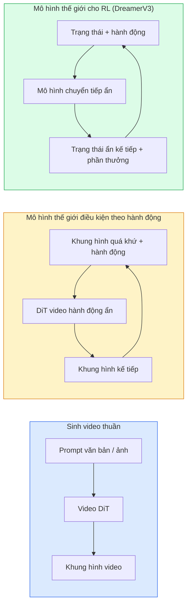

# Mô hình thế giới & Khuếch tán video

> Một mô hình video dự đoán những giây tiếp theo của một cảnh chính là một bộ mô phỏng thế giới. Đặt điều kiện cho dự đoán đó theo hành động và bạn có một game engine học được.

**Type:** Learn + Build
**Languages:** Python
**Prerequisites:** Giai đoạn 4, Bài 10 (Diffusion), Bài 12 (Hiểu video), Bài 23 (DiT + Rectified Flow)
**Time:** ~75 phút

## Mục tiêu học tập

- Phân biệt mô hình sinh video thuần (Sora 2) với mô hình thế giới (world model) điều kiện theo hành động (action conditioning) (Genie 3, DreamerV3)
- Mô tả một DiT video: patch không-thời gian, mã hoá vị trí 3D, attention chung trên các token (T, H, W)
- Lần theo cách mô hình thế giới cắm vào robot: VLM lập kế hoạch (planning) → mô hình video mô phỏng → động lực học nghịch phát ra hành động
- Chọn giữa Sora 2, Genie 3, Runway GWM-1 Worlds, Wan-Video, và HunyuanVideo cho một trường hợp sử dụng cụ thể (video sáng tạo, mô phỏng tương tác, tổng hợp dữ liệu lái tự động)

## Vấn đề

Sinh video và mô hình hoá thế giới đã hội tụ vào năm 2026. Một mô hình có thể sinh ra một phút video mạch lạc, tức nhất quán về thời gian (temporal consistency), thì ở một nghĩa nào đó đã học được cách thế giới chuyển động: sự tồn tại của vật thể, trọng lực, nhân quả, phong cách. Nếu bạn đặt điều kiện cho dự đoán đó theo hành động (đi sang trái, mở cửa), mô hình video trở thành một bộ mô phỏng học được có thể thay thế game engine, bộ mô phỏng lái xe, hay môi trường robot.

Mức đặt cược rất cụ thể. Genie 3 sinh ra môi trường chơi được từ một ảnh duy nhất. Runway GWM-1 Worlds tổng hợp những cảnh vô hạn có thể khám phá. Sora 2 tạo video dài một phút với âm thanh đồng bộ và vật lý được mô hình hoá. NVIDIA Cosmos-Drive, Wayve Gaia-2, và Tesla DrivingWorld sinh video lái xe chân thực cho dữ liệu huấn luyện xe tự hành. Mô hình thế giới đang lặng lẽ chiếm lĩnh sim-to-real cho robot.

Bài này là bài "bức tranh lớn" của Giai đoạn 4. Nó nối sinh ảnh, hiểu video, và suy luận tác tử thành mẫu kiến trúc mà nghiên cứu chủ đạo đang chuyển hướng tới.

## Khái niệm

### Ba họ mô hình hoá thế giới



- **Sora 2** là sinh video thuần, điều kiện theo prompt. Không có giao diện hành động. Bạn không thể "lái" nó giữa một lần lăn bánh mô phỏng (rollout).
- **Genie 3**, **GWM-1 Worlds**, **Mirage / Magica** là mô hình thế giới điều kiện theo hành động. Suy ra hành động ẩn từ video quan sát được, rồi đặt điều kiện cho dự đoán khung hình tương lai theo hành động. Tương tác được — bạn bấm phím hoặc di chuyển camera và cảnh phản hồi.
- **DreamerV3** và họ mô hình thế giới RL cổ điển dự đoán trong không gian ẩn, tức động lực học ẩn (latent dynamics), với điều kiện theo hành động rõ ràng, huấn luyện trên tín hiệu phần thưởng. Ít hình ảnh hơn; hữu ích hơn cho RL tiết kiệm mẫu.

### Kiến trúc DiT video

```
Video latent:          (C, T, H, W)
Patchify (spatial):    grid of P_h x P_w patches per frame
Patchify (temporal):   group P_t frames into a temporal patch
Resulting tokens:      (T / P_t) * (H / P_h) * (W / P_w) tokens
```

Mã hoá vị trí là 3D: một embedding quay hoặc học được cho mỗi toạ độ (t, h, w). Attention có thể là:

- **Chung đầy đủ** — mọi token attend tới mọi token. O(N^2) với N token. Quá đắt cho video dài.
- **Chia tách** — xen kẽ attention thời gian (cùng vị trí không gian, xuyên thời gian: `(H*W) * T^2`) và attention không gian (cùng bước thời gian, xuyên không gian: `T * (H*W)^2`). Được TimeSformer và hầu hết DiT video dùng.
- **Cửa sổ** — cửa sổ cục bộ trong (t, h, w). Được Video Swin dùng.

Mọi mô hình khuếch tán video (video diffusion) năm 2026 đều dùng một trong ba mẫu này cùng điều kiện AdaLN (Bài 23) và rectified flow.

### Điều kiện theo hành động: mô hình hành động ẩn

Genie học một **hành động ẩn** cho mỗi khung hình bằng cách dự đoán phân biệt hành động giữa một cặp khung hình liên tiếp. Bộ giải mã của mô hình sau đó đặt điều kiện theo hành động ẩn được suy ra — không phải theo phím bàn phím tường minh. Khi suy luận, người dùng có thể chỉ định một hành động ẩn (hoặc lấy mẫu một hành động từ prior mới) và mô hình sinh khung hình kế tiếp nhất quán với hành động đó.

Sora bỏ qua hoàn toàn giao diện hành động. Bộ giải mã của nó dự đoán token không-thời gian kế tiếp từ token không-thời gian trước đó, tức là tự hồi quy (autoregressive). Prompt đặt điều kiện cho điểm khởi đầu; không gì lái nó giữa lúc sinh.

### Tính hợp lý vật lý

Bản phát hành Sora 2 năm 2026 quảng bá rõ ràng **tính hợp lý vật lý**: trọng lượng, cân bằng, sự tồn tại của vật thể, nhân quả. Được nhóm đo bằng điểm hợp lý do người chấm; mô hình cải thiện thấy rõ ở vật thể bị đánh rơi, nhân vật va chạm, và các thất bại cố ý (một cú nhảy hụt) so với Sora 1.

Tính hợp lý vẫn là chế độ thất bại chủ đạo. Video 2024-2025 về người ăn spaghetti hay uống từ ly cho thấy mô hình thiếu biểu diễn vật thể bền vững. Các mô hình 2026 (Sora 2, Runway Gen-5, HunyuanVideo) giảm bớt nhưng không loại bỏ được.

### Mô hình thế giới cho lái tự động

Mô hình thế giới lái xe sinh cảnh đường chân thực điều kiện theo quỹ đạo, bounding box, hoặc bản đồ điều hướng. Cách dùng:

- **Cosmos-Drive-Dreams** (NVIDIA) — sinh nhiều phút video lái xe cho huấn luyện RL.
- **Gaia-2** (Wayve) — tổng hợp cảnh điều kiện theo quỹ đạo để đánh giá chính sách.
- **DrivingWorld** (Tesla) — mô phỏng thời tiết, thời điểm trong ngày, điều kiện giao thông đa dạng.
- **Vista** (ByteDance) — tổng hợp cảnh lái xe phản ứng.

Chúng thay thế việc thu thập dữ liệu thực tế đắt đỏ cho các tình huống hiếm — người đi bộ băng qua đường lúc đêm, giao lộ đóng băng, loại xe lạ — mà nếu không sẽ cần hàng triệu dặm lái.

### Ngăn xếp robot: VLM + mô hình video + động lực học nghịch

Vòng lặp robot ba thành phần đang nổi lên:

1. **VLM** phân tích mục tiêu ("nhấc chiếc cốc đỏ"), lập kế hoạch một chuỗi hành động mức cao.
2. **Mô hình sinh video** mô phỏng việc thực thi mỗi hành động sẽ trông thế nào — dự đoán quan sát trước N khung hình.
3. **Mô hình động lực học nghịch** trích ra các lệnh động cơ cụ thể sẽ tạo ra những quan sát đó.

Cách này thay thế việc định hình phần thưởng và RL nặng mẫu. Mô hình thế giới đảm nhận phần tưởng tượng; động lực học nghịch đóng vòng lặp ở khâu chấp hành. Genie Envisioner là một hiện thân; nhiều nhóm nghiên cứu đang hội tụ về cấu trúc này.

### Đánh giá

- **Chất lượng hình ảnh** — FVD (Fréchet Video Distance), nghiên cứu người dùng.
- **Khớp prompt** — CLIPScore từng khung hình, đánh giá kiểu VQA.
- **Tính hợp lý vật lý** — do người chấm trên một bộ benchmark (benchmark nội bộ của Sora 2, VBench).
- **Khả năng điều khiển** (cho mô hình thế giới tương tác) — nhất quán hành động → quan sát; bạn có thể quay lại trạng thái trước đó không?

### Bức tranh mô hình năm 2026

| Mô hình | Công dụng | Tham số | Đầu ra | Giấy phép |
|-------|-----|------------|--------|---------|
| Sora 2 | văn bản-thành-video, âm thanh | — | 1080p 1 phút + âm thanh | chỉ API |
| Runway Gen-5 | văn bản/ảnh-thành-video | — | clip 10 giây | API |
| Runway GWM-1 Worlds | thế giới tương tác | — | rollout 3D vô hạn | API |
| Genie 3 | thế giới tương tác từ ảnh | 11B+ | khung hình chơi được | bản xem trước nghiên cứu |
| Wan-Video 2.1 | văn bản-thành-video mở | 14B | clip chất lượng cao | phi thương mại |
| HunyuanVideo | văn bản-thành-video mở | 13B | clip 10 giây | giấy phép thoáng |
| Cosmos / Cosmos-Drive | mô phỏng lái tự động | 7-14B | cảnh lái xe | NVIDIA mở |
| Magica / Mirage 2 | game engine gốc AI | — | thế giới có thể sửa | sản phẩm |

```figure
v4-world-rollout
```

## Tự tay làm

### Bước 1: Patchify 3D cho video

```python
import torch
import torch.nn as nn


class VideoPatch3D(nn.Module):
    def __init__(self, in_channels=4, dim=64, patch_t=2, patch_h=2, patch_w=2):
        super().__init__()
        self.proj = nn.Conv3d(
            in_channels, dim,
            kernel_size=(patch_t, patch_h, patch_w),
            stride=(patch_t, patch_h, patch_w),
        )
        self.patch_t = patch_t
        self.patch_h = patch_h
        self.patch_w = patch_w

    def forward(self, x):
        # x: (N, C, T, H, W)
        x = self.proj(x)
        n, c, t, h, w = x.shape
        tokens = x.reshape(n, c, t * h * w).transpose(1, 2)
        return tokens, (t, h, w)
```

Một conv 3D với stride bằng kernel đóng vai trò bộ tạo patch không-thời gian. Lưới token `(T, H, W) -> (T/2, H/2, W/2)`.

### Bước 2: Mã hoá vị trí quay 3D

Rotary Position Embeddings (RoPE) áp dụng riêng theo các trục `t`, `h`, `w`:

```python
def rope_3d(tokens, t_dim, h_dim, w_dim, grid):
    """
    tokens: (N, T*H*W, D)
    grid: (T, H, W) sizes
    t_dim + h_dim + w_dim == D
    """
    T, H, W = grid
    n, seq, d = tokens.shape
    if t_dim + h_dim + w_dim != d:
        raise ValueError(f"t_dim+h_dim+w_dim ({t_dim}+{h_dim}+{w_dim}) must equal D={d}")
    assert seq == T * H * W
    t_idx = torch.arange(T, device=tokens.device).repeat_interleave(H * W)
    h_idx = torch.arange(H, device=tokens.device).repeat_interleave(W).repeat(T)
    w_idx = torch.arange(W, device=tokens.device).repeat(T * H)
    # Simplified: just scale channels by frequencies. Real RoPE rotates pairs.
    freqs_t = torch.exp(-torch.log(torch.tensor(10000.0)) * torch.arange(t_dim // 2, device=tokens.device) / (t_dim // 2))
    freqs_h = torch.exp(-torch.log(torch.tensor(10000.0)) * torch.arange(h_dim // 2, device=tokens.device) / (h_dim // 2))
    freqs_w = torch.exp(-torch.log(torch.tensor(10000.0)) * torch.arange(w_dim // 2, device=tokens.device) / (w_dim // 2))
    emb_t = torch.cat([torch.sin(t_idx[:, None] * freqs_t), torch.cos(t_idx[:, None] * freqs_t)], dim=-1)
    emb_h = torch.cat([torch.sin(h_idx[:, None] * freqs_h), torch.cos(h_idx[:, None] * freqs_h)], dim=-1)
    emb_w = torch.cat([torch.sin(w_idx[:, None] * freqs_w), torch.cos(w_idx[:, None] * freqs_w)], dim=-1)
    return tokens + torch.cat([emb_t, emb_h, emb_w], dim=-1)
```

Dạng cộng gộp đơn giản hoá. RoPE thật xoay các cặp kênh ở các tần số; thông tin vị trí là như nhau.

### Bước 3: Khối attention chia tách

```python
class DividedAttentionBlock(nn.Module):
    def __init__(self, dim=64, heads=2):
        super().__init__()
        self.time_attn = nn.MultiheadAttention(dim, heads, batch_first=True)
        self.space_attn = nn.MultiheadAttention(dim, heads, batch_first=True)
        self.ln1 = nn.LayerNorm(dim)
        self.ln2 = nn.LayerNorm(dim)
        self.ln3 = nn.LayerNorm(dim)
        self.mlp = nn.Sequential(nn.Linear(dim, 4 * dim), nn.GELU(), nn.Linear(4 * dim, dim))

    def forward(self, x, grid):
        T, H, W = grid
        n, seq, d = x.shape
        # time attention: same (h, w), across t
        xt = x.view(n, T, H * W, d).permute(0, 2, 1, 3).reshape(n * H * W, T, d)
        a, _ = self.time_attn(self.ln1(xt), self.ln1(xt), self.ln1(xt), need_weights=False)
        xt = (xt + a).reshape(n, H * W, T, d).permute(0, 2, 1, 3).reshape(n, seq, d)
        # space attention: same t, across (h, w)
        xs = xt.view(n, T, H * W, d).reshape(n * T, H * W, d)
        a, _ = self.space_attn(self.ln2(xs), self.ln2(xs), self.ln2(xs), need_weights=False)
        xs = (xs + a).reshape(n, T, H * W, d).reshape(n, seq, d)
        xs = xs + self.mlp(self.ln3(xs))
        return xs
```

Attention thời gian attend trong từng vị trí không gian xuyên thời gian; attention không gian attend trong từng khung hình xuyên các vị trí. Hai phép O(T^2 + (HW)^2) thay vì một phép O((THW)^2). Đây là lõi của TimeSformer và mọi DiT video hiện đại.

### Bước 4: Ghép một DiT video tí hon

```python
class TinyVideoDiT(nn.Module):
    def __init__(self, in_channels=4, dim=64, depth=2, heads=2):
        super().__init__()
        self.patch = VideoPatch3D(in_channels=in_channels, dim=dim, patch_t=2, patch_h=2, patch_w=2)
        self.blocks = nn.ModuleList([DividedAttentionBlock(dim, heads) for _ in range(depth)])
        self.out = nn.Linear(dim, in_channels * 2 * 2 * 2)

    def forward(self, x):
        tokens, grid = self.patch(x)
        for blk in self.blocks:
            tokens = blk(tokens, grid)
        return self.out(tokens), grid
```

Không phải một bộ sinh video chạy được; một bản demo cấu trúc để mọi mảnh đều đúng hình dạng.

### Bước 5: Kiểm tra hình dạng

```python
vid = torch.randn(1, 4, 8, 16, 16)  # (N, C, T, H, W)
model = TinyVideoDiT()
out, grid = model(vid)
print(f"input  {tuple(vid.shape)}")
print(f"tokens grid {grid}")
print(f"output {tuple(out.shape)}")
```

Mong đợi `grid = (4, 8, 8)` và `out = (1, 256, 32)` sau khi tạo patch; đầu ra sau đó được chiếu thành các patch không-thời gian theo token, sẵn sàng được giải patch trở lại thành video.

## Áp dụng

Các mẫu truy cập trong sản xuất cho năm 2026:

- **Sora 2 API** (OpenAI) — văn bản-thành-video, âm thanh đồng bộ. Giá cao cấp.
- **Runway Gen-5 / GWM-1** (Runway) — ảnh-thành-video, thế giới tương tác.
- **Wan-Video 2.1 / HunyuanVideo** — mã nguồn mở, tự lưu trữ.
- **Cosmos / Cosmos-Drive** (NVIDIA) — trọng số mở cho mô phỏng lái xe.
- **Genie 3** — bản xem trước nghiên cứu, yêu cầu quyền truy cập.

Để xây một demo mô hình thế giới tương tác: bắt đầu với Wan-Video để có chất lượng, rồi thêm adapter hành động ẩn cho tính tương tác. Để mô phỏng lái tự động: Cosmos-Drive là tham chiếu mở của năm 2026.

Với robot, ngăn xếp thực tế ngoài kia:

1. Mục tiêu ngôn ngữ -> VLM (Qwen3-VL) -> kế hoạch mức cao.
2. Kế hoạch -> mô hình video hành động ẩn -> rollout tưởng tượng.
3. Rollout -> mô hình động lực học nghịch -> hành động mức thấp.
4. Hành động được thực thi -> quan sát đưa ngược vào bước 1.

## Đóng gói

Bài này tạo ra:

- `outputs/prompt-video-model-picker.md` — chọn giữa Sora 2 / Runway / Wan / HunyuanVideo / Cosmos dựa trên tác vụ, giấy phép, và độ trễ.
- `outputs/skill-physical-plausibility-checks.md` — một skill định nghĩa các kiểm tra tự động (sự tồn tại của vật thể, trọng lực, tính liên tục) để chạy trên mọi video được sinh ra trước khi phát hành.

## Bài tập

1. **(Dễ)** Tính số token cho một video 5 giây 360p với patch-t=2, patch-h=8, patch-w=8. Lý luận về bộ nhớ cho attention ở kích thước này.
2. **(Trung bình)** Đổi khối attention chia tách ở trên thành khối attention chung đầy đủ và đo hình dạng cùng số tham số. Giải thích vì sao attention chia tách là cần thiết cho mô hình video thật.
3. **(Khó)** Xây một mô hình video hành động ẩn tối giản: lấy một tập dữ liệu các bộ ba (frame_t, action_t, frame_{t+1}) (một game 2D đơn giản bất kỳ), huấn luyện một DiT video tí hon điều kiện theo embedding hành động, và cho thấy các hành động khác nhau tạo ra khung hình kế tiếp khác nhau.

## Thuật ngữ chính

| Thuật ngữ | Người ta thường nói | Ý nghĩa thực sự |
|------|----------------|----------------------|
| World model | "Bộ mô phỏng học được" | Mô hình dự đoán các quan sát tương lai từ trạng thái và hành động |
| Video DiT | "Transformer không-thời gian" | Diffusion transformer với patchify 3D và attention chia tách |
| Latent action | "Điều khiển suy ra được" | Hành động ẩn rời rạc hoặc liên tục được suy ra từ các cặp khung hình; dùng để đặt điều kiện cho việc sinh khung hình kế tiếp |
| Divided attention | "Thời gian rồi không gian" | Hai phép attention trong mỗi khối — xuyên thời gian rồi xuyên không gian — để giữ O(N^2) trong tầm kiểm soát |
| Object permanence | "Đồ vật vẫn là thật" | Thuộc tính của cảnh mà mô hình video phải học; chế độ thất bại kinh điển với đồ ăn, đồ thuỷ tinh |
| FVD | "Fréchet Video Distance" | Bản video của FID; thước đo chất lượng hình ảnh chính |
| Inverse dynamics model | "Quan sát thành hành động" | Cho (trạng thái, trạng thái kế tiếp), xuất ra hành động nối chúng; đóng vòng lặp robot |
| Cosmos-Drive | "Bộ mô phỏng lái xe của NVIDIA" | Mô hình thế giới lái tự động với trọng số mở cho RL và đánh giá |

## Đọc thêm

- [Sora technical report (OpenAI)](https://openai.com/index/video-generation-models-as-world-simulators/)
- [Genie: Generative Interactive Environments (Bruce et al., 2024)](https://arxiv.org/abs/2402.15391) — mô hình thế giới hành động ẩn
- [TimeSformer (Bertasius et al., 2021)](https://arxiv.org/abs/2102.05095) — attention chia tách cho transformer video
- [DreamerV3 (Hafner et al., 2023)](https://arxiv.org/abs/2301.04104) — mô hình thế giới cho RL
- [Cosmos-Drive-Dreams (NVIDIA, 2025)](https://research.nvidia.com/labs/toronto-ai/cosmos-drive-dreams/) — mô hình thế giới lái xe
- [Top 10 Video Generation Models 2026 (DataCamp)](https://www.datacamp.com/blog/top-video-generation-models)
- [From Video Generation to World Model — survey repo](https://github.com/ziqihuangg/Awesome-From-Video-Generation-to-World-Model/)

---

[← Bài trước: Bám đuổi nhiều đối tượng & Bộ nhớ video](../../27-multi-object-tracking/docs/vi.md)
