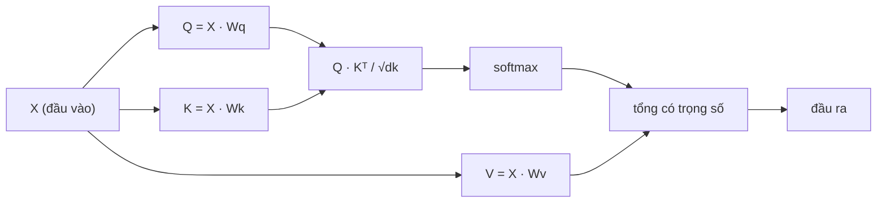

# Self-attention từ đầu

> Attention là một bảng tra cứu nơi mỗi từ tự hỏi "từ nào quan trọng với tôi?" - và rồi học được câu trả lời.

**Type:** Build
**Languages:** Python
**Prerequisites:** Giai đoạn 3 (Deep Learning Core), Giai đoạn 5, Bài 10 (Mô hình chuỗi sang chuỗi)
**Time:** ~90 phút

## Mục tiêu học tập

- Tự tay cài đặt self-attention kiểu tích vô hướng có chia căn (scaled dot-product) chỉ với NumPy, gồm cả các phép chiếu truy vấn/khoá/giá trị (query/key/value) và phép lấy tổng có trọng số qua softmax
- Xây dựng một lớp multi-head attention biết tách các head, tính attention song song rồi ghép kết quả lại
- Lần theo cách ma trận attention nắm bắt quan hệ giữa các token và giải thích vì sao chia cho sqrt(d_k) lại giúp softmax không bị bão hoà
- Áp mặt nạ nhân quả (causal mask) để biến attention hai chiều thành attention tự hồi quy (kiểu decoder)

## Vấn đề

RNN xử lý chuỗi từng token một. Đến token thứ 50 thì thông tin từ token 1 đã phải đi qua 50 bước nén. Những phụ thuộc xa bị ép vào một hidden state có kích thước cố định - một nút cổ chai mà mọi cổng LSTM cũng không gỡ hết được.

Bài báo attention của Bahdanau năm 2014 đưa ra cách sửa: để decoder nhìn lại mọi vị trí bên encoder và quyết định vị trí nào quan trọng cho bước hiện tại. Nhưng nó vẫn bắt vít vào RNN. Bài báo "Attention Is All You Need" năm 2017 đặt câu hỏi sắc hơn: nếu attention là cơ chế *duy nhất* thì sao? Không hồi quy. Không tích chập. Chỉ attention.

Self-attention cho mọi vị trí trong chuỗi nhìn tới mọi vị trí khác trong một bước song song duy nhất. Chính điều đó khiến transformer nhanh, mở rộng tốt và thống trị.

## Khái niệm

### Phép so sánh với tra cứu cơ sở dữ liệu

Hãy nghĩ attention như một kiểu tra cứu cơ sở dữ liệu mềm:

```
Traditional database:
  Query: "capital of France"  -->  exact match  -->  "Paris"

Attention:
  Query: "capital of France"  -->  similarity to ALL keys  -->  weighted blend of ALL values
```

Mỗi token sinh ra ba vector:
- **Query (Q)**: "Tôi đang tìm gì?"
- **Key (K)**: "Tôi chứa gì?"
- **Value (V)**: "Nếu được chọn thì tôi cung cấp thông tin gì?"

Tích vô hướng giữa một truy vấn với toàn bộ khoá tạo ra điểm attention. Điểm cao nghĩa là "khoá này khớp với truy vấn của tôi". Những điểm đó làm trọng số cho các giá trị. Đầu ra là tổng có trọng số của các giá trị.

### Cách tính Q, K, V

Mỗi embedding của token được chiếu qua ba ma trận trọng số đã học:

```
Input embeddings (sequence of n tokens, each d-dimensional):

  X = [x1, x2, x3, ..., xn]       shape: (n, d)

Three weight matrices:

  Wq  shape: (d, dk)
  Wk  shape: (d, dk)
  Wv  shape: (d, dv)

Projections:

  Q = X @ Wq    shape: (n, dk)      each token's query
  K = X @ Wk    shape: (n, dk)      each token's key
  V = X @ Wv    shape: (n, dv)      each token's value
```

Nhìn trực quan với một token:

```
             Wq
  x_i ------[*]------> q_i    "What am I looking for?"
       |
       |     Wk
       +----[*]------> k_i    "What do I contain?"
       |
       |     Wv
       +----[*]------> v_i    "What do I offer?"
```

### Ma trận attention

Khi đã có Q, K, V cho mọi token, điểm attention tạo thành một ma trận:

```
Scores = Q @ K^T    shape: (n, n)

              k1    k2    k3    k4    k5
        +-----+-----+-----+-----+-----+
   q1   | 2.1 | 0.3 | 0.1 | 0.8 | 0.2 |   <- how much q1 attends to each key
        +-----+-----+-----+-----+-----+
   q2   | 0.4 | 1.9 | 0.7 | 0.1 | 0.3 |
        +-----+-----+-----+-----+-----+
   q3   | 0.2 | 0.6 | 2.3 | 0.5 | 0.1 |
        +-----+-----+-----+-----+-----+
   q4   | 0.9 | 0.1 | 0.4 | 1.7 | 0.6 |
        +-----+-----+-----+-----+-----+
   q5   | 0.1 | 0.3 | 0.2 | 0.5 | 2.0 |
        +-----+-----+-----+-----+-----+

Each row: one token's attention over the entire sequence
```

Hãy xem một truy vấn quét qua các khoá: mỗi dòng cho điểm mọi token, softmax biến điểm thành trọng số, và vector ngữ cảnh là hỗn hợp có trọng số của các giá trị.

```figure
attention-matrix
```

### Vì sao phải chia căn?

Tích vô hướng lớn dần theo số chiều dk. Nếu dk = 64, tích vô hướng có thể rơi vào khoảng hàng chục, đẩy softmax vào vùng mà gradient gần như biến mất. Cách sửa: chia cho sqrt(dk).

```
Scaled scores = (Q @ K^T) / sqrt(dk)
```

Nhờ vậy các giá trị nằm trong khoảng mà softmax vẫn cho ra gradient hữu ích.

### Softmax biến điểm thành trọng số

Softmax chuyển điểm thô thành một phân phối xác suất trên mỗi dòng:

```
Raw scores for q1:   [2.1, 0.3, 0.1, 0.8, 0.2]
                            |
                         softmax
                            |
Attention weights:   [0.52, 0.09, 0.07, 0.14, 0.08]   (sums to ~1.0)
```

Giờ mỗi token có một bộ trọng số nói lên nó nên chú ý tới mọi token khác bao nhiêu.

### Tổng có trọng số của các giá trị

Đầu ra cuối cùng cho mỗi token là tổng có trọng số của toàn bộ vector giá trị:

```
output_i = sum( attention_weight[i][j] * v_j  for all j )

For token 1:
  output_1 = 0.52 * v1 + 0.09 * v2 + 0.07 * v3 + 0.14 * v4 + 0.08 * v5
```

### Toàn bộ luồng xử lý



Công thức trong một dòng:

```
Attention(Q, K, V) = softmax( Q @ K^T / sqrt(dk) ) @ V
```

```figure
softmax-attention-scaling
```

## Tự tay làm

### Bước 1: Softmax từ đầu

Softmax chuyển logit thô thành xác suất. Trừ đi giá trị lớn nhất để ổn định số học.

```python
import numpy as np

def softmax(x):
    shifted = x - np.max(x, axis=-1, keepdims=True)
    exp_x = np.exp(shifted)
    return exp_x / np.sum(exp_x, axis=-1, keepdims=True)

logits = np.array([2.0, 1.0, 0.1])
print(f"logits:  {logits}")
print(f"softmax: {softmax(logits)}")
print(f"sum:     {softmax(logits).sum():.4f}")
```

### Bước 2: Attention tích vô hướng có chia căn

Hàm cốt lõi. Nhận các ma trận Q, K, V và trả về đầu ra attention cùng ma trận trọng số.

```python
def scaled_dot_product_attention(Q, K, V):
    dk = Q.shape[-1]
    scores = Q @ K.T / np.sqrt(dk)
    weights = softmax(scores)
    output = weights @ V
    return output, weights
```

### Bước 3: Lớp self-attention với các phép chiếu đã học

Một module self-attention đầy đủ với các ma trận trọng số Wq, Wk, Wv khởi tạo theo kiểu Xavier.

```python
class SelfAttention:
    def __init__(self, d_model, dk, dv, seed=42):
        rng = np.random.default_rng(seed)
        scale = np.sqrt(2.0 / (d_model + dk))
        self.Wq = rng.normal(0, scale, (d_model, dk))
        self.Wk = rng.normal(0, scale, (d_model, dk))
        scale_v = np.sqrt(2.0 / (d_model + dv))
        self.Wv = rng.normal(0, scale_v, (d_model, dv))
        self.dk = dk

    def forward(self, X):
        Q = X @ self.Wq
        K = X @ self.Wk
        V = X @ self.Wv
        output, weights = scaled_dot_product_attention(Q, K, V)
        return output, weights
```

### Bước 4: Chạy thử trên một câu

Tạo embedding giả cho một câu rồi xem trọng số attention.

```python
sentence = ["The", "cat", "sat", "on", "the", "mat"]
n_tokens = len(sentence)
d_model = 8
dk = 4
dv = 4

rng = np.random.default_rng(42)
X = rng.normal(0, 1, (n_tokens, d_model))

attn = SelfAttention(d_model, dk, dv, seed=42)
output, weights = attn.forward(X)

print("Attention weights (each row: where that token looks):\n")
print(f"{'':>6}", end="")
for token in sentence:
    print(f"{token:>6}", end="")
print()

for i, token in enumerate(sentence):
    print(f"{token:>6}", end="")
    for j in range(n_tokens):
        w = weights[i][j]
        print(f"{w:6.3f}", end="")
    print()
```

### Bước 5: Trực quan hoá attention bằng heatmap ASCII

Ánh xạ trọng số attention sang các ký tự để nhìn nhanh.

```python
def ascii_heatmap(weights, tokens, chars=" ░▒▓█"):
    n = len(tokens)
    print(f"\n{'':>6}", end="")
    for t in tokens:
        print(f"{t:>6}", end="")
    print()

    for i in range(n):
        print(f"{tokens[i]:>6}", end="")
        for j in range(n):
            level = int(weights[i][j] * (len(chars) - 1) / weights.max())
            level = min(level, len(chars) - 1)
            print(f"{'  ' + chars[level] + '   '}", end="")
        print()

ascii_heatmap(weights, sentence)
```

## Áp dụng

`nn.MultiheadAttention` của PyTorch làm đúng những gì ta vừa xây, cộng thêm phần tách nhiều head và phép chiếu đầu ra:

```python
import torch
import torch.nn as nn

d_model = 8
n_heads = 2
seq_len = 6

mha = nn.MultiheadAttention(embed_dim=d_model, num_heads=n_heads, batch_first=True)

X_torch = torch.randn(1, seq_len, d_model)

output, attn_weights = mha(X_torch, X_torch, X_torch)

print(f"Input shape:            {X_torch.shape}")
print(f"Output shape:           {output.shape}")
print(f"Attention weight shape: {attn_weights.shape}")
print(f"\nAttn weights (averaged over heads):")
print(attn_weights[0].detach().numpy().round(3))
```

Khác biệt then chốt: multi-head attention chạy nhiều hàm attention song song, mỗi hàm có phép chiếu Q, K, V riêng với kích thước dk = d_model / n_heads, rồi ghép các kết quả lại. Nhờ vậy mô hình có thể đồng thời chú ý tới nhiều kiểu quan hệ khác nhau.

## Đóng gói

Bài học này tạo ra:
- `outputs/prompt-attention-explainer.md` - một prompt giải thích attention qua phép so sánh với tra cứu cơ sở dữ liệu

## Bài tập

1. Sửa `scaled_dot_product_attention` để nhận thêm một ma trận mặt nạ (mask) tuỳ chọn, đặt một số vị trí thành âm vô cực trước softmax (đây chính là cách mặt nạ nhân quả/decoder hoạt động)
2. Tự cài đặt multi-head attention: tách Q, K, V thành `n_heads` phần, chạy attention trên từng phần, ghép lại rồi chiếu qua ma trận trọng số cuối Wo
3. Lấy hai câu khác nhau có cùng độ dài, đưa chúng qua cùng một thực thể SelfAttention và so sánh kiểu attention của chúng. Cái gì thay đổi? Cái gì giữ nguyên?

## Thuật ngữ chính

| Thuật ngữ | Người ta thường nói | Ý nghĩa thực sự |
|------|----------------|----------------------|
| Query (Q) | "Vector câu hỏi" | Một phép chiếu đã học của đầu vào, biểu diễn thông tin mà token này đang tìm kiếm |
| Key (K) | "Vector nhãn" | Một phép chiếu đã học biểu diễn thông tin token này chứa, được đối chiếu với các truy vấn |
| Value (V) | "Vector nội dung" | Một phép chiếu đã học mang thông tin thật sự sẽ được tổng hợp dựa trên điểm attention |
| Scaled dot-product attention | "Công thức attention" | softmax(QK^T / sqrt(dk)) @ V - việc chia căn giúp softmax không bão hoà ở số chiều cao |
| Self-attention | "Token nhìn chính nó và những token khác" | Kiểu attention mà Q, K, V đều đến từ cùng một chuỗi, cho mọi vị trí nhìn tới mọi vị trí khác |
| Attention weights | "Mức độ chú ý" | Một phân phối xác suất trên các vị trí, tạo ra bằng softmax trên các tích vô hướng đã chia căn |
| Multi-head attention | "Attention song song" | Chạy nhiều hàm attention với các phép chiếu khác nhau rồi ghép kết quả để có biểu diễn phong phú hơn |

## Đọc thêm

- [Attention Is All You Need (Vaswani et al., 2017)](https://arxiv.org/abs/1706.03762) - bài báo transformer gốc
- [The Illustrated Transformer (Jay Alammar)](https://jalammar.github.io/illustrated-transformer/) - phần dẫn dắt trực quan hay nhất về toàn bộ kiến trúc
- [The Annotated Transformer (Harvard NLP)](https://nlp.seas.harvard.edu/annotated-transformer/) - bản cài đặt PyTorch từng dòng kèm giải thích

---

[← Bài trước: Vì sao có Transformer](../../01-why-transformers/docs/vi.md) · [Bài sau: Multi-Head Attention →](../../03-multi-head-attention/docs/vi.md)
