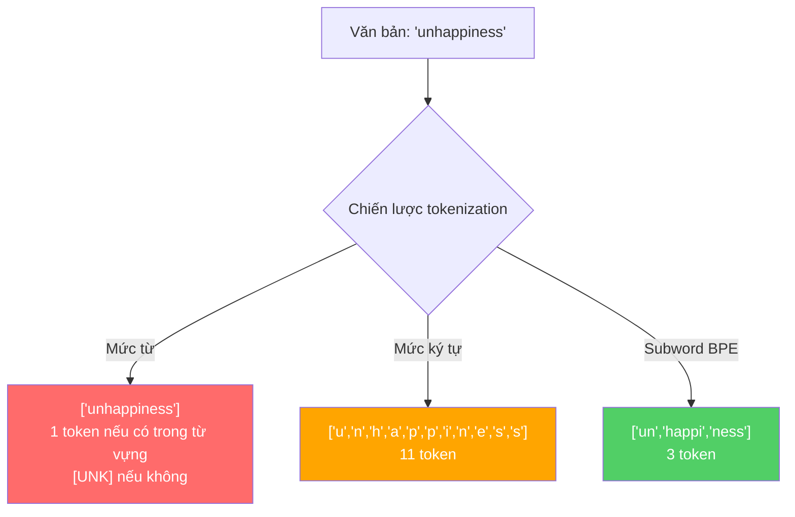
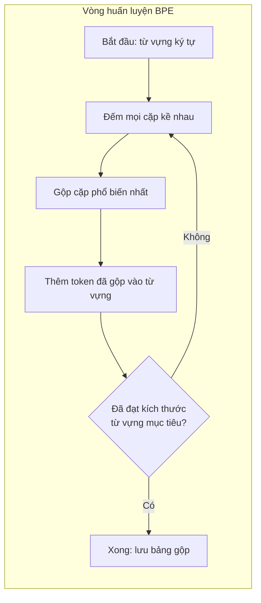
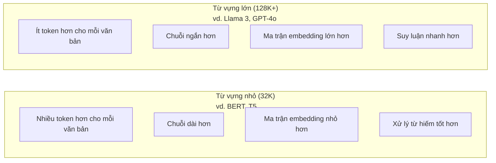

# Tokenizers: BPE, WordPiece, SentencePiece

> LLM của bạn không đọc tiếng Anh. Nó đọc số nguyên. Bộ tách token (tokenizer) quyết định những số nguyên đó mang ý nghĩa hay chỉ lãng phí.

**Type:** Build
**Languages:** Python
**Prerequisites:** Giai đoạn 5 (NLP Foundations)
**Time:** ~90 phút

## Mục tiêu học tập

- Tự tay cài đặt các thuật toán tokenization BPE, WordPiece và Unigram rồi so sánh chiến lược gộp (merge rule) của chúng
- Giải thích cách kích thước từ vựng (vocabulary) ảnh hưởng tới hiệu năng mô hình: quá nhỏ tạo ra chuỗi dài, quá lớn thì lãng phí tham số embedding
- Phân tích các hiện tượng lạ do tokenization sinh ra trên nhiều ngôn ngữ và trên code, chỉ ra chỗ từng bộ tách token cụ thể bị vỡ
- Dùng thư viện tiktoken và sentencepiece để tách token văn bản và soi các token ID thu được

## Vấn đề

LLM của bạn không đọc tiếng Anh. Nó không đọc ngôn ngữ nào cả. Nó đọc số.

Khoảng cách giữa "Hello, world!" và [15496, 11, 995, 0] chính là bộ tách token. Mỗi từ, mỗi dấu cách, mỗi dấu câu đều phải được đổi thành một số nguyên trước khi mô hình xử lý được. Việc đổi này không trung tính. Nó nướng những giả định vào mô hình mà sau này không gỡ ra được.

Làm sai chỗ này thì mô hình lãng phí năng lực để mã hoá những từ phổ biến bằng nhiều token. "unfortunately" biến thành bốn token thay vì một. Cửa sổ context 128K của bạn vừa co lại 75% với những văn bản nhiều từ đa âm tiết. Làm đúng thì cũng cửa sổ đó chứa được gấp đôi lượng ý nghĩa. Khác biệt giữa "mô hình này xử lý code tốt" và "mô hình này bó tay với Python" thường nằm ở cách bộ tách token được huấn luyện.

Mỗi lệnh gọi API tới GPT-4 hay Claude đều được tính tiền theo token. Mỗi token mô hình sinh ra đều tốn compute. Càng ít token để biểu diễn một đầu ra, suy luận end-to-end càng nhanh. Tokenization không phải bước tiền xử lý. Nó là kiến trúc.

## Khái niệm

### Ba cách tiếp cận đã thất bại (và một cách đã thắng)

Có ba cách hiển nhiên để đổi văn bản thành số. Hai trong số đó không mở rộng được quy mô.

**Word-level tokenization** cắt theo dấu cách và dấu câu. "The cat sat" thành ["The", "cat", "sat"]. Đơn giản. Nhưng còn "tokenization" thì sao? Hay "GPT-4o"? Hay một từ ghép tiếng Đức như "Geschwindigkeitsbegrenzung"? Word-level cần một từ vựng khổng lồ để phủ mọi từ trong mọi ngôn ngữ. Sót một từ là bạn nhận ngay token `[UNK]` đáng sợ -- cách mô hình nói "tôi không biết cái này là gì". Chỉ riêng tiếng Anh đã có hơn một triệu dạng từ. Thêm code, URL, ký hiệu khoa học và 100 ngôn ngữ khác nữa thì bạn cần một từ vựng vô hạn.

**Character-level tokenization** đi theo hướng ngược lại. "hello" thành ["h", "e", "l", "l", "o"]. Từ vựng rất nhỏ (vài trăm ký tự). Không bao giờ có token lạ. Nhưng chuỗi trở nên cực dài. Một câu mà mức từ chỉ tốn 10 token sẽ thành 50 token ở mức ký tự. Mô hình phải học rằng "t", "h", "e" đứng cạnh nhau nghĩa là "the" -- đốt năng lực attention vào thứ mà con người học được từ lúc ba tuổi.

**Subword tokenization** tìm được điểm ngọt. Từ phổ biến giữ nguyên: "the" là một token. Từ hiếm được tách thành các mảnh có nghĩa: "unhappiness" thành ["un", "happi", "ness"]. Từ vựng vẫn vừa phải (30K đến 128K token). Chuỗi vẫn ngắn. Token lạ gần như biến mất vì từ nào cũng có thể ghép từ các mảnh subword.

Mọi LLM hiện đại đều dùng subword tokenization. GPT-2, GPT-4, BERT, Llama 3, Claude -- tất cả. Câu hỏi là dùng thuật toán nào.



### BPE: Byte Pair Encoding

BPE là một thuật toán nén tham lam được tái dụng cho tokenization. Ý tưởng đơn giản đến mức vừa một tấm thẻ ghi chú.

Bắt đầu bằng từng ký tự riêng lẻ. Đếm mọi cặp kề nhau trong corpus huấn luyện. Gộp cặp phổ biến nhất thành một token mới. Lặp lại cho tới khi đạt kích thước từ vựng mục tiêu.

```figure
tokenizer-bpe
```

Đây là BPE chạy trên một corpus tí hon với các từ "lower", "lowest" và "newest":

```
Corpus (with word frequencies):
  "lower"  x5
  "lowest" x2
  "newest" x6

Step 0 -- Start with characters:
  l o w e r       (x5)
  l o w e s t     (x2)
  n e w e s t     (x6)

Step 1 -- Count adjacent pairs:
  (e,s): 8    (s,t): 8    (l,o): 7    (o,w): 7
  (w,e): 13   (e,r): 5    (n,e): 6    ...

Step 2 -- Merge most frequent pair (w,e) -> "we":
  l o we r        (x5)
  l o we s t      (x2)
  n e we s t      (x6)

Step 3 -- Recount and merge (e,s) -> "es":
  l o we r        (x5)
  l o we s t      (x2)    <- 'es' only forms from 'e'+'s', not 'we'+'s'
  n e we s t      (x6)    <- wait, the 'e' before 'we' and 's' after 'we'

Actually tracking this precisely:
  After "we" merge, remaining pairs:
  (l,o): 7   (o,we): 7   (we,r): 5   (we,s): 8
  (s,t): 8   (n,e): 6    (e,we): 6

Step 3 -- Merge (we,s) -> "wes" or (s,t) -> "st" (tied at 8, pick first):
  Merge (we,s) -> "wes":
  l o we r        (x5)
  l o wes t       (x2)
  n e wes t       (x6)

Step 4 -- Merge (wes,t) -> "west":
  l o we r        (x5)
  l o west        (x2)
  n e west        (x6)

...continue until target vocab size reached.
```

Bảng gộp chính là bộ tách token. Để mã hoá văn bản mới, áp các phép gộp theo đúng thứ tự đã học. Corpus huấn luyện quyết định những phép gộp nào tồn tại, và lựa chọn đó định hình vĩnh viễn thứ mà mô hình nhìn thấy.



### Byte-Level BPE (GPT-2, GPT-3, GPT-4)

BPE chuẩn chạy trên các ký tự Unicode. BPE mức byte (byte-level) chạy trên byte thô (0-255). Cách này cho bạn từ vựng nền đúng 256 token, xử lý được mọi ngôn ngữ hay bảng mã, và không bao giờ sinh ra token lạ.

GPT-2 giới thiệu cách này. Từ vựng nền phủ mọi byte có thể. Các phép gộp BPE xây tiếp lên trên. Thư viện tiktoken của OpenAI cài đặt byte-level BPE với các kích thước từ vựng sau:

- GPT-2: 50,257 token
- GPT-3.5/GPT-4: ~100,256 token (bảng mã cl100k_base)
- GPT-4o: 200,019 token (bảng mã o200k_base)

### WordPiece (BERT)

WordPiece trông giống BPE nhưng chọn phép gộp khác. Thay vì tần suất thô, nó tối đa hoá khả năng xảy ra của dữ liệu huấn luyện:

```
BPE merge criterion:      count(A, B)
WordPiece merge criterion: count(AB) / (count(A) * count(B))
```

BPE hỏi: "Cặp nào xuất hiện nhiều nhất?" WordPiece hỏi: "Cặp nào xuất hiện cùng nhau nhiều hơn mức bạn kỳ vọng do ngẫu nhiên?" Khác biệt tinh tế này sinh ra những từ vựng khác nhau. WordPiece ưu tiên những phép gộp mà sự đồng xuất hiện gây bất ngờ, chứ không chỉ là thường gặp.

WordPiece cũng dùng tiền tố "##" cho các subword nối tiếp:

```
"unhappiness" -> ["un", "##happi", "##ness"]
"embedding"   -> ["em", "##bed", "##ding"]
```

Tiền tố "##" cho biết mảnh này nối tiếp một token trước đó. BERT dùng WordPiece với từ vựng 30,522 token. Mọi biến thể BERT -- DistilBERT, tokenizer của RoBERTa thực ra là BPE, còn bản thân BERT là WordPiece.

### SentencePiece (Llama, T5)

SentencePiece coi đầu vào là một dòng ký tự Unicode thô, kể cả khoảng trắng. Không có bước pre-tokenization (tách trước). Không có quy tắc ranh giới từ riêng cho từng ngôn ngữ. Nhờ vậy nó thực sự không phụ thuộc ngôn ngữ -- nó chạy được trên tiếng Trung, tiếng Nhật, tiếng Thái và các ngôn ngữ khác nơi dấu cách không phân tách từ.

SentencePiece hỗ trợ hai thuật toán:
- **BPE mode**: cùng logic gộp như BPE chuẩn, áp lên chuỗi ký tự thô
- **Unigram mode**: bắt đầu với một từ vựng lớn rồi lặp lại việc loại bỏ những token ít ảnh hưởng nhất tới khả năng tổng thể. Ngược với BPE -- tỉa thay vì gộp.

Llama 2 dùng SentencePiece BPE với từ vựng 32,000 token. T5 dùng SentencePiece Unigram với 32,000 token. Lưu ý: Llama 3 chuyển sang bộ tách token BPE mức byte dựa trên tiktoken với 128,256 token.

### Đánh đổi kích thước từ vựng

Đây là một quyết định kỹ thuật thực sự, với hậu quả đo đếm được.



Con số cụ thể. Với từ vựng 128K và embedding 4,096 chiều, riêng ma trận embedding đã là 128,000 x 4,096 = 524 triệu tham số. Với từ vựng 32K, con số đó là 131 triệu tham số. Chênh nhau 400M tham số chỉ vì lựa chọn bộ tách token.

Nhưng từ vựng lớn hơn nén văn bản mạnh hơn. Cùng một đoạn văn tiếng Anh tốn 100 token với từ vựng 32K có thể chỉ tốn 70 token với từ vựng 128K. Nghĩa là ít hơn 30% lượt forward khi sinh. Với một mô hình phục vụ hàng triệu request, đó là giảm trực tiếp chi phí compute.

Xu hướng rất rõ: kích thước từ vựng đang tăng. GPT-2 dùng 50,257. GPT-4 dùng ~100K. Llama 3 dùng 128K. GPT-4o dùng 200K.

| Mô hình | Kích thước từ vựng | Loại tokenizer | Token trung bình mỗi từ tiếng Anh |
|-------|-----------|----------------|---------------------------|
| BERT | 30,522 | WordPiece | ~1.4 |
| GPT-2 | 50,257 | Byte-level BPE | ~1.3 |
| Llama 2 | 32,000 | SentencePiece BPE | ~1.4 |
| GPT-4 | ~100,256 | Byte-level BPE | ~1.2 |
| Llama 3 | 128,256 | Byte-level BPE (tiktoken) | ~1.1 |
| GPT-4o | 200,019 | Byte-level BPE | ~1.0 |

### Thuế đa ngôn ngữ

Các bộ tách token huấn luyện chủ yếu trên tiếng Anh rất tàn nhẫn với ngôn ngữ khác. Văn bản tiếng Hàn qua bộ tách token của GPT-2 trung bình 2-3 token mỗi từ. Tiếng Trung có thể còn tệ hơn. Nghĩa là người dùng Hàn Quốc thực chất có cửa sổ context chỉ bằng nửa người dùng tiếng Anh -- trả cùng giá mà mật độ thông tin ít hơn.

Đó là lý do Llama 3 nhân bốn từ vựng từ 32K lên 128K. Nhiều token hơn dành cho các hệ chữ phi tiếng Anh nghĩa là nén công bằng hơn giữa các ngôn ngữ.

```figure
tokenizer-tradeoff
```

## Tự tay làm

### Bước 1: Bộ tách token mức ký tự

Bắt đầu từ nền móng. Một bộ tách token mức ký tự ánh xạ mỗi ký tự sang code point Unicode của nó. Không cần huấn luyện. Không có token lạ. Chỉ là một ánh xạ trực tiếp.

```python
class CharTokenizer:
    def encode(self, text):
        return [ord(c) for c in text]

    def decode(self, tokens):
        return "".join(chr(t) for t in tokens)
```

"hello" thành [104, 101, 108, 108, 111]. Mỗi ký tự là một token riêng. Đây là mốc nền để ta cải thiện.

### Bước 2: Bộ tách token BPE tự viết

Bản cài đặt thật. Ta huấn luyện trên byte thô (như GPT-2), đếm các cặp, gộp cặp phổ biến nhất, và ghi lại từng phép gộp theo thứ tự. Bảng gộp chính là bộ tách token.

```python
from collections import Counter

class BPETokenizer:
    def __init__(self):
        self.merges = {}
        self.vocab = {}

    def _get_pairs(self, tokens):
        pairs = Counter()
        for i in range(len(tokens) - 1):
            pairs[(tokens[i], tokens[i + 1])] += 1
        return pairs

    def _merge_pair(self, tokens, pair, new_token):
        merged = []
        i = 0
        while i < len(tokens):
            if i < len(tokens) - 1 and tokens[i] == pair[0] and tokens[i + 1] == pair[1]:
                merged.append(new_token)
                i += 2
            else:
                merged.append(tokens[i])
                i += 1
        return merged

    def train(self, text, num_merges):
        tokens = list(text.encode("utf-8"))
        self.vocab = {i: bytes([i]) for i in range(256)}

        for i in range(num_merges):
            pairs = self._get_pairs(tokens)
            if not pairs:
                break
            best_pair = max(pairs, key=pairs.get)
            new_token = 256 + i
            tokens = self._merge_pair(tokens, best_pair, new_token)
            self.merges[best_pair] = new_token
            self.vocab[new_token] = self.vocab[best_pair[0]] + self.vocab[best_pair[1]]

        return self

    def encode(self, text):
        tokens = list(text.encode("utf-8"))
        for pair, new_token in self.merges.items():
            tokens = self._merge_pair(tokens, pair, new_token)
        return tokens

    def decode(self, tokens):
        byte_sequence = b"".join(self.vocab[t] for t in tokens)
        return byte_sequence.decode("utf-8", errors="replace")
```

Vòng huấn luyện là lõi của BPE: đếm cặp, gộp cặp thắng, lặp lại. Mỗi phép gộp làm giảm tổng số token. Sau `num_merges` vòng, từ vựng lớn lên từ 256 (byte nền) thành 256 + num_merges.

Mã hoá áp các phép gộp theo đúng thứ tự đã học. Điều này quan trọng. Nếu phép gộp 1 tạo ra "th" và phép gộp 5 tạo ra "the", khi mã hoá phải áp phép gộp 1 trước để "the" có thể hình thành từ "th" + "e" ở phép gộp 5.

Giải mã là phép ngược: tra từng token ID trong từ vựng, nối các byte lại, giải mã ra UTF-8.

### Bước 3: Vòng mã hoá và giải mã

```python
corpus = (
    "The cat sat on the mat. The cat ate the rat. "
    "The dog sat on the log. The dog ate the frog. "
    "Natural language processing is the study of how computers "
    "understand and generate human language. "
    "Tokenization is the first step in any NLP pipeline."
)

tokenizer = BPETokenizer()
tokenizer.train(corpus, num_merges=40)

test_sentences = [
    "The cat sat on the mat.",
    "Natural language processing",
    "tokenization pipeline",
    "unhappiness",
]

for sentence in test_sentences:
    encoded = tokenizer.encode(sentence)
    decoded = tokenizer.decode(encoded)
    raw_bytes = len(sentence.encode("utf-8"))
    ratio = len(encoded) / raw_bytes
    print(f"'{sentence}'")
    print(f"  Tokens: {len(encoded)} (from {raw_bytes} bytes) -- ratio: {ratio:.2f}")
    print(f"  Roundtrip: {'PASS' if decoded == sentence else 'FAIL'}")
```

Tỉ lệ nén cho biết bộ tách token hiệu quả đến đâu. Tỉ lệ 0.50 nghĩa là bộ tách token đã nén văn bản xuống còn một nửa số token so với byte thô. Càng thấp càng tốt. Trên corpus huấn luyện, tỉ lệ sẽ tốt. Với văn bản ngoài phân phối như "unhappiness" (không xuất hiện trong corpus), tỉ lệ sẽ tệ hơn -- bộ tách token rơi về mã hoá mức ký tự cho những mẫu chưa thấy.

### Bước 4: So sánh với tiktoken

```python
import tiktoken

enc = tiktoken.get_encoding("cl100k_base")

texts = [
    "The cat sat on the mat.",
    "unhappiness",
    "Hello, world!",
    "def fibonacci(n): return n if n < 2 else fibonacci(n-1) + fibonacci(n-2)",
    "Geschwindigkeitsbegrenzung",
]

for text in texts:
    our_tokens = tokenizer.encode(text)
    tiktoken_tokens = enc.encode(text)
    tiktoken_pieces = [enc.decode([t]) for t in tiktoken_tokens]
    print(f"'{text}'")
    print(f"  Our BPE:   {len(our_tokens)} tokens")
    print(f"  tiktoken:  {len(tiktoken_tokens)} tokens -> {tiktoken_pieces}")
```

tiktoken dùng đúng thuật toán đó nhưng huấn luyện trên hàng trăm gigabyte văn bản với 100,000 phép gộp. Thuật toán giống hệt. Khác biệt là dữ liệu huấn luyện và số phép gộp. Bộ tách token của bạn huấn luyện trên một đoạn văn với 40 phép gộp không thể cạnh tranh với 100K phép gộp của tiktoken trên một corpus khổng lồ. Nhưng cơ chế là như nhau.

### Bước 5: Phân tích từ vựng

```python
def analyze_vocabulary(tokenizer, test_texts):
    total_tokens = 0
    total_chars = 0
    token_usage = Counter()

    for text in test_texts:
        encoded = tokenizer.encode(text)
        total_tokens += len(encoded)
        total_chars += len(text)
        for t in encoded:
            token_usage[t] += 1

    print(f"Vocabulary size: {len(tokenizer.vocab)}")
    print(f"Total tokens across all texts: {total_tokens}")
    print(f"Total characters: {total_chars}")
    print(f"Avg tokens per character: {total_tokens / total_chars:.2f}")

    print(f"\nMost used tokens:")
    for token_id, count in token_usage.most_common(10):
        token_bytes = tokenizer.vocab[token_id]
        display = token_bytes.decode("utf-8", errors="replace")
        print(f"  Token {token_id:4d}: '{display}' (used {count} times)")

    unused = [t for t in tokenizer.vocab if t not in token_usage]
    print(f"\nUnused tokens: {len(unused)} out of {len(tokenizer.vocab)}")
```

Điều này phơi ra phân phối Zipf trong từ vựng của bạn. Vài token thống trị (dấu cách, "the", "e"). Phần lớn token hiếm khi được dùng. Các bộ tách token production tối ưu cho phân phối này -- mẫu phổ biến nhận token ID ngắn, mẫu hiếm nhận biểu diễn dài hơn.

## Áp dụng

BPE tự viết của bạn đã chạy. Giờ xem công cụ production trông thế nào.

### tiktoken (OpenAI)

```python
import tiktoken

enc = tiktoken.get_encoding("cl100k_base")

text = "Tokenizers convert text to integers"
tokens = enc.encode(text)
print(f"Tokens: {tokens}")
print(f"Pieces: {[enc.decode([t]) for t in tokens]}")
print(f"Roundtrip: {enc.decode(tokens)}")
```

tiktoken viết bằng Rust với binding Python. Nó mã hoá hàng triệu token mỗi giây. Cùng thuật toán BPE, bản cài đặt chất lượng công nghiệp.

### Hugging Face tokenizers

```python
from tokenizers import Tokenizer
from tokenizers.models import BPE
from tokenizers.trainers import BpeTrainer
from tokenizers.pre_tokenizers import ByteLevel

tokenizer = Tokenizer(BPE())
tokenizer.pre_tokenizer = ByteLevel()

trainer = BpeTrainer(vocab_size=1000, special_tokens=["<pad>", "<eos>", "<unk>"])
tokenizer.train(["corpus.txt"], trainer)

output = tokenizer.encode("The cat sat on the mat.")
print(f"Tokens: {output.tokens}")
print(f"IDs: {output.ids}")
```

Thư viện tokenizers của Hugging Face cũng là Rust bên dưới. Nó huấn luyện BPE trên corpus cỡ gigabyte trong vài giây. Đây là thứ bạn dùng khi tự huấn luyện mô hình của mình.

### Nạp bộ tách token của Llama

```python
from transformers import AutoTokenizer

tokenizer = AutoTokenizer.from_pretrained("meta-llama/Llama-3.1-8B")

text = "Tokenizers are the unsung heroes of LLMs"
tokens = tokenizer.encode(text)
print(f"Token IDs: {tokens}")
print(f"Tokens: {tokenizer.convert_ids_to_tokens(tokens)}")
print(f"Vocab size: {tokenizer.vocab_size}")

multilingual = ["Hello world", "Hola mundo", "Bonjour le monde"]
for text in multilingual:
    ids = tokenizer.encode(text)
    print(f"'{text}' -> {len(ids)} tokens")
```

Từ vựng 128K của Llama 3 nén văn bản không phải tiếng Anh tốt hơn hẳn từ vựng 50K của GPT-2. Bạn có thể tự kiểm chứng -- mã hoá cùng một câu bằng nhiều ngôn ngữ rồi đếm token.

## Đóng gói

Bài học này tạo ra `outputs/prompt-tokenizer-analyzer.md` -- một prompt tái sử dụng, phân tích hiệu quả tokenization cho bất kỳ cặp văn bản và mô hình nào. Đưa cho nó một mẫu văn bản, nó cho bạn biết bộ tách token của mô hình nào xử lý mẫu đó tốt nhất.

## Bài tập

1. Sửa bộ tách token BPE để in từ vựng ở mỗi bước gộp. Xem "t" + "h" thành "th", rồi "th" + "e" thành "the" như thế nào. Theo dõi cách các từ tiếng Anh phổ biến được lắp ghép từng mảnh.

2. Thêm special token (token đặc biệt) `<pad>`, `<eos>`, `<unk>` vào bộ tách token BPE. Gán cho chúng ID 0, 1, 2 và dịch chuyển mọi token khác tương ứng. Cài đặt một bước pre-tokenization cắt theo khoảng trắng trước khi chạy BPE.

3. Cài đặt tiêu chí gộp của WordPiece (tỉ lệ khả năng thay vì tần suất). Huấn luyện cả BPE và WordPiece trên cùng corpus với cùng số phép gộp. So sánh hai từ vựng thu được -- cái nào tạo ra những subword có ý nghĩa ngôn ngữ học hơn?

4. Xây một benchmark hiệu quả tokenization đa ngôn ngữ. Lấy 10 câu bằng tiếng Anh, Tây Ban Nha, Trung, Hàn và Ả Rập. Tách token từng câu bằng tiktoken (cl100k_base) và đo số token trung bình mỗi ký tự. Định lượng "thuế đa ngôn ngữ" cho mỗi ngôn ngữ.

5. Huấn luyện bộ tách token BPE của bạn trên một corpus lớn hơn (tải một bài Wikipedia). Tinh chỉnh số phép gộp để đạt tỉ lệ nén trong khoảng 10% so với tiktoken trên cùng văn bản đó. Việc này buộc bạn hiểu quan hệ giữa kích thước corpus, số phép gộp và chất lượng nén.

## Thuật ngữ chính

| Thuật ngữ | Người ta thường nói | Ý nghĩa thực sự |
|------|----------------|----------------------|
| Token | "Một từ" | Một đơn vị trong từ vựng của mô hình -- có thể là ký tự, subword, từ, hoặc cụm nhiều từ |
| BPE | "Cái gì đó về nén" | Byte Pair Encoding -- gộp lặp lại cặp token kề nhau phổ biến nhất cho tới khi đạt kích thước từ vựng mục tiêu |
| WordPiece | "Bộ tách token của BERT" | Giống BPE nhưng phép gộp tối đa hoá tỉ lệ khả năng count(AB)/(count(A)*count(B)) thay vì tần suất thô |
| SentencePiece | "Một thư viện tokenizer" | Bộ tách token không phụ thuộc ngôn ngữ, chạy trên Unicode thô không cần pre-tokenization, hỗ trợ thuật toán BPE và Unigram |
| Vocabulary size | "Nó biết bao nhiêu từ" | Tổng số token duy nhất: GPT-2 có 50,257, BERT có 30,522, Llama 3 có 128,256 |
| Fertility | "Không phải thuật ngữ tokenizer" | Số token trung bình mỗi từ -- đo hiệu quả bộ tách token giữa các ngôn ngữ (1.0 là hoàn hảo, 3.0 nghĩa là mô hình phải làm việc vất vả gấp ba) |
| Byte-level BPE | "Bộ tách token của GPT" | BPE chạy trên byte thô (0-255) thay vì ký tự Unicode, đảm bảo không có token lạ với bất kỳ đầu vào nào |
| Merge table | "Tệp tokenizer" | Danh sách có thứ tự các phép gộp cặp học được khi huấn luyện -- đây CHÍNH LÀ bộ tách token, và thứ tự rất quan trọng |
| Pre-tokenization | "Cắt theo dấu cách" | Các quy tắc áp trước khi tách subword: cắt theo khoảng trắng, tách chữ số, xử lý dấu câu |
| Compression ratio | "Bộ tách token hiệu quả đến đâu" | Số token sinh ra chia cho số byte đầu vào -- càng thấp thì nén càng tốt và suy luận càng nhanh |

## Đọc thêm

- [Sennrich et al., 2016 -- "Neural Machine Translation of Rare Words with Subword Units"](https://arxiv.org/abs/1508.07909) -- bài báo giới thiệu BPE cho NLP, biến một thuật toán nén năm 1994 thành nền tảng của tokenization hiện đại
- [Kudo & Richardson, 2018 -- "SentencePiece: A simple and language independent subword tokenizer"](https://arxiv.org/abs/1808.06226) -- tokenization không phụ thuộc ngôn ngữ, mở đường cho các mô hình đa ngôn ngữ thực dụng
- [OpenAI tiktoken repository](https://github.com/openai/tiktoken) -- bản cài đặt BPE production bằng Rust với binding Python, được GPT-3.5/4/4o dùng
- [Hugging Face Tokenizers documentation](https://huggingface.co/docs/tokenizers) -- huấn luyện tokenizer cấp production với hiệu năng Rust

---

[Bài sau: Tự xây Tokenizer từ đầu →](../../02-building-a-tokenizer/docs/vi.md)
