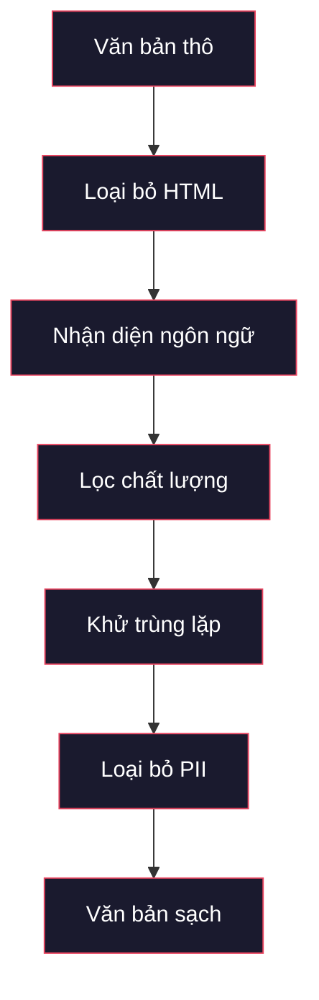
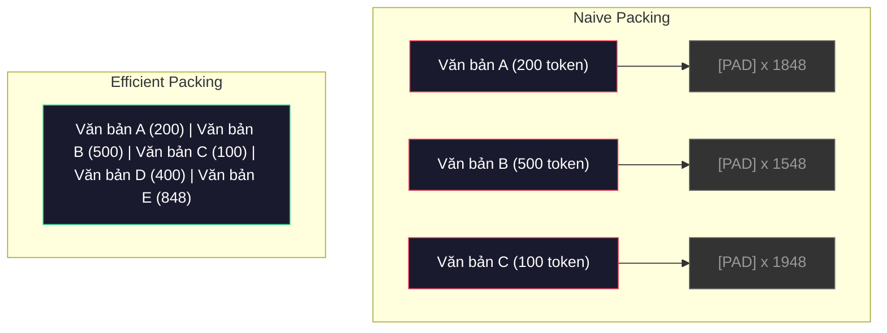

# Data pipeline (pipeline dữ liệu) cho Tiền huấn luyện

> Mô hình là một tấm gương. Nó phản chiếu bất cứ thứ dữ liệu nào bạn đưa vào. Đưa rác vào, nó phản chiếu rác với độ trôi chảy hoàn hảo.

**Type:** Build
**Languages:** Python
**Prerequisites:** Giai đoạn 10, Bài 01-02 (Tokenizer, Xây dựng tokenizer)
**Time:** ~90 phút

## Mục tiêu học tập

- Xây dựng một pipeline dữ liệu dạng streaming (truyền trực tiếp) để tokenize, chia khối, xáo trộn và gom batch hàng terabyte văn bản mà không cần nạp tất cả vào bộ nhớ
- Cài đặt các bộ lọc chất lượng dữ liệu dùng trong pipeline tiền huấn luyện thực tế: deduplication (khử trùng lặp), nhận diện ngôn ngữ và filtering (lọc) nội dung
- Tạo các chuỗi huấn luyện có độ dài cố định với attention mask đúng và cách xử lý ranh giới document (văn bản)
- Đo thông lượng của pipeline để đảm bảo dataloader theo kịp tốc độ huấn luyện trên GPU

## Vấn đề

Bạn đã có tokenizer. Giờ bạn cần dữ liệu.

Không phải một dataset. Không phải một file CSV. Mà là hàng terabyte văn bản -- đã làm sạch, khử trùng lặp, lọc theo chất lượng, tokenize thành các chuỗi độ dài cố định, và được phục vụ theo các batch ngẫu nhiên đủ nhanh để cụm 8-GPU của bạn không bao giờ phải chờ batch tiếp theo.

Hầu hết mọi người nghĩ huấn luyện LLM là chuyện kiến trúc mô hình. Không phải vậy. Llama 3 dùng 15.6 nghìn tỷ token. GPT-3 dùng 300 tỷ. DeepSeek-V2 dùng 8.1 nghìn tỷ. Kiến trúc của cả ba gần như giống nhau: các khối transformer xếp chồng với lớp attention và feedforward. Khác biệt về chất lượng đầu ra đến chủ yếu từ dữ liệu.

Bài báo Chinchilla của DeepMind đã nói rõ điều này. Với một ngân sách tính toán cho trước, tồn tại một tỷ lệ tối ưu giữa số tham số mô hình và số token huấn luyện. Chinchilla chỉ ra rằng hầu hết mô hình năm 2022 đều thiếu huấn luyện một cách nghiêm trọng -- chúng có quá nhiều tham số so với lượng dữ liệu chúng thấy. Một mô hình 70B tham số huấn luyện trên 1.4 nghìn tỷ token (tối ưu theo Chinchilla) vượt trội hơn mô hình 280B huấn luyện trên 300 tỷ token (Gopher).

Pipeline dữ liệu của bạn quyết định xem mô hình của bạn học ngôn ngữ hay học nhiễu.

## Khái niệm

### Dữ liệu đến từ đâu

Mọi mô hình ngôn ngữ lớn đều được huấn luyện trên hỗn hợp nhiều nguồn. Thành phần chính xác là bí mật được bảo vệ chặt chẽ ở hầu hết các lab, nhưng chúng ta biết đủ để hiểu các nhóm nguồn.

| Nguồn | Kích thước | Chất lượng | Được dùng bởi |
|--------|------|---------|---------|
| Common Crawl | ~250 TB thô | Thấp (cần lọc mạnh) | GPT-3, Llama, hầu hết mô hình mở |
| Wikipedia | ~20 GB | Cao | Mọi LLM lớn |
| GitHub code | ~1 TB+ | Trung bình (nhiều bản trùng, code chết) | StarCoder, CodeLlama, DeepSeek-Coder |
| Books (BookCorpus, Pile) | ~100 GB | Cao | GPT-2, GPT-3, các mô hình đầu tiên |
| Academic papers (arXiv, S2ORC) | ~100 GB | Cao với STEM | Llama, Galactica |
| StackOverflow, Reddit | ~100 GB | Trung bình | Llama, Falcon |
| Curated web (C4, RefinedWeb) | ~5 TB | Trung bình-Cao (đã lọc trước) | T5, Falcon |

Llama 3 công bố hỗn hợp dữ liệu của mình: khoảng 50% dữ liệu web, 25% code, 13% sách và bài báo khoa học, 8% dữ liệu toán, và 4% dữ liệu web đa ngôn ngữ. Tổng cộng là 15.6 nghìn tỷ token từ các nguồn vượt quá 5 TB văn bản thô.

Tỷ lệ quan trọng không kém tổng kích thước. Quá nhiều dữ liệu web và mô hình biến thành con vẹt Reddit. Quá ít code và nó không lập trình được. Quá ít toán và nó thất bại trong suy luận. Lấy đúng hỗn hợp này là một trong những phần khó nhất của việc huấn luyện LLM, và không có công thức nào -- nó đòi hỏi thử nghiệm và đánh giá.

### Làm sạch dữ liệu

Dữ liệu web thô rất bẩn. Một bản Common Crawl dump điển hình chứa:

- Thẻ HTML và JavaScript
- Header, footer, menu điều hướng dạng boilerplate
- Trang trùng lặp (trùng chính xác và gần trùng)
- Spam do máy tạo
- Thông tin nhận dạng cá nhân (PII)
- Văn bản chất lượng thấp (danh sách từ khoá, spam SEO)
- Nội dung không phải văn bản bị mã hoá thành văn bản

Làm sạch chuyện này không phải tuỳ chọn. Nó là khác biệt giữa một mô hình sinh ra đoạn văn mạch lạc và một mô hình xuất ra thẻ HTML lẫn với danh mục sản phẩm.



Mỗi bước loại bỏ một nhóm nhiễu:

**Loại bỏ HTML:** Xoá toàn bộ markup. Chỉ giữ nội dung văn bản hiển thị. Các thư viện như `trafilatura` hay `readability` trích nội dung bài viết đồng thời bỏ đi điều hướng, quảng cáo và boilerplate.

**Nhận diện ngôn ngữ:** Dùng mô hình nhận diện ngôn ngữ của fastText (lid.176.bin) để phân loại từng document. Lọc về các ngôn ngữ bạn nhắm tới. Một document được phân loại là tiếng Anh với độ tin cậy dưới 0.8 thì nhiều khả năng không phải tiếng Anh sạch.

**Lọc chất lượng:** Đây là chỗ thú vị. RefinedWeb (dataset đứng sau Falcon) dùng bộ lọc dựa trên perplexity: huấn luyện một mô hình ngôn ngữ nhỏ trên Wikipedia, rồi cho điểm từng document. Perplexity cao nghĩa là document khác Wikipedia -- nhiều khả năng là spam, danh sách từ khoá, hay nội dung do máy tạo. Các document có perplexity vượt ngưỡng sẽ bị loại.

**Khử trùng lặp:** Bước làm sạch có tác động lớn nhất. Common Crawl chứa lượng khổng lồ trang trùng lặp -- tuyên bố pháp lý, thông báo cookie, điều khoản dịch vụ. Huấn luyện trên bản trùng lặp lãng phí tính toán và có thể khiến mô hình ghi nhớ rồi nhả lại nguyên văn những đoạn cụ thể.

**Loại bỏ PII:** Tên, địa chỉ email, số điện thoại, số an sinh xã hội. Phát hiện dựa trên regex cho PII có cấu trúc, mô hình NER cho tên trong ngữ cảnh.

### Khử trùng lặp với MinHash

Khử trùng lặp chính xác thì dễ: băm từng document, loại bản trùng. Nhưng gần trùng mới là vấn đề thật. Hai bản của cùng một bài báo với quảng cáo hơi khác xung quanh là gần trùng. Nội dung giống nhau 95%, nhưng từng byte thì khác.

MinHash + Locality-Sensitive Hashing (LSH) giải quyết việc này một cách hiệu quả.


Ý tưởng:

1. **Shingling:** Chuyển mỗi document thành một tập n-gram (ví dụ 5-gram của từ hoặc ký tự). "the quick brown fox" với shingle 3 từ trở thành {"the quick brown", "quick brown fox"}.

2. **MinHash:** Với tập shingle của mỗi document, tính k giá trị hash. Mỗi giá trị hash là hash nhỏ nhất trên toàn bộ shingle dưới một hàm hash khác nhau. Việc này tạo ra một "chữ ký" kích thước cố định, xấp xỉ độ tương đồng Jaccard giữa hai document bất kỳ.

3. **LSH:** Nhóm các document vào giỏ dựa trên các dải trong chữ ký MinHash của chúng. Các document trong cùng giỏ là ứng viên gần trùng. Cách này tránh phải so sánh mọi cặp -- bạn chỉ so sánh các ứng viên.

4. **Verify:** Với mỗi cặp ứng viên, tính độ tương đồng Jaccard chính xác. Loại một bản nếu độ tương đồng vượt ngưỡng (thường là 0.8).

Nhóm Llama báo cáo đã loại khoảng 38% dữ liệu web của họ qua khử trùng lặp. Đó không phải con số nhỏ. Hơn một phần ba Common Crawl là nội dung trùng hoặc gần trùng.

### Đóng gói chuỗi

Mô hình của bạn mong đợi các chuỗi đầu vào có độ dài cố định. Document của bạn có độ dài thay đổi. Có cái 50 token. Có cái 50,000 token.

Cách ngây thơ: đệm mọi document tới độ dài chuỗi tối đa. Cách này lãng phí lượng tính toán khổng lồ cho các token padding không đóng góp gì cho việc học.

Cách tốt hơn: packing (đóng gói) nhiều document vào một chuỗi, phân tách bởi token kết thúc chuỗi. Một chuỗi 2048 token có thể chứa ba document ngắn được nối với nhau, có token [EOS] ở giữa.



Attention mask phải được đặt đúng. Token của Document A không được attend tới token của Document B trong cùng một chuỗi đã đóng gói. Việc này cần một attention mask dạng block-diagonal.

Các document dài bị cắt cụt hoặc chia thành khối tại ranh giới chuỗi. Điểm chia rất quan trọng: chia giữa câu buộc mô hình thấy những ý không trọn vẹn. Một số pipeline căn điểm chia theo ranh giới đoạn văn hoặc câu khi có thể.

### Định luật scaling của Chinchilla

Với ngân sách tính toán cố định C (đo bằng FLOPs), kích thước mô hình tối ưu N và kích thước dataset D tuân theo:

```
N_opt ~ C^0.5
D_opt ~ C^0.5
```

Trên thực tế, điều này nghĩa là bạn nên mở rộng kích thước mô hình và kích thước dataset gần như ngang nhau. Một mô hình có số tham số gấp 10 lần cần khoảng 10 lần token huấn luyện để đạt cùng mức loss.

| Mô hình | Tham số | Token huấn luyện | Tối ưu theo Chinchilla? |
|-------|-----------|----------------|-------------------|
| GPT-3 | 175B | 300B | Không (thiếu huấn luyện 3-4x) |
| Chinchilla | 70B | 1.4T | Có (theo thiết kế) |
| Llama 2 | 70B | 2T | Quá huấn luyện (có chủ ý) |
| Llama 3 | 70B | 15T | Quá huấn luyện nặng |

Llama 3 cố ý vi phạm định luật Chinchilla. Meta thấy rằng huấn luyện quá mức trên nhiều dữ liệu hơn -- vượt xa tỷ lệ tối ưu tính toán -- tạo ra mô hình tốt hơn khi suy luận. Chi phí huấn luyện thêm chỉ trả một lần, nhưng mô hình nhỏ hơn thì phục vụ rẻ hơn mãi mãi. Cách này đôi khi được gọi là hướng scaling "tối ưu cho suy luận", và nó đã trở thành chuẩn của ngành từ 2024.

```figure
l5-data-pipeline
```

## Tự tay làm

### Bước 1: Làm sạch văn bản

Loại bỏ HTML, chuẩn hoá khoảng trắng, xoá nội dung không phải văn bản. Chúng ta sẽ dùng một văn bản thuộc phạm vi công cộng (Project Gutenberg) làm kho ngữ liệu nhỏ.

```python
import re

def clean_text(text):
    text = re.sub(r"<[^>]+>", "", text)
    text = re.sub(r"http\S+", "", text)
    text = re.sub(r"[^\x20-\x7E\n]", "", text)
    text = re.sub(r"\n{3,}", "\n\n", text)
    text = re.sub(r" {2,}", " ", text)
    return text.strip()

def quality_filter(text, min_words=50, max_ratio_caps=0.3, max_ratio_special=0.1):
    words = text.split()
    if len(words) < min_words:
        return False
    caps_ratio = sum(1 for w in words if w.isupper()) / len(words)
    if caps_ratio > max_ratio_caps:
        return False
    special_chars = sum(1 for c in text if not c.isalnum() and not c.isspace())
    if special_chars / max(len(text), 1) > max_ratio_special:
        return False
    return True
```

Bộ lọc chất lượng bắt được spam SEO (TOÀN CHỮ HOA), nhiễu do máy tạo (tỷ lệ ký tự đặc biệt cao), và trang rỗng (quá ngắn). Chỉ ba kiểm tra này đã loại được một lượng rác đáng ngạc nhiên khỏi dữ liệu thu thập web.

### Bước 2: Khử trùng lặp bằng MinHash

Cài đặt MinHash từ đầu. Không cần thư viện ngoài -- chỉ cần `hashlib`.

```python
import hashlib
from collections import defaultdict

def get_shingles(text, k=5):
    words = text.lower().split()
    if len(words) < k:
        return set()
    return {" ".join(words[i:i+k]) for i in range(len(words) - k + 1)}

def minhash_signature(shingles, num_hashes=128):
    signature = []
    for i in range(num_hashes):
        min_hash = float("inf")
        for shingle in shingles:
            h = int(hashlib.sha256(f"{i}:{shingle}".encode()).hexdigest(), 16)
            min_hash = min(min_hash, h)
        signature.append(min_hash)
    return signature

def lsh_buckets(signature, bands=16):
    rows_per_band = len(signature) // bands
    buckets = []
    for b in range(bands):
        start = b * rows_per_band
        band_data = tuple(signature[start:start + rows_per_band])
        bucket_hash = hashlib.md5(str(band_data).encode()).hexdigest()
        buckets.append((b, bucket_hash))
    return buckets

def deduplicate(documents, threshold=0.8, num_hashes=128, bands=16):
    signatures = []
    shingle_sets = []
    for doc in documents:
        shingles = get_shingles(doc)
        shingle_sets.append(shingles)
        signatures.append(minhash_signature(shingles, num_hashes))

    bucket_map = defaultdict(list)
    for doc_idx, sig in enumerate(signatures):
        for band_id, bucket_hash in lsh_buckets(sig, bands):
            bucket_map[(band_id, bucket_hash)].append(doc_idx)

    duplicate_pairs = set()
    for bucket_docs in bucket_map.values():
        if len(bucket_docs) < 2:
            continue
        for i in range(len(bucket_docs)):
            for j in range(i + 1, len(bucket_docs)):
                duplicate_pairs.add((bucket_docs[i], bucket_docs[j]))

    removed = set()
    for i, j in duplicate_pairs:
        if i in removed or j in removed:
            continue
        s1, s2 = shingle_sets[i], shingle_sets[j]
        if not s1 or not s2:
            continue
        jaccard = len(s1 & s2) / len(s1 | s2)
        if jaccard >= threshold:
            removed.add(j)

    return [doc for idx, doc in enumerate(documents) if idx not in removed], len(removed)
```

Các tham số `num_hashes=128` và `bands=16` điều khiển đánh đổi precision-recall. Nhiều hash hơn cho ước lượng tương đồng chính xác hơn. Nhiều band hơn tăng recall (bắt được nhiều bản trùng hơn) với cái giá là nhiều dương tính giả hơn. Các giá trị này hoạt động tốt với văn bản web điển hình.

### Bước 3: Tokenize và đóng gói chuỗi

Lấy văn bản đã làm sạch, đã khử trùng lặp, tokenize nó, và đóng gói thành các chuỗi độ dài cố định cho huấn luyện.

```python
def tokenize_corpus(documents, tokenizer):
    all_tokens = []
    for doc in documents:
        tokens = tokenizer.encode(doc)
        all_tokens.extend(tokens)
        all_tokens.append(tokenizer.eos_id)
    return all_tokens

def pack_sequences(token_ids, seq_length, pad_id=0):
    sequences = []
    attention_masks = []
    for i in range(0, len(token_ids), seq_length):
        seq = token_ids[i:i + seq_length]
        mask = [1] * len(seq)
        if len(seq) < seq_length:
            pad_count = seq_length - len(seq)
            seq = seq + [pad_id] * pad_count
            mask = mask + [0] * pad_count
        sequences.append(seq)
        attention_masks.append(mask)
    return sequences, attention_masks
```

### Bước 4: DataLoader cho huấn luyện

Sinh ra các batch ngẫu nhiên của chuỗi đã đóng gói. Đây là thứ vòng lặp huấn luyện tiêu thụ.

```python
import random

class PreTrainingDataLoader:
    def __init__(self, sequences, attention_masks, batch_size, shuffle=True):
        self.sequences = sequences
        self.attention_masks = attention_masks
        self.batch_size = batch_size
        self.shuffle = shuffle

    def __len__(self):
        return (len(self.sequences) + self.batch_size - 1) // self.batch_size

    def __iter__(self):
        indices = list(range(len(self.sequences)))
        if self.shuffle:
            random.shuffle(indices)
        for start in range(0, len(indices), self.batch_size):
            batch_idx = indices[start:start + self.batch_size]
            batch_seqs = [self.sequences[i] for i in batch_idx]
            batch_masks = [self.attention_masks[i] for i in batch_idx]
            yield batch_seqs, batch_masks
```

### Bước 5: Thống kê dataset

Tính những con số quan trọng: tổng token, token duy nhất, tỷ lệ nén, phân bố độ dài document.

```python
from collections import Counter

def compute_statistics(documents, token_ids, sequences, tokenizer_vocab_size):
    total_chars = sum(len(d) for d in documents)
    total_tokens = len(token_ids)
    unique_tokens = len(set(token_ids))
    compression_ratio = total_chars / total_tokens

    doc_lengths = [len(d.split()) for d in documents]
    avg_doc_length = sum(doc_lengths) / max(len(doc_lengths), 1)
    max_doc_length = max(doc_lengths) if doc_lengths else 0
    min_doc_length = min(doc_lengths) if doc_lengths else 0

    token_counts = Counter(token_ids)
    top_tokens = token_counts.most_common(10)

    non_pad_tokens = sum(sum(1 for t in seq if t != 0) for seq in sequences)
    total_positions = sum(len(seq) for seq in sequences)
    utilization = non_pad_tokens / max(total_positions, 1)

    stats = {
        "total_documents": len(documents),
        "total_characters": total_chars,
        "total_tokens": total_tokens,
        "unique_tokens": unique_tokens,
        "vocab_utilization": unique_tokens / tokenizer_vocab_size,
        "compression_ratio": compression_ratio,
        "avg_doc_length_words": avg_doc_length,
        "max_doc_length_words": max_doc_length,
        "min_doc_length_words": min_doc_length,
        "num_sequences": len(sequences),
        "sequence_utilization": utilization,
        "top_10_tokens": top_tokens,
    }
    return stats
```

Tỷ lệ nén cho bạn biết tokenizer hiệu quả thế nào trên kho ngữ liệu này. Văn bản tiếng Anh thường nén còn khoảng 3-4 ký tự mỗi token. Nếu bạn thấy 1.5 ký tự mỗi token, tokenizer của bạn đang tách quá mạnh. Nếu bạn thấy 8+, nó đã học được những phép merge rất đặc thù miền.

Độ sử dụng chuỗi cho bạn biết bao nhiêu phần trong các chuỗi đã đóng gói là dữ liệu thật so với padding. Dưới 90% nghĩa là cách đóng gói của bạn kém hiệu quả -- bạn đang lãng phí tính toán cho các token padding.

## Áp dụng

### So sánh với HuggingFace Datasets

Nạp cùng kho ngữ liệu qua thư viện datasets của HuggingFace và so sánh tốc độ pipeline.

```python
from datasets import load_dataset
from transformers import AutoTokenizer

ds = load_dataset("wikitext", "wikitext-2-raw-v1", split="train")
tokenizer = AutoTokenizer.from_pretrained("meta-llama/Meta-Llama-3-8B")

import time

start = time.time()
tokenized = ds.map(
    lambda x: tokenizer(x["text"], truncation=True, max_length=2048),
    batched=True,
    num_proc=4,
)
hf_time = time.time() - start
total_tokens = sum(len(t) for t in tokenized["input_ids"])
print(f"HuggingFace: {total_tokens:,} tokens in {hf_time:.2f}s ({total_tokens/hf_time:,.0f} tokens/sec)")
```

Pipeline của HuggingFace dùng tokenizer viết bằng Rust bên dưới và xử lý song song trên 4 core. Pipeline Python thuần của bạn sẽ chậm hơn 10-50 lần. Khoảng cách đó là lý do các nhóm production dùng tokenizer đã biên dịch. Thuật toán giống nhau. Ngôn ngữ cài đặt là khác biệt.

## Đóng gói

Bài này tạo ra một prompt để kiểm tra và gỡ lỗi chất lượng dữ liệu trong pipeline huấn luyện LLM. Xem `outputs/prompt-data-quality-checker.md`.

## Bài tập

1. **Dễ:** Thêm nhận diện ngôn ngữ vào pipeline làm sạch bằng một heuristic đơn giản (phân tích tập ký tự). Chỉ lọc lấy document tiếng Anh và đo xem bao nhiêu document bị loại.
2. **Trung bình:** Cài đặt khử trùng lặp chính xác bằng hash SHA-256 song song với khử trùng lặp gần bằng MinHash. So sánh số bản trùng mỗi phương pháp bắt được trên một kho ngữ liệu thu thập từ web.
3. **Khó:** Xây dựng bộ lọc chất lượng dựa trên perplexity. Huấn luyện một mô hình ngôn ngữ bigram nhỏ trên văn bản Wikipedia, cho điểm từng document theo perplexity, và loại 20% thấp nhất. So sánh chất lượng đầu ra của mô hình khi huấn luyện trên dữ liệu đã lọc và chưa lọc.

## Thuật ngữ chính

| Thuật ngữ | Người ta thường nói | Ý nghĩa thực sự |
|------|----------------|----------------------|
| Common Crawl | "Cả Internet" | Một tổ chức phi lợi nhuận thu thập web hàng tháng -- ~250TB thô, điểm khởi đầu cho hầu hết dữ liệu huấn luyện LLM |
| MinHash | "Một mẹo băm nào đó" | Kỹ thuật ước lượng độ tương đồng Jaccard giữa các tập bằng chữ ký kích thước cố định -- cho phép phát hiện gần trùng ở quy mô lớn |
| LSH | "Locality-Sensitive Hashing" | Phương pháp nhóm các mục tương tự vào cùng một giỏ -- giảm so sánh từng cặp từ O(n^2) xuống gần tuyến tính |
| Sequence packing | "Nối các document lại" | Xếp nhiều document vào chuỗi độ dài cố định với attention mask đúng -- loại bỏ lãng phí padding |
| Chinchilla scaling | "Huấn luyện trên nhiều dữ liệu hơn" | Với ngân sách tính toán cố định, hiệu năng tối ưu đòi hỏi mở rộng kích thước mô hình và số token huấn luyện gần như tương đương |
| Fertility | "Token trên mỗi từ" | Số token trung bình trên mỗi từ -- 1.3 với tiếng Anh trong GPT-4, cao hơn với các hệ chữ không phải Latin |
| Data mixing | "Chọn dữ liệu huấn luyện" | Tỷ lệ giữa code, văn bản, toán và dữ liệu đa ngôn ngữ -- không có công thức, cần thử nghiệm |
| Perplexity filter | "Cho điểm chất lượng" | Dùng một mô hình ngôn ngữ nhỏ để cho điểm document -- perplexity cao nghĩa là văn bản khác dữ liệu tham chiếu sạch |
| Deduplication | "Xoá các bản sao" | Loại bỏ document trùng chính xác và gần trùng -- thường loại 30-40% dữ liệu web thô |
| Attention mask | "Những token nào được nhìn" | Mặt nạ nhị phân ngăn attention vượt qua ranh giới document trong các chuỗi đã đóng gói |

## Đọc thêm

- [Hoffmann et al., 2022 -- Training Compute-Optimal Large Language Models (Chinchilla)](https://arxiv.org/abs/2203.15556) -- bài báo đã thay đổi cách chúng ta nghĩ về quy mô dữ liệu
- [Penedo et al., 2023 -- The RefinedWeb Dataset for Falcon LLM](https://arxiv.org/abs/2306.01116) -- cách lọc Common Crawl thành chất lượng cao
- [Touvron et al., 2023 -- Llama 2: Open Foundation and Fine-Tuned Chat Models](https://arxiv.org/abs/2307.09288) -- chi tiết pipeline dữ liệu của Llama 2
- [Lee et al., 2022 -- Deduplicating Training Data Makes Language Models Better](https://arxiv.org/abs/2107.06499) -- vì sao khử trùng lặp quan trọng hơn bạn tưởng
- [Broder, 1997 -- On the Resemblance and Containment of Documents](https://ieeexplore.ieee.org/document/666900) -- bài báo gốc về MinHash
- [Meta, 2024 -- Llama 3 Technical Report](https://arxiv.org/abs/2407.21783) -- 15.6T token, tỷ lệ trộn dữ liệu, pipeline lọc

---

[← Bài trước: Tự xây Tokenizer từ đầu](../../02-building-a-tokenizer/docs/vi.md) · [Bài sau: Huấn luyện trước (pre-training) một mini GPT (GPT cỡ nhỏ, 124M tham số) →](../../04-pre-training-mini-gpt/docs/vi.md)
