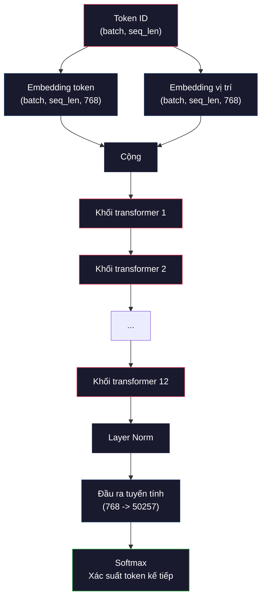
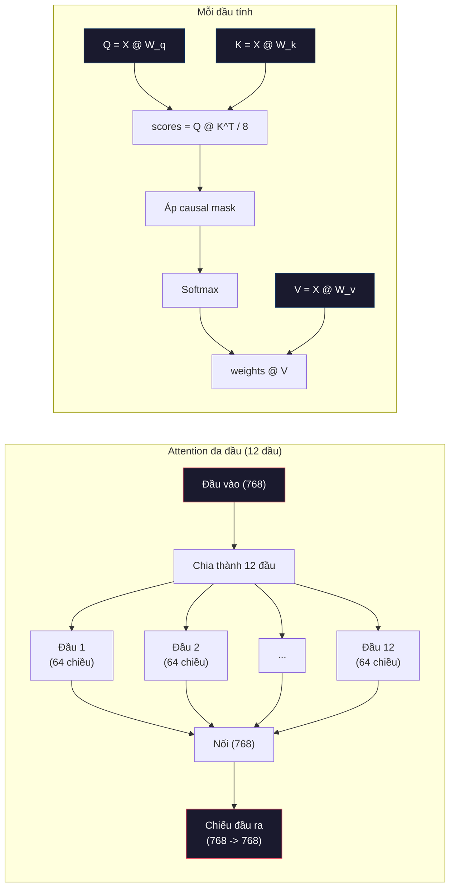
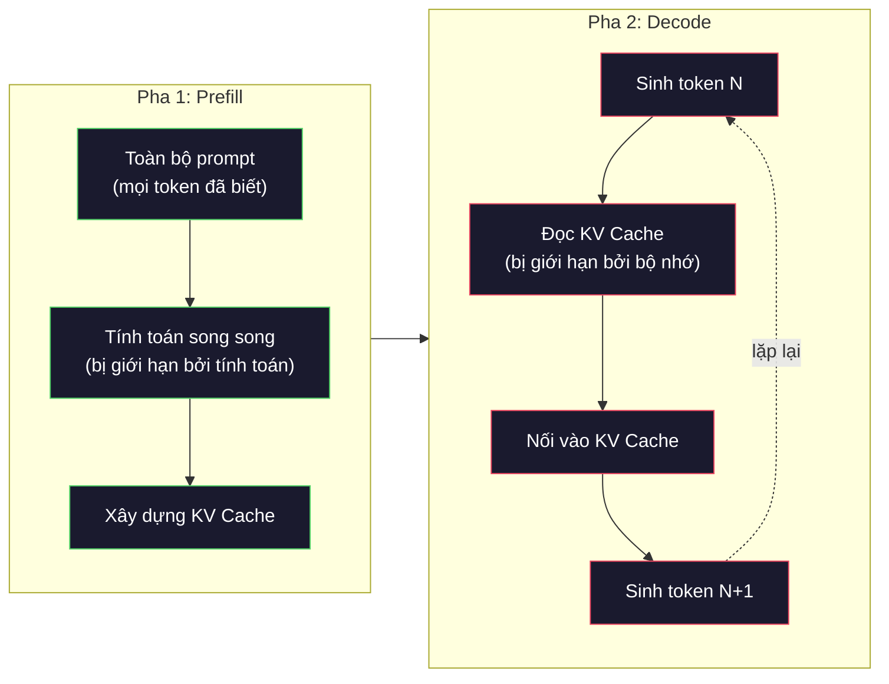

# Huấn luyện trước (pre-training) một mini GPT (GPT cỡ nhỏ, 124M tham số)

> GPT-2 Small có 124 triệu tham số. Đó là 12 lớp transformer, 12 đầu chú ý (attention head) và embedding 768 chiều. Bạn có thể huấn luyện nó từ đầu trên một GPU duy nhất trong vài giờ. Hầu hết mọi người không bao giờ làm vậy. Họ dùng checkpoint (bản lưu mô hình) có sẵn. Nhưng nếu bạn không tự huấn luyện một cái, bạn không thực sự hiểu điều gì xảy ra bên trong mô hình mà bạn đang xây sản phẩm dựa trên đó.

**Type:** Build
**Languages:** Python (with numpy)
**Prerequisites:** Giai đoạn 10, Bài 01-03 (Tokenizer, Xây dựng tokenizer, Pipeline dữ liệu)
**Time:** ~120 phút

## Mục tiêu học tập

- Cài đặt toàn bộ kiến trúc GPT-2 (124M tham số) từ đầu: embedding token, embedding vị trí, các khối transformer và đầu ra mô hình ngôn ngữ
- Huấn luyện một mô hình GPT trên một kho văn bản bằng dự đoán token kế tiếp với mất mát cross-entropy
- Cài đặt sinh văn bản tự hồi quy với lấy mẫu theo temperature và lọc top-k/top-p
- Theo dõi loss curve (đường cong mất mát) khi huấn luyện và kiểm chứng rằng mô hình học được các mẫu ngôn ngữ mạch lạc

## Vấn đề

Bạn biết transformer là gì. Bạn đã xem các sơ đồ. Bạn có thể đọc thuộc lòng "attention is all you need" và vẽ những ô vuông dán nhãn "Multi-Head Attention" lên bảng trắng.

Không điều nào trong số đó có nghĩa là bạn hiểu điều gì xảy ra khi một mô hình sinh văn bản.

Có 124,438,272 tham số trong GPT-2 Small (với weight tying). Từng tham số trong số đó được đặt bằng cách chạy một training loop (vòng huấn luyện): lan truyền xuôi, tính mất mát, lan truyền ngược, cập nhật trọng số. Mười hai khối transformer. Mười hai đầu chú ý mỗi khối. Một không gian embedding 768 chiều. Một từ vựng 50,257 token. Mỗi lần mô hình sinh một token, toàn bộ 124 triệu tham số cùng tham gia vào một chuỗi phép nhân ma trận: nhận vào một chuỗi token ID và tạo ra phân phối xác suất trên token kế tiếp.

Nếu bạn chưa từng tự xây dựng nó, bạn đang làm việc với một hộp đen. Bạn có thể dùng API. Bạn có thể fine-tune. Nhưng khi có sự cố -- khi mô hình ảo giác (hallucinate), khi nó lặp lại chính mình, khi nó từ chối làm theo chỉ dẫn -- bạn không có mô hình tinh thần nào để hiểu *tại sao*.

Bài học này xây dựng GPT-2 Small từ đầu. Không phải bằng PyTorch. Mà bằng numpy. Mọi phép nhân ma trận đều nhìn thấy được. Mọi gradient đều do mã của bạn tính. Bạn sẽ thấy chính xác cách 124 triệu con số phối hợp để dự đoán từ tiếp theo.

## Khái niệm

### Kiến trúc GPT

GPT là một mô hình ngôn ngữ tự hồi quy. "Tự hồi quy" nghĩa là nó sinh từng token một, mỗi token phụ thuộc vào tất cả token trước đó. Kiến trúc là một chồng các khối giải mã (decoder) transformer.

Đây là toàn bộ đồ thị tính toán từ token ID tới xác suất token kế tiếp:

1. Token ID đi vào. Hình dạng: (batch_size, seq_len).
2. Tra cứu embedding token. Mỗi ID ánh xạ tới một vector 768 chiều. Hình dạng: (batch_size, seq_len, 768).
3. Tra cứu embedding vị trí. Mỗi vị trí (0, 1, 2, ...) ánh xạ tới một vector 768 chiều. Cùng hình dạng.
4. Cộng embedding token + embedding vị trí.
5. Đi qua 12 khối transformer.
6. Chuẩn hoá lớp cuối cùng.
7. Chiếu tuyến tính tới kích thước từ vựng. Hình dạng: (batch_size, seq_len, vocab_size).
8. Softmax để có xác suất.

Đó là toàn bộ mô hình. Không tích chập. Không cơ chế hồi tiếp. Chỉ embedding, attention, mạng feedforward và layer norm xếp chồng 12 lần.



### Khối transformer

Mỗi khối trong 12 khối theo cùng một khuôn mẫu. Kiến trúc pre-norm (GPT-2 dùng pre-norm, không dùng post-norm như transformer gốc):

1. LayerNorm
2. Self-attention đa đầu
3. Kết nối tàn dư (cộng đầu vào trở lại)
4. LayerNorm
5. Mạng feedforward (MLP)
6. Kết nối tàn dư (cộng đầu vào trở lại)

Các kết nối tàn dư là thiết yếu. Không có chúng, gradient biến mất khi tới khối 1 trong lúc lan truyền ngược. Có chúng, gradient có thể chảy trực tiếp từ mất mát tới bất kỳ lớp nào qua đường "skip". Đây là lý do bạn có thể xếp chồng 12, 32, thậm chí 96 khối (GPT-4 được đồn dùng 120).

### Attention: cơ chế cốt lõi

Self-attention cho mỗi token nhìn vào mọi token trước đó và quyết định mức độ chú ý vào từng token. Đây là phần toán.

Với mỗi vị trí token, tính ba vector từ đầu vào:
- **Query (Q)**: "Tôi đang tìm gì?"
- **Key (K)**: "Tôi chứa gì?"
- **Value (V)**: "Tôi mang thông tin gì?"

```
Q = input @ W_q    (768 -> 768)
K = input @ W_k    (768 -> 768)
V = input @ W_v    (768 -> 768)

attention_scores = Q @ K^T / sqrt(d_k)
attention_scores = mask(attention_scores)   # causal mask: -inf for future positions
attention_weights = softmax(attention_scores)
output = attention_weights @ V
```

Causal mask chính là thứ khiến GPT tự hồi quy. Vị trí 5 có thể chú ý tới vị trí 0-5 nhưng không tới 6, 7, 8, v.v. Điều này ngăn mô hình "gian lận" bằng cách nhìn vào token tương lai trong khi huấn luyện.

**Attention đa đầu** chia không gian 768 chiều thành 12 đầu, mỗi đầu 64 chiều. Mỗi đầu học một mẫu chú ý khác nhau. Một đầu có thể theo dõi quan hệ cú pháp (hợp giữa chủ ngữ và vị ngữ). Một đầu khác có thể theo dõi sự tương đồng ngữ nghĩa (từ đồng nghĩa). Một đầu khác nữa có thể theo dõi sự gần nhau về vị trí (các từ cạnh nhau). Đầu ra của cả 12 đầu được nối lại và chiếu về 768 chiều.



Phép chia cho sqrt(d_k) -- sqrt(64) = 8 -- là bước scaling. Không có nó, tích vô hướng trở nên lớn với vector nhiều chiều, đẩy softmax vào vùng gradient gần như bằng 0. Đây là một trong những phát hiện then chốt của bài báo gốc "Attention Is All You Need".

### KV Cache: vì sao suy luận nhanh

Trong huấn luyện, bạn xử lý toàn bộ chuỗi một lúc. Trong suy luận, bạn sinh từng token một. Nếu không tối ưu, sinh token N đòi hỏi tính lại attention cho cả N-1 token trước đó. Đó là O(N^2) cho mỗi token sinh ra, hay O(N^3) tổng cộng cho một chuỗi dài N.

KV Cache giải quyết việc này. Sau khi tính K và V cho mỗi token, hãy lưu chúng lại. Khi sinh token N+1, bạn chỉ cần tính Q cho token mới và tra K, V đã lưu của mọi token trước. Điều này giảm chi phí mỗi token từ O(N) xuống O(1) cho phần tính K và V. Phần tính điểm attention vẫn là O(N) vì bạn chú ý tới mọi vị trí phía trước, nhưng bạn tránh được các phép nhân ma trận dư thừa trên đầu vào.

Với GPT-2 có 12 lớp và 12 đầu, KV cache lưu 2 (K + V) x 12 lớp x 12 đầu x 64 chiều = 18,432 giá trị mỗi token. Với chuỗi 1024 token, đó là khoảng 75MB ở FP32. Với Llama 3 405B có 128 lớp, KV cache cho một chuỗi có thể vượt 10GB. Đây là lý do suy luận ngữ cảnh dài bị giới hạn bởi bộ nhớ.

### Prefill vs Decode: hai pha của suy luận

Khi bạn gửi một prompt tới LLM, suy luận diễn ra theo hai pha riêng biệt.

**Prefill** xử lý toàn bộ prompt song song. Mọi token đã biết, nên mô hình có thể tính attention cho tất cả vị trí cùng lúc. Pha này bị giới hạn bởi tính toán -- GPU đang thực hiện phép nhân ma trận với công suất tối đa. Với prompt 1000 token trên A100, prefill mất khoảng 20-50ms.

**Decode** sinh token từng cái một. Mỗi token mới phụ thuộc vào mọi token trước. Pha này bị giới hạn bởi bộ nhớ -- nút thắt là đọc trọng số mô hình và KV cache từ bộ nhớ GPU, không phải phép toán ma trận. Các lõi tính toán của GPU gần như ngồi không chờ đọc bộ nhớ. Với GPT-2, mỗi bước decode mất khoảng thời gian như nhau bất kể các phép matmul cần bao nhiêu FLOP, vì băng thông bộ nhớ mới là ràng buộc.

Sự phân biệt này quan trọng với hệ thống production. Thông lượng prefill tăng theo năng lực tính toán của GPU (nhiều FLOPS hơn = prefill nhanh hơn). Thông lượng decode tăng theo băng thông bộ nhớ (bộ nhớ nhanh hơn = decode nhanh hơn). Đó là lý do H100 của NVIDIA tập trung cải thiện băng thông bộ nhớ so với A100 -- nó tăng tốc trực tiếp việc sinh token.



### Vòng huấn luyện

Huấn luyện một LLM là dự đoán token kế tiếp. Cho các token [0, 1, 2, ..., N-1], dự đoán các token [1, 2, 3, ..., N]. Hàm mất mát là cross-entropy giữa phân phối xác suất mô hình dự đoán và token kế tiếp thật.

Một bước huấn luyện:

1. **Lan truyền xuôi**: Chạy batch qua cả 12 khối. Lấy logits (điểm trước softmax) cho mỗi vị trí.
2. **Tính mất mát**: Cross-entropy giữa logits và token mục tiêu (chính đầu vào dịch đi một vị trí).
3. **Lan truyền ngược**: Tính gradient cho cả 124M tham số bằng backpropagation.
4. **Bước optimizer**: Cập nhật trọng số. GPT-2 dùng Adam với warmup learning rate và suy giảm cosine.

learning rate schedule (lịch trình tốc độ học) quan trọng hơn bạn tưởng. GPT-2 warmup từ 0 tới learning rate đỉnh trong 2,000 bước đầu, rồi suy giảm theo đường cosine. Bắt đầu với learning rate cao khiến mô hình phân kỳ. Giữ một tốc độ cao không đổi gây dao động ở giai đoạn sau. Mẫu warmup-rồi-suy-giảm được mọi LLM lớn sử dụng.

### GPT-2 Small: các con số

| Thành phần | Hình dạng | Tham số |
|-----------|-------|------------|
| Embedding token | (50257, 768) | 38,597,376 |
| Embedding vị trí | (1024, 768) | 786,432 |
| Attention mỗi khối (W_q, W_k, W_v, W_out) | 4 x (768, 768) | 2,359,296 |
| FFN mỗi khối (lên + xuống) | (768, 3072) + (3072, 768) | 4,718,592 |
| LayerNorm mỗi khối (2x) | 2 x 768 x 2 | 3,072 |
| LayerNorm cuối | 768 x 2 | 1,536 |
| **Tổng mỗi khối** | | **7,080,960** |
| **Tổng (12 khối)** | | **85,054,464 + 39,383,808 = 124,438,272** |

Phép chiếu đầu ra (đầu logits) dùng chung trọng số với ma trận embedding token. Đây gọi là weight tying -- nó giảm số tham số đi 38M và cải thiện hiệu năng vì buộc mô hình dùng cùng một không gian biểu diễn cho đầu vào và đầu ra.

## Tự tay làm

### Bước 1: Lớp embedding

Embedding token ánh xạ mỗi token trong 50,257 token có thể tới một vector 768 chiều. Embedding vị trí thêm thông tin về nơi mỗi token nằm trong chuỗi. Hai thứ được cộng lại.

```python
import numpy as np

class Embedding:
    def __init__(self, vocab_size, embed_dim, max_seq_len):
        self.token_embed = np.random.randn(vocab_size, embed_dim) * 0.02
        self.pos_embed = np.random.randn(max_seq_len, embed_dim) * 0.02

    def forward(self, token_ids):
        seq_len = token_ids.shape[-1]
        tok_emb = self.token_embed[token_ids]
        pos_emb = self.pos_embed[:seq_len]
        return tok_emb + pos_emb
```

Độ lệch chuẩn 0.02 khi khởi tạo đến từ bài báo GPT-2. Quá lớn thì các lượt lan truyền xuôi đầu tiên tạo ra giá trị cực đoan làm huấn luyện bất ổn. Quá nhỏ thì đầu ra ban đầu gần như giống nhau với mọi đầu vào, khiến tín hiệu gradient sớm trở nên vô dụng.

### Bước 2: Self-attention với causal mask

Attention một đầu trước. Causal mask đặt các vị trí tương lai thành âm vô cùng trước softmax, đảm bảo mỗi vị trí chỉ có thể chú ý tới chính nó và các vị trí phía trước.

```python
def attention(Q, K, V, mask=None):
    d_k = Q.shape[-1]
    scores = Q @ K.transpose(0, -1, -2 if Q.ndim == 4 else 1) / np.sqrt(d_k)
    if mask is not None:
        scores = scores + mask
    weights = np.exp(scores - scores.max(axis=-1, keepdims=True))
    weights = weights / weights.sum(axis=-1, keepdims=True)
    return weights @ V
```

Cách cài softmax trừ đi giá trị lớn nhất trước khi luỹ thừa. Không có bước này, exp(số lớn) tràn thành vô cùng. Đây là mẹo ổn định số học không làm thay đổi đầu ra, vì softmax(x - c) = softmax(x) với mọi hằng số c.

### Bước 3: Attention đa đầu

Chia đầu vào 768 chiều thành 12 đầu, mỗi đầu 64 chiều. Mỗi đầu tính attention độc lập. Nối các kết quả lại rồi chiếu về 768 chiều.

```python
class MultiHeadAttention:
    def __init__(self, embed_dim, num_heads):
        self.num_heads = num_heads
        self.head_dim = embed_dim // num_heads
        self.W_q = np.random.randn(embed_dim, embed_dim) * 0.02
        self.W_k = np.random.randn(embed_dim, embed_dim) * 0.02
        self.W_v = np.random.randn(embed_dim, embed_dim) * 0.02
        self.W_out = np.random.randn(embed_dim, embed_dim) * 0.02

    def forward(self, x, mask=None):
        batch, seq_len, d = x.shape
        Q = (x @ self.W_q).reshape(batch, seq_len, self.num_heads, self.head_dim).transpose(0, 2, 1, 3)
        K = (x @ self.W_k).reshape(batch, seq_len, self.num_heads, self.head_dim).transpose(0, 2, 1, 3)
        V = (x @ self.W_v).reshape(batch, seq_len, self.num_heads, self.head_dim).transpose(0, 2, 1, 3)

        scores = Q @ K.transpose(0, 1, 3, 2) / np.sqrt(self.head_dim)
        if mask is not None:
            scores = scores + mask
        weights = np.exp(scores - scores.max(axis=-1, keepdims=True))
        weights = weights / weights.sum(axis=-1, keepdims=True)
        attn_out = weights @ V

        attn_out = attn_out.transpose(0, 2, 1, 3).reshape(batch, seq_len, d)
        return attn_out @ self.W_out
```

Điệu nhảy reshape-transpose-reshape là phần khó hiểu nhất của attention đa đầu. Đây là những gì xảy ra: tensor (batch, seq_len, 768) thành (batch, seq_len, 12, 64), rồi thành (batch, 12, seq_len, 64). Giờ mỗi đầu trong 12 đầu có ma trận (seq_len, 64) riêng để chạy attention. Sau attention, ta làm ngược lại: (batch, 12, seq_len, 64) thành (batch, seq_len, 12, 64) thành (batch, seq_len, 768).

### Bước 4: Khối transformer

Một khối transformer hoàn chỉnh: LayerNorm, attention đa đầu với kết nối tàn dư, LayerNorm, feedforward với kết nối tàn dư.

```python
class LayerNorm:
    def __init__(self, dim, eps=1e-5):
        self.gamma = np.ones(dim)
        self.beta = np.zeros(dim)
        self.eps = eps

    def forward(self, x):
        mean = x.mean(axis=-1, keepdims=True)
        var = x.var(axis=-1, keepdims=True)
        return self.gamma * (x - mean) / np.sqrt(var + self.eps) + self.beta


class FeedForward:
    def __init__(self, embed_dim, ff_dim):
        self.W1 = np.random.randn(embed_dim, ff_dim) * 0.02
        self.b1 = np.zeros(ff_dim)
        self.W2 = np.random.randn(ff_dim, embed_dim) * 0.02
        self.b2 = np.zeros(embed_dim)

    def forward(self, x):
        h = x @ self.W1 + self.b1
        h = np.maximum(0, h)  # GELU approximation: ReLU for simplicity
        return h @ self.W2 + self.b2


class TransformerBlock:
    def __init__(self, embed_dim, num_heads, ff_dim):
        self.ln1 = LayerNorm(embed_dim)
        self.attn = MultiHeadAttention(embed_dim, num_heads)
        self.ln2 = LayerNorm(embed_dim)
        self.ffn = FeedForward(embed_dim, ff_dim)

    def forward(self, x, mask=None):
        x = x + self.attn.forward(self.ln1.forward(x), mask)
        x = x + self.ffn.forward(self.ln2.forward(x))
        return x
```

Mạng feedforward mở rộng đầu vào 768 chiều thành 3,072 chiều (gấp 4 lần), áp một hàm phi tuyến, rồi chiếu về 768. Mẫu mở rộng-rồi-thu gọn này cho mô hình một biểu diễn nội bộ "rộng" hơn để xử lý ở mỗi vị trí. GPT-2 dùng hàm kích hoạt GELU, nhưng ở đây ta dùng ReLU cho đơn giản -- khác biệt không lớn nếu chỉ nhằm hiểu kiến trúc.

### Bước 5: Mô hình GPT đầy đủ

Xếp chồng 12 khối transformer. Thêm lớp embedding ở đầu và phép chiếu đầu ra ở cuối.

```python
class MiniGPT:
    def __init__(self, vocab_size=50257, embed_dim=768, num_heads=12,
                 num_layers=12, max_seq_len=1024, ff_dim=3072):
        self.embedding = Embedding(vocab_size, embed_dim, max_seq_len)
        self.blocks = [
            TransformerBlock(embed_dim, num_heads, ff_dim)
            for _ in range(num_layers)
        ]
        self.ln_f = LayerNorm(embed_dim)
        self.vocab_size = vocab_size
        self.embed_dim = embed_dim

    def forward(self, token_ids):
        seq_len = token_ids.shape[-1]
        mask = np.triu(np.full((seq_len, seq_len), -1e9), k=1)

        x = self.embedding.forward(token_ids)
        for block in self.blocks:
            x = block.forward(x, mask)
        x = self.ln_f.forward(x)

        logits = x @ self.embedding.token_embed.T
        return logits

    def count_parameters(self):
        total = 0
        total += self.embedding.token_embed.size
        total += self.embedding.pos_embed.size
        for block in self.blocks:
            total += block.attn.W_q.size + block.attn.W_k.size
            total += block.attn.W_v.size + block.attn.W_out.size
            total += block.ffn.W1.size + block.ffn.b1.size
            total += block.ffn.W2.size + block.ffn.b2.size
            total += block.ln1.gamma.size + block.ln1.beta.size
            total += block.ln2.gamma.size + block.ln2.beta.size
        total += self.ln_f.gamma.size + self.ln_f.beta.size
        return total
```

Chú ý weight tying: `logits = x @ self.embedding.token_embed.T`. Phép chiếu đầu ra dùng lại ma trận embedding token (chuyển vị). Đây không chỉ là mẹo tiết kiệm tham số. Nó có nghĩa mô hình dùng cùng một không gian vector để hiểu token (embedding) và để dự đoán token (đầu ra).

### Bước 6: Vòng huấn luyện

Với một lần huấn luyện thật trên 124M tham số, bạn sẽ cần GPU và PyTorch. Vòng huấn luyện này minh hoạ cơ chế trên một mô hình nhỏ chạy bằng numpy thuần. Ta dùng một mô hình tí hon (4 lớp, 4 đầu, 128 chiều) cho khả thi.

```python
def cross_entropy_loss(logits, targets):
    batch, seq_len, vocab_size = logits.shape
    logits_flat = logits.reshape(-1, vocab_size)
    targets_flat = targets.reshape(-1)

    max_logits = logits_flat.max(axis=-1, keepdims=True)
    log_softmax = logits_flat - max_logits - np.log(
        np.exp(logits_flat - max_logits).sum(axis=-1, keepdims=True)
    )

    loss = -log_softmax[np.arange(len(targets_flat)), targets_flat].mean()
    return loss


def train_mini_gpt(text, vocab_size=256, embed_dim=128, num_heads=4,
                   num_layers=4, seq_len=64, num_steps=200, lr=3e-4):
    tokens = np.array(list(text.encode("utf-8")[:2048]))
    model = MiniGPT(
        vocab_size=vocab_size, embed_dim=embed_dim, num_heads=num_heads,
        num_layers=num_layers, max_seq_len=seq_len, ff_dim=embed_dim * 4
    )

    print(f"Model parameters: {model.count_parameters():,}")
    print(f"Training tokens: {len(tokens):,}")
    print(f"Config: {num_layers} layers, {num_heads} heads, {embed_dim} dims")
    print()

    for step in range(num_steps):
        start_idx = np.random.randint(0, max(1, len(tokens) - seq_len - 1))
        batch_tokens = tokens[start_idx:start_idx + seq_len + 1]

        input_ids = batch_tokens[:-1].reshape(1, -1)
        target_ids = batch_tokens[1:].reshape(1, -1)

        logits = model.forward(input_ids)
        loss = cross_entropy_loss(logits, target_ids)

        if step % 20 == 0:
            print(f"Step {step:4d} | Loss: {loss:.4f}")

    return model
```

Mất mát khởi đầu quanh ln(vocab_size) -- với từ vựng byte 256 token, đó là ln(256) = 5.55. Một mô hình ngẫu nhiên gán xác suất bằng nhau cho mọi token. Khi huấn luyện tiến triển, mất mát giảm vì mô hình học cách dự đoán các mẫu phổ biến: "th" sau "t", dấu cách sau dấu chấm, v.v.

Trong production, bạn sẽ dùng optimizer Adam với gradient accumulation (tích luỹ gradient), warmup learning rate và gradient clipping. Vòng lan truyền xuôi - tính mất mát - lan truyền ngược - cập nhật là y hệt. Chỉ optimizer là tinh vi hơn.

### Bước 7: Sinh văn bản

Sinh văn bản dùng mô hình đã huấn luyện để dự đoán từng token một. Mỗi dự đoán được lấy mẫu từ phân phối đầu ra (hoặc lấy tham lam theo argmax).

```python
def generate(model, prompt_tokens, max_new_tokens=100, temperature=0.8):
    tokens = list(prompt_tokens)
    seq_len = model.embedding.pos_embed.shape[0]

    for _ in range(max_new_tokens):
        context = np.array(tokens[-seq_len:]).reshape(1, -1)
        logits = model.forward(context)
        next_logits = logits[0, -1, :]

        next_logits = next_logits / temperature
        probs = np.exp(next_logits - next_logits.max())
        probs = probs / probs.sum()

        next_token = np.random.choice(len(probs), p=probs)
        tokens.append(next_token)

    return tokens
```

Temperature điều khiển độ ngẫu nhiên. Temperature 1.0 dùng phân phối thô. Temperature 0.5 làm nó nhọn hơn (xác định hơn -- mô hình chọn các lựa chọn hàng đầu thường xuyên hơn). Temperature 1.5 làm nó phẳng hơn (ngẫu nhiên hơn -- token xác suất thấp có cơ hội lớn hơn). Temperature 0.0 là giải mã tham lam (luôn chọn token xác suất cao nhất).

Cửa sổ `tokens[-seq_len:]` là cần thiết vì mô hình có độ dài ngữ cảnh tối đa (1024 với GPT-2). Khi bạn vượt quá, bạn phải bỏ các token cũ nhất. Đây chính là "cửa sổ ngữ cảnh" mà mọi người nói tới.

```figure
sampling-decoder
```

## Áp dụng

### Demo huấn luyện và sinh văn bản đầy đủ

```python
corpus = """The transformer architecture has revolutionized natural language processing.
Attention mechanisms allow the model to focus on relevant parts of the input.
Self-attention computes relationships between all pairs of positions in a sequence.
Multi-head attention splits the representation into multiple subspaces.
Each attention head can learn different types of relationships.
The feedforward network provides nonlinear transformations at each position.
Residual connections enable gradient flow through deep networks.
Layer normalization stabilizes training by normalizing activations.
Position embeddings give the model information about token ordering.
The causal mask ensures autoregressive generation during training.
Pre-training on large text corpora teaches the model general language understanding.
Fine-tuning adapts the pre-trained model to specific downstream tasks."""

model = train_mini_gpt(corpus, num_steps=200)

prompt = list("The transformer".encode("utf-8"))
output_tokens = generate(model, prompt, max_new_tokens=100, temperature=0.8)
generated_text = bytes(output_tokens).decode("utf-8", errors="replace")
print(f"\nGenerated: {generated_text}")
```

Trên một kho văn bản nhỏ với mô hình nhỏ, văn bản sinh ra cùng lắm là nửa mạch lạc. Nó sẽ học được một số mẫu ở mức byte từ văn bản huấn luyện nhưng không thể tổng quát hoá như GPT-2 với 40GB dữ liệu huấn luyện và kiến trúc đầy đủ 124M tham số. Điểm mấu chốt không phải chất lượng đầu ra. Điểm mấu chốt là bạn có thể lần theo từng bước: tra cứu embedding, tính attention, biến đổi feedforward, chiếu logits, softmax và lấy mẫu. Mọi phép toán đều nhìn thấy được.

## Đóng gói

Bài học này tạo ra `outputs/prompt-gpt-architecture-analyzer.md` -- một prompt phân tích các lựa chọn kiến trúc trong bất kỳ mô hình kiểu GPT nào. Đưa cho nó một model card hoặc báo cáo kỹ thuật, nó sẽ phân rã cách phân bổ tham số, thiết kế attention và các quyết định mở rộng quy mô.

## Bài tập

1. Sửa mô hình để dùng 24 lớp và 16 đầu thay vì 12/12. Đếm số tham số. Tăng gấp đôi độ sâu so với tăng gấp đôi độ rộng (chiều embedding) khác nhau thế nào?

2. Cài đặt hàm kích hoạt GELU (GELU(x) = x * 0.5 * (1 + erf(x / sqrt(2)))) và thay ReLU trong mạng feedforward. Chạy huấn luyện 500 bước với mỗi hàm kích hoạt rồi so sánh mất mát cuối cùng.

3. Thêm KV cache vào hàm sinh văn bản. Lưu các tensor K và V cho mỗi lớp sau lượt lan truyền xuôi đầu tiên, và dùng lại cho các token sau đó. Đo tốc độ: sinh 200 token có và không có cache rồi so sánh thời gian thực tế.

4. Cài đặt lấy mẫu top-k (chỉ xét k token có xác suất cao nhất) và lấy mẫu top-p (lấy mẫu hạt nhân: xét tập token nhỏ nhất có xác suất tích luỹ vượt p). So sánh chất lượng đầu ra ở temperature 0.8 với top-k=50 so với top-p=0.95.

5. Xây dựng công cụ vẽ loss curve. Huấn luyện mô hình 1000 bước và vẽ mất mát theo số bước. Nhận diện ba pha: giảm nhanh lúc đầu (học các byte phổ biến), pha giữa chậm hơn (học các mẫu byte), và vùng bão hoà (overfitting trên kho văn bản nhỏ). Hình dạng đường cong này giống nhau dù bạn huấn luyện mô hình 128 chiều hay GPT-4.

## Thuật ngữ chính

| Thuật ngữ | Người ta thường nói | Ý nghĩa thực sự |
|------|----------------|----------------------|
| Autoregressive | "Nó sinh từng từ một" | Mỗi token đầu ra phụ thuộc vào mọi token trước đó -- mô hình dự đoán P(token_n \| token_0, ..., token_{n-1}) |
| Causal mask | "Nó không nhìn thấy tương lai" | Ma trận tam giác trên chứa toàn giá trị âm vô cùng, ngăn attention tới các vị trí tương lai trong lúc huấn luyện |
| Multi-head attention | "Nhiều mẫu chú ý" | Chia Q, K, V thành các đầu song song (ví dụ 12 đầu 64 chiều mỗi đầu với GPT-2) để mỗi đầu học một kiểu quan hệ khác nhau |
| KV Cache | "Bộ nhớ đệm cho tốc độ" | Lưu các tensor Key và Value đã tính từ những token trước để tránh tính lại trong lúc sinh tự hồi quy |
| Prefill | "Xử lý prompt" | Pha suy luận đầu tiên, xử lý song song toàn bộ token của prompt -- bị giới hạn bởi FLOPS của GPU |
| Decode | "Sinh token" | Pha suy luận thứ hai, sinh token từng cái một -- bị giới hạn bởi băng thông bộ nhớ GPU |
| Weight tying | "Dùng chung embedding" | Dùng cùng một ma trận cho embedding token đầu vào và đầu chiếu đầu ra -- tiết kiệm 38M tham số ở GPT-2 |
| Residual connection | "Kết nối tắt" | Cộng trực tiếp đầu vào vào đầu ra của một lớp con (x + sublayer(x)) -- cho phép gradient chảy trong mạng sâu |
| Layer normalization | "Chuẩn hoá kích hoạt" | Chuẩn hoá theo chiều đặc trưng về trung bình 0 và phương sai 1, với tham số scale và bias học được |
| Cross-entropy loss | "Dự đoán sai đến mức nào" | -log(xác suất gán cho token kế tiếp đúng), lấy trung bình trên mọi vị trí -- mục tiêu huấn luyện chuẩn của LLM |

## Đọc thêm

- [Radford et al., 2019 -- "Language Models are Unsupervised Multitask Learners" (GPT-2)](https://cdn.openai.com/better-language-models/language_models_are_unsupervised_multitask_learners.pdf) -- bài báo GPT-2 giới thiệu họ mô hình từ 124M tới 1.5B tham số
- [Vaswani et al., 2017 -- "Attention Is All You Need"](https://arxiv.org/abs/1706.03762) -- bài báo transformer gốc với scaled dot-product attention và attention đa đầu
- [Llama 3 Technical Report](https://arxiv.org/abs/2407.21783) -- cách Meta mở rộng kiến trúc GPT lên 405B tham số với 16K GPU
- [Pope et al., 2022 -- "Efficiently Scaling Transformer Inference"](https://arxiv.org/abs/2211.05102) -- bài báo hình thức hoá prefill vs decode và phân tích KV cache

---

[← Bài trước: Data pipeline (pipeline dữ liệu) cho Tiền huấn luyện](../../03-data-pipelines/docs/vi.md) · [Bài sau: Mở rộng quy mô: Huấn luyện phân tán, FSDP, DeepSpeed →](../../05-scaling-distributed/docs/vi.md)
