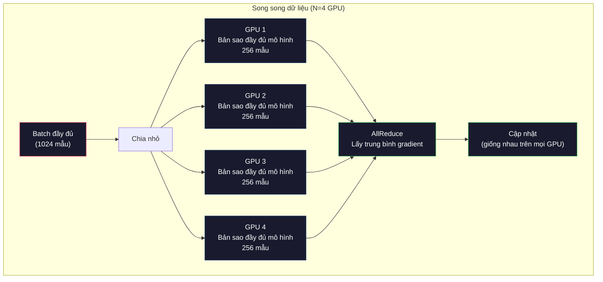
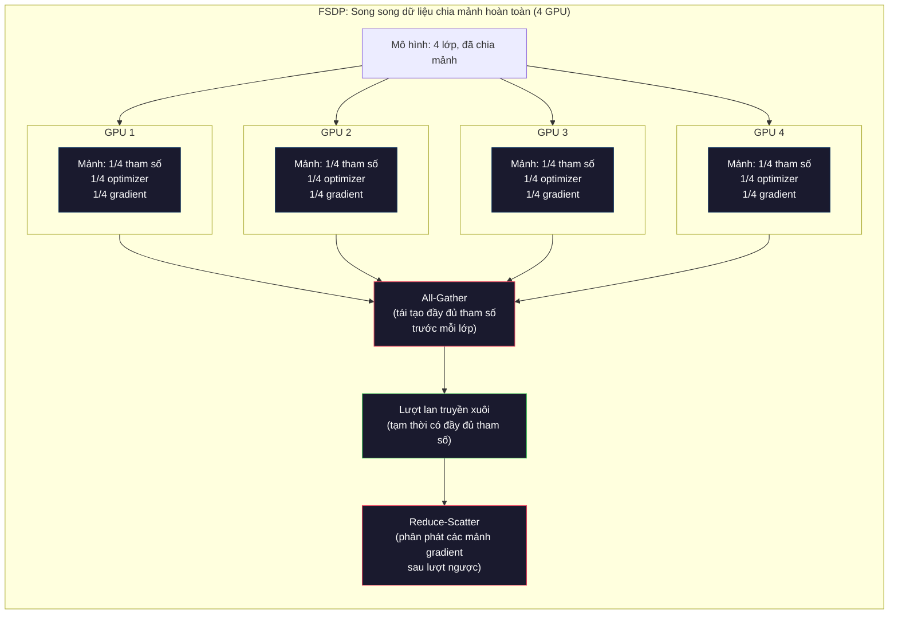
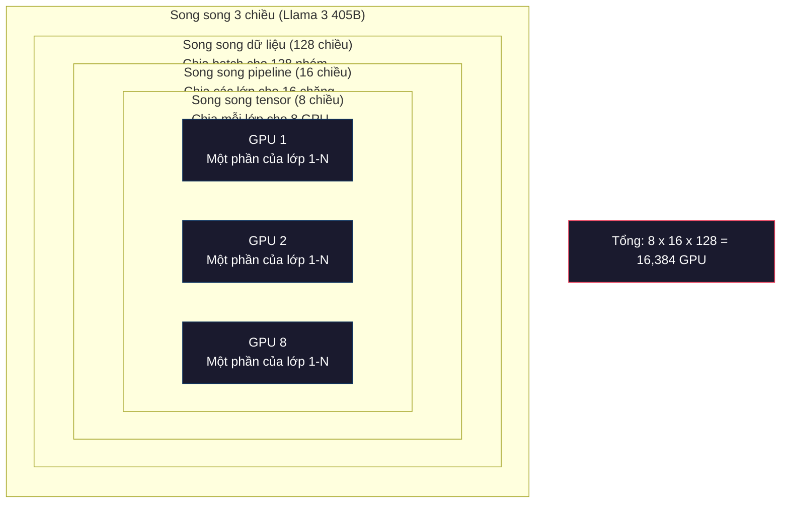

# Mở rộng quy mô: Huấn luyện phân tán, FSDP, DeepSpeed

> Mô hình 124M của bạn đã huấn luyện trên một GPU. Giờ thử 7 tỷ tham số. Mô hình không vừa bộ nhớ. Dữ liệu mất hàng tuần trên một máy. Ở quy mô lớn, huấn luyện phân tán không phải là lựa chọn. Đó là con đường duy nhất.

**Type:** Build
**Languages:** Python
**Prerequisites:** Giai đoạn 10, Bài 04 (Huấn luyện trước một mini GPT)
**Time:** ~120 phút

## Mục tiêu học tập

- Giải thích ba kiểu song song (dữ liệu, tensor, pipeline) và khi nào mỗi kiểu là cần thiết tùy theo kích thước mô hình và cụm máy
- Triển khai huấn luyện song song dữ liệu bằng PyTorch DDP với đồng bộ gradient trên nhiều GPU
- Tính ngân sách bộ nhớ cho một kích thước mô hình (trọng số + trạng thái optimizer + gradient + activation) để xác định phần cứng tối thiểu
- Cấu hình FSDP hoặc các mức DeepSpeed ZeRO để chia mảnh trạng thái mô hình ra nhiều GPU và chứa được những mô hình vượt quá bộ nhớ một GPU

## Vấn đề

Một mô hình 7B tham số ở FP16 cần 14GB chỉ cho phần trọng số. Optimizer Adam lưu thêm hai bản sao của mỗi tham số (ước lượng moment bậc một và bậc hai). Đó là thêm 28GB. Gradient trong lan truyền ngược thêm 14GB nữa. Bạn đã ở mức 56GB trước khi lưu một activation nào.

Một chiếc NVIDIA A100 có 80GB bộ nhớ.

56GB trong 80GB đã bị chiếm. Còn lại 24GB cho activation -- các giá trị trung gian tính trong lượt lan truyền xuôi và phải giữ lại cho lan truyền ngược. Với chuỗi 2048 token và mô hình 4096 chiều, activation của một lớp tốn khoảng 64MB. Với 32 lớp, bạn cần 2GB cho mỗi mẫu. Batch size 8 cần 16GB. Bạn có 24GB. Batch size 12 là nổ.

Giờ thử 70B tham số. Chỉ trọng số: 140GB ở FP16. Không vừa một GPU. Bạn cần ít nhất 2 A100 (2 x 80GB = 160GB) chỉ để chứa trọng số. Cộng thêm trạng thái optimizer và gradient thì cần nhiều hơn nữa: tối thiểu 3+ GPU, và thực tế là 8-16 tùy chiến lược sharding (chia mảnh).

Llama 3 405B được huấn luyện trên 16,384 GPU NVIDIA H100. Lần huấn luyện đó tốn khoảng 100 triệu USD tiền tính toán. DeepSeek V3 huấn luyện một mô hình tương đương với khoảng 5.6 triệu USD nhờ khôn khéo về kiến trúc (Mixture of Experts nghĩa là chỉ một phần tham số được kích hoạt cho mỗi token) và hiệu quả huấn luyện.

Bài này trình bày bốn chiến lược làm cho huấn luyện quy mô lớn khả thi: data parallelism (song song dữ liệu), tensor parallelism (song song tensor), pipeline parallelism (song song pipeline), và fully sharded data parallelism. Bạn sẽ mô phỏng từng chiến lược bằng Python thuần để hiểu cơ chế trước khi chạm vào bất kỳ framework huấn luyện phân tán nào.

## Khái niệm

### Vì sao phải phân tán

Đây là phép toán bộ nhớ cho các mô hình thực. Mọi con số đều được tính, không phải ước lượng.

| Mô hình | Tham số | Trọng số (FP16) | Trạng thái Adam | Gradient (FP16) | Tổng (chưa tính activation) |
|-------|--------|----------------|-------------|------------------|----------------------|
| GPT-2 Small | 124M | 248 MB | 992 MB | 248 MB | 1.5 GB |
| Llama 3 8B | 8B | 16 GB | 64 GB | 16 GB | 96 GB |
| Llama 3 70B | 70B | 140 GB | 560 GB | 140 GB | 840 GB |
| Llama 3 405B | 405B | 810 GB | 3,240 GB | 810 GB | 4,860 GB |

Cột "Trạng thái Adam" là kẻ giết người. Adam lưu một trung bình chạy (m) và một phương sai chạy (v) cho mỗi tham số, cả hai ở FP32. Với mô hình 70B, đó là 70B x 4 byte x 2 = 560GB. Chỉ optimizer đã cần bảy chiếc A100.

Một chiếc H100 có 80GB. Llama 3 405B cần ít nhất 61 H100 để chứa trọng số, optimizer và gradient. Cộng thêm activation thì con số còn tăng. Meta dùng 16,384 GPU không phải vì họ muốn -- mà vì họ buộc phải vậy.

### Song song dữ liệu

Chiến lược phân tán đơn giản nhất. Sao chép toàn bộ mô hình sang N GPU. Chia mỗi batch huấn luyện thành N phần bằng nhau. Mỗi GPU chạy lượt xuôi và lượt ngược trên mảnh dữ liệu của mình. Sau lượt ngược, lấy trung bình gradient trên tất cả GPU. Mỗi GPU cập nhật bản sao trọng số của mình bằng gradient trung bình đó, giữ mọi bản sao đồng bộ.

**Điểm tốt:** throughput (thông lượng) tăng tuyến tính. N GPU xử lý dữ liệu gấp N lần mỗi bước. Truyền thông chỉ giới hạn ở việc lấy trung bình gradient, và được chồng lấp với tính toán.

**Điểm xấu:** mỗi GPU giữ một bản sao đầy đủ của mô hình, trạng thái optimizer và gradient. Với mô hình 70B, mỗi GPU cần 840GB. Song song dữ liệu không giúp giảm bộ nhớ trên mỗi GPU. Nó chỉ giảm thời gian huấn luyện.

**Phép toán:** batch hiệu dụng = batch mỗi GPU x N. Với N=64 GPU và batch mỗi GPU là 16, batch hiệu dụng là 1,024. Llama 3 dùng batch hiệu dụng 16 triệu token mỗi bước.



### Song song tensor

Chia từng lớp riêng lẻ ra nhiều GPU. Một phép nhân ma trận được chia cho các GPU, mỗi GPU tính một phần kết quả.

Xét ma trận trọng số kích thước (8192, 8192) trong một lớp feedforward. Với song song tensor 4 chiều, mỗi GPU giữ một mảnh (8192, 2048). Mỗi GPU nhân đầu vào với mảnh của mình, tạo ra kết quả một phần. Các kết quả một phần được kết hợp (qua all-reduce (tổng hợp và chia đều giữa các GPU) hoặc all-gather) để tạo ra đầu ra đầy đủ.

**Điểm tốt:** giảm bộ nhớ trên mỗi GPU cho trọng số mô hình. Một mô hình 70B chia cho 8 GPU nghĩa là mỗi GPU giữ trọng số tương đương ~8.75B tham số.

**Điểm xấu:** cần truyền thông giữa các GPU rất nhanh sau mỗi lớp. Phép all-reduce sau mỗi matmul thêm độ trễ. Cách này chạy tốt với NVLink (900 GB/s giữa các GPU trong cùng node) nhưng kém khi qua các node nối bằng InfiniBand (400 Gb/s, khoảng 50 GB/s). Song song tensor gần như luôn bị giới hạn trong một node (8 GPU).

**Dùng thực tế:** Megatron-LM là nơi khai sinh song song tensor. Llama 3 405B dùng song song tensor 8 chiều trong mỗi node.

### Song song pipeline

Chia mô hình theo lớp. GPU 1 chạy lớp 1-8. GPU 2 chạy lớp 9-16. GPU 3 chạy lớp 17-24. GPU 4 chạy lớp 25-32. Dữ liệu chảy qua pipeline: GPU 1 tính các lớp của mình rồi gửi activation cho GPU 2, GPU 2 tính rồi gửi cho GPU 3, và cứ thế.

**Điểm tốt:** truyền thông giữa các GPU rất ít -- chỉ là activation ở ranh giới lớp, nhỏ so với gradient hay trọng số. Chạy được qua nhiều node vì yêu cầu băng thông thấp.

**Điểm xấu:** bong bóng pipeline. Khi GPU 4 đang tính lượt xuôi cho micro-batch 1, các GPU 1, 2 và 3 ngồi không (chúng đã chuyển tiếp phần của mình xong). Trong lượt ngược, mẫu hình đảo lại. Với pipeline ngây thơ, hiệu suất sử dụng GPU chỉ là 1/N với N chặng pipeline.

**GPipe và PipeDream** giải bài toán bong bóng bằng cách chia batch thành các micro-batch. GPU 1 bắt đầu micro-batch 2 ngay khi chuyển tiếp xong micro-batch 1. Điều này chồng lấp tính toán giữa các chặng. Với M micro-batch và N chặng, tỷ lệ bong bóng giảm còn (N-1)/M. Dùng M=16 micro-batch với N=4 chặng thì bong bóng là 3/16 = 18.75% thời gian ngồi không.

### FSDP: Song song dữ liệu chia mảnh hoàn toàn

FSDP kết hợp khả năng mở rộng của song song dữ liệu với hiệu quả bộ nhớ của sharding. Thay vì mỗi GPU giữ một bản sao đầy đủ của mô hình, mỗi GPU chỉ giữ 1/N tham số, gradient và trạng thái optimizer.

Trước lượt xuôi của một lớp, FSDP chạy **all-gather** để thu thập đầy đủ tham số từ mọi GPU vào bộ nhớ của từng GPU. Sau lượt xuôi, mỗi GPU vứt bỏ các tham số không thuộc phần của mình. Trong lượt ngược, all-gather chạy lại để tái tạo tham số phục vụ tính gradient. Sau lượt ngược, **reduce-scatter** phân phát các mảnh gradient để mỗi GPU chỉ lưu 1/N gradient.

**Phép toán cho mô hình 70B trên 8 GPU:**

| Thành phần | Không có FSDP | Có FSDP |
|-----------|-------------|-----------|
| Trọng số (FP16) | 140 GB mỗi GPU | 17.5 GB mỗi GPU |
| Trạng thái Adam (FP32) | 560 GB mỗi GPU | 70 GB mỗi GPU |
| Gradient (FP16) | 140 GB mỗi GPU | 17.5 GB mỗi GPU |
| **Tổng** | **840 GB mỗi GPU** | **105 GB mỗi GPU** |

Không có FSDP, bạn không thể nhét mô hình 70B vào một GPU 80GB. Với FSDP trên 8 GPU, mỗi GPU dùng 105GB -- khoan, thế vẫn chưa vừa. Bạn cần ít nhất 16 GPU để xuống dưới 80GB mỗi GPU, hoặc kết hợp FSDP với activation checkpointing (lưu checkpoint kích hoạt để tính lại trong lượt ngược thay vì lưu trữ).

Chi phí truyền thông cao hơn song song dữ liệu thuần vì phải all-gather trước mỗi lớp. Nhưng phần bộ nhớ tiết kiệm được biến những lần huấn luyện trước đây bất khả thi thành khả thi.



### DeepSpeed ZeRO

ZeRO (Zero Redundancy Optimizer) của DeepSpeed về khái niệm giống hệt FSDP nhưng được Microsoft phát triển độc lập. Nó định nghĩa ba mức, mỗi mức chia mảnh mạnh hơn:

| Mức | Chia mảnh | Tiết kiệm bộ nhớ | Truyền thông |
|-------|--------|---------------|---------------|
| ZeRO-1 | Chỉ trạng thái optimizer | giảm ~4x | Như song song dữ liệu |
| ZeRO-2 | + Gradient | giảm ~8x | Nhiều hơn một chút |
| ZeRO-3 | + Tham số | giảm ~Nx (N GPU) | All-gather mỗi lớp |

ZeRO-3 tương đương FSDP. Tên gọi khác nhau, cơ chế như nhau. PyTorch thêm FSDP như một triển khai gốc sau khi DeepSpeed chứng minh khái niệm này.

DeepSpeed cũng giới thiệu ZeRO-Offload (đẩy trạng thái optimizer sang RAM CPU, rẻ hơn và lớn hơn) và ZeRO-Infinity (đẩy sang SSD NVMe). Chúng đánh đổi tốc độ tính toán lấy dung lượng bộ nhớ -- các phép bị đẩy ra chậm hơn nhưng giải phóng bộ nhớ GPU.

### Huấn luyện với độ chính xác hỗn hợp

Huấn luyện hiện đại dùng nhiều định dạng dấu phẩy động cùng lúc:

- **Lượt lan truyền xuôi**: FP16 hoặc BF16 (16-bit). Tốn một nửa bộ nhớ so với FP32. Matmul chạy nhanh gấp 2 lần trên tensor core.
- **Trọng số gốc**: FP32 (32-bit). Optimizer giữ lại để đảm bảo độ chính xác số học khi cập nhật trọng số.
- **Loss scaling**: nhân loss với một hằng số lớn trước lượt ngược để gradient FP16 không bị tràn xuống 0. Chia lại cho đúng hằng số đó trước bước optimizer.

BF16 (Brain Float 16) có cùng dải mũ như FP32 (8 bit mũ) nhưng độ chính xác thấp hơn (7 bit định trị so với 23 của FP32). Nó hiếm khi cần loss scaling vì biểu diễn được cùng dải giá trị. FP16 có 5 bit mũ và 10 bit định trị -- nó biểu diễn được giá trị mịn nhưng tràn trên/dưới ở độ lớn cực đoan.

TPU của Google dùng BF16 tự nhiên. A100 và H100 của NVIDIA hỗ trợ cả FP16 lẫn BF16. Ngành đã phần lớn chuyển sang BF16 vì nó xoá bỏ được nỗi phiền loss scaling.

**So sánh bộ nhớ cho mô hình 7B:**

| Độ chính xác | Trọng số | Optimizer | Gradient | Tổng |
|-----------|---------|-----------|-----------|-------|
| FP32 toàn bộ | 28 GB | 56 GB | 28 GB | 112 GB |
| Hỗn hợp (BF16 + FP32 gốc) | 14 GB | 56 GB | 14 GB | 84 GB |

Độ chính xác hỗn hợp tiết kiệm 28GB trên mô hình này. Trạng thái optimizer vẫn luôn ở FP32 -- đó là nơi ngốn phần lớn bộ nhớ.

### Megatron-LM và song song 3 chiều

Huấn luyện quy mô lớn thực tế kết hợp cả ba kiểu song song:

- **Song song dữ liệu** giữa các nhóm node (tăng batch size)
- **Song song tensor** trong một node (chia lớp cho 8 GPU)
- **Song song pipeline** giữa các node (chia nhóm lớp cho nhiều máy)

Llama 3 405B trên 16,384 H100:
- Song song tensor 8 chiều trong mỗi node (8 GPU mỗi node)
- Song song pipeline 16 chiều giữa các node (16 chặng pipeline)
- Song song dữ liệu 128 chiều trên chiều còn lại (16,384 / 8 / 16 = 128)

Cách phân rã 3 chiều này (8 x 16 x 128 = 16,384) là cách bạn mở rộng tới hàng nghìn GPU. Mỗi GPU thấy một mảnh dữ liệu khác nhau (song song dữ liệu), giữ một lát của mỗi lớp (song song tensor), và tính một nhóm lớp khác nhau (song song pipeline).

DeepSeek V3 đi hướng khác. Kiến trúc Mixture of Experts của họ chỉ kích hoạt 37B trong 671B tham số cho mỗi token. Nghĩa là mỗi GPU chỉ cần tính (và lưu activation cho) các tham số được kích hoạt. Họ huấn luyện trên 2,048 GPU H800 -- chưa bằng 1/8 số GPU của Meta -- với 5.6 triệu USD so với con số ước tính 100 triệu USD của Meta.



```figure
paged-kv-cache
```

## Tự tay làm

### Bước 1: Mô phỏng song song dữ liệu

Chia một batch cho các GPU mô phỏng. Mỗi GPU tính lượt xuôi trên mảnh của mình. Lấy trung bình "gradient" (chúng ta mô phỏng chúng bằng chính giá trị loss).

```python
import numpy as np

def simulate_data_parallelism(data, num_gpus, model_fn):
    batch_size = len(data)
    shard_size = batch_size // num_gpus
    remainder = batch_size % num_gpus

    gpu_losses = []
    gpu_gradients = []

    offset = 0
    for gpu_id in range(num_gpus):
        extra = 1 if gpu_id < remainder else 0
        shard = data[offset:offset + shard_size + extra]
        offset += shard_size + extra

        loss, grad = model_fn(shard)
        gpu_losses.append(loss)
        gpu_gradients.append(grad)

    avg_loss = np.mean(gpu_losses)
    avg_gradient = np.mean(gpu_gradients, axis=0)

    return avg_loss, avg_gradient
```

Phép all-reduce (lấy trung bình gradient) là truyền thông duy nhất trong song song dữ liệu. Trong thực tế, việc này dùng thư viện NCCL trên GPU NVIDIA, thư viện cài đặt ring all-reduce: mỗi GPU gửi 1/N gradient của mình cho hàng xóm, nhận 1/N từ hàng xóm còn lại, và sau N-1 bước mỗi GPU có trung bình đầy đủ. Tổng khối lượng truyền thông: 2 x gradient_size x (N-1)/N, tiệm cận 2 lần kích thước gradient khi N lớn.

### Bước 2: Mô phỏng song song tensor

Chia một ma trận trọng số cho các GPU. Mỗi GPU tính một phần phép nhân ma trận. Kết hợp các kết quả lại.

```python
def simulate_tensor_parallelism(input_data, weight_matrix, num_gpus):
    d_in, d_out = weight_matrix.shape
    assert d_out % num_gpus == 0, f"d_out {d_out} not divisible by num_gpus {num_gpus}"
    shard_size = d_out // num_gpus

    partial_results = []
    for gpu_id in range(num_gpus):
        start = gpu_id * shard_size
        end = start + shard_size
        weight_shard = weight_matrix[:, start:end]

        partial = input_data @ weight_shard
        partial_results.append(partial)

    full_output = np.concatenate(partial_results, axis=-1)

    direct_output = input_data @ weight_matrix
    error = np.abs(full_output - direct_output).max()

    return full_output, error
```

Sai số phải đúng bằng không (hoặc epsilon máy). Song song tensor chính xác về mặt toán học -- nó cho kết quả như tính toàn bộ matmul trên một GPU. Phép chia theo chiều đầu ra, nên mỗi GPU tạo một khối cột khác nhau, và phép nối tái tạo kết quả đầy đủ.

Với lớp tuyến tính song song theo cột (chia chiều đầu ra), bạn nối kết quả. Với song song theo hàng (chia chiều đầu vào), bạn cộng. Trong FFN của transformer, tuyến tính thứ nhất (mở rộng) dùng song song theo cột và tuyến tính thứ hai (thu gọn) dùng song song theo hàng. Cách này tránh một phép all-reduce giữa hai lớp.

### Bước 3: Mô phỏng song song pipeline

Chia các lớp của mô hình cho các GPU ảo. Cho thấy bài toán bong bóng khi các chặng đầu ngồi không trong lúc các chặng sau tính toán.

```python
def simulate_pipeline_parallelism(num_layers, num_stages, num_microbatches):
    layers_per_stage = num_layers // num_stages

    timeline = {}
    clock = 0

    for mb in range(num_microbatches):
        for stage in range(num_stages):
            start_time = max(
                timeline.get((stage, mb - 1, "fwd"), (0, 0))[1] if mb > 0 else 0,
                timeline.get((stage - 1, mb, "fwd"), (0, 0))[1] if stage > 0 else 0,
            )
            end_time = start_time + layers_per_stage
            timeline[(stage, mb, "fwd")] = (start_time, end_time)

    last_fwd_end = max(v[1] for v in timeline.values())

    for mb in range(num_microbatches - 1, -1, -1):
        for stage in range(num_stages - 1, -1, -1):
            deps = [last_fwd_end]
            if mb < num_microbatches - 1 and (stage, mb + 1, "bwd") in timeline:
                deps.append(timeline[(stage, mb + 1, "bwd")][1])
            if stage < num_stages - 1 and (stage + 1, mb, "bwd") in timeline:
                deps.append(timeline[(stage + 1, mb, "bwd")][1])
            start_time = max(deps)
            end_time = start_time + layers_per_stage
            timeline[(stage, mb, "bwd")] = (start_time, end_time)

    total_time = max(v[1] for v in timeline.values())
    compute_time = num_microbatches * num_stages * layers_per_stage * 2
    bubble_fraction = 1.0 - compute_time / (total_time * num_stages)

    return timeline, total_time, bubble_fraction
```

Với 4 chặng và 1 micro-batch, tỷ lệ bong bóng là 75% -- ba trong bốn GPU ngồi không ở mọi thời điểm. Với 16 micro-batch, tỷ lệ này giảm còn khoảng 19%. Cái giá để xoá bong bóng là bộ nhớ: bạn phải lưu activation cho tất cả micro-batch đang chạy cùng lúc.

### Bước 4: Máy tính bộ nhớ

Tính chính xác yêu cầu bộ nhớ để huấn luyện bất kỳ kích thước mô hình nào.

```python
def memory_calculator(
    params_billions,
    precision_bytes=2,
    optimizer="adam",
    num_gpus=1,
    sharding="none",
    sequence_length=2048,
    batch_size_per_gpu=1,
    hidden_dim=None,
    num_layers=None,
):
    params = params_billions * 1e9

    weight_memory = params * precision_bytes

    if optimizer == "adam":
        optimizer_memory = params * 4 * 2
    elif optimizer == "sgd":
        optimizer_memory = params * 4
    else:
        optimizer_memory = 0

    gradient_memory = params * precision_bytes

    total_no_activation = weight_memory + optimizer_memory + gradient_memory

    if hidden_dim and num_layers:
        activation_per_layer = (
            sequence_length * batch_size_per_gpu * hidden_dim * precision_bytes * 4
        )
        activation_memory = activation_per_layer * num_layers
    else:
        activation_memory = params * precision_bytes * 0.5

    if sharding == "fsdp" or sharding == "zero3":
        weight_memory /= num_gpus
        optimizer_memory /= num_gpus
        gradient_memory /= num_gpus
    elif sharding == "zero2":
        optimizer_memory /= num_gpus
        gradient_memory /= num_gpus
    elif sharding == "zero1":
        optimizer_memory /= num_gpus

    per_gpu_total = weight_memory + optimizer_memory + gradient_memory + activation_memory

    return {
        "params_billions": params_billions,
        "weights_gb": weight_memory / 1e9,
        "optimizer_gb": optimizer_memory / 1e9,
        "gradients_gb": gradient_memory / 1e9,
        "activations_gb": activation_memory / 1e9,
        "per_gpu_total_gb": per_gpu_total / 1e9,
        "total_across_gpus_gb": per_gpu_total * num_gpus / 1e9,
        "fits_on_80gb": per_gpu_total / 1e9 <= 80,
        "num_gpus": num_gpus,
        "sharding": sharding,
    }
```

Máy tính này trả lời câu hỏi mà mọi kỹ sư ML đều hỏi: "Tôi cần bao nhiêu GPU?" Đưa vào kích thước mô hình và xem nó có vừa không. Chỉnh chiến lược sharding cho tới khi tổng mỗi GPU xuống dưới 80GB.

### Bước 5: Mô phỏng độ chính xác hỗn hợp

So sánh mức dùng bộ nhớ giữa FP32, FP16 và huấn luyện độ chính xác hỗn hợp.

```python
def mixed_precision_comparison(params_billions):
    params = params_billions * 1e9

    fp32_weights = params * 4
    fp32_optimizer = params * 4 * 2
    fp32_gradients = params * 4
    fp32_total = fp32_weights + fp32_optimizer + fp32_gradients

    fp16_weights = params * 2
    fp16_master = params * 4
    fp16_optimizer = params * 4 * 2
    fp16_gradients = params * 2
    fp16_total = fp16_weights + fp16_master + fp16_optimizer + fp16_gradients

    mixed_weights = params * 2
    mixed_optimizer = params * 4 * 2
    mixed_gradients = params * 2
    mixed_total = mixed_weights + mixed_optimizer + mixed_gradients

    return {
        "fp32_total_gb": fp32_total / 1e9,
        "fp16_with_master_gb": fp16_total / 1e9,
        "mixed_bf16_gb": mixed_total / 1e9,
        "savings_vs_fp32": 1 - mixed_total / fp32_total,
    }
```

Bất ngờ lớn nhất với hầu hết mọi người: độ chính xác hỗn hợp không giảm một nửa bộ nhớ. Trạng thái optimizer (m và v của Adam) vẫn ở FP32 bất kể độ chính xác. Với mô hình 7B, huấn luyện FP32 dùng 112GB. Độ chính xác hỗn hợp dùng 84GB. Đó là giảm 25%, không phải 50%. Optimizer chiếm phần lớn.

## Áp dụng

### Chạy tất cả mô phỏng

```python
def run_all_demos():
    print("=" * 70)
    print("DATA PARALLELISM SIMULATION")
    print("=" * 70)

    np.random.seed(42)
    data = np.random.randn(64, 32)
    weight = np.random.randn(32, 16)

    def model_fn(batch):
        output = batch @ weight
        loss = np.mean(output ** 2)
        grad = 2 * batch.T @ (batch @ weight) / len(batch)
        return loss, grad

    for n_gpus in [1, 2, 4, 8]:
        loss, grad = simulate_data_parallelism(data, n_gpus, model_fn)
        print(f"  {n_gpus} GPUs: loss={loss:.4f}, grad_norm={np.linalg.norm(grad):.4f}")

    print()
    print("=" * 70)
    print("TENSOR PARALLELISM SIMULATION")
    print("=" * 70)

    x = np.random.randn(4, 8192)
    W = np.random.randn(8192, 8192)

    for n_gpus in [1, 2, 4, 8]:
        output, error = simulate_tensor_parallelism(x, W, n_gpus)
        print(f"  {n_gpus} GPUs: output_shape={output.shape}, max_error={error:.2e}")

    print()
    print("=" * 70)
    print("PIPELINE PARALLELISM SIMULATION")
    print("=" * 70)

    for n_mb in [1, 4, 8, 16, 32]:
        _, total_t, bubble = simulate_pipeline_parallelism(32, 4, n_mb)
        print(f"  {n_mb:2d} micro-batches: total_time={total_t:4d}, bubble={bubble:.1%}")

    print()
    print("=" * 70)
    print("MEMORY CALCULATOR")
    print("=" * 70)

    configs = [
        (7, "none", 1),
        (7, "fsdp", 8),
        (70, "none", 1),
        (70, "fsdp", 8),
        (70, "fsdp", 16),
        (405, "fsdp", 64),
        (405, "fsdp", 128),
    ]

    print(f"  {'Model':>8} {'Sharding':>8} {'GPUs':>5} {'Per-GPU':>10} {'Fits 80GB':>10}")
    print("  " + "-" * 50)
    for params, shard, gpus in configs:
        result = memory_calculator(params, num_gpus=gpus, sharding=shard)
        fits = "Yes" if result["fits_on_80gb"] else "No"
        print(f"  {params:>6}B {shard:>8} {gpus:>5} {result['per_gpu_total_gb']:>8.1f}GB {fits:>10}")

    print()
    print("=" * 70)
    print("MIXED PRECISION COMPARISON")
    print("=" * 70)

    for params_b in [7, 13, 70, 405]:
        result = mixed_precision_comparison(params_b)
        print(f"  {params_b}B: FP32={result['fp32_total_gb']:.0f}GB, "
              f"Mixed BF16={result['mixed_bf16_gb']:.0f}GB, "
              f"Savings={result['savings_vs_fp32']:.0%}")
```

## Đóng gói

Bài này tạo ra `outputs/prompt-distributed-training-planner.md` -- một prompt nhận kích thước mô hình và phần cứng hiện có, rồi tạo ra kế hoạch huấn luyện phân tán hoàn chỉnh: chiến lược song song, ngân sách bộ nhớ, communication overhead (chi phí truyền thông), và thông lượng kỳ vọng.

## Bài tập

1. Sửa máy tính bộ nhớ để tính cả activation checkpointing. Với checkpointing, chỉ lưu activation ở mỗi lớp thứ K (thường K=1, nghĩa là tính lại toàn bộ). Chỉ ra đánh đổi bộ nhớ - tính toán: checkpointing tiết kiệm bao nhiêu bộ nhớ, và làm chậm huấn luyện bao nhiêu (xấp xỉ tốn thêm 33% tính toán khi checkpoint toàn bộ)?

2. Mở rộng mô phỏng song song pipeline để cài đặt lịch 1F1B (một lượt xuôi, một lượt ngược) mà PipeDream dùng. So sánh tỷ lệ bong bóng với lịch ngây thơ cho 4 chặng và 8 micro-batch. Lịch 1F1B phải có bộ nhớ đỉnh nhỏ hơn vì nó bắt đầu các lượt ngược sớm hơn.

3. Cài đặt một bộ mô phỏng tích luỹ gradient. Thay vì all-reduce sau mỗi micro-batch, tích luỹ gradient cục bộ trong K bước rồi mới all-reduce. Chỉ ra cách này giảm truyền thông K lần nhưng cho gradient cuối cùng y hệt (và do đó huấn luyện y hệt).

4. Xây một bộ ước lượng chi phí. Cho kích thước mô hình, số token mục tiêu, loại GPU (A100 giá 2 USD/giờ, H100 giá 3.50 USD/giờ) và chiến lược song song, ước lượng tổng chi phí huấn luyện bằng USD. Đối chiếu với các chi phí đã biết: Llama 3 405B được báo cáo tốn ~100 triệu USD, DeepSeek V3 tốn ~5.6 triệu USD.

5. Thêm ZeRO-Offload vào máy tính bộ nhớ. Giả sử RAM CPU là 512GB mỗi node và NVMe là 2TB. Chỉ ra cách đẩy trạng thái optimizer sang CPU cho phép mô hình 70B huấn luyện trên 4 GPU thay vì 16, với cái giá là các bước optimizer chậm hơn 30-50%.

## Thuật ngữ chính

| Thuật ngữ | Người ta thường nói | Ý nghĩa thực sự |
|------|----------------|----------------------|
| Data parallelism | "Sao chép mô hình sang mọi GPU" | Mỗi GPU xử lý một mảnh dữ liệu khác nhau; gradient được lấy trung bình qua all-reduce sau mỗi bước |
| Tensor parallelism | "Chia một lớp ra nhiều GPU" | Phân hoạch ma trận trọng số để mỗi GPU tính một phần matmul; cần liên kết NVLink nhanh |
| Pipeline parallelism | "Chia các lớp ra nhiều GPU" | Mỗi GPU chạy một nhóm lớp khác nhau; dữ liệu chảy qua pipeline theo micro-batch để giảm bong bóng |
| FSDP | "Chia mảnh mọi thứ" | Fully Sharded Data Parallel -- mỗi GPU giữ 1/N trọng số, gradient và trạng thái optimizer; all-gather trước khi tính |
| ZeRO | "Bản FSDP của DeepSpeed" | Zero Redundancy Optimizer với 3 mức: chia mảnh optimizer (mức 1), + gradient (mức 2), + tham số (mức 3) |
| All-reduce | "Lấy trung bình giữa các GPU" | Phép tập thể mà sau đó mọi GPU đều có tổng (hoặc trung bình) đầu vào của tất cả GPU -- thường cài đặt bằng ring all-reduce |
| All-gather | "Thu thập từ mọi GPU" | Phép tập thể mà sau đó mọi GPU đều có phép nối dữ liệu của tất cả GPU -- dùng trong FSDP để tái tạo tham số đầy đủ |
| Reduce-scatter | "Cộng rồi phân phát" | Phép tập thể cộng (tổng) dữ liệu rồi phân các khối khác nhau cho các GPU khác nhau -- dùng trong FSDP để chia mảnh gradient |
| Mixed precision | "Huấn luyện với nửa độ chính xác" | Dùng FP16/BF16 cho lượt xuôi/ngược và FP32 cho trạng thái optimizer -- tiết kiệm ~25% bộ nhớ, không phải 50%, vì optimizer chiếm phần lớn |
| Pipeline bubble | "Thời gian ngồi không trong pipeline" | Tỷ lệ thời gian GPU ngồi chờ dữ liệu từ chặng trước -- giảm bằng cách dùng nhiều micro-batch hơn |

## Đọc thêm

- [Rajbhandari et al., 2020 -- "ZeRO: Memory Optimizations Toward Training Trillion Parameter Models"](https://arxiv.org/abs/1910.02054) -- bài báo DeepSpeed ZeRO định nghĩa ba mức chia mảnh
- [Shoeybi et al., 2020 -- "Megatron-LM: Training Multi-Billion Parameter Language Models Using Model Parallelism"](https://arxiv.org/abs/1909.08053) -- song song tensor của NVIDIA cho transformer
- [Narayanan et al., 2021 -- "Efficient Large-Scale Language Model Training on GPU Clusters Using Megatron-LM"](https://arxiv.org/abs/2104.04473) -- song song 3 chiều kết hợp dữ liệu, tensor và pipeline
- [Zhao et al., 2023 -- "PyTorch FSDP: Experiences on Scaling Fully Sharded Data Parallel"](https://arxiv.org/abs/2304.11277) -- triển khai FSDP gốc của PyTorch
- [Llama 3 Technical Report](https://arxiv.org/abs/2407.21783) -- huấn luyện trên 16,384 GPU với chi tiết song song 3 chiều
- [DeepSeek-V3 Technical Report](https://arxiv.org/abs/2412.19437) -- kiến trúc MoE giảm chi phí huấn luyện đi một bậc độ lớn

---

[← Bài trước: Huấn luyện trước (pre-training) một mini GPT (GPT cỡ nhỏ, 124M tham số)](../../04-pre-training-mini-gpt/docs/vi.md) · [Bài sau: Tinh chỉnh theo chỉ dẫn (SFT) →](../../06-instruction-tuning-sft/docs/vi.md)
