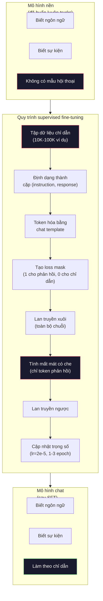

# Tinh chỉnh theo chỉ dẫn (SFT)

> Một mô hình nền chỉ dự đoán token tiếp theo. Chỉ vậy thôi. Nó không làm theo chỉ dẫn, không trả lời câu hỏi, cũng không từ chối những yêu cầu có hại. SFT là cây cầu nối một bộ dự đoán token với một trợ lý hữu ích. Mọi mô hình mà bạn từng trò chuyện -- Claude, GPT, Llama Chat -- đều đã đi qua bước này.

**Type:** Build
**Languages:** Python (with numpy)
**Prerequisites:** Giai đoạn 10, Bài 04 (Huấn luyện trước một mini GPT)
**Time:** ~90 phút

## Mục tiêu học tập

- Triển khai supervised fine-tuning (SFT) (tinh chỉnh có giám sát) để biến một mô hình ngôn ngữ nền thành một trợ lý biết làm theo chỉ dẫn
- Định dạng dữ liệu huấn luyện bằng chat template (mẫu chat) với các vai system, user, assistant, và che mất mát trên những token không phải của assistant
- Giải thích vì sao cần có SFT: mô hình nền viết tiếp văn bản chứ không trả lời câu hỏi
- Đánh giá chất lượng SFT bằng cách so sánh phản hồi của mô hình nền với mô hình đã tinh chỉnh trên một tập chỉ dẫn giữ riêng

## Vấn đề

Bạn đã huấn luyện một mô hình ở Bài 04. Nó có thể dự đoán token tiếp theo khi được cho một chuỗi. Đưa vào "The transformer architecture" và nó có thể viết tiếp "has revolutionized natural language processing." Điều đó thật ấn tượng với một bộ dự đoán token tiếp theo.

Giờ thử điều này: đưa vào "What is the capital of France?" Một mô hình nền sẽ không trả lời "Paris." Nó tiếp tục mẫu văn bản. Nó có thể sinh ra "What is the capital of Germany? What is the capital of Spain?" vì nó học từ các tài liệu chứa danh sách câu hỏi. Hoặc nó có thể sinh ra "is a question that many people ask" vì đó là một cách viết tiếp hợp lý. Mô hình không có khái niệm *trả lời*. Nó chỉ biết *viết tiếp*.

Đây chính là khoảng cách giữa GPT-3 (mô hình nền, phát hành tháng 6 năm 2020) và ChatGPT (đã tinh chỉnh theo chỉ dẫn, phát hành tháng 11 năm 2022). Cùng kiến trúc. Cùng quá trình huấn luyện trước. Khác biệt là 20,000 đến 100,000 cặp (instruction, response) được xây dựng kỹ càng, dạy mô hình đi theo mẫu hội thoại.

Stanford Alpaca đã chứng minh bạn không cần hàng triệu ví dụ. Tháng 3 năm 2023, họ tinh chỉnh Llama 7B trên chỉ 52,000 cặp instruction-response do GPT-3.5 sinh ra. Tổng chi phí: $600. Kết quả là một chatbot biết làm theo chỉ dẫn, trả lời câu hỏi và duy trì hội thoại. Không tốt bằng ChatGPT, nhưng gần đến mức khó tin với $600 và vài giờ huấn luyện.

Llama 2 Chat của Meta chỉ dùng ~27,000 ví dụ chất lượng cao cho giai đoạn SFT đầu tiên. Điểm mấu chốt: chất lượng quan trọng hơn số lượng. 27,000 ví dụ do những người gán nhãn giỏi viết ra đánh bại 1 triệu ví dụ nhiễu thu thập từ internet.

## Khái niệm

### SFT thực sự làm gì

Supervised Fine-Tuning tiếp tục đúng vòng huấn luyện của quá trình huấn luyện trước -- lan truyền xuôi, tính mất mát, lan truyền ngược, cập nhật trọng số -- nhưng trên một kiểu dữ liệu khác. Thay vì văn bản thô, bạn huấn luyện trên những cuộc hội thoại có cấu trúc:

```json
{
  "system": "You are a helpful assistant.",
  "user": "What is the capital of France?",
  "assistant": "The capital of France is Paris."
}
```

Mô hình đã biết Paris là thủ đô của Pháp. Nó học điều này trong quá trình huấn luyện trước trên Wikipedia, sách giáo khoa và các trang web. SFT không dạy mô hình những sự kiện mới. Nó dạy mô hình một *hành vi* mới: khi thấy một câu hỏi, hãy tạo ra câu trả lời. Khi thấy một chỉ dẫn, hãy tạo ra phần hoàn thành. Khi thấy một yêu cầu có hại, hãy tạo ra lời từ chối.

Hãy nghĩ theo cách này. Huấn luyện trước trao cho mô hình kiến thức. SFT trao cho mô hình cách cư xử.

### Các định dạng dữ liệu

Ba định dạng thống trị ngành. Mỗi định dạng mã hóa cùng một thông tin -- ai nói gì -- bằng những dấu phân cách khác nhau.

**Định dạng Alpaca** (Stanford, tháng 3 năm 2023):

```json
{
  "instruction": "Summarize the following article in 3 sentences.",
  "input": "The European Central Bank raised interest rates...",
  "output": "The ECB increased rates by 25 basis points..."
}
```

Đơn giản và được dùng rộng rãi. Trường `input` là tuỳ chọn -- nhiều chỉ dẫn không cần thêm ngữ cảnh. Stanford phát hành 52,000 ví dụ theo định dạng này, do GPT-3.5 sinh ra với chi phí $600. Điều này khởi động phong trào instruction tuning (tinh chỉnh theo chỉ dẫn) mã nguồn mở.

**Định dạng ShareGPT** (cộng đồng, 2023):

```json
{
  "conversations": [
    {"from": "system", "value": "You are a helpful assistant."},
    {"from": "human", "value": "What causes tides?"},
    {"from": "gpt", "value": "Tides are caused by the gravitational pull of the Moon..."},
    {"from": "human", "value": "How often do they occur?"},
    {"from": "gpt", "value": "Most coastal areas experience two high tides and two low tides per day..."}
  ]
}
```

Hỗ trợ hội thoại nhiều lượt. Trường "from" theo quy ước dùng "human" và "gpt", bất kể mô hình thực tế là gì. Vicuna được huấn luyện trên 70,000 cuộc hội thoại ShareGPT thu thập từ các bản ghi ChatGPT do người dùng chia sẻ.

**Định dạng ChatML** (OpenAI, được nhiều mô hình mã nguồn mở dùng):

```
<|im_start|>system
You are a helpful assistant.<|im_end|>
<|im_start|>user
What is the capital of France?<|im_end|>
<|im_start|>assistant
The capital of France is Paris.<|im_end|>
```

Dùng các token đặc biệt (`<|im_start|>`, `<|im_end|>`) để phân tách vai. Những token này được thêm vào từ vựng của tokenizer trong quá trình tinh chỉnh. Qwen, Yi và nhiều mô hình khác dùng ChatML.

Cả ba định dạng đều đạt cùng một mục đích: chúng nói với mô hình "đây là chỉ dẫn, đây là phản hồi, hãy học mẫu này."

### Vì sao nó hiệu quả

Mô hình đã biết ngôn ngữ từ quá trình huấn luyện trước. Nó đã thấy hàng tỷ ví dụ về câu hỏi đi kèm câu trả lời, chỉ dẫn đi kèm phần hoàn thành, và hội thoại giữa người với người. Những mẫu đó đã được mã hóa trong trọng số.

SFT tập trung khả năng tiềm ẩn này. Thay vì để mô hình phải tự suy ra từ ngữ cảnh xem nên trả lời câu hỏi hay viết tiếp tài liệu, SFT huấn luyện một cách tường minh trên mẫu hội thoại. Sau vài nghìn ví dụ, mô hình học được: khi thấy dấu vai assistant, hãy tạo ra một phản hồi hữu ích.

Đây là lý do 27,000 ví dụ là đủ. Bạn không dạy mô hình tiếng Anh. Bạn không dạy nó các sự kiện về thế giới. Bạn đang dạy nó một hành vi đơn giản: phản hồi các chỉ dẫn. Kiến thức đã ở đó rồi.

### Che mất mát (loss masking)

Đây là chi tiết kỹ thuật quan trọng nhất trong SFT, và hầu hết hướng dẫn đều bỏ qua nó.

Trong huấn luyện trước, bạn tính mất mát trên mọi token. Mô hình học cách dự đoán mọi token tiếp theo trong chuỗi. Trong SFT, bạn chỉ tính mất mát trên các token *phản hồi*. Các token chỉ dẫn có mặt để làm ngữ cảnh, nhưng mô hình không bị phạt vì đã "dự đoán" sai chúng.

Vì sao? Vì bạn không muốn mô hình học cách *sinh ra* chỉ dẫn. Bạn muốn nó học cách *phản hồi* chỉ dẫn. Nếu bạn tính mất mát trên các token chỉ dẫn, bạn đang huấn luyện mô hình dự đoán "What is the capital of France?" như thể nó là người đặt câu hỏi. Việc đó lãng phí tín hiệu gradient và có thể khiến mô hình nhầm vai của mình.

Trong thực tế, bạn tạo một loss mask: bằng 1 cho token phản hồi, bằng 0 cho token chỉ dẫn. Nhân mất mát từng token với mask này trước khi lấy trung bình.

```
Tokens:    [SYS] You are helpful [USER] What is the capital? [ASST] Paris is the capital [EOS]
Loss mask:   0    0    0     0      0     0   0  0     0       1     1    1   1     1      1
```

Chỉ các token sau `[ASST]` đóng góp vào mất mát. Mô hình thấy toàn bộ hội thoại trong lượt lan truyền xuôi (nó cần chỉ dẫn để tạo ra phản hồi đúng) nhưng chỉ cập nhật trọng số dựa trên việc nó dự đoán phản hồi tốt đến đâu.

### Siêu tham số huấn luyện

SFT dùng siêu tham số khác biệt rõ rệt so với huấn luyện trước. Bạn không huấn luyện từ đầu. Bạn đang điều chỉnh một mô hình đã hoạt động được.

| Tham số | Huấn luyện trước (Llama 2 7B) | SFT (Llama 2 Chat) |
|-----------|---------------------------|---------------------|
| Learning rate | 3e-4 (đỉnh) | 2e-5 |
| Epochs | 1 (một lượt qua dữ liệu) | 2 |
| Batch size | 4M token | 64 ví dụ |
| Warmup steps | 2,000 | 0-100 |
| Weight decay | 0.1 | 0.0-0.1 |
| Data size | 2T token | 27,000 ví dụ |

Learning rate thấp hơn 15 lần cho SFT. Điều này then chốt. Learning rate cao trong quá trình tinh chỉnh sẽ phá hủy kiến thức đã huấn luyện trước. Mô hình "quên" những gì đã học và overfits (quá khớp) với tập dữ liệu tinh chỉnh nhỏ. Đây là catastrophic forgetting (quên thảm khốc).

Hai epoch (vòng huấn luyện) nghĩa là mô hình thấy mỗi ví dụ huấn luyện hai lần. Nhiều hơn 3 epoch trên một tập nhỏ dẫn tới học vẹt -- mô hình bắt đầu tái tạo nguyên văn các ví dụ huấn luyện thay vì khái quát hóa.

### Quên thảm khốc

Tinh chỉnh có thể phá hủy các năng lực tổng quát. Huấn luyện quá lâu trên dữ liệu làm theo chỉ dẫn và mô hình mất khả năng viết code, làm toán hay tạo văn bản sáng tạo. Nó trở nên rất giỏi với đúng định dạng của dữ liệu huấn luyện và rất tệ với mọi thứ khác.

Ba cách giảm thiểu:

1. **Learning rate thấp.** 1e-5 đến 5e-5. Cập nhật nhỏ hơn nghĩa là ít phá hủy các đặc trưng đã huấn luyện trước hơn.

2. **Huấn luyện ngắn.** 1-3 epoch. Dừng trước khi mô hình quá khớp.

3. **Trộn vào dữ liệu huấn luyện trước.** Llama 2 Chat trộn một tỷ lệ nhỏ (2-5%) dữ liệu huấn luyện trước thô vào dataset mixture (hỗn hợp dữ liệu) dùng cho SFT. Việc này "nhắc" mô hình nhớ các năng lực tổng quát trong khi vẫn học hành vi mới là làm theo chỉ dẫn.

### Con số thực tế

Tinh chỉnh một mô hình 7B trên 10,000 cặp chỉ dẫn chất lượng cao mất khoảng 1 giờ trên một GPU NVIDIA A100 80GB. Đây là phép tính:

- 10,000 ví dụ x 512 token trung bình = 5.12M token
- 2 epoch = tổng 10.24M token
- Thông lượng A100 khi tinh chỉnh mô hình 7B: ~3,000 token/giây
- 10.24M / 3,000 = ~3,400 giây = ~57 phút

Với mini GPT của chúng ta (4 lớp, 128 chiều), huấn luyện gần như tức thì. Điều quan trọng là hiểu cơ chế, không phải quy mô.



```figure
loss-masking
```

## Tự tay làm

### Bước 1: Tập dữ liệu chỉ dẫn

Tạo một tập dữ liệu chỉ dẫn tổng hợp. Trong môi trường thực tế, những công ty như Scale AI và Anthropic thuê người gán nhãn để viết những dữ liệu này. Chúng ta sẽ tạo chúng bằng chương trình để minh họa định dạng.

```python
import numpy as np

INSTRUCTION_DATA = [
    {
        "instruction": "What is the capital of France?",
        "response": "The capital of France is Paris."
    },
    {
        "instruction": "Explain gravity in one sentence.",
        "response": "Gravity is the force that attracts objects with mass toward each other."
    },
    {
        "instruction": "Write a haiku about the ocean.",
        "response": "Waves crash on the shore, salt and foam beneath the sun, endless blue expanse."
    },
    {
        "instruction": "What is 15 multiplied by 7?",
        "response": "15 multiplied by 7 is 105."
    },
    {
        "instruction": "Name three programming languages.",
        "response": "Three programming languages are Python, Rust, and TypeScript."
    },
    {
        "instruction": "Summarize photosynthesis.",
        "response": "Photosynthesis converts sunlight, water, and carbon dioxide into glucose and oxygen."
    },
    {
        "instruction": "What year did World War II end?",
        "response": "World War II ended in 1945."
    },
    {
        "instruction": "Define machine learning.",
        "response": "Machine learning is a field where algorithms learn patterns from data to make predictions."
    },
]
```

Tám ví dụ là rất ít. Stanford Alpaca dùng 52,000. Nhưng cơ chế là như nhau dù bạn có 8 hay 52,000: token hóa, che, chỉ tính mất mát trên phản hồi.

### Bước 2: Token hóa bằng chat template

Chuyển các cặp instruction-response thành chuỗi token với những dấu vai đặc biệt. Những dấu này cho mô hình biết chỉ dẫn kết thúc ở đâu và phản hồi bắt đầu ở đâu.

```python
SPECIAL_TOKENS = {
    "INST_START": 253,
    "INST_END": 254,
    "RESP_START": 255,
}


def tokenize_instruction_pair(instruction, response, vocab_size=256):
    inst_tokens = list(instruction.encode("utf-8"))
    resp_tokens = list(response.encode("utf-8"))

    inst_tokens = [min(t, vocab_size - 4) for t in inst_tokens]
    resp_tokens = [min(t, vocab_size - 4) for t in resp_tokens]

    tokens = (
        [SPECIAL_TOKENS["INST_START"]]
        + inst_tokens
        + [SPECIAL_TOKENS["INST_END"]]
        + [SPECIAL_TOKENS["RESP_START"]]
        + resp_tokens
    )

    return tokens


def create_loss_mask(tokens):
    mask = np.zeros(len(tokens), dtype=np.float32)
    in_response = False

    for i, token in enumerate(tokens):
        if token == SPECIAL_TOKENS["RESP_START"]:
            in_response = True
            continue
        if in_response:
            mask[i] = 1.0

    return mask
```

Loss mask toàn số 0 cho các token chỉ dẫn và toàn số 1 cho các token phản hồi. Bản thân token `RESP_START` nhận mask 0 vì nó là dấu phân cách, không phải phần nội dung phản hồi.

### Bước 3: Mất mát cross-entropy có che

Cross-entropy chuẩn, nhưng nhân với loss mask. Chỉ các token phản hồi đóng góp vào gradient.

```python
def masked_cross_entropy_loss(logits, targets, loss_mask):
    batch, seq_len, vocab_size = logits.shape
    logits_flat = logits.reshape(-1, vocab_size)
    targets_flat = targets.reshape(-1)
    mask_flat = loss_mask.reshape(-1)

    max_logits = logits_flat.max(axis=-1, keepdims=True)
    log_softmax = logits_flat - max_logits - np.log(
        np.exp(logits_flat - max_logits).sum(axis=-1, keepdims=True)
    )

    per_token_loss = -log_softmax[np.arange(len(targets_flat)), targets_flat]

    masked_loss = per_token_loss * mask_flat
    num_response_tokens = mask_flat.sum()
    if num_response_tokens == 0:
        return 0.0
    loss = masked_loss.sum() / num_response_tokens

    return loss
```

Mẫu số là `num_response_tokens`, không phải `seq_len`. Nếu bạn chia cho tổng độ dài chuỗi, các chỉ dẫn dài sẽ làm loãng tín hiệu gradient. Chia cho số token phản hồi đảm bảo mỗi token phản hồi có trọng số như nhau bất kể chỉ dẫn dài hay ngắn.

### Bước 4: Vòng huấn luyện SFT

Tái sử dụng MiniGPT từ Bài 04. Vòng huấn luyện trông gần như y hệt huấn luyện trước, nhưng có định dạng chỉ dẫn và mất mát có che.

```python
import sys
import os
sys.path.insert(0, os.path.join(os.path.dirname(__file__), "..", "..", "04-pre-training-mini-gpt", "code"))
from main import MiniGPT, LayerNorm, FeedForward, MultiHeadAttention, TransformerBlock, Embedding


def sft_train(model, dataset, num_epochs=2, lr=2e-5, seq_len=64):
    formatted_data = []
    for example in dataset:
        tokens = tokenize_instruction_pair(example["instruction"], example["response"])
        mask = create_loss_mask(tokens)
        formatted_data.append((tokens, mask))

    print(f"SFT Training: {len(formatted_data)} examples, {num_epochs} epochs, lr={lr}")
    print(f"Total tokens: {sum(len(t) for t, _ in formatted_data):,}")
    print()

    losses = []

    for epoch in range(num_epochs):
        epoch_loss = 0.0
        num_batches = 0

        indices = np.random.permutation(len(formatted_data))

        for idx in indices:
            tokens, mask = formatted_data[idx]

            if len(tokens) < 3:
                continue
            if len(tokens) > seq_len:
                tokens = tokens[:seq_len]
                mask = mask[:seq_len]

            input_ids = np.array(tokens[:-1]).reshape(1, -1)
            target_ids = np.array(tokens[1:]).reshape(1, -1)
            loss_mask = np.array(mask[1:]).reshape(1, -1)

            logits = model.forward(input_ids)
            loss = masked_cross_entropy_loss(logits, target_ids, loss_mask)

            batch_size, s_len, v_size = logits.shape
            probs = np.exp(logits - logits.max(axis=-1, keepdims=True))
            probs = probs / probs.sum(axis=-1, keepdims=True)
            dlogits = probs.copy()
            dlogits[np.arange(batch_size)[:, None], np.arange(s_len), target_ids] -= 1.0

            mask_expanded = loss_mask[:, :, np.newaxis]
            num_resp = loss_mask.sum()
            if num_resp > 0:
                dlogits = dlogits * mask_expanded / num_resp

            for block in model.blocks:
                block.ffn.W1 -= lr * np.random.randn(*block.ffn.W1.shape) * 0.01
                block.ffn.W2 -= lr * np.random.randn(*block.ffn.W2.shape) * 0.01
                block.ffn.b1 -= lr * np.random.randn(*block.ffn.b1.shape) * 0.01
                block.ffn.b2 -= lr * np.random.randn(*block.ffn.b2.shape) * 0.01

            epoch_loss += loss
            num_batches += 1
            losses.append(loss)

        avg_loss = epoch_loss / max(num_batches, 1)
        print(f"Epoch {epoch + 1}/{num_epochs} | Avg Loss: {avg_loss:.4f}")

    return model, losses
```

Learning rate là 2e-5, khớp với Llama 2 Chat. So sánh với 3e-4 dùng trong huấn luyện trước -- nhỏ hơn 15 lần. Gradient được che: các token chỉ dẫn tạo gradient bằng 0. Chỉ các token phản hồi đẩy trọng số.

### Bước 5: So sánh mô hình nền và mô hình SFT

Toàn bộ mục đích của SFT là thay đổi hành vi. Hãy đo điều đó bằng cách kiểm tra mô hình phản hồi thế nào với đầu vào được định dạng như chỉ dẫn so với việc viết tiếp văn bản thô.

```python
def generate_response(model, prompt_tokens, max_new_tokens=50, temperature=0.8):
    tokens = list(prompt_tokens)
    seq_len = model.embedding.pos_embed.shape[0]

    for _ in range(max_new_tokens):
        context = np.array(tokens[-seq_len:]).reshape(1, -1)
        logits = model.forward(context)
        next_logits = logits[0, -1, :]

        next_logits = next_logits / max(temperature, 1e-8)
        probs = np.exp(next_logits - next_logits.max())
        probs = probs / probs.sum()
        probs = np.clip(probs, 1e-10, 1.0)
        probs = probs / probs.sum()

        next_token = np.random.choice(len(probs), p=probs)
        tokens.append(int(next_token))

    return tokens


def evaluate_instruction_following(model, instructions):
    print("Evaluating instruction following:")
    print("-" * 50)

    for instruction in instructions:
        tokens = (
            [SPECIAL_TOKENS["INST_START"]]
            + [min(t, 252) for t in list(instruction.encode("utf-8"))]
            + [SPECIAL_TOKENS["INST_END"]]
            + [SPECIAL_TOKENS["RESP_START"]]
        )

        output = generate_response(model, tokens, max_new_tokens=30, temperature=0.6)
        response_start = len(tokens)
        response_tokens = output[response_start:]
        response_bytes = bytes([t for t in response_tokens if t < 128])
        response_text = response_bytes.decode("utf-8", errors="replace")

        print(f"  Q: {instruction}")
        print(f"  A: {response_text[:80]}")
        print()
```

Trên một mô hình tí hon với 8 ví dụ, các phản hồi sẽ không có nghĩa. Đó là điều dự kiến. Điều quan trọng là *cấu trúc*: mô hình học cách tạo ra đầu ra sau dấu phản hồi thay vì tiếp tục sinh thêm chỉ dẫn.

### Bước 6: Đo mức quên thảm khốc

So sánh khả năng dự đoán token tiếp theo của mô hình trước và sau SFT. Nếu SFT làm hỏng các năng lực tổng quát, mất mát trên văn bản thô sẽ tăng lên.

```python
def measure_forgetting(model, test_text, seq_len=64):
    tokens = np.array(list(test_text.encode("utf-8")[:512]))

    total_loss = 0.0
    num_windows = 0

    for start in range(0, len(tokens) - seq_len - 1, seq_len):
        input_ids = tokens[start:start + seq_len].reshape(1, -1)
        target_ids = tokens[start + 1:start + seq_len + 1].reshape(1, -1)

        logits = model.forward(input_ids)

        batch, s_len, vocab_size = logits.shape
        logits_flat = logits.reshape(-1, vocab_size)
        targets_flat = target_ids.reshape(-1)

        max_logits = logits_flat.max(axis=-1, keepdims=True)
        log_softmax = logits_flat - max_logits - np.log(
            np.exp(logits_flat - max_logits).sum(axis=-1, keepdims=True)
        )

        loss = -log_softmax[np.arange(len(targets_flat)), targets_flat].mean()
        total_loss += loss
        num_windows += 1

    return total_loss / max(num_windows, 1)
```

Trong tinh chỉnh thực tế, bạn sẽ theo dõi chỉ số này suốt quá trình huấn luyện. Nếu mất mát trên văn bản thô tăng hơn 10-15%, SFT của bạn quá mạnh tay. Hãy giảm learning rate hoặc giảm số epoch.

## Áp dụng

### Demo toàn bộ pipeline SFT

```python
if __name__ == "__main__":
    np.random.seed(42)

    test_text = """The transformer architecture processes sequences through self-attention.
Each layer applies multi-head attention followed by a feedforward network.
Residual connections and layer normalization stabilize deep networks.
The model learns to predict the next token given all previous tokens."""

    print("=" * 70)
    print("INSTRUCTION TUNING (SFT) DEMO")
    print("=" * 70)
    print()

    model = MiniGPT(
        vocab_size=256, embed_dim=128, num_heads=4,
        num_layers=4, max_seq_len=128, ff_dim=512
    )
    print(f"Model: {model.count_parameters():,} parameters")
    print(f"Config: 4 layers, 4 heads, 128 dims (mini GPT from Lesson 04)")
    print()

    print("PRE-SFT: Measuring base model loss on raw text")
    base_loss = measure_forgetting(model, test_text)
    print(f"  Base model loss: {base_loss:.4f}")
    print()

    print("=" * 70)
    print("SFT TRAINING")
    print("=" * 70)

    model, losses = sft_train(
        model, INSTRUCTION_DATA, num_epochs=3, lr=2e-5, seq_len=128
    )

    print()
    print("POST-SFT: Measuring fine-tuned model loss on raw text")
    sft_loss = measure_forgetting(model, test_text)
    print(f"  SFT model loss: {sft_loss:.4f}")
    print(f"  Change: {((sft_loss - base_loss) / base_loss * 100):+.1f}%")
    if abs(sft_loss - base_loss) / base_loss < 0.15:
        print("  Minimal forgetting (< 15% change)")
    else:
        print("  Significant forgetting detected")
    print()

    print("=" * 70)
    print("INSTRUCTION FOLLOWING EVALUATION")
    print("=" * 70)
    print()

    test_instructions = [
        "What is the capital of France?",
        "Name a programming language.",
        "Define gravity.",
    ]
    evaluate_instruction_following(model, test_instructions)

    print("=" * 70)
    print("DATA FORMAT EXAMPLES")
    print("=" * 70)
    print()

    for i, example in enumerate(INSTRUCTION_DATA[:3]):
        tokens = tokenize_instruction_pair(example["instruction"], example["response"])
        mask = create_loss_mask(tokens)
        resp_count = int(mask.sum())
        total_count = len(tokens)
        print(f"  Example {i + 1}: {total_count} tokens, {resp_count} response tokens ({resp_count/total_count:.0%} of sequence)")
        print(f"    Instruction: {example['instruction']}")
        print(f"    Response: {example['response']}")
        print()

    print("=" * 70)
    print("TRAINING LOSS CURVE")
    print("=" * 70)
    print()

    if losses:
        window = max(1, len(losses) // 5)
        for i in range(0, len(losses), window):
            chunk = losses[i:i + window]
            avg = sum(chunk) / len(chunk)
            print(f"  Steps {i:3d}-{i + len(chunk) - 1:3d}: avg loss = {avg:.4f}")
```

## Đóng gói

Bài này tạo ra `outputs/prompt-sft-data-curator.md` -- một prompt giúp bạn thiết kế và tuyển chọn tập dữ liệu chỉ dẫn cho SFT. Cho một năng lực đích (sinh code, toán, hội thoại), nó tạo ra một kế hoạch thu thập dữ liệu với đặc tả định dạng, tiêu chí chất lượng và yêu cầu về độ đa dạng.

## Bài tập

1. Thêm hỗ trợ system prompt. Sửa `tokenize_instruction_pair` để nhận một thông điệp system và chèn nó vào trước chỉ dẫn. Tạo 5 ví dụ với các system prompt khác nhau ("You are a poet", "You are a math tutor") và kiểm chứng rằng mô hình thấy các system prompt khác nhau trong khi huấn luyện.

2. Triển khai trộn dữ liệu. Viết một hàm nhận một tập dữ liệu SFT và một kho văn bản thô, rồi tạo các batch huấn luyện trong đó 5% ví dụ là văn bản thô (không che) và 95% là cặp chỉ dẫn (có che). Chạy 3 epoch và so sánh chỉ số quên với huấn luyện SFT thuần.

3. Xây một bộ chấm điểm chất lượng dữ liệu. Với mỗi cặp instruction-response, hãy tính: (a) độ dài phản hồi theo token, (b) tỷ lệ chỉ dẫn trên phản hồi, (c) độ đa dạng từ vựng (token khác nhau / tổng token). Loại bỏ những ví dụ có độ dài phản hồi < 10 token hoặc độ đa dạng < 0.3. Cho thấy việc lọc ảnh hưởng thế nào tới mất mát cuối cùng.

4. Triển khai huấn luyện hội thoại nhiều lượt. Mở rộng phần token hóa để xử lý hội thoại 3 lượt (user-assistant-user-assistant-user-assistant). Loss mask phải bao trùm cả ba lượt assistant. Kiểm chứng mask là đúng bằng cách in căn chỉnh token-mask cho một ví dụ.

5. So sánh learning rate. Huấn luyện cùng một mô hình ba lần với lr=1e-4, lr=2e-5 và lr=1e-6. Vẽ các đường cong mất mát. Lần chạy 1e-4 sẽ giảm nhanh lúc đầu nhưng mất mát cuối cao hơn (overfitting). Lần chạy 1e-6 gần như không nhúc nhích. Lần chạy 2e-5 nên là điểm ngọt.

## Thuật ngữ chính

| Thuật ngữ | Người ta thường nói | Ý nghĩa thực sự |
|------|----------------|----------------------|
| SFT | "Tinh chỉnh trên hội thoại" | Supervised Fine-Tuning: tiếp tục huấn luyện trên các cặp (instruction, response) với mất mát chỉ tính trên token phản hồi |
| Instruction tuning | "Dạy mô hình làm theo chỉ dẫn" | Huấn luyện trên những cặp chỉ dẫn-phản hồi tường minh để mô hình nền học mẫu hội thoại, không phải kiến thức mới |
| Loss masking | "Bỏ qua prompt" | Đặt mất mát bằng 0 cho các token chỉ dẫn để gradient chỉ chảy từ dự đoán token phản hồi |
| ChatML | "Chat Markup Language" | Một định dạng token dùng các dấu phân cách `<\|im_start\|>` và `<\|im_end\|>` để đánh dấu vai người nói trong dữ liệu hội thoại |
| Alpaca format | "Định dạng của Stanford" | Một định dạng JSON với các trường instruction/input/output, dùng cho 52K ví dụ do GPT-3.5 sinh ra với chi phí $600 |
| Catastrophic forgetting | "Mô hình trở nên kém hơn" | Tinh chỉnh phá hủy các năng lực đã huấn luyện trước vì cập nhật gradient ghi đè kiến thức tổng quát bằng những mẫu riêng cho tác vụ |
| Weight tying | "Dùng chung embedding" | Dùng cùng một ma trận cho embedding token đầu vào và đầu ra dự đoán, tiết kiệm tham số và cải thiện tính mạch lạc |
| Chat template | "Cách bạn định dạng prompt" | Chuỗi token cụ thể (dấu vai, dấu phân cách) tạo cấu trúc hội thoại cho mô hình |

## Đọc thêm

- [Ouyang et al., 2022 -- "Training language models to follow instructions with human feedback" (InstructGPT)](https://arxiv.org/abs/2203.02155) -- bài báo giới thiệu instruction tuning + RLHF tại OpenAI
- [Taori et al., 2023 -- "Stanford Alpaca: An Instruction-following LLaMA Model"](https://github.com/tatsu-lab/stanford_alpaca) -- 52K ví dụ chỉ dẫn với $600, chứng minh SFT hiệu quả trên tập dữ liệu nhỏ
- [Touvron et al., 2023 -- "Llama 2: Open Foundation and Fine-Tuned Chat Models"](https://arxiv.org/abs/2307.09288) -- pipeline SFT + RLHF của Meta với 27K ví dụ chất lượng cao
- [Chiang et al., 2023 -- "Vicuna: An Open-Source Chatbot Impressing GPT-4"](https://lmsys.org/blog/2023-03-30-vicuna/) -- huấn luyện trên 70K cuộc hội thoại ShareGPT
- [Zhou et al., 2023 -- "LIMA: Less Is More for Alignment"](https://arxiv.org/abs/2305.11206) -- chứng minh rằng 1,000 ví dụ được tuyển chọn kỹ có thể sánh với SFT trên các tập dữ liệu lớn hơn nhiều

---

[← Bài trước: Mở rộng quy mô: Huấn luyện phân tán, FSDP, DeepSpeed](../../05-scaling-distributed/docs/vi.md) · [Bài sau: RLHF: Mô hình phần thưởng + PPO →](../../07-rlhf/docs/vi.md)
