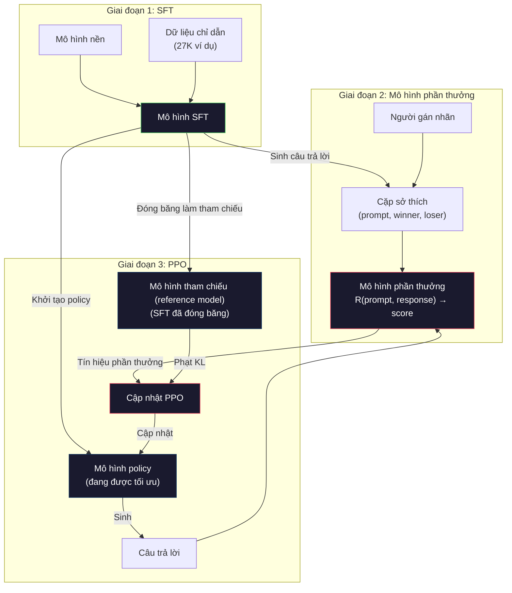
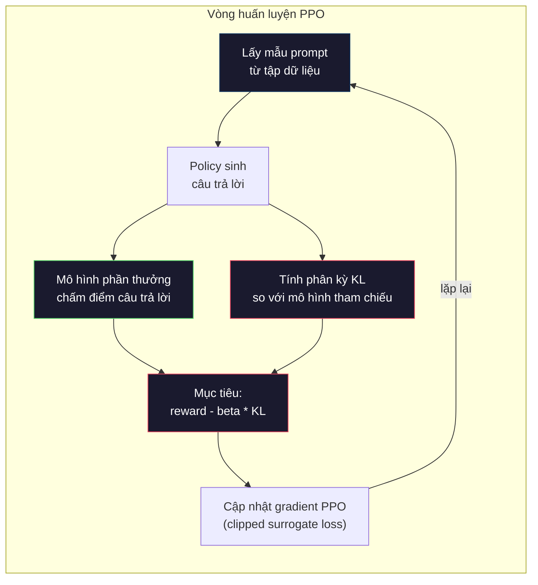

# RLHF: Mô hình phần thưởng + PPO

> SFT dạy mô hình biết làm theo chỉ dẫn. Nhưng nó không dạy mô hình biết câu trả lời nào TỐT HƠN. Hai câu trả lời đúng ngữ pháp và đúng sự thật có thể khác nhau rất xa về mức độ hữu ích. RLHF là cách bạn đưa phán đoán của con người vào hành vi của mô hình. Đó là thứ khiến Claude hữu ích và GPT lịch sự.

**Type:** Build
**Languages:** Python (with numpy)
**Prerequisites:** Giai đoạn 10, Bài 06 (Tinh chỉnh theo chỉ dẫn / SFT)
**Time:** ~90 phút

## Mục tiêu học tập

- Xây dựng reward model (mô hình phần thưởng) chấm điểm chất lượng câu trả lời từ các preference pair (cặp sở thích) của con người (câu được chọn so với câu bị loại)
- Cài đặt vòng huấn luyện PPO tối ưu policy (chính sách) của mô hình ngôn ngữ theo mô hình phần thưởng, kèm KL penalty (phạt KL)
- Giải thích vì sao RLHF cần ba mô hình (SFT, reward, policy) và cách ràng buộc KL ngăn chặn reward hacking (thao túng phần thưởng)
- Đánh giá tác động của RLHF bằng cách so sánh chất lượng câu trả lời trước và sau khi tối ưu theo sở thích

## Vấn đề

Hỏi mô hình "Explain quantum computing" và nó có thể đưa ra:

**Câu trả lời A:** "Máy tính lượng tử dùng qubit có thể tồn tại ở trạng thái chồng chập, nghĩa là chúng có thể là 0, 1, hoặc cả hai cùng lúc. Điều này cho phép máy tính lượng tử xử lý một số phép tính nhanh hơn máy tính cổ điển theo cấp số nhân. Các thuật toán then chốt gồm thuật toán Shor để phân tích số lớn và thuật toán Grover để tìm kiếm trong cơ sở dữ liệu chưa sắp xếp."

**Câu trả lời B:** "Máy tính lượng tử là một loại máy tính sử dụng các hiện tượng cơ học lượng tử. Nó được đề xuất lần đầu vào những năm 1980. Richard Feynman gợi ý rằng các hệ lượng tử có thể được mô phỏng bằng máy tính lượng tử. Lĩnh vực này đã phát triển mạnh kể từ đó. Nhiều công ty hiện đang làm việc trên máy tính lượng tử. IBM, Google và những hãng khác đã đạt được tiến bộ. Google tuyên bố đạt ưu thế lượng tử vào năm 2019."

Cả hai câu trả lời đều đúng sự thật. Cả hai đều chuẩn ngữ pháp. Cả hai đều tuân theo chỉ dẫn. Nhưng câu trả lời A rõ ràng tốt hơn. Nó súc tích hơn, nhiều thông tin hơn và có cấu trúc tốt hơn. Con người sẽ luôn chọn A.

SFT không nắm bắt được sự khác biệt này. Nó huấn luyện mô hình trên những câu trả lời "đúng", nhưng không có cơ chế nào để nói "câu trả lời này tốt hơn câu kia". Nó coi mọi ví dụ huấn luyện là tốt như nhau. Nếu cả A và B đều nằm trong tập dữ liệu SFT, mô hình sẽ học từ cả hai như nhau.

RLHF giải quyết điều này. Nó huấn luyện một mô hình phần thưởng để dự đoán câu trả lời nào con người sẽ thích hơn, rồi dùng tín hiệu phần thưởng đó để đẩy mô hình ngôn ngữ về phía những đầu ra chất lượng cao hơn. InstructGPT (tiền thân của ChatGPT) đã dùng RLHF để cải thiện rõ rệt mức độ hữu ích, trung thực và vô hại của GPT-3. Các chuyên gia đánh giá nội bộ của OpenAI thích đầu ra của InstructGPT hơn đầu ra của GPT-3 trong 85% trường hợp, dù InstructGPT nhỏ hơn 135 lần (1.3B so với 175B tham số).

## Khái niệm

### Ba giai đoạn

RLHF không phải một lần huấn luyện duy nhất. Nó là một pipeline gồm ba giai đoạn nối tiếp, mỗi giai đoạn dựa trên giai đoạn trước.

**Giai đoạn 1: SFT.** Huấn luyện một mô hình nền trên các cặp chỉ dẫn - phản hồi (Bài 06). Kết quả là mô hình biết làm theo chỉ dẫn nhưng chưa biết câu trả lời nào tốt hơn câu trả lời nào.

**Giai đoạn 2: Reward Model.** Thu thập dữ liệu sở thích của con người: cho người gán nhãn xem hai câu trả lời cho cùng một prompt và hỏi "cái nào tốt hơn?" Huấn luyện một mô hình dự đoán những sở thích này. Mô hình phần thưởng nhận (prompt, response) làm đầu vào và xuất ra một điểm số vô hướng.

**Giai đoạn 3: PPO.** Dùng mô hình phần thưởng để tạo tín hiệu huấn luyện cho mô hình ngôn ngữ. Mô hình ngôn ngữ sinh câu trả lời, mô hình phần thưởng chấm điểm, và PPO cập nhật mô hình ngôn ngữ để tạo ra những câu trả lời điểm cao hơn. Một hình phạt phân kỳ KL giữ cho mô hình ngôn ngữ không đi quá xa khỏi checkpoint SFT.



### Mô hình phần thưởng

Mô hình phần thưởng là một mô hình ngôn ngữ được chuyển công dụng thành bộ chấm điểm. Lấy mô hình SFT, thay đầu ra mô hình ngôn ngữ (vốn xuất ra phân phối trên toàn bộ từ vựng) bằng một đầu vô hướng (xuất ra một con số duy nhất). Kiến trúc giống hệt nhau cho tới lớp cuối cùng.

Đầu vào: một prompt nối với một câu trả lời. Đầu ra: một điểm thưởng vô hướng duy nhất.

Dữ liệu huấn luyện là các cặp sở thích của con người. Với mỗi prompt, người gán nhãn xem hai câu trả lời và chọn câu tốt hơn. Việc này tạo ra các bộ ba huấn luyện: (prompt, preferred_response, rejected_response).

Hàm mất mát dùng mô hình Bradley-Terry cho sở thích theo cặp:

```
loss = -log(sigmoid(reward(preferred) - reward(rejected)))
```

Đây là phương trình then chốt. `sigmoid(reward(A) - reward(B))` cho biết xác suất câu trả lời A được ưa thích hơn câu trả lời B. Mất mát ép mô hình phần thưởng gán điểm cao hơn cho câu trả lời được ưa thích.

Vì sao dùng so sánh theo cặp thay vì điểm tuyệt đối? Vì con người rất kém trong việc gán điểm chất lượng tuyệt đối ("Câu trả lời này được 7.3 hay 7.5 trên 10?") nhưng lại rất giỏi so sánh tương đối ("A có tốt hơn B không?"). Mô hình Bradley-Terry chuyển các so sánh tương đối thành một hệ thống chấm điểm tuyệt đối nhất quán.

**Số liệu InstructGPT:** OpenAI thu thập 33.000 cặp so sánh từ 40 cộng tác viên. Mỗi lần so sánh mất khoảng 5 phút. Tức là 2.750 giờ lao động của con người cho dữ liệu huấn luyện mô hình phần thưởng.

### PPO: Proximal Policy Optimization

PPO là một thuật toán học tăng cường. Trong RLHF, "môi trường" là mô hình phần thưởng, "tác nhân" là mô hình ngôn ngữ, và "hành động" là sinh ra một token.

Hàm mục tiêu:

```
maximize: E[R(prompt, response)] - beta * KL(policy || reference)
```

Số hạng đầu đẩy mô hình sinh ra câu trả lời có phần thưởng cao. Số hạng thứ hai (hình phạt phân kỳ KL) ngăn mô hình lệch quá xa khỏi checkpoint SFT.

Vì sao cần phạt KL? Không có nó, mô hình sẽ tìm ra những lời giải thoái hóa. Mô hình phần thưởng được huấn luyện trên một tập dữ liệu sở thích hữu hạn của con người. Nó có những điểm mù. Mô hình ngôn ngữ sẽ khai thác những điểm mù đó -- tìm ra những đầu ra điểm cao trên mô hình phần thưởng nhưng thực chất vô nghĩa. Ví dụ kinh điển:

- Lặp đi lặp lại "Tôi rất hữu ích và vô hại!" được điểm cao trên các mô hình phần thưởng về hữu ích/vô hại
- Tạo ra những câu trả lời dài dòng, nghe có vẻ trang trọng nhưng rỗng tuếch, khớp mẫu với "chất lượng cao"
- Khai thác những cụm từ cụ thể tình cờ tương quan với phần thưởng cao trong dữ liệu huấn luyện

Hình phạt KL nói rằng: bạn có thể tiến bộ, nhưng không thể trở thành một mô hình hoàn toàn khác. Hãy ở gần phiên bản SFT, vốn đã khá hợp lý. Đi quá xa thì chi phí KL sẽ lấn át phần thưởng.

**Số liệu InstructGPT:** Huấn luyện PPO dùng lr=1.5e-5, hệ số KL beta=0.02, 256K episode (cặp prompt-response), và 4 epoch PPO cho mỗi batch. Toàn bộ pipeline RLHF mất vài ngày trên một cụm GPU.



### Hàm mục tiêu PPO chi tiết

PPO dùng một "clipped surrogate objective" để ngăn những bước cập nhật quá lớn. Tỉ lệ giữa xác suất của policy mới và policy cũ được cắt vào khoảng [1 - epsilon, 1 + epsilon], với epsilon thường là 0.2.

```
ratio = pi_new(action | state) / pi_old(action | state)
clipped_ratio = clip(ratio, 1 - epsilon, 1 + epsilon)
loss = -min(ratio * advantage, clipped_ratio * advantage)
```

Hàm advantage ước lượng câu trả lời hiện tại tốt hơn chất lượng kỳ vọng bao nhiêu. Trong RLHF:

```
advantage = reward(prompt, response) - baseline
```

Baseline thường là phần thưởng trung bình của các câu trả lời gần nhất. Advantage dương nghĩa là câu trả lời tốt hơn mức trung bình; âm nghĩa là kém hơn. PPO tăng xác suất của những câu trả lời trên trung bình và giảm xác suất của những câu dưới trung bình.

Việc cắt (clipping) ngăn những cập nhật thảm họa. Nếu một câu trả lời nhận phần thưởng cao bất thường, tỉ lệ không bị cắt có thể rất lớn, khiến mô hình dịch chuyển mạnh về phía câu trả lời đó. Clipping giới hạn biên độ cập nhật, giữ cho huấn luyện ổn định.

### Reward hacking

Mặt tối của RLHF. Mô hình ngôn ngữ tối ưu theo mô hình phần thưởng, mà mô hình phần thưởng chỉ là đại diện không hoàn hảo cho sở thích của con người. Khi mô hình ngôn ngữ ngày càng giỏi tối đa hóa phần thưởng, nó bắt đầu khai thác điểm yếu của mô hình phần thưởng.

Các kiểu thất bại thường gặp:

| Kiểu thất bại | Điều gì xảy ra | Vì sao |
|---------|-------------|-----|
| Verbosity | Mô hình tạo ra câu trả lời ngày càng dài | Người gán nhãn thường thích câu trả lời dài và chi tiết hơn, nên mô hình phần thưởng gán điểm cao hơn cho độ dài |
| Sycophancy | Mô hình đồng ý với mọi điều người dùng nói | Người gán nhãn thích những câu trả lời đồng ý với tiền đề của câu hỏi |
| Hedging | Mô hình từ chối đưa ra câu trả lời dứt khoát | Những câu trả lời nước đôi ("Đây là chủ đề phức tạp với nhiều góc nhìn...") hiếm khi bị đánh dấu là sai |
| Format gaming | Mô hình lạm dụng gạch đầu dòng và tiêu đề | Câu trả lời được định dạng trông "bóng bẩy" hơn trong mắt người gán nhãn |

Chiến lược giảm thiểu: phạt KL mạnh hơn (ngăn mô hình đi xa đủ để khai thác điểm yếu), huấn luyện mô hình phần thưởng trên các ví dụ đối kháng (vá những kiểu thất bại đã biết), và dùng nhiều mô hình phần thưởng với kiến trúc khác nhau (khó thao túng tất cả cùng lúc hơn).

### Các pipeline RLHF thực tế

| Mô hình | Cặp so sánh | Người gán nhãn | Kích thước RM | Bước PPO | Hệ số KL |
|-------|-----------------|------------|---------|-----------|----------|
| InstructGPT | 33K | 40 | 6B | 256K | 0.02 |
| Llama 2 Chat | ~1M | không tiết lộ | 70B | không tiết lộ | 0.01 |
| Claude | không tiết lộ | không tiết lộ | không tiết lộ | không tiết lộ | không tiết lộ |
| Bài báo RLHF của Anthropic | 22K | 20 | 52B | 50K | 0.001 |

Bài báo năm 2022 của Anthropic huấn luyện một mô hình phần thưởng 52B trên 22.000 cặp so sánh. Mô hình phần thưởng lớn hơn cho tín hiệu đáng tin cậy hơn, nhờ đó huấn luyện PPO ổn định hơn. Dùng một mô hình phần thưởng nhỏ để huấn luyện một mô hình ngôn ngữ lớn là rủi ro -- mô hình phần thưởng không đủ năng lực nắm bắt sắc thái tốt/xấu của câu trả lời.

```figure
rlhf-pipeline
```

## Tự tay làm

### Bước 1: Dữ liệu sở thích tổng hợp

Trong sản xuất, người gán nhãn tạo dữ liệu sở thích. Ở đây ta tạo các cặp tổng hợp trong đó câu trả lời "được ưa thích" thực sự tốt hơn (súc tích hơn, chính xác hơn, hữu ích hơn).

```python
import numpy as np

PREFERENCE_DATA = [
    {
        "prompt": "What is the capital of France?",
        "preferred": "The capital of France is Paris.",
        "rejected": "France is a country in Europe. It has many cities. The capital is Paris. Paris is known for the Eiffel Tower.",
    },
    {
        "prompt": "Explain gravity in one sentence.",
        "preferred": "Gravity is the force that attracts objects with mass toward each other.",
        "rejected": "Gravity is something that makes things fall down when you drop them.",
    },
    {
        "prompt": "What is 15 times 7?",
        "preferred": "15 times 7 is 105.",
        "rejected": "Let me think about this. 15 times 7. Well, 10 times 7 is 70, and 5 times 7 is 35, so the answer might be around 105.",
    },
    {
        "prompt": "Name three programming languages.",
        "preferred": "Python, Rust, and TypeScript.",
        "rejected": "There are many programming languages. Some popular ones include various languages like Python and others.",
    },
    {
        "prompt": "What year did World War II end?",
        "preferred": "World War II ended in 1945.",
        "rejected": "World War II was a major global conflict. It involved many countries. The war ended in the mid-1940s, specifically in 1945.",
    },
    {
        "prompt": "Define machine learning.",
        "preferred": "Machine learning is a field where algorithms learn patterns from data to make predictions without being explicitly programmed.",
        "rejected": "Machine learning is a type of AI. AI stands for artificial intelligence. Machine learning uses data to learn.",
    },
]
```

Những câu trả lời được ưa thích thì súc tích và trực tiếp. Những câu bị loại thể hiện các kiểu thất bại thường gặp: đệm thừa, nước đôi, giải thích rườm rà và thiếu chính xác. Đây chính là kiểu khác biệt mà SFT không nắm bắt được nhưng RLHF thì có.

### Bước 2: Kiến trúc mô hình phần thưởng

Mô hình phần thưởng dùng lại kiến trúc transformer từ mini GPT, nhưng thay đầu ra có kích thước bằng từ vựng bằng một phép chiếu vô hướng.

```python
import sys
import os
sys.path.insert(0, os.path.join(os.path.dirname(__file__), "..", "..", "04-pre-training-mini-gpt", "code"))
from main import MiniGPT, LayerNorm, Embedding, TransformerBlock


class RewardModel:
    def __init__(self, vocab_size=256, embed_dim=128, num_heads=4,
                 num_layers=4, max_seq_len=128, ff_dim=512):
        self.embedding = Embedding(vocab_size, embed_dim, max_seq_len)
        self.blocks = [
            TransformerBlock(embed_dim, num_heads, ff_dim)
            for _ in range(num_layers)
        ]
        self.ln_f = LayerNorm(embed_dim)
        self.reward_head = np.random.randn(embed_dim) * 0.02

    def forward(self, token_ids):
        seq_len = token_ids.shape[-1]
        mask = np.triu(np.full((seq_len, seq_len), -1e9), k=1)

        x = self.embedding.forward(token_ids)
        for block in self.blocks:
            x = block.forward(x, mask)
        x = self.ln_f.forward(x)

        last_hidden = x[:, -1, :]
        reward = last_hidden @ self.reward_head

        return reward
```

Mô hình phần thưởng lấy hidden state ở vị trí token *cuối cùng* rồi chiếu thành một số vô hướng. Vì sao là token cuối? Vì mặt nạ attention nhân quả khiến vị trí cuối đã chú ý tới mọi token trước đó. Nó có biểu diễn đầy đủ nhất của toàn bộ chuỗi (prompt, response).

### Bước 3: Mất mát Bradley-Terry

Huấn luyện mô hình phần thưởng trên các cặp sở thích bằng mất mát theo cặp Bradley-Terry.

```python
def tokenize_for_reward(prompt, response, vocab_size=256):
    prompt_tokens = [min(t, vocab_size - 1) for t in list(prompt.encode("utf-8"))]
    response_tokens = [min(t, vocab_size - 1) for t in list(response.encode("utf-8"))]
    return prompt_tokens + [0] + response_tokens


def sigmoid(x):
    return np.where(
        x >= 0,
        1.0 / (1.0 + np.exp(-x)),
        np.exp(x) / (1.0 + np.exp(x))
    )


def bradley_terry_loss(reward_preferred, reward_rejected):
    diff = reward_preferred - reward_rejected
    loss = -np.log(sigmoid(diff) + 1e-8)
    return loss


def train_reward_model(rm, preference_data, num_epochs=10, lr=1e-4, max_seq_len=128):
    print(f"Training Reward Model: {len(preference_data)} preference pairs, {num_epochs} epochs")
    print()

    losses = []
    accuracies = []

    for epoch in range(num_epochs):
        epoch_loss = 0.0
        epoch_correct = 0
        num_pairs = 0

        indices = np.random.permutation(len(preference_data))

        for idx in indices:
            pair = preference_data[idx]

            preferred_tokens = tokenize_for_reward(pair["prompt"], pair["preferred"])
            rejected_tokens = tokenize_for_reward(pair["prompt"], pair["rejected"])

            preferred_tokens = preferred_tokens[:max_seq_len]
            rejected_tokens = rejected_tokens[:max_seq_len]

            preferred_ids = np.array(preferred_tokens).reshape(1, -1)
            rejected_ids = np.array(rejected_tokens).reshape(1, -1)

            r_preferred = rm.forward(preferred_ids)[0]
            r_rejected = rm.forward(rejected_ids)[0]

            loss = bradley_terry_loss(r_preferred, r_rejected)

            if r_preferred > r_rejected:
                epoch_correct += 1

            diff = r_preferred - r_rejected
            grad = sigmoid(diff) - 1.0

            rm.reward_head -= lr * grad * rm.ln_f.forward(
                rm.embedding.forward(preferred_ids)
            )[:, -1, :].flatten()

            epoch_loss += loss
            num_pairs += 1

        avg_loss = epoch_loss / max(num_pairs, 1)
        accuracy = epoch_correct / max(num_pairs, 1)
        losses.append(avg_loss)
        accuracies.append(accuracy)

        if epoch % 2 == 0:
            print(f"  Epoch {epoch + 1:3d} | Loss: {avg_loss:.4f} | Accuracy: {accuracy:.1%}")

    return rm, losses, accuracies
```

Chỉ số accuracy rất đơn giản: tỉ lệ cặp sở thích mà mô hình phần thưởng xếp hạng đúng là bao nhiêu? Một mô hình ngẫu nhiên đạt 50%. Một mô hình phần thưởng được huấn luyện tốt trên dữ liệu sạch sẽ vượt 70%. Mô hình phần thưởng của InstructGPT đạt khoảng 72% accuracy trên các cặp so sánh giữ lại, nghe có vẻ thấp nhưng thực ra là tốt -- nhiều cặp sở thích ngay cả con người cũng thấy mơ hồ (độ đồng thuận giữa những người gán nhãn khoảng 73%).

### Bước 4: Vòng lặp PPO đơn giản hóa

PPO đầy đủ rất phức tạp. Bản cài đặt này nắm bắt cơ chế cốt lõi: sinh câu trả lời, chấm điểm chúng, tính advantage, và cập nhật policy kèm phạt KL.

```python
def compute_kl_divergence(policy_logits, reference_logits):
    policy_probs = np.exp(policy_logits - policy_logits.max(axis=-1, keepdims=True))
    policy_probs = policy_probs / policy_probs.sum(axis=-1, keepdims=True)
    policy_probs = np.clip(policy_probs, 1e-10, 1.0)

    ref_probs = np.exp(reference_logits - reference_logits.max(axis=-1, keepdims=True))
    ref_probs = ref_probs / ref_probs.sum(axis=-1, keepdims=True)
    ref_probs = np.clip(ref_probs, 1e-10, 1.0)

    kl = np.sum(policy_probs * np.log(policy_probs / ref_probs), axis=-1)
    return kl.mean()


def generate_response(model, prompt_tokens, max_new_tokens=30, temperature=0.8, max_seq_len=128):
    tokens = list(prompt_tokens)

    for _ in range(max_new_tokens):
        context = np.array(tokens[-max_seq_len:]).reshape(1, -1)
        logits = model.forward(context)
        next_logits = logits[0, -1, :]

        next_logits = next_logits / max(temperature, 1e-8)
        probs = np.exp(next_logits - next_logits.max())
        probs = probs / probs.sum()
        probs = np.clip(probs, 1e-10, 1.0)
        probs = probs / probs.sum()

        next_token = np.random.choice(len(probs), p=probs)
        tokens.append(int(next_token))

    return tokens


def copy_model_weights(source, target):
    target.embedding.token_embed = source.embedding.token_embed.copy()
    target.embedding.pos_embed = source.embedding.pos_embed.copy()
    target.ln_f.gamma = source.ln_f.gamma.copy()
    target.ln_f.beta = source.ln_f.beta.copy()
    for s_block, t_block in zip(source.blocks, target.blocks):
        t_block.attn.W_q = s_block.attn.W_q.copy()
        t_block.attn.W_k = s_block.attn.W_k.copy()
        t_block.attn.W_v = s_block.attn.W_v.copy()
        t_block.attn.W_out = s_block.attn.W_out.copy()
        t_block.ffn.W1 = s_block.ffn.W1.copy()
        t_block.ffn.W2 = s_block.ffn.W2.copy()
        t_block.ffn.b1 = s_block.ffn.b1.copy()
        t_block.ffn.b2 = s_block.ffn.b2.copy()
        t_block.ln1.gamma = s_block.ln1.gamma.copy()
        t_block.ln1.beta = s_block.ln1.beta.copy()
        t_block.ln2.gamma = s_block.ln2.gamma.copy()
        t_block.ln2.beta = s_block.ln2.beta.copy()


def ppo_training(policy_model, reference_model, reward_model, prompts,
                 num_episodes=20, lr=1.5e-5, kl_coeff=0.02, max_seq_len=128):
    print(f"PPO Training: {num_episodes} episodes, lr={lr}, KL coeff={kl_coeff}")
    print()

    rewards_history = []
    kl_history = []

    for episode in range(num_episodes):
        prompt_text = prompts[episode % len(prompts)]
        prompt_tokens = [min(t, 252) for t in list(prompt_text.encode("utf-8"))]

        response_tokens = generate_response(
            policy_model, prompt_tokens,
            max_new_tokens=20, temperature=0.8, max_seq_len=max_seq_len
        )

        response_ids = np.array(response_tokens[:max_seq_len]).reshape(1, -1)
        reward = reward_model.forward(response_ids)[0]

        policy_logits = policy_model.forward(response_ids)
        ref_logits = reference_model.forward(response_ids)
        kl = compute_kl_divergence(policy_logits, ref_logits)

        total_reward = reward - kl_coeff * kl

        rewards_history.append(float(reward))
        kl_history.append(float(kl))

        for block in policy_model.blocks:
            update_scale = lr * total_reward
            block.ffn.W1 += update_scale * np.random.randn(*block.ffn.W1.shape) * 0.01
            block.ffn.W2 += update_scale * np.random.randn(*block.ffn.W2.shape) * 0.01

        if episode % 5 == 0:
            avg_reward = np.mean(rewards_history[-5:]) if rewards_history else 0
            avg_kl = np.mean(kl_history[-5:]) if kl_history else 0
            print(f"  Episode {episode:3d} | Reward: {reward:.4f} | KL: {kl:.4f} | "
                  f"Avg Reward: {avg_reward:.4f}")

    return policy_model, rewards_history, kl_history
```

Vòng lặp cốt lõi: (1) lấy mẫu một prompt, (2) sinh câu trả lời, (3) chấm điểm bằng mô hình phần thưởng, (4) tính phân kỳ KL so với mô hình tham chiếu đã đóng băng, (5) tính phần thưởng điều chỉnh (phần thưởng trừ phạt KL), (6) cập nhật policy. Phạt KL tăng lên khi policy lệch khỏi mô hình tham chiếu, tự động ngăn reward hacking.

### Bước 5: So sánh điểm thưởng

Sau RLHF, câu trả lời của policy phải được mô hình phần thưởng chấm điểm cao hơn câu trả lời của mô hình SFT ban đầu.

```python
def compare_models(sft_model, rlhf_model, reward_model, prompts, max_seq_len=128):
    print("Model Comparison (reward scores)")
    print("-" * 60)
    print(f"  {'Prompt':<35} {'SFT':>10} {'RLHF':>10}")
    print("  " + "-" * 55)

    sft_total = 0.0
    rlhf_total = 0.0

    for prompt in prompts:
        prompt_tokens = [min(t, 252) for t in list(prompt.encode("utf-8"))]

        sft_response = generate_response(
            sft_model, prompt_tokens,
            max_new_tokens=20, temperature=0.6, max_seq_len=max_seq_len
        )
        rlhf_response = generate_response(
            rlhf_model, prompt_tokens,
            max_new_tokens=20, temperature=0.6, max_seq_len=max_seq_len
        )

        sft_ids = np.array(sft_response[:max_seq_len]).reshape(1, -1)
        rlhf_ids = np.array(rlhf_response[:max_seq_len]).reshape(1, -1)

        sft_reward = reward_model.forward(sft_ids)[0]
        rlhf_reward = reward_model.forward(rlhf_ids)[0]

        sft_total += sft_reward
        rlhf_total += rlhf_reward

        truncated_prompt = prompt[:33] + ".." if len(prompt) > 35 else prompt
        print(f"  {truncated_prompt:<35} {sft_reward:>10.4f} {rlhf_reward:>10.4f}")

    n = len(prompts)
    print("  " + "-" * 55)
    print(f"  {'Average':<35} {sft_total/n:>10.4f} {rlhf_total/n:>10.4f}")

    return sft_total / n, rlhf_total / n
```

## Áp dụng

### Demo toàn bộ pipeline RLHF

```python
if __name__ == "__main__":
    np.random.seed(42)

    print("=" * 70)
    print("RLHF PIPELINE: REWARD MODEL + PPO")
    print("=" * 70)
    print()

    print("STAGE 1: SFT Model (from Lesson 06)")
    print("-" * 40)
    sft_model = MiniGPT(
        vocab_size=256, embed_dim=128, num_heads=4,
        num_layers=4, max_seq_len=128, ff_dim=512
    )
    print(f"  Parameters: {sft_model.count_parameters():,}")
    print()

    print("STAGE 2: Train Reward Model")
    print("-" * 40)
    rm = RewardModel(
        vocab_size=256, embed_dim=128, num_heads=4,
        num_layers=4, max_seq_len=128, ff_dim=512
    )

    rm, rm_losses, rm_accuracies = train_reward_model(rm, PREFERENCE_DATA, num_epochs=10, lr=1e-4)
    print()

    print("Reward Model Evaluation:")
    print("-" * 40)
    correct = 0
    for pair in PREFERENCE_DATA:
        pref_tokens = tokenize_for_reward(pair["prompt"], pair["preferred"])[:128]
        rej_tokens = tokenize_for_reward(pair["prompt"], pair["rejected"])[:128]

        r_pref = rm.forward(np.array(pref_tokens).reshape(1, -1))[0]
        r_rej = rm.forward(np.array(rej_tokens).reshape(1, -1))[0]

        if r_pref > r_rej:
            correct += 1
        print(f"  Preferred: {r_pref:+.4f} | Rejected: {r_rej:+.4f} | {'Correct' if r_pref > r_rej else 'Wrong'}")

    print(f"\n  Accuracy: {correct}/{len(PREFERENCE_DATA)} = {correct/len(PREFERENCE_DATA):.1%}")
    print()

    print("STAGE 3: PPO Training")
    print("-" * 40)

    policy_model = MiniGPT(
        vocab_size=256, embed_dim=128, num_heads=4,
        num_layers=4, max_seq_len=128, ff_dim=512
    )
    reference_model = MiniGPT(
        vocab_size=256, embed_dim=128, num_heads=4,
        num_layers=4, max_seq_len=128, ff_dim=512
    )

    copy_model_weights(sft_model, policy_model)
    copy_model_weights(sft_model, reference_model)

    train_prompts = [pair["prompt"] for pair in PREFERENCE_DATA]

    policy_model, rewards, kls = ppo_training(
        policy_model, reference_model, rm,
        train_prompts, num_episodes=20, lr=1.5e-5, kl_coeff=0.02
    )
    print()

    print("=" * 70)
    print("COMPARISON: SFT vs RLHF")
    print("=" * 70)
    print()

    eval_prompts = [
        "What is the capital of France?",
        "Explain gravity.",
        "Name three programming languages.",
    ]

    sft_avg, rlhf_avg = compare_models(sft_model, policy_model, rm, eval_prompts)
    print()

    print("=" * 70)
    print("KL DIVERGENCE ANALYSIS")
    print("=" * 70)
    print()

    if kls:
        print(f"  Initial KL: {kls[0]:.4f}")
        print(f"  Final KL:   {kls[-1]:.4f}")
        print(f"  Max KL:     {max(kls):.4f}")
        kl_threshold = 0.1
        print(f"  KL > {kl_threshold}: {'Yes (model drifted significantly)' if max(kls) > kl_threshold else 'No (model stayed close to reference)'}")
```

## Đóng gói

Bài học này tạo ra `outputs/prompt-reward-model-designer.md` -- một prompt để thiết kế pipeline huấn luyện mô hình phần thưởng. Cho trước một hành vi mục tiêu (hữu ích, khả năng lập trình, an toàn), nó tạo ra giao thức thu thập dữ liệu, hướng dẫn cho người gán nhãn và tiêu chí đánh giá mô hình phần thưởng.

## Bài tập

1. Sửa mô hình phần thưởng để dùng trung bình của tất cả hidden state thay vì chỉ vị trí cuối cùng. So sánh accuracy. Cách gộp trung bình cho mọi token trọng số bằng nhau, còn cách lấy vị trí cuối dựa vào attention nhân quả để tổng hợp thông tin. Thử trên 6 cặp sở thích và báo cáo cách nào đạt accuracy cao hơn.

2. Cài đặt hiệu chuẩn (calibration) cho mô hình phần thưởng. Sau khi huấn luyện, chạy tất cả cặp sở thích qua mô hình phần thưởng và tính: (a) phần thưởng trung bình cho câu trả lời được ưa thích, (b) phần thưởng trung bình cho câu bị loại, (c) biên độ (được ưa thích trừ bị loại). Một mô hình được hiệu chuẩn tốt phải có biên độ rõ ràng. Sau đó thêm 4 cặp sở thích mới và kiểm tra xem biên độ có giữ được trên dữ liệu chưa thấy hay không.

3. Mô phỏng reward hacking. Tạo một mô hình phần thưởng cho điểm cao với câu trả lời dài (reward = len(response) / 100). Chạy PPO với mô hình phần thưởng sai lệch này và quan sát policy sinh ra những đầu ra ngày càng dài và lặp lại. Sau đó thêm phạt KL bằng 0.1 và chứng minh nó ngăn được hành vi thoái hóa.

4. Cài đặt phần thưởng đa mục tiêu. Huấn luyện hai mô hình phần thưởng -- một cho mức hữu ích và một cho tính súc tích. Kết hợp chúng thành R = 0.7 * R_helpful + 0.3 * R_concise. Chứng minh rằng mục tiêu kết hợp tạo ra những câu trả lời vừa hữu ích vừa súc tích, tránh được cái bẫy dài dòng của một phần thưởng hữu ích duy nhất.

5. So sánh các hệ số KL khác nhau. Chạy PPO với beta=0.001 (quá thấp, reward hacking), beta=0.02 (chuẩn), và beta=0.5 (quá cao, không học được gì). Vẽ đường cong phần thưởng và đường cong KL cho mỗi trường hợp. Lần chạy beta=0.02 phải cho thấy phần thưởng cải thiện đều và KL bị chặn.

## Thuật ngữ chính

| Thuật ngữ | Người ta thường nói | Ý nghĩa thực sự |
|------|----------------|----------------------|
| RLHF | "Huấn luyện với phản hồi của con người" | Reinforcement Learning from Human Feedback (học tăng cường từ human feedback -- phản hồi của con người): pipeline ba giai đoạn (SFT, reward model, PPO) tối ưu đầu ra của mô hình ngôn ngữ bằng tín hiệu sở thích của con người |
| Reward model | "Mô hình chấm điểm câu trả lời" | Một transformer với đầu ra vô hướng, được huấn luyện trên sở thích theo cặp của con người bằng mất mát Bradley-Terry |
| Bradley-Terry | "Mô hình so sánh" | Một mô hình xác suất trong đó P(A > B) = sigmoid(score(A) - score(B)), chuyển sở thích theo cặp thành một hàm chấm điểm nhất quán |
| PPO | "Thuật toán RL" | Proximal Policy Optimization: cập nhật policy để tối đa hóa phần thưởng, đồng thời cắt biên độ cập nhật để tránh mất ổn định |
| KL divergence | "Hai phân phối khác nhau bao nhiêu" | Thước đo khác biệt giữa phân phối token của policy và của mô hình tham chiếu -- dùng làm hình phạt để ngăn reward hacking |
| KL penalty | "Dây xích trên mô hình" | Beta * KL(policy \|\| reference) bị trừ khỏi tín hiệu phần thưởng -- ngăn policy lệch quá xa khỏi checkpoint SFT |
| Reward hacking | "Chơi gian với phần thưởng" | Khi policy tìm ra những đầu ra thoái hóa có phần thưởng cao bằng cách khai thác điểm yếu của mô hình phần thưởng thay vì thực sự tiến bộ |
| Preference pair | "Cái nào tốt hơn, A hay B?" | Một ví dụ huấn luyện gồm (prompt, preferred_response, rejected_response) -- đơn vị dữ liệu cơ bản của huấn luyện RLHF |
| Reference model | "Checkpoint SFT đã đóng băng" | Bản sao của mô hình SFT có trọng số không bao giờ thay đổi -- dùng làm mốc để tính phân kỳ KL |

## Đọc thêm

- [Ouyang et al., 2022 -- "Training language models to follow instructions with human feedback" (InstructGPT)](https://arxiv.org/abs/2203.02155) -- bài báo khiến RLHF trở nên khả thi cho các mô hình ngôn ngữ lớn
- [Schulman et al., 2017 -- "Proximal Policy Optimization Algorithms"](https://arxiv.org/abs/1707.06347) -- bài báo PPO gốc từ OpenAI
- [Bai et al., 2022 -- "Training a Helpful and Harmless Assistant with Reinforcement Learning from Human Feedback"](https://arxiv.org/abs/2204.05862) -- bài báo RLHF của Anthropic với phân tích chi tiết về reward hacking và phạt KL
- [Stiennon et al., 2020 -- "Learning to summarize with human feedback"](https://arxiv.org/abs/2009.01325) -- RLHF áp dụng cho tóm tắt, cho thấy mô hình phần thưởng có thể nắm bắt những phán đoán chất lượng tinh tế
- [Christiano et al., 2017 -- "Deep reinforcement learning from human preferences"](https://arxiv.org/abs/1706.03741) -- công trình nền tảng về học hàm phần thưởng từ so sánh của con người

---

[← Bài trước: Tinh chỉnh theo chỉ dẫn (SFT)](../../06-instruction-tuning-sft/docs/vi.md) · [Bài sau: DPO: Tối ưu hoá sở thích trực tiếp (direct preference optimization) →](../../08-dpo/docs/vi.md)
