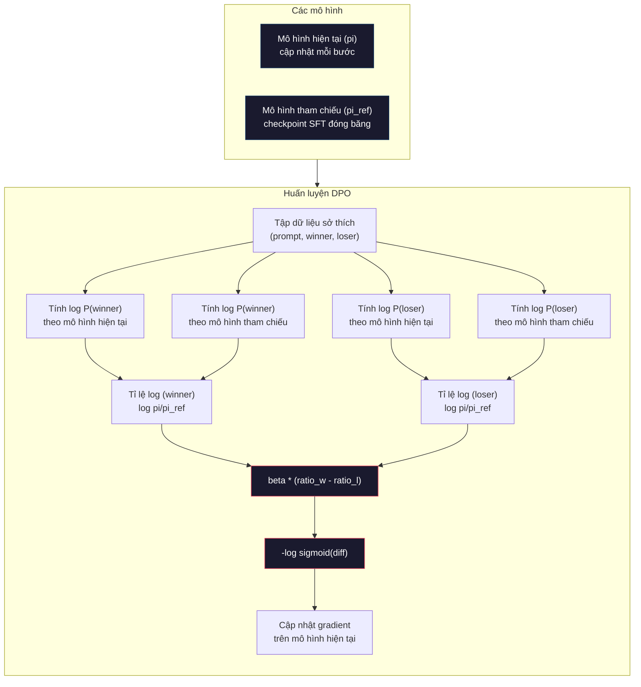

# DPO: Tối ưu hoá sở thích trực tiếp (direct preference optimization)

> RLHF hiệu quả. Nhưng nó đòi hỏi huấn luyện ba mô hình (SFT, mô hình phần thưởng, policy), xử lý tính bất ổn của PPO, và tinh chỉnh một hình phạt KL. DPO đặt câu hỏi: nếu bạn bỏ qua được tất cả những thứ đó thì sao? DPO tối ưu hoá trực tiếp mô hình ngôn ngữ trên các cặp sở thích (preference pair). Không mô hình phần thưởng. Không PPO. Một vòng huấn luyện. Kết quả tương đương.

**Type:** Build
**Languages:** Python (with numpy)
**Prerequisites:** Giai đoạn 10, Bài 07 (RLHF)
**Time:** ~90 phút

## Mục tiêu học tập

- Cài đặt huấn luyện DPO tối ưu hoá trực tiếp một mô hình ngôn ngữ trên các cặp sở thích mà không cần mô hình phần thưởng riêng
- Suy ra hàm mất mát DPO và giải thích cách nó biểu diễn ngầm một mô hình phần thưởng thông qua log xác suất (log-probability) của policy
- So sánh DPO với RLHF về độ ổn định huấn luyện, chi phí tính toán và số mô hình cần dùng
- Tinh chỉnh tham số beta để điều khiển mức policy sau huấn luyện lệch khỏi mô hình tham chiếu (reference model)

## Vấn đề

Bạn đã xây một pipeline RLHF trong Bài 07. Ba giai đoạn. Ba mô hình. Mô hình SFT, mô hình phần thưởng, và mô hình policy được tối ưu bằng PPO. Chỉ riêng mô hình phần thưởng đã cần hàng nghìn cặp sở thích do con người gán nhãn cùng một vòng huấn luyện riêng. PPO đòi hỏi tinh chỉnh cẩn thận hệ số KL, learning rate, tỉ lệ clip và số epoch.

Trong thực tế, huấn luyện PPO nổi tiếng là bất ổn. Những thay đổi nhỏ về siêu tham số khiến quá trình huấn luyện phân kỳ. Mô hình phần thưởng chỉ là đại diện không hoàn hảo cho sở thích con người, và policy tìm cách khai thác điểm yếu của nó. Hình phạt KL có giúp ích nhưng cũng cần tinh chỉnh riêng -- quá thấp thì bạn gặp reward hacking, quá cao thì mô hình gần như không học được.

Chính sự phức tạp này khiến phần lớn mô hình mã nguồn mở chật vật với RLHF trong nhiều năm sau khi InstructGPT được công bố. Pipeline ba giai đoạn rất mong manh. Mỗi giai đoạn có kiểu hỏng riêng, và sai số cộng dồn.

Tháng 5 năm 2023, Rafael Rafailov, Archit Sharma và các đồng nghiệp tại Stanford công bố "Direct Preference Optimization: Your Language Model is Secretly a Reward Model." Điểm mấu chốt: bạn không cần một mô hình phần thưởng riêng. Hàm phần thưởng tối ưu được xác định bằng toán học từ chính xác suất token của mô hình ngôn ngữ. Bạn có thể bỏ hẳn mô hình phần thưởng và tối ưu mô hình ngôn ngữ trực tiếp trên các cặp sở thích.

DPO rút RLHF về một bước học có giám sát duy nhất. Một mô hình. Một hàm mất mát. Một vòng huấn luyện. Không học tăng cường. Zephyr-7B, một trong những mô hình đầu tiên dùng DPO ở quy mô lớn, đã ngang bằng hoặc vượt các mô hình huấn luyện bằng RLHF đầy đủ trên nhiều benchmark. Meta dùng DPO như một phần trong pipeline alignment của Llama 3. Anthropic cũng đã nhắc tới các phương pháp kiểu DPO trong nghiên cứu alignment của họ.

## Khái niệm

### Điểm mấu chốt

RLHF tối ưu mục tiêu sau:

```
maximize: E[R(x, y)] - beta * KL(pi || pi_ref)
```

trong đó R là mô hình phần thưởng, pi là policy, pi_ref là mô hình tham chiếu, và beta là hệ số KL.

Bài báo DPO chỉ ra rằng mục tiêu này có nghiệm tối ưu dạng đóng (closed-form). Với mọi hàm phần thưởng R, policy tối ưu là:

```
pi*(y | x) = pi_ref(y | x) * exp(R(x, y) / beta) / Z(x)
```

trong đó Z(x) là hằng số chuẩn hoá. Sắp xếp lại:

```
R(x, y) = beta * log(pi*(y | x) / pi_ref(y | x)) + beta * log Z(x)
```

Đây là bước đột phá. Phần thưởng được biểu diễn hoàn toàn qua xác suất của mô hình policy và xác suất của mô hình tham chiếu. Bạn không cần huấn luyện một mô hình phần thưởng riêng. Phần thưởng ẩn (implicit reward) nằm ngay trong tỉ lệ xác suất.

Thay vào mô hình sở thích Bradley-Terry:

```
P(y_w > y_l | x) = sigmoid(R(x, y_w) - R(x, y_l))
                  = sigmoid(beta * (log pi(y_w|x)/pi_ref(y_w|x) - log pi(y_l|x)/pi_ref(y_l|x)))
```

Các hạng Z(x) triệt tiêu vì cả hai phản hồi đều điều kiện trên cùng prompt x. Còn lại là một hàm chỉ phụ thuộc log xác suất của mô hình policy và log xác suất của mô hình tham chiếu trên phản hồi được ưa thích và phản hồi bị từ chối.

### Hàm mất mát DPO

```
L_DPO = -log(sigmoid(beta * (log pi(y_w|x)/pi_ref(y_w|x) - log pi(y_l|x)/pi_ref(y_l|x))))
```

Cùng bóc tách từng thành phần:

- **y_w** = phản hồi được ưa thích (thắng)
- **y_l** = phản hồi bị từ chối (thua)
- **x** = prompt
- **pi** = mô hình hiện tại (đang được huấn luyện)
- **pi_ref** = mô hình tham chiếu (checkpoint SFT đóng băng)
- **beta** = tham số nhiệt độ điều khiển mức lệch khỏi mô hình tham chiếu (thường từ 0.1 đến 0.5)

Tỉ lệ `log pi(y|x) / pi_ref(y|x)` là tỉ lệ log xác suất. Khi tỉ lệ này dương, mô hình hiện tại gán xác suất cho phản hồi y cao hơn mô hình tham chiếu. Khi âm, mô hình hiện tại gán xác suất thấp hơn.

Hàm mất mát DPO đẩy mô hình tăng tỉ lệ log xác suất cho phản hồi được ưa thích và giảm tỉ lệ đó cho phản hồi bị từ chối. Tham số beta điều khiển mức độ mạnh dạn mà mô hình được phép lệch khỏi mô hình tham chiếu -- beta nhỏ cho phép lệch nhiều, beta lớn giữ mô hình sát mô hình tham chiếu.



### Vì sao DPO đơn giản hơn

| Khía cạnh | RLHF (PPO) | DPO |
|--------|-----------|-----|
| Số mô hình phải huấn luyện | 3 (SFT + reward + policy) | 1 (chỉ policy) |
| Vòng huấn luyện | 3 (SFT, huấn luyện RM, PPO) | 2 (SFT, DPO) |
| Siêu tham số | lr, hệ số KL, tỉ lệ clip, lr của RM, epochs x3 | lr, beta, epochs |
| Mô hình phần thưởng | Bắt buộc (huấn luyện riêng) | Ẩn trong xác suất mô hình |
| Thuật toán RL | PPO (phức tạp, bất ổn) | Học có giám sát (ổn định) |
| Bộ nhớ GPU | 3-4 mô hình trong bộ nhớ khi chạy PPO | 2 mô hình (hiện tại + tham chiếu) |
| Độ ổn định huấn luyện | Nhạy với siêu tham số | Bền vững, tương tự SFT |

DPO cần hai mô hình trong bộ nhớ khi huấn luyện -- mô hình hiện tại và mô hình tham chiếu đóng băng. RLHF cần ba hoặc bốn: policy, mô hình tham chiếu, mô hình phần thưởng, và tuỳ chọn một baseline hàm giá trị. Với mô hình 70B, mỗi bản sao tốn 140GB ở FP16. Tiết kiệm bộ nhớ nhờ bỏ mô hình phần thưởng là rất đáng kể.

### Khi nào DPO tốt hơn RLHF

**Tập dữ liệu nhỏ.** Với 5,000-20,000 cặp sở thích, DPO thường ngang bằng hoặc vượt RLHF. Mô hình phần thưởng trong RLHF cần đủ dữ liệu để khái quát hoá -- với dữ liệu hạn chế, nó overfit và tạo tín hiệu phần thưởng không đáng tin. DPO né được vấn đề này vì không cần mô hình phần thưởng nào cả.

**Tính toán hạn chế.** DPO cần khoảng một phần ba lượng tính toán của RLHF đầy đủ (một vòng huấn luyện thay vì ba). Với những nhóm không có cụm GPU lớn, đây là lựa chọn thực tế.

**Lặp nhanh.** Muốn thử 10 tập dữ liệu sở thích khác nhau để xem tập nào cho mô hình tốt nhất? DPO cho phép bạn chạy mỗi thí nghiệm trong vài giờ. RLHF đòi hỏi huấn luyện lại mô hình phần thưởng cho từng tập dữ liệu.

### Khi nào RLHF tốt hơn DPO

**Huấn luyện quy mô lớn.** Ở quy mô của GPT-4 hay Claude, mô hình phần thưởng riêng của RLHF có thể nắm bắt tín hiệu sở thích tinh tế hơn. Mô hình phần thưởng đóng vai một hàm mất mát học được, thích ứng với các tiêu chí chất lượng phức tạp.

**Tín hiệu phần thưởng phức tạp.** Khi "tốt hơn" liên quan tới nhiều chiều (hữu ích, vô hại, trung thực), một mô hình phần thưởng có thể học được sự đánh đổi đa mục tiêu này. DPO coi mỗi cặp sở thích là một tín hiệu nhị phân -- một cái tốt hơn, một cái kém hơn -- mà không mô hình hoá lý do.

**Alignment lặp.** Pipeline RLHF có thể sinh phản hồi mới bằng policy hiện tại, để con người chấm điểm, rồi huấn luyện lại mô hình phần thưởng trong một vòng trực tuyến. DPO chỉ làm việc trên một tập cặp sở thích cố định. Constitutional AI (cách tiếp cận của Anthropic) tận dụng mạnh tính lặp này của RLHF.

### Ngoài DPO: KTO, ORPO, SimPO

DPO truyền cảm hứng cho một họ phương pháp alignment đơn giản hơn.

**KTO (Kahneman-Tversky Optimization, 2024):** Bạn thậm chí không cần cặp. KTO làm việc với phản hồi không ghép cặp -- chỉ cần gán nhãn mỗi phản hồi là "tốt" hoặc "kém" mà không so sánh với phương án khác. Điều này đơn giản hoá việc thu thập dữ liệu rất nhiều. Thay vì đưa cho người gán nhãn hai phản hồi và hỏi "cái nào tốt hơn?", bạn đưa một phản hồi và hỏi "cái này có tốt không?" Hàm mất mát áp dụng tâm lý ác cảm mất mát từ lý thuyết triển vọng: phản hồi kém bị phạt nặng hơn mức thưởng cho phản hồi tốt.

**ORPO (Odds Ratio Preference Optimization, 2024):** Kết hợp SFT và alignment trong một bước huấn luyện duy nhất. Thay vì làm SFT trước rồi DPO sau, ORPO sửa hàm mất mát SFT để bao gồm tín hiệu sở thích. Hàm mất mát có hai hạng: một hạng mất mát dự đoán token kế tiếp chuẩn trên các phản hồi được ưa thích, cộng thêm một hạng tỉ lệ odds làm tăng khoảng cách giữa xác suất của phản hồi được ưa thích và phản hồi bị từ chối. Một vòng huấn luyện thay vì hai.

**SimPO (Simple Preference Optimization, 2024):** Loại bỏ hoàn toàn mô hình tham chiếu. Thay vì tính tỉ lệ log xác suất so với một mô hình tham chiếu đóng băng, SimPO dùng log xác suất trung bình của phản hồi (chuẩn hoá theo độ dài) làm phần thưởng ẩn. Cách này tiết kiệm bộ nhớ (không cần mô hình tham chiếu) và đơn giản hoá huấn luyện. Việc chuẩn hoá độ dài ngăn mô hình thiên vị các phản hồi ngắn.

| Phương pháp | Năm | Số mô hình trong bộ nhớ | Cần cặp? | Cần tham chiếu? | Vòng huấn luyện |
|--------|------|-----------------|-------------|-----------------|----------------|
| RLHF | 2022 | 3-4 | Có (cho RM) | Có | 3 |
| DPO | 2023 | 2 | Có | Có | 2 |
| KTO | 2024 | 2 | Không (không ghép cặp) | Có | 2 |
| ORPO | 2024 | 1 | Có | Không | 1 |
| SimPO | 2024 | 1 | Có | Không | 1 |

Xu hướng rất rõ: mỗi phương pháp loại bỏ thêm một mảnh phức tạp. RLHF cần mô hình phần thưởng và PPO. DPO loại bỏ cả hai. KTO loại bỏ dữ liệu ghép cặp. ORPO loại bỏ giai đoạn SFT riêng. SimPO loại bỏ mô hình tham chiếu. Thuế alignment -- chi phí tính toán và phức tạp để đi từ mô hình nền sang mô hình đã alignment -- ngày càng giảm.

### Triển khai DPO thực tế

**Zephyr-7B (HuggingFace, tháng 10 năm 2023):** Nền Mistral 7B, SFT trên UltraChat (200K ví dụ), rồi DPO trên UltraFeedback (60K cặp sở thích). Đạt 6.47 trên MT-Bench -- mô hình 7B cao nhất thời điểm đó. Để so sánh, Llama 2 Chat 70B đạt 6.86, nghĩa là Zephyr chỉ kém 6% so với một mô hình lớn gấp 10 lần chỉ nhờ alignment bằng DPO.

**Llama 3 (Meta, tháng 4 năm 2024):** Dùng DPO sau các giai đoạn RLHF ban đầu. Sự kết hợp này cho thấy DPO và RLHF có thể bổ trợ nhau -- RLHF cho alignment rộng, DPO cho tinh chỉnh có mục tiêu.

**Neural Magic / nm-chat (2024):** Áp dụng DPO cho nhiều mô hình mã nguồn mở, luôn cho thấy cải thiện 5-15% trên các benchmark alignment so với baseline chỉ SFT.

```figure
dpo-loss
```

## Tự tay làm

### Bước 1: Tập dữ liệu sở thích

Cùng định dạng như RLHF -- bộ ba (prompt, preferred, rejected). DPO dùng thẳng dữ liệu này mà không cần mô hình phần thưởng trung gian.

```python
import numpy as np
import sys
import os
sys.path.insert(0, os.path.join(os.path.dirname(__file__), "..", "..", "04-pre-training-mini-gpt", "code"))
from main import MiniGPT, LayerNorm, Embedding, TransformerBlock

PREFERENCE_DATA = [
    {
        "prompt": "What is the capital of France?",
        "preferred": "The capital of France is Paris.",
        "rejected": "France is a country in Europe. It has many cities. The capital is Paris. Paris is known for the Eiffel Tower.",
    },
    {
        "prompt": "Explain gravity in one sentence.",
        "preferred": "Gravity is the force that attracts objects with mass toward each other.",
        "rejected": "Gravity is something that makes things fall down when you drop them.",
    },
    {
        "prompt": "What is 15 times 7?",
        "preferred": "15 times 7 is 105.",
        "rejected": "Let me think about this. 15 times 7. Well, 10 times 7 is 70, and 5 times 7 is 35, so the answer might be around 105.",
    },
    {
        "prompt": "Name three programming languages.",
        "preferred": "Python, Rust, and TypeScript.",
        "rejected": "There are many programming languages. Some popular ones include various languages like Python and others.",
    },
    {
        "prompt": "What year did World War II end?",
        "preferred": "World War II ended in 1945.",
        "rejected": "World War II was a major global conflict. It involved many countries. The war ended in the mid-1940s, specifically in 1945.",
    },
    {
        "prompt": "Define machine learning.",
        "preferred": "Machine learning is a field where algorithms learn patterns from data to make predictions without being explicitly programmed.",
        "rejected": "Machine learning is a type of AI. AI stands for artificial intelligence. Machine learning uses data to learn.",
    },
]
```

### Bước 2: Log xác suất của chuỗi

Hàm mất mát DPO cần tính tổng log xác suất của một phản hồi khi biết prompt. Điều đó có nghĩa là chạy mô hình trên toàn bộ chuỗi (prompt + response) rồi cộng log xác suất của từng token trong phản hồi.

```python
def tokenize_sequence(text, vocab_size=256):
    return [min(t, vocab_size - 1) for t in list(text.encode("utf-8"))]


def compute_sequence_log_prob(model, prompt_tokens, response_tokens, max_seq_len=128):
    full_sequence = prompt_tokens + response_tokens
    if len(full_sequence) > max_seq_len:
        full_sequence = full_sequence[:max_seq_len]

    if len(full_sequence) < 2:
        return 0.0

    input_ids = np.array(full_sequence[:-1]).reshape(1, -1)
    target_ids = np.array(full_sequence[1:])

    logits = model.forward(input_ids)
    logits = logits[0]

    max_logits = logits.max(axis=-1, keepdims=True)
    log_probs = logits - max_logits - np.log(
        np.exp(logits - max_logits).sum(axis=-1, keepdims=True)
    )

    prompt_len = len(prompt_tokens)
    response_start = max(0, prompt_len - 1)
    response_end = len(target_ids)

    if response_start >= response_end:
        return 0.0

    response_log_probs = log_probs[response_start:response_end, :]
    response_targets = target_ids[response_start:response_end]

    total_log_prob = 0.0
    for i, target in enumerate(response_targets):
        total_log_prob += response_log_probs[i, target]

    return total_log_prob
```

Hàm này là trụ cột của DPO. Với mỗi cặp sở thích, nó chạy bốn lần: mô hình trên phản hồi được ưa thích, mô hình trên phản hồi bị từ chối, mô hình tham chiếu trên phản hồi được ưa thích, mô hình tham chiếu trên phản hồi bị từ chối. Tức 4 lượt forward cho mỗi ví dụ huấn luyện, so với chuỗi sinh + chấm điểm phần thưởng + ước lượng giá trị + cập nhật PPO của RLHF. Đơn giản hơn, nhanh hơn, ổn định hơn.

### Bước 3: Hàm mất mát DPO

Phần cốt lõi của bài báo, bằng code. Một hàm. Một mất mát. Không mô hình phần thưởng.

```python
def sigmoid(x):
    return np.where(
        x >= 0,
        1.0 / (1.0 + np.exp(-x)),
        np.exp(x) / (1.0 + np.exp(x))
    )


def dpo_loss(policy_logprob_preferred, policy_logprob_rejected,
             ref_logprob_preferred, ref_logprob_rejected, beta=0.1):
    preferred_ratio = policy_logprob_preferred - ref_logprob_preferred
    rejected_ratio = policy_logprob_rejected - ref_logprob_rejected

    logit = beta * (preferred_ratio - rejected_ratio)

    loss = -np.log(sigmoid(logit) + 1e-8)

    preferred_reward = beta * preferred_ratio
    rejected_reward = beta * rejected_ratio

    return loss, {
        "preferred_ratio": float(preferred_ratio),
        "rejected_ratio": float(rejected_ratio),
        "logit": float(logit),
        "implicit_preferred_reward": float(preferred_reward),
        "implicit_rejected_reward": float(rejected_reward),
        "reward_margin": float(preferred_reward - rejected_reward),
    }
```

`preferred_ratio` và `rejected_ratio` là các tỉ lệ log xác suất trong phép suy ra DPO. Khi mô hình hiện tại gán xác suất cao hơn cho phản hồi được ưa thích (so với mô hình tham chiếu) và xác suất thấp hơn cho phản hồi bị từ chối, logit dương và mất mát thấp. Tín hiệu huấn luyện đẩy mô hình đúng theo hướng đó.

`implicit_preferred_reward` và `implicit_rejected_reward` là phần thưởng mà hàm mất mát DPO gán ngầm. Bạn có thể trích xuất chúng để kiểm tra quá trình huấn luyện có hiệu quả -- khoảng cách giữa phần thưởng của phản hồi được ưa thích và phản hồi bị từ chối phải tăng dần trong quá trình huấn luyện.

### Bước 4: Vòng huấn luyện DPO

Một vòng huấn luyện có giám sát tiêu chuẩn. Không PPO. Không mô hình phần thưởng. Chỉ có forward pass và cập nhật gradient.

```python
def copy_model_weights(source, target):
    target.embedding.token_embed = source.embedding.token_embed.copy()
    target.embedding.pos_embed = source.embedding.pos_embed.copy()
    target.ln_f.gamma = source.ln_f.gamma.copy()
    target.ln_f.beta = source.ln_f.beta.copy()
    for s_block, t_block in zip(source.blocks, target.blocks):
        t_block.attn.W_q = s_block.attn.W_q.copy()
        t_block.attn.W_k = s_block.attn.W_k.copy()
        t_block.attn.W_v = s_block.attn.W_v.copy()
        t_block.attn.W_out = s_block.attn.W_out.copy()
        t_block.ffn.W1 = s_block.ffn.W1.copy()
        t_block.ffn.W2 = s_block.ffn.W2.copy()
        t_block.ffn.b1 = s_block.ffn.b1.copy()
        t_block.ffn.b2 = s_block.ffn.b2.copy()
        t_block.ln1.gamma = s_block.ln1.gamma.copy()
        t_block.ln1.beta = s_block.ln1.beta.copy()
        t_block.ln2.gamma = s_block.ln2.gamma.copy()
        t_block.ln2.beta = s_block.ln2.beta.copy()


def dpo_train(policy_model, reference_model, preference_data,
              num_epochs=5, lr=5e-6, beta=0.1, max_seq_len=128):
    print(f"DPO Training: {len(preference_data)} pairs, {num_epochs} epochs, "
          f"lr={lr}, beta={beta}")
    print()

    losses = []
    margins = []

    for epoch in range(num_epochs):
        epoch_loss = 0.0
        epoch_margin = 0.0
        num_examples = 0

        indices = np.random.permutation(len(preference_data))

        for idx in indices:
            pair = preference_data[idx]

            prompt_tokens = tokenize_sequence(pair["prompt"])
            preferred_tokens = tokenize_sequence(pair["preferred"])
            rejected_tokens = tokenize_sequence(pair["rejected"])

            pi_logprob_w = compute_sequence_log_prob(
                policy_model, prompt_tokens, preferred_tokens, max_seq_len
            )
            pi_logprob_l = compute_sequence_log_prob(
                policy_model, prompt_tokens, rejected_tokens, max_seq_len
            )
            ref_logprob_w = compute_sequence_log_prob(
                reference_model, prompt_tokens, preferred_tokens, max_seq_len
            )
            ref_logprob_l = compute_sequence_log_prob(
                reference_model, prompt_tokens, rejected_tokens, max_seq_len
            )

            loss, metrics = dpo_loss(
                pi_logprob_w, pi_logprob_l,
                ref_logprob_w, ref_logprob_l, beta
            )

            update_direction = 1.0 if metrics["logit"] < 0 else -0.1
            for block in policy_model.blocks:
                block.ffn.W1 += lr * update_direction * np.random.randn(*block.ffn.W1.shape) * 0.01
                block.ffn.W2 += lr * update_direction * np.random.randn(*block.ffn.W2.shape) * 0.01

            epoch_loss += loss
            epoch_margin += metrics["reward_margin"]
            num_examples += 1
            losses.append(float(loss))
            margins.append(metrics["reward_margin"])

        avg_loss = epoch_loss / max(num_examples, 1)
        avg_margin = epoch_margin / max(num_examples, 1)

        print(f"  Epoch {epoch + 1}/{num_epochs} | Loss: {avg_loss:.4f} | "
              f"Avg Margin: {avg_margin:.4f}")

    return policy_model, losses, margins
```

Vòng huấn luyện này đơn giản một cách sảng khoái so với RLHF. Với mỗi cặp sở thích: tính bốn log xác suất (hai mô hình, hai phản hồi), đưa vào hàm mất mát DPO, tính gradient, cập nhật policy. Không bước sinh. Không suy luận mô hình phần thưởng. Không ước lượng advantage. Không clipping.

### Bước 5: So sánh DPO với RLHF

Đo khoảng cách phần thưởng ẩn và mức dịch chuyển log xác suất để so sánh DPO với mô hình RLHF ở Bài 07.

```python
def evaluate_preference_accuracy(model, reference_model, preference_data, beta=0.1, max_seq_len=128):
    correct = 0
    total = 0

    for pair in preference_data:
        prompt_tokens = tokenize_sequence(pair["prompt"])
        preferred_tokens = tokenize_sequence(pair["preferred"])
        rejected_tokens = tokenize_sequence(pair["rejected"])

        pi_w = compute_sequence_log_prob(model, prompt_tokens, preferred_tokens, max_seq_len)
        pi_l = compute_sequence_log_prob(model, prompt_tokens, rejected_tokens, max_seq_len)
        ref_w = compute_sequence_log_prob(reference_model, prompt_tokens, preferred_tokens, max_seq_len)
        ref_l = compute_sequence_log_prob(reference_model, prompt_tokens, rejected_tokens, max_seq_len)

        preferred_reward = beta * (pi_w - ref_w)
        rejected_reward = beta * (pi_l - ref_l)

        if preferred_reward > rejected_reward:
            correct += 1
        total += 1

    return correct / max(total, 1)


def analyze_implicit_rewards(model, reference_model, preference_data, beta=0.1, max_seq_len=128):
    print("Implicit Reward Analysis:")
    print("-" * 65)
    print(f"  {'Prompt':<30} {'Pref Reward':>12} {'Rej Reward':>12} {'Margin':>10}")
    print("  " + "-" * 60)

    for pair in preference_data:
        prompt_tokens = tokenize_sequence(pair["prompt"])
        preferred_tokens = tokenize_sequence(pair["preferred"])
        rejected_tokens = tokenize_sequence(pair["rejected"])

        pi_w = compute_sequence_log_prob(model, prompt_tokens, preferred_tokens, max_seq_len)
        pi_l = compute_sequence_log_prob(model, prompt_tokens, rejected_tokens, max_seq_len)
        ref_w = compute_sequence_log_prob(reference_model, prompt_tokens, preferred_tokens, max_seq_len)
        ref_l = compute_sequence_log_prob(reference_model, prompt_tokens, rejected_tokens, max_seq_len)

        pref_reward = beta * (pi_w - ref_w)
        rej_reward = beta * (pi_l - ref_l)
        margin = pref_reward - rej_reward

        truncated = pair["prompt"][:28] + ".." if len(pair["prompt"]) > 30 else pair["prompt"]
        print(f"  {truncated:<30} {pref_reward:>12.4f} {rej_reward:>12.4f} {margin:>10.4f}")

    print()
```

### Bước 6: Phân tích độ nhạy của beta

Tham số beta là tương đương của hệ số KL trong RLHF ở DPO. Nó điều khiển mức mô hình có thể lệch khỏi mô hình tham chiếu. Thí nghiệm này cho thấy tác động của nó.

```python
def beta_sensitivity_analysis(sft_model, preference_data, betas, max_seq_len=128):
    print("Beta Sensitivity Analysis")
    print("-" * 60)
    print(f"  {'Beta':>8} {'Final Loss':>12} {'Final Margin':>14} {'Accuracy':>10}")
    print("  " + "-" * 55)

    results = []

    for beta in betas:
        policy = MiniGPT(
            vocab_size=256, embed_dim=128, num_heads=4,
            num_layers=4, max_seq_len=max_seq_len, ff_dim=512
        )
        reference = MiniGPT(
            vocab_size=256, embed_dim=128, num_heads=4,
            num_layers=4, max_seq_len=max_seq_len, ff_dim=512
        )
        copy_model_weights(sft_model, policy)
        copy_model_weights(sft_model, reference)

        policy, losses, margins_list = dpo_train(
            policy, reference, preference_data,
            num_epochs=3, lr=5e-6, beta=beta, max_seq_len=max_seq_len
        )

        accuracy = evaluate_preference_accuracy(
            policy, reference, preference_data, beta, max_seq_len
        )

        final_loss = losses[-1] if losses else 0
        final_margin = margins_list[-1] if margins_list else 0

        print(f"  {beta:>8.3f} {final_loss:>12.4f} {final_margin:>14.4f} {accuracy:>10.1%}")
        results.append({
            "beta": beta,
            "final_loss": final_loss,
            "final_margin": final_margin,
            "accuracy": accuracy,
        })

        print()

    return results
```

Beta nhỏ (0.01) cho mô hình lệch tự do khỏi mô hình tham chiếu -- học nhanh nhưng có nguy cơ rơi vào nghiệm suy biến. Beta lớn (1.0) giữ mô hình sát mô hình tham chiếu -- ổn định nhưng học chậm. Vùng tối ưu cho hầu hết ứng dụng là 0.1 đến 0.3.

## Áp dụng

### Demo pipeline DPO đầy đủ

```python
if __name__ == "__main__":
    np.random.seed(42)

    print("=" * 70)
    print("DPO: DIRECT PREFERENCE OPTIMIZATION")
    print("=" * 70)
    print()

    print("STEP 1: Initialize SFT Model (from Lesson 06)")
    print("-" * 50)
    sft_model = MiniGPT(
        vocab_size=256, embed_dim=128, num_heads=4,
        num_layers=4, max_seq_len=128, ff_dim=512
    )
    print(f"  Parameters: {sft_model.count_parameters():,}")
    print()

    print("STEP 2: DPO Training")
    print("-" * 50)

    policy_model = MiniGPT(
        vocab_size=256, embed_dim=128, num_heads=4,
        num_layers=4, max_seq_len=128, ff_dim=512
    )
    reference_model = MiniGPT(
        vocab_size=256, embed_dim=128, num_heads=4,
        num_layers=4, max_seq_len=128, ff_dim=512
    )
    copy_model_weights(sft_model, policy_model)
    copy_model_weights(sft_model, reference_model)

    policy_model, losses, margins = dpo_train(
        policy_model, reference_model, PREFERENCE_DATA,
        num_epochs=5, lr=5e-6, beta=0.1
    )
    print()

    print("=" * 70)
    print("STEP 3: Evaluate")
    print("=" * 70)
    print()

    pre_accuracy = evaluate_preference_accuracy(
        sft_model, reference_model, PREFERENCE_DATA, beta=0.1
    )
    post_accuracy = evaluate_preference_accuracy(
        policy_model, reference_model, PREFERENCE_DATA, beta=0.1
    )

    print(f"  Preference accuracy (pre-DPO):  {pre_accuracy:.1%}")
    print(f"  Preference accuracy (post-DPO): {post_accuracy:.1%}")
    print()

    analyze_implicit_rewards(policy_model, reference_model, PREFERENCE_DATA, beta=0.1)

    print("=" * 70)
    print("STEP 4: Training Dynamics")
    print("=" * 70)
    print()

    if losses:
        print("  Loss curve:")
        window = max(1, len(losses) // 5)
        for i in range(0, len(losses), window):
            chunk = losses[i:i + window]
            avg = sum(chunk) / len(chunk)
            print(f"    Steps {i:3d}-{i + len(chunk) - 1:3d}: loss = {avg:.4f}")
        print()

    if margins:
        print("  Reward margin curve:")
        window = max(1, len(margins) // 5)
        for i in range(0, len(margins), window):
            chunk = margins[i:i + window]
            avg = sum(chunk) / len(chunk)
            print(f"    Steps {i:3d}-{i + len(chunk) - 1:3d}: margin = {avg:.4f}")
        print()

    print("=" * 70)
    print("STEP 5: Beta Sensitivity")
    print("=" * 70)
    print()

    beta_results = beta_sensitivity_analysis(
        sft_model, PREFERENCE_DATA, betas=[0.01, 0.1, 0.3, 1.0]
    )

    print("=" * 70)
    print("DPO vs RLHF COMPARISON")
    print("=" * 70)
    print()
    print("  DPO advantages:")
    print("    - 1 training loop (vs 3 for RLHF)")
    print("    - 2 models in memory (vs 3-4 for RLHF)")
    print("    - Supervised learning (vs RL, more stable)")
    print("    - No reward model to train or maintain")
    print()
    print("  RLHF advantages:")
    print("    - Separate reward model captures complex preferences")
    print("    - Online learning: generate, rate, retrain")
    print("    - Better for multi-objective alignment")
    print("    - Proven at largest scales (GPT-4, Claude)")
    print()
    print("  Practical guidance:")
    print("    - Start with DPO. It's simpler and often sufficient.")
    print("    - Switch to RLHF if DPO plateaus on your eval metrics.")
    print("    - Many production systems use both: RLHF first, DPO to refine.")
```

## Đóng gói

Bài học này tạo ra `outputs/prompt-alignment-method-selector.md` -- một prompt giúp bạn chọn đúng phương pháp alignment (SFT, RLHF, DPO, KTO, ORPO, SimPO) cho tình huống của mình. Dựa trên dữ liệu sẵn có, ngân sách tính toán và mục tiêu alignment, nó đề xuất một phương pháp và kế hoạch huấn luyện.

## Bài tập

1. Cài đặt KTO (Kahneman-Tversky Optimization). KTO không cần cặp -- chỉ cần gán nhãn mỗi phản hồi là "tốt" hoặc "kém." Mất mát cho phản hồi tốt là `-log(sigmoid(beta * log_ratio))` và cho phản hồi kém là `-log(1 - sigmoid(beta * log_ratio))`, kèm hệ số ác cảm mất mát (thường 1.5x) nhân vào mất mát của phản hồi kém. Huấn luyện trên cùng dữ liệu (coi preferred là "tốt" và rejected là "kém" một cách độc lập) rồi so sánh độ chính xác với DPO.

2. Cài đặt DPO chuẩn hoá theo độ dài. Thay vì dùng log xác suất thô, chia cho số token của phản hồi: `normalized_logprob = total_logprob / num_tokens`. Cách này ngăn mô hình thiên vị các phản hồi ngắn (vốn có tổng log xác suất cao hơn). So sánh khoảng cách phần thưởng ẩn khi có và không có chuẩn hoá.

3. Xây một hàm mất mát kết hợp kiểu ORPO. Cộng thêm mất mát dự đoán token kế tiếp chuẩn trên phản hồi được ưa thích vào mất mát DPO: `L = L_sft(preferred) + alpha * L_dpo`. Thử các giá trị alpha 0.1, 0.5 và 1.0. Mất mát kết hợp phải tạo ra mô hình vừa tuân theo chỉ dẫn (nhờ hạng SFT) vừa ưu tiên phản hồi tốt hơn (nhờ hạng DPO), loại bỏ nhu cầu về một giai đoạn SFT riêng.

4. Cài đặt DPO lặp. Chạy DPO 3 epoch, sau đó sinh phản hồi mới từ mô hình đã huấn luyện, ghép chúng với các phản hồi được ưa thích ban đầu thành cặp sở thích mới, rồi chạy DPO lần nữa. Hai vòng của quá trình "tự chơi" này. So sánh độ chính xác sở thích sau vòng 1 và vòng 2 để xem tinh chỉnh lặp có giúp ích không.

5. So sánh DPO với các mô hình tham chiếu khác nhau. Thay vì dùng checkpoint SFT làm tham chiếu, hãy thử: (a) mô hình nền (trước SFT), (b) một checkpoint từ epoch 1 của DPO, (c) trung bình động luỹ thừa của mô hình policy. Báo cáo mô hình tham chiếu nào cho độ chính xác sở thích cao nhất và đường cong huấn luyện ổn định nhất.

## Thuật ngữ chính

| Thuật ngữ | Người ta thường nói | Ý nghĩa thực sự |
|------|----------------|----------------------|
| DPO | "RLHF không cần RL" | Direct Preference Optimization: thuật toán học có giám sát tối ưu hoá mô hình ngôn ngữ trực tiếp trên các cặp sở thích, bỏ qua mô hình phần thưởng và PPO |
| Implicit reward | "Phần thưởng nằm trong mô hình" | Hàm phần thưởng được xác định bởi tỉ lệ log xác suất giữa mô hình policy và mô hình tham chiếu -- không cần mô hình phần thưởng riêng |
| Beta (DPO) | "Nhiệt độ" | Điều khiển mức policy có thể lệch khỏi mô hình tham chiếu -- beta nhỏ cho phép lệch nhiều, beta lớn giữ mô hình sát lại |
| Log-probability ratio | "Mô hình đã thay đổi bao nhiêu" | log pi(y\|x) - log pi_ref(y\|x) -- dương nghĩa là mô hình hiện tại gán xác suất cao hơn mô hình tham chiếu |
| Reference model | "Checkpoint đóng băng" | Bản sao của mô hình SFT có trọng số không bao giờ thay đổi -- đóng vai điểm neo để tính tỉ lệ xác suất |
| KTO | "DPO không cần cặp" | Kahneman-Tversky Optimization: làm việc với nhãn "tốt" hoặc "kém" không ghép cặp thay vì yêu cầu cặp sở thích |
| ORPO | "Alignment một bước" | Odds Ratio Preference Optimization: kết hợp SFT và alignment vào một vòng huấn luyện duy nhất bằng cách thêm hạng sở thích vào mất mát SFT |
| SimPO | "Không cần tham chiếu" | Simple Preference Optimization: loại bỏ mô hình tham chiếu bằng cách dùng log xác suất trung bình chuẩn hoá theo độ dài làm phần thưởng ẩn |
| Alignment tax | "Chi phí làm mô hình an toàn" | Lượng tính toán, dữ liệu và độ phức tạp tăng thêm để đi từ mô hình nền sang mô hình đã alignment -- DPO giảm đáng kể khoản này |

## Đọc thêm

- [Rafailov et al., 2023 -- "Direct Preference Optimization: Your Language Model is Secretly a Reward Model"](https://arxiv.org/abs/2305.18290) -- bài báo DPO đã đơn giản hoá alignment từ RLHF sang học có giám sát
- [Tunstall et al., 2023 -- "Zephyr: Direct Distillation of LM Alignment"](https://arxiv.org/abs/2310.16944) -- Zephyr-7B, cho thấy DPO trên UltraFeedback ngang bằng RLHF trên các benchmark
- [Ethayarajh et al., 2024 -- "KTO: Model Alignment as Prospect Theoretic Optimization"](https://arxiv.org/abs/2402.01306) -- loại bỏ nhu cầu về sở thích ghép cặp
- [Hong et al., 2024 -- "ORPO: Monolithic Preference Optimization without Reference Model"](https://arxiv.org/abs/2403.07691) -- kết hợp SFT và alignment trong một bước
- [Meng et al., 2024 -- "SimPO: Simple Preference Optimization with a Reference-Free Reward"](https://arxiv.org/abs/2405.14734) -- loại bỏ hoàn toàn mô hình tham chiếu
- [Llama 3 Technical Report](https://arxiv.org/abs/2407.21783) -- pipeline alignment của Meta kết hợp RLHF và DPO

---

[← Bài trước: RLHF: Mô hình phần thưởng + PPO](../../07-rlhf/docs/vi.md) · [Bài sau: Constitutional AI (AI theo hiến chương) và Self-Improvement (tự cải thiện) →](../../09-constitutional-ai-self-improvement/docs/vi.md)
