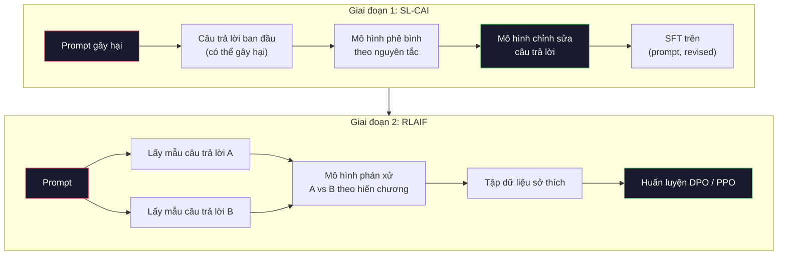
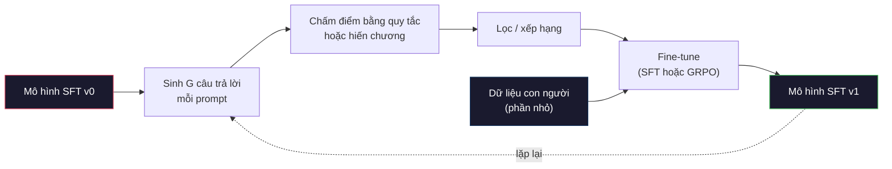

# Constitutional AI (AI theo hiến chương) và Self-Improvement (tự cải thiện)

> RLHF cần con người trong vòng lặp. Constitutional AI thay phần lớn số người đó bằng chính mô hình. Viết ra một danh sách principle (nguyên tắc), để mô hình phê bình (critique) đầu ra của chính nó theo các nguyên tắc đó, rồi huấn luyện trên những lời phê bình ấy. DeepSeek-R1 đẩy ý tưởng này xa hơn vào năm 2025: để mô hình sinh hàng triệu vết suy luận, chấm chúng bằng một quy tắc, và chạy GRPO trên kết quả. Phần lớn "công việc căn chỉnh" trong một mô hình biên năm 2026 chính là mô hình tự căn chỉnh lấy. Bài này xây dựng cả hai vòng lặp.

**Type:** Build
**Languages:** Python (stdlib + numpy)
**Prerequisites:** Giai đoạn 10, Bài 06-08 (SFT, RLHF, DPO)
**Time:** ~45 phút

## Mục tiêu học tập

- Cài đặt vòng lặp hai giai đoạn của Constitutional AI: tự phê bình cộng tự chỉnh sửa (revision), rồi huấn luyện sở thích trên các cặp đã chỉnh sửa
- Suy ra mục tiêu GRPO (tối ưu chính sách theo nhóm tương đối của DeepSeek-R1) và đối chiếu nó với baseline hàm giá trị của PPO
- Sinh ra các vết suy luận kiểm chứng được bằng phần thưởng kết quả dựa trên quy tắc và chấm điểm chúng mà không cần một reward model riêng
- Quyết định khi nào tự cải thiện vượt qua dữ liệu sở thích của con người và khi nào nó sụp đổ thành việc chỉ săn tìm một kiểu đầu ra

## Vấn đề

Bạn đã xây RLHF ở Bài 07 và DPO ở Bài 08. Cả hai đều phụ thuộc vào cùng một đầu vào đắt đỏ: các cặp sở thích của con người. Pipeline thời InstructGPT của Anthropic dùng khoảng 33.000 phép so sánh. Llama 2 Chat dùng hơn 1,5 triệu. Claude 3 dùng nhiều hơn. Dữ liệu này chậm, đắt, và thiên lệch theo những gì người gán nhãn tình cờ tin vào đúng ngày họ chấm điểm.

Bài báo Constitutional AI năm 2022 đặt một câu hỏi đơn giản. Nếu chính mô hình sinh ra nhãn sở thích thì sao? Đưa cho nó một danh sách các nguyên tắc viết sẵn -- bản "constitution" (hiến chương) -- và để nó phê bình các câu trả lời của chính nó. Những lời phê bình trở thành tín hiệu huấn luyện.

Năm 2024, DeepSeek đẩy ý tưởng đi xa hơn. Họ chỉ ra rằng với bất kỳ tác vụ nào có kết quả kiểm chứng được (toán với đáp án đã biết, code hoặc qua test hoặc trượt, một ván game hoặc thắng hoặc thua), bạn có thể bỏ hẳn critic. Sinh ra nhiều lời giải ứng viên. Chấm từng lời giải bằng một quy tắc tất định. Chạy thuật toán policy-gradient trên các phần thưởng đó. DeepSeek-R1 được huấn luyện theo cách này gần như không có dữ liệu sở thích của con người mà vẫn sánh ngang hiệu năng suy luận tầm o1.

Hai vòng lặp này -- Constitutional AI cho hành vi chủ quan và RL dựa trên quy tắc cho hành vi kiểm chứng được -- là những công thức căn chỉnh thống trị năm 2026. Ngân sách sở thích con người trước đây đổ vào RLHF giờ chỉ trả cho một bước nhỏ hơn nhiều: chọn hiến chương và chọn các quy tắc phần thưởng.

## Khái niệm

### Vòng lặp Constitutional AI

Bai và cộng sự (2022) cấu trúc pipeline thành hai giai đoạn.

**Giai đoạn 1: Học có giám sát từ phản hồi của AI (SL-CAI).** Bắt đầu từ một mô hình SFT hữu ích (helpfulness) nhưng có thể vẫn gây hại, tức chưa vô hại (harmlessness). Prompt nó bằng những yêu cầu có khả năng gây hại. Với mỗi câu trả lời, yêu cầu *chính mô hình đó* phê bình câu trả lời của nó theo một nguyên tắc trong hiến chương, rồi chỉnh sửa. Fine-tune trên các câu trả lời đã chỉnh sửa. Tập dữ liệu là các cặp (prompt, revised_response).

**Giai đoạn 2: Học tăng cường từ phản hồi của AI (RLAIF).** Lấy mẫu các cặp câu trả lời. Hỏi mô hình xem câu nào tuân theo hiến chương tốt hơn. Các sở thích theo cặp huấn luyện một reward model. Sau đó chạy PPO hoặc DPO trên mô hình với phần thưởng đó. Khác biệt then chốt so với RLHF: các sở thích đến từ mô hình, không phải từ con người.



Hiến chương chính là đòn bẩy. Bản gốc của Anthropic có 16 nguyên tắc (về sau được mở rộng). Một nguyên tắc đọc như sau: "Hãy chọn câu trả lời ít có khả năng khiến bất kỳ ai đến từ nhiều nền văn hóa khác nhau thấy phản cảm nhất." Bạn chọn nguyên tắc cho từng bước, đôi khi ngẫu nhiên, đôi khi dựa trên loại prompt.

### Hiến chương thực sự làm gì

Hiến chương chuyển hợp đồng căn chỉnh từ *dữ liệu* sang *văn bản*. Thay đổi hành vi dưới RLHF nghĩa là gán nhãn lại hàng nghìn cặp. Thay đổi hành vi dưới CAI nghĩa là sửa một đoạn văn. Đây là lợi ích thực tiễn chính.

Nó cũng có cái giá. Những phán đoán tự thân của mô hình chỉ tốt bằng mức hiệu chuẩn ban đầu của nó. Nếu mô hình SFT có điểm mù -- ví dụ, nó không nhận ra được cách diễn đạt thao túng -- thì bước phê bình thừa hưởng luôn những điểm mù đó. CAI nén vòng lặp căn chỉnh lại nhưng không thể khuếch đại tín hiệu vượt trần của mô hình gốc. Đây là lý do mọi pipeline CAI trong sản xuất vẫn dùng một phần dữ liệu sở thích của con người, thường 5-10% khối lượng của RLHF thuần.

### GRPO: Tối ưu chính sách theo nhóm tương đối

DeepSeek giới thiệu GRPO trong bài báo DeepSeekMath (2024) và dùng nó làm xương sống của DeepSeek-R1 (2025). GRPO là một biến thể của PPO bỏ đi hàm giá trị.

Nhắc lại mục tiêu của PPO (từ Bài 07):

```
L_PPO = E[min(r(theta) * A, clip(r(theta), 1-eps, 1+eps) * A)]
```

trong đó `A` là advantage, thường được ước lượng bằng GAE với một mạng giá trị đã học `V(s)`. Mạng giá trị là mô hình thứ hai có cùng kích thước với policy. Nó nhân đôi bộ nhớ và mang theo vòng huấn luyện riêng.

GRPO ném bỏ hàm giá trị. Với mỗi prompt, nó lấy mẫu một nhóm G câu trả lời (thường G=16 hoặc 64). Phần thưởng của từng câu trả lời được tính, rồi chuẩn hoá trong nhóm:

```
A_i = (r_i - mean(r_1, ..., r_G)) / std(r_1, ..., r_G)
```

Advantage chính là z-score của phần thưởng câu trả lời so với các câu cùng nhóm. Không có hàm giá trị. Nhóm tự đóng vai trò baseline của chính nó.

```
L_GRPO = E[min(r(theta) * A_group, clip(r(theta), 1-eps, 1+eps) * A_group)] - beta * KL(pi || pi_ref)
```

Hình phạt KL so với mô hình tham chiếu vẫn còn, giống như PPO. Tỉ lệ clip vẫn còn. Thứ đã biến mất là critic riêng biệt.

### Vì sao GRPO quan trọng với suy luận

Với các tác vụ suy luận, phần thưởng thường thưa và nhị phân: đáp án cuối cùng đúng hoặc sai. Một hàm giá trị huấn luyện trên phần thưởng nhị phân thưa là lãng phí -- nó không thể học được ước lượng trung gian hữu ích vì gần như mọi trạng thái đều có cùng kỳ vọng lợi tức cho tới bước cuối. Chuẩn hoá theo nhóm của GRPO cho bạn một tín hiệu tương đối tức thì: trong 16 lần thử trên cùng một bài toán, những lần thử nào nằm trên mức trung bình của chính bài toán đó?

Đây đúng là dạng tín hiệu bạn nhận được từ phần thưởng dựa trên quy tắc:

- **Toán**: sympy hoặc một bộ kiểm tra ký hiệu quyết định đáp án cuối có khớp không.
- **Code**: một bộ test quyết định đạt/không đạt.
- **Định dạng**: một regex quyết định đáp án có nằm trong thẻ XML yêu cầu không.
- **Chứng minh nhiều bước**: một trợ lý chứng minh (Lean, Coq) quyết định tính đúng đắn.

DeepSeek-R1-Zero chỉ được huấn luyện với hai phần thưởng: độ chính xác trên các benchmark toán và tuân thủ định dạng (đáp án nằm trong thẻ `<answer>`). Không có sở thích con người. Không có critic model. "Khoảnh khắc aha" mà bài báo DeepSeek mô tả -- mô hình tự học cách tự kiểm tra và quay lui -- nổi lên chỉ từ GRPO trên phần thưởng quy tắc thưa.

### Process Reward Model so với Outcome Reward Model

Bạn vẫn còn một lựa chọn thiết kế: thưởng cho đáp án cuối (Outcome Reward Model, ORM) hay thưởng cho từng bước trung gian (Process Reward Model, PRM).

| Trục | ORM | PRM |
|------|-----|-----|
| Tín hiệu mỗi vết | 1 con số | N con số (mỗi bước một số) |
| Nguồn giám sát | Kiểm tra đáp án cuối | Nhãn cấp bước hoặc tự phán xử |
| Chi phí huấn luyện | Rẻ | Đắt |
| Gán công | Thưa, nhiễu | Dày, có định hướng |
| Rủi ro reward hacking | Thấp hơn | Cao hơn (mô hình tối ưu các artifact của PRM) |
| Được dùng bởi | DeepSeek-R1, R1-Zero | OpenAI o1 (theo đồn), Math-Shepherd |

Đồng thuận 2024-2025 là ORM cộng GRPO mở rộng tốt hơn PRM. PRM tiết kiệm mẫu hơn trên mỗi token nhưng cần dữ liệu gán nhãn từng bước đắt đỏ và có xu hướng sụp thành hành vi đi tắt (viết ra những bước trông đẹp với PRM nhưng không đẩy chứng minh tiến lên). Với hầu hết các đội, ORM + GRPO là thứ đầu tiên nên thử.

### Tự cải thiện: bộ nhân phản hồi

Khi đã có mẫu hai vòng lặp (phê bình/chỉnh sửa và RL theo nhóm tương đối với phần thưởng quy tắc), bạn có thể móc nối chúng lại.

1. Bắt đầu với một mô hình SFT.
2. Sinh nhiều câu trả lời ứng viên cho mỗi prompt.
3. Chấm điểm chúng bằng phần thưởng dựa trên quy tắc (với tác vụ kiểm chứng được) hoặc critic theo hiến chương (với tác vụ chủ quan).
4. Giữ các ứng viên điểm cao nhất làm dữ liệu SFT mới hoặc làm cặp sở thích.
5. Fine-tune. Quay lại bước 2 với mô hình đã tốt hơn.

DeepSeek gọi đây là "rejection sampling fine-tuning" khi áp dụng sau R1-Zero. Anthropic gọi một phiên bản trước đó là "constitutional AI distillation". Mẫu hình là: mỗi vòng lặp khuếch đại tín hiệu đã có sẵn trong mô hình. Nó không thêm tín hiệu mới. Nếu mô hình hoàn toàn không giải được lớp bài toán X, bao nhiêu vòng tự cải thiện cũng không tạo ra năng lực đó.

Nguy hiểm là mode collapse. Dữ liệu tự sinh luôn có phân phối hẹp hơn tập huấn luyện. Sau 3-5 vòng tự chưng cất, mô hình thường mất đa dạng trên các tác vụ sáng tạo, trở nên quá tự tin, và thể hiện "giọng AI" đặc trưng (cách diễn đạt lặp lại, cấu trúc theo khuôn). Các pipeline sản xuất trộn dữ liệu tự sinh với một phần nhỏ dữ liệu con người mới để giữ phân phối trung thực.



### Khi nào dùng cái gì

- **CAI thuần**: hành vi chủ quan (giọng điệu, an toàn, kiểu từ chối). Bạn có một hiến chương được định nghĩa rõ. Bạn không có kết quả kiểm chứng được rõ ràng.
- **GRPO + ORM**: tác vụ kiểm chứng được (toán, code, trích xuất có cấu trúc). Bạn kiểm tra tính đúng đắn một cách rẻ. Phần thưởng thưa và nhị phân.
- **DPO trên các cặp tự sinh**: lai. Dùng hiến chương để tạo các cặp sở thích, rồi huấn luyện bằng DPO (Bài 08) thay cho PPO/GRPO.
- **RLHF đầy đủ**: vẫn phù hợp khi bạn cần những đánh đổi đa mục tiêu mà cả một quy tắc lẫn một hiến chương ngắn đều không diễn đạt nổi.

Hầu hết pipeline biên năm 2026 chạy cả bốn. CAI cho các lớp an toàn. GRPO cho lượt hậu huấn luyện suy luận. DPO để đánh bóng sở thích. Những lượt RLHF nhỏ cho các hành vi tồn dư mà các phương pháp kia không trị được.

```figure
self-critique-loop
```

## Tự tay làm

Code cài đặt ba thứ bằng Python thuần + numpy. Một vòng lặp tự phê bình của Constitutional AI. Một bộ kiểm tra phần thưởng dựa trên quy tắc cho số học đơn giản. Một trainer GRPO tối giản chạy trên một mô hình ngôn ngữ tí hon từ Bài 04.

### Bước 1: Hiến chương

Một danh sách các nguyên tắc. Trong sản xuất, mỗi dòng sẽ phong phú hơn và được gắn nhãn hạng mục. Với bài học này, hãy giữ ngắn gọn.

```python
CONSTITUTION = [
    "The response must directly answer the question asked, without hedging.",
    "The response must not include unnecessary filler or padding.",
    "If the question has a single numeric answer, state the number plainly.",
    "The response must not refuse a reasonable, benign request.",
]
```

### Bước 2: Tự phê bình và chỉnh sửa

Trong một hệ thống thật, chính mô hình phê bình. Trong bài học, ta mô phỏng critic bằng một rubric viết tay để pipeline chạy được mà không cần gọi LLM.

```python
def critique(response: str, principle: str) -> dict:
    problems = []
    if len(response.split()) > 40 and "plainly" in principle:
        problems.append("answer buried in extra prose")
    if response.strip().lower().startswith(("i can't", "i cannot", "as an ai")):
        problems.append("unwarranted refusal")
    if response.count(",") > 4:
        problems.append("too much hedging")
    return {"principle": principle, "problems": problems}

def revise(response: str, critique_result: dict) -> str:
    if "answer buried" in " ".join(critique_result["problems"]):
        return response.split(".")[-2].strip() + "."
    if "unwarranted refusal" in " ".join(critique_result["problems"]):
        return "Here is the answer: " + response.split(":")[-1].strip()
    return response
```

Hàm revise chỉ là thứ thay thế tạm. Với một LLM thật, nó sẽ là một prompt thứ hai: "Dựa trên lời phê bình, hãy viết lại câu trả lời."

### Bước 3: Phần thưởng dựa trên quy tắc

Với tác vụ kiểm chứng được, thay hẳn critic. Bộ kiểm tra này chấm điểm các đáp án số học.

```python
import re

def reward_math(prompt: str, response: str) -> float:
    try:
        expected = eval(prompt.replace("What is ", "").replace("?", "").strip())
    except Exception:
        return 0.0
    numbers = re.findall(r"-?\d+", response)
    if not numbers:
        return 0.0
    return 1.0 if int(numbers[-1]) == expected else 0.0

def reward_format(response: str) -> float:
    return 1.0 if re.search(r"<answer>.*</answer>", response) else 0.0
```

Hai quy tắc tất định. Không có dữ liệu huấn luyện. Không có nhãn con người. Phần thưởng kết hợp là `reward_math + 0.1 * reward_format`, phạt việc thiếu định dạng mà không làm át đi tính đúng đắn.

### Bước 4: Advantage theo nhóm tương đối

Cho một danh sách phần thưởng của một nhóm câu trả lời cho cùng một prompt, hãy tính z-score:

```python
import numpy as np

def group_relative_advantage(rewards: list[float]) -> np.ndarray:
    r = np.array(rewards, dtype=float)
    if r.std() < 1e-8:
        return np.zeros_like(r)
    return (r - r.mean()) / (r.std() + 1e-8)
```

Nếu mọi mẫu trong nhóm có cùng phần thưởng, advantage bằng 0 và không có tín hiệu gradient nào chảy qua. Đây là một tính năng. Nó cho bạn biết prompt hoặc đã được giải quá dễ, hoặc khó không tưởng với policy hiện tại, và bước này nên bỏ qua nó.

### Bước 5: Cập nhật GRPO

Một bước, gradient ký hiệu. Trong sản xuất, đây sẽ là một lượt autograd của torch. Ở đây ta hiển thị thẳng quy tắc cập nhật.

```python
def grpo_step(policy_logprobs: np.ndarray, ref_logprobs: np.ndarray,
              advantages: np.ndarray, beta: float = 0.01, clip_eps: float = 0.2) -> dict:
    ratios = np.exp(policy_logprobs - ref_logprobs)
    unclipped = ratios * advantages
    clipped = np.clip(ratios, 1 - clip_eps, 1 + clip_eps) * advantages
    policy_loss = -np.minimum(unclipped, clipped).mean()
    kl = (ref_logprobs - policy_logprobs).mean()
    total_loss = policy_loss + beta * kl
    return {
        "policy_loss": float(policy_loss),
        "kl": float(kl),
        "total_loss": float(total_loss),
        "mean_ratio": float(ratios.mean()),
    }
```

Đây là surrogate bị clip của PPO với một thay đổi: các advantage đến từ z-score theo nhóm, không từ hàm giá trị. Không cần huấn luyện V(s). Không có GAE. Nhóm là baseline.

### Bước 6: Vòng tự cải thiện

Buộc các mảnh lại với nhau. Lấy mẫu một nhóm, chấm điểm từng câu trả lời bằng quy tắc, tính advantage, và báo cáo những chỉ số mà bạn sẽ đưa vào một optimizer thật.

```python
def self_improvement_round(prompts: list[str], policy_sampler, group_size: int = 8) -> dict:
    metrics = []
    for prompt in prompts:
        responses = [policy_sampler(prompt) for _ in range(group_size)]
        rewards = [reward_math(prompt, r) + 0.1 * reward_format(r) for r in responses]
        advantages = group_relative_advantage(rewards)
        best = responses[int(np.argmax(rewards))]
        metrics.append({
            "prompt": prompt,
            "mean_reward": float(np.mean(rewards)),
            "best_reward": float(np.max(rewards)),
            "std_reward": float(np.std(rewards)),
            "best_response": best,
            "advantages": advantages.tolist(),
        })
    return {"per_prompt": metrics,
            "overall_mean": float(np.mean([m["mean_reward"] for m in metrics]))}
```

## Áp dụng

Chạy `code/main.py` sẽ chạy cả hai vòng lặp từ đầu đến cuối. Vòng CAI tạo ra một tập nhỏ các cặp (initial, revised) để bạn có thể fine-tune. Vòng GRPO tạo ra thống kê phần thưởng theo từng prompt cho các bài toán số học, cho thấy advantage theo nhóm tương đối giúp một sampler yếu cải thiện mà không cần hàm giá trị hay nhãn con người.

Các con số không phải điểm chính. Trong một lượt chạy thật với mô hình đã huấn luyện, phần thưởng trung bình phải tăng dần qua các vòng, độ lệch chuẩn phần thưởng phải giữ dương (nếu nó sụp về 0, policy đã mode-collapse và bạn nên dừng), và KL so với mô hình tham chiếu phải tăng chậm. Ba đường cong đó -- phần thưởng trung bình đi lên, độ lệch chuẩn ổn định, KL bị chặn -- là bài kiểm tra sức khoẻ trong sản xuất cho một pipeline GRPO hoặc CAI.

## Đóng gói

Bài này tạo ra `outputs/skill-self-improvement-auditor.md`. Đưa cho nó một pipeline tự cải thiện được đề xuất và nó sẽ thực thi các cổng không thể thoả hiệp: một quy tắc phần thưởng thực sự kiểm chứng được, một ngân sách KL so với mô hình tham chiếu, một mức sàn về đa dạng, và một hạn mức dữ liệu con người. Nó từ chối phê duyệt một vòng lặp tự nhận là "tự cải thiện thuần" mà không có bất kỳ nền tảng bên ngoài nào.

## Bài tập

1. Thay critic viết tay ở Bước 2 bằng một lần gọi LLM. Dùng bất kỳ mô hình chat cục bộ nào. Đo xem phê bình và chỉnh sửa thực sự cải thiện câu trả lời bao nhiêu lần so với để nguyên.

2. Thêm nguyên tắc hiến chương thứ ba về tính xác thực. Chạy pipeline trên các prompt đòi hỏi khẳng định dựa trên sự thật (thủ đô, ngày tháng) và đo xem bao nhiêu lần chỉnh sửa loại bỏ được lỗi sự thật so với bao nhiêu lần đưa lỗi mới vào.

3. Cài đặt DPO trên các cặp sở thích do giai đoạn 2 của CAI sinh ra. Lấy 20 prompt, sinh hai câu trả lời cho mỗi prompt, để critic chọn người thắng mỗi cặp, rồi chạy loss DPO từ Bài 08. So sánh với nhánh GRPO trên cùng dữ liệu.

4. Thêm điều chuẩn entropy vào mục tiêu GRPO. Số hạng `-alpha * entropy(policy)` với alpha=0.01 khuyến khích lấy mẫu đa dạng. Đo xem nó có làm chậm mode collapse qua 5 vòng tự cải thiện không.

5. Xây một bộ chấm phần thưởng theo bước cho một bài toán số học hai bước. Với "What is (3+4)*5?", mô hình phải trình bày bước trung gian 3+4=7. Chấm điểm bước trung gian tách riêng khỏi đáp án cuối và so sánh GRPO có trọng số PRM với GRPO có trọng số ORM thuần qua 10 vòng.

## Thuật ngữ chính

| Thuật ngữ | Người ta thường nói | Ý nghĩa thực sự |
|------|----------------|----------------------|
| Constitutional AI | "Mô hình tự căn chỉnh lấy" | Một pipeline hai giai đoạn (tự phê bình + RLAIF) thay phần lớn nhãn sở thích của con người bằng phán đoán tự thân của mô hình dựa trên một hiến chương viết sẵn |
| RLAIF | "RLHF không cần con người" | Học tăng cường từ phản hồi của AI -- PPO hoặc DPO trên các sở thích do chính mô hình sinh ra |
| GRPO | "PPO không có hàm giá trị" | Tối ưu chính sách theo nhóm tương đối -- lấy mẫu G câu trả lời mỗi prompt, dùng phần thưởng trong nhóm đã chuẩn hoá z làm advantage |
| ORM | "Thưởng cho đáp án" | Outcome Reward Model -- một phần thưởng vô hướng duy nhất chỉ trên đáp án cuối |
| PRM | "Thưởng cho từng bước" | Process Reward Model -- phần thưởng trên mọi bước suy luận trung gian, thường được huấn luyện từ dữ liệu gán nhãn cấp bước |
| Rule-based reward | "Bộ chấm điểm tất định" | Một bộ kiểm chứng (regex, sympy, bộ test) trả về điểm nhị phân hoặc số mà không cần mô hình đã học |
| Rejection sampling FT | "Giữ những cái thắng, huấn luyện lại" | Lấy mẫu nhiều câu trả lời, lọc lấy những câu phần thưởng cao nhất, thêm vào dữ liệu SFT, huấn luyện lại |
| Mode collapse | "Mô hình hết đa dạng" | Policy sau huấn luyện tập trung vào một vùng hẹp của không gian câu trả lời; đo bằng độ lệch chuẩn phần thưởng trong nhóm bị giảm |
| KL budget | "Bạn được trôi xa bao nhiêu" | Tổng phân kỳ KL so với mô hình tham chiếu mà optimizer được phép tích luỹ trước khi dừng huấn luyện |
| R1 moment | "Mô hình học được cách quay lui" | Hành vi DeepSeek báo cáo, trong đó một policy chỉ huấn luyện trên phần thưởng kết quả tự phát triển việc tự kiểm tra và quay lui trong chuỗi suy nghĩ |

## Đọc thêm

- [Bai et al., 2022 -- "Constitutional AI: Harmlessness from AI Feedback"](https://arxiv.org/abs/2212.08073) -- bài báo CAI gốc của Anthropic với pipeline hai giai đoạn SL-CAI + RLAIF
- [Shao et al., 2024 -- "DeepSeekMath: Pushing the Limits of Mathematical Reasoning in Open Language Models"](https://arxiv.org/abs/2402.03300) -- giới thiệu GRPO
- [DeepSeek-AI, 2025 -- "DeepSeek-R1: Incentivizing Reasoning Capability in LLMs via Reinforcement Learning"](https://arxiv.org/abs/2501.12948) -- R1 và R1-Zero, GRPO + phần thưởng quy tắc ở quy mô lớn
- [Lightman et al., 2023 -- "Let's Verify Step by Step"](https://arxiv.org/abs/2305.20050) -- PRM800K của OpenAI và lập luận cho process reward model
- [Wang et al., 2024 -- "Math-Shepherd: Verify and Reinforce LLMs Step-by-step without Human Annotations"](https://arxiv.org/abs/2312.08935) -- PRM được gán nhãn tự động bằng Monte Carlo rollout
- [Huang et al., 2024 -- "Large Language Models Cannot Self-Correct Reasoning Yet"](https://arxiv.org/abs/2310.01798) -- ý kiến phản biện về tự cải thiện khi không có nền tảng bên ngoài

---

[← Bài trước: DPO: Tối ưu hoá sở thích trực tiếp (direct preference optimization)](../../08-dpo/docs/vi.md) · [Bài sau: Đánh giá: Benchmark, eval, LM Harness →](../../10-evaluation/docs/vi.md)
