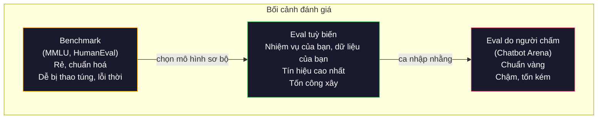
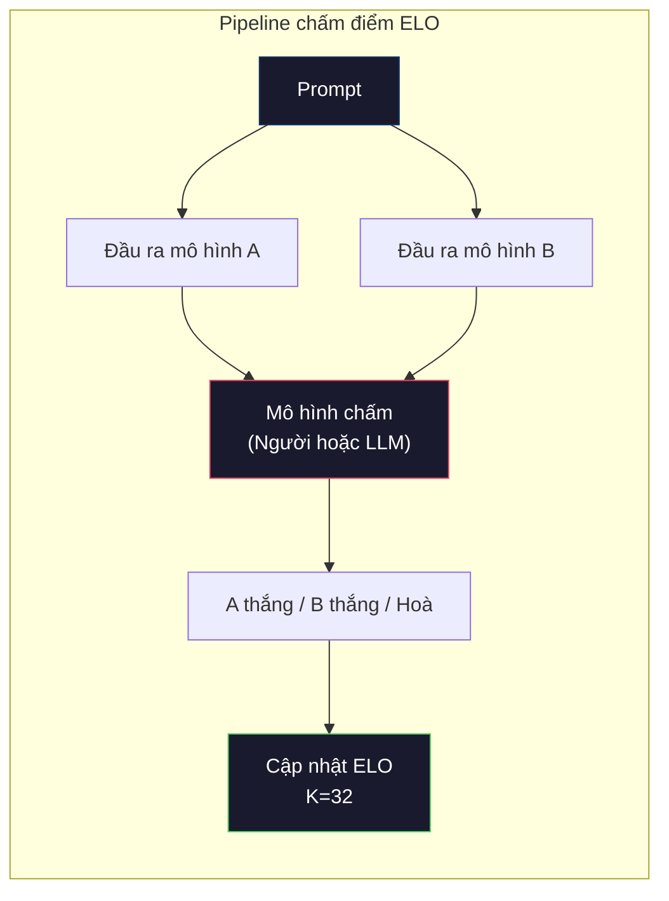

# Đánh giá: Benchmark, eval, LM Harness

> Định luật Goodhart: khi một thước đo trở thành mục tiêu, nó không còn là thước đo tốt nữa. Mọi phòng lab hàng đầu đều chơi benchmark (bộ đánh giá). Điểm MMLU tăng lên trong khi mô hình vẫn không đếm nổi số chữ R trong "strawberry." Bài đánh giá duy nhất có ý nghĩa là bài đánh giá CỦA BẠN -- trên NHIỆM VỤ của bạn, với DỮ LIỆU của bạn.

**Type:** Build
**Languages:** Python
**Prerequisites:** Giai đoạn 10, Bài 01-05 (LLM from scratch)
**Time:** ~90 phút

## Mục tiêu học tập

- Xây một evaluation harness (khung đánh giá) tuỳ biến chạy được cả benchmark trắc nghiệm lẫn benchmark dạng mở trên một mô hình ngôn ngữ
- Giải thích vì sao các benchmark chuẩn (MMLU, HumanEval) bão hoà và không còn phân biệt được các mô hình tiên tiến
- Cài đặt eval theo từng nhiệm vụ với đúng thước đo: exact match, F1, BLEU và chấm điểm bằng LLM-as-judge
- Thiết kế một bộ eval riêng nhắm vào đúng use case của bạn thay vì chỉ dựa vào leaderboard (bảng xếp hạng) công khai

## Vấn đề

MMLU được công bố năm 2020 với 15.908 câu hỏi thuộc 57 chủ đề. Trong vòng ba năm, các mô hình tiên tiến đã bão hoà nó. GPT-4 đạt 86,4%. Claude 3 Opus đạt 86,8%. Llama 3 405B đạt 88,6%. Bảng xếp hạng co lại trong một khoảng 3 điểm, nơi khác biệt chỉ là nhiễu thống kê, không phải khoảng cách năng lực thật.

Trong khi đó, chính những mô hình ấy lại thất bại ở việc mà một đứa trẻ 10 tuổi làm không cần nghĩ. Claude 3.5 Sonnet, đạt 88,7% trên MMLU, lúc đầu không đếm nổi số chữ cái trong "strawberry" -- một việc không cần kiến thức thế giới, không cần suy luận, chỉ cần lặp ở mức ký tự. HumanEval kiểm tra sinh mã với 164 bài. Mô hình đạt 90%+ trên đó trong khi vẫn sinh ra mã chết ở những edge case mà bất kỳ lập trình viên junior nào cũng bắt được.

Khoảng cách giữa hiệu suất trên benchmark và độ tin cậy thực tế là vấn đề trung tâm của việc đánh giá LLM. Benchmark cho bạn biết mô hình làm tốt đến đâu trên chính benchmark đó. Nó gần như không nói gì về việc mô hình sẽ làm ra sao trên nhiệm vụ cụ thể của bạn, với dữ liệu cụ thể của bạn, dưới những kiểu lỗi cụ thể của bạn. Nếu bạn xây bot hỗ trợ khách hàng, MMLU là không liên quan. Nếu bạn xây trợ lý lập trình, HumanEval chỉ phủ phần sinh mã ở mức hàm -- nó không nói gì về gỡ lỗi, refactor, hay giải thích mã xuyên nhiều file.

Bạn cần eval tuỳ biến. Không phải vì benchmark vô dụng -- chúng hữu ích để chọn mô hình sơ bộ -- mà vì bài đánh giá cuối cùng phải khớp chính xác điều kiện triển khai của bạn.

## Khái niệm

### Bối cảnh của việc đánh giá

Có ba nhóm đánh giá, mỗi nhóm có chi phí và chất lượng tín hiệu khác nhau.

**Benchmark** là các bộ đề kiểm tra chuẩn hoá. MMLU, HumanEval, SWE-bench, MATH, ARC, HellaSwag. Bạn chạy mô hình trên benchmark và nhận một điểm. Ưu điểm: ai cũng dùng cùng một đề nên so sánh được các mô hình. Nhược điểm: mô hình và dữ liệu huấn luyện ngày càng làm nhiễm bẩn các benchmark này. Các lab huấn luyện trên dữ liệu có chứa câu hỏi benchmark. Điểm tăng. Năng lực có thể không.

**Eval tuỳ biến** là bộ đề bạn tự xây cho use case cụ thể của mình. Bạn định nghĩa đầu vào, đầu ra mong đợi và hàm chấm điểm. Một công cụ tóm tắt văn bản pháp lý được đánh giá trên văn bản pháp lý. Một công cụ sinh SQL được đánh giá trên schema cơ sở dữ liệu của bạn. Những bộ này tốn công tạo nhưng là bài đánh giá duy nhất dự báo được hiệu suất khi chạy thật.

**Eval do người chấm** dùng người gán nhãn có trả phí để đánh giá đầu ra của mô hình theo các tiêu chí như hữu ích, đúng đắn, trôi chảy và an toàn. Đây là chuẩn vàng cho các nhiệm vụ mở, nơi chấm điểm tự động thất bại. Chatbot Arena đã thu hơn 2 triệu phiếu ưu tiên của con người trên hơn 100 mô hình. Nhược điểm: chi phí ($0.10-$2.00 mỗi lượt chấm) và tốc độ (vài giờ đến vài ngày).



### Vì sao benchmark hỏng

Ba cơ chế khiến điểm benchmark không còn phản ánh năng lực thật.

**Data contamination (nhiễm dữ liệu).** Kho dữ liệu huấn luyện thu thập từ internet. Câu hỏi benchmark nằm trên internet. Mô hình thấy đáp án trong lúc huấn luyện. Đây không phải gian lận theo nghĩa truyền thống -- các lab không cố ý đưa dữ liệu benchmark vào. Nhưng thu thập ở quy mô web khiến việc loại trừ gần như bất khả thi.

**Dạy đúng đề.** Các lab tối ưu hỗn hợp huấn luyện theo hiệu suất benchmark. Nếu 5% hỗn hợp huấn luyện là trắc nghiệm kiểu MMLU, mô hình học được định dạng và phân bố đáp án. MMLU là trắc nghiệm 4 lựa chọn. Mô hình học rằng phân bố đáp án gần như đều trên A/B/C/D, điều này giúp ích cả khi mô hình không biết đáp án.

**Bão hoà.** Khi mọi mô hình tiên tiến đều đạt 85-90% trên một benchmark, benchmark đó không còn phân biệt được nữa. 10-15% câu còn lại có thể nhập nhằng, gán nhãn sai, hoặc đòi kiến thức chuyên ngành hiếm. Đi từ 87% lên 89% trên MMLU có thể chỉ nghĩa là mô hình học thuộc thêm hai câu hiếm, chứ không phải thông minh hơn.

### Perplexity (độ hỗn loạn): kiểm tra sức khoẻ nhanh

Perplexity đo mức độ bất ngờ của mô hình trước một chuỗi token. Về mặt hình thức, nó là exp của trung bình âm log-likelihood:

```
PPL = exp(-1/N * sum(log P(token_i | context)))
```

Perplexity bằng 10 nghĩa là trung bình mô hình bối rối như khi chọn đều giữa 10 lựa chọn ở mỗi vị trí token. Thấp hơn là tốt hơn. GPT-2 đạt perplexity ~30 trên WikiText-103. GPT-3 đạt ~20. Llama 3 8B đạt ~7.

Perplexity hữu ích để so sánh các mô hình trên cùng một tập kiểm tra, nhưng nó có điểm mù. Một mô hình có thể có perplexity thấp nhờ giỏi dự đoán các mẫu phổ biến trong khi rất tệ với các mẫu hiếm nhưng quan trọng. Nó cũng không nói gì về việc tuân theo chỉ dẫn, suy luận, hay độ chính xác thực tế. Hãy dùng nó như một bước kiểm tra nhanh, không phải phán quyết cuối cùng.

### LLM-as-Judge

Dùng một mô hình mạnh để đánh giá đầu ra của một mô hình yếu hơn. Ý tưởng đơn giản: nhờ GPT-4o hoặc Claude Sonnet chấm một câu trả lời theo thang 1-5 về độ đúng, độ hữu ích và độ an toàn. Việc này tốn khoảng $0.01 mỗi lượt chấm với GPT-4o-mini và tương quan đáng ngạc nhiên với đánh giá của con người -- khoảng 80% đồng thuận trên hầu hết nhiệm vụ.

Prompt chấm điểm quan trọng hơn cả mô hình. Một prompt mơ hồ ("Rate this response") cho điểm nhiễu. Một prompt có cấu trúc kèm rubric ("Cho 5 điểm nếu câu trả lời đúng sự thật và có dẫn nguồn, 4 nếu đúng nhưng không nguồn, 3 nếu đúng một phần...") cho điểm nhất quán, tái lập được.

Các kiểu thất bại: judge model (mô hình chấm) có thiên kiến vị trí (thích câu trả lời đứng đầu khi so sánh cặp), thiên kiến dài dòng (thích câu trả lời dài hơn), và thiên vị bản thân (GPT-4 chấm đầu ra của GPT-4 cao hơn đầu ra tương đương của Claude). Cách giảm thiểu: xáo trộn thứ tự, chuẩn hoá theo độ dài, dùng mô hình chấm khác với mô hình đang được đánh giá.

### Xếp hạng ELO từ so sánh cặp

Đây là cách Chatbot Arena làm. Đưa hai câu trả lời cho cùng một prompt từ hai mô hình khác nhau. Một người (hoặc một LLM chấm) chọn câu tốt hơn. Từ hàng nghìn so sánh như vậy, tính điểm ELO cho từng mô hình -- đúng hệ thống dùng trong cờ vua.

Ưu điểm của ELO: xếp hạng tương đối đáng tin hơn chấm điểm tuyệt đối, xử lý hoà một cách nhẹ nhàng, và hội tụ với ít so sánh hơn so với chấm điểm từng đầu ra riêng lẻ. Tính đến đầu năm 2026, bảng xếp hạng Chatbot Arena cho thấy GPT-4o, Claude 3.5 Sonnet và Gemini 1.5 Pro chỉ cách nhau trong 20 điểm ELO ở nhóm đầu.



### Các framework đánh giá

**lm-evaluation-harness** (EleutherAI): framework đánh giá mã nguồn mở chuẩn. Hỗ trợ hơn 200 benchmark. Chạy bất kỳ mô hình Hugging Face nào trên MMLU, HellaSwag, ARC, v.v. bằng một lệnh. Được Open LLM Leaderboard dùng.

**RAGAS**: framework đánh giá dành riêng cho pipeline RAG. Đo độ trung thành (câu trả lời có khớp ngữ cảnh truy xuất được không?), độ liên quan (ngữ cảnh truy xuất được có liên quan đến câu hỏi không?), và độ đúng của câu trả lời.

**promptfoo**: eval điều khiển bằng cấu hình cho prompt engineering. Định nghĩa test case trong YAML, chạy trên nhiều mô hình, nhận báo cáo pass/fail. Hữu ích để kiểm tra hồi quy prompt -- bảo đảm một thay đổi prompt không phá các test case đang có.

### Xây eval tuỳ biến

Bài đánh giá duy nhất có ý nghĩa cho môi trường thật. Quy trình:

1. **Định nghĩa nhiệm vụ.** Chính xác mô hình nên làm gì? Hãy cụ thể. "Trả lời câu hỏi" quá mơ hồ. "Cho một email phàn nàn của khách, trích ra tên sản phẩm, nhóm vấn đề và cảm xúc" là nhiệm vụ bạn đánh giá được.

2. **Tạo test case.** Tối thiểu 50 cho eval thử nghiệm, 200+ cho production. Mỗi test case là một cặp (đầu vào, đầu ra mong đợi). Bao gồm edge case: đầu vào rỗng, đầu vào đối kháng, đầu vào nhập nhằng, đầu vào bằng ngôn ngữ khác.

3. **Định nghĩa cách chấm điểm.** Exact match cho đầu ra có cấu trúc. BLEU/ROUGE cho độ tương đồng văn bản. LLM-as-judge cho chất lượng mở. F1 cho nhiệm vụ trích xuất. Kết hợp nhiều thước đo với trọng số.

4. **Tự động hoá.** Mọi eval chạy bằng một lệnh. Không bước thủ công. Lưu kết quả ở định dạng cho phép so sánh theo thời gian.

5. **Theo dõi theo thời gian.** Điểm eval đứng một mình thì vô nghĩa. Bạn cần đường xu hướng. Điểm có tăng sau lần đổi prompt trước không? Có giảm sau khi đổi mô hình không? Đánh phiên bản cho eval song song với prompt.

| Loại eval | Chi phí mỗi lượt chấm | Đồng thuận với con người | Phù hợp nhất |
|-----------|------------------|----------------------|----------|
| Exact match | ~$0 | 100% (khi áp dụng được) | Đầu ra có cấu trúc, phân loại |
| BLEU/ROUGE | ~$0 | ~60% | Dịch, tóm tắt |
| LLM-as-judge | ~$0.01 | ~80% | Sinh văn bản mở |
| Human eval | $0.10-$2.00 | N/A (chính là chuẩn đúng) | Nhiệm vụ nhập nhằng, rủi ro cao |

```figure
perplexity-loss
```

## Tự tay làm

### Bước 1: Một framework eval tối giản

Định nghĩa các trừu tượng cốt lõi. Một eval case có đầu vào, đầu ra mong đợi và một dict metadata tuỳ chọn. Một scorer nhận dự đoán và tham chiếu rồi trả về điểm trong khoảng 0 đến 1.

```python
import json
from collections import Counter

class EvalCase:
    def __init__(self, input_text, expected, metadata=None):
        self.input_text = input_text
        self.expected = expected
        self.metadata = metadata or {}

class EvalSuite:
    def __init__(self, name, cases, scorers):
        self.name = name
        self.cases = cases
        self.scorers = scorers

    def run(self, model_fn):
        results = []
        for case in self.cases:
            prediction = model_fn(case.input_text)
            scores = {}
            for scorer_name, scorer_fn in self.scorers.items():
                scores[scorer_name] = scorer_fn(prediction, case.expected)
            results.append({
                "input": case.input_text,
                "expected": case.expected,
                "prediction": prediction,
                "scores": scores,
            })
        return results
```

### Bước 2: Các hàm chấm điểm

Xây exact match, token F1 và một scorer LLM-as-judge mô phỏng.

```python
def exact_match(prediction, expected):
    return 1.0 if prediction.strip().lower() == expected.strip().lower() else 0.0

def token_f1(prediction, expected):
    pred_tokens = set(prediction.lower().split())
    exp_tokens = set(expected.lower().split())
    if not pred_tokens or not exp_tokens:
        return 0.0
    common = pred_tokens & exp_tokens
    precision = len(common) / len(pred_tokens)
    recall = len(common) / len(exp_tokens)
    if precision + recall == 0:
        return 0.0
    return 2 * (precision * recall) / (precision + recall)

def llm_judge_simulated(prediction, expected):
    pred_words = set(prediction.lower().split())
    exp_words = set(expected.lower().split())
    if not exp_words:
        return 0.0
    overlap = len(pred_words & exp_words) / len(exp_words)
    length_penalty = min(1.0, len(prediction) / max(len(expected), 1))
    return round(overlap * 0.7 + length_penalty * 0.3, 3)
```

### Bước 3: Hệ thống xếp hạng ELO

Cài đặt so sánh cặp với cập nhật ELO. Đây chính là hệ thống Chatbot Arena dùng để xếp hạng mô hình.

```python
class ELOTracker:
    def __init__(self, k=32, initial_rating=1500):
        self.ratings = {}
        self.k = k
        self.initial_rating = initial_rating
        self.history = []

    def _ensure_player(self, name):
        if name not in self.ratings:
            self.ratings[name] = self.initial_rating

    def expected_score(self, rating_a, rating_b):
        return 1 / (1 + 10 ** ((rating_b - rating_a) / 400))

    def record_match(self, player_a, player_b, outcome):
        self._ensure_player(player_a)
        self._ensure_player(player_b)

        ea = self.expected_score(self.ratings[player_a], self.ratings[player_b])
        eb = 1 - ea

        if outcome == "a":
            sa, sb = 1.0, 0.0
        elif outcome == "b":
            sa, sb = 0.0, 1.0
        else:
            sa, sb = 0.5, 0.5

        self.ratings[player_a] += self.k * (sa - ea)
        self.ratings[player_b] += self.k * (sb - eb)

        self.history.append({
            "a": player_a, "b": player_b,
            "outcome": outcome,
            "rating_a": round(self.ratings[player_a], 1),
            "rating_b": round(self.ratings[player_b], 1),
        })

    def leaderboard(self):
        return sorted(self.ratings.items(), key=lambda x: -x[1])
```

### Bước 4: Tính perplexity

Tính perplexity từ xác suất token. Trong thực tế bạn lấy chúng từ logits của mô hình. Ở đây ta mô phỏng bằng một phân bố xác suất.

```python
import numpy as np

def perplexity(log_probs):
    if not log_probs:
        return float("inf")
    avg_neg_log_prob = -np.mean(log_probs)
    return float(np.exp(avg_neg_log_prob))

def token_log_probs_simulated(text, model_quality=0.8):
    np.random.seed(hash(text) % 2**31)
    tokens = text.split()
    log_probs = []
    for i, token in enumerate(tokens):
        base_prob = model_quality
        if len(token) > 8:
            base_prob *= 0.6
        if i == 0:
            base_prob *= 0.7
        prob = np.clip(base_prob + np.random.normal(0, 0.1), 0.01, 0.99)
        log_probs.append(float(np.log(prob)))
    return log_probs
```

### Bước 5: Tổng hợp kết quả

Tính thống kê tóm tắt cho một lượt eval: trung bình, trung vị, tỷ lệ đạt theo ngưỡng, và phân rã theo từng thước đo.

```python
def summarize_results(results, threshold=0.8):
    all_scores = {}
    for r in results:
        for metric, score in r["scores"].items():
            all_scores.setdefault(metric, []).append(score)

    summary = {}
    for metric, scores in all_scores.items():
        arr = np.array(scores)
        summary[metric] = {
            "mean": round(float(np.mean(arr)), 3),
            "median": round(float(np.median(arr)), 3),
            "std": round(float(np.std(arr)), 3),
            "min": round(float(np.min(arr)), 3),
            "max": round(float(np.max(arr)), 3),
            "pass_rate": round(float(np.mean(arr >= threshold)), 3),
            "n": len(scores),
        }
    return summary

def print_summary(summary, suite_name="Eval"):
    print(f"\n{'=' * 60}")
    print(f"  {suite_name} Summary")
    print(f"{'=' * 60}")
    for metric, stats in summary.items():
        print(f"\n  {metric}:")
        print(f"    Mean:      {stats['mean']:.3f}")
        print(f"    Median:    {stats['median']:.3f}")
        print(f"    Std:       {stats['std']:.3f}")
        print(f"    Range:     [{stats['min']:.3f}, {stats['max']:.3f}]")
        print(f"    Pass rate: {stats['pass_rate']:.1%} (threshold >= 0.8)")
        print(f"    N:         {stats['n']}")
```

### Bước 6: Chạy toàn bộ pipeline

Nối mọi thứ lại. Định nghĩa một nhiệm vụ, tạo test case, mô phỏng hai mô hình, chạy eval, tính ELO từ so sánh cặp và in bảng xếp hạng.

```python
def demo_model_good(prompt):
    responses = {
        "What is the capital of France?": "Paris",
        "What is 2 + 2?": "4",
        "Who wrote Hamlet?": "William Shakespeare",
        "What language is PyTorch written in?": "Python and C++",
        "What is the boiling point of water?": "100 degrees Celsius",
    }
    return responses.get(prompt, "I don't know")

def demo_model_bad(prompt):
    responses = {
        "What is the capital of France?": "Paris is the capital city of France",
        "What is 2 + 2?": "The answer is four",
        "Who wrote Hamlet?": "Shakespeare",
        "What language is PyTorch written in?": "Python",
        "What is the boiling point of water?": "212 Fahrenheit",
    }
    return responses.get(prompt, "Unknown")

cases = [
    EvalCase("What is the capital of France?", "Paris"),
    EvalCase("What is 2 + 2?", "4"),
    EvalCase("Who wrote Hamlet?", "William Shakespeare"),
    EvalCase("What language is PyTorch written in?", "Python and C++"),
    EvalCase("What is the boiling point of water?", "100 degrees Celsius"),
]

suite = EvalSuite(
    name="General Knowledge",
    cases=cases,
    scorers={
        "exact_match": exact_match,
        "token_f1": token_f1,
        "llm_judge": llm_judge_simulated,
    },
)

results_good = suite.run(demo_model_good)
results_bad = suite.run(demo_model_bad)

print_summary(summarize_results(results_good), "Model A (concise)")
print_summary(summarize_results(results_bad), "Model B (verbose)")
```

Mô hình "tốt" đưa đáp án chính xác. Mô hình "tệ" đưa câu diễn giải dài dòng. Exact match trừng phạt mô hình dài dòng rất nặng. Token F1 và LLM-as-judge dễ tính hơn. Điều này cho thấy vì sao chọn thước đo lại quan trọng: cùng một mô hình trông rất tốt hoặc rất tệ tuỳ cách bạn chấm.

### Bước 7: Giải đấu ELO

Chạy so sánh cặp giữa các mô hình qua nhiều vòng.

```python
elo = ELOTracker(k=32)

for case in cases:
    pred_a = demo_model_good(case.input_text)
    pred_b = demo_model_bad(case.input_text)

    score_a = token_f1(pred_a, case.expected)
    score_b = token_f1(pred_b, case.expected)

    if score_a > score_b:
        outcome = "a"
    elif score_b > score_a:
        outcome = "b"
    else:
        outcome = "tie"

    elo.record_match("model_a_concise", "model_b_verbose", outcome)

print("\nELO Leaderboard:")
for name, rating in elo.leaderboard():
    print(f"  {name}: {rating:.0f}")
```

### Bước 8: So sánh perplexity

So sánh perplexity giữa các "mô hình" có mức chất lượng khác nhau.

```python
test_text = "The quick brown fox jumps over the lazy dog in the garden"

for quality, label in [(0.9, "Strong model"), (0.7, "Medium model"), (0.4, "Weak model")]:
    log_probs = token_log_probs_simulated(test_text, model_quality=quality)
    ppl = perplexity(log_probs)
    print(f"  {label} (quality={quality}): perplexity = {ppl:.2f}")
```

## Áp dụng

### lm-evaluation-harness (EleutherAI)

Công cụ chuẩn để chạy benchmark trên bất kỳ mô hình nào.

```python
# pip install lm-eval
# Command line:
# lm_eval --model hf --model_args pretrained=meta-llama/Llama-3.1-8B --tasks mmlu --batch_size 8

# Python API:
# import lm_eval
# results = lm_eval.simple_evaluate(
#     model="hf",
#     model_args="pretrained=meta-llama/Llama-3.1-8B",
#     tasks=["mmlu", "hellaswag", "arc_easy"],
#     batch_size=8,
# )
# print(results["results"])
```

### promptfoo

Eval điều khiển bằng cấu hình cho prompt engineering. Định nghĩa test trong YAML và chạy trên nhiều provider.

```yaml
# promptfoo.yaml
providers:
  - openai:gpt-4o-mini
  - anthropic:claude-3-haiku

prompts:
  - "Answer in one word: {{question}}"

tests:
  - vars:
      question: "What is the capital of France?"
    assert:
      - type: contains
        value: "Paris"
  - vars:
      question: "What is 2 + 2?"
    assert:
      - type: equals
        value: "4"
```

### RAGAS cho đánh giá RAG

```python
# pip install ragas
# from ragas import evaluate
# from ragas.metrics import faithfulness, answer_relevancy, context_precision
#
# result = evaluate(
#     dataset,
#     metrics=[faithfulness, answer_relevancy, context_precision],
# )
# print(result)
```

RAGAS đo những gì eval chung bỏ sót: liệu câu trả lời của mô hình có bám vào ngữ cảnh truy xuất được hay không, chứ không chỉ là câu trả lời có "đúng" một cách trừu tượng hay không.

## Đóng gói

Bài này tạo ra `outputs/prompt-eval-designer.md` -- một prompt tái sử dụng để thiết kế bộ eval tuỳ biến cho bất kỳ nhiệm vụ nào. Đưa vào mô tả nhiệm vụ, nó sinh test case, hàm chấm điểm và khuyến nghị ngưỡng pass/fail.

Nó cũng tạo ra `outputs/skill-llm-evaluation.md` -- một khung quyết định để chọn chiến lược đánh giá phù hợp dựa trên loại nhiệm vụ, ngân sách và yêu cầu độ trễ.

## Bài tập

1. Thêm một scorer "độ nhất quán" chạy cùng một đầu vào qua mô hình 5 lần và đo tần suất các đầu ra khớp nhau. Câu trả lời không nhất quán trên đầu vào tất định cho thấy prompt mong manh hoặc cấu hình temperature cao.

2. Mở rộng bộ theo dõi ELO để hỗ trợ nhiều hàm chấm (exact match, F1, LLM-as-judge) và gán trọng số cho chúng. So sánh bảng xếp hạng thay đổi ra sao khi bạn cho exact match trọng số lớn so với khi cho F1 trọng số lớn.

3. Xây một bộ eval cho nhiệm vụ cụ thể: phân loại email vào 5 nhóm. Tạo 100 test case với ví dụ đa dạng, gồm cả edge case (email có thể thuộc nhiều nhóm, email rỗng, email bằng ngôn ngữ khác). Đo hiệu suất của các "mô hình" khác nhau (dựa trên luật, khớp từ khoá, LLM mô phỏng).

4. Cài đặt phát hiện nhiễm dữ liệu: cho một tập câu hỏi eval và một kho dữ liệu huấn luyện, kiểm tra bao nhiêu phần trăm câu hỏi eval (hoặc bản diễn giải gần) xuất hiện trong dữ liệu huấn luyện. Đây là cách các nhà nghiên cứu kiểm tra tính hợp lệ của benchmark.

5. Xây một công cụ "model diff". Cho kết quả eval của hai phiên bản mô hình, làm nổi bật test case nào cải thiện, case nào giảm, case nào giữ nguyên. Đây là bản tương đương của code diff cho eval -- cần thiết để hiểu một thay đổi giúp hay hại.

## Thuật ngữ chính

| Thuật ngữ | Người ta thường nói | Ý nghĩa thực sự |
|------|----------------|----------------------|
| MMLU | "Cái benchmark" | Massive Multitask Language Understanding -- 15.908 câu trắc nghiệm trên 57 chủ đề, bị bão hoà trên 88% từ 2025 |
| HumanEval | "Eval code" | 164 bài hoàn thiện hàm Python từ OpenAI, chỉ kiểm tra sinh hàm đơn lẻ |
| SWE-bench | "Eval lập trình thật" | 2.294 issue GitHub từ 12 repo Python, đo việc sửa lỗi đầu-cuối gồm cả sinh test |
| Perplexity | "Mô hình bối rối đến đâu" | exp(-avg(log P(token_i given context))) -- thấp hơn nghĩa là mô hình gán xác suất cao hơn cho các token thực tế |
| ELO rating | "Xếp hạng cờ vua cho mô hình" | Điểm kỹ năng tương đối tính từ bản thắng/thua theo cặp, được Chatbot Arena dùng để xếp hạng hơn 100 mô hình |
| LLM-as-judge | "Dùng AI chấm AI" | Một mô hình mạnh chấm đầu ra của mô hình yếu hơn theo rubric, đồng thuận ~80% với người chấm ở mức ~$0.01/lượt |
| Data contamination | "Mô hình đã thấy đề" | Dữ liệu huấn luyện chứa câu hỏi benchmark, làm điểm phồng lên mà không tăng năng lực thật |
| Eval suite | "Một đống test" | Tập hợp có đánh phiên bản gồm các bộ ba (đầu vào, đầu ra mong đợi, scorer) đo một năng lực cụ thể |
| Pass rate | "Đúng bao nhiêu phần trăm" | Tỷ lệ eval case đạt trên một ngưỡng -- hữu ích hơn điểm trung bình vì đo độ tin cậy |
| Chatbot Arena | "Trang web xếp hạng mô hình" | Nền tảng LMSYS với hơn 2 triệu phiếu ưu tiên của người, tạo ra bảng xếp hạng LLM đáng tin nhất qua điểm ELO |

## Đọc thêm

- [Hendrycks et al., 2021 -- "Measuring Massive Multitask Language Understanding"](https://arxiv.org/abs/2009.03300) -- bài báo MMLU, vẫn là benchmark LLM được trích dẫn nhiều nhất dù đã bão hoà
- [Chen et al., 2021 -- "Evaluating Large Language Models Trained on Code"](https://arxiv.org/abs/2107.03374) -- bài báo HumanEval từ OpenAI, đặt ra phương pháp đánh giá sinh mã
- [Zheng et al., 2023 -- "Judging LLM-as-a-Judge"](https://arxiv.org/abs/2306.05685) -- phân tích có hệ thống việc dùng LLM để đánh giá LLM, gồm phát hiện về thiên kiến vị trí và thiên kiến dài dòng
- [Arena (formerly LMSYS Chatbot Arena)](https://arena.ai/leaderboard) -- nền tảng so sánh mô hình do cộng đồng đóng góp với hơn 2 triệu phiếu, bảng xếp hạng LLM thực tế đáng tin nhất

---

[← Bài trước: Constitutional AI (AI theo hiến chương) và Self-Improvement (tự cải thiện)](../../09-constitutional-ai-self-improvement/docs/vi.md) · [Bài sau: Lượng tử hoá: làm mô hình vừa vặn →](../../11-quantization/docs/vi.md)
