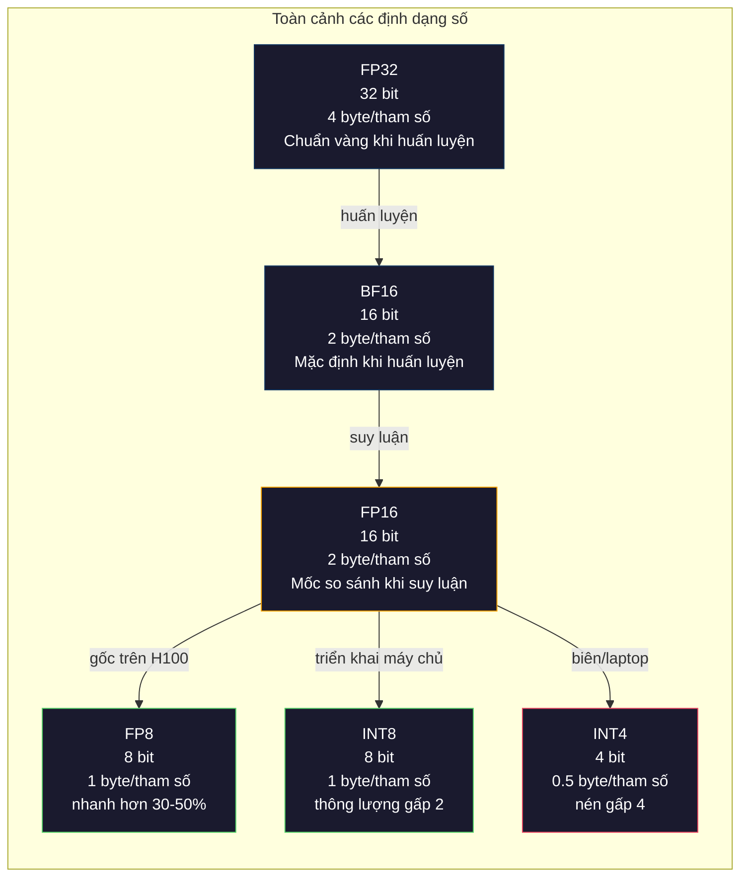
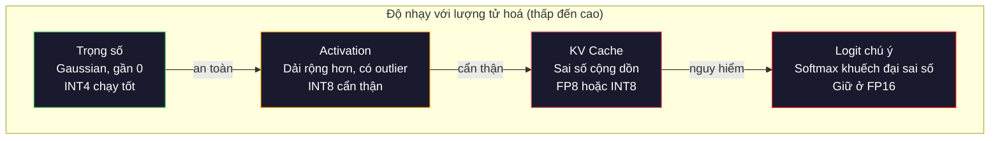
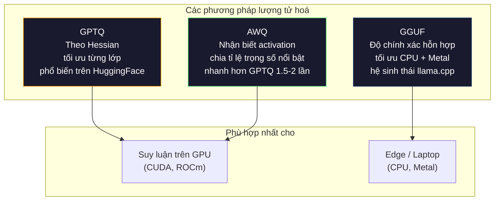

# Lượng tử hoá: làm mô hình vừa vặn

> Một mô hình 70B ở FP16 cần 140GB. Hai chiếc A100 chỉ để chứa trọng số. Lượng tử hoá xuống FP8: một GPU 80GB. INT4: một chiếc MacBook.

**Type:** Build
**Languages:** Python (with numpy)
**Prerequisites:** Giai đoạn 10, Bài 01-10 (LLM from scratch)
**Time:** ~120 phút

## Mục tiêu học tập

- Cài đặt lượng tử hoá đối xứng và bất đối xứng từ FP16 xuống INT8 và INT4, gồm cả chia tỉ lệ per-tensor và per-channel (theo từng kênh)
- Tính mức tiết kiệm bộ nhớ nhờ lượng tử hoá và xác định độ chính xác nào vừa với VRAM của một GPU cụ thể
- Giải thích khác biệt giữa lượng tử hoá sau huấn luyện (PTQ) và huấn luyện có nhận biết lượng tử hoá (QAT)
- Áp dụng GPTQ hoặc AWQ để lượng tử hoá một mô hình thật và đo đánh đổi độ chính xác - bộ nhớ trên một benchmark

## Vấn đề

Llama 3 70B có 70 tỉ tham số. Mỗi tham số là một số dấu phẩy động 16 bit. Đó là 140 tỉ byte. 140GB. Một chiếc A100 chỉ có 80GB VRAM. Bạn thậm chí không nạp nổi trọng số, chưa nói tới chạy suy luận, trên một GPU. Bạn cần hai chiếc A100, mỗi chiếc $2/giờ, chỉ để phục vụ một mô hình.

Nhưng 16 bit cho mỗi tham số là lãng phí. Hầu hết trọng số trong mạng nơ-ron tập trung quanh 0. Toàn bộ dải động của FP16 (từ 0.000000059 đến 65,504) gần như không được dùng. Nếu bạn đo phân bố thật của trọng số trong Llama 3 70B, 95% nằm giữa -0.1 và +0.1. Bạn đang đốt 16 bit để biểu diễn những giá trị có thể vừa trong 4 bit.

Quantization (lượng tử hoá) thay các số có độ chính xác cao bằng những số có độ chính xác thấp hơn. FP16 xuống FP8 giảm một nửa bộ nhớ. FP16 xuống INT4 giảm còn một phần tư. Mô hình 140GB đó thành 35GB. Nó vừa trên một GPU tiêu dùng. Đẩy tới lượng tử hoá 2 bit (mạnh tay, mất mát, nhưng dùng được cho một số tác vụ) và cùng mô hình đó chạy trên một laptop 16GB.

Cái giá là độ chính xác. Mỗi bit bạn bỏ đi đều phá huỷ thông tin. Câu hỏi là bạn mất bao nhiêu độ chính xác và mất ở đâu. Một mô hình INT4 được lượng tử hoá tốt vẫn giữ 95-99% chất lượng của bản gốc trên hầu hết benchmark. Lượng tử hoá ngây thơ xuống INT4 có thể phá huỷ mô hình hoàn toàn. Khác biệt nằm ở kỹ thuật.

Các bản lượng tử hoá cộng đồng của Llama 3 xuống INT4 bằng GPTQ cho thấy mất khoảng 1-2 điểm perplexity trên WikiText. Mistral phát hành checkpoint FP8 của Mixtral 8x22B với mức mất chất lượng không đo được trên MMLU. Định dạng GGUF chạy llama.cpp, đưa mô hình 70B lên MacBook dùng chip M-series. Lượng tử hoá không phải là mẹo vặt. Đó là con đường triển khai chuẩn cho mọi mô hình lớn hơn 7B.

## Khái niệm

### Định dạng số: mỗi bit làm gì

Mỗi số dấu phẩy động có ba phần: dấu, số mũ và phần định trị (còn gọi là significand). Dấu là một bit. Số mũ quyết định dải (số có thể lớn hay nhỏ đến đâu). Phần định trị quyết định độ chính xác (bạn được bao nhiêu chữ số thập phân).

```
FP32:  [1 sign] [8 exponent] [23 mantissa]  = 32 bits
FP16:  [1 sign] [5 exponent] [10 mantissa]  = 16 bits
BF16:  [1 sign] [8 exponent] [7  mantissa]  = 16 bits
FP8:   [1 sign] [4 exponent] [3  mantissa]  = 8  bits (E4M3)
FP8:   [1 sign] [5 exponent] [2  mantissa]  = 8  bits (E5M2)
INT8:  [1 sign] [7 value]                   = 8  bits (uniform steps)
INT4:  [1 sign] [3 value]                   = 4  bits (16 levels total)
```

**FP32** là độ chính xác đầy đủ. 23 bit định trị cho bạn khoảng 7 chữ số thập phân. Dải: khoảng 1.2 x 10^-38 đến 3.4 x 10^38. Trước đây huấn luyện diễn ra hoàn toàn ở FP32. Đến nay vẫn vậy cho phép tích luỹ (cộng dồn trong lúc nhân ma trận).

**FP16** giảm một nửa số bit. 10 bit định trị cho khoảng 3.3 chữ số thập phân. Số mũ co còn 5 bit, thu hẹp dải rất mạnh (giá trị lớn nhất ~65,504). Điều này ổn cho trọng số (vốn tập trung quanh 0) nhưng nguy hiểm cho activation và gradient có thể vọt lên trong huấn luyện. Huấn luyện FP16 cần loss scaling để tránh underflow.

**BF16** (Brain Float 16) giữ số mũ 8 bit của FP32 nhưng co phần định trị xuống 7 bit. Cùng dải với FP32, độ chính xác kém hơn FP16. Google thiết kế nó riêng cho học sâu. Trực giác: với mạng nơ-ron, dải quan trọng hơn độ chính xác. Một gradient 10^-20 bị underflow về 0 trong FP16 thì vẫn sống trong BF16. Một trọng số 0.07342 làm tròn thành 0.0734 trong BF16 là đủ gần. Mọi lần huấn luyện hiện đại đều dùng BF16 hoặc hỗn hợp BF16/FP32.

**FP8** có hai biến thể. E4M3 (4 số mũ, 3 định trị) dùng cho trọng số và activation khi suy luận. E5M2 (5 số mũ, 2 định trị) dùng cho gradient khi huấn luyện, nơi dải quan trọng hơn độ chính xác. Suy luận FP8 trên GPU H100 nhanh hơn 30-50% so với FP16 với mức mất chất lượng không đáng kể.

**INT8** (số nguyên 8 bit) là định dạng số nguyên. Không số mũ, không phần định trị. Chỉ 256 giá trị cách đều từ -128 đến 127. Bạn cần một scale factor (hệ số tỉ lệ) để ánh xạ trọng số dấu phẩy động vào dải này. Lợi thế: số học số nguyên nhanh hơn và tiết kiệm điện hơn số dấu phẩy động. Nhân ma trận INT8 trên A100 chạy 624 TOPS so với 312 TFLOPS của FP16.

**INT4** đi xa hơn. Chỉ 16 giá trị khả dĩ. Scale factor phải gánh phần lớn công việc. Chất lượng phụ thuộc hoàn toàn vào cách bạn chọn scale và trọng số nào bạn lượng tử hoá. Các phương pháp INT4 hiện đại nhất (GPTQ, AWQ) giữ được hơn 95% chất lượng mô hình gốc.



### Cách lượng tử hoá hoạt động

Thao tác cốt lõi rất đơn giản. Lấy một tensor giá trị dấu phẩy động, tìm một scale factor, nhân, làm tròn về số nguyên gần nhất, rồi lưu các số nguyên đó cùng scale factor.

**Lượng tử hoá:**
```
scale = max(abs(tensor)) / max_int_value
quantized = round(tensor / scale)
```

**Dequantization** (giải lượng tử):
```
reconstructed = quantized * scale
```

Với INT8 có dải đối xứng (-127 đến 127):
```
scale = max(abs(tensor)) / 127
quantized = clamp(round(tensor / scale), -128, 127)
```

Sai số là sai số làm tròn. Mỗi giá trị có thể lệch tối đa `scale / 2`. Tổng sai số trên một lớp phụ thuộc vào số trọng số bạn có và độ nhạy của mô hình với nhiễu loạn trên những trọng số đó.

**Lượng tử hoá per-tensor so với per-channel.** Per-tensor dùng một scale factor cho toàn bộ ma trận trọng số. Đơn giản nhưng mất mát: nếu một cột có giá trị lớn còn cột khác có giá trị nhỏ, các giá trị nhỏ mất phần lớn độ chính xác. Per-channel dùng một scale factor cho mỗi kênh đầu ra (mỗi hàng hoặc mỗi cột của ma trận trọng số). Tốn thêm chút chi phí lưu trữ (bạn lưu N scale factor thay vì 1) nhưng chất lượng tốt hơn hẳn. Mọi phương pháp lượng tử hoá trong sản xuất đều dùng per-channel hoặc chia mịn hơn.

**Lượng tử hoá bất đối xứng** thêm một độ lệch zero point (điểm không): `quantized = round(tensor / scale) + zero_point`. Cách này xử lý các phân bố không lấy 0 làm tâm. Ví dụ activation ReLU luôn không âm. Lượng tử hoá đối xứng phí mất nửa dải số nguyên cho các giá trị âm không bao giờ xuất hiện. Lượng tử hoá bất đối xứng ánh xạ dải thật [min, max] vào toàn bộ dải số nguyên.

### Thứ bậc độ nhạy

Không phải mọi thứ trong mô hình đều chịu lượng tử hoá như nhau. Có một thứ bậc rõ ràng.

**Trọng số (bền nhất).** Trọng số mô hình thay đổi chậm trong huấn luyện và tuân theo phân bố gần Gaussian lấy 0 làm tâm. Chúng lượng tử hoá tốt. Trọng số INT8 với scale per-channel cho kết quả gần như không mất mát. INT4 cần phương pháp tinh vi hơn nhưng vẫn chạy được.

**Activation (nhạy vừa).** Activation là các giá trị trung gian chảy qua mạng khi suy luận. Chúng có dải động rộng hơn trọng số và chứa outlier. Một đầu chú ý đơn lẻ có thể tạo ra giá trị activation lớn gấp 100 lần trung bình. Những outlier này rất quan trọng với chất lượng mô hình. Lượng tử hoá ngây thơ chúng sẽ phá huỷ thông tin. Giải pháp: giữ các kênh outlier ở độ chính xác cao hơn (LLM.int8()), dùng scale activation per-token hoặc per-channel.

**KV cache (nhạy cao).** Bộ nhớ đệm key-value lưu trạng thái chú ý cho mọi token trước đó. Với ngữ cảnh dài, KV cache chiếm phần lớn bộ nhớ. Với mô hình 70B ở ngữ cảnh 32K, riêng KV cache đã là 40GB ở FP16. Lượng tử hoá KV cache xuống FP8 hoặc INT8 tiết kiệm bộ nhớ rất lớn nhưng mọi sai số đều cộng dồn qua tất cả phép tính chú ý về sau. Tác động lên chất lượng tăng theo độ dài chuỗi.

**Logit chú ý (nhạy nhất).** Hàm softmax trong cơ chế chú ý rất nhạy với thay đổi nhỏ ở đầu vào. Sai số lượng tử hoá 0.01 ở một logit trước softmax có thể dịch chuyển phân bố chú ý đáng kể. Hầu hết sơ đồ lượng tử hoá giữ phần tính chú ý ở độ chính xác cao hơn (FP16 hoặc BF16) kể cả khi mọi thứ khác đã bị lượng tử hoá.



### PTQ so với QAT

**Lượng tử hoá sau huấn luyện (PTQ)** lượng tử hoá một mô hình đã huấn luyện xong. Không huấn luyện lại. Bạn lấy trọng số FP16, tính scale factor, làm tròn rồi triển khai. Nhanh (vài phút đến vài giờ) và rẻ. Hiệu quả với INT8 và FP8. Với INT4, PTQ ngây thơ thường thất bại nặng vì sai số làm tròn cộng dồn. Các phương pháp PTQ tiên tiến (GPTQ, AWQ) dùng dữ liệu calibration (hiệu chuẩn) để tối thiểu hoá sai số lượng tử hoá.

**Huấn luyện có nhận biết lượng tử hoá (QAT)** chèn các phép lượng tử hoá giả vào lượt truyền xuôi trong huấn luyện. Mô hình học cách đặt trọng số ở nơi sai số làm tròn nhỏ. Gradient chảy qua phép lượng tử hoá giả nhờ straight-through estimator (STE): giả vờ rằng phép làm tròn có gradient bằng 1. QAT cho mô hình INT4 và INT2 tốt hơn PTQ nhưng cần một lần huấn luyện đầy đủ. Google dùng QAT cho việc phục vụ tiết kiệm của Gemini. Meta dùng QAT cho một số đích triển khai Llama.

| Khía cạnh | PTQ | QAT |
|--------|-----|-----|
| Chi phí | Vài phút đến vài giờ | Một lần huấn luyện đầy đủ |
| Chất lượng ở INT8 | Xuất sắc (mất < 0.1%) | Xuất sắc |
| Chất lượng ở INT4 | Tốt với GPTQ/AWQ (mất 1-3%) | Tốt hơn (mất < 1%) |
| Chất lượng ở INT2 | Kém | Dùng được cho một số tác vụ |
| Dữ liệu hiệu chuẩn | 128-1024 ví dụ | Toàn bộ tập huấn luyện |
| Khi nào dùng | Triển khai, lặp nhanh | Chất lượng tối đa ở độ rộng bit thấp |

### GPTQ, AWQ, GGUF

**GPTQ (GPT Quantization)** là một phương pháp PTQ một lần. Nó lượng tử hoá trọng số từng lớp một, dùng một tập dữ liệu hiệu chuẩn nhỏ (128 ví dụ là mức điển hình) để đo Hessian (thông tin bậc hai về mức độ nhạy của đầu ra với từng trọng số). Những trọng số mà Hessian cho là quan trọng sẽ được lượng tử hoá cẩn thận hơn. GPTQ là phương pháp đầu tiên đưa lượng tử hoá INT4 tới mức thực dụng cho LLM. TheBloke trên Hugging Face phổ biến GPTQ bằng cách phát hành các bản lượng tử hoá của hàng trăm mô hình.

**AWQ (Activation-Aware Weight Quantization)** nhận thấy một phần nhỏ trọng số (khoảng 1%) quan trọng không tương xứng vì chúng nhân với những giá trị activation lớn. AWQ xác định các trọng số nổi bật này bằng dữ liệu hiệu chuẩn rồi phóng to chúng trước khi lượng tử hoá (sau đó thu nhỏ activation tương ứng). Cách này giữ các trọng số quan trọng trong dải mà lượng tử hoá INT4 còn chính xác. AWQ thường ngang hoặc nhỉnh hơn GPTQ một chút về chất lượng, trong khi áp dụng nhanh hơn 1.5-2 lần.

**GGUF (GPT-Generated Unified Format)** là định dạng file mà llama.cpp và hệ sinh thái của nó dùng. Nó hỗ trợ lượng tử hoá hỗn hợp: các lớp khác nhau nhận độ rộng bit khác nhau. Lớp đầu và lớp cuối (embedding và đầu ra) thường được giữ ở độ chính xác cao hơn. Các lớp giữa nhận INT4 hoặc INT3. File GGUF tự chứa mọi thứ: trọng số, tokenizer, metadata trong cùng một file. Định dạng này được thiết kế cho suy luận trên CPU và Apple Silicon, nơi nạp toàn bộ mô hình vào bộ nhớ và chạy nhân ma trận trên CPU hoặc GPU Metal là con đường chuẩn. Q4_K_M là biến thể GGUF phổ biến nhất, cân bằng giữa chất lượng và kích thước.



### Đo chất lượng

Làm sao biết mô hình đã lượng tử hoá của bạn vẫn còn tốt?

**Perplexity.** Thước đo phổ biến nhất. Càng thấp càng tốt. Tính perplexity trên một tập giữ riêng (WikiText-2 là chuẩn) cho cả mô hình gốc và mô hình đã lượng tử hoá. Độ lệch cho bạn biết lượng tử hoá đã phá huỷ bao nhiêu thông tin. Quy tắc ngón tay: độ lệch < 0.5 là xuất sắc, 0.5-1.0 là tốt, 1.0-2.0 là chấp nhận được với hầu hết tác vụ, > 2.0 nghĩa là có gì đó sai.

**Benchmark theo tác vụ.** Chạy mô hình đã lượng tử hoá trên MMLU, HumanEval, GSM8K, hoặc bộ đánh giá riêng của bạn. So sánh với bản gốc. Lượng tử hoá ảnh hưởng không đều tới các năng lực khác nhau. Tác vụ toán và lập trình nhạy với mất độ chính xác hơn kiến thức chung.

**So sánh đầu ra.** Sinh câu trả lời từ cả hai mô hình trên cùng các prompt rồi so sánh. LLM-as-judge (Bài 10) dùng tốt ở đây. Tính tỉ lệ thắng: bao nhiêu phần prompt mà mô hình lượng tử hoá ngang hoặc hơn bản gốc?

**Độ trễ và thông lượng.** Lượng tử hoá tồn tại để làm mô hình nhanh hơn và rẻ hơn. Hãy đo token mỗi giây, thời gian tới token đầu tiên, và mức dùng bộ nhớ. Một mô hình lượng tử hoá mà chậm hơn bản gốc thì còn tệ hơn là vô dụng.

| Mô hình | Định dạng | Kích thước | Perplexity (WikiText-2) | MMLU | Token/giây (A100) |
|-------|--------|------|------------------------|------|-------------------|
| Llama 3 70B | FP16 | 140GB | 3.12 | 79.5% | 38 |
| Llama 3 70B | FP8 | 70GB | 3.14 | 79.3% | 55 |
| Llama 3 70B | GPTQ INT4 | 35GB | 4.32 | 77.8% | 72 |
| Llama 3 70B | AWQ INT4 | 35GB | 4.18 | 78.1% | 75 |
| Llama 3 70B | GGUF Q4_K_M | 40GB | 4.25 | 77.9% | 28 (CPU) |

Quy luật: FP8 gần như miễn phí. INT4 tốn 1-2 điểm MMLU nhưng gấp đôi thông lượng và giảm bốn lần bộ nhớ. Đánh đổi này đáng giá với gần như mọi lần triển khai.

### Con số thực tế

FP16 xuống FP8 trên H100: suy luận nhanh hơn 30-50%, mất < 0.1% chất lượng. Đây là kiểu lượng tử hoá khỏi phải nghĩ. Mọi triển khai H100 đều nên dùng.

FP16 xuống INT8 (LLM.int8()): giảm 2 lần bộ nhớ, mất < 0.5% chất lượng. Cách tiếp cận độ chính xác hỗn hợp giữ các đặc trưng outlier ở FP16 trong khi lượng tử hoá mọi thứ còn lại xuống INT8.

FP16 xuống INT4 (GPTQ/AWQ): giảm 4 lần bộ nhớ, mất 1-3% chất lượng tuỳ mô hình và phương pháp. Cho phép mô hình 70B chạy trên một GPU 48GB.

FP16 xuống INT4 (GGUF Q4_K_M): giảm 3.5 lần bộ nhớ, mất 1-2% chất lượng. Tối ưu cho suy luận trên CPU. Mô hình 70B ở Q4_K_M nặng khoảng 40GB và chạy 10-15 token/giây trên M3 Max 64GB.

FP16 xuống INT2: giảm 8 lần bộ nhớ, mất 5-15% chất lượng. Chỉ khả thi cho những tác vụ hẹp cụ thể nơi bạn chấp nhận được suy giảm. Đây là biên nghiên cứu, chưa sẵn sàng cho sản xuất ở mức dùng chung.

```figure
quantization
```

## Tự tay làm

### Bước 1: Biểu diễn các định dạng số

Dựng biểu diễn mức bit của từng định dạng để thấy chính xác dấu, số mũ và phần định trị làm gì.

```python
import numpy as np


def float_to_fp32_bits(value):
    bits = np.float32(value).view(np.uint32)
    sign = (bits >> 31) & 1
    exponent = (bits >> 23) & 0xFF
    mantissa = bits & 0x7FFFFF
    return {"sign": int(sign), "exponent": int(exponent), "mantissa": int(mantissa),
            "exponent_bits": format(int(exponent), '08b'),
            "mantissa_bits": format(int(mantissa), '023b'),
            "value": float(value),
            "actual_exponent": int(exponent) - 127}


def float_to_fp16_bits(value):
    fp16 = np.float16(value)
    bits = fp16.view(np.uint16)
    sign = (bits >> 15) & 1
    exponent = (bits >> 10) & 0x1F
    mantissa = bits & 0x3FF
    return {"sign": int(sign), "exponent": int(exponent), "mantissa": int(mantissa),
            "exponent_bits": format(int(exponent), '05b'),
            "mantissa_bits": format(int(mantissa), '010b'),
            "value": float(fp16),
            "actual_exponent": int(exponent) - 15}


def float_to_bf16_bits(value):
    fp32_bits = np.float32(value).view(np.uint32)
    bf16_bits = (fp32_bits >> 16).astype(np.uint16)
    sign = (bf16_bits >> 15) & 1
    exponent = (bf16_bits >> 7) & 0xFF
    mantissa = bf16_bits & 0x7F
    reconstructed = np.uint32(bf16_bits.astype(np.uint32) << 16).view(np.float32)
    return {"sign": int(sign), "exponent": int(exponent), "mantissa": int(mantissa),
            "exponent_bits": format(int(exponent), '08b'),
            "mantissa_bits": format(int(mantissa), '07b'),
            "value": float(reconstructed),
            "actual_exponent": int(exponent) - 127}


def simulate_fp8_e4m3(value):
    sign = 1 if value < 0 else 0
    abs_val = abs(value)
    max_val = 448.0
    abs_val = min(abs_val, max_val)
    if abs_val == 0:
        return {"sign": sign, "exponent": 0, "mantissa": 0, "value": 0.0,
                "exponent_bits": "0000", "mantissa_bits": "000"}
    exp = int(np.floor(np.log2(abs_val)))
    exp = max(-6, min(8, exp))
    mantissa_val = abs_val / (2.0 ** exp) - 1.0
    mantissa_quant = round(mantissa_val * 8) / 8
    mantissa_quant = max(0, min(0.875, mantissa_quant))
    reconstructed = (1.0 + mantissa_quant) * (2.0 ** exp)
    if sign:
        reconstructed = -reconstructed
    mantissa_int = int(round(mantissa_quant * 8))
    return {"sign": sign, "exponent": exp + 7, "mantissa": mantissa_int,
            "exponent_bits": format(exp + 7, '04b'),
            "mantissa_bits": format(mantissa_int, '03b'),
            "value": float(reconstructed),
            "actual_exponent": exp}


def display_format_comparison(value):
    fp32 = float_to_fp32_bits(value)
    fp16 = float_to_fp16_bits(value)
    bf16 = float_to_bf16_bits(value)
    fp8 = simulate_fp8_e4m3(value)

    print(f"\n  Value: {value}")
    print(f"  {'Format':<8} {'Stored Value':>14} {'Error':>12} {'Sign':>5} {'Exp Bits':>10} {'Man Bits':>25}")
    print(f"  {'-'*76}")
    print(f"  {'FP32':<8} {fp32['value']:>14.6f} {abs(fp32['value'] - value):>12.8f} {fp32['sign']:>5} {fp32['exponent_bits']:>10} {fp32['mantissa_bits']:>25}")
    print(f"  {'FP16':<8} {fp16['value']:>14.6f} {abs(fp16['value'] - value):>12.8f} {fp16['sign']:>5} {fp16['exponent_bits']:>10} {fp16['mantissa_bits']:>25}")
    print(f"  {'BF16':<8} {bf16['value']:>14.6f} {abs(bf16['value'] - value):>12.8f} {bf16['sign']:>5} {bf16['exponent_bits']:>10} {bf16['mantissa_bits']:>25}")
    print(f"  {'FP8e4m3':<8} {fp8['value']:>14.6f} {abs(fp8['value'] - value):>12.8f} {fp8['sign']:>5} {fp8['exponent_bits']:>10} {fp8['mantissa_bits']:>25}")
```

### Bước 2: Lượng tử hoá đối xứng (per-tensor và per-channel)

Các phép lượng tử hoá nền tảng. Per-tensor dùng một scale cho cả ma trận. Per-channel dùng một scale cho mỗi hàng hoặc mỗi cột.

```python
def quantize_symmetric(tensor, num_bits=8):
    qmin = -(2 ** (num_bits - 1))
    qmax = 2 ** (num_bits - 1) - 1
    abs_max = np.max(np.abs(tensor))
    if abs_max == 0:
        return np.zeros_like(tensor, dtype=np.int32), 1.0
    scale = abs_max / qmax
    quantized = np.clip(np.round(tensor / scale), qmin, qmax).astype(np.int32)
    return quantized, float(scale)


def dequantize_symmetric(quantized, scale):
    return quantized.astype(np.float64) * scale


def quantize_per_channel(tensor, num_bits=8, axis=0):
    qmin = -(2 ** (num_bits - 1))
    qmax = 2 ** (num_bits - 1) - 1

    if axis == 0:
        abs_max = np.max(np.abs(tensor), axis=1, keepdims=True)
    else:
        abs_max = np.max(np.abs(tensor), axis=0, keepdims=True)

    abs_max = np.where(abs_max == 0, 1.0, abs_max)
    scales = abs_max / qmax
    quantized = np.clip(np.round(tensor / scales), qmin, qmax).astype(np.int32)
    return quantized, scales.squeeze()


def dequantize_per_channel(quantized, scales, axis=0):
    if axis == 0:
        return quantized.astype(np.float64) * scales.reshape(-1, 1)
    else:
        return quantized.astype(np.float64) * scales.reshape(1, -1)


def quantize_asymmetric(tensor, num_bits=8):
    qmin = 0
    qmax = 2 ** num_bits - 1
    t_min = np.min(tensor)
    t_max = np.max(tensor)
    if t_max == t_min:
        return np.zeros_like(tensor, dtype=np.int32), 1.0, 0
    scale = (t_max - t_min) / (qmax - qmin)
    zero_point = int(np.round(qmin - t_min / scale))
    zero_point = max(qmin, min(qmax, zero_point))
    quantized = np.clip(np.round(tensor / scale + zero_point), qmin, qmax).astype(np.int32)
    return quantized, float(scale), int(zero_point)


def dequantize_asymmetric(quantized, scale, zero_point):
    return (quantized.astype(np.float64) - zero_point) * scale
```

### Bước 3: Đo chất lượng

Đo xem lượng tử hoá đã phá huỷ bao nhiêu thông tin. Sai số bình phương trung bình, tỉ lệ tín hiệu trên nhiễu, và độ tương đồng cosine giữa tensor gốc và tensor tái dựng.

```python
def quantization_error(original, reconstructed):
    diff = original - reconstructed
    mse = float(np.mean(diff ** 2))
    rmse = float(np.sqrt(mse))
    max_error = float(np.max(np.abs(diff)))
    signal_power = float(np.mean(original ** 2))
    snr_db = 10 * np.log10(signal_power / max(mse, 1e-20))

    orig_flat = original.flatten()
    recon_flat = reconstructed.flatten()
    norm_orig = np.linalg.norm(orig_flat)
    norm_recon = np.linalg.norm(recon_flat)
    if norm_orig == 0 or norm_recon == 0:
        cosine_sim = 0.0
    else:
        cosine_sim = float(np.dot(orig_flat, recon_flat) / (norm_orig * norm_recon))

    return {"mse": mse, "rmse": rmse, "max_error": max_error,
            "snr_db": float(snr_db), "cosine_similarity": cosine_sim}


def compare_quantization_methods(tensor, num_bits=8):
    q_pt, s_pt = quantize_symmetric(tensor, num_bits)
    recon_pt = dequantize_symmetric(q_pt, s_pt)
    err_pt = quantization_error(tensor, recon_pt)

    q_pc, s_pc = quantize_per_channel(tensor, num_bits, axis=0)
    recon_pc = dequantize_per_channel(q_pc, s_pc, axis=0)
    err_pc = quantization_error(tensor, recon_pc)

    q_asym, s_asym, zp = quantize_asymmetric(tensor, num_bits)
    recon_asym = dequantize_asymmetric(q_asym, s_asym, zp)
    err_asym = quantization_error(tensor, recon_asym)

    print(f"\n  Quantization Comparison ({num_bits}-bit, tensor shape {tensor.shape}):")
    print(f"  {'Method':<20} {'MSE':>12} {'SNR (dB)':>10} {'Cosine Sim':>12} {'Max Error':>12}")
    print(f"  {'-'*68}")
    print(f"  {'Per-tensor sym':<20} {err_pt['mse']:>12.8f} {err_pt['snr_db']:>10.2f} {err_pt['cosine_similarity']:>12.8f} {err_pt['max_error']:>12.8f}")
    print(f"  {'Per-channel sym':<20} {err_pc['mse']:>12.8f} {err_pc['snr_db']:>10.2f} {err_pc['cosine_similarity']:>12.8f} {err_pc['max_error']:>12.8f}")
    print(f"  {'Asymmetric':<20} {err_asym['mse']:>12.8f} {err_asym['snr_db']:>10.2f} {err_asym['cosine_similarity']:>12.8f} {err_asym['max_error']:>12.8f}")

    return {"per_tensor": err_pt, "per_channel": err_pc, "asymmetric": err_asym}
```

### Bước 4: Quét độ rộng bit

Lượng tử hoá cùng một tensor ở các độ rộng bit khác nhau (2, 3, 4, 8, 16) và đo chất lượng ở từng mức. Việc này chỉ ra chính xác vách đá chất lượng nằm ở đâu.

```python
def bit_width_sweep(tensor):
    print(f"\n  Bit-Width Sweep (tensor shape {tensor.shape}):")
    print(f"  {'Bits':>6} {'Levels':>8} {'MSE':>14} {'SNR (dB)':>10} {'Cosine Sim':>12} {'Compression':>12}")
    print(f"  {'-'*64}")

    results = []
    for bits in [2, 3, 4, 8, 16]:
        q, s = quantize_per_channel(tensor, bits, axis=0)
        recon = dequantize_per_channel(q, s, axis=0)
        err = quantization_error(tensor, recon)
        levels = 2 ** bits
        compression = 32.0 / bits

        print(f"  {bits:>6} {levels:>8} {err['mse']:>14.8f} {err['snr_db']:>10.2f} {err['cosine_similarity']:>12.8f} {compression:>11.1f}x")
        results.append({"bits": bits, "levels": levels, "error": err, "compression": compression})

    return results
```

### Bước 5: Thí nghiệm độ nhạy

Mô phỏng việc lượng tử hoá các phần khác nhau của một transformer và đo xem thành phần nào nhạy nhất. Việc này minh hoạ thứ bậc độ nhạy: trọng số < activation < KV cache < chú ý.

```python
def simulate_transformer_layer(input_data, weights, kv_scale=1.0):
    hidden = input_data @ weights["qkv"]
    seq_len = hidden.shape[1]
    d_model = weights["qkv"].shape[1] // 3
    q, k, v = hidden[:, :, :d_model], hidden[:, :, d_model:2*d_model], hidden[:, :, 2*d_model:]

    attn_scores = (q @ k.transpose(0, 2, 1)) / np.sqrt(d_model) * kv_scale
    attn_max = np.max(attn_scores, axis=-1, keepdims=True)
    attn_exp = np.exp(attn_scores - attn_max)
    attn_weights = attn_exp / np.sum(attn_exp, axis=-1, keepdims=True)

    attn_output = attn_weights @ v
    output = attn_output @ weights["out"]
    return output, {"q": q, "k": k, "v": v, "attn_scores": attn_scores,
                    "attn_weights": attn_weights, "attn_output": attn_output}


def sensitivity_experiment(batch_size=2, seq_len=16, d_model=64, num_bits=8):
    np.random.seed(42)
    input_data = np.random.randn(batch_size, seq_len, d_model) * 0.1

    weights = {
        "qkv": np.random.randn(d_model, 3 * d_model) * (2.0 / d_model) ** 0.5,
        "out": np.random.randn(d_model, d_model) * (2.0 / d_model) ** 0.5,
    }

    baseline_output, baseline_internals = simulate_transformer_layer(input_data, weights)

    experiments = {}

    q_qkv, s_qkv = quantize_per_channel(weights["qkv"], num_bits, axis=0)
    q_out, s_out = quantize_per_channel(weights["out"], num_bits, axis=0)
    quantized_weights = {
        "qkv": dequantize_per_channel(q_qkv, s_qkv, axis=0),
        "out": dequantize_per_channel(q_out, s_out, axis=0),
    }
    weight_quant_output, _ = simulate_transformer_layer(input_data, quantized_weights)
    experiments["Weights only"] = quantization_error(baseline_output, weight_quant_output)

    _, fresh_internals = simulate_transformer_layer(input_data, weights)
    q_act, s_act = quantize_per_channel(
        fresh_internals["attn_output"].reshape(-1, d_model), num_bits, axis=0
    )
    quant_attn_out = dequantize_per_channel(q_act, s_act, axis=0).reshape(batch_size, seq_len, d_model)
    act_quant_output = quant_attn_out @ weights["out"]
    experiments["Activations only"] = quantization_error(baseline_output, act_quant_output)

    q_k, s_k = quantize_per_channel(fresh_internals["k"].reshape(-1, d_model), num_bits, axis=0)
    q_v, s_v = quantize_per_channel(fresh_internals["v"].reshape(-1, d_model), num_bits, axis=0)
    quant_k = dequantize_per_channel(q_k, s_k, axis=0).reshape(batch_size, seq_len, d_model)
    quant_v = dequantize_per_channel(q_v, s_v, axis=0).reshape(batch_size, seq_len, d_model)
    attn_scores_kv = (fresh_internals["q"] @ quant_k.transpose(0, 2, 1)) / np.sqrt(d_model)
    attn_max_kv = np.max(attn_scores_kv, axis=-1, keepdims=True)
    attn_exp_kv = np.exp(attn_scores_kv - attn_max_kv)
    attn_weights_kv = attn_exp_kv / np.sum(attn_exp_kv, axis=-1, keepdims=True)
    kv_quant_output = (attn_weights_kv @ quant_v) @ weights["out"]
    experiments["KV cache only"] = quantization_error(baseline_output, kv_quant_output)

    noise_scale = np.std(fresh_internals["attn_scores"]) * 0.05
    noisy_scores = fresh_internals["attn_scores"] + np.random.randn(*fresh_internals["attn_scores"].shape) * noise_scale
    noisy_max = np.max(noisy_scores, axis=-1, keepdims=True)
    noisy_exp = np.exp(noisy_scores - noisy_max)
    noisy_weights = noisy_exp / np.sum(noisy_exp, axis=-1, keepdims=True)
    attn_quant_output = (noisy_weights @ fresh_internals["v"]) @ weights["out"]
    experiments["Attention logits (5% noise)"] = quantization_error(baseline_output, attn_quant_output)

    print(f"\n  Sensitivity Experiment ({num_bits}-bit quantization):")
    print(f"  {'Component':<30} {'MSE':>14} {'SNR (dB)':>10} {'Cosine Sim':>12}")
    print(f"  {'-'*68}")
    for name, err in sorted(experiments.items(), key=lambda x: x[1]["mse"]):
        print(f"  {name:<30} {err['mse']:>14.8f} {err['snr_db']:>10.2f} {err['cosine_similarity']:>12.8f}")

    return experiments
```

### Bước 6: GPTQ mô phỏng

GPTQ lượng tử hoá từng cột một, dùng Hessian để quyết định cách phân bổ sai số làm tròn. Đây là phiên bản đơn giản hoá nhưng giữ được ý cốt lõi: dùng dữ liệu hiệu chuẩn để đo tầm quan trọng của trọng số, rồi lượng tử hoá mạnh tay hơn với những trọng số ít quan trọng nhất.

```python
def simulated_gptq(weight_matrix, calibration_inputs, num_bits=4):
    n_in, n_out = weight_matrix.shape
    qmin = -(2 ** (num_bits - 1))
    qmax = 2 ** (num_bits - 1) - 1

    H = np.zeros((n_in, n_in))
    for x in calibration_inputs:
        x = x.reshape(-1, 1) if x.ndim == 1 else x
        for row in range(x.shape[0]):
            xi = x[row].reshape(-1, 1)
            H += xi @ xi.T
    H /= len(calibration_inputs)
    H += np.eye(n_in) * 1e-4

    weight_importance = np.diag(H)

    quantized = np.zeros_like(weight_matrix, dtype=np.int32)
    scales = np.zeros(n_out)
    errors = np.zeros(n_out)

    W = weight_matrix.copy()

    for col in range(n_out):
        w_col = W[:, col]
        abs_max = np.max(np.abs(w_col))
        if abs_max == 0:
            scales[col] = 1.0
            continue
        scale = abs_max / qmax
        scales[col] = scale

        q_col = np.clip(np.round(w_col / scale), qmin, qmax).astype(np.int32)
        quantized[:, col] = q_col

        quant_error = w_col - q_col * scale
        errors[col] = np.sqrt(np.mean(quant_error ** 2))

        if col < n_out - 1:
            importance_weights = weight_importance / (np.max(weight_importance) + 1e-10)
            for next_col in range(col + 1, min(col + 4, n_out)):
                compensation = quant_error * importance_weights * 0.1
                W[:, next_col] += compensation

    return quantized, scales, {"column_errors": errors,
                               "mean_error": float(np.mean(errors)),
                               "max_error": float(np.max(errors))}


def dequantize_gptq(quantized, scales):
    result = np.zeros_like(quantized, dtype=np.float64)
    for col in range(quantized.shape[1]):
        result[:, col] = quantized[:, col] * scales[col]
    return result
```

### Bước 7: Mô phỏng AWQ

AWQ xác định các trọng số nổi bật (những trọng số nhân với activation lớn) và bảo vệ chúng bằng cách phóng to trước khi lượng tử hoá.

```python
def simulated_awq(weight_matrix, calibration_inputs, num_bits=4, salient_fraction=0.01):
    n_in, n_out = weight_matrix.shape
    qmin = -(2 ** (num_bits - 1))
    qmax = 2 ** (num_bits - 1) - 1

    activation_magnitudes = np.zeros(n_in)
    for x in calibration_inputs:
        if x.ndim == 1:
            activation_magnitudes += np.abs(x)
        else:
            activation_magnitudes += np.mean(np.abs(x), axis=0)
    activation_magnitudes /= len(calibration_inputs)

    n_salient = max(1, int(n_in * salient_fraction))
    salient_indices = np.argsort(activation_magnitudes)[-n_salient:]

    scale_factors = np.ones(n_in)
    for idx in salient_indices:
        col_max = np.max(np.abs(weight_matrix[idx, :]))
        if col_max > 0:
            scale_factors[idx] = min(4.0, 1.0 / (col_max + 1e-8) * np.mean(np.abs(weight_matrix)))

    scaled_weights = weight_matrix * scale_factors.reshape(-1, 1)

    quantized, scales = quantize_per_channel(scaled_weights, num_bits, axis=0)
    dequantized = dequantize_per_channel(quantized, scales, axis=0)

    result = dequantized / scale_factors.reshape(-1, 1)

    err = quantization_error(weight_matrix, result)

    return result, {"salient_indices": salient_indices,
                    "scale_factors": scale_factors[salient_indices],
                    "error": err,
                    "n_salient": n_salient}
```

### Bước 8: Toàn bộ pipeline

Nối mọi thứ lại. So sánh lượng tử hoá ngây thơ, per-channel, GPTQ và AWQ trên cùng một ma trận trọng số.

```python
def full_quantization_comparison(d_in=256, d_out=512, num_bits=4, n_calibration=32):
    np.random.seed(42)

    weight = np.random.randn(d_in, d_out) * 0.02
    outlier_rows = np.random.choice(d_in, size=5, replace=False)
    weight[outlier_rows] *= 10

    calibration = [np.random.randn(8, d_in) * 0.1 for _ in range(n_calibration)]

    q_naive, s_naive = quantize_symmetric(weight, num_bits)
    recon_naive = dequantize_symmetric(q_naive, s_naive)
    err_naive = quantization_error(weight, recon_naive)

    q_pc, s_pc = quantize_per_channel(weight, num_bits, axis=0)
    recon_pc = dequantize_per_channel(q_pc, s_pc, axis=0)
    err_pc = quantization_error(weight, recon_pc)

    q_gptq, s_gptq, gptq_info = simulated_gptq(weight, calibration, num_bits)
    recon_gptq = dequantize_gptq(q_gptq, s_gptq)
    err_gptq = quantization_error(weight, recon_gptq)

    recon_awq, awq_info = simulated_awq(weight, calibration, num_bits)
    err_awq = awq_info["error"]

    print(f"\n  Full Quantization Comparison ({num_bits}-bit, {d_in}x{d_out} matrix)")
    print(f"  Matrix has {len(outlier_rows)} outlier rows (10x scale)")
    print()
    print(f"  {'Method':<20} {'MSE':>14} {'SNR (dB)':>10} {'Cosine Sim':>12}")
    print(f"  {'-'*58}")
    print(f"  {'Naive per-tensor':<20} {err_naive['mse']:>14.8f} {err_naive['snr_db']:>10.2f} {err_naive['cosine_similarity']:>12.8f}")
    print(f"  {'Per-channel':<20} {err_pc['mse']:>14.8f} {err_pc['snr_db']:>10.2f} {err_pc['cosine_similarity']:>12.8f}")
    print(f"  {'Simulated GPTQ':<20} {err_gptq['mse']:>14.8f} {err_gptq['snr_db']:>10.2f} {err_gptq['cosine_similarity']:>12.8f}")
    print(f"  {'Simulated AWQ':<20} {err_awq['mse']:>14.8f} {err_awq['snr_db']:>10.2f} {err_awq['cosine_similarity']:>12.8f}")

    test_input = np.random.randn(4, d_in) * 0.1
    baseline = test_input @ weight
    output_naive = test_input @ recon_naive
    output_pc = test_input @ recon_pc
    output_gptq = test_input @ recon_gptq
    output_awq = test_input @ recon_awq

    print(f"\n  End-to-End Output Error (matmul with test input):")
    print(f"  {'Method':<20} {'Output MSE':>14} {'Output Cosine':>14}")
    print(f"  {'-'*50}")
    for name, output in [("Naive", output_naive), ("Per-channel", output_pc),
                          ("GPTQ", output_gptq), ("AWQ", output_awq)]:
        out_err = quantization_error(baseline, output)
        print(f"  {name:<20} {out_err['mse']:>14.8f} {out_err['cosine_similarity']:>14.8f}")

    return {"naive": err_naive, "per_channel": err_pc, "gptq": err_gptq, "awq": err_awq}


def memory_calculator(num_params_billions, bits_per_param):
    bytes_per_param = bits_per_param / 8
    total_bytes = num_params_billions * 1e9 * bytes_per_param
    total_gb = total_bytes / (1024 ** 3)
    return total_gb


def print_memory_table():
    print("\n  Memory Requirements by Model and Precision:")
    print(f"  {'Model':<15} {'FP32':>8} {'FP16':>8} {'FP8':>8} {'INT8':>8} {'INT4':>8} {'INT2':>8}")
    print(f"  {'-'*64}")
    for name, params in [("7B", 7), ("13B", 13), ("34B", 34), ("70B", 70), ("405B", 405)]:
        fp32 = memory_calculator(params, 32)
        fp16 = memory_calculator(params, 16)
        fp8 = memory_calculator(params, 8)
        int8 = memory_calculator(params, 8)
        int4 = memory_calculator(params, 4)
        int2 = memory_calculator(params, 2)
        print(f"  {name:<15} {fp32:>7.1f}G {fp16:>7.1f}G {fp8:>7.1f}G {int8:>7.1f}G {int4:>7.1f}G {int2:>7.1f}G")


if __name__ == "__main__":
    np.random.seed(42)

    print("=" * 70)
    print("QUANTIZATION: MAKING MODELS FIT")
    print("=" * 70)

    print("\nSTEP 1: Number Format Comparison")
    print("-" * 50)
    for val in [0.1, 3.14159, -0.00073, 42.5, 0.0000012]:
        display_format_comparison(val)

    print("\n\nSTEP 2: Memory Requirements")
    print("-" * 50)
    print_memory_table()

    print("\n\nSTEP 3: Quantization Methods Comparison")
    print("-" * 50)
    weight_matrix = np.random.randn(128, 256) * 0.02
    weight_matrix[0] *= 15
    weight_matrix[42] *= 8
    compare_quantization_methods(weight_matrix, num_bits=8)
    compare_quantization_methods(weight_matrix, num_bits=4)

    print("\n\nSTEP 4: Bit-Width Sweep")
    print("-" * 50)
    sweep_tensor = np.random.randn(64, 128) * 0.05
    bit_width_sweep(sweep_tensor)

    print("\n\nSTEP 5: Sensitivity Experiment")
    print("-" * 50)
    print("\n  INT8:")
    sensitivity_experiment(num_bits=8)
    print("\n  INT4:")
    sensitivity_experiment(num_bits=4)

    print("\n\nSTEP 6: GPTQ vs AWQ vs Naive (INT4)")
    print("-" * 50)
    full_quantization_comparison(d_in=256, d_out=512, num_bits=4)

    print("\n\nSTEP 7: Distribution Analysis")
    print("-" * 50)
    np.random.seed(0)
    simulated_weights = np.random.randn(1000) * 0.02
    abs_vals = np.abs(simulated_weights)
    pct_in_range = np.mean(abs_vals < 0.1) * 100
    print(f"\n  Simulated weight distribution (1000 params, std=0.02):")
    print(f"  Weights in [-0.1, 0.1]: {pct_in_range:.1f}%")
    print(f"  Weights in [-0.05, 0.05]: {np.mean(abs_vals < 0.05) * 100:.1f}%")
    print(f"  Weights in [-0.01, 0.01]: {np.mean(abs_vals < 0.01) * 100:.1f}%")
    print(f"  Max absolute value: {np.max(abs_vals):.6f}")
    print(f"  Mean absolute value: {np.mean(abs_vals):.6f}")

    histogram = np.histogram(simulated_weights, bins=20)
    print(f"\n  Weight histogram:")
    max_count = max(histogram[0])
    for i in range(len(histogram[0])):
        bar_len = int(histogram[0][i] / max_count * 40)
        lo = histogram[1][i]
        hi = histogram[1][i + 1]
        print(f"  [{lo:>7.4f}, {hi:>7.4f}] {'#' * bar_len} ({histogram[0][i]})")

    print("\n\n" + "=" * 70)
    print("DONE")
    print("=" * 70)
```

## Áp dụng

### Lượng tử hoá với GPTQModel

```python
# pip install gptqmodel
# from gptqmodel import GPTQConfig, GPTQModel
#
# model_id = "meta-llama/Llama-3.1-8B"
# quant_config = GPTQConfig(bits=4, group_size=128)
#
# model = GPTQModel.load(model_id, quant_config)
# model.quantize(calibration_texts[:128], batch_size=1)
# model.save("llama-8b-gptq-int4")
```

### Lượng tử hoá sang AWQ với LLM Compressor

```python
# pip install llmcompressor
# from transformers import AutoModelForCausalLM, AutoTokenizer
# from llmcompressor import oneshot
# from llmcompressor.modifiers.quantization import QuantizationModifier
# from llmcompressor.modifiers.transform.awq import AWQModifier
#
# model_id = "meta-llama/Llama-3.1-8B"
# model = AutoModelForCausalLM.from_pretrained(model_id)
# tokenizer = AutoTokenizer.from_pretrained(model_id)
#
# recipe = [
#     AWQModifier(duo_scaling="both"),
#     QuantizationModifier(ignore=["lm_head"], scheme="W4A16_ASYM", targets=["Linear"]),
# ]
# oneshot(
#     model=model,
#     dataset="perfectblend",
#     splits="train[:512]",
#     recipe=recipe,
#     max_seq_length=512,
#     num_calibration_samples=256,
# )
# model.save_pretrained("llama-8b-awq-int4", save_compressed=True)
# tokenizer.save_pretrained("llama-8b-awq-int4")
```

AutoGPTQ và AutoAWQ, những công cụ gốc cho hai phương pháp này, đã bị lưu trữ. GPTQModel và LLM Compressor là những kế thừa vẫn được duy trì.

### Chuyển sang GGUF

```bash
# git clone https://github.com/ggml-org/llama.cpp
# cmake -S llama.cpp -B llama.cpp/build && cmake --build llama.cpp/build --config Release
# pip install -r llama.cpp/requirements.txt
# hf download meta-llama/Llama-3.1-8B --local-dir Llama-3.1-8B
# python llama.cpp/convert_hf_to_gguf.py Llama-3.1-8B --outtype f16 --outfile llama-8b-f16.gguf
# llama.cpp/build/bin/llama-quantize llama-8b-f16.gguf llama-8b-q4km.gguf Q4_K_M
# llama.cpp/build/bin/llama-server -m llama-8b-q4km.gguf -c 4096 -ngl 99
```

Bộ chuyển đổi không xuất được K-quant (`--outtype` nhận `f32`, `f16`, `bf16`, `q8_0`, `tq1_0`, `tq2_0`, hoặc `auto`), nên `llama-quantize` mới là bước tạo ra file Q4_K_M.

### Phục vụ mô hình đã lượng tử hoá

```python
# pip install vllm
# vllm serve llama-8b-awq-int4 --max-model-len 8192
```

vLLM hỗ trợ sẵn mô hình AWQ và GPTQ, đọc phương pháp lượng tử hoá từ config của checkpoint, nên không cần cờ `--quantization`. Nó xử lý việc giải lượng tử ngay trong lúc nhân ma trận và dùng paged attention cho KV cache. Với FP8 trên H100, thêm `--quantization fp8_per_tensor` để lượng tử hoá trọng số của một checkpoint 16 bit ngay khi nạp.

## Đóng gói

Bài này tạo ra `outputs/skill-quantization.md`, một khung quyết định để chọn chiến lược lượng tử hoá phù hợp. Cho trước kích thước mô hình, phần cứng đích và yêu cầu chất lượng, nó cho bạn biết nên dùng định dạng nào, phương pháp nào và các bước kiểm chứng nào. Tài liệu gồm tính toán ngân sách bộ nhớ, khuyến nghị độ chính xác cho từng thành phần, và công thức triển khai cho vLLM, llama.cpp và TensorRT-LLM.

## Bài tập

1. Cài đặt lượng tử hoá group-wise (theo từng nhóm). Thay vì một scale cho mỗi kênh, dùng một scale cho mỗi nhóm 128 trọng số trong một kênh. Đây mới là thứ GPTQ và AWQ dùng thật. So sánh các kích thước nhóm 32, 64, 128 và 256 trên cùng một ma trận trọng số. Nhóm nhỏ hơn cho chất lượng tốt hơn nhưng tốn thêm chỗ lưu scale factor.

2. Xây một bộ lượng tử hoá độ chính xác hỗn hợp. Lượng tử hoá lớp đầu và lớp cuối của một mạng nhiều lớp ở INT8 trong khi lượng tử hoá các lớp giữa ở INT4. So sánh chất lượng đầu ra cuối cùng với INT4 đồng nhất và INT8 đồng nhất. Đo mức tiết kiệm bộ nhớ so với toàn bộ INT8.

3. Cài đặt straight-through estimator (STE) cho huấn luyện có nhận biết lượng tử hoá. Chèn các phép lượng tử hoá/giải lượng tử giả vào lượt truyền xuôi của một mạng hai lớp đơn giản huấn luyện trên tác vụ hồi quy. So sánh loss cuối cùng giữa một mô hình huấn luyện bình thường (rồi PTQ xuống INT4) với một mô hình huấn luyện bằng QAT ngay từ đầu.

4. Xây một bộ lượng tử hoá nhận biết outlier, lấy cảm hứng từ LLM.int8(). Phát hiện các kênh có biên độ activation vượt 6 lần trung bình. Giữ các kênh đó ở FP16 và lượng tử hoá mọi thứ còn lại xuống INT8. Đo chất lượng đầu ra cuối cùng trên lớp transformer ở Bước 5 với các ngưỡng outlier khác nhau (3x, 6x, 10x).

5. Cài đặt một bảng điều khiển chất lượng lượng tử hoá. Cho một ma trận trọng số, tính và hiển thị: histogram phân bố trọng số, phân bố sai số lượng tử hoá, scale factor theo từng kênh, những kênh bị lượng tử hoá tệ nhất (sai số tái dựng cao nhất), và độ tương đồng cosine giữa đầu ra gốc và đầu ra lượng tử hoá trên 100 đầu vào ngẫu nhiên. Xác định kênh nào nên giữ ở độ chính xác cao hơn.

## Thuật ngữ chính

| Thuật ngữ | Người ta thường nói | Ý nghĩa thực sự |
|------|----------------|----------------------|
| FP16 | "Bán chính xác" | Số dấu phẩy động 16 bit với 5 bit số mũ và 10 bit định trị, giá trị lớn nhất 65,504, định dạng suy luận tiêu chuẩn |
| BF16 | "Brain float" | Số dấu phẩy động 16 bit với 8 bit số mũ (cùng dải với FP32) và 7 bit định trị, Google thiết kế cho huấn luyện |
| FP8 | "Số thực tám bit" | Hai biến thể: E4M3 (suy luận, chính xác hơn) và E5M2 (huấn luyện, dải rộng hơn), có sẵn trên H100 |
| INT8 | "Số nguyên tám bit" | 256 giá trị cách đều từ -128 đến 127, cần một scale factor để ánh xạ từ số thực |
| INT4 | "Số nguyên bốn bit" | Tổng cộng 16 mức, cần phương pháp tinh vi (GPTQ, AWQ) để giữ chất lượng |
| Per-channel quantization | "Mỗi hàng một scale" | Dùng một scale factor riêng cho từng kênh đầu ra thay vì một scale cho cả tensor, giảm sai số rất mạnh |
| GPTQ | "Phương pháp Hessian" | Lượng tử hoá sau huấn luyện dùng thông tin bậc hai để tối thiểu hoá sai số đầu ra, từng lớp một |
| AWQ | "Nhận biết activation" | Phóng to các trọng số nổi bật (những trọng số nhân với activation lớn) trước khi lượng tử hoá để bảo vệ chúng |
| GGUF | "Định dạng của llama.cpp" | File mô hình tự chứa với các lớp độ chính xác hỗn hợp, tối ưu cho suy luận trên CPU và Apple Silicon |
| PTQ | "Lượng tử hoá sau huấn luyện" | Chuyển trọng số của mô hình đã huấn luyện xuống độ chính xác thấp hơn mà không huấn luyện lại, nhanh nhưng hạn chế khi nén cực mạnh |
| QAT | "Lượng tử hoá trong huấn luyện" | Chèn lượng tử hoá giả vào lượt truyền xuôi để mô hình học cách chịu được làm tròn, tốt hơn ở INT4/INT2 |
| Calibration data | "128 ví dụ đó" | Một tập dữ liệu nhỏ chạy qua mô hình để tính thống kê activation dùng cho việc đặt scale factor |
| Scale factor | "Hệ số nhân" | Chuyển đổi giữa dải số thực và dải số nguyên: `float_val = int_val * scale` |
| Perplexity delta | "Kém đi bao nhiêu" | Chênh lệch perplexity giữa mô hình gốc và mô hình lượng tử hoá, < 0.5 là xuất sắc, > 2.0 là có vấn đề |

## Đọc thêm

- [Frantar et al., 2022 -- "GPTQ: Accurate Post-Training Quantization for Generative Pre-trained Transformers"](https://arxiv.org/abs/2210.17323) -- bài báo đưa lượng tử hoá INT4 tới mức thực dụng cho LLM nhờ làm tròn trọng số có Hessian dẫn đường
- [Lin et al., 2023 -- "AWQ: Activation-aware Weight Quantization for LLM Compression and Acceleration"](https://arxiv.org/abs/2306.00978) -- bảo vệ các trọng số nổi bật bằng cách phóng to trước khi lượng tử hoá, ngang hoặc hơn GPTQ
- [Dettmers et al., 2022 -- "LLM.int8(): 8-bit Matrix Multiplication for Transformers at Scale"](https://arxiv.org/abs/2208.07339) -- INT8 độ chính xác hỗn hợp giữ các đặc trưng outlier ở FP16, cho phép suy luận INT8 không mất chất lượng
- [Xiao et al., 2023 -- "SmoothQuant: Accurate and Efficient Post-Training Quantization for Large Language Models"](https://arxiv.org/abs/2211.10438) -- chuyển độ khó của lượng tử hoá từ activation sang trọng số để triển khai W8A8
- [Micikevicius et al., 2022 -- "FP8 Formats for Deep Learning"](https://arxiv.org/abs/2209.05433) -- bài báo của NVIDIA/ARM/Intel định nghĩa các định dạng E4M3 và E5M2 nay có sẵn trên H100

---

[← Bài trước: Đánh giá: Benchmark, eval, LM Harness](../../10-evaluation/docs/vi.md) · [Bài sau: Tối ưu suy luận (inference optimization) →](../../12-inference-optimization/docs/vi.md)
