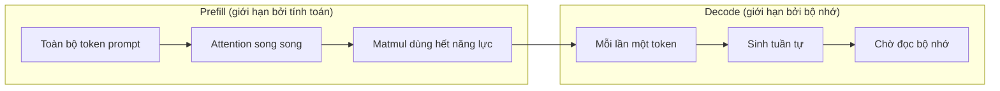
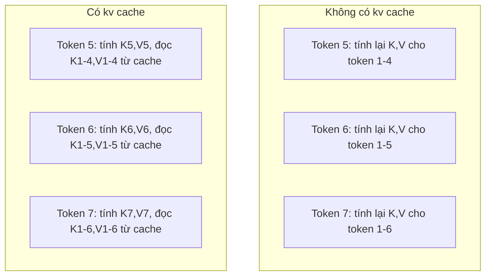
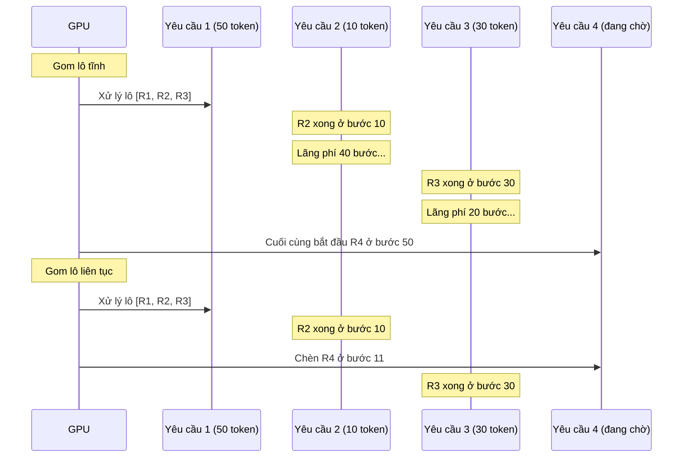
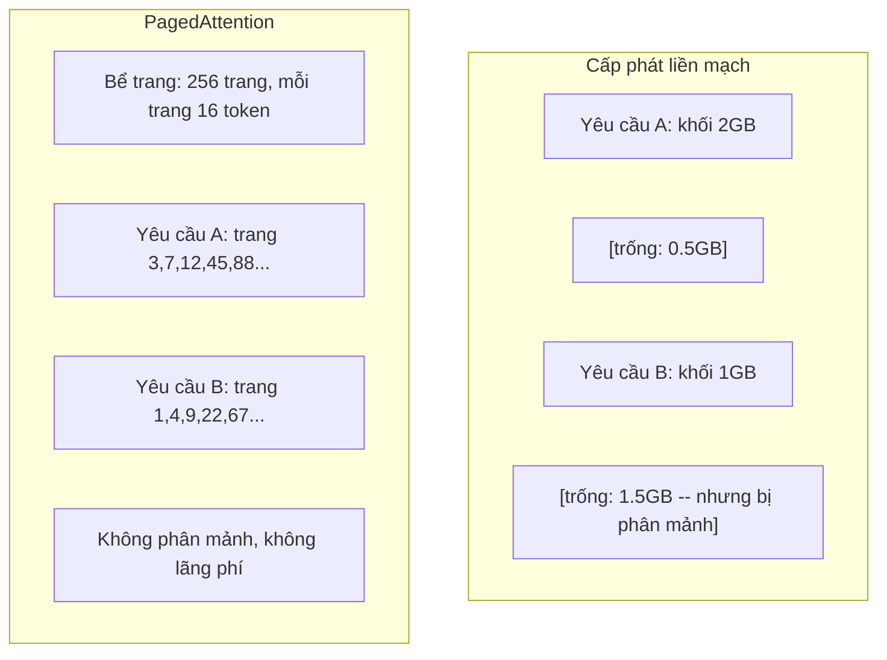
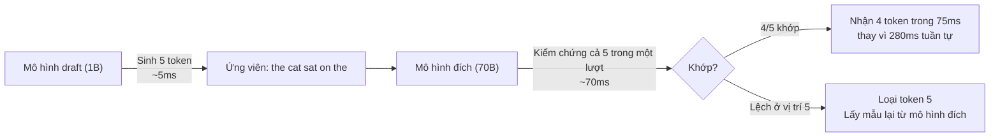

# Tối ưu suy luận (inference optimization)

> Hai pha định hình suy luận LLM. Prefill (xử lý prompt) chạy toàn bộ prompt của bạn song song -- bị giới hạn bởi tính toán. Decode (sinh token) sinh ra từng token một -- bị giới hạn bởi bộ nhớ. Mọi tối ưu đều nhắm vào một hoặc cả hai pha.

**Type:** Build
**Languages:** Python
**Prerequisites:** Giai đoạn 10, Bài 01-08 (Kiến trúc Transformer, attention)
**Time:** ~120 phút

## Mục tiêu học tập

- Cài đặt kv cache (bộ nhớ đệm KV) để loại bỏ phần tính toán dư thừa khi sinh token tự hồi quy
- Giải thích hai pha prefill và decode của suy luận LLM, và vì sao mỗi pha có nút thắt khác nhau (bị giới hạn bởi tính toán vs bị giới hạn bởi bộ nhớ)
- Cài đặt continuous batching (gom lô liên tục) và PagedAttention (attention theo trang) để tối đa hóa mức dùng GPU khi có nhiều yêu cầu đồng thời
- So sánh các kỹ thuật tối ưu suy luận (kv cache, speculative decoding, flash attention) và đánh đổi throughput (thông lượng)/latency (độ trễ) của chúng

## Vấn đề

Bạn triển khai Llama 3 70B trên 4 GPU A100. Một người dùng đơn lẻ nhận ~50 token mỗi giây. Cảm giác rất nhanh. Rồi 100 người dùng cùng lúc đập vào endpoint. Throughput tụt xuống 3 token/giây/người dùng. Hóa đơn GPU $25,000/tháng của bạn đang trả lời chậm hơn tốc độ người ta gõ phím.

Bản thân mô hình không đổi giữa 1 người dùng và 100 người dùng. Cùng trọng số, cùng kiến trúc, cùng phép toán. Thứ thay đổi là cách bạn lập lịch công việc. Suy luận ngây thơ lãng phí hơn 90% năng lực tính toán GPU sẵn có. Một người dùng đang chờ token thứ 47 giữ nguyên một suất trong lô trong khi bus bộ nhớ GPU nằm không giữa các phép matmul. Trong lúc đó, prompt 2,000 token của người dùng mới có thể lấp đầy khoảng chết đó bằng công việc tính toán hữu ích.

Đây không phải bài toán mở rộng quy mô. Đây là bài toán lập lịch. Các kỹ thuật trong bài này -- KV caching, continuous batching, PagedAttention, speculative decoding, prefix caching -- chính là thứ tách biệt hóa đơn suy luận $25k/tháng với hóa đơn $5k/tháng cho cùng lưu lượng.

vLLM phục vụ Llama 3 70B trên 4xA100-80GB đạt ~50 token/giây/người dùng khi ít yêu cầu đồng thời, và giữ được 15-25 TPS/người dùng ở 100 yêu cầu đồng thời nhờ continuous batching và PagedAttention. Không có những tối ưu này, cùng phần cứng đó chỉ phục vụ 5 TPS/người dùng ở mức đồng thời ấy. Cùng GPU, cùng mô hình, throughput gấp 4 lần.

## Khái niệm

### Prefill vs Decode

Mỗi yêu cầu suy luận LLM đều có hai pha tách biệt.

**Prefill** xử lý toàn bộ prompt đầu vào. Mọi token đều đã biết, nên attention có thể tính song song trên cả chuỗi. Đây là một phép nhân ma trận lớn -- các nhân GPU luôn bận. Nút thắt là tính toán: phần cứng của bạn giao được bao nhiêu FLOPS mỗi giây. Một A100 đạt 312 TFLOPS (BF16). Prefill cho prompt 4,096 token trên mô hình 70B mất ~400ms trên một A100.

**Decode** sinh token đầu ra từng cái một. Mỗi token mới attend tới mọi token trước đó, nhưng chỉ một token được sinh ra mỗi lượt forward. Các ma trận trọng số vẫn cùng kích thước như khi prefill, nhưng bạn nhân chúng với một vector đơn thay vì một ma trận. Các nhân GPU xong việc trong vài micro giây, rồi chờ lô trọng số tiếp theo từ bộ nhớ. Nút thắt là băng thông bộ nhớ: bạn truyền trọng số mô hình từ HBM tới các đơn vị tính toán nhanh đến đâu. Một A100 có băng thông 2 TB/s. Mô hình 70B ở FP16 là 140 GB. Đọc hết mô hình một lần mất 70ms -- đó là mức sàn cho một bước decode.



**Tỷ lệ ops:byte** (còn gọi là cường độ số học) nắm bắt đánh đổi này. Nó đo xem bạn thực hiện bao nhiêu phép toán trên mỗi byte nạp từ bộ nhớ.

```
ops:byte ratio = FLOPs per token / bytes read from memory
```

Khi prefill với lô 4,096 token, bạn thực hiện ~4,096 phép nhân-cộng cho mỗi trọng số được nạp. Tỷ lệ cao -- bạn bị giới hạn bởi tính toán. Khi decode với batch size 1, bạn thực hiện ~1 phép toán cho mỗi trọng số được nạp. Tỷ lệ thấp -- bạn bị giới hạn bởi bộ nhớ.

Điểm cốt lõi: *decode bị giới hạn bởi bộ nhớ vì bạn phải đọc toàn bộ mô hình để sinh ra một token*. Mọi tối ưu bên dưới hoặc giảm lượng đọc, hoặc tăng số token xử lý trên mỗi lần đọc, hoặc tránh hẳn việc đọc.

### KV Cache

Trong attention, query của mỗi token hướng tới vector key và value của mọi token trước đó. Không có cache, sinh token N đòi hỏi tính lại các phép chiếu key và value cho cả N-1 token phía trước. Token 1 bị chiếu khi sinh token 2, rồi lại khi sinh token 3, rồi lại khi sinh token 4. Tới token 1,000, bạn đã chiếu token 1 tổng cộng 999 lần.

kv cache lưu các phép chiếu key và value của mọi token trước đó. Khi sinh token N, bạn chỉ tính key và value cho token N, rồi nối chúng với K/V đã cache từ token 1 đến N-1.



**Công thức bộ nhớ cho kv cache:**

```
KV cache size = 2 * num_layers * num_kv_heads * head_dim * seq_len * bytes_per_param
```

Với Llama 3 70B (80 lớp, 8 KV head với GQA, head_dim=128, BF16):

```
per token: 2 * 80 * 8 * 128 * 2 bytes = 327,680 bytes = 320 KB
at 4,096 tokens: 320 KB * 4,096 = 1.28 GB
at 128K tokens: 320 KB * 131,072 = 40 GB
```

Một hội thoại ngữ cảnh 128K với Llama 3 70B tiêu tốn 40 GB kv cache -- một nửa bộ nhớ của A100. Với 100 người dùng đồng thời, mỗi người 4K token, riêng kv cache đã cần 128 GB. Đó là lý do quản lý kv cache là thách thức trung tâm của tối ưu suy luận.

### Continuous Batching

Static batching chờ cho một lô N yêu cầu đến, xử lý chúng cùng nhau, rồi chờ tới khi *tất cả* xong mới nhận yêu cầu mới. Nếu một yêu cầu cần 500 token còn yêu cầu khác cần 10, yêu cầu ngắn nằm không suốt 490 bước decode sau khi đã xong.

continuous batching (còn gọi là gom lô theo vòng lặp) chèn yêu cầu mới vào lô ngay khi có yêu cầu hoàn thành. Lô được đánh giá lại ở mỗi bước decode. Một yêu cầu xong sau 10 token được thay ngay bằng yêu cầu đang chờ.



Mức cải thiện throughput phụ thuộc độ dài đầu ra biến thiên đến đâu. Với độ dài đồng đều, continuous batching ngang static batching. Với độ dài biến thiên (trường hợp phổ biến), continuous batching có thể cho throughput cao gấp 2-5 lần vì suất GPU không bao giờ bỏ trống.

### PagedAttention

kv cache cho mỗi yêu cầu là một khối bộ nhớ liền mạch. Khi yêu cầu đến và đi, bộ nhớ bị phân mảnh -- đúng như phân mảnh RAM trong hệ điều hành. Một yêu cầu 4K token cần 1.28 GB liền mạch. Kể cả khi tổng cộng còn 2 GB trống, bạn có thể không có 1.28 GB *liền mạch*. Bạn hoặc lãng phí bộ nhớ, hoặc từ chối yêu cầu.

PagedAttention (từ vLLM) áp dụng bộ nhớ ảo kiểu OS cho kv cache. Thay vì cấp một khối liền mạch cho mỗi yêu cầu, nó cấp các "trang" kích thước cố định (thường 16 token mỗi trang). Các trang có thể nằm bất kỳ đâu trong bộ nhớ vật lý của GPU. Một bảng trang ánh xạ vị trí chuỗi logic của mỗi yêu cầu sang vị trí trang vật lý.



PagedAttention cũng mở ra **copy-on-write** cho các tiền tố dùng chung. Nếu 50 yêu cầu chia sẻ cùng một system prompt, các trang kv cache cho system prompt đó được lưu một lần và được cả 50 yêu cầu tham chiếu. Chỉ khi một yêu cầu rẽ nhánh (tin nhắn người dùng khác nhau) thì nó mới có trang riêng. Điều này cắt giảm mạnh mức dùng bộ nhớ cho các ứng dụng có system prompt chung.

vLLM báo cáo mức lãng phí bộ nhớ gần như bằng không (~4% so với ~60-80% ở cách cấp phát ngây thơ) nhờ PagedAttention.

### Speculative Decoding

Decode chậm vì nó tuần tự -- bạn sinh một token, đưa nó lại vào, sinh token tiếp theo. Nhưng nếu bạn có thể đoán rẻ 5 token tiếp theo rồi kiểm chứng tất cả cùng lúc thì sao?

Speculative decoding dùng một **mô hình draft** nhỏ, nhanh để sinh K token ứng viên. **Mô hình đích** lớn sau đó xử lý cả K ứng viên trong một lượt forward duy nhất (trông giống prefill -- song song, bị giới hạn bởi tính toán, hiệu quả). Nếu mô hình đích đồng ý với dự đoán của mô hình draft, bạn nhận cả K token trong thời gian của một lượt forward của mô hình đích. Nếu nó lệch ở vị trí j, bạn nhận token 1 đến j-1 và bỏ phần còn lại.



Mức tăng tốc phụ thuộc **tỷ lệ chấp nhận** -- tần suất dự đoán của mô hình draft khớp với mô hình đích. Với Llama 3 8B làm draft cho Llama 3 70B, tỷ lệ chấp nhận 70-85% là điển hình trên ngôn ngữ tự nhiên. Điều này tương đương decode nhanh gấp 2-3 lần.

Ba cách tiếp cận speculative decoding:

| Phương pháp | Nguồn draft | Tỷ lệ chấp nhận | Chi phí phụ |
|--------|-------------|-----------------|----------|
| Draft-target (Leviathan et al.) | Mô hình nhỏ tách riêng | 70-85% | Bộ nhớ mô hình draft |
| EAGLE (Li et al.) | Đầu nhẹ trên mô hình đích | 75-90% | ~1% tham số thêm |
| N-gram lookup | Bảng n-gram token | 40-60% | Không đáng kể |

**EAGLE** huấn luyện một đầu tự hồi quy nhỏ trên trạng thái ẩn của chính mô hình đích. Nó dự đoán embedding của token tiếp theo bằng đặc trưng lớp gần cuối của mô hình đích. Vì làm việc trên biểu diễn của chính mô hình đích (không phải mô hình riêng), nó đạt tỷ lệ chấp nhận cao hơn với bộ nhớ thêm tối thiểu. EAGLE-2 thêm một cây draft động, điều chỉnh số ứng viên theo ngữ cảnh.

**Speculative decoding bằng n-gram** duy trì một bảng các phần tiếp theo của n-gram từ ngữ cảnh hiện tại hoặc một kho ngữ liệu dựng sẵn. Nếu bản draft khớp với thứ đã xuất hiện trước đó trong cùng hội thoại (mẫu lặp, code, đầu ra có cấu trúc), nó kích hoạt mà không tốn chi phí mạng nơ-ron nào. Tỷ lệ chấp nhận trung bình thấp hơn nhưng chi phí mỗi lần dự đoán gần như bằng không.

Speculative decoding *chính xác về mặt toán học* -- phân phối đầu ra giống hệt phân phối của mô hình đích. Đây không phải xấp xỉ. Bước kiểm chứng đảm bảo mỗi token được nhận có đúng xác suất mà mô hình đích sẽ gán.

### Prefix Caching

Nhiều yêu cầu chia sẻ cùng một tiền tố. Một system prompt của chatbot. Một khối ngữ cảnh RAG. Một tập ví dụ few-shot. Không có prefix caching, mỗi yêu cầu đều tính lại kv cache cho các token dùng chung này từ đầu.

Prefix caching lưu kv cache cho các tiền tố phổ biến và tái dùng qua các yêu cầu. Khi một yêu cầu mới đến với tiền tố đã biết, hệ thống sao chép (hoặc tham chiếu) các mục KV đã cache và chỉ tính KV cho phần đuôi riêng.

Với system prompt 2,000 token dùng chung cho mọi yêu cầu, prefix caching loại bỏ ~400ms prefill mỗi yêu cầu. Ở 100 yêu cầu/giây, bạn tiết kiệm 40 giây tính toán GPU mỗi giây -- nhiều hơn công của một GPU.

RadixAttention của SGLang cài prefix caching bằng một radix tree (trie) đánh chỉ mục tiền tố theo nội dung token. Mọi yêu cầu khớp tiền tố đã lưu sẽ có kv cache miễn phí. Cây cho phép khớp tiền tố một phần -- nếu bạn chia sẻ 1,500 trong 2,000 token tiền tố với một mục đã cache, bạn tái dùng 1,500 đó và chỉ tính lại 500.

### Các engine suy luận

Ba engine thống trị việc phục vụ LLM trong môi trường sản xuất:

| Engine | Cải tiến chính | Phù hợp nhất cho |
|--------|---------------|----------|
| vLLM | PagedAttention, continuous batching | Phục vụ đa dụng, tương thích cao nhất |
| SGLang | RadixAttention (prefix caching), sinh có cấu trúc | Chatbot nhiều lượt, decode có ràng buộc |
| TensorRT-LLM | Hợp nhất kernel của NVIDIA, lượng tử hóa FP8 | Throughput đơn GPU tối đa trên phần cứng NVIDIA |

**vLLM** là điểm khởi đầu mặc định. Nó hỗ trợ dải mô hình rộng nhất, chạy trên mọi nhà cung cấp GPU (NVIDIA, AMD, Intel), và đạt throughput mạnh nhờ PagedAttention + continuous batching. API tương thích OpenAI nghĩa là bạn có thể thay thế trực tiếp mọi lệnh gọi OpenAI API.

**SGLang** xây trên cùng nền tảng như vLLM nhưng thêm RadixAttention cho prefix caching và một ngôn ngữ chuyên biệt cho các chương trình LLM có cấu trúc. Nếu workload của bạn gồm hội thoại nhiều lượt, dùng công cụ, hoặc decode có ràng buộc (đầu ra JSON, sinh theo regex), SGLang thường vượt vLLM 2-5 lần nhờ tái dùng tiền tố.

**TensorRT-LLM** biên dịch mô hình thành các kernel GPU NVIDIA đã tối ưu. Nó hợp nhất các phép toán (attention + linear + activation trong một kernel), dùng FP8 trên GPU H100, và tích hợp với NVIDIA Triton Inference Server để triển khai sản xuất. Nó đạt throughput đơn GPU cao nhất trên phần cứng NVIDIA nhưng cần thiết lập nhiều hơn và chỉ chạy trên GPU NVIDIA.

Số liệu thực tế cho Llama 3 70B (4xA100-80GB, BF16):

| Chỉ số | vLLM | SGLang | TensorRT-LLM |
|--------|------|--------|---------------|
| Throughput (1 người dùng) | ~50 TPS | ~55 TPS | ~65 TPS |
| Throughput (100 người dùng) | ~2,500 TPS tổng | ~3,200 TPS tổng | ~3,000 TPS tổng |
| Thời gian tới token đầu | ~400ms | ~300ms (khớp tiền tố) | ~350ms |
| Ngữ cảnh tối đa | 128K | 128K | 128K |

### Khung Ops:Byte

Bạn không thể tối ưu thứ bạn không đo. Tỷ lệ ops:byte cho bạn biết mình đang bị giới hạn bởi tính toán hay bởi bộ nhớ, từ đó quyết định tối ưu nào quan trọng.

```
Compute roof: peak FLOPS of the GPU
Memory roof:  peak bandwidth * ops:byte ratio
```

Khi ops:byte thấp (decode, lô nhỏ), bạn chạm trần băng thông bộ nhớ. Thêm tính toán (xung nhịp cao hơn, nhiều nhân hơn) không giúp gì. Bạn cần giảm lượt đọc bộ nhớ (lượng tử hóa, nén kv cache) hoặc tăng batch size để chia đều lượt đọc cho nhiều công việc hữu ích hơn.

Khi ops:byte cao (prefill, lô lớn), bạn chạm trần tính toán. Tối ưu băng thông bộ nhớ không giúp gì. Bạn cần GPU nhanh hơn, hợp nhất kernel, hoặc giảm độ chính xác để ép thêm FLOPS.

| Kịch bản | ops:byte | Giới hạn | Tối ưu bằng |
|----------|----------|-------|---------------|
| Prefill, batch=1 | ~4,096 | Tính toán | Hợp nhất kernel, FP8 |
| Decode, batch=1 | ~1 | Bộ nhớ | Lượng tử hóa, nén KV |
| Decode, batch=32 | ~32 | Bộ nhớ | Lô lớn hơn, continuous batching |
| Decode, batch=256 | ~256 | Chuyển tiếp | Cả hai đều quan trọng |
| Decode, batch=1024 | ~1,024 | Tính toán | Hợp nhất kernel, song song tensor |

Điểm giao trên A100 vào khoảng ops:byte = 156 (312 TFLOPS / 2 TB/s). Dưới 156, bạn bị giới hạn bởi bộ nhớ. Trên 156, bạn bị giới hạn bởi tính toán. continuous batching đẩy decode về phía điểm giao này bằng cách nhồi nhiều token hơn mỗi vòng lặp.

```figure
context-window-slide
```

## Tự tay làm

### Bước 1: KV Cache từ đầu

Chúng ta xây một kv cache đa đầu lưu các phép chiếu key và value theo từng lớp, từng head, và minh họa kiểu tăng bộ nhớ.

```python
import numpy as np

class KVCache:
    def __init__(self, num_layers, num_heads, head_dim, max_seq_len, dtype=np.float16):
        self.num_layers = num_layers
        self.num_heads = num_heads
        self.head_dim = head_dim
        self.max_seq_len = max_seq_len
        self.dtype = dtype

        self.k_cache = np.zeros(
            (num_layers, num_heads, max_seq_len, head_dim), dtype=dtype
        )
        self.v_cache = np.zeros(
            (num_layers, num_heads, max_seq_len, head_dim), dtype=dtype
        )
        self.seq_len = 0

    def update(self, layer_idx, new_keys, new_values):
        num_new = new_keys.shape[1]
        end = self.seq_len + num_new
        self.k_cache[layer_idx, :, self.seq_len:end, :] = new_keys
        self.v_cache[layer_idx, :, self.seq_len:end, :] = new_values
        return (
            self.k_cache[layer_idx, :, :end, :],
            self.v_cache[layer_idx, :, :end, :]
        )

    def advance(self, num_tokens):
        self.seq_len += num_tokens

    def memory_bytes(self):
        return self.k_cache.nbytes + self.v_cache.nbytes

    def used_bytes(self):
        per_token = 2 * self.num_layers * self.num_heads * self.head_dim * np.dtype(self.dtype).itemsize
        return per_token * self.seq_len
```

### Bước 2: Attention với KV Cache

Một attention đa đầu giản lược dùng kv cache cho các bước decode.

```python
def scaled_dot_product_attention(query, keys, values):
    head_dim = query.shape[-1]
    scores = np.matmul(query, keys.transpose(0, 1, 3, 2)) / np.sqrt(head_dim)
    seq_len_q = scores.shape[-2]
    seq_len_k = scores.shape[-1]
    if seq_len_q > 1:
        mask = np.triu(np.ones((seq_len_q, seq_len_k), dtype=np.float32), k=seq_len_k - seq_len_q + 1)
        scores = scores + mask * (-1e9)
    max_scores = np.max(scores, axis=-1, keepdims=True)
    exp_scores = np.exp(scores - max_scores)
    attn_weights = exp_scores / np.sum(exp_scores, axis=-1, keepdims=True)
    return np.matmul(attn_weights, values)


class MultiHeadAttention:
    def __init__(self, d_model, num_heads):
        self.num_heads = num_heads
        self.head_dim = d_model // num_heads
        scale = np.sqrt(2.0 / d_model)
        self.W_q = np.random.randn(d_model, d_model).astype(np.float32) * scale
        self.W_k = np.random.randn(d_model, d_model).astype(np.float32) * scale
        self.W_v = np.random.randn(d_model, d_model).astype(np.float32) * scale
        self.W_o = np.random.randn(d_model, d_model).astype(np.float32) * scale

    def forward(self, x, kv_cache=None, layer_idx=0):
        batch, seq_len, d_model = x.shape
        Q = np.matmul(x, self.W_q).reshape(batch, seq_len, self.num_heads, self.head_dim).transpose(0, 2, 1, 3)
        K = np.matmul(x, self.W_k).reshape(batch, seq_len, self.num_heads, self.head_dim).transpose(0, 2, 1, 3)
        V = np.matmul(x, self.W_v).reshape(batch, seq_len, self.num_heads, self.head_dim).transpose(0, 2, 1, 3)

        if kv_cache is not None:
            K_full, V_full = kv_cache.update(layer_idx, K[0], V[0])
            K = K_full[np.newaxis, :, :, :]
            V = V_full[np.newaxis, :, :, :]
            if seq_len == 1:
                kv_cache.advance(1)

        attn_out = scaled_dot_product_attention(Q, K, V)
        attn_out = attn_out.transpose(0, 2, 1, 3).reshape(batch, -1, d_model)
        return np.matmul(attn_out, self.W_o)
```

### Bước 3: Bộ mô phỏng continuous batching

Phần này mô phỏng khác biệt lập lịch giữa static batching và continuous batching.

```python
import heapq

class Request:
    def __init__(self, request_id, prompt_tokens, output_tokens, arrival_step):
        self.request_id = request_id
        self.prompt_tokens = prompt_tokens
        self.output_tokens = output_tokens
        self.arrival_step = arrival_step
        self.tokens_generated = 0
        self.start_step = None
        self.end_step = None

    def is_done(self):
        return self.tokens_generated >= self.output_tokens


def simulate_static_batching(requests, batch_size):
    step = 0
    completed = []
    queue = list(requests)
    queue.sort(key=lambda r: r.arrival_step)

    while queue:
        batch = []
        while queue and len(batch) < batch_size:
            r = queue.pop(0)
            r.start_step = max(step, r.arrival_step)
            batch.append(r)

        if batch:
            step = max(step, max(r.start_step for r in batch))
            max_output = max(r.output_tokens for r in batch)
            for r in batch:
                r.tokens_generated = r.output_tokens
                r.end_step = step + max_output
            step += max_output
            completed.extend(batch)

    return completed


def simulate_continuous_batching(requests, batch_size):
    step = 0
    completed = []
    queue = sorted(requests, key=lambda r: r.arrival_step)
    queue_idx = 0
    active = []
    waiting = []

    while queue_idx < len(queue) or active or waiting:
        while queue_idx < len(queue) and queue[queue_idx].arrival_step <= step:
            waiting.append(queue[queue_idx])
            queue_idx += 1

        while waiting and len(active) < batch_size:
            r = waiting.pop(0)
            r.start_step = step
            active.append(r)

        if not active:
            if waiting:
                step += 1
                continue
            elif queue_idx < len(queue):
                step = queue[queue_idx].arrival_step
                continue
            else:
                break

        for r in active:
            r.tokens_generated += 1

        done = [r for r in active if r.is_done()]
        for r in done:
            r.end_step = step + 1
            completed.append(r)
        active = [r for r in active if not r.is_done()]

        step += 1

    return completed


def batching_stats(completed):
    latencies = [r.end_step - r.arrival_step for r in completed]
    total_time = max(r.end_step for r in completed) - min(r.arrival_step for r in completed)
    total_tokens = sum(r.output_tokens for r in completed)
    return {
        "avg_latency": np.mean(latencies),
        "p50_latency": np.median(latencies),
        "p99_latency": np.percentile(latencies, 99),
        "total_time": total_time,
        "throughput": total_tokens / total_time if total_time > 0 else 0,
    }
```

### Bước 4: Prefix Cache

Một prefix cache dựa trên trie lưu các mục KV cho những tiền tố dùng chung.

```python
class TrieNode:
    def __init__(self):
        self.children = {}
        self.kv_data = None
        self.hit_count = 0


class PrefixCache:
    def __init__(self, max_entries=1000):
        self.root = TrieNode()
        self.max_entries = max_entries
        self.total_entries = 0
        self.hits = 0
        self.misses = 0

    def _walk(self, token_ids):
        node = self.root
        depth = 0
        for tid in token_ids:
            if tid not in node.children:
                break
            node = node.children[tid]
            depth += 1
        return node, depth

    def lookup(self, token_ids):
        node, depth = self._walk(token_ids)
        if depth > 0:
            self.hits += 1
            current = self.root
            for tid in token_ids[:depth]:
                current = current.children[tid]
                current.hit_count += 1
            kv_entries = []
            current = self.root
            for tid in token_ids[:depth]:
                current = current.children[tid]
                if current.kv_data is not None:
                    kv_entries.append(current.kv_data)
            return depth, kv_entries
        self.misses += 1
        return 0, []

    def insert(self, token_ids, kv_per_token):
        node = self.root
        for i, tid in enumerate(token_ids):
            if tid not in node.children:
                if self.total_entries >= self.max_entries:
                    return i
                node.children[tid] = TrieNode()
                self.total_entries += 1
            node = node.children[tid]
            if i < len(kv_per_token):
                node.kv_data = kv_per_token[i]
        return len(token_ids)

    def hit_rate(self):
        total = self.hits + self.misses
        return self.hits / total if total > 0 else 0.0
```

### Bước 5: Bộ mô phỏng speculative decoding

Chúng ta mô phỏng speculative decoding kiểu draft-target với tỷ lệ chấp nhận cấu hình được.

```python
class DraftModel:
    def __init__(self, vocab_size, acceptance_rate=0.8):
        self.vocab_size = vocab_size
        self.acceptance_rate = acceptance_rate

    def generate(self, context, num_tokens):
        tokens = np.random.randint(0, self.vocab_size, size=num_tokens)
        return tokens

    def get_probs(self, context, token):
        probs = np.random.dirichlet(np.ones(self.vocab_size))
        return probs


class TargetModel:
    def __init__(self, vocab_size):
        self.vocab_size = vocab_size

    def get_probs(self, context, tokens=None):
        if tokens is not None:
            return [np.random.dirichlet(np.ones(self.vocab_size)) for _ in tokens]
        return np.random.dirichlet(np.ones(self.vocab_size))


def speculative_decode(draft_model, target_model, context, num_speculative=5,
                       draft_cost=1.0, target_cost=10.0, verify_cost=12.0):
    total_tokens = 0
    total_cost = 0.0
    accepted_counts = []
    context = list(context)

    max_tokens = 100

    while total_tokens < max_tokens:
        draft_tokens = draft_model.generate(context, num_speculative)
        total_cost += draft_cost * num_speculative

        target_probs = target_model.get_probs(context, draft_tokens)
        total_cost += verify_cost

        accepted = 0
        for i, token in enumerate(draft_tokens):
            draft_p = draft_model.get_probs(context + list(draft_tokens[:i]), token)
            target_p = target_probs[i]

            r = np.random.random()
            acceptance_prob = min(1.0, target_p[token] / (draft_p[token] + 1e-10))

            if r < draft_model.acceptance_rate:
                accepted += 1
                context.append(token)
                total_tokens += 1
            else:
                new_token = np.random.choice(draft_model.vocab_size, p=target_p)
                context.append(new_token)
                total_tokens += 1
                break

        accepted_counts.append(accepted)

        if accepted == num_speculative:
            bonus_probs = target_model.get_probs(context)
            bonus_token = np.random.choice(draft_model.vocab_size, p=bonus_probs)
            context.append(bonus_token)
            total_tokens += 1

    sequential_cost = total_tokens * target_cost
    return {
        "total_tokens": total_tokens,
        "speculative_cost": total_cost,
        "sequential_cost": sequential_cost,
        "speedup": sequential_cost / total_cost if total_cost > 0 else 1.0,
        "avg_accepted": np.mean(accepted_counts),
        "acceptance_rate": np.mean(accepted_counts) / num_speculative,
    }


def compare_speculation_strategies(vocab_size=1000, num_trials=20):
    results = {}

    for name, acceptance_rate, spec_tokens in [
        ("Draft-target (8B->70B)", 0.78, 5),
        ("EAGLE", 0.85, 6),
        ("N-gram", 0.50, 4),
        ("No speculation", 0.0, 0),
    ]:
        if spec_tokens == 0:
            results[name] = {
                "speedup": 1.0,
                "acceptance_rate": 0.0,
                "avg_accepted": 0.0,
            }
            continue

        trial_results = []
        for _ in range(num_trials):
            draft = DraftModel(vocab_size, acceptance_rate=acceptance_rate)
            target = TargetModel(vocab_size)
            context = list(np.random.randint(0, vocab_size, size=10))
            result = speculative_decode(draft, target, context, num_speculative=spec_tokens)
            trial_results.append(result)

        results[name] = {
            "speedup": np.mean([r["speedup"] for r in trial_results]),
            "acceptance_rate": np.mean([r["acceptance_rate"] for r in trial_results]),
            "avg_accepted": np.mean([r["avg_accepted"] for r in trial_results]),
        }

    return results
```

### Bước 6: Công cụ đo bộ nhớ kv cache

Tính nhu cầu bộ nhớ kv cache cho các cấu hình mô hình thật.

```python
MODEL_CONFIGS = {
    "Llama-3-8B": {
        "num_layers": 32, "num_kv_heads": 8, "head_dim": 128,
        "model_params_b": 8, "gqa": True,
    },
    "Llama-3-70B": {
        "num_layers": 80, "num_kv_heads": 8, "head_dim": 128,
        "model_params_b": 70, "gqa": True,
    },
    "Llama-3-405B": {
        "num_layers": 126, "num_kv_heads": 8, "head_dim": 128,
        "model_params_b": 405, "gqa": True,
    },
    "Mistral-7B": {
        "num_layers": 32, "num_kv_heads": 8, "head_dim": 128,
        "model_params_b": 7, "gqa": True,
    },
    "GPT-4-est": {
        "num_layers": 120, "num_kv_heads": 96, "head_dim": 128,
        "model_params_b": 1800, "gqa": False,
    },
}


def kv_cache_memory(config, seq_len, dtype_bytes=2):
    per_token = 2 * config["num_layers"] * config["num_kv_heads"] * config["head_dim"] * dtype_bytes
    total = per_token * seq_len
    return {
        "per_token_bytes": per_token,
        "per_token_kb": per_token / 1024,
        "total_bytes": total,
        "total_mb": total / (1024 ** 2),
        "total_gb": total / (1024 ** 3),
    }


def memory_budget(config, gpu_memory_gb, model_dtype_bytes=2, kv_dtype_bytes=2):
    model_memory_gb = config["model_params_b"] * 1e9 * model_dtype_bytes / (1024 ** 3)
    overhead_gb = gpu_memory_gb * 0.1
    available_for_kv = gpu_memory_gb - model_memory_gb - overhead_gb

    if available_for_kv <= 0:
        return {"error": "Model does not fit in GPU memory", "model_memory_gb": model_memory_gb}

    per_token = 2 * config["num_layers"] * config["num_kv_heads"] * config["head_dim"] * kv_dtype_bytes
    max_tokens = int(available_for_kv * (1024 ** 3) / per_token)

    return {
        "gpu_memory_gb": gpu_memory_gb,
        "model_memory_gb": round(model_memory_gb, 1),
        "overhead_gb": round(overhead_gb, 1),
        "available_for_kv_gb": round(available_for_kv, 1),
        "max_total_tokens": max_tokens,
        "max_users_at_2k": max_tokens // 2048,
        "max_users_at_4k": max_tokens // 4096,
        "max_users_at_32k": max_tokens // 32768,
    }
```

## Áp dụng

Với vLLM:

```python
from vllm import LLM, SamplingParams

llm = LLM(
    model="meta-llama/Meta-Llama-3-70B-Instruct",
    tensor_parallel_size=4,
    enable_prefix_caching=True,
    max_model_len=8192,
    gpu_memory_utilization=0.9,
)

params = SamplingParams(temperature=0.7, max_tokens=256)
outputs = llm.generate(["Explain inference optimization in one paragraph."], params)
```

Với SGLang cho prefix caching + đầu ra có cấu trúc:

```python
import sglang as sgl

@sgl.function
def classify(s, text):
    s += sgl.system("You are a classifier. Output JSON only.")
    s += sgl.user(f"Classify this text: {text}")
    s += sgl.assistant(sgl.gen("result", regex=r'\{"label": "(positive|negative|neutral)"\}'))

runtime = sgl.Runtime(model_path="meta-llama/Meta-Llama-3-70B-Instruct", tp_size=4)
sgl.set_default_backend(runtime)

results = classify.run_batch([
    {"text": "This product is amazing!"},
    {"text": "Terrible experience."},
    {"text": "It was okay I guess."},
])
```

Với TensorRT-LLM:

```python
import tensorrt_llm
from tensorrt_llm.runtime import ModelRunner

runner = ModelRunner.from_dir("./llama-70b-trt-engine/", rank=0)

outputs = runner.generate(
    batch_input_ids=[tokenizer.encode("Explain KV caching.")],
    max_new_tokens=256,
    temperature=0.7,
)
```

## Đóng gói

Bài này tạo ra:
- `outputs/skill-inference-optimization.md` -- một skill để chẩn đoán và tối ưu phục vụ suy luận LLM

## Bài tập

1. Sửa công cụ đo kv cache để so sánh lượng tử hóa kv cache FP16 vs FP8 vs INT4. Với Llama 3 70B ở ngữ cảnh 4K, tính số người dùng đồng thời tối đa cho mỗi lựa chọn trên 4xA100-80GB. Lượng tử hóa KV xuống INT4 về lý thuyết cho dung lượng người dùng gấp khoảng 4 lần.

2. Mở rộng bộ mô phỏng continuous batching để theo dõi mức dùng GPU (phần suất trong lô được lấp đầy mỗi bước). Vẽ mức dùng theo thời gian cho cả static batching và continuous batching với 50 yêu cầu có độ dài đầu ra tuân theo phân phối Pareto (shape=1.5, scale=20). continuous batching sẽ giữ mức dùng >80%.

3. Cài đặt phiên bản grouped-query attention (GQA) của kv cache với `num_kv_heads < num_query_heads`. Llama 3 70B dùng 64 query head nhưng chỉ 8 KV head. Tính mức tiết kiệm bộ nhớ so với multi-head attention đầy đủ (giảm 8 lần kích thước kv cache).

4. Xây một prefix cache dùng đuổi LRU. Đặt max_entries = 500 và sinh 1,000 yêu cầu, trong đó 60% chia sẻ một trong 5 tiền tố phổ biến. Đo tỷ lệ khớp và so với cache không giới hạn. Với đuổi tốt, tỷ lệ khớp nên giữ trên 55%.

5. Mở rộng bộ mô phỏng speculative decoding để cài đặt dự đoán theo cây (kiểu EAGLE-2). Thay vì một chuỗi K token draft duy nhất, sinh một cây ứng viên (ví dụ 2 nhánh ở mỗi tầng trong 3 tầng = 8 ứng viên lá). So sánh tổng số token được nhận mỗi vòng kiểm chứng với cách dự đoán tuyến tính.

## Thuật ngữ chính

| Thuật ngữ | Người ta thường nói | Ý nghĩa thực sự |
|------|----------------|----------------------|
| Prefill | "Xử lý prompt" | Tính attention trên toàn bộ token đầu vào một cách song song -- bị giới hạn bởi tính toán vì phép nhân ma trận đầy đủ giữ các nhân GPU luôn bận |
| Decode | "Sinh token" | Sinh ra một token mỗi lượt forward, đọc toàn bộ trọng số mô hình mỗi lần -- bị giới hạn bởi bộ nhớ vì tính toán xong trước khi lô trọng số tiếp theo tới |
| KV cache | "Cache trạng thái attention" | Lưu các phép chiếu key và value của mọi token trước đó để chúng không bị tính lại ở mỗi bước decode -- đổi bộ nhớ lấy tính toán |
| Continuous batching | "Gom lô động" | Chèn yêu cầu mới vào lô đang chạy ngay khi có yêu cầu xong, đánh giá lại ở từng vòng decode thay vì chờ cả lô |
| PagedAttention | "Bộ nhớ ảo cho kv cache" | Cấp kv cache theo trang kích thước cố định thay vì khối liền mạch, loại bỏ phân mảnh bộ nhớ và cho phép copy-on-write với tiền tố dùng chung |
| Speculative decoding | "Draft rồi kiểm chứng" | Dùng mô hình draft nhanh đề xuất nhiều token, rồi kiểm chứng tất cả trong một lượt forward của mô hình đích -- chính xác về toán học, nhanh gấp 2-3 lần |
| EAGLE | "Speculative decoding tự thân" | Một biến thể speculative decoding huấn luyện đầu nhẹ trên trạng thái ẩn của chính mô hình đích, đạt tỷ lệ chấp nhận cao hơn mô hình draft tách riêng |
| Prefix caching | "Tái dùng KV của system prompt" | Lưu các mục kv cache đã tính cho tiền tố phổ biến (system prompt, ví dụ few-shot) và tái dùng qua các yêu cầu để bỏ qua prefill dư thừa |
| Ops:byte ratio | "Cường độ số học" | Tỷ lệ phép toán tính toán trên số byte bộ nhớ đã đọc -- quyết định workload bị giới hạn bởi tính toán (tỷ lệ cao) hay bởi bộ nhớ (tỷ lệ thấp) |
| Time to first token | "TTFT" | Độ trễ từ khi nhận yêu cầu tới khi sinh token đầu tiên -- bị chi phối bởi thời gian prefill với prompt dài |

## Đọc thêm

- Kwon et al., "Efficient Memory Management for Large Language Model Serving with PagedAttention" (2023) -- bài báo vLLM giới thiệu quản lý kv cache theo trang, nay là chuẩn công nghiệp cho phục vụ suy luận
- Leviathan et al., "Fast Inference from Transformers via Speculative Decoding" (2023) -- bài báo nền tảng chứng minh rằng draft-rồi-kiểm-chứng tạo ra phân phối đúng của mô hình đích trong khi đạt tốc độ nhanh gấp 2-3 lần
- Li et al., "EAGLE: Speculative Sampling Requires Rethinking Feature Uncertainty" (2024) -- đạt tỷ lệ chấp nhận cao hơn bằng cách huấn luyện một đầu trên chính đặc trưng của mô hình đích thay vì dùng mô hình draft tách riêng
- Zheng et al., "SGLang: Efficient Execution of Structured Language Model Programs" (2024) -- giới thiệu RadixAttention cho prefix caching và một mô hình lập trình cho các chương trình LLM nhiều lệnh gọi
- Williams et al., "Roofline: An Insightful Visual Performance Model for Multicore Architectures" (2009) -- bài báo roofline gốc đã hình thức hóa khung ops:byte để lý luận về nút thắt tính toán vs bộ nhớ

---

[← Bài trước: Lượng tử hoá: làm mô hình vừa vặn](../../11-quantization/docs/vi.md) · [Bài sau: Xây dựng một pipeline LLM hoàn chỉnh →](../../13-building-complete-llm-pipeline/docs/vi.md)
