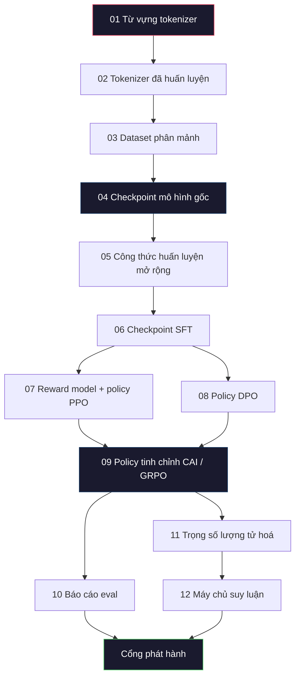
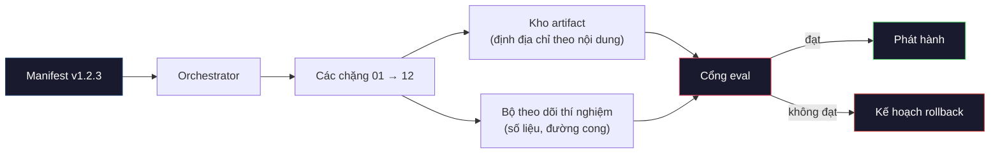

# Xây dựng một pipeline LLM hoàn chỉnh

> Mọi thứ từ Bài 01 đến 12 chỉ là một chặng của một pipeline. Bài này là bộ khung biến những chặng đó thành một lần chạy end-to-end (đầu-cuối) duy nhất: tokenize, pre-train, mở rộng quy mô, SFT, align, đánh giá, lượng tử hoá, phục vụ. Bạn sẽ không huấn luyện mô hình 70B trên laptop. Bạn sẽ tạo ra tầng orchestration (điều phối), manifest, cổng eval và kế hoạch rollback mà một đội tiên phong năm 2026 dùng để quyết định cái gì được phát hành. Đây là bài kết môn.

**Type:** Build
**Languages:** Python (stdlib)
**Prerequisites:** Toàn bộ bài 01-12 của Giai đoạn 10
**Time:** ~120 phút

## Mục tiêu học tập

- Ghép mười một bài trước (tokenizer, dữ liệu, pre-training, mở rộng quy mô, SFT, RLHF, DPO, CAI, eval, lượng tử hoá, suy luận) thành một đặc tả pipeline tái lập được duy nhất
- Định nghĩa hợp đồng artifact (sản phẩm lưu) giữa các chặng (stage): mỗi chặng tiêu thụ gì, tạo ra gì, và chặng sau kiểm tra đầu vào như thế nào
- Xây dựng một orchestrator theo dõi thí nghiệm, băm artifact và chặn quyết định phát hành bằng các ngưỡng eval
- Thiết kế kế hoạch rollback: artifact nào chạy lại rẻ, artifact nào đắt, và một checkpoint (điểm lưu) hỏng tốn bao nhiêu

## Vấn đề

Các bài trước đều chạy được. Tokenizer đã huấn luyện. GPT nhỏ đã pre-train. Dataset SFT đã lắp xong. Reward model đã huấn luyện. DPO đã chạy. Eval đã đo. Trọng số lượng tử hoá đã xuất. Máy chủ suy luận đã dựng. Mỗi thứ là một notebook. Mỗi thứ có quy ước riêng, đường dẫn đầu ra riêng, seed riêng.

Một lần huấn luyện tiên phong không phải là notebook. Llama 3 405B tốn 30 triệu giờ H100 trong khoảng 54 ngày. DeepSeek-V3 dùng khoảng 2,8 triệu giờ H800. Trong thời gian đó, một checkpoint hỏng, một lần nhiễm bẩn dữ liệu, một lần eval hồi quy có thể khiến cả đội mất một tuần thời gian thực và một tháng ngân sách GPU. Cách các đội sống sót là vệ sinh pipeline: mỗi chặng có đầu vào tất định, đầu ra tất định, một manifest, một mã băm và một cổng.

Đây là bài kết môn. Bạn sẽ không chạy pipeline end-to-end trên laptop. Bạn sẽ viết orchestrator điều phối các chặng, manifest mô tả lần chạy, bộ kiểm tra chặn quyết định phát hành, và kế hoạch chạy lại cho phép người khác tái lập công việc của bạn từ một file duy nhất. Code thì nhỏ; kỷ luật thì lớn.

Mẫu hình này mở rộng từ 100M đến 1T tham số mà không đổi. Bốn thành phần -- manifest, orchestrator, cổng eval, kho artifact -- vừa chạy Llama 3 vừa chạy GPT sở thích của bạn. Khác biệt chỉ là độ lớn các con số trong config của từng chặng, không phải hình dạng của pipeline.

## Khái niệm

### Mười hai chặng

Mỗi bài của Giai đoạn 10 là một chặng. Đây là đồ thị phụ thuộc đầy đủ.



Chặng 07 và 08 có thể chạy song song. Phần còn lại là phụ thuộc cứng. Thay đổi ở chặng 02 (tokenizer) làm vô hiệu mọi artifact phía sau. Thay đổi ở chặng 10 (eval) chỉ làm vô hiệu quyết định phát hành.

### Manifest

Manifest là một file duy nhất mô tả lần chạy đủ chi tiết để chạy lại. Không sản phẩm nào của pipeline được phụ thuộc vào trạng thái không nằm trong manifest. Các trường thì nhàm chán và bắt buộc.

```
pipeline_version: 1.2.3
seed: 42
git_commit: a1b2c3d4
stages:
  01_tokenizer:
    recipe: bpe_32k
    input_hash: sha256:...
    output_hash: sha256:...
    wall_clock_sec: 3600
    cost_usd: 12
```

Mã băm đầu ra của chặng N chính là mã băm đầu vào của chặng N+1. Lệch một chút là pipeline dừng. Đây là cách bạn phát hiện hỏng dữ liệu sớm. Cũng là cách một đồng nghiệp ở châu lục khác kiểm chứng rằng lần chạy lại của họ tạo ra đúng artifact như của bạn.

Trên thực tế, các đội dùng một schema YAML nhỏ cộng với bộ kiểm tra manifest so sánh với lần chạy thành công trước đó. Mọi sai lệch ngoài các trường dự kiến (chi phí, thời gian thực) đều là cờ đỏ.

### Phân loại artifact

Đầu ra của mỗi chặng là một artifact có kiểu. Không phải một đống file trong thư mục, không phải pickle, mà là một kiểu có tên với schema đã biết.

| Chặng | Loại artifact | Trường chính |
|-------|--------------|-----------|
| 01-02 | Tokenizer | vocab.json, merges.txt, config.json, hash |
| 03 | Dataset | shards[], row count, token count, dedup stats |
| 04-05 | Checkpoint | weights.safetensors, config.json, optimizer state, step count |
| 06 | SFT Model | checkpoint + SFT recipe + data mix |
| 07 | Reward Model | RM checkpoint + preference data hash |
| 08-09 | Policy | checkpoint + reference hash + beta + KL budget consumed |
| 10 | Eval Report | benchmark scores + regression diffs + eval data hash |
| 11 | Quantized Model | quantized weights + calibration data + accuracy delta vs FP16 |
| 12 | Server Spec | endpoint + model hash + config + observability hooks |

Việc định kiểu ngăn chế độ hỏng phổ biến nhất: dùng đầu ra chặng 08 làm đầu vào chặng 06, đưa mô hình huấn luyện bằng DPO qua đường SFT. Artifact có kiểu và chữ ký chặng có kiểu biến những lỗi này thành lỗi lúc biên dịch, không phải lỗi đến ngày thứ năm mới thấy.

### Cổng eval

Phát hành không phải là "huấn luyện xong". Phát hành là "huấn luyện xong và cổng eval đã qua". Cổng được định nghĩa trước khi lần chạy bắt đầu.

```
gates:
  mmlu:      >= baseline + 0.5   # no regression
  humaneval: >= baseline + 1.0
  truthfulqa: >= baseline         # no drop
  safety_refusal_rate: <= 0.05
  kl_from_reference: <= 25.0
  cost_total_usd: <= 50000
```

Mỗi cổng là một ngưỡng số. Không có cổng "trông ổn". Không có phê duyệt cảm tính. Nếu mọi cổng đều qua, artifact được đánh dấu là có thể phát hành. Nếu bất kỳ cổng nào không qua, lần chạy bị giữ lại chờ một người đánh giá có tên phê duyệt rõ ràng, và chính việc phê duyệt đó được ghi vào manifest.

Hai cổng bắt được phần lớn thảm hoạ. Cổng *hồi quy* (mô hình mới phải tốt ít nhất bằng mô hình trước trên các benchmark cốt lõi) bắt lỗi huấn luyện. Cổng *ngân sách KL* (policy đã align không được trôi xa hơn X so với bản tham chiếu) bắt việc align quá tay. Mọi pipeline sản xuất đều có cả hai.

### Orchestrator

Một đoạn code nhỏ đọc manifest, điều phối các chặng, theo dõi artifact và dừng khi có vi phạm hợp đồng. Đây không phải Airflow. Cũng không phải Kubeflow. Để giữ vệ sinh pipeline, bạn muốn một thứ nhàm chán do chính bạn viết.

Công việc của orchestrator rất hẹp:

1. Phân giải DAG từ manifest.
2. Với mỗi chặng, kiểm tra đầu ra mong đợi đã tồn tại với đúng mã băm chưa (nếu có thì bỏ qua).
3. Chạy chặng, ghi lại stdout/stderr, đo thời gian thực và chi phí.
4. Kiểm tra mã băm đầu ra so với mã băm đầu vào mong đợi của chặng sau.
5. Khi lỗi, ghi một manifest một phần với đúng chặng bị lỗi và thoát với mã khác 0.

Đó là 200 dòng Python. Nó sẽ giống file `code/main.py` trong bài này. Bên dưới, pipeline thật dùng `torchrun` hoặc `ray` để chạy từng chặng trên cluster, nhưng bản thân orchestrator chạy trên một máy.

### Theo dõi thí nghiệm và lưu trữ artifact

Hai hệ thống bên ngoài neo giữ pipeline.

**Bộ theo dõi thí nghiệm (wandb, neptune, mlflow).** Ghi lại đường cong loss, số liệu eval, telemetry hệ thống theo từng chặng. Tracker là nơi bạn tìm đến khi cần so sánh lần chạy A với lần chạy B sau ba tuần. Các đội gần như luôn dùng tracker được host sẵn -- tự viết sẽ mất thời gian đáng lẽ dành cho huấn luyện.

**Kho artifact (S3, R2, GCS).** Object store bất biến cho checkpoint, dataset, tokenizer, báo cáo eval. Artifact được định địa chỉ bằng mã băm, không phải bằng tên file. Tên file như `latest.pt` là một cái bẫy; `ckpt-7b-step-20000-sha256:abc123.safetensors` là một hợp đồng.

Orchestrator ghi vào cả hai. Tracker dành cho người xem biểu đồ. Kho artifact dành cho chặng sau tra cứu đầu vào.

### Tính chi phí

Một lần chạy tiên phong luôn gắn với một con số đô-la. Kỷ luật ngân sách diễn ra ở hai chỗ.

**Ước tính trước khi chạy.** Từ manifest, tính FLOPs dự kiến (với pre-training: 6 x params x tokens), số giờ GPU dự kiến (FLOPs / throughput (thông lượng) đỉnh / mức sử dụng), và chi phí đô-la theo giá thuê hiện tại. Nếu ước tính vượt cổng ngân sách, pipeline từ chối khởi động.

**Theo dõi trong lúc chạy.** Thời gian thực và chi phí từng chặng được ghi vào manifest. Sau mỗi chặng, ngân sách còn lại được kiểm tra. Nếu một chặng vượt dự toán, cổng của chặng sau được đánh giá với ngân sách còn lại mới. Bạn không phải đợi đến khi nhà đầu tư gọi mới biết mình hết tiền.

Chi phí Llama 3 công bố là 61 triệu đô. DeepSeek-V3 công bố 5,6 triệu đô cho lần pre-training chính. Tỷ lệ đó chủ yếu nhờ hiệu quả phần cứng cộng mixture-of-experts -- nhưng con số cụ thể hiện ra được vì cả hai đội theo dõi theo từng chặng, không phải theo cả lần chạy.

### Tái lập được so với tất định

Hai khái niệm này không giống nhau. *Tái lập được* nghĩa là cùng manifest, cùng code, cùng hạ tầng tạo ra checkpoint có số liệu phía sau tương đương. *Tất định* nghĩa là đầu ra giống hệt từng bit.

Huấn luyện LLM hiện đại tái lập được nhưng không tất định. Thứ tự reduce trong huấn luyện phân tán, tính phi tất định của kernel GPU (cuBLAS, flash-attn), và làm tròn độ chính xác hỗn hợp cộng lại tạo ra các số thực lệch nhau ở mức 1e-5 giữa các lần chạy. Điều đó không sao với số liệu cuối cùng, vốn không đổi. Nhưng là chí tử nếu bạn muốn gỡ lỗi bằng so sánh từng bit. Cách chữa là ghi lại mã băm đầu vào, mã băm đầu ra và các số liệu chính của từng chặng -- nếu chúng khớp, lần chạy được coi là "tái lập" dù trọng số không giống hệt từng bit.



### Kế hoạch rollback

Trước khi lần chạy bắt đầu, hãy viết ra chuyện gì xảy ra khi từng chặng lỗi. Ba nhóm.

- **Chạy lại rẻ** (giờ): tokenizer, eval, lượng tử hoá, máy chủ suy luận. Chỉ cần chạy lại.
- **Trung bình** (ngày): SFT, DPO, CAI. Giữ mô hình gốc; chỉ chạy lại các chặng align.
- **Đắt** (tuần và hàng triệu đô): pre-training. Kế hoạch rollback ở đây không phải "chạy lại". Mà là "dùng checkpoint tốt cuối cùng và chạy lại các chặng sau rẻ hơn với dữ liệu đã chỉnh".

Vì phụ thuộc giữa các chặng có kiểu và có mã băm, orchestrator có thể tự tính tập rollback: vô hiệu chặng lỗi cùng mọi chặng con cháu. Lỗi ở chặng 06 (SFT) làm vô hiệu 06, 07, 08, 09, 10, 11, 12. Lỗi ở chặng 11 (lượng tử hoá) chỉ làm vô hiệu 11 và 12. Nói rõ trước giúp tránh phải ứng biến lúc cả đội kiệt sức lúc 4 giờ sáng.

### Công thức sản xuất quan sát được năm 2026

Hầu hết các đội tiên phong đều hội tụ về cùng một bộ khung.

- Tokenizer: BPE 128k có byte fallback. Huấn luyện trên một lát cắt đa ngôn ngữ nhỏ và cân bằng.
- Pre-training: 10-20T token, chủ yếu web cộng code cộng dữ liệu tổng hợp. Optimizer Muon hoặc AdamW. FSDP2 hoặc DeepSpeed ZeRO-3. Gradient checkpointing. Trọng số BF16, master FP32.
- SFT: 500k-2M cặp instruction, pha trộn do người tạo và tổng hợp, khử trùng lặp nghiêm ngặt so với tập eval.
- Alignment: DPO hoặc CAI + GRPO. Chỉ dùng RLHF ở nơi tín hiệu sở thích quá đa chiều với DPO.
- Eval: MMLU-Pro, MATH, HumanEval+, GPQA, SWE-Bench Verified, LiveBench, cộng một tập giữ kín mà công chúng không bao giờ thấy.
- Lượng tử hoá: GPTQ hoặc AWQ 4-bit để phục vụ, 8-bit cho eval an toàn nơi độ lệch chính xác quan trọng.
- Phục vụ: vLLM, TensorRT-LLM hoặc tự viết. Continuous batching. Giải mã suy đoán. Đẩy KV cache ra.

Các con số thay đổi sáu tháng một lần. Bộ khung thì không.

```figure
beam-search
```

## Tự tay làm

Code của bài này là một orchestrator và một bộ kiểm tra manifest, không phải mười hai script huấn luyện. Mỗi chặng được mô phỏng bằng một placeholder tạo ra artifact đúng hình dạng và mã băm. Chạy orchestrator end-to-end chứng minh đường ống của pipeline hoạt động trước khi bạn đốt tiền GPU cho các chặng thật.

Xem `code/main.py` để có bản triển khai đầy đủ. Những phần chính:

- Dataclass `Manifest`: phiên bản pipeline, seed, git commit, stages, gates.
- Dataclass `Stage`: name, type, inputs (mã băm), output (mã băm), thời gian thực, chi phí.
- `Orchestrator.run()`: phân giải DAG, điều phối các chặng, kiểm tra mã băm, cập nhật manifest.
- `EvalGate.check()`: đọc các ngưỡng, so với báo cáo eval mới nhất, trả về đạt/không đạt.
- `ArtifactStore` (stub trong bộ nhớ): put/get theo mã băm, mô phỏng S3.
- `CostTracker`: theo từng chặng và luỹ kế, dừng khi vượt hạn mức.

Pipeline trong `main.py` chạy mười hai chặng placeholder, tạo ra một manifest, và thử một cổng eval thất bại để cho thấy một lần chạy bị giữ lại trông thế nào. Thay từng placeholder bằng script huấn luyện thật từ bài tương ứng là bạn có bộ khung mà một pipeline tiên phong thật sự dùng.

## Áp dụng

Quy trình chuẩn có ba lệnh.

```
python code/main.py plan    # validate manifest, compute cost estimate, print DAG
python code/main.py run     # execute stages, writing to manifest.out.yaml
python code/main.py gate    # read manifest.out.yaml, apply eval gates, ship-or-hold
```

Lần nào cũng chạy `plan` trước. Phần lớn lỗi pipeline lộ ra ở bước plan -- thiếu ngưỡng cổng, mã băm cũ, vượt ngân sách. Chạy `plan` miễn phí. Chạy `run` thì đắt. Tiết kiệm tiền bằng cách bắt lỗi ở phía rẻ.

Đầu ra của `gate` là `SHIP` hoặc `HOLD: <reason>`. Một lần chạy bị giữ không phải là thất bại; đó là điểm ra quyết định. Một người đánh giá có tên hoặc phê duyệt ghi đè (và việc ghi đè được log lại), hoặc họ chấp thuận rollback.

## Đóng gói

Bài này tạo ra `outputs/skill-llm-pipeline-reviewer.md`. Đưa cho nó một manifest pipeline đề xuất và nó kiểm tra mọi hợp đồng: định kiểu chặng, chuỗi mã băm, các cổng, kế hoạch rollback, ước tính chi phí. Nó từ chối phê duyệt manifest thiếu cổng eval, ngân sách KL không giới hạn, hoặc một lần chạy trộn dữ liệu eval với dữ liệu huấn luyện.

## Bài tập

1. Mở rộng orchestrator để hỗ trợ chạy song song chặng 07 và 08. Dùng module `concurrent.futures` của thư viện chuẩn. Xác nhận manifest cuối ghi lại đầu ra của cả hai chặng và mã băm đầu vào của chặng 09 là tổ hợp tất định của cả hai.

2. Thêm cổng "kiểm tra nhiễm bẩn". Cho trước mã băm của dataset eval và các mảnh của dataset huấn luyện, tính phần giao nhau (khớp chuỗi chính xác hoặc khớp 13-gram). Cổng thất bại nếu phần giao vượt 0,1%. Đưa vào một tập huấn luyện bị nhiễm bẩn và xác nhận cổng giữ lần chạy lại.

3. Cài đặt một bộ ước tính chi phí từ nguyên lý đầu tiên. Với chặng 04 (pre-training), ước tính FLOPs là 6 x params x tokens, giả định MFU (mức sử dụng FLOPs của mô hình) 40% trên H100 đạt 989 TFLOPs BF16, giá 2,50 đô/giờ GPU. Báo cáo ước tính cho mô hình 7B huấn luyện trên 2T token. So sánh với con số Llama 2 đã công bố.

4. Xây dựng rollback một phần. Mô phỏng lỗi ở chặng 09 (CAI), rồi chạy lại chặng 09 đến 12 trong khi để 01-08 trong cache. Orchestrator phải phát hiện artifact đã cache qua mã băm và bỏ qua chúng. Đo thời gian thực tiết kiệm được so với chạy lại toàn bộ.

5. Thêm khả năng quan sát. Phát OpenTelemetry span cho mỗi chặng, với thuộc tính cho params, token đã thấy, loss và chi phí. Đẩy các span về một collector cục bộ. Mục đích không phải dashboard; mục đích là sức khoẻ của mọi chặng đều truy vết được từ một trace ID duy nhất.

## Thuật ngữ chính

| Thuật ngữ | Người ta thường nói | Ý nghĩa thực sự |
|------|----------------|----------------------|
| Manifest | "File công thức" | YAML hoặc JSON mô tả phiên bản pipeline, seed, config từng chặng và ngưỡng cổng — đủ để chạy lại một lần chạy |
| Content-addressed | "Theo mã băm chứ không theo tên" | Artifact được lưu theo SHA-256 của nội dung, nên không bao giờ nhầm phiên bản A với phiên bản B |
| Eval gate | "Tiêu chí phát hành" | Ngưỡng số trên các số liệu benchmark và điểm an toàn, phải qua trước khi artifact được đánh dấu có thể phát hành |
| KL budget | "Alignment đã trôi bao xa" | Mức trần cho KL(policy || reference) luỹ kế qua các chặng align, được thực thi như một cổng |
| MFU | "Bạn dùng được bao nhiêu phần GPU" | Model FLOPs Utilization — FLOPs đạt được chia cho đỉnh lý thuyết. 40% là mức điển hình ở quy mô 70B, 55% ở 7B |
| Rollback plan | "Làm gì khi nó hỏng" | Tập hành động viết sẵn cho từng chặng khi lỗi: chạy lại, lùi về bản cũ, huấn luyện lại với đầu vào đã chỉnh |
| Orchestrator | "Người nhạc trưởng" | Tiến trình đọc manifest, điều phối các chặng, kiểm tra mã băm, dừng khi có vi phạm hợp đồng |
| Artifact store | "S3 có phiên bản cho trọng số" | Object store bất biến, định địa chỉ theo nội dung — nguồn sự thật duy nhất cho checkpoint, dataset, báo cáo eval |
| Reproducible | "Cùng số liệu khi chạy lại" | Trọng số khác nhau ở mức bit nhưng số liệu phía sau tương đương — mục tiêu thực tế cho huấn luyện LLM phân tán |
| Cost gate | "Bạn không được vượt X" | Ước tính chi phí trước khi chạy cộng theo dõi trong lúc chạy — pipeline từ chối khởi động nếu ước tính vượt ngân sách |

## Đọc thêm

- [Dubey et al., 2024 -- "The Llama 3 Herd of Models"](https://arxiv.org/abs/2407.21783) -- mô tả công khai chi tiết nhất về một pipeline tiên phong, gồm dữ liệu, huấn luyện, alignment, eval
- [DeepSeek-AI, 2024 -- "DeepSeek-V3 Technical Report"](https://arxiv.org/abs/2412.19437) -- pipeline đặt hiệu quả lên đầu với chi phí khoảng 1/10 so với huấn luyện cỡ Llama 3
- [Kaplan et al., 2020 -- "Scaling Laws for Neural Language Models"](https://arxiv.org/abs/2001.08361) -- quan hệ mở rộng compute-dữ liệu-tham số ban đầu
- [Hoffmann et al., 2022 -- "Training Compute-Optimal Large Language Models (Chinchilla)"](https://arxiv.org/abs/2203.15556) -- bản chỉnh sửa cho Kaplan, hiệu chỉnh lại ngân sách dữ liệu hiện đại
- [PyTorch FSDP2 documentation](https://pytorch.org/docs/stable/fsdp.html) -- primitive huấn luyện phân tán thay FSDP1 trong PyTorch 2.4+
- [Weights & Biases LLM Reports](https://wandb.ai/site/solutions/llms/) -- manifest thật và output của experiment tracker cho các lần chạy LLM mã nguồn mở, hữu ích làm mẫu để tham khảo

---

[← Bài trước: Tối ưu suy luận (inference optimization)](../../12-inference-optimization/docs/vi.md) · [Bài sau: Mô hình mở: Điểm qua kiến trúc →](../../14-open-models-architecture-walkthroughs/docs/vi.md)
