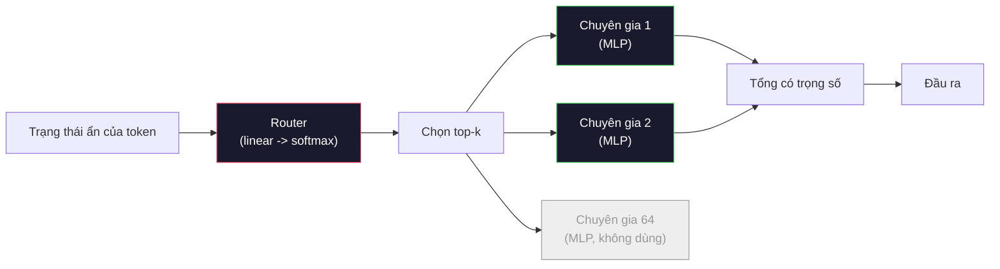

# Mô hình mở: Điểm qua kiến trúc

> Bạn đã tự tay dựng một GPT-2 Small từ đầu trong Bài 04. Các mô hình open weights (trọng số mở) tiên tiến năm 2026 vẫn thuộc cùng một họ với năm hoặc sáu thay đổi cụ thể. RMSNorm thay cho LayerNorm. SwiGLU thay cho GELU. RoPE thay cho vị trí học được. GQA hoặc MLA thay cho MHA đầy đủ. Mixture of Experts (hỗn hợp chuyên gia) ở quy mô lớn. Phần toán bạn đã biết bao trùm 95% trong số đó. Bài này là một architecture walkthrough (điểm qua kiến trúc): đọc Llama 3, DeepSeek-V3, Mixtral, Qwen và Gemma song song và gọi tên chính xác dòng nơi mỗi kiến trúc rẽ nhánh.

**Type:** Learn
**Languages:** Python (stdlib)
**Prerequisites:** Giai đoạn 10, Bài 04, 05, 12 (Huấn luyện trước, Mở rộng quy mô, Suy luận)
**Time:** ~45 phút

## Mục tiêu học tập

- Đọc config.json (cấu hình) của Llama 3, Mistral, Mixtral, Gemma 2, Qwen 2.5 và DeepSeek-V3 rồi giải thích từng trường
- Gọi tên thay đổi kiến trúc cụ thể mà mỗi mô hình thực hiện so với GPT-2 Small và biện luận nó từ những nguyên lý đầu tiên
- Tính số tham số, kích thước KV cache và bộ nhớ activation cho bất kỳ mô hình mở nào chỉ từ config của nó
- Chọn đúng mô hình mở cho một mục tiêu triển khai với các ràng buộc về độ trễ, bộ nhớ và năng lực

## Vấn đề

Trong Bài 04 bạn viết 350 dòng numpy và có một mô hình hình dạng GPT-2. Llama 3 405B có một báo cáo kỹ thuật dài 200 trang. Bản năng mách bảo bạn rằng đây là những con thú khác nhau. Không phải. 200 trang đó mô tả cùng một đối tượng với năm hoặc sáu sửa đổi có lý do rõ ràng, cộng thêm hàng nghìn chi tiết triển khai về mở rộng quy mô. Bộ khung -- embedding, khối transformer, attention, MLP, norm, head -- không đổi.

Bài này là một bản diff (so sánh khác biệt). Với mỗi họ mô hình mở lớn, chúng ta liệt kê chính xác điều gì đã thay đổi so với GPT-2, vì sao, và cái giá phải trả. Khi xong, bạn có thể đọc một model card mới và dịch nó trong đầu về chuẩn GPT-2.

Lợi ích thực tế là khi Meta phát hành Llama 5 hay DeepSeek phát hành V4, bạn sẽ không cần một mô hình tư duy mới. Bạn sẽ nhìn vào config, thấy nút vặn quen thuộc nào đã dịch chuyển, và biết hệ quả phía sau là gì. Kiến trúc năm 2026 là một hộp đồ nghề hữu hạn. Mỗi mô hình mới chọn một tập con khác nhau.

## Khái niệm

### Phần lõi bất biến

Mọi mô hình mở tự hồi quy đều chia sẻ:

- Ma trận embedding token (vocab_size x hidden_dim).
- Chồng N khối decoder: norm, self-attention, residual, norm, MLP, residual.
- Norm cuối và head tuyến tính chiếu về vocab_size (thường buộc trọng số với embedding).
- Causal mask, loss cross-entropy dự đoán token kế tiếp.

Đó là hình dạng. Phần còn lại là các nút vặn.

### Sáu nút vặn thực sự xê dịch

Trong mọi mô hình mở tiên tiến giai đoạn 2024-2026, cùng sáu lựa chọn thiết kế được chọn đi chọn lại:

1. **Chuẩn hoá.** LayerNorm -> RMSNorm.
2. **Mã hoá vị trí.** Vị trí tuyệt đối học được -> RoPE (kèm biến thể: YaRN, NTK).
3. **Hàm kích hoạt.** GELU -> SwiGLU (hoặc GeGLU).
4. **Chia sẻ attention head (đầu attention).** MHA -> GQA -> MQA -> MLA.
5. **MLP dày hay thưa.** Dày -> Mixture-of-Experts.
6. **Vị trí pre-norm.** Pre-norm ở lại. Post-norm đã biến mất.

Mọi thứ khác (lịch learning rate, hỗn hợp dữ liệu, batch size, context length (độ dài ngữ cảnh)) nằm trong cấu hình huấn luyện, không phải kiến trúc. Sáu nút vặn.

### Nút 1: RMSNorm

LayerNorm trừ trung bình, chia độ lệch chuẩn, nhân tỉ lệ và cộng dịch. RMSNorm chỉ giữ phần tỉ lệ:

```
RMSNorm(x) = x / sqrt(mean(x^2) + eps) * gamma
```

Không trừ trung bình. Không bias. Mỗi token ít hơn một matmul. Zhang và Sennrich (2019) lập luận nó ngang LayerNorm trên dịch máy mà nhanh hơn 10%. Mọi mô hình mở hiện đại đều chạy nó.

Chi phí: không. Lợi ích: thắng nhỏ về thông lượng, code đơn giản hơn.

### Nút 2: RoPE

Embedding vị trí học được từng là một bảng tra 1024 ô trong GPT-2. Ngữ cảnh 1025 là vượt ra ngoài bảng. Mô hình không thể ngoại suy vượt quá độ dài huấn luyện.

Rotary Position Embedding (RoPE, Su và cộng sự 2021) đưa vị trí vào bằng cách quay từng vector Q và K theo cặp trước phép nhân vô hướng attention. Góc quay là hàm tất định của vị trí, nên không có gì học được và không có gì cạn. Với các thủ thuật tỉ lệ (nội suy NTK, YaRN), mô hình huấn luyện trên ngữ cảnh 8k có thể kéo lên 128k lúc suy luận với mất mát độ chính xác vừa phải.

```
q_rotated = rotate(q, angle(pos))
k_rotated = rotate(k, angle(pos))
score = q_rotated . k_rotated
```

Mọi Llama, Mistral, Qwen, DeepSeek và Gemma đều dùng RoPE. Gemma 2 dùng kiểu lai (RoPE trên phần lớn layer (lớp), attention cửa sổ trượt cục bộ trên các lớp khác).

### Nút 3: SwiGLU

MLP của GPT-2 là `x -> gelu(xW1 + b1) -> (...)W2 + b2`. SwiGLU (Shazeer 2020) thay hàm kích hoạt bằng một tích có cổng:

```
SwiGLU(x) = (xW1) * sigmoid(xW1) * xV
```

Hai phép chiếu song song thay vì một, được cổng hoá bởi hàm kích hoạt Swish. Theo thực nghiệm thì mạnh hơn về perplexity trên mỗi tham số. Llama 2 nhận nó, mọi người theo. Kích thước ẩn của MLP thường được đặt sao cho tổng số tham số khớp với MLP dày ban đầu: nếu GPT-2 dùng `ff_dim = 4 * hidden`, SwiGLU dùng `ff_dim = (2/3) * 4 * hidden = 8/3 * hidden`.

### Nút 4: Chia sẻ đầu attention

GPT-2 dùng **Multi-Head Attention (MHA)**: mỗi head có phép chiếu Q, K, V riêng.

**Multi-Query Attention (MQA, Shazeer 2019)** chia sẻ một K và một V cho mọi head. Cắt KV cache đi num_heads lần, tức giảm 12x đến 32x trên một mô hình điển hình. Độ chính xác giảm nhẹ trên các benchmark khó.

**Grouped-Query Attention (GQA, Ainslie và cộng sự 2023)** là điểm giữa: G nhóm đầu Q chia sẻ một K và một V. Llama 3 8B dùng GQA với 32 đầu Q và 8 đầu KV (G=8), nên KV cache co 4 lần so với MHA đầy đủ.

**Multi-Head Latent Attention (MLA, DeepSeek 2024)** nén K và V vào một latent hạng thấp dùng chung, rồi chiếu ngược lên theo từng head. Giảm tiếp KV cache mà vẫn giữ khả năng biểu diễn của từng head. DeepSeek-V2 và V3 dựa vào điều này cho hiệu năng ngữ cảnh dài.

| Cơ chế | Đầu KV | KV Cache | Độ chính xác |
|--------|----------|----------|----------|
| MHA    | num_heads | đầy đủ | tốt nhất |
| GQA    | num_groups (G < num_heads) | giảm num_heads / G lần | gần MHA |
| MQA    | 1 | giảm num_heads lần | giảm nhẹ |
| MLA    | latent, giải nén theo từng đầu | nhỏ hơn MQA | gần MHA |

Với bất kỳ mô hình nào trên ~13B tham số, GQA hoặc MLA gần như bắt buộc. MHA đầy đủ ở quy mô lớn là một thảm hoạ KV cache.

### Nút 5: Hỗn hợp chuyên gia

Một MLP dày kích hoạt toàn bộ tham số cho mỗi token. MLP MoE có K chuyên gia mỗi khối và một router chọn top-k chuyên gia cho mỗi token (thường là top-2). Chỉ trọng số của những chuyên gia đó được lan truyền xuôi cho token ấy.

```
router_logits = xW_r
indices, weights = top_k(router_logits, k=2)
output = sum_i weights[i] * expert[indices[i]](x)
```

Sức hút: bạn có thể có 64 chuyên gia cỡ 7B mỗi cái (nên tổng tham số rất lớn) mà mỗi token chỉ chạy 2 trong số đó (nên tính toán mỗi token ngang một mô hình dày 7B). Mixtral 8x7B có 47B tổng tham số nhưng chỉ kích hoạt 13B mỗi token. DeepSeek-V3 có 671B tổng tham số nhưng chỉ kích hoạt 37B mỗi token.



Ưu: cùng tính toán, nhiều tham số hơn, năng lực tốt hơn. Nhược: bộ nhớ chuyên gia vẫn phải nằm ở đâu đó (nên phục vụ cần nhiều VRAM hơn một mô hình dày tương đương), cân bằng tải cho router rất khó, và tinh chỉnh router trong quá trình alignment là một lĩnh vực nghiên cứu riêng.

### Nút 6: Pre-norm ở lại

Transformer gốc áp dụng layer norm sau mỗi sublayer. Mọi mô hình mở từ GPT-2 trở đi đặt nó *trước* mỗi sublayer. Pre-norm rõ ràng dễ huấn luyện hơn ở độ sâu lớn. Không có gì phải tranh luận.

### So sánh từng mô hình

Đây là bảng khiến tất cả trở nên cụ thể.

| Mô hình | Năm | Tổng tham số | Tham số kích hoạt | Norm | Kích hoạt | Vị trí | Attention | MoE | Ngữ cảnh |
|-------|------|-------------|---------------|------|-----------|----------|-----------|-----|---------|
| GPT-2 Small | 2019 | 124M | 124M | LayerNorm | GELU | Học được | MHA (12 đầu) | không | 1k |
| Llama 3 8B | 2024 | 8B | 8B | RMSNorm | SwiGLU | RoPE | GQA (32/8) | không | 128k |
| Llama 3 70B | 2024 | 70B | 70B | RMSNorm | SwiGLU | RoPE | GQA (64/8) | không | 128k |
| Llama 3 405B | 2024 | 405B | 405B | RMSNorm | SwiGLU | RoPE | GQA (128/16) | không | 128k |
| Mistral 7B | 2023 | 7.2B | 7.2B | RMSNorm | SwiGLU | RoPE | GQA | không | 32k |
| Mixtral 8x7B | 2023 | 47B | 13B | RMSNorm | SwiGLU | RoPE | GQA | có (8 chuyên gia, top-2) | 32k |
| Gemma 2 9B | 2024 | 9B | 9B | RMSNorm (pre+post) | GeGLU | RoPE + trượt | GQA | không | 8k |
| Qwen 2.5 72B | 2024 | 72B | 72B | RMSNorm | SwiGLU | RoPE (YaRN) | GQA (64/8) | không | 128k |
| DeepSeek V2 236B | 2024 | 236B | 21B | RMSNorm | SwiGLU | RoPE | MLA | có (160 chuyên gia, top-6) | 128k |
| DeepSeek V3 | 2024 | 671B | 37B | RMSNorm | SwiGLU | RoPE | MLA | có (256 chuyên gia, top-8) | 128k |

Quét các cột. RMSNorm là phổ quát. SwiGLU hay người anh em GeGLU của nó là phổ quát. RoPE là phổ quát. GQA là phổ quát trên 7B trừ khi bị MLA thay thế. MoE là yếu tố khác biệt ở phân khúc cao nhất.

### Đọc một config.json

Config của Llama 3 8B:

```
{
  "hidden_size": 4096,
  "intermediate_size": 14336,
  "num_hidden_layers": 32,
  "num_attention_heads": 32,
  "num_key_value_heads": 8,
  "max_position_embeddings": 131072,
  "rope_theta": 500000.0,
  "rms_norm_eps": 1e-5,
  "vocab_size": 128256
}
```

Mỗi trường ứng với một thứ bạn đã tự triển khai.

- `hidden_size`: chiều embedding.
- `intermediate_size`: kích thước ẩn của MLP (3.5x hidden -- toán SwiGLU).
- `num_hidden_layers`: độ sâu chồng lớp.
- `num_attention_heads`: số đầu Q.
- `num_key_value_heads`: số đầu KV (GQA).
- `max_position_embeddings`: độ dài ngữ cảnh huấn luyện.
- `rope_theta`: tần số cơ sở của RoPE. Meta nâng nó từ mặc định 10k lên 500k để ngoại suy ngữ cảnh dài.
- `rms_norm_eps`: ổn định số học.
- `vocab_size`: số token.

Chỉ từ đó bạn tính được tổng tham số, KV cache và bộ nhớ activation đỉnh. Xem `code/main.py` để biết công thức chính xác.

### Ngân sách bộ nhớ activation

Activation chi phối bộ nhớ huấn luyện khi vượt vài tỉ tham số. Quy tắc ngón tay cho huấn luyện trước (có gradient checkpointing):

```
activation_mem ~ batch_size * seq_len * hidden_size * num_layers * bytes_per_element
```

Với Llama 3 8B ở batch 1, seq 8192, BF16, 32 lớp, hidden 4096: khoảng 8 GB chỉ cho activation khi có checkpointing, 40 GB khi không. Đây là lý do flash-attention và ring-attention quan trọng -- chúng viết lại phép tính attention để activation vừa bộ nhớ.

### Ngân sách KV Cache

Cho suy luận ở ngữ cảnh tối đa:

```
kv_cache = 2 * num_layers * num_kv_heads * head_dim * max_seq_len * bytes_per_element
```

Llama 3 8B ở ngữ cảnh 128k, BF16, head_dim = hidden / num_heads = 128:
`2 * 32 * 8 * 128 * 131072 * 2 = 17.2 GB` mỗi chuỗi.

Trọng số 8B là 16 GB ở BF16. KV cache cho một chuỗi 128k lớn hơn cả trọng số. Đây là áp lực bộ nhớ thúc đẩy GQA, MLA và nghiên cứu lượng tử hoá KV cache.

### Khi nào mỗi mô hình thắng

- **Một GPU 80GB, không MoE**: Llama 3 8B, Mistral 7B, Gemma 2 9B. Dễ phục vụ, hệ công cụ rộng.
- **Một node (8x80GB), năng lực lớn**: Llama 3 70B, Qwen 2.5 72B. Năng lực mở dày cao nhất.
- **Năng lực mở lớn nhất, chấp nhận phức tạp MoE**: DeepSeek V3, Mixtral 8x22B. Năng lực tốt nhất trên mỗi FLOP kích hoạt.
- **Nhu cầu ngữ cảnh dài**: Llama 3 (128k với tỉ lệ RoPE), DeepSeek (lợi thế MLA).
- **Phục vụ độ trễ thấp**: Gemma 2 9B (cửa sổ trượt cắt tính toán ngữ cảnh dài).

```figure
rmsnorm-vs-layernorm
```

## Tự tay làm

Code của bài là một máy tính. Cho bất kỳ config.json nào, nó in số tham số theo thành phần, KV cache ở ngữ cảnh tối đa, tỉ lệ MLP SwiGLU, và một nhận định ngắn về kiến trúc (dày / GQA / MLA / MoE).

```python
config = {
    "hidden_size": 4096, "intermediate_size": 14336,
    "num_hidden_layers": 32, "num_attention_heads": 32,
    "num_key_value_heads": 8, "vocab_size": 128256,
    "max_position_embeddings": 131072,
}
```

Script đi qua kiến trúc từng trường một, tính số tham số cho embedding, attention (có giảm GQA), MLP (có mở rộng SwiGLU), các layernorm và head. Sau đó nó tính KV cache ở độ dài ngữ cảnh đã nêu và in một bản tóm tắt.

Xem `code/main.py` để biết phần triển khai.

## Áp dụng

Chạy máy tính trên config của Llama 3 8B, Mistral 7B, Mixtral 8x7B và DeepSeek V3 đi kèm trong script. So sánh các phân rã tham số. Chú ý rằng các mô hình MoE có tổng tham số áp đảo mô hình dày nhưng số tham số kích hoạt thường nhỏ hơn. Chú ý rằng KV cache của DeepSeek V3 nhỏ hơn của Llama 3 405B dù tổng tham số nhiều hơn -- đó là MLA trong hành động.

Sau đó nhập config cho bất kỳ mô hình nào bạn có sẵn, đọc phần tóm tắt, và quyết định xem nó có vừa GPU của bạn không.

## Đóng gói

Bài này tạo ra `outputs/skill-open-model-picker.md`. Cho một mục tiêu triển khai (loại GPU, VRAM, độ dài ngữ cảnh, ngân sách độ trễ) và một hồ sơ tác vụ (chat, code, suy luận, ngữ cảnh dài), nó đề xuất một mô hình mở, một phương án lượng tử hoá từ Bài 11, và một chồng suy luận từ Bài 12, kèm lý giải tường minh về sáu nút vặn kiến trúc.

## Bài tập

1. Đọc config của Qwen 2.5 72B từ HuggingFace. Tính tổng tham số từ đầu. So với giá trị HF báo cáo và xác định chênh lệch đến từ đâu (làm tròn head dim, hệ số chia sẻ KV, v.v.).

2. DeepSeek V3 dùng 256 chuyên gia với định tuyến top-8. Tính tỉ lệ chuyên gia được kích hoạt trên tổng số chuyên gia và so với top-2 trên 8 của Mixtral 8x7B. Việc chuyển từ thưa (25%) sang thưa dày hơn (3%) nói lên điều gì về năng lực trên mỗi FLOP?

3. Tính KV cache cho Llama 3 405B ở ngữ cảnh 128k với FP8 và BF16. Ở FP8 nó bằng một nửa con số BF16. Bạn phục vụ được bao nhiêu chuỗi song song trên một node 8xH100 (80GB mỗi card = tổng 640GB, trừ bộ nhớ trọng số)?

4. Gemma 2 xen kẽ lớp attention đầy đủ và attention cửa sổ trượt. Viết công thức KV cache khi một nửa số lớp dùng cửa sổ trượt 4096 token thay vì ngữ cảnh đầy đủ. Điều đó tiết kiệm bao nhiêu bộ nhớ ở tổng ngữ cảnh 8k?

5. Tìm một mô hình mở tiên tiến ra mắt sau khi bài này được viết. Xác định nó chọn nút nào trong sáu nút và liệu nó có giới thiệu nút thứ bảy không. Giáo trình sẽ thấy lỗi thời ngay khi một kiến trúc mới ra -- mục tiêu là cập nhật bảng của bạn mà không phải dựng lại mô hình tư duy.

## Thuật ngữ chính

| Thuật ngữ | Người ta thường nói | Ý nghĩa thực sự |
|------|----------------|----------------------|
| RMSNorm | "LayerNorm không có trung bình" | Chuẩn hoá chỉ theo căn trung bình bình phương, với một tỉ lệ học được — rẻ hơn và tương đương LayerNorm |
| RoPE | "Vị trí quay" | Quay từng vector Q và K theo cặp 2D một góc phụ thuộc vị trí — ngoại suy vượt độ dài huấn luyện nhờ thủ thuật tỉ lệ |
| SwiGLU | "Hàm kích hoạt MLP mới" | Đơn vị tuyến tính có cổng với Swish: `(xW1) * sigmoid(xW1) * xV` — chuẩn trong mọi mô hình mở từ 2024 trở đi |
| GQA | "Attention điểm giữa" | Grouped-Query Attention: G nhóm đầu Q chia sẻ một đầu K và một đầu V — thu nhỏ KV cache mà không mất độ chính xác như MQA |
| MLA | "Attention của DeepSeek" | Multi-Head Latent Attention: nén K/V vào một latent hạng thấp dùng chung, giải nén theo từng đầu — KV cache nhỏ nhất cho mô hình lớn |
| MoE | "Chuyên gia thưa" | Mixture of Experts: N MLP mỗi khối, router chọn top-k mỗi token — tổng tham số lớn, tham số kích hoạt nhỏ |
| Top-k routing | "Chọn k chuyên gia mỗi token" | Router tính điểm cho mỗi chuyên gia và kích hoạt k cái cao nhất — k điển hình là 2 (Mixtral) đến 8 (DeepSeek) |
| YaRN | "Kéo giãn RoPE" | Một phần mở rộng RoPE khác — nội suy góc quay để mở rộng ngữ cảnh từ 8k lên 128k+ lúc suy luận |
| Sliding-window attention | "Đừng chú ý tới mọi thứ" | Mỗi token chỉ chú ý tới W token gần nhất — chặn chi phí attention ở O(W) mỗi token, dùng trong Gemma 2 và Mistral đời đầu |
| Active params | "Cái gì chạy mỗi token" | Với mô hình MoE, số tham số được lan truyền xuôi mỗi token (nhỏ hơn nhiều tổng tham số) — quyết định FLOP mỗi token |

## Đọc thêm

- [Dubey et al., 2024 -- "The Llama 3 Herd of Models"](https://arxiv.org/abs/2407.21783) -- tài liệu tham chiếu về kiến trúc và huấn luyện cho họ Llama 3 dày
- [DeepSeek-AI, 2024 -- "DeepSeek-V3 Technical Report"](https://arxiv.org/abs/2412.19437) -- MLA cộng cân bằng tải không cần loss phụ cộng MoE 671B
- [Jiang et al., 2024 -- "Mixtral of Experts"](https://arxiv.org/abs/2401.04088) -- bài báo mô hình mở MoE kinh điển
- [Su et al., 2021 -- "RoFormer: Enhanced Transformer with Rotary Position Embedding"](https://arxiv.org/abs/2104.09864) -- bài báo RoPE
- [Shazeer, 2020 -- "GLU Variants Improve Transformer"](https://arxiv.org/abs/2002.05202) -- SwiGLU, GeGLU và những người bạn
- [Ainslie et al., 2023 -- "GQA: Training Generalized Multi-Query Transformer Models"](https://arxiv.org/abs/2305.13245) -- bài báo GQA
- [Gemma 2 Team, 2024 -- "Gemma 2: Improving Open Language Models at a Practical Size"](https://arxiv.org/abs/2408.00118) -- attention lai đầy đủ + trượt, norm trước + sau
- [Qwen Team, 2024 -- "Qwen 2.5 Technical Report"](https://arxiv.org/abs/2412.15115) -- mở rộng ngữ cảnh YaRN và công thức huấn luyện ngữ cảnh dài

---

[← Bài trước: Xây dựng một pipeline LLM hoàn chỉnh](../../13-building-complete-llm-pipeline/docs/vi.md) · [Bài sau: Giải mã suy đoán và EAGLE-3 →](../../15-speculative-decoding-eagle3/docs/vi.md)
