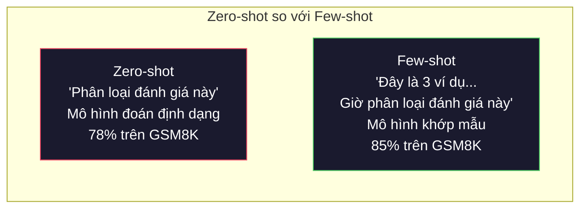
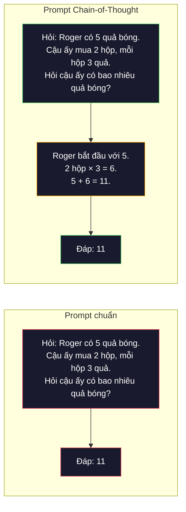
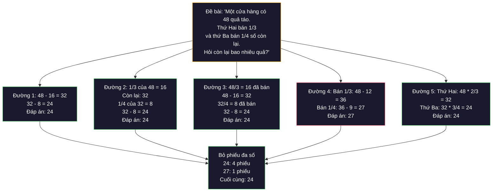
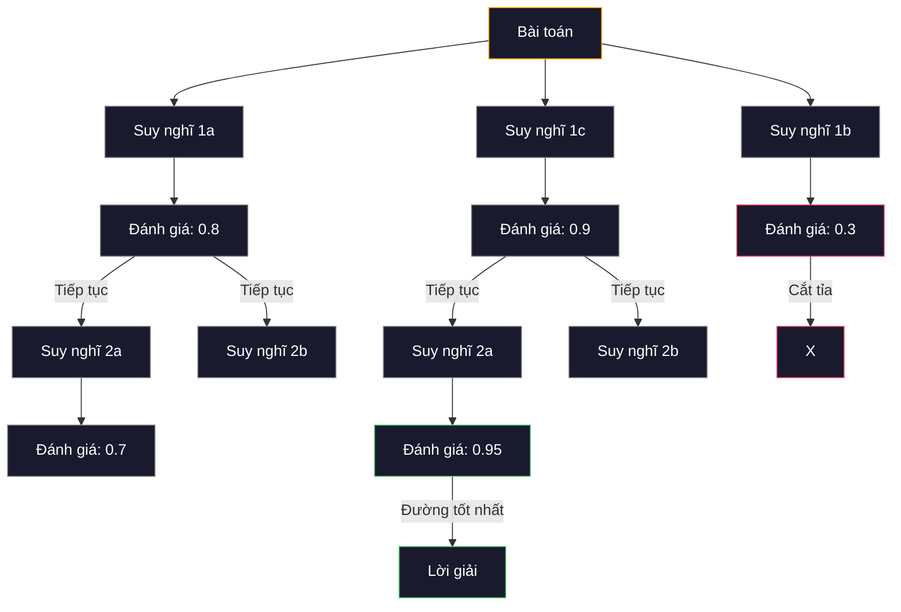

# Few-Shot, Chain-of-Thought, Tree-of-Thought

> Nói cho mô hình biết phải làm gì là prompt. Chỉ cho nó thấy cách suy nghĩ mới là kỹ thuật. Khoảng cách giữa 78% và 91% độ chính xác trên cùng một mô hình, cùng một tác vụ, cùng một dữ liệu không phải là mô hình tốt hơn. Đó là chiến lược suy luận tốt hơn.

**Type:** Build
**Languages:** Python
**Prerequisites:** Bài 11.01 (Kỹ thuật viết prompt)
**Time:** ~45 phút

## Mục tiêu học tập

- Triển khai few-shot prompting (prompt vài mẫu) bằng cách chọn và định dạng các mẫu ví dụ sao cho tối đa độ chính xác của tác vụ
- Áp dụng chain-of-thought (chuỗi suy nghĩ) để cải thiện độ chính xác trên các bài toán nhiều bước như bài toán đố
- Xây dựng prompt tree-of-thought (cây suy nghĩ) khám phá nhiều đường suy luận rồi chọn đường tốt nhất
- Đo mức cải thiện độ chính xác giữa zero-shot (không có mẫu), few-shot và CoT trên một benchmark chuẩn

## Vấn đề

Bạn xây một ứng dụng dạy toán. Prompt của bạn ghi: "Giải bài toán đố này." GPT-5 làm đúng 94% số lần trên GSM8K, benchmark toán tiểu học chuẩn. Bạn tưởng mình đã chạm trần. Không phải vậy — chain-of-thought vẫn cộng thêm 3-4 điểm.

Thêm năm từ -- "Let's think step by step" -- và độ chính xác nhảy lên 91%. Thêm vài ví dụ có lời giải và nó đạt 95%. Cùng mô hình. Cùng temperature. Cùng chi phí API. Khác biệt duy nhất là bạn đưa cho mô hình tờ giấy nháp.

Đây không phải mẹo vặt. Đó là cách suy luận vận hành. Con người không giải bài toán nhiều bước bằng một cú nhảy trong đầu. Transformer cũng vậy. Khi bạn buộc mô hình sinh ra các token trung gian, những token đó trở thành một phần ngữ cảnh cho token kế tiếp. Mỗi bước suy luận nuôi bước sau. Mô hình thực sự tính toán đường đi tới đáp án.

Nhưng "think step by step" chỉ là khởi đầu, không phải kết thúc. Nếu bạn lấy năm đường suy luận rồi bỏ phiếu theo đa số thì sao? Nếu bạn để mô hình khám phá một cây khả năng, đánh giá và cắt tỉa các nhánh thì sao? Nếu bạn xen kẽ suy luận với việc dùng công cụ thì sao? Đây không phải giả thuyết. Đó là những kỹ thuật đã công bố với mức cải thiện đo được, và bạn sẽ tự xây tất cả trong bài này.

## Khái niệm

### Zero-shot so với Few-shot: khi ví dụ thắng chỉ dẫn

Zero-shot đưa mô hình một tác vụ và không gì khác. Few-shot prompting đưa ví dụ trước.

Wei et al. (2022) đo điều này trên 8 benchmark. Với tác vụ đơn giản như phân loại cảm xúc, zero-shot và few-shot chênh nhau trong khoảng 2%. Với tác vụ phức tạp như số học nhiều bước và suy luận ký hiệu, few-shot cải thiện độ chính xác 10-25%.

Trực giác: ví dụ là chỉ dẫn đã được nén. Thay vì mô tả định dạng đầu ra, bạn cho xem. Thay vì giải thích quá trình suy luận, bạn làm mẫu. Mô hình khớp mẫu trên các ví dụ đáng tin hơn là diễn giải các chỉ dẫn trừu tượng.



**Khi few-shot thắng:** tác vụ nhạy với định dạng, phân loại, trích xuất có cấu trúc, biệt ngữ chuyên ngành, bất kỳ tác vụ nào mô hình cần khớp một mẫu cụ thể.

**Khi zero-shot thắng:** câu hỏi sự kiện đơn giản, tác vụ sáng tạo nơi ví dụ bóp nghẹt sự sáng tạo, tác vụ mà tìm ví dụ tốt còn khó hơn viết chỉ dẫn tốt.

### Chọn ví dụ: tương tự thắng ngẫu nhiên

Không phải mọi ví dụ đều như nhau. Chọn ví dụ tương tự với đầu vào mục tiêu vượt chọn ngẫu nhiên 5-15% trên tác vụ phân loại (Liu et al., 2022). Ba nguyên tắc:

1. **Tương đồng ngữ nghĩa**: chọn các ví dụ gần đầu vào nhất trong không gian embedding
2. **Đa dạng nhãn**: bao phủ mọi hạng mục đầu ra trong bộ ví dụ của bạn
3. **Khớp độ khó**: khớp mức phức tạp của bài toán mục tiêu

Số ví dụ tối ưu cho hầu hết tác vụ là 3-5. Dưới 3, mô hình không đủ tín hiệu để rút ra mẫu. Trên 5, bạn chạm điểm lợi ích giảm dần và lãng phí token của cửa sổ ngữ cảnh. Với phân loại nhiều nhãn, dùng một ví dụ cho mỗi nhãn.

### Chain-of-Thought: cho mô hình tờ giấy nháp

Chain-of-Thought (CoT) prompting được Wei et al. (2022) ở Google Brain giới thiệu. Ý tưởng đơn giản: thay vì chỉ hỏi đáp án, yêu cầu mô hình trình bày các bước suy luận trước.



Vì sao điều này hiệu quả về mặt cơ học? Mỗi token transformer sinh ra trở thành ngữ cảnh cho token kế tiếp. Không có CoT, mô hình phải nén toàn bộ suy luận vào trạng thái ẩn của một lượt lan truyền xuôi. Có CoT, mô hình đưa các phép tính trung gian ra ngoài thành token. Mỗi token suy luận mở rộng độ sâu tính toán hiệu dụng.

**Benchmark GSM8K (toán tiểu học, 8.5K bài):**

| Mô hình | Zero-shot | Zero-shot CoT | Few-shot CoT |
|-------|-----------|---------------|--------------|
| GPT-4o | 78% | 91% | 95% |
| GPT-5 | 94% | 97% | 98% |
| o4-mini (reasoning) | 97% | — | — |
| Claude Opus 4.7 | 93% | 97% | 98% |
| Gemini 3 Pro | 92% | 96% | 98% |
| Llama 4 70B | 80% | 89% | 94% |
| DeepSeek-V3.1 | 89% | 94% | 96% |

**Lưu ý về mô hình suy luận.** Các mô hình như dòng o của OpenAI (o3, o4-mini) và DeepSeek-R1 chạy chain-of-thought bên trong trước khi phát ra đáp án. Thêm "Let's think step by step" vào một mô hình suy luận là thừa và đôi khi phản tác dụng — nó đã làm việc đó rồi.

Hai biến thể của CoT:

**Zero-shot CoT**: nối thêm "Let's think step by step" vào prompt. Không cần ví dụ. Kojima et al. (2022) cho thấy một câu này cải thiện độ chính xác trên các tác vụ số học, tri thức thông thường và suy luận ký hiệu.

**Few-shot CoT**: cung cấp ví dụ có kèm các bước suy luận. Hiệu quả hơn zero-shot CoT vì mô hình thấy đúng định dạng suy luận mà bạn mong đợi.

**Khi CoT phản tác dụng**: truy hồi sự kiện đơn giản ("Thủ đô của Pháp là gì?"), phân loại một bước, tác vụ mà tốc độ quan trọng hơn độ chính xác. CoT cộng thêm 50-200 token suy luận cho mỗi truy vấn. Với tác vụ thông lượng cao, độ phức tạp thấp, đó là chi phí bỏ đi.

### Self-Consistency: lấy nhiều mẫu, bỏ phiếu một lần

Wang et al. (2023) giới thiệu self-consistency (tự nhất quán). Điểm mấu chốt: một đường CoT duy nhất có thể chứa lỗi suy luận. Nhưng nếu bạn lấy N đường suy luận độc lập (dùng temperature > 0) và bỏ phiếu đa số cho đáp án cuối, các lỗi sẽ triệt tiêu nhau.



Self-consistency nâng độ chính xác GSM8K từ 56.5% (CoT đơn) lên 74.4% với N=40 trong thí nghiệm gốc trên PaLM 540B. Trên GPT-5 mức cải thiện nhỏ (97% lên 98%) vì độ chính xác nền đã bão hoà. Kỹ thuật này toả sáng nhất trên các mô hình có độ chính xác CoT nền 60-85% -- vùng ngọt nơi lỗi một đường là thường gặp nhưng không mang tính hệ thống. Với mô hình suy luận (dòng o, R1), self-consistency đã được bao hàm trong cơ chế lấy mẫu nội bộ sẵn có.

Đánh đổi: N mẫu nghĩa là chi phí API và độ trễ gấp N lần. Trong thực tế, N=5 đã bắt được phần lớn lợi ích. N=3 là mức tối thiểu để một cuộc bỏ phiếu có nghĩa. N > 10 cho lợi ích giảm dần với hầu hết tác vụ.

### Tree-of-Thought: khám phá phân nhánh

Yao et al. (2023) giới thiệu Tree-of-Thought (ToT). Nơi CoT đi theo một đường suy luận tuyến tính, ToT khám phá nhiều nhánh và đánh giá nhánh nào triển vọng nhất trước khi đi tiếp.



ToT có ba thành phần:

1. **Tạo suy nghĩ**: sinh ra nhiều bước tiếp theo ứng viên
2. **Đánh giá trạng thái**: cho điểm từng ứng viên (có thể dùng chính LLM làm giám khảo)
3. **Thuật toán tìm kiếm**: BFS hoặc DFS trên cây, cắt tỉa các nhánh điểm thấp

Trên tác vụ Game of 24 (dùng phép tính với 4 con số để ra 24), GPT-4 với prompt chuẩn giải được 7.3% số bài. Với CoT là 4.0% (CoT thực sự phản tác dụng ở đây vì không gian tìm kiếm quá rộng). Với ToT là 74%.

ToT rất tốn kém. Mỗi nút trên cây cần một lần gọi LLM. Một cây có hệ số phân nhánh 3 và độ sâu 3 cần tới 39 lần gọi LLM. Chỉ dùng nó cho các bài toán có không gian tìm kiếm lớn nhưng đánh giá được -- lập kế hoạch, giải câu đố, giải quyết vấn đề sáng tạo có ràng buộc.

### ReAct: suy nghĩ + hành động

Yao et al. (2022) kết hợp reasoning trace (vết suy luận) với hành động. Mô hình luân phiên giữa suy nghĩ (sinh lý lẽ) và hành động (gọi công cụ, tìm kiếm, tính toán).

```mermaid
graph LR
    Q["Câu hỏi:\nDân số của\nquốc gia có\ntháp Eiffel\nlà bao nhiêu?"]
    T1["Suy nghĩ: Mình cần\ntìm quốc gia nào\ncó tháp Eiffel"]
    A1["Hành động: tìm kiếm\n'vị trí tháp Eiffel'"]
    O1["Quan sát:\nParis, Pháp"]
    T2["Suy nghĩ: Giờ mình cần\ndân số của Pháp"]
    A2["Hành động: tìm kiếm\n'dân số Pháp 2024'"]
    O2["Quan sát:\n68.4 triệu"]
    T3["Suy nghĩ: Mình đã\ncó đáp án"]
    F["Đáp án:\n68.4 triệu"]

    Q --> T1 --> A1 --> O1 --> T2 --> A2 --> O2 --> T3 --> F

    style Q fill:#1a1a2e,stroke:#ffa500,color:#fff
    style T1 fill:#1a1a2e,stroke:#51cf66,color:#fff
    style A1 fill:#1a1a2e,stroke:#e94560,color:#fff
    style O1 fill:#1a1a2e,stroke:#808080,color:#fff
    style T2 fill:#1a1a2e,stroke:#51cf66,color:#fff
    style A2 fill:#1a1a2e,stroke:#e94560,color:#fff
    style O2 fill:#1a1a2e,stroke:#808080,color:#fff
    style T3 fill:#1a1a2e,stroke:#51cf66,color:#fff
    style F fill:#1a1a2e,stroke:#51cf66,color:#fff
```



ReAct vượt CoT thuần trên các tác vụ đòi hỏi tri thức vì nó neo được lý lẽ vào dữ liệu thật. Trên HotpotQA (hỏi đáp nhiều bước), ReAct với GPT-4 đạt 35.1% exact match so với 29.4% của CoT đơn thuần. Sức mạnh thực sự là các lỗi suy luận được quan sát sửa lại -- mô hình có thể cập nhật kế hoạch giữa lúc thực thi.

ReAct là nền tảng của AI agent hiện đại. Mọi framework agent (LangChain, CrewAI, AutoGen) đều cài đặt một biến thể của vòng lặp Thought-Action-Observation. Bạn sẽ xây agent đầy đủ ở Giai đoạn 14. Bài này chỉ bàn mẫu prompt.

### Prompt có cấu trúc: thẻ XML, dấu phân cách, tiêu đề

Khi prompt trở nên phức tạp, cấu trúc giúp mô hình không nhầm lẫn giữa các phần. Ba cách tiếp cận:

**Thẻ XML** (tốt nhất với Claude, ổn ở mọi nơi):
```
<context>
You are reviewing a pull request.
The codebase uses TypeScript and React.
</context>

<task>
Review the following diff for bugs, security issues, and style violations.
</task>

<diff>
{diff_content}
</diff>

<output_format>
List each issue with: file, line, severity (critical/warning/info), description.
</output_format>
```

**Tiêu đề Markdown** (phổ quát):
```
## Role
Senior security engineer at a fintech company.

## Task
Analyze this API endpoint for vulnerabilities.

## Input
{api_code}

## Rules
- Focus on OWASP Top 10
- Rate each finding: critical, high, medium, low
- Include remediation steps
```

**Dấu phân cách** (tối giản nhưng hiệu quả):
```
---INPUT---
{user_text}
---END INPUT---

---INSTRUCTIONS---
Summarize the above in 3 bullet points.
---END INSTRUCTIONS---
```

### Prompt chaining: decomposition (phân rã) tuần tự

Có những tác vụ quá phức tạp cho một prompt duy nhất. Prompt chaining chia chúng thành các bước, trong đó đầu ra của prompt này là đầu vào của prompt kế tiếp.


Chaining thắng prompt đơn vì ba lý do:

1. **Mỗi bước đơn giản hơn**: mô hình xử lý một tác vụ tập trung thay vì gánh mọi thứ cùng lúc
2. **Đầu ra trung gian kiểm tra được**: bạn có thể xác nhận và sửa giữa các bước
3. **Các bước khác nhau có thể dùng mô hình khác nhau**: dùng mô hình rẻ để trích xuất, mô hình đắt để suy luận

### So sánh hiệu năng

| Kỹ thuật | Phù hợp nhất | Độ chính xác GSM8K (GPT-5) | Số lần gọi API | Token thêm | Độ phức tạp |
|-----------|----------|------------------------|-----------|----------------|------------|
| Zero-Shot | Tác vụ đơn giản | 94% | 1 | Không | Rất thấp |
| Few-Shot | Khớp định dạng | 96% | 1 | 200-500 token | Thấp |
| Zero-Shot CoT | Tăng suy luận nhanh | 97% | 1 | 50-200 token | Rất thấp |
| Few-Shot CoT | Độ chính xác tối đa trong một lần gọi | 98% | 1 | 300-600 token | Thấp |
| Self-Consistency (N=5) | Suy luận quan trọng | 98.5% | 5 | Chi phí token 5x | Trung bình |
| Mô hình suy luận (o4-mini) | Thay thế CoT trực tiếp | 97% | 1 | ẩn (2-10x nội bộ) | Rất thấp |
| Tree-of-Thought | Bài toán tìm kiếm/lập kế hoạch | N/A (74% trên Game of 24) | 10-40+ | Chi phí token 10-40x | Cao |
| ReAct | Suy luận dựa trên tri thức | N/A (35.1% trên HotpotQA) | 3-10+ | Thay đổi | Cao |
| Prompt Chaining | Tác vụ nhiều bước phức tạp | 96% (pipeline) | 2-5 | Chi phí token 2-5x | Trung bình |

Kỹ thuật đúng phụ thuộc ba yếu tố: yêu cầu độ chính xác, ngân sách độ trễ và mức chấp nhận chi phí. Với hầu hết hệ thống production, few-shot CoT kèm dự phòng self-consistency 3 mẫu bao phủ 90% trường hợp sử dụng.

```figure
few-shot-curve
```

## Tự tay làm

Chúng ta sẽ xây một bộ giải bài toán kết hợp few-shot prompting, chain-of-thought và bỏ phiếu self-consistency vào một pipeline duy nhất. Sau đó thêm tree-of-thought cho các bài khó.

Cài đặt đầy đủ nằm ở `code/advanced_prompting.py`. Dưới đây là các thành phần chính.

### Bước 1: Kho ví dụ few-shot

Thành phần đầu tiên quản lý các ví dụ few-shot và chọn những ví dụ liên quan nhất cho một bài toán.

```python
GSM8K_EXAMPLES = [
    {
        "question": "Janet's ducks lay 16 eggs per day. She eats three for breakfast every morning and bakes muffins for her friends every day with four. She sells every egg at the farmers' market for $2. How much does she make every day at the farmers' market?",
        "reasoning": "Janet's ducks lay 16 eggs per day. She eats 3 and bakes 4, using 3 + 4 = 7 eggs. So she has 16 - 7 = 9 eggs left. She sells each for $2, so she makes 9 * 2 = $18 per day.",
        "answer": "18"
    },
    ...
]
```

Mỗi ví dụ có ba phần: câu hỏi, chuỗi suy luận và đáp án cuối. Chuỗi suy luận chính là thứ biến một ví dụ few-shot thường thành ví dụ few-shot CoT.

### Bước 2: Bộ dựng prompt chain-of-thought

Bộ dựng prompt ghép một system message, các ví dụ few-shot kèm chuỗi suy luận, và câu hỏi mục tiêu thành một prompt duy nhất.

```python
def build_cot_prompt(question, examples, num_examples=3):
    system = (
        "You are a math problem solver. "
        "For each problem, show your step-by-step reasoning, "
        "then give the final numerical answer on the last line "
        "in the format: 'The answer is [number]'."
    )

    example_text = ""
    for ex in examples[:num_examples]:
        example_text += f"Q: {ex['question']}\n"
        example_text += f"A: {ex['reasoning']} The answer is {ex['answer']}.\n\n"

    user = f"{example_text}Q: {question}\nA:"
    return system, user
```

Ràng buộc định dạng ("The answer is [number]") là then chốt. Không có nó, self-consistency không thể trích ra và so sánh đáp án giữa các lần lấy mẫu.

### Bước 3: Bỏ phiếu self-consistency

Lấy N đường suy luận rồi chọn đáp án xuất hiện nhiều nhất.

```python
def self_consistency_solve(question, examples, client, model, n_samples=5):
    system, user = build_cot_prompt(question, examples)

    answers = []
    reasonings = []
    for _ in range(n_samples):
        response = client.chat.completions.create(
            model=model,
            messages=[
                {"role": "system", "content": system},
                {"role": "user", "content": user}
            ],
            temperature=0.7
        )
        text = response.choices[0].message.content
        reasonings.append(text)
        answer = extract_answer(text)
        if answer is not None:
            answers.append(answer)

    vote_counts = Counter(answers)
    best_answer = vote_counts.most_common(1)[0][0] if vote_counts else None
    confidence = vote_counts[best_answer] / len(answers) if best_answer else 0

    return best_answer, confidence, reasonings, vote_counts
```

Temperature 0.7 rất quan trọng. Ở temperature 0.0, cả N lần lấy mẫu sẽ giống hệt nhau, phá hỏng mục đích. Bạn cần đủ ngẫu nhiên để có các đường suy luận đa dạng, nhưng không quá nhiều đến mức mô hình sinh ra vô nghĩa.

### Bước 4: Bộ giải tree-of-thought

Với những bài toán mà suy luận tuyến tính thất bại, ToT khám phá nhiều hướng tiếp cận và đánh giá hướng nào triển vọng nhất.

```python
def tree_of_thought_solve(question, client, model, breadth=3, depth=3):
    thoughts = generate_initial_thoughts(question, client, model, breadth)
    scored = [(t, evaluate_thought(t, question, client, model)) for t in thoughts]
    scored.sort(key=lambda x: x[1], reverse=True)

    for current_depth in range(1, depth):
        next_thoughts = []
        for thought, score in scored[:2]:
            extensions = extend_thought(thought, question, client, model, breadth)
            for ext in extensions:
                ext_score = evaluate_thought(ext, question, client, model)
                next_thoughts.append((ext, ext_score))
        scored = sorted(next_thoughts, key=lambda x: x[1], reverse=True)

    best_thought = scored[0][0] if scored else ""
    return extract_answer(best_thought), best_thought
```

Bộ đánh giá cũng chính là một lần gọi LLM. Bạn hỏi mô hình: "Trên thang 0.0 đến 1.0, đường suy luận này triển vọng đến mức nào cho việc giải bài toán?" Đây là điểm mấu chốt của ToT -- mô hình tự đánh giá các lời giải một phần của chính nó.

### Bước 5: Pipeline đầy đủ

Pipeline kết hợp mọi kỹ thuật với một chiến lược leo thang.

```python
def solve_with_escalation(question, examples, client, model):
    single_answer, _ = few_shot_cot_solve(question, examples, client, model)

    sc_answer, confidence, _, _ = self_consistency_solve(
        question, examples, client, model, n_samples=5
    )

    if confidence >= 0.8 and single_answer == sc_answer:
        return sc_answer, "self_consistency", confidence

    tot_answer, _ = tree_of_thought_solve(question, client, model)
    return tot_answer, "tree_of_thought", None
```

Logic leo thang: thử cách rẻ (một lần CoT) trước. Một đường tất định không có tỉ lệ phiếu, nên phép kiểm chất lượng của nó là sự đồng thuận: đáp án ở temperature 0 phải khớp đáp án đa số từ các đường lấy mẫu. Nếu không khớp, hoặc nếu độ tin cậy self-consistency dưới 0.8 (ít hơn 4 trong 5 mẫu đồng ý), leo thang lên ToT. Cách này cân bằng chi phí và độ chính xác -- hầu hết bài toán được giải rẻ, bài khó nhận thêm compute.

## Áp dụng

### Prompt few-shot dựa trên template

LangChain hỗ trợ sẵn prompt template và phân tích đầu ra, giúp đơn giản hoá các mẫu few-shot và CoT:

```python
from langchain_core.prompts import FewShotPromptTemplate, PromptTemplate
from langchain_openai import ChatOpenAI

example_prompt = PromptTemplate(
    input_variables=["question", "reasoning", "answer"],
    template="Q: {question}\nA: {reasoning} The answer is {answer}."
)

few_shot_prompt = FewShotPromptTemplate(
    examples=examples,
    example_prompt=example_prompt,
    suffix="Q: {input}\nA: Let's think step by step.",
    input_variables=["input"]
)

llm = ChatOpenAI(model="gpt-4o", temperature=0.7)
chain = few_shot_prompt | llm
result = chain.invoke({"input": "If a train travels 120 km in 2 hours..."})
```

LangChain cũng có các lớp `ExampleSelector` để chọn theo tương đồng ngữ nghĩa:

```python
from langchain_core.example_selectors import SemanticSimilarityExampleSelector
from langchain_openai import OpenAIEmbeddings

selector = SemanticSimilarityExampleSelector.from_examples(
    examples,
    OpenAIEmbeddings(),
    k=3
)
```

### Prompt được biên dịch

DSPy coi các chiến lược prompt như những module tối ưu hoá được. Thay vì tự tay viết prompt CoT, bạn khai báo một signature rồi để DSPy tối ưu prompt:

```python
import dspy

dspy.configure(lm=dspy.LM("openai/gpt-4o", temperature=0.7))

class MathSolver(dspy.Module):
    def __init__(self):
        self.solve = dspy.ChainOfThought("question -> answer")

    def forward(self, question):
        return self.solve(question=question)

solver = MathSolver()
result = solver(question="Janet's ducks lay 16 eggs per day...")
```

`ChainOfThought` của DSPy tự động thêm reasoning trace. `dspy.majority` cài đặt self-consistency:

```python
result = dspy.majority(
    [solver(question=q) for _ in range(5)],
    field="answer"
)
```

### So sánh: tự làm so với framework

| Tính năng | Tự làm (bài này) | LangChain | DSPy |
|---------|--------------------------|-----------|------|
| Kiểm soát định dạng prompt | Toàn bộ | Dựa trên template | Tự động |
| Self-consistency | Bỏ phiếu thủ công | Thủ công | Có sẵn (`dspy.majority`) |
| Chọn ví dụ | Logic tùy chỉnh | `ExampleSelector` | `dspy.BootstrapFewShot` |
| Tree-of-Thought | Tìm kiếm cây tùy chỉnh | Chain cộng đồng | Không có sẵn |
| Tối ưu prompt | Lặp thủ công | Thủ công | Biên dịch tự động |
| Phù hợp nhất | Học tập, pipeline tùy chỉnh | Quy trình chuẩn | Nghiên cứu, tối ưu hóa |

## Đóng gói

Bài này tạo ra hai artifact.

**1. Reasoning Chain Prompt** (`outputs/prompt-reasoning-chain.md`): một mẫu prompt sẵn sàng cho production cho few-shot CoT kèm self-consistency. Chỉ cần gắn ví dụ và lĩnh vực bài toán của bạn vào.

**2. CoT Pattern Selection Skill** (`outputs/skill-cot-patterns.md`): một khung quyết định để chọn đúng kỹ thuật suy luận dựa trên loại tác vụ, yêu cầu độ chính xác và ràng buộc chi phí.

## Bài tập

1. **Đo khoảng cách**: Lấy 10 bài GSM8K. Giải từng bài với zero-shot, few-shot, zero-shot CoT và few-shot CoT. Ghi lại độ chính xác của từng cách. Kỹ thuật nào mang lại mức tăng lớn nhất trên mô hình của bạn?

2. **Thí nghiệm chọn ví dụ**: Với cùng 10 bài đó, so sánh chọn ví dụ ngẫu nhiên với chọn tay các ví dụ tương tự. Đo chênh lệch độ chính xác. Tới mức nào thì chất lượng ví dụ quan trọng hơn số lượng ví dụ?

3. **Đường cong chi phí self-consistency**: Chạy self-consistency với N=1, 3, 5, 7, 10 trên 20 bài GSM8K. Vẽ đồ thị độ chính xác theo chi phí (tổng token). Điểm gãy của đường cong nằm ở đâu với mô hình của bạn?

4. **Xây vòng lặp ReAct**: Mở rộng pipeline với một công cụ máy tính. Khi mô hình sinh ra một biểu thức toán, thực thi nó bằng `eval()` của Python (trong sandbox) rồi đưa kết quả trở lại. Đo xem suy luận có công cụ làm nền có vượt CoT thuần không.

5. **ToT cho tác vụ sáng tạo**: Chuyển bộ giải Tree-of-Thought sang một tác vụ viết sáng tạo: "Viết một truyện 6 từ vừa buồn cười vừa buồn." Dùng LLM làm giám khảo. Khám phá phân nhánh có tạo ra đầu ra sáng tạo tốt hơn sinh một lần không?

## Thuật ngữ chính

| Thuật ngữ | Người ta thường nói | Ý nghĩa thực sự |
|------|----------------|----------------------|
| Few-shot prompting | "Đưa nó vài ví dụ" | Đưa các minh họa đầu vào-đầu ra vào prompt để neo định dạng và hành vi đầu ra của mô hình |
| Chain-of-Thought | "Bắt nó nghĩ từng bước" | Khơi ra các token suy luận trung gian, mở rộng phép tính hiệu dụng của mô hình trước khi đưa ra đáp án cuối |
| Self-Consistency | "Chạy nó nhiều lần" | Lấy N đường suy luận đa dạng ở temperature > 0 rồi chọn đáp án cuối xuất hiện nhiều nhất theo bỏ phiếu đa số |
| Tree-of-Thought | "Để nó khám phá các lựa chọn" | Tìm kiếm có cấu trúc trên các nhánh suy luận, mỗi lời giải một phần được đánh giá và chỉ những nhánh triển vọng mới được mở rộng |
| ReAct | "Suy nghĩ + dùng công cụ" | Xen kẽ reasoning trace với hành động bên ngoài (tìm kiếm, tính toán, gọi API) trong vòng lặp Thought-Action-Observation |
| Prompt chaining | "Chia nó thành các bước" | Phân rã một tác vụ phức tạp thành các prompt tuần tự, mỗi đầu ra làm đầu vào cho bước sau |
| Zero-shot CoT | "Chỉ cần thêm 'think step by step'" | Gắn một câu kích hoạt suy luận vào prompt mà không cần ví dụ, dựa vào năng lực suy luận tiềm ẩn của mô hình |

## Đọc thêm

- [Chain-of-Thought Prompting Elicits Reasoning in Large Language Models](https://arxiv.org/abs/2201.11903) -- Wei et al. 2022. Bài báo CoT gốc của Google Brain. Đọc mục 2-3 để xem kết quả cốt lõi.
- [Self-Consistency Improves Chain of Thought Reasoning in Language Models](https://arxiv.org/abs/2203.11171) -- Wang et al. 2023. Bài báo self-consistency. Bảng 1 có đủ mọi con số bạn cần.
- [Tree of Thoughts: Deliberate Problem Solving with Large Language Models](https://arxiv.org/abs/2305.10601) -- Yao et al. 2023. Bài báo ToT. Kết quả Game of 24 ở mục 4 là điểm nhấn.
- [ReAct: Synergizing Reasoning and Acting in Language Models](https://arxiv.org/abs/2210.03629) -- Yao et al. 2022. Nền tảng của AI agent hiện đại. Mục 3 giải thích vòng lặp Thought-Action-Observation.
- [Large Language Models are Zero-Shot Reasoners](https://arxiv.org/abs/2205.11916) -- Kojima et al. 2022. Bài báo "Let's think step by step". Hiệu quả đáng ngạc nhiên so với mức đơn giản của nó.
- [DSPy: Compiling Declarative Language Model Calls into Self-Improving Pipelines](https://arxiv.org/abs/2310.03714) -- Khattab et al. 2023. Coi prompting như một bài toán biên dịch. Đọc nếu bạn muốn vượt khỏi kỹ thuật prompt thủ công.
- [OpenAI — Reasoning models guide](https://platform.openai.com/docs/guides/reasoning) -- hướng dẫn của nhà cung cấp về khi nào chain-of-thought trở thành chế độ "reasoning" nội bộ, tính tiền theo token, thay vì một mẹo ở tầng prompt.
- [Lightman et al., "Let's Verify Step by Step" (2023)](https://arxiv.org/abs/2305.20050) -- process reward model (PRM) chấm điểm từng bước của một chuỗi; tín hiệu giám sát suy luận vượt qua phần thưởng chỉ dựa trên kết quả.
- [Snell et al., "Scaling LLM Test-Time Compute Optimally" (2024)](https://arxiv.org/abs/2408.03314) -- nghiên cứu có hệ thống về độ dài CoT, lấy mẫu self-consistency và MCTS; "think step by step" đi về đâu khi độ chính xác quan trọng hơn độ trễ.

---

[← Bài trước: Prompt Engineering: Kỹ thuật và các mẫu](../../01-prompt-engineering/docs/vi.md) · [Bài sau: Đầu ra có cấu trúc: JSON, kiểm tra lược đồ, giải mã ràng buộc →](../../03-structured-outputs/docs/vi.md)
